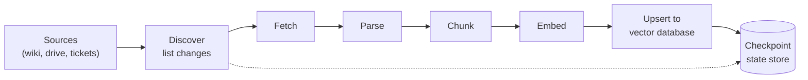

Ingesting a few hundred pages on a laptop is a loop: read, parse, chunk, embed, store. Ingesting millions of pages, from many sources, continuously, while the system is serving users, is a different problem. A single process becomes too slow, so the work must be spread over many workers; and the moment work is spread, the questions of distributed systems arrive. What if a worker dies halfway through a document? What if the same document is processed twice? What if one huge PDF keeps one worker busy while seven sit idle? What if the embedding service allows only so many calls a second?

**Distributed ingestion** is the design that answers those questions. This lesson covers how to split the work (partitioning), how to make repeated work harmless (idempotency), how to resume after a crash (checkpoints), how to detect what changed so that only that is reprocessed, and how to keep the live index consistent while bulk work runs. The transport that moves work between machines, the durable queue, is the subject of [Queue-based pipelines](/learn/production-architecture/queue-based-pipelines); here the focus is on the properties the pipeline must have whatever the transport. You will build a sharded, crash-and-resume ingestor in about a hundred lines and test it by killing it.

## Learning objectives

- Describe the stages of an ingestion pipeline and identify which is usually the throughput bottleneck.
- Partition documents across workers by hash and by size, and explain the effect of skewed document sizes on completion time.
- Make writes idempotent with deterministic identifiers, and explain why at-least-once processing then gives correct results.
- Implement checkpointing and change detection with content hashes, including deletions of stale chunks.
- Identify the consistency hazards of concurrent ingestion and queries and the controls for them.

## Prerequisites

- [Scalable RAG systems](/learn/production-architecture/scalable-rag-systems): the separation of interactive and background work, and capacity arithmetic.
- [Fault tolerance](/learn/production-architecture/fault-tolerance): retries, idempotency and backoff.
- [Chunking fundamentals](/learn/chunking-fundamentals): how documents become chunks.
- [Embedding costs](/learn/cost-engineering/embedding-costs): why embedding is a large share of ingestion cost and time.

## Why this matters

Ingestion is the part of a RAG system that quietly decides whether the rest can be trusted. An index that is stale, partially updated or full of duplicates answers confidently from the wrong documents. And ingestion fails more often than serving does: it touches many external sources, it processes untidy input (scanned PDFs, corrupt files, enormous spreadsheets), and it runs for hours, long enough for something to break.

A pipeline designed as a simple loop handles all of this badly. A crash at document 80,000 of 100,000 means starting again, or worse, starting again without knowing which half-written documents are in the index. A retry after a timeout duplicates chunks, so that the same handbook paragraph appears three times and crowds the other results out of the top-k. A bulk upload from one team saturates the embedding service and makes interactive queries slow. None of these is a rare accident; they are the normal behaviour of long-running distributed jobs, and the design must assume them.

## The intuition

Imagine a library digitising a million books with a team of scanners. A foreman hands each scanner a trolley of books. Three things make this go well.

First, the foreman keeps a **ledger**: a book is ticked off only after its scan has been filed. If a scanner falls ill, someone else takes the trolley and starts from the first unticked book; nothing is lost and nothing needs to be guessed. Second, each scan is filed under the book's catalogue number, so scanning a book twice simply replaces the earlier file: filing is **idempotent**. A scan filed but not yet ticked is harmless, because redoing it overwrites itself. Third, the foreman does not hand out trolleys by the first letter of the title: one scanner who draws the encyclopaedias would still be working at closing time while the others have gone home. Work is shared out with an eye on size.

Distributed ingestion is exactly this: a ledger (checkpoints), catalogue-numbered filing (deterministic identifiers) and sensible sharing out of work (partitioning).

## How it works

### The pipeline and its bottleneck



The stages differ in what limits them. **Fetch** is bound by the source system's rate limits and by network. **Parse** (especially OCR and layout analysis, see [Document parsing](/learn/advanced-document-parsing)) is CPU-heavy and highly variable in time per file. **Chunking** is cheap. **Embedding** is usually the bottleneck: it is either a hosted API with a rate limit and a per-token price, or a local model that needs a GPU or many CPU cores. **Upsert** is bound by the vector database's write path and index building, which compete with query traffic on the same cluster.

Knowing the bottleneck tells you where parallelism pays. If embedding is limited by an API quota, adding workers beyond the quota achieves nothing, and the right move is batching and throttling. If parsing dominates, add parse workers. Measure per-stage time on a sample before designing.

### Partitioning: dividing the work

The unit of work is almost always the **document** (or a batch of documents), not the chunk, because a document's chunks must stay consistent with each other. A **partition** (or shard) is the set of documents one worker handles. Two approaches:

- **Hash partitioning:** assign a document to worker $h(\text{doc\_id}) \bmod W$, where $h$ is a stable hash and $W$ the number of workers. It needs no coordination, the same document always goes to the same worker (which prevents two workers racing on one document), and adding documents spreads evenly *in count*. Its weakness is skew in size: if one document has 1,000 chunks and most have 10, the worker that draws large documents finishes late.
- **Dynamic assignment (work queue):** workers pull the next unit of work when free. This balances load automatically, handles variable parse times, and tolerates workers dying (their unfinished units return to the queue). It needs a queue or coordinator, which is why production systems use [queues](/learn/production-architecture/queue-based-pipelines). Order the queue largest-first when sizes are known, and the **straggler** (the one huge task that starts last and finishes long after the rest) disappears.

A common compromise: partition by hash for *affinity* (so that updates to one document are serialised on one consumer) and split very large documents into separate tasks that are safe to run in parallel because their chunk identifiers differ.

### Idempotency: making repetition harmless

In a distributed system you cannot reliably know whether a task ran. A worker may write its output and then die before reporting success; a message may be delivered twice; a timeout may fire while the work is still running. The practical guarantee most systems offer is **at-least-once** processing: every task runs one or more times. **Exactly-once** is, in general, not achievable by the transport alone, and what you actually build is at-least-once delivery plus **idempotent** processing, so that running twice leaves the same final state as running once.

For ingestion the recipe has three parts:

1. **Deterministic identifiers.** The identifier of a chunk is computed from its origin, for example a UUID derived (version 5) from the document id and the chunk's position. Upserting the same chunk twice overwrites the same point. Random identifiers (the default for many client libraries if you let them generate ids) make every retry a duplicate.
2. **Upsert, not insert.** The write replaces by identifier.
3. **Replace the whole document, including removals.** If a document shrinks from five chunks to three, the old chunks 3 and 4 still exist under their old ids. The pipeline must delete identifiers that are no longer produced, or the index keeps answering from text that was removed.

A caution on position-based ids: inserting a paragraph at the top shifts every later chunk, so every chunk of that document changes anyway, which is fine as the whole document is replaced; it is only a problem if the ids are used as stable references elsewhere. Content-hash-based ids avoid that but make "which chunks belong to which document version" bookkeeping necessary; either design is acceptable if you know which you chose.

### Checkpoints and resumption

A **checkpoint** records what has been completed, durably, outside the workers: a table keyed by document id holding the content hash that was ingested and the number of chunks. The order of operations is the crux:

1. Compute the document's hash and compare with the checkpoint; if equal, skip.
2. Do the work (chunk, embed, upsert, delete stale chunks).
3. **Only then** write the checkpoint.

If a worker dies between 2 and 3, the checkpoint says "not done", the document is processed again, and idempotency makes that harmless. Reversing the order (checkpoint first) would lose documents on a crash: the ledger says done, the index says otherwise. The checkpoint store must be durable and shared (a database table, not worker memory).

### Change detection

Re-ingesting everything on every run does not scale. The **content hash** (a SHA-256 of the extracted text, or of the raw bytes when parsing is deterministic) identifies a document's version cheaply, so that unchanged documents are skipped. Complement it with source metadata (modification time, version number, ETag) to avoid even fetching unchanged files. Three cases need explicit handling:

- **New or changed:** process, replacing prior chunks.
- **Deleted at the source:** the discovery step must notice the absence (a listing diff or a source event) and delete the document's chunks and checkpoint. Many "deleted" documents live on in the index because nothing was watching for deletion; this is also a compliance concern ([Secure deletion](/learn/enterprise-rag-governance/secure-deletion)).
- **Changed pipeline:** a new chunking strategy or embedding model changes the output for every document even though the content did not. Then the checkpoint must include a **pipeline version** alongside the content hash, and the change becomes a reindex ([Reindexing](/learn/ci-cd-and-mlops/reindexing)).

### Rate limits, batching and backpressure

Embedding APIs accept batches of texts per call, and batching is the largest single efficiency: one call with 64 chunks is far cheaper in overhead than 64 calls. Providers also limit requests and tokens per minute (check the current documentation, as limits depend on the account). A distributed ingestor therefore needs **throttling**, a shared limit across all workers, not one limit per worker, or twenty workers each respecting a "local" limit will exceed the global one. When the limiter pushes back, workers wait; this waiting, propagated upstream so that fetchers slow down instead of piling up fetched documents in memory, is **backpressure**. Without it, the fast stage fills memory or the queue with work that the slow stage cannot absorb.

### Consistency with live queries

Queries run while ingestion writes. Two hazards follow.

- **Partial documents.** Between the upsert of the first and last chunks of a document, a query may see a mixture of old and new chunks, such as an updated paragraph next to an outdated one. For most corpora this window is brief and acceptable; where it is not (legal text, versioned policies), write the new chunks under a new `version` field and switch a pointer, or filter queries on the current version, so that the switch is atomic. [Index versioning](/learn/ci-cd-and-mlops/index-versioning) describes this pattern at the whole-index level.
- **Resource contention.** Bulk upserts trigger index building and merges that slow queries. Throttle the write rate, run heavy backfills off-peak, and where possible use a separate bulk-load path or collection that is swapped in when complete.

### Poison documents

Some documents will never process: a corrupt PDF, a 2 GB spreadsheet, a file in an unsupported format. If a failing task is retried forever it blocks the shard. After a bounded number of attempts, record the failure with its error in a **dead-letter** store, continue, and alert; a person decides whether to fix the parser or skip the file. Make sure the system can report "N documents failed to ingest and here is why", because silent skips are how corpora become incomplete without anyone noticing.

## The mathematics

### Completion time and the straggler effect

**Intuition.** A stage finishes when its slowest worker finishes, not when the average does.

With $W$ workers and per-document work $s_i$ (in chunks, or seconds), the total work is $T = \sum_i s_i$, the best achievable completion time is $T/W$, and the actual time is the maximum over workers of the work assigned to them:

$$
t_{\text{done}} = \max_{w} \sum_{i \in \text{shard}(w)} s_i \;\ge\; \max\!\left(\frac{T}{W},\; \max_i s_i\right)
$$

The bound has two parts: no schedule beats the even split $T/W$, and none finishes before the single largest document is done. **By hand.** Eight workers, 80,000 chunks in total: the ideal is 10,000 chunks each. If the largest document has 1,100 chunks, it is not the limit here, but a hash partition may still give one worker 11,700 chunks (17 per cent over ideal) purely by chance in the sizes drawn.

### Throughput ceiling from a shared limit

If each worker can embed $r$ chunks per second but the service allows at most $R$ chunks per second in total, throughput is

$$
\Theta = \min(W \cdot r,\; R)
$$

**By hand.** Suppose, as an assumption, $r = 50$ chunks per second per worker and $R = 400$ per second. Eight workers reach 400, and a ninth adds nothing. Ingesting 2 million chunks takes $2 \times 10^6 / 400 = 5{,}000$ seconds, about 83 minutes. At 4 workers it takes twice as long, at 200 per second. Beyond $W = R/r$ the way to go faster is a higher quota or a local model, not more workers.

## In code

**The problem.** Build an ingestor with the properties above and test them by force: kill it midway, resume, run it again, then edit and shrink documents, checking at each step that the index holds exactly the right chunks, with no duplicates.

**Dependencies.** `qdrant-client` (local in-memory mode) and NumPy. A hashing-trick embedder stands in for a real model so that the run is fast and exactly reproducible; swap it for a real embedding function without changing anything else. SQLite stands in for the shared state store (production would use a database server).

```bash
pip install qdrant-client numpy
```

```python
"""Idempotent, resumable, sharded ingestion with a durable checkpoint table."""
import hashlib, sqlite3, threading, uuid
from concurrent.futures import ThreadPoolExecutor
import numpy as np
from qdrant_client import QdrantClient, models

DIM = 64
NS = uuid.UUID("5d0f6c52-3f49-4f43-8a0e-0d8f4d9c7a11")

# ---- a small synthetic corpus: 24 handbook pages of 2-3 paragraphs each ----------------
FACTS = ["Annual leave is 25 days and up to 5 unused days carry over until 31 March.",
         "Remote work is allowed up to 3 days a week.",
         "Expenses must be submitted within 30 days and need a receipt above 75 pounds.",
         "Passwords must be rotated every 90 days and VPN is required on public Wi-Fi.",
         "Laptops are refreshed every 3 years; the support desk runs 08:00 to 18:00 UK time."]
def make_docs():
    return {f"page-{i:02d}": [f"Page {i}, section {j}. {FACTS[(i + j) % 5]}" for j in range(2 + i % 2)]
            for i in range(24)}

def embed(text):                       # deterministic toy embedder (hashing trick), no model needed
    v = np.zeros(DIM)
    for tok in text.lower().split():
        h = int(hashlib.md5(tok.encode()).hexdigest(), 16)
        v[h % DIM] += 1 if (h >> 8) % 2 else -1
    n = np.linalg.norm(v)
    return (v / n if n else v).tolist()

class Ingestor:
    def __init__(self):
        self.store = QdrantClient(":memory:")
        self.store.create_collection("kb", vectors_config=models.VectorParams(
            size=DIM, distance=models.Distance.COSINE))
        self.db = sqlite3.connect(":memory:", check_same_thread=False)   # stands in for a real state DB
        self.db.execute("create table state(doc_id text primary key, hash text, n_chunks int)")
        self.lock = threading.Lock()

    def pid(self, doc_id, i):                                 # deterministic point id
        return str(uuid.uuid5(NS, f"{doc_id}:{i}"))

    def process(self, doc_id, paragraphs, crash_after=None, counter=None):
        digest = hashlib.sha256("\n".join(paragraphs).encode()).hexdigest()
        with self.lock:
            row = self.db.execute("select hash, n_chunks from state where doc_id=?", (doc_id,)).fetchone()
        if row and row[0] == digest:
            return "skipped"
        if crash_after is not None and counter is not None:
            with self.lock:
                counter[0] += 1
                if counter[0] > crash_after:
                    raise RuntimeError("worker killed")      # simulated crash before any write
        points = [models.PointStruct(id=self.pid(doc_id, i), vector=embed(p),
                                     payload={"doc_id": doc_id, "chunk": i, "text": p})
                  for i, p in enumerate(paragraphs)]
        with self.lock:
            self.store.upsert("kb", points=points)                   # idempotent: same ids overwrite
            if row and row[1] > len(paragraphs):                    # document shrank: drop stale chunks
                stale = [self.pid(doc_id, i) for i in range(len(paragraphs), row[1])]
                self.store.delete("kb", points_selector=models.PointIdsList(points=stale))
            self.db.execute("insert or replace into state values (?,?,?)",   # checkpoint AFTER the write
                            (doc_id, digest, len(paragraphs)))
        return "ingested"

    def run(self, docs, workers=4, crash_after=None):
        shards = [[] for _ in range(workers)]
        for doc_id in docs:                                   # stable hash partitioning
            shards[int(hashlib.md5(doc_id.encode()).hexdigest(), 16) % workers].append(doc_id)
        counter, tally = [0], {"ingested": 0, "skipped": 0, "failed": 0}
        def work(shard):
            for d in shard:
                try:
                    r = self.process(d, docs[d], crash_after, counter)
                except RuntimeError:
                    r = "failed"
                with self.lock:
                    tally[r] += 1
        with ThreadPoolExecutor(workers) as ex:
            list(ex.map(work, shards))
        return tally

    def points(self):
        pts, _ = self.store.scroll("kb", limit=10_000)
        return len(pts), len({p.id for p in pts})

ing = Ingestor()
docs = make_docs()
print("documents:", len(docs), " expected chunks:", sum(len(v) for v in docs.values()))
print("run 1 (crash after 10 docs):", ing.run(docs, crash_after=10), "chunks, unique ids:", ing.points())
print("run 2 (resume)             :", ing.run(docs), "chunks, unique ids:", ing.points())
print("run 3 (nothing changed)    :", ing.run(docs), "chunks, unique ids:", ing.points())
docs["page-07"] = docs["page-07"][:1] + ["Updated: remote work is now 2 days a week."]   # edit one page
docs["page-08"] = docs["page-08"][:1]                                                 # shrink another
print("run 4 (two pages edited)   :", ing.run(docs), "chunks, unique ids:", ing.points())
print("expected chunks now        :", sum(len(v) for v in docs.values()))
```

**How it works.** `process` is the unit of work for one document. It hashes the paragraphs, consults the `state` table and skips if the hash is unchanged. Otherwise it builds points with deterministic ids from `uuid5(doc_id:chunk)`, upserts them, deletes any chunk positions beyond the new length, and only then writes the checkpoint. `run` hash-partitions document ids over four threads (each thread is a stand-in for a worker process or pod) and tallies the outcomes. The `crash_after` argument makes the process raise after ten documents have started, simulating workers being killed before they write. A lock serialises access to the shared Qdrant client and SQLite connection, which the demonstration needs; real workers would each hold their own connection to a server.

```output
documents: 24  expected chunks: 60
run 1 (crash after 10 docs): {'ingested': 10, 'skipped': 0, 'failed': 14} chunks, unique ids: (25, 25)
run 2 (resume)             : {'ingested': 14, 'skipped': 10, 'failed': 0} chunks, unique ids: (60, 60)
run 3 (nothing changed)    : {'ingested': 0, 'skipped': 24, 'failed': 0} chunks, unique ids: (60, 60)
run 4 (two pages edited)   : {'ingested': 2, 'skipped': 22, 'failed': 0} chunks, unique ids: (58, 58)
expected chunks now        : 58
```

**What the output means.** Run 1 ingests 10 documents (25 chunks) and fails 14, as designed. Run 2 resumes: the 10 finished documents are skipped by their checkpoints, the 14 remaining are ingested, and the index reaches the full 60 chunks with 60 unique ids. Run 3 changes nothing and does no work: 24 skipped. Run 4 edits one page and shrinks another, and exactly those two are reprocessed; the chunk count drops from 60 to 58, matching the expected 58, because the stale chunks of the shrunk pages were deleted. Throughout, the number of points equals the number of unique ids, so there are no duplicates.

**Common errors.** Writing the checkpoint before the data: a crash then loses documents silently. Letting the client generate random point ids, which makes every retry a duplicate. Forgetting to delete stale chunks when a document shrinks, which the 58 versus 59 count would reveal. Sharing a Qdrant `:memory:` client across processes (in-memory mode lives inside one process; use a server for real multi-process workers). Not including the pipeline version in the checkpoint, so that a new chunker leaves old chunks in place.

**Extending it.** Add a pipeline version to the state row; add a discovery step that compares the source listing with the state table and deletes missing documents; wrap `process` in the retry-and-dead-letter logic from [Fault tolerance](/learn/production-architecture/fault-tolerance); replace the hash partition with a queue.

Now the straggler effect. The next program draws 2,000 document sizes from a heavy-tailed distribution and compares hash partitioning with longest-first assignment to the least-loaded worker:

```python
"""Hash partitioning vs size-aware (longest-first) assignment: makespan on 8 workers."""
import hashlib, heapq
import numpy as np

rng = np.random.default_rng(4)
sizes = rng.lognormal(mean=3.0, sigma=1.2, size=2000)          # chunks per document, heavy tail
W = 8

hash_load = [0.0] * W
for i, s in enumerate(sizes):
    hash_load[int(hashlib.md5(f"doc-{i}".encode()).hexdigest(), 16) % W] += s

heap = [(0.0, w) for w in range(W)]                            # longest-first onto least-loaded
lpt_load = [0.0] * W
for s in sorted(sizes, reverse=True):
    load, w = heapq.heappop(heap)
    lpt_load[w] = load + s
    heapq.heappush(heap, (load + s, w))

ideal = sizes.sum() / W
print(f"total chunks {sizes.sum():.0f}, largest document {sizes.max():.0f}, ideal per worker {ideal:.0f}")
print(f"hash partition : busiest worker {max(hash_load):.0f}  ({max(hash_load)/ideal:.2f} x ideal)")
print(f"size-aware     : busiest worker {max(lpt_load):.0f}  ({max(lpt_load)/ideal:.2f} x ideal)")
```

```output
total chunks 80329, largest document 1099, ideal per worker 10041
hash partition : busiest worker 11731  (1.17 x ideal)
size-aware     : busiest worker 10041  (1.00 x ideal)
```

Hash partitioning leaves the busiest of eight workers 17 per cent above the ideal, which means the whole stage runs 17 per cent longer than necessary while seven workers wait at the end. Size-aware assignment reaches the ideal here. The size of the effect depends on the tail of the size distribution and on how many documents each worker draws; with fewer, larger documents per worker the gap widens.

## A real-world example

A fictional bank, Harrowgate, indexes 1.8 million internal documents for a compliance assistant. The first ingestion is a script that loops over a file share. It takes nine hours and dies at hour seven on a corrupt scan; the team restarts from the beginning, since nothing records progress, and the second attempt creates duplicates because the vector store generates ids and the first run's chunks are still there. Query results then show the same clause three times.

The rebuilt pipeline has the properties of this lesson. Discovery lists the share and compares it with a state table; documents are published as tasks to a queue, largest first; twelve workers consume them with a shared rate limiter in front of the embedding service; point identifiers are derived from document id and chunk number; the checkpoint is written after the upsert. Corrupt files go to a dead-letter table after three attempts, and a daily report lists them. The first full ingestion takes four hours (the embedding quota is the limit, as the throughput formula predicted); a nightly incremental run touches about two per cent of documents and finishes in minutes. When a worker pod is evicted in the middle of a run, the task returns to the queue and nobody notices. When compliance deletes a retired policy, the discovery step sees the file vanish and removes its chunks, which previously lingered for months.

## Common mistakes

- **Random point ids.** Retries and re-runs create duplicates that crowd the top-k.
- **Checkpoint before write.** A crash leaves a document recorded as done and missing from the index.
- **Ignoring shrinking and deleted documents.** Stale chunks keep answering from text that no longer exists.
- **Per-worker rate limits.** Twenty workers each within their own limit exceed the provider's global limit and trigger throttling storms.
- **Partitioning by count when sizes are skewed.** One worker holds the batch open while the rest idle.
- **Infinite retries on a poison document.** One corrupt file blocks a shard forever. Cap attempts and dead-letter it.
- **No pipeline version in the checkpoint.** A new chunker or model does not re-process documents whose content is unchanged.
- **Bulk ingestion on the interactive path.** A backfill saturates the database and embedding service and slows every user.

## Best practices

- Make every write idempotent: deterministic ids, upserts, and removal of ids that are no longer produced.
- Keep checkpoints in a durable shared store and write them only after the data is written.
- Skip unchanged documents by content hash plus pipeline version; detect source deletions explicitly.
- Choose partitions by hash for affinity and sizes for balance, or use a dynamic queue ordered largest-first.
- Batch embedding calls, share one global rate limiter, and apply backpressure upstream.
- Bound retries, dead-letter poison documents, and report failures where people will see them.
- Keep ingestion off the interactive path: separate workers, separate quotas, throttled writes, off-peak backfills.
- Track per-run metrics: documents ingested, skipped and failed, chunks written, stage times, and lag between a source change and its appearance in the index ([RAG observability](/learn/rag-observability)).

## Performance considerations

Throughput is set by the slowest stage and the shared limits. Measure per-stage time on a representative sample, then compute the ceiling with $\min(W \cdot r, R)$ for the embedding stage and similar limits elsewhere. Batching is the first lever: embedding calls with tens of chunks per request amortise network overhead, and larger batches raise memory use and the cost of a failed call, so pick a size from measurement. Keep the cost in view: the work scales with total tokens ([Embedding costs](/learn/cost-engineering/embedding-costs)), and change detection is the cheapest optimisation because skipped documents cost nothing. For the vector database, batch upserts (hundreds of points per call is typical) rather than one point per request, and for very large first loads consider the database's bulk-load options and deferring index construction until the data is in, where the product supports it. Parallelism has diminishing returns: past the shared limit, more workers add contention and cost, so scale workers to the ceiling and no further.

## Security considerations

Ingestion is where untrusted content enters the system, so it is the first line of defence for the whole RAG pipeline. Parse files in sandboxed workers with limited privileges and resource limits (memory, CPU time, no outbound network except to the embedding service), since document parsers have a history of vulnerabilities and decompression bombs can exhaust a worker. Treat document text as untrusted: a document can contain instructions aimed at the model that will later read it ([Indirect prompt injection](/learn/rag-security-fundamentals/indirect-prompt-injection)), and ingestion is the place to scan, flag or quarantine suspicious content and record provenance. Carry the access-control metadata (owner, tenant, permissions) from the source into every chunk's payload at ingestion time; permissions added later are an afterthought that is easy to get wrong ([Document-level permissions](/learn/access-control-and-privacy/document-level-permissions)). Credentials for source systems and embedding APIs belong in a secrets manager scoped per worker role. Finally, state tables and dead-letter stores contain document identifiers and error text, sometimes snippets of content, so protect and retain them like the data itself.

## Summary

- Ingestion is a multi-stage pipeline whose bottleneck is usually embedding or a shared rate limit; measure before parallelising.
- Partition by document, using hashes for affinity and size-aware or queue-based assignment to avoid stragglers.
- Make processing idempotent with deterministic identifiers and upserts, and delete stale chunks, so that at-least-once execution gives correct results.
- Write the checkpoint only after the data, from a durable shared store; use content hashes and a pipeline version to skip unchanged work and detect deletions.
- Share one global rate limit, batch calls and apply backpressure; keep bulk work off the interactive path.
- Bound retries, dead-letter poison documents, and make failures visible.

## Exercises

**1.** 2.4 million chunks must be embedded. Each worker embeds 40 chunks per second, and the provider allows 300 chunks per second in total. How many workers are useful, and how long does the full ingestion take with that number?

<details><summary>Show solution</summary>

Useful workers: $300/40 = 7.5$, so 8 workers saturate the limit (the eighth is partly idle). Throughput is capped at 300 per second, so the time is $2.4 \times 10^6 / 300 = 8{,}000$ seconds, about 2.2 hours. Adding workers beyond 8 does not help; only a higher quota, a faster provider or a local model does.

</details>

**2.** A worker upserts a document's chunks, then crashes before writing its checkpoint. What happens on the retry in this lesson's design? What would happen if chunk ids were random?

<details><summary>Show solution</summary>

The checkpoint is missing, so the document is processed again. The ids are deterministic, so the upsert overwrites the same points and the final state is as if it had run once. With random ids the retry would insert a second copy of every chunk, leaving duplicates in the index and no way to tell which were written first.

</details>

**3.** A document shrinks from 5 chunks to 3. Describe exactly which operations the ingestor must perform, and what a query would return if the deletion step were missing.

<details><summary>Show solution</summary>

Upsert chunks 0 to 2 (overwriting), delete the points with ids for chunks 3 and 4 (derived from the document id and positions 3 and 4, with the old chunk count read from the checkpoint), then write the checkpoint with the new hash and a chunk count of 3. Without the deletion, chunks 3 and 4 keep the old text and still match queries, so the assistant can quote passages that were removed from the document, an error that is invisible unless you count chunks per document.

</details>

**4.** Extend the ingestor with a pipeline version. Change the `state` table to store it, treat a version mismatch like a hash mismatch, and show that bumping the version from 1 to 2 re-processes all 24 documents once and then skips them again.

<details><summary>Show solution</summary>

Add a column: `create table state(doc_id text primary key, hash text, n_chunks int, version int)`. Define `PIPELINE_VERSION = 1`. In `process`, select `hash, n_chunks, version` and skip only if `row and row[0] == digest and row[2] == PIPELINE_VERSION`; write `PIPELINE_VERSION` in the `insert or replace`. Run once (everything ingested), then set `PIPELINE_VERSION = 2` and run again: all 24 are ingested because the stored version differs (the ids are unchanged, so the upserts overwrite in place and the chunk count stays 60); run a third time and all 24 are skipped. For a version change that alters the *number* of chunks, the existing delete-stale-chunks logic handles shrinkage, and growth is handled by the upsert.

</details>

## Check your understanding

```quiz
[
  {
    "q": "A worker upserts a document and crashes before recording its checkpoint. The document is processed again on retry. Which design property makes this safe?",
    "options": ["Exactly-once delivery by the queue", "Deterministic chunk ids with upserts, so repeating overwrites rather than duplicates", "Using more workers", "Writing the checkpoint before the data"],
    "answer": 1,
    "why": "At-least-once processing is safe when the write is idempotent. Deterministic ids make a repeat overwrite the same points."
  },
  {
    "q": "Why must the checkpoint be written after the data, not before?",
    "options": ["Checkpoints are slower to write", "If the worker dies after the checkpoint but before the data, the document is recorded as done yet missing from the index", "The database requires it", "It makes ids deterministic"],
    "answer": 1,
    "why": "A checkpoint that precedes the work can claim completion that never happened. After the work, a crash only causes harmless redoing."
  },
  {
    "q": "Eight workers have a per-worker rate of 50 chunks per second, and the embedding provider allows 300 per second in total. What is the throughput?",
    "options": ["400 chunks per second", "300 chunks per second", "50 chunks per second", "350 chunks per second"],
    "answer": 1,
    "why": "Throughput is the minimum of workers times rate (400) and the shared limit (300), so 300."
  },
  {
    "q": "A policy page is shortened from 6 chunks to 4 and re-ingested by upserting 4 chunks. What stale state remains if nothing else is done?",
    "options": ["None; upserts remove old chunks", "Chunks 4 and 5 still exist in the index with their old text", "All six chunks are duplicated", "The checkpoint is deleted"],
    "answer": 1,
    "why": "Upserts only overwrite ids that are written. The ids for positions 4 and 5 are no longer produced, so they must be deleted explicitly."
  },
  {
    "q": "Why does hash partitioning of documents across workers sometimes leave one worker finishing much later than the others?",
    "options": ["Hashes are not stable", "It balances the number of documents, not their sizes, so a worker that draws large documents carries more work", "Workers cannot run in parallel", "Hash partitioning duplicates documents"],
    "answer": 1,
    "why": "The hash spreads documents evenly in count. With heavy-tailed sizes, the sum of work per worker varies, and the stage waits for the busiest one."
  }
]
```

## Further reading

- Kleppmann, M. (2017), *Designing Data-Intensive Applications*, O'Reilly, chapters 10 and 11 on batch processing and stream processing, including fault tolerance and idempotence.
- Graham, R. L. (1969), "Bounds on Multiprocessing Timing Anomalies", *SIAM Journal on Applied Mathematics*, the analysis of longest-first scheduling.
- Hohpe, G. and Woolf, B. (2003), *Enterprise Integration Patterns*, Addison-Wesley, the idempotent receiver and dead letter channel patterns.
- [Qdrant documentation](https://qdrant.tech/documentation/): points, upserts and payloads.
- [Python `sqlite3` documentation](https://docs.python.org/3/library/sqlite3.html), for the checkpoint table used in the example.
