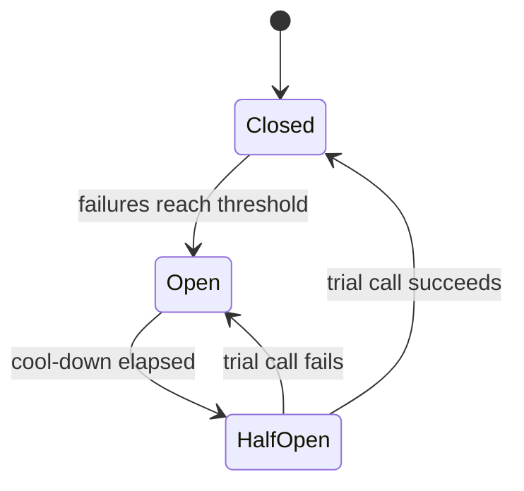

**Fault tolerance** is the ability of a system to keep delivering a useful service when a part of it fails. [High availability](/learn/production-architecture/high-availability) adds spare copies so that a failed component can be replaced; fault tolerance is about what the surviving code does in the moment of failure, before any replacement arrives: how long it waits, whether it tries again, when it gives up, and what it offers the user instead of an error.

A RAG request depends on several remote services, and the language model is the slowest and most failure-prone of them. This lesson builds the standard toolkit: timeouts and deadlines, retries with backoff and jitter, circuit breakers, bulkheads, load shedding and graceful degradation. Each tool has a failure mode of its own (retries are the classic one: they can turn a small outage into a large one), so you will measure what each one does by replaying a thirty-second model outage against three client policies.

## Learning objectives

- Classify failures in a RAG pipeline (crash, timeout, slow response, partial failure, wrong result) and say which tool addresses each.
- Implement retries with exponential backoff and full jitter, and calculate the load amplification that retries cause during an outage.
- Explain the three states of a circuit breaker and what each protects.
- Design a degradation ladder for a RAG request, deciding for each dependency what the system does when it fails.
- Propagate a request deadline through the pipeline so that no stage works on a request whose caller has already given up.

## Prerequisites

- [Scalable RAG systems](/learn/production-architecture/scalable-rag-systems): stages, capacity and why queues grow under load.
- [High availability](/learn/production-architecture/high-availability): redundancy and failure domains, and why this lesson is about behaviour rather than spare copies.
- [Error handling](/learn/backend-engineering/error-handling): exceptions and error responses in an API.
- [Async endpoints](/learn/backend-engineering/async-endpoints): why a waiting request occupies resources.

## Why this matters

When a dependency fails, the failure is rarely clean. A crashed service is the easy case: connections are refused at once and the caller can react in milliseconds. The dangerous case is the service that is slow or half-working. A language-model API that starts taking 40 seconds per call does not return an error; it holds a connection, a thread and a user's patience for 40 seconds, and a hundred such requests exhaust the worker pool, so the API stops answering even the requests that never needed the model. One slow dependency has taken the whole service down, and no component actually crashed. This is a **cascading failure**.

Naive responses make it worse. If every client retries three times, the struggling dependency receives three times its normal traffic at exactly the moment it can least afford it. If the system has no fallback, every user sees an error screen though retrieval, which works perfectly, could have shown them the relevant handbook passages. And if nothing limits how long a request may take, users abandon requests that the system continues to process for minutes, wasting capacity on answers nobody will read.

The ideas here are old (they come from decades of distributed-systems practice) and none is specific to RAG. What is specific is where RAG puts the risk: one expensive, rate-limited, variable-latency model call at the end of every request, and a pipeline in which a failure at several earlier points can be survived by doing slightly less.

## The intuition

Picture a restaurant whose supplier of fresh fish stops delivering. A fragile kitchen keeps promising fish, customers wait an hour and leave. A tolerant kitchen does four things. It sets a **time limit**: if the delivery is not here in ten minutes, stop waiting. It **retries sensibly**: phone once more after a short pause, not every five seconds, because a supplier who is overwhelmed with calls delivers even less. It **stops calling altogether** after repeated failures and checks again in an hour: the **circuit breaker**. And it **changes the menu**: tonight there is chicken, which is worse than fish but better than a closed kitchen. That last step is **graceful degradation**.

The kitchen also protects the rest of the restaurant. The fish problem must not use up all the waiters. Separating resources so that one failing dependency cannot starve the others is the **bulkhead**, named after the compartments of a ship's hull.

## How it works

### What fails, and how

| Failure | Looks like | Main defence |
| --- | --- | --- |
| Crash or refusal | Immediate connection error | Retry (if safe), fallback |
| Slow response | No answer for seconds | Timeout, deadline, breaker |
| Transient error | An occasional 5xx or rate-limit response | Retry with backoff and jitter |
| Sustained outage | Everything fails for minutes | Breaker, fallback, degradation |
| Overload | Rising latency and errors for everyone | Load shedding, rate limits, bulkheads |
| Partial or wrong result | Succeeds but the output is empty, truncated or malformed | Validation, fallback |

Slowness is more dangerous than outright failure, because it consumes resources instead of releasing them. Most of the tools below exist to turn slowness into fast, bounded failure.

### Timeouts and deadlines

Every network call needs a **timeout**: the longest it will wait. A call with no timeout can wait forever, and "forever" times the number of concurrent requests is an exhausted pool. Choose a timeout from observed latency: slightly above the p99 of healthy behaviour, not an arbitrary round number. For generation, remember that a long answer legitimately takes longer; stream the response ([Streaming APIs](/learn/backend-engineering/streaming-apis)) and apply a timeout to the time to first token and to the gaps between tokens rather than only to the total.

Per-call timeouts are not enough, because a request makes several calls and retries. Give each request a **deadline**: an absolute time by which the user's answer is worthless. Propagate it down the pipeline (as a header or context value) and let every stage compute its remaining time. A stage that finds the deadline already passed should abandon the work at once. Without deadlines, a timed-out client's request keeps running through retrieval, reranking and generation, consuming capacity to produce an answer nobody receives.

### Retries: powerful and dangerous

A **retry** repeats a failed call. It helps for **transient** failures that vanish on their own: a dropped connection, a momentary overload, a rate-limit response. It does nothing for permanent failures (a malformed request, an authentication error, an unknown model name), where it only wastes time, so retry only the error classes that can recover.

Three rules make retries safe.

1. **Retry only idempotent operations**, those that can be repeated without a second effect. Reading chunks and generating an answer are idempotent; "send this answer by email" is not. For writes, such as the [ingestion](/learn/production-architecture/distributed-ingestion) upsert, make the operation idempotent with a deterministic identifier so that a repeat overwrites rather than duplicates.
2. **Back off exponentially.** Wait longer after each failure: for example a base of 200 ms doubling to 400 ms, 800 ms. This gives a struggling dependency room to recover.
3. **Add jitter.** If a thousand clients all fail at once and all wait exactly 200 ms, they all retry in the same instant and fail again together, in synchronised waves. **Jitter** randomises the wait. The "full jitter" scheme waits a uniformly random time between zero and the exponential cap, which spreads retries out most effectively.

Retries also **multiply across layers**. If the gateway retries 3 times, the API retries the model 3 times, and the model client retries 3 times internally, one user request can become 27 calls to the model. Decide in one place, preferably only at the layer closest to the dependency, and use a **retry budget**: for instance, allow retries only up to 10 per cent of the normal request volume, so that a widespread outage cannot multiply load.

### Circuit breakers

A **circuit breaker** wraps calls to a dependency and stops making them when the dependency is clearly failing. It is a small state machine:



- **Closed:** normal operation; calls pass through and consecutive failures are counted.
- **Open:** calls are rejected immediately, without touching the dependency. The caller moves straight to its fallback. This protects the dependency from load while it recovers and protects the caller from waiting on timeouts.
- **Half-open:** after a cool-down, a single trial call is allowed. If it succeeds the breaker closes; if it fails the breaker re-opens for another cool-down.

Thresholds are a trade-off. A low threshold or long cool-down protects the dependency but delays your return to normal service after it recovers; a high threshold or short cool-down reacts slowly to outages. The simulation below makes this cost visible.

### Bulkheads and load shedding

A **bulkhead** gives each dependency (or each tenant, as in [Multi-tenant RAG](/learn/production-architecture/multi-tenant-rag)) its own limited pool of concurrent slots. If the reranker hangs and its pool of 10 slots is full, further reranker calls fail at once, but the pool serving retrieval is untouched. Without it, slow reranker calls absorb every worker.

**Load shedding** is deliberate refusal under overload: when the queue or latency passes a threshold, reject new low-priority requests with a quick 503 or 429 and a `Retry-After`, instead of accepting work that will not finish in time. Shedding keeps the requests that are admitted fast, which is better for everyone than letting all of them become slow.

### Graceful degradation for RAG

Degradation means replacing a failed capability with a weaker one. The skill is in deciding, per dependency and in advance, what the weaker version is. For a RAG request:

| Failed component | Degraded behaviour | What the user loses |
| --- | --- | --- |
| Reranker | Return the vector search's order, perhaps with fewer chunks | Some precision |
| Query embedding service | Fall back to keyword (BM25) search | Meaning-based matching |
| Vector database | Serve cached answers for popular questions, or keyword search over a replica | Freshness, coverage |
| Language model (primary) | Retry on a second provider or a smaller model | Some quality; check for security equivalence |
| Language model (all) | Show the top retrieved passages with their sources and an honest note | The synthesised answer |
| Cache | Bypass it | Speed |

Two rules apply. Degraded responses must be **honest**: tell the user that the answer is a list of passages because the answer service is unavailable, and never present a fallback as a normal answer. And **mark them in telemetry** so you can see how often you are degraded, since a system that is quietly degraded all day looks healthy on an error-rate dashboard. The cases where the model must refuse rather than guess are in [Handling missing information](/learn/prompt-engineering-for-rag/handling-missing-information).

> [!KEY]
> Decide the fallback before the outage. The question "what do we show if the model is down?" has a good answer when asked in a design review and a poor one when asked at 09:05 on Monday.

## The mathematics

### Retry load amplification

**Intuition.** Retries add traffic in proportion to the failure rate: negligible when the dependency is healthy, up to multiplication by the attempt limit when it is down.

Let each attempt fail independently with probability $f$ and let the client make at most $n$ attempts. The probability that the request eventually succeeds is

$$
P_{\text{success}} = 1 - f^{\,n}
$$

and the expected number of calls per request is

$$
E[\text{calls}] = \sum_{k=0}^{n-1} f^{\,k} = \frac{1 - f^{\,n}}{1 - f}
$$

where $f^k$ is the probability that the first $k$ attempts all failed, so that attempt $k+1$ is made. **By hand.** Healthy dependency with $f = 0.03$ and $n = 3$: success probability $1 - 0.03^3 = 0.999973$, and expected calls $(1 - 0.000027)/0.97 \approx 1.031$, so retries add about 3 per cent load and cut failures from 3 per cent to 0.003 per cent. During an outage with $f = 1$: success 0, expected calls exactly $n = 3$, triple load on a dependency that is already failing. These independence assumptions break during a real outage, where failures are correlated, which is exactly why retries need budgets and breakers.

### Backoff with full jitter

The delay before retry number $i$ (counting from 0) is drawn uniformly:

$$
d_i \sim \text{Uniform}\left(0, \min(c,\; b \cdot 2^{\,i})\right)
$$

with $b$ the base delay, $c$ a cap, and $2^i$ the doubling. **By hand.** $b = 0.2$ s: the delay before the first retry is uniform on 0 to 0.2 s (mean 0.1 s), before the second 0 to 0.4 s (mean 0.2 s). The worst-case time for three attempts with a per-attempt timeout of 2 s is $3 \times 2 + 0.2 + 0.4 = 6.6$ s, which is why the deadline must be checked: if the user's deadline is 8 s, a fourth attempt cannot fit.

## In code

**The problem.** Replay 90 seconds of traffic (one request every 0.25 seconds) against a model API that is healthy except for a total outage from 20 s to 50 s, during which every call hangs until the client's 2-second timeout. Compare three client policies: a single call, retries with backoff and jitter, and retries with a circuit breaker and a retrieval-only fallback.

**Dependencies.** The Python standard library only. Time is virtual (the clock is a number), so the run is instant and exactly repeatable. It models behaviour; it is not a load test of any real API.

```bash
# no installation needed: standard library only
python fault_tolerance_demo.py
```

```python
"""Retries, a circuit breaker and a fallback, replayed against a model outage."""
import random

OUTAGE = (20.0, 50.0)        # the generation API is down from t=20 s to t=50 s
TIMEOUT = 2.0                # per-attempt timeout in seconds

class Dependency:
    """A flaky language-model API. Healthy: 0.5 s, 3% transient errors (0.1 s).
    During the outage every call hangs until the client's timeout."""
    def __init__(self, seed):
        self.rng, self.calls = random.Random(seed), 0
    def call(self, t):
        self.calls += 1
        if OUTAGE[0] <= t < OUTAGE[1]:
            return False, TIMEOUT
        if self.rng.random() < 0.03:
            return False, 0.1
        return True, 0.5

class Breaker:
    """closed -> open after `threshold` consecutive failures; after `cool` seconds
    one trial call is allowed (half-open); success closes it, failure re-opens it."""
    def __init__(self, threshold=5, cool=10.0):
        self.threshold, self.cool = threshold, cool
        self.fails, self.opened_at, self.state = 0, None, "closed"
    def allow(self, t):
        if self.state == "open" and t - self.opened_at >= self.cool:
            self.state = "half-open"
            return True
        return self.state != "open"
    def record(self, ok, t):
        if ok:
            self.fails, self.state = 0, "closed"
        else:
            self.fails += 1
            if self.state == "half-open" or self.fails >= self.threshold:
                self.state, self.opened_at = "open", t

def with_retries(dep, t, rng, attempts=3, base=0.2):
    """Retry with exponential backoff and full jitter. Returns (ok, elapsed)."""
    elapsed = 0.0
    for i in range(attempts):
        ok, d = dep.call(t + elapsed)
        elapsed += d
        if ok:
            return True, elapsed
        if i < attempts - 1:
            elapsed += rng.uniform(0, base * 2 ** i)      # full jitter
    return False, elapsed

def simulate(policy, seed=1):
    dep, rng, brk = Dependency(seed), random.Random(seed + 100), Breaker()
    out = {"answered": 0, "degraded": 0, "failed": 0}
    lat = []
    t = 0.0
    while t < 90.0:
        if policy == "no retry":
            ok, e = dep.call(t)
            res = "answered" if ok else "failed"
        elif policy == "retry":
            ok, e = with_retries(dep, t, rng)
            res = "answered" if ok else "failed"
        else:                                             # "retry + breaker + fallback"
            if brk.allow(t):
                ok, e = with_retries(dep, t, rng, attempts=1 if brk.state == "half-open" else 3)
                brk.record(ok, t + e)
            else:
                ok, e = False, 0.0
            if ok:
                res = "answered"
            else:
                res, e = "degraded", e + 0.05             # fallback: retrieved passages only
        out[res] += 1
        lat.append(e)
        t += 0.25
    lat.sort()
    return out, dep.calls, lat[len(lat) // 2], lat[int(len(lat) * 0.95)]

print(f"{'policy':<28}{'answered':>9}{'degraded':>9}{'failed':>7}{'model calls':>12}{'p50 s':>7}{'p95 s':>7}")
for name in ("no retry", "retry", "retry + breaker + fallback"):
    o, calls, p50, p95 = simulate(name)
    print(f"{name:<28}{o['answered']:>9}{o['degraded']:>9}{o['failed']:>7}{calls:>12}{p50:>7.2f}{p95:>7.2f}")
```

**How it works.** `Dependency` is the model API: 0.5 seconds when healthy with 3 per cent transient errors, and during the outage every call consumes the full timeout and fails. `with_retries` implements backoff with full jitter. `Breaker` is the three-state machine: after five consecutive failures it opens, rejects instantly for ten seconds, then allows a single half-open trial. In the third policy, an open breaker sends the request straight to the fallback (retrieved passages only, 0.05 s). Because requests are processed in time order and each uses its own local elapsed time, concurrency inside the window is ignored, which is a simplification.

```output
policy                       answered degraded failed model calls  p50 s  p95 s
no retry                          225        0    135         360   0.50   2.00
retry                             256        0    104         607   0.50   6.43
retry + breaker + fallback        194      166      0         226   0.50   0.66
```

**What the output means.** The first row is the baseline: all 120 requests inside the outage fail, plus 15 transient failures outside it (the seed produces more transients than the expected 3 per cent, which is ordinary chance variation), and every outage request occupies a worker for the full 2-second timeout. Retries (second row) rescue the transient failures and the requests whose later attempts landed after the outage ended, so failures fall from 135 to 104, but at a price: the model received 607 calls instead of 360, and the p95 latency tripled to 6.4 seconds because failing requests now spend three timeouts plus backoff. Under real load this extra traffic arrives at the struggling dependency, which is the amplification the formula predicts. The third row removes both problems: no request failed outright, the model was called only 226 times (well under half the retried figure), and p95 latency is 0.66 seconds because once the breaker opens the system answers from the fallback immediately. The cost is visible too: 166 requests were degraded, more than the 120 that arrived during the outage, because the breaker stays open for its cool-down after recovery (the model came back at 50 s and the trial happened up to ten seconds later) and because a few transient failures in the healthy periods fell back immediately. Shorter cool-downs reduce that tail and increase the probe load on the dependency.

**Common errors.** Retrying non-idempotent calls or permanent errors. Putting the breaker per process: with many API instances each has its own breaker and learns about the outage separately, which is usually acceptable, but sharing state through a store makes decisions consistent and adds a dependency. Treating the half-open state loosely: allowing many trial calls at once re-floods the dependency, so allow one or a few. Counting only HTTP errors as failures, so that slow successes (a 30-second answer) never trip the breaker; count calls slower than the timeout as failures.

**Extending it.** Add a retry budget (cap retries at 10 per cent of recent calls), make the breaker trip on error rate over a sliding window instead of consecutive failures, and add a second provider as an intermediate fallback before the retrieval-only answer.

For real calls to the Anthropic API, the SDK already retries a small set of transient errors by default and exposes both knobs when you construct the client (`max_retries` and `timeout`). The snippet below sets them explicitly and adds the application-level fallback. It needs an API key and was not executed; adapt the breaker from the code above around it:

```python
import anthropic

# Fewer SDK retries and a hard timeout: retry policy is then decided in one place, by you.
client = anthropic.Anthropic(max_retries=1, timeout=20.0)  # reads ANTHROPIC_API_KEY

def answer(question: str, passages: list[str]) -> dict:
    prompt = "Context:\n" + "\n\n".join(passages) + f"\n\nQuestion: {question}"
    try:
        response = client.messages.create(
            model="claude-opus-5-5",
            max_tokens=1024,
            system="Answer only from the provided context. If the answer is not there, say you don't know.",
            messages=[{"role": "user", "content": prompt}],
        )
        text = "".join(b.text for b in response.content if b.type == "text")
        return {"mode": "answer", "text": text}
    except (anthropic.APIConnectionError, anthropic.APITimeoutError,
            anthropic.RateLimitError, anthropic.InternalServerError):
        # Degrade honestly: show the retrieved passages instead of a synthesised answer.
        return {"mode": "degraded",
                "text": "The answer service is unavailable. Relevant passages:\n\n" + "\n\n".join(passages)}
```

## A real-world example

A fictional insurer, Corvane, runs a claims-handling assistant. Its generation call has a 60-second client timeout (the default of an HTTP library) and the code retries up to five times. One afternoon the model provider has a regional slowdown: calls take 45 seconds instead of 4. Nothing returns an error.

Within minutes the API's 40 workers are all waiting on the model. Because each slow call is retried on timeout, and the load balancer's health check also calls the model, the API pods fail their readiness checks one by one and are removed. The remaining pods receive the traffic of the departed ones and fail faster. The search page and the document viewer, served by the same API, go down with them, though neither uses the model.

The post-incident changes are the standard toolkit, applied in order. Generation gets a 20-second timeout and a total request deadline of 25 seconds, propagated to every stage. Retries drop to one, with jitter, and only for connection errors and rate-limit responses. A circuit breaker opens after repeated timeouts, and the fallback shows the top retrieved passages with a banner. Generation gets its own bulkhead of 25 slots so that the remaining 15 workers always serve search and the viewer. The readiness probe no longer calls the model; a separate synthetic check does, and only raises an alert. In the next slowdown, three weeks later, assistant users see passages and a banner for twenty minutes, search never degrades, and nobody is paged at night.

## Common mistakes

- **No timeout, or a very long default.** A hanging call holds a worker indefinitely, and a few of them take the service down.
- **Retrying everything.** Permanent errors and non-idempotent operations are retried uselessly or harmfully.
- **Retries without jitter or budget.** Synchronised retry waves and tripled load turn a brownout into an outage.
- **Retrying at every layer.** Three layers of three retries make nine or twenty-seven calls per user action. Retry at one layer.
- **Breaker without a fallback.** Opening the circuit just changes a slow error into a fast error unless the caller has something else to offer.
- **Health checks that call fragile dependencies.** One slow dependency then removes every healthy instance from rotation.
- **Silent degradation.** Fallbacks that are not labelled to the user or counted in metrics hide a system that has been broken for hours.
- **No deadline propagation.** Work continues for requests whose callers gave up, wasting capacity during exactly the period when there is none to waste.

## Best practices

- Put a timeout on every network call, chosen from observed latency, and a deadline on every request, propagated downstream.
- Retry only transient errors on idempotent operations, with exponential backoff and full jitter, at one layer, with a retry budget.
- Wrap each remote dependency in a circuit breaker whose open state goes straight to a defined fallback.
- Use bulkheads (separate pools) per dependency and per tenant class so that one failure cannot consume all workers.
- Write the degradation ladder down: for each dependency, the weaker behaviour, its honest user message and its metric.
- Shed load early with a fast 429 or 503 and `Retry-After` when queues pass a threshold.
- Make ingestion and other writes idempotent with deterministic identifiers, so retries and re-deliveries are safe ([Distributed ingestion](/learn/production-architecture/distributed-ingestion)).
- Test failures deliberately: inject latency, errors and outages in staging, and confirm that the fallbacks and breakers behave as designed.

## Performance considerations

Fault-tolerance mechanisms spend resources to save them later. A breaker check is an in-memory comparison of a few microseconds. Retries cost latency and load: the worst-case latency of a request is the sum of the attempt timeouts and backoffs, so with a 2-second timeout, three attempts and the delays above, a failing request can occupy a worker for 6.6 seconds, and at 40 requests per second that is 264 concurrent workers' worth of waiting if everything fails, an argument for short timeouts and breakers. Bulkheads reduce the peak concurrency available to each dependency: size them from [Little's law](/learn/production-architecture/scalable-rag-systems) (rate times latency) plus headroom rather than guessing. Fallbacks have their own cost: a retrieval-only answer is cheap, but a second model provider needs its own capacity and a warm connection, and falling back to a large model during an outage of a small one can cost many times more per request. Measure the time to recover: a breaker with a ten-second cool-down delays recovery by up to ten seconds by design, as the simulation showed.

## Security considerations

Failure paths are code paths, and attackers find them. Error messages and fallback pages must not leak internal hostnames, stack traces, prompts or retrieved text that the user is not allowed to see: a fallback that dumps "the top passages" must apply the same access filters as the normal path. A second provider used for failover receives the same user content as the first, so it needs an equivalent data-processing agreement and safety evaluation. Retry and rate-limit behaviour can be turned into an amplifier: an attacker who can trigger failures (oversized inputs, malformed queries) can make you retry expensive calls, so validate input before spending a retry, and keep per-user limits in front of the whole stack. Deadlines and timeouts are themselves a defence against slow-request attacks that hold connections open. Finally, a breaker that opens for everyone because one tenant sends poison requests lets that tenant deny service to the rest; where possible, scope breakers and bulkheads per tenant or per request class ([Multi-tenant RAG](/learn/production-architecture/multi-tenant-rag)).

## Summary

- Slow failures are more dangerous than crashes, because they hold resources; timeouts and deadlines turn slowness into fast, bounded failure.
- Retry only transient errors on idempotent operations, with exponential backoff and full jitter, at one layer; retries multiply load by up to the attempt limit when a dependency is down.
- A circuit breaker (closed, open, half-open) stops calling a failing dependency and sends callers straight to a fallback, at the cost of a delayed return to normal.
- Bulkheads and load shedding stop one failing dependency or one overload from consuming every worker.
- Design the degradation ladder in advance, make degraded answers honest, and count them in metrics.

## Exercises

**1.** A client makes at most 4 attempts, each failing independently with probability 0.1. What is the probability the request succeeds, and the expected number of calls per request?

<details><summary>Show solution</summary>

Success: $1 - 0.1^4 = 0.9999$. Expected calls: $(1 - 0.1^4)/(1 - 0.1) = 0.9999/0.9 = 1.111$, so about 11 per cent extra load.

</details>

**2.** The user's deadline is 10 seconds. Each attempt has a 3-second timeout, and the backoff before retry $i$ has a worst case of $0.5 \cdot 2^i$ seconds. How many attempts fit in the worst case?

<details><summary>Show solution</summary>

Three attempts need $3 \times 3 = 9$ seconds plus backoffs of 0.5 and 1.0 seconds, so 10.5 seconds, which exceeds the deadline. Two attempts need $2 \times 3 + 0.5 = 6.5$ seconds, which fits. In the worst case only two attempts fit. The third attempt should be abandoned, or given a shorter timeout equal to the time remaining.

</details>

**3.** Design a degradation ladder for AskMeridian. List what happens when (a) the reranker is down, (b) the embedding service is down, (c) the language model is down. State what the user is told in case (c).

<details><summary>Show solution</summary>

(a) Skip reranking and use the vector-search order, perhaps reducing to the top 4 chunks; no user message needed beyond a metric. (b) Fall back to keyword (BM25) search over the same chunks, which works well for exact terms such as error codes like E-4021 and worse for paraphrases; record the fallback in telemetry. (c) Retry once on a second provider or smaller model if one is configured and approved; otherwise return the top retrieved passages with their source titles and a message such as "The answer service is unavailable right now. These handbook passages may help." The honest label matters: employees must not mistake a passage list for a checked answer.

</details>

**4.** In the simulation, change the breaker's cool-down from 10 s to 3 s and then to 30 s. Predict the effect on the number of degraded requests and on the number of model calls, then run it.

<details><summary>Show solution</summary>

Prediction: a shorter cool-down probes sooner, so after recovery fewer requests are degraded, but during the outage there are more failed trial calls (each costing a 2-second timeout), so more model calls. A longer cool-down should do the opposite. Run it with `Breaker(cool=3.0)` and `Breaker(cool=30.0)` in `simulate`. The results here: with 3 s, 122 degraded requests and 272 model calls; with 10 s, 166 and 226; with 30 s, 150 and 240. The 3 s row matches the prediction. The 30 s row does not follow it simply, because the result depends on timing: the breaker opened at about 21 s, so a 30 s cool-down put the trial at about 51 s, just after the outage ended, by luck, whereas the 10 s cool-down's last failed trial fell near the end of the outage and delayed recovery. The lesson is that recovery lag is bounded by the cool-down but its actual size depends on where the probes land relative to the end of the outage, so reason about the bound and test with several outage lengths.

</details>

## Check your understanding

```quiz
[
  {
    "q": "A model API starts responding in 40 seconds instead of 4, with no errors. Why can this take down an API service that has no timeouts?",
    "options": ["Slow calls generate more log lines", "Each slow call holds a worker, so concurrent requests exhaust the pool and even requests that need no model stop being served", "The model sends corrupt data", "The load balancer rejects slow servers"],
    "answer": 1,
    "why": "Slowness consumes resources instead of releasing them. A timeout turns it into a fast, bounded failure."
  },
  {
    "q": "A thousand clients fail at the same moment and all retry after exactly 200 ms. What problem does this create, and what fixes it?",
    "options": ["Clients retry too slowly; use a longer base delay", "A synchronised wave of retries hits the dependency together; add jitter", "Clients retry too rarely; add more attempts", "The dependency caches the failures; clear its cache"],
    "answer": 1,
    "why": "Identical delays synchronise the retries into waves. Randomising the delay (jitter) spreads them out."
  },
  {
    "q": "In which circuit-breaker state are calls rejected immediately without contacting the dependency?",
    "options": ["Closed", "Open", "Half-open, for every call", "None; breakers only count failures"],
    "answer": 1,
    "why": "The open state protects the dependency and the caller by sending requests straight to the fallback. Half-open allows a single trial call."
  },
  {
    "q": "During a total outage every attempt fails. A client allows 3 attempts. How much load does it place on the dependency compared with no retries?",
    "options": ["The same", "1.5 times", "3 times", "Nine times"],
    "answer": 2,
    "why": "With f = 1 the expected calls per request equal the attempt limit, here 3. That is why retries need budgets and breakers."
  },
  {
    "q": "The language model is unavailable and the system shows the top retrieved passages. Which practice makes this degradation acceptable?",
    "options": ["Present the passages as if they were the model's answer", "Tell the user clearly that the answer service is down and these are source passages, and record the fallback in metrics", "Hide the event from the dashboards to avoid alarm", "Return an empty page"],
    "answer": 1,
    "why": "Honest labelling prevents users trusting a fallback as a checked answer, and metrics reveal how often the system is degraded."
  }
]
```

## Further reading

- Nygard, M. T. (2018), *Release It!* (2nd edition), Pragmatic Bookshelf, which popularised the circuit breaker and bulkhead patterns and the study of cascading failures.
- Brooker, M. (2015), "Exponential Backoff And Jitter", Amazon Web Services Architecture Blog, the analysis behind full jitter.
- Beyer, B., Jones, C., Petoff, J. and Murphy, N. R. (eds.) (2016), *Site Reliability Engineering*, O'Reilly, freely available at https://sre.google/books/: chapters on handling overload and addressing cascading failures.
- Dean, J. and Barroso, L. A. (2013), "The Tail at Scale", *Communications of the ACM*, on timeouts, hedged requests and tail latency.
- [Anthropic API documentation](https://docs.anthropic.com/): errors and rate limits, and the Python SDK's retry and timeout options.
