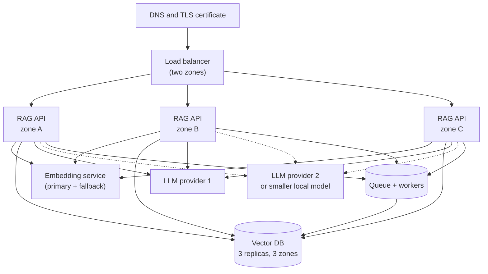

Every RAG system is a chain: gateway, API, embedding service, vector database, reranker, language model. A chain is only as available as its links together, and each link is a machine, a network path, a deployment or a provider that will, sooner or later, be unavailable. **High availability** (HA) is the discipline of designing so that no single such failure takes the whole system down: you add redundancy, spread it across things that fail independently, detect failure quickly and route around it.

This lesson is about HA for the whole request path, not for one component. The [replication lesson](/learn/advanced-vector-database-engineering/replication) already explains how a vector database keeps copies of its data; here we ask the broader questions: how many "nines" do you actually need, how do redundant components combine into an end-to-end number, why does placing redundant copies in the same zone quietly destroy that number, how much spare capacity redundancy really needs, and what must a health check test to be trustworthy? You will compute and then simulate the availability of a RAG request path and watch correlated failure undo the benefit of three replicas.

## Learning objectives

- Convert an availability target into allowed downtime and an error budget, and say what it implies for design effort and cost.
- Compute the availability of components in series and in parallel, and of a whole request path with redundancy at several tiers.
- Explain failure domains, and show quantitatively why replicas in one failure domain give far less availability than the independent-failure formula suggests.
- Size redundant capacity with the N+1 rule and distinguish active-active from active-passive designs.
- Specify health checks that distinguish "process alive", "ready for traffic" and "system healthy", and state what each gates.

## Prerequisites

- [Scalable RAG systems](/learn/production-architecture/scalable-rag-systems): the stages of the request path and stateless versus stateful components.
- [Replication](/learn/advanced-vector-database-engineering/replication): copies of data and quorum behaviour in the vector database.
- [Kubernetes fundamentals](/learn/deployment/kubernetes-fundamentals): probes, Deployments and rolling updates.
- [Cloud deployment](/learn/deployment/cloud-deployment): regions and availability zones.

## Why this matters

AskMeridian starts life as one container on one virtual machine, and for months that is fine. Then the support desk begins to route first-line questions through it, and a two-hour outage during a Monday morning kernel patch produces forty tickets and a message from the head of IT. Nothing was wrong with the design in the sense of correctness; it simply had a single point of failure at every layer, and the arithmetic of single points of failure is unforgiving: a chain of four components each available 99.5 per cent of the time is available only about 98 per cent of the time, which is more than a week of downtime a year.

The opposite error is just as common. After one outage, teams buy redundancy everywhere (three database replicas, two regions, a standby of everything) and the next outage happens anyway, because all three replicas were in the same zone, or all received the same bad configuration push, or the one component nobody doubled (the embedding API, the DNS record, the certificate) failed. HA is not a purchase; it is the habit of listing what can fail, what fails together and what a failure costs, then spending where the number moves.

## The intuition

Think of a hospital's power supply. The building draws from the grid. A cut in the grid would be an emergency, so there is a diesel generator. A generator that nobody ever starts will not start when needed, so it is tested every month. A generator in the basement is lost in the same flood as the grid connection, so a second sits on the roof. And all of them are useless if the switch that moves load between them fails, so the switch is itself duplicated and tested.

Each lesson transfers directly. Redundancy must be real (the standby is exercised), independent (the copies share no cause of failure), and must include the pieces that decide between the copies. A system with redundancy on paper and none in practice is the most dangerous kind, because everyone believes it is safe.

## How it works

### Availability and the nines

**Availability** is the fraction of time a service works: uptime divided by total time. It is quoted in "nines": 99.9 per cent is "three nines". Each extra nine cuts the allowed downtime tenfold.

| Availability | Downtime per year | Downtime per 30-day month |
| --- | --- | --- |
| 99% | about 3.65 days | about 7.2 hours |
| 99.9% | about 8.8 hours | about 43 minutes |
| 99.99% | about 53 minutes | about 4.3 minutes |

Targets come from an agreed **service level objective** (SLO), such as "99.9 per cent of requests succeed within 10 seconds, measured monthly". The gap between the SLO and 100 per cent is the **error budget**: 0.1 per cent of a month is about 43 minutes of failure you may spend on deployments, incidents and experiments. When the budget is spent, reliability work takes priority over new features.

Choose the target for the use case. An internal assistant used in working hours may reasonably aim for 99.5 or 99.9 per cent; a customer-facing support assistant might aim higher. Each additional nine costs disproportionately more, because you must remove ever-rarer causes, including human error and provider outages you do not control.

> [!NOTE]
> Define availability by user outcomes. A request that errors, times out, or returns "I don't know" because retrieval was down has failed, even though the HTTP layer answered. The [observability](/learn/rag-observability) modules show how to measure this.

### Series and parallel

Components in a request path are in **series**: all must work. Redundant copies of one component are in **parallel**: at least one must work. If failures are independent:

- Series: multiply availabilities. The result is lower than the worst component.
- Parallel: multiply unavailabilities. $n$ copies of availability $a$ give $1 - (1-a)^n$.

Two lessons follow. Every extra dependency on the critical path costs availability, so a feature that calls a second model synchronously on every request should earn its place. And the total is dominated by the weakest tier, so redundancy has diminishing returns: once the database is highly redundant, the next improvement must come from whatever is now weakest.

### Failure domains

Independence is the assumption behind the parallel formula, and in practice it is the one that fails. A **failure domain** is a set of components that can fail together because of a shared cause, from smallest to largest:

- a process or container (a crash, a memory leak),
- a host (hardware fault, a maintenance reboot),
- a rack and its switch and power feed,
- an **availability zone** (a separate data-centre location within a cloud region, with independent power and networking by design),
- a **region** (a geographical area containing several zones),
- a provider (an outage in a model API that all your replicas call),
- a **change** (a deployment, flag or certificate rotation applied to every copy at once).

Redundancy only helps against failures that do not cross the domain the copies share. Three replicas in one zone protect against a host failing, not the zone; three replicas running one buggy release protect against nothing the release breaks. The shared change is the cause of many real outages, which is why rollouts are gradual (canary, then a fraction, then everyone).

### Active-active and active-passive

In **active-active**, every copy serves traffic. A [load balancer](/learn/production-architecture/load-balancing) spreads requests and stops sending to a failed copy. Failover is just the balancer noticing, so it is fast and exercised constantly; the cost is spare capacity on every copy. Stateless tiers (the RAG API, reranker workers) and read replicas of the vector database are naturally active-active.

In **active-passive**, one copy serves and a standby waits. When the active copy fails, a controller promotes the standby. This suits components where only one writer is allowed: a primary accepting writes, a unique queue consumer, a database that elects a leader. The weaknesses are failover time (detection plus promotion plus warm-up, during which requests fail) and untested standbys, which often turn out to have stale configuration or a cold cache. The remedy is to fail over on purpose, on a schedule.

### Capacity for redundancy: N+1

Redundancy is useless if the survivors cannot carry the load. With $n$ active copies, losing one makes the remaining $n-1$ carry its share. The rule is **N+1** (N+2 for critical systems): provision enough that targets are met with one (or two) copies gone. If copies normally run at utilisation $\rho$, after losing one they run at $\rho \cdot n/(n-1)$, which must stay below the ceiling where latency explodes, as in [Scalable RAG systems](/learn/production-architecture/scalable-rag-systems).

### What a health check must test

A balancer or orchestrator removes unhealthy copies only as well as it can tell. Three questions need three checks, matching the probes in [Kubernetes fundamentals](/learn/deployment/kubernetes-fundamentals):

1. **Liveness: is the process alive?** Cheap, with no dependencies. Failure triggers a restart. If it also tested the database, a database outage would restart every healthy API pod and turn one failure into a fleet-wide one.
2. **Readiness: can this copy serve traffic now?** True once models are loaded and caches warm, false while shutting down or overloaded. Failure removes the copy from the balancer without restarting it.
3. **End-to-end health: can the system do its job?** A synthetic query run every few seconds from outside, checking that retrieval returns known-good content. It feeds alerts and failover decisions, not liveness.

The classic trap is a health endpoint that returns 200 while the web server is up, whatever the state of retrieval. The user-visible failure goes unseen until someone complains.

### Where a RAG system has single points of failure



Walk the diagram and ask of each box: if this vanished, what happens, and is there a second one? The familiar suspects are the vector database (replicate across zones), the API (several copies, spread) and the language model (a second provider or a smaller fallback model, which must be evaluated for quality and pass the same security review). Less obvious are the **embedding service** (queries need the same model as the index, so a fallback must produce compatible vectors), the **DNS record and TLS certificate** (an expired certificate is a total outage with no hardware involved), **secrets and configuration stores**, and the **deployment pipeline** you need in order to fix everything else. Ingestion workers matter for freshness rather than answering, so they usually have a looser target.

## The mathematics

### Series, parallel and the whole path

**Intuition.** A request needs every tier; a tier needs at least one of its copies.

$$
A_{\text{path}} = \prod_{i} A_i, \qquad A_i = 1 - (1 - a_i)^{n_i}
$$

$A_{\text{path}}$ is end-to-end availability, $A_i$ the availability of tier $i$, $a_i$ one copy's availability and $n_i$ the number of copies, assuming independent failures.

**By hand.** An API at 0.995, a vector-database node at 0.99, a model provider at 0.999 and an embedding API at 0.999, one of each: $0.995 \times 0.99 \times 0.999 \times 0.999 = 0.9831$, about 8,900 minutes of downtime a year. With three API copies (about 1.0), three database replicas ($1 - 0.01^3 = 0.999999$) and a second provider at 0.995 (tier availability $1 - 0.001 \times 0.005 = 0.999995$), the product is about 0.9990, and nearly all the remaining failure comes from the single embedding API.

### Correlated failure

**Intuition.** If all copies depend on one shared thing, that thing's failure probability sets a floor under the downtime.

Let each of $n$ replicas fail independently with probability $p$ and the zone fail with probability $q$. Replicas all in one zone are available when the zone is up and at least one replica is:

$$
A_{\text{one zone}} = (1 - q)\left(1 - p^{\,n}\right)
$$

With one replica per zone, each replica is up with probability $(1-q)(1-p)$, independently:

$$
A_{\text{spread}} = 1 - \left(1 - (1-q)(1-p)\right)^{n}
$$

**By hand.** $p = 0.01$, $q = 0.002$, $n = 3$. One zone: $0.998 \times (1 - 10^{-6}) \approx 0.998$, so $q$ dominates and the replicas add almost nothing. Spread: $1 - (1 - 0.998 \times 0.99)^3 = 1 - 0.01198^3 \approx 1 - 1.7 \times 10^{-6}$. The naive formula $1 - p^3$ promises $1 - 10^{-6}$, close to the spread figure and unrelated to the one-zone one.

### N+1 and the error budget

If $n$ copies run at utilisation $\rho$ and one is lost, survivors run at $\rho' = \rho \, n/(n-1)$. With $n = 3$ and $\rho = 0.6$, $\rho' = 0.9$, where latency climbs steeply. To stay at or below 0.7 after losing one of three, normal utilisation must be at most $0.7 \times 2/3 \approx 0.47$. The error budget is $(1 - \text{SLO}) \times T$: for 99.9 per cent over 30 days, $0.001 \times 43{,}200 = 43.2$ minutes.

## In code

**The problem.** Compute downtime for several targets, then the availability of a RAG request path with and without redundancy, and verify by simulation that three replicas in one zone give much less availability than three spread over zones.

**Dependencies.** NumPy only. The availabilities are assumptions for illustration, not measurements of any product.

```bash
pip install numpy
```

```python
"""Availability of a RAG request path: nines, series vs parallel, and correlated failure."""
import numpy as np

MIN_PER_YEAR = 365 * 24 * 60

def downtime_min(avail):
    return (1 - avail) * MIN_PER_YEAR

def series(*avails):
    out = 1.0
    for a in avails:
        out *= a
    return out

def parallel(avail, n):
    """At least one of n independent copies is up."""
    return 1 - (1 - avail) ** n

print("Availability -> allowed downtime per year")
for a in (0.99, 0.999, 0.9995, 0.9999):
    print(f"  {a:.2%}  {downtime_min(a):8.0f} min  ({downtime_min(a)/60:6.1f} h)")

# --- Independent-failure model of the whole path --------------------------------
api, db_node, llm_primary, llm_backup, embed = 0.995, 0.99, 0.999, 0.995, 0.999
single = series(api, db_node, llm_primary, embed)
redundant = series(parallel(api, 3), parallel(db_node, 3),
                   1 - (1 - llm_primary) * (1 - llm_backup), embed)
print(f"\nSingle copy of everything : {single:.5f}  ({downtime_min(single):7.0f} min/year)")
print(f"Redundant API, DB, LLM    : {redundant:.5f}  ({downtime_min(redundant):7.0f} min/year)")
print("  weakest tier is now the embedding API: "
      f"{embed:.5f} alone costs {downtime_min(embed):.0f} min/year")

# --- Correlated failure: three DB replicas, spread over zones or not ---------------
p, q = 0.01, 0.002          # replica process failure, whole-zone failure (assumptions)
rng = np.random.default_rng(3)
N = 2_000_000
inst = rng.random((N, 3)) < p           # True = this replica's process is down
zone = rng.random((N, 3)) < q           # True = zone is down

up_spread = ~(inst | zone)                                  # replica i lives in zone i
spread_mc = up_spread.any(axis=1).mean()
up_same = ~inst & ~zone[:, [0]]                             # all replicas live in zone 0
same_mc = up_same.any(axis=1).mean()

spread_an = 1 - (1 - (1 - q) * (1 - p)) ** 3
same_an = (1 - q) * (1 - p ** 3)
print(f"\nThree DB replicas, p={p}, zone q={q}")
print(f"  independent (formula p^3 only) : {1 - p**3:.6f}")
print(f"  one zone  : formula {same_an:.6f}  simulated {same_mc:.6f}")
print(f"  three zones: formula {spread_an:.6f}  simulated {spread_mc:.6f}")
print(f"  downtime/year: one zone {downtime_min(same_an):.0f} min, three zones {downtime_min(spread_an):.1f} min")
```

**How it works.** `series` and `parallel` are the two formulas; the model tier combines a primary and a backup provider as a parallel pair. The simulation draws two million independent "moments": whether each replica's process is down, and whether each of three zones is down. In the spread case replica $i$ lives in zone $i$; in the concentrated case all replicas share zone 0's state. The fraction of moments with at least one replica up is the simulated availability.

```output
Availability -> allowed downtime per year
  99.00%      5256 min  (  87.6 h)
  99.90%       526 min  (   8.8 h)
  99.95%       263 min  (   4.4 h)
  99.99%        53 min  (   0.9 h)

Single copy of everything : 0.98308  (   8893 min/year)
Redundant API, DB, LLM    : 0.99899  (    529 min/year)
  weakest tier is now the embedding API: 0.99900 alone costs 526 min/year

Three DB replicas, p=0.01, zone q=0.002
  independent (formula p^3 only) : 0.999999
  one zone  : formula 0.997999  simulated 0.998024
  three zones: formula 0.999998  simulated 0.999999
  downtime/year: one zone 1052 min, three zones 0.9 min
```

**What the output means.** Redundancy at three tiers cuts expected downtime from about 8,900 minutes a year to about 530, and what remains is almost entirely the embedding API, which was not duplicated. The second block is the lesson on independence. The naive formula promises six nines for three replicas; placed in one zone they deliver about 99.8 per cent (1,052 minutes a year), because the zone is a single point of failure; spread over three zones the figure is close to the naive promise. The simulation matches the formulas within sampling error (0.998024 against 0.997999 is Monte Carlo noise).

**Common errors.** Applying $1-(1-a)^n$ without asking whether copies share a domain. Using a vendor's SLA figure as measured availability for your usage. Using "at least one" for writes to a quorum store, which needs a majority (see [Replication](/learn/advanced-vector-database-engineering/replication)). Multiplying in tiers that are not on the critical path (an optional reranker that can be skipped is not in series).

**Extending it.** Add a deployment-failure term: each release has some probability of breaking all copies at once, with a mean time to roll back, and see how it dominates once hardware is redundant.

Spreading pods across zones is declarative in Kubernetes. These manifest fragments use the standard Kubernetes API; they were not run here, as they need a cluster. They spread a Deployment's pods over zones and stop voluntary disruptions, such as node drains, from removing too many at once:

```yaml
# In the Deployment's pod template spec
topologySpreadConstraints:
  - maxSkew: 1
    topologyKey: topology.kubernetes.io/zone
    whenUnsatisfiable: DoNotSchedule
    labelSelector:
      matchLabels:
        app: askmeridian-api
---
apiVersion: policy/v1
kind: PodDisruptionBudget
metadata:
  name: askmeridian-api
spec:
  minAvailable: 2
  selector:
    matchLabels:
      app: askmeridian-api
```

`maxSkew: 1` keeps pod counts in any two zones within one of each other; `minAvailable: 2` makes a drain refuse to leave fewer than two API pods.

## A real-world example

The platform team at a fictional retailer, Quillfield, runs a product-advice assistant. After an outage they upgrade it: the API goes from two pods to six, the vector database from one node to three replicas. Six weeks later the whole service is down for 50 minutes.

The review finds three weaknesses the upgrade did not touch. First, all three database replicas and four of six API pods were scheduled in one availability zone, because that was where the cluster had free capacity; the zone's networking failed and everything in it vanished together. Second, the health endpoint returned 200 whenever the web process was up, so the load balancer kept sending traffic to pods that could not reach the database. Third, the embedding service for query vectors was a single instance with no fallback; the incident restarted it and it took twelve minutes to reload its model.

The fixes are specific and cheap. Topology spread constraints place pods and replicas in three zones; readiness checks verify that a retrieval against the database succeeds; the embedding service gets a second warm instance in another zone; and a quarterly "zone evacuation" drill drains one zone's workloads on purpose during working hours. The next real zone problem, months later, produces a brief rise in latency and no outage.

## Common mistakes

- **Counting copies instead of failure domains.** Three replicas in one zone are one failure domain, so availability is far below $1 - p^3$.
- **A health check that tests nothing.** A 200 from a process whose dependencies are down sends users to broken instances.
- **A health check that tests too much.** Dependencies in the liveness probe restart healthy pods during a dependency outage and spread the failure.
- **Unexercised standbys.** A passive copy that has never taken traffic fails when needed.
- **No headroom for N+1.** Three copies at 80 per cent utilisation cannot survive losing one.
- **Doubling the strong tier.** The path is limited by its weakest unduplicated link; find it before spending.
- **Correlated change.** Pushing a release to every copy at once makes redundancy irrelevant to the most common cause of outages.
- **Ignoring non-obvious dependencies.** Certificates, DNS, secret stores, identity providers and container registries have caused total outages of otherwise redundant systems.

## Best practices

- Write an SLO in user terms, compute the error budget, and decide what it allows, planned maintenance included.
- Draw the request path and mark every single point of failure; for each, record a redundancy plan or an explicit decision to accept the risk.
- Spread stateless tiers and replicas across at least three zones with scheduling constraints, and use disruption budgets for planned maintenance.
- Provision for N+1 (N+2 for critical tiers) and check utilisation after losing a copy or zone.
- Implement liveness, readiness and an external synthetic check separately, and alert on the synthetic check.
- Roll out gradually with automatic rollback; see [Blue-green deployments](/learn/ci-cd-and-mlops/blue-green-deployments).
- Practise failure: kill an instance, drain a zone, break a dependency, in staging and, where stakes allow, in production.
- Give each external provider a degraded-mode plan ([Fault tolerance](/learn/production-architecture/fault-tolerance)), and remember that redundancy is not backup ([Disaster recovery](/learn/production-architecture/disaster-recovery)).

## Performance considerations

Redundancy costs money and sometimes latency. Active-active across three zones with a zone-loss design event runs at about two thirds of capacity normally (each zone must absorb half again as much), so you pay for roughly 1.5 times the capacity the traffic needs. Cross-zone traffic adds roughly a millisecond or less per hop and on many clouds a per-gigabyte charge, which matters for large embedding batches and replication streams; check your provider's pricing. Synchronous replication across zones adds the round trip to every write, which is why stores let you choose write consistency per request. Health checks consume resources too: a deep check running a retrieval every second from many balancers is a real load on a small database, so run synthetic checks from a few places at modest intervals.

Failover time is part of availability. If detection takes 30 seconds (three failed probes at 10-second intervals) and promotion another 30, each failover costs a minute of errors; ten such events a year consume ten minutes of a 53-minute four-nines budget. Faster probes and warm standbys buy time at the price of load and false alarms.

## Security considerations

Redundancy multiplies the places where data lives and credentials are used: every replica and standby needs the same encryption, access control and patching as the primary, and cross-zone or cross-region replication must be encrypted in transit. A failover path is an attack surface: a fallback model provider receives the same prompts and retrieved text as the primary, so it needs the same data-processing terms and must not offer a route that skips your output filters. Health and admin endpoints should not be public or reveal version and dependency details to unauthenticated callers. Auto-promotion can create two active primaries (a "split brain"); use the leader election and fencing of the underlying system rather than home-made scripts.

## Summary

- Availability targets translate into allowed downtime; the gap to 100 per cent is an error budget to spend deliberately.
- Series multiplies availability (it falls), parallel multiplies unavailability (it rises), and the path is limited by its weakest unduplicated tier.
- Redundancy works only across independent failure domains; replicas in one zone or one release share their fate.
- Size for N+1: survivors must carry the load after a failure.
- Use separate liveness, readiness and end-to-end checks, and exercise failover on purpose.
- List the non-obvious single points of failure (embedding service, certificates, DNS, providers) and decide on each.

## Exercises

**1.** A service must meet 99.95 per cent over a 30-day month. What is the error budget in minutes? A deployment causes 12 minutes of errors and an incident another 20. Is the budget exhausted?

<details><summary>Show solution</summary>

A 30-day month has 43,200 minutes, so the budget is $0.0005 \times 43{,}200 = 21.6$ minutes. The events total 32 minutes, overspending by 10.4 minutes: the SLO was missed, and policy should shift effort to reliability work.

</details>

**2.** A path has an API tier (three independent copies, each 0.99), a vector database (two independent replicas, each 0.98) and a single reranker at 0.999. Compute end-to-end availability and name the weakest tier.

<details><summary>Show solution</summary>

API: $1 - 0.01^3 = 0.999999$. Database: $1 - 0.02^2 = 0.9996$. Reranker: 0.999. Product: about 0.99860. The reranker, a single copy, has the largest unavailability (0.001 against 0.0004). If the reranker can be skipped when it fails, it is not truly in series; see [Fault tolerance](/learn/production-architecture/fault-tolerance).

</details>

**3.** Four API pods share load evenly at 55 per cent utilisation; the latency target needs at most 75 per cent. Can the service survive losing one pod? Two? How many pods survive losing two?

<details><summary>Show solution</summary>

Total load is $4 \times 0.55 = 2.2$ pod-equivalents. After one loss, $2.2/3 = 73.3$ per cent: yes. After two, $2.2/2 = 110$ per cent: no. To survive two losses you need $n - 2 \ge 2.2/0.75 = 2.93$, so $n = 5$ pods (44 per cent normal utilisation each).

</details>

**4.** For $p = 0.02$ and $q = 0.001$, compare three replicas in one zone against three zones, and decide whether three zones is worth a 20 per cent cost increase for a 99.9 per cent target.

<details><summary>Show solution</summary>

One zone: $0.999 \times (1 - 0.02^3) = 0.998992$, about 530 minutes a year, just missing 99.9 per cent (526 minutes) with no room for any other failure. Three zones: each replica is up with $0.999 \times 0.98 = 0.97902$, so $A = 1 - 0.02098^3 \approx 0.999991$, about 5 minutes a year. For a 99.9 per cent target the single zone uses the whole budget on this tier alone, so the spread is justified; for a 99 per cent target (5,256 minutes) the single zone would be adequate.

</details>

## Check your understanding

```quiz
[
  {
    "q": "A path has four tiers in series, each with one copy and availability 0.995. What is the end-to-end availability, approximately?",
    "options": ["0.995", "0.990", "0.980", "0.999"],
    "answer": 2,
    "why": "0.995 to the fourth power is about 0.980. Each link in series lowers the total."
  },
  {
    "q": "Three vector-database replicas all run in one availability zone. Why is availability much lower than 1 minus p cubed suggests?",
    "options": ["Replicas in one zone cannot communicate", "The zone is a shared failure domain, so its failure takes all replicas down at once", "More replicas always reduce availability", "Replication latency counts as downtime"],
    "answer": 1,
    "why": "The parallel formula assumes independent failures. A shared zone makes the replicas fail together, so the zone's failure probability sets the floor."
  },
  {
    "q": "Which probe should NOT query the database, to avoid restarting healthy pods during a database outage?",
    "options": ["The synthetic end-to-end check", "The readiness probe", "The liveness probe", "The deployment smoke test"],
    "answer": 2,
    "why": "A liveness failure restarts the container. If it depended on the database, an outage would restart every healthy API pod."
  },
  {
    "q": "Three active pods normally run at 60 per cent utilisation. After one fails, at what utilisation do the other two run?",
    "options": ["60 per cent", "80 per cent", "90 per cent", "120 per cent"],
    "answer": 2,
    "why": "Load is unchanged: 3 x 0.6 = 1.8 pod-equivalents over 2 pods is 0.9. This is the N+1 check."
  },
  {
    "q": "A 99.9 per cent monthly SLO is set for a 30-day month. How large is the error budget?",
    "options": ["About 4.3 minutes", "About 43 minutes", "About 7 hours", "About 8.8 hours"],
    "answer": 1,
    "why": "0.001 times 43,200 minutes is 43.2 minutes. The 8.8 hours figure is the yearly allowance."
  }
]
```

## Further reading

- Beyer, B., Jones, C., Petoff, J. and Murphy, N. R. (eds.) (2016), *Site Reliability Engineering*, O'Reilly, freely available at https://sre.google/books/: the chapters on service level objectives and embracing risk.
- Kleppmann, M. (2017), *Designing Data-Intensive Applications*, O'Reilly, chapter 8 on the trouble with distributed systems and partial failure.
- Amazon Web Services, "Well-Architected Framework: Reliability Pillar", at https://aws.amazon.com/architecture/well-architected/, a cloud provider's view of failure domains.
- [Kubernetes documentation](https://kubernetes.io/docs/home/): Pod topology spread constraints, Pod disruption budgets and probes.
- Treynor Sloss, B., Dahlin, M., Rau, V. and Beyer, B. (2017), "The Calculus of Service Availability", *ACM Queue*.
