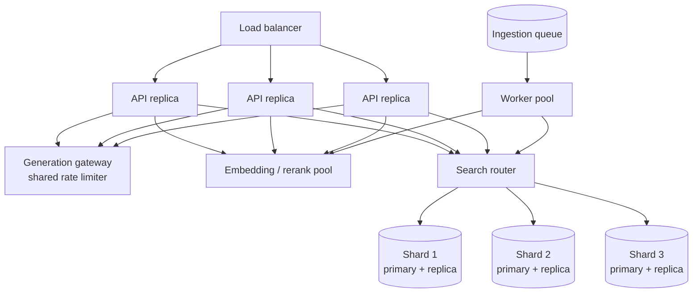

When one copy of a service can no longer carry the load, there are two ways out: make the machine bigger, or run more machines. **Horizontal scaling** is the second. It is attractive because it has no hard ceiling for the right kind of work, it improves availability as a side effect, and it lets you pay for capacity in small steps. It is also where most RAG systems discover that "just add replicas" works beautifully for some components and does nothing, or makes things worse, for others.

This lesson explains what has to be true of a component before copies of it can share load, how each tier of a RAG system (API, embedding and reranking workers, the generation gateway, the vector database) actually scales out, how to choose an autoscaling signal that reflects reality, and why speed-up is never linear. You will build a sharded search over a consistent-hash ring, check that scatter-gather returns exactly the same results as a single index, and measure how many chunks move when a shard is added. [Scalable RAG systems](/learn/production-architecture/scalable-rag-systems) told you which component to scale; [Load balancing](/learn/production-architecture/load-balancing) covers how traffic is spread over the copies. This lesson is about making copies useful.

## Learning objectives

- Identify hidden state that prevents a service from scaling out, and refactor it into external or immutable state.
- Choose an autoscaling metric for an I/O-bound API, a compute-bound worker pool and a queue consumer, and compute the desired replica count from it.
- Explain how a vector index scales by replication (more read throughput) and by sharding (more capacity), and implement scatter-gather top-k merging.
- Use Amdahl's law and the Universal Scalability Law to explain why adding replicas yields diminishing, and eventually negative, returns.
- Detect shared dependencies (connection limits, provider rate limits) that cap the benefit of more replicas.

## Prerequisites

- [Scalable RAG systems](/learn/production-architecture/scalable-rag-systems): stateless versus stateful components, bottlenecks and capacity arithmetic.
- [Kubernetes fundamentals](/learn/deployment/kubernetes-fundamentals): Deployments, probes and the Horizontal Pod Autoscaler.
- [Queue-based pipelines](/learn/production-architecture/queue-based-pipelines): how workers share a backlog.
- [Replication](/learn/advanced-vector-database-engineering/replication) and [Sharding](/learn/advanced-vector-database-engineering/sharding): how a vector database copies and splits data.

## Why this matters

The first scaling incident usually follows a pattern. Latency rises, someone raises the API replica count from two to eight, and nothing improves, because the API spends its life waiting for a language-model provider that allows a fixed number of concurrent requests. Or it does improve for an hour, until eight replicas each hold their own connection pool to the vector database and together exceed its connection limit, and the database starts refusing connections. Or the new replicas each load a 1.5 GB reranker into memory, take 40 seconds to become ready, and the autoscaler, seeing high CPU while they start, adds more of them.

Each of these is the same mistake: treating "replica count" as one knob that adds capacity everywhere. Scaling out is a property of how a component holds state, what it shares with its siblings, and how long it takes to become useful. Knowing those three facts about each tier lets you scale the right one by the right amount and predict where the next limit lies.

## The intuition

Return to the restaurant. Adding a second grill cook helps only if both cooks can reach the ingredients, work without bumping into each other and be briefed in a few seconds. If every order must be approved by one manager who signs each ticket, a third and fourth cook add little; the manager is a **serial fraction** that no number of cooks shortens. If the cooks share one narrow door to the pantry, more cooks spend their time queueing at the door, and past some number the kitchen is slower. If each new cook takes an hour to learn the menu, hiring in response to a rush is useless: the rush is over before they are productive.

Contrast that with serving tables by section. If the restaurant is split so that each waiter owns the tables in one area, adding a waiter means redrawing the sections, and some regulars will find a different waiter. That redrawing, and keeping each customer's order with the right waiter, is **sharding**. It is more work than hiring a clone, because the customers' state, their half-eaten meals, has to be handed over.

## How it works

### Statelessness is the precondition

A service can be copied freely when any copy can handle any request and a copy can be destroyed at any moment without losing anything that matters. It is **stateless** when the state needed to answer a request lives somewhere other than the process: in the request itself, in a database, in a cache or in object storage. Hidden state is the usual obstacle, and in RAG services it hides in predictable places.

- **Conversation history held in memory.** A second request in the same chat that reaches a different replica finds no history. Keep sessions in a shared store, or send the history (or a handle to it) with each request.
- **In-process caches.** A per-replica cache is fine as an optimisation, but correctness must not depend on it, and N replicas means N cold caches and a hit rate that falls as N rises. A shared cache such as Redis trades a network hop for a higher hit rate ([Query caching](/learn/performance-optimisation/query-caching)).
- **Files on local disk.** An uploaded PDF written to the container's disk is invisible to the worker that runs on another machine and disappears on restart. Use object storage.
- **Background threads and in-process queues.** Work promised to a user and held in memory is lost when the replica is replaced. Use a [durable queue](/learn/production-architecture/queue-based-pipelines).
- **Local counters.** A rate limit of "60 requests a minute per user" implemented in each replica becomes 60 times the replica count. Limits need a shared store or a gateway.

Some in-memory state is acceptable because it is **immutable and reproducible**: a loaded embedding model, a tokenizer, a compiled prompt template. Every replica holds an identical copy, and a replacement rebuilds it. That state makes start-up slow (a cost examined below) but does not break correctness.

> [!KEY]
> A replica must be disposable: killing it at any moment should lose no user data, and starting one should need nothing but configuration and shared stores.

### Scaling each tier



**The API tier** does little computation; it waits. A single process can hold hundreds of requests in flight (see [Async endpoints](/learn/backend-engineering/async-endpoints)), so CPU stays low even when the service is saturated by concurrency or by its downstream dependencies. Scale it on **in-flight requests per replica**, not CPU. It scales out nearly freely, but each replica opens its own connection pools to the database, cache and providers, so total connections are replicas times pool size. With 20 replicas and a pool of 10, the database sees 200 connections; check it against the database's limit.

**Embedding and reranking workers** are compute-bound. They scale out, but each replica carries a model: memory (a cross-encoder or embedding model occupies from hundreds of megabytes to several gigabytes) and a start-up delay for loading it. They benefit from **batching**: a worker that gathers requests for a few milliseconds and runs them as one batch uses a CPU or GPU far better than one that handles requests singly, which means throughput per replica depends on load, and CPU utilisation tells you less than queue time does. With accelerators, the unit of scaling is often one process per device.

**The generation gateway** is a different case, because the real limit is outside your system. A hosted model enforces rate limits per account or project, and your replicas share them. Doubling the API replicas doubles your potential demand on the same quota. That is why the limit and the retry and backoff logic should live in one place (a gateway or a shared limiter) rather than in each replica, and why a self-hosted model server scales by adding accelerators, with its own batching and memory limits. Provider limits and their dependence on account tier are set out in each provider's documentation.

**Ingestion workers** consume a queue, so the right signal is the backlog, specifically its age or the backlog per worker. They are the easiest tier to scale aggressively, since they are tolerant of delay, but their ceiling is the embedding service and the database they write to.

**The vector database** is stateful. There are two separate moves, and they solve different problems.

1. **Replication** keeps identical copies of the same data. It multiplies **read throughput** and tolerates the loss of a node, but it does nothing for capacity: each replica holds everything, so memory per node does not fall. Writes must reach every copy, so write-heavy workloads gain less.
2. **Sharding** splits the data so each node holds a part. It multiplies **capacity** (memory and index build time) and write throughput. A query must usually go to all shards, because the nearest neighbours of a query may live on any of them, and the results are merged: **scatter-gather**.

Production clusters combine them: each shard has replicas. In a simple design, a search router sends the query to one replica of each shard, takes the top $k$ from every shard, and keeps the best $k$ overall. Two details matter. First, each shard must return $k$ results, not $k/S$, since all the true top $k$ could sit on one shard. Second, the merge is only valid if scores are comparable across shards. That holds for vector similarity (the same metric and normalisation everywhere), but not for lexical scoring that uses collection statistics: BM25 computed with each shard's local document frequencies gives slightly different scores for the same text on different shards, which is why search engines offer an option to gather global term statistics first, at the cost of an extra round trip.

### Choosing the shard key and the placement rule

How do you decide which shard owns a chunk? The simplest rule is `hash(id) mod N`. It balances well but fails when $N$ changes: almost every key maps to a different shard, so adding one shard to four moves about four fifths of the data. **Consistent hashing** fixes this. Both nodes and keys are hashed onto a ring; a key belongs to the first node clockwise from its position. Adding a node takes over only the arc between it and its predecessor, so only about $1/(N+1)$ of keys move. Giving each node many **virtual nodes** (positions on the ring) evens out the arcs, so that load is spread more evenly. Many vector databases implement something of this kind internally; the point is to understand the cost of resizing.

A second decision is *what* to hash. Hashing by chunk identifier spreads every tenant over all shards, which balances load and makes every query hit every shard. Placing a tenant's data on one shard (hashing by tenant) makes a query cheap, since it touches one shard, but a large tenant can overload it and a small one wastes capacity. [Multi-tenant RAG](/learn/production-architecture/multi-tenant-rag) takes up that trade-off.

### Autoscaling signals and start-up cost

An autoscaler compares a measured metric with a target and adjusts the replica count. The Kubernetes Horizontal Pod Autoscaler's rule is

$$
\text{desired} = \left\lceil \text{current} \times \frac{\text{metric}}{\text{target}} \right\rceil
$$

(see [Kubernetes fundamentals](/learn/deployment/kubernetes-fundamentals)). Everything depends on the metric.

| Tier | Poor metric | Better metric |
| --- | --- | --- |
| API (I/O-bound) | CPU, which stays low while requests pile up | In-flight requests per replica, or request latency |
| Embedding or rerank workers | CPU on a batching server | Queue time, or batch queue length |
| Ingestion workers | CPU | Queue age or backlog per worker |
| Generation gateway | CPU | Concurrent generations against the limit |

Two behaviours cause trouble. **Slow start**: if a replica takes a minute to load a model, the autoscaler sees the load persist and adds more, overshooting. Remedies are a readiness probe that passes only when the model is loaded, a start-up delay in the autoscaler's metric, a minimum replica count that covers normal peaks, and, for sharp predictable peaks, scaling on a schedule before the peak (09:00 on a Monday). **Flapping**: scaling down after a brief lull, then up again, wastes starts. Scale up fast and scale down slowly, using a stabilisation window.

## The mathematics

### Amdahl's law

**Intuition.** If a fraction of the work cannot be parallelised, that fraction bounds the speed-up however many replicas you add.

$$
S(N) = \frac{1}{s + \frac{1 - s}{N}}
$$

$S(N)$ is the speed-up with $N$ replicas, $s$ the serial fraction (work that cannot be spread, such as a shared lock, a single primary database writer or a coordinator). As $N \to \infty$, $S \to 1/s$.

**By hand.** With $s = 0.1$ and $N = 8$: $1/(0.1 + 0.9/8) = 1/0.2125 = 4.71$. The ceiling is $1/0.1 = 10$ however many replicas you buy.

### The Universal Scalability Law

Amdahl's law never decreases. Real systems also pay for **coherence**, the cost of replicas coordinating (cache invalidation, lock contention, cluster chatter). Neil Gunther's Universal Scalability Law adds a term for it:

$$
C(N) = \frac{N}{1 + \alpha (N - 1) + \beta N (N - 1)}
$$

$C(N)$ is capacity relative to one replica, $\alpha$ is the contention (serial) coefficient and $\beta$ the coherence coefficient. The $N(N-1)$ term, which counts pairs of replicas, eventually dominates, so capacity peaks at $N^* = \sqrt{(1 - \alpha)/\beta}$ and then falls.

**By hand.** With $\alpha = 0.05$ and $\beta = 0.002$: $N^* = \sqrt{0.95/0.002} = \sqrt{475} \approx 21.8$. At $N = 8$: $8/(1 + 0.35 + 0.112) = 5.47$. At $N = 32$: $32/(1 + 1.55 + 1.984) = 7.06$, lower than at 22. The coefficients are properties of a particular system, found by measuring throughput at several sizes and fitting; the values here are illustrative.

### Tail latency across shards

**Intuition.** A scatter-gather query waits for the slowest shard, so rare slowness is amplified.

If each shard answers within a time $t$ with probability $p$, and shards are independent, all $S$ shards answer within $t$ with probability $p^S$. **By hand.** With $p = 0.99$ and $S = 8$: $0.99^8 = 0.923$. The shard-level 99th percentile has become the whole query's 92nd. Mitigations include hedged requests (sending the query to a second replica if the first is slow) and per-shard timeouts that return partial results, with the recall consequence noted.

```python
import math

def amdahl(n, s):
    return 1 / (s + (1 - s) / n)

def usl(n, alpha, beta):
    return n / (1 + alpha * (n - 1) + beta * n * (n - 1))

for n in (1, 8, 16, 22, 32):
    print(n, round(amdahl(n, 0.1), 2), round(usl(n, 0.05, 0.002), 2))
print("peak at", round(math.sqrt((1 - 0.05) / 0.002), 1))

def desired(current, metric, target):
    return math.ceil(current * metric / target)

print(desired(4, 18, 5), desired(10, 2, 5), desired(6, 5.2, 5))
```

```output
1 1.0 1.0
8 4.71 5.47
16 6.4 7.17
22 7.1 7.4
32 7.8 7.06
peak at 21.8
15 4 7
```

The columns are replicas, Amdahl speed-up and USL capacity. Amdahl keeps rising towards 10; the USL curve peaks near 22 and then declines (7.4 at 22, 7.06 at 32), so past the peak, additional replicas reduce throughput. The last line applies the autoscaling rule: 4 replicas with 18 in-flight requests each against a target of 5 asks for 15; 10 replicas at 2 each could shrink to 4; 6 replicas at 5.2 asks for 7.

## In code

**The problem.** Split an index over several shards with a consistent-hash ring, answer a query by scatter-gather, confirm that it returns exactly what one big index would, and compare the cost of adding a shard under consistent hashing with plain modulo hashing.

**Dependencies.** NumPy only. The "shards" are subsets of one array in a single process, so the example demonstrates routing and merging, not network behaviour or latency. The vectors are random and normalised, with a fixed seed.

```bash
pip install numpy
```

```python
"""Shard routing with consistent hashing, and scatter-gather search over the shards."""
import bisect
import hashlib
import numpy as np


def h(key):
    return int(hashlib.md5(key.encode()).hexdigest()[:8], 16)


class Ring:
    def __init__(self, nodes, vnodes=100):
        self.points = sorted((h(f"{n}#{v}"), n) for n in nodes for v in range(vnodes))
        self.keys = [p for p, _ in self.points]

    def node_for(self, key):
        i = bisect.bisect(self.keys, h(key)) % len(self.points)
        return self.points[i][1]


def modulo_node(key, n):
    return f"shard-{h(key) % n}"


rng = np.random.default_rng(42)
n, d, k = 20000, 64, 10
vectors = rng.normal(size=(n, d)).astype("float32")
vectors /= np.linalg.norm(vectors, axis=1, keepdims=True)
ids = [f"chunk-{i}" for i in range(n)]

# 1. Route chunks to four shards and search each shard separately.
nodes = [f"shard-{i}" for i in range(4)]
ring = Ring(nodes)
owner = np.array([ring.node_for(c) for c in ids])
print("chunks per shard:", {s: int((owner == s).sum()) for s in nodes})

query = rng.normal(size=d).astype("float32")
query /= np.linalg.norm(query)

def search(rows, query, k):
    scores = vectors[rows] @ query
    top = np.argsort(-scores)[:k]
    return [(float(scores[t]), int(rows[t])) for t in top]

partial = []
for s in nodes:                                   # scatter: each shard returns its own top k
    partial += search(np.where(owner == s)[0], query, k)
merged = sorted(partial, reverse=True)[:k]        # gather: merge and keep the best k
exact = search(np.arange(n), query, k)
print("scatter-gather equals single index:", [m[1] for m in merged] == [e[1] for e in exact])
print("candidates gathered:", len(partial), "for k =", k)

# 2. Add a fifth shard: how many chunks must move?
ring5 = Ring(nodes + ["shard-4"])
moved_ring = sum(ring.node_for(c) != ring5.node_for(c) for c in ids)
moved_mod = sum(modulo_node(c, 4) != modulo_node(c, 5) for c in ids)
print(f"moved with consistent hashing: {moved_ring / n:.1%}")
print(f"moved with hash modulo N:      {moved_mod / n:.1%}")
```

```output
chunks per shard: {'shard-0': 4279, 'shard-1': 4978, 'shard-2': 4522, 'shard-3': 6221}
scatter-gather equals single index: True
candidates gathered: 40 for k = 10
moved with consistent hashing: 20.8%
moved with hash modulo N:      79.3%
```

**The important lines.**

- `Ring` places 100 virtual points per node and finds a key's owner by binary search for the first point clockwise (`bisect`, wrapping with the modulo). Many virtual points smooth the arc lengths.
- `search` is exact (a dot product on normalised vectors is cosine similarity), so it can serve as both the per-shard search and the single-index reference.
- The scatter step asks each shard for its own top $k$; the gather step sorts the $4k = 40$ candidates and keeps $k$. Because every true top-$k$ chunk is in the top $k$ of its own shard, the merge cannot miss one.

**What the output means.** The shard sizes range from 4,279 to 6,221 for an ideal of 5,000: with only 100 virtual nodes per shard the balance is decent but not perfect, and shard-3 is 24 per cent above average. More virtual nodes narrow the spread, at the cost of a bigger routing table. Scatter-gather agrees exactly with the single index, as the argument says it must for exact search. (With approximate indexes each shard's result is itself approximate, so the merged list inherits that recall, not exactness.) Adding a fifth shard moved 20.8 per cent of chunks with consistent hashing, close to the ideal $1/5 = 20$ per cent, against 79.3 per cent for modulo hashing, close to $4/5$. In a real cluster that difference is the data you must copy while still serving traffic.

**Common errors.** Asking each shard for $k/S$ results silently drops true neighbours. Merging scores that are not comparable (lexical scores with different statistics, or a different metric per shard) produces a wrong order. Re-using a node's name for a different machine changes its ring positions; keep names stable. Too few virtual nodes leaves a hot shard.

**Extending it.** Make the shards separate FAISS or Qdrant collections, add a replica per shard with a round-robin choice, and add a per-shard timeout that returns partial results. Measure how recall changes when one shard is skipped.

## A real-world example

The Platform team at Meridian runs AskMeridian as six API replicas, a reranker on two machines and a Qdrant cluster. At 09:00 on a Monday after a long weekend, p95 latency goes from 3 seconds to 11. The on-call engineer's first instinct is to double the API replicas; instead she opens the dashboards by tier. API CPU is 20 per cent, but in-flight requests per replica have reached the configured concurrency cap, and 70 per cent of that time is spent in generation, where the provider is returning rate-limit responses and the gateway's retries are queueing. More API replicas would add more waiting requests against the same quota.

The fix has three parts. They raise the account's limit with the provider (a commercial step, not an engineering one), enable the existing semantic cache for the most common questions (the leave policy and password reset account for a large share of Monday traffic), and change the autoscaler for the API from CPU to in-flight requests with a lower target so that capacity is added before the cap is hit. Two weeks later the re-index of the handbook, which runs as workers on the ingestion queue, scales to 12 workers on queue age. It saturates the embedding service and slows the reranker they share, and the team splits the pools. The lesson in both incidents was to scale where the measurement points, and to look for what the new replicas would share.

## Common mistakes

- **Scaling the API when generation is the bottleneck.** More replicas wait on the same provider quota and raise the demand on it.
- **Autoscaling on CPU for I/O-bound services.** CPU stays low while requests queue, so the autoscaler never reacts.
- **Ignoring connection totals.** Replicas times pool size can exceed the database's connection limit and cause failures at exactly the moment of peak load.
- **Hidden state.** Session memory, local files and in-process queues make replicas behave differently, or lose data when one is replaced.
- **Per-replica rate limits.** A limit enforced locally multiplies by the replica count.
- **Modulo sharding.** Resizing the cluster remaps most keys, forcing a near-complete data migration.
- **Asking each shard for k/S results.** True neighbours are lost whenever the top results cluster on one shard.
- **Slow readiness.** Replicas that pass the readiness probe before their model has loaded receive traffic and fail, or trigger runaway scale-out.

## Best practices

- Make every replica disposable: sessions, files and queues external, models loaded at start-up from a pinned version.
- Scale each tier on a metric that reflects its limit: in-flight requests, queue age, batch wait or concurrent generations.
- Scale up quickly, scale down slowly, and keep a minimum replica count that absorbs the normal peak.
- Make readiness depend on warm-up: model loaded, one test inference done.
- Centralise rate limiting and retries for external providers in a gateway so replicas share a budget.
- Budget shared resources: total connections, provider quota, database write throughput.
- Use consistent hashing (or the database's own sharding) and test a resize in staging before you need it.
- Load-test to fit your own scalability curve and find where adding replicas stops helping.

## Performance considerations

Horizontal scaling trades money for capacity and adds coordination. Cost scales with replica count, so the efficient fleet is the smallest one that meets the latency target at your chosen peak utilisation; running replicas at 20 per cent to be safe costs five times the capacity you use. Scatter-gather multiplies network traffic: a query to $S$ shards returns $S \times k$ candidates, each with a payload if you ask for one, so fetch identifiers and scores first and retrieve payloads only for the final $k$. Latency is the maximum over shards, so uneven shard sizes or one slow node set the pace for everyone, and the tail amplification above grows with $S$. Replicas also add memory: three replicas of a 16 GB index need about 48 GB before headroom. Start-up time is a cost in its own right. If a replica needs 40 seconds to load, capacity added in response to a spike arrives after the spike, which argues for headroom and scheduled scaling over purely reactive scaling. Finally, remember the limits shown by the USL: measure rather than assume that the 30th replica helps.

## Security considerations

More replicas mean more places where secrets, credentials and cached data live, and more places that can be compromised. Give every replica the least privilege it needs and rotate secrets centrally rather than baking them into images. A shared cache holds content from several users, so key cache entries by tenant and permission scope, or a replica may serve one user's retrieved text to another. When a tenant's data is placed on specific shards, verify that the routing layer enforces the tenant boundary rather than relying on the client. Autoscaling is also a cost-based denial-of-service target: an attacker who can generate expensive requests can drive the fleet, and the bill, upward, so keep an upper bound on replicas and per-user rate limits in front of the autoscaler.

## Summary

- Scaling out needs disposable replicas: no state in the process that matters, and whatever they share must be able to bear the combined load.
- Scale each tier on the metric of its own limit; CPU is a poor signal for I/O-bound services, and queue age suits workers.
- Replication scales reads and availability; sharding scales capacity and writes. Scatter-gather asks each shard for $k$ results and merges, provided scores are comparable.
- Consistent hashing moves about $1/(N+1)$ of the keys when a node is added; modulo hashing moves most of them.
- Amdahl's law and the Universal Scalability Law explain diminishing and eventually negative returns, and show why shared dependencies, such as provider quotas and connection limits, cap the benefit of replicas.
- Slow start-up turns reactive autoscaling into late autoscaling; plan headroom and warm-up.

## Exercises

**1. (Calculation)** A service has 12 replicas, each with a connection pool of 25. The database allows 250 connections and administration needs 20. How many replicas can you run before exhausting the limit, and what are two ways to scale beyond that?

<details>
<summary>Show solution</summary>

230 connections are available to the service, so $\lfloor 230/25 \rfloor = 9$ replicas. Twelve replicas would need 300 connections. Options: shrink each pool (an I/O-bound async replica often needs far fewer connections than its concurrency), put a connection pooler between the replicas and the database, or add read replicas of the database and spread reads across them.

</details>

**2. (Calculation)** Eight workers consume a queue with a target backlog of 30 messages per worker. The backlog is now 900. What does the autoscaling rule suggest, and what could go wrong if starting a worker takes five minutes?

<details>
<summary>Show solution</summary>

The metric is 900/8 = 112.5 messages per worker against a target of 30, so desired = $\lceil 8 \times 112.5/30 \rceil = 30$ workers. With a five-minute start-up, the autoscaler re-evaluates before the new workers are ready and still sees a large backlog per worker; without a start-up allowance or a limit on scale-up rate it may keep adding workers, overshooting. Count pending replicas toward the current total, and cap the step size.

</details>

**3. (Code)** Modify the lesson's code so that each shard returns only $\lceil k/4 \rceil$ results, then measure how often the merged list differs from the exact list over 200 random queries.

<details>
<summary>Show solution</summary>

Replace `search(..., k)` in the scatter loop with `search(..., -(-k // 4))` (a ceiling division) and loop over 200 queries generated with the same `rng`, counting the queries where `[m[1] for m in merged] != [e[1] for e in exact]`. Run once with seed 42 as in the lesson (`rng` continuing after the first query), 156 of 200 queries differed from the exact list. Your count depends on the data and seed; the point is that it is far from zero, because the true top 10 are rarely spread exactly 3, 3, 2, 2 over the shards.

</details>

**4. (Design)** AskMeridian will grow into a product serving 5,000 customers, most with small corpora and a few with millions of chunks. Choose a shard key and a placement rule, and say what you would do about a very large customer.

<details>
<summary>Show solution</summary>

Hash by tenant for the many small customers, so each query touches one shard and tenant isolation is simple. Track each tenant's size and move any that exceed a threshold to a dedicated shard or collection, or split them across several shards by chunk identifier with scatter-gather across just those shards. Keep a routing table (tenant to shard set) in a small database rather than deriving it from a hash, so a tenant can be moved without changing the others. Plan the migration path (copy, dual-write, switch, delete) before the first large customer arrives.

</details>

## Check your understanding

```quiz
[
  {
    "q": "A RAG API spends most of its time waiting for a language-model provider. Which autoscaling metric is most appropriate?",
    "options": [
      "CPU utilisation",
      "In-flight requests per replica",
      "Disk usage",
      "Number of vectors in the index"
    ],
    "answer": 1,
    "why": "An I/O-bound service's CPU stays low even when it is saturated. In-flight requests per replica reflects how full each replica really is."
  },
  {
    "q": "Why must each shard return k results rather than k divided by the number of shards?",
    "options": [
      "Shards cannot return fewer than k results",
      "Merging is faster with more candidates",
      "All of the true top k could be on one shard",
      "It keeps shard sizes equal"
    ],
    "answer": 2,
    "why": "The true neighbours may be unevenly spread. Asking for fewer than k per shard can drop some of them from the candidate set before merging."
  },
  {
    "q": "A cluster using hash(id) mod N grows from 4 to 5 shards. About what fraction of chunks changes shard?",
    "options": [
      "About 20 per cent",
      "About 50 per cent",
      "About 80 per cent",
      "None"
    ],
    "answer": 2,
    "why": "A key stays on its shard only if hash mod 4 equals hash mod 5, which is true for roughly one key in five, so about four fifths move. Consistent hashing would move about one fifth."
  },
  {
    "q": "In the Universal Scalability Law, what does the beta term represent and what is its effect?",
    "options": [
      "Contention on a serial resource; it caps speed-up at a constant",
      "Coherence cost between replicas; it makes capacity peak and then fall",
      "Network latency; it adds a fixed delay",
      "Start-up time; it delays scaling"
    ],
    "answer": 1,
    "why": "Beta multiplies N(N-1), the number of replica pairs. It grows faster than N, so beyond a peak at about sqrt((1-alpha)/beta) adding replicas reduces throughput."
  },
  {
    "q": "A scatter-gather query waits for all 8 shards, and each shard meets the latency target 99 per cent of the time, independently. About how often does the whole query meet it?",
    "options": [
      "99 per cent",
      "92 per cent",
      "88 per cent",
      "50 per cent"
    ],
    "answer": 1,
    "why": "0.99 to the power 8 is about 0.923. Tail latency is amplified because the query is as slow as its slowest shard."
  }
]
```

## Further reading

- Kubernetes documentation, *Horizontal Pod Autoscaling*: the scaling algorithm, stabilisation windows and custom metrics (kubernetes.io/docs).
- Neil J. Gunther, *Guerrilla Capacity Planning* (Springer, 2007): the Universal Scalability Law.
- Gene M. Amdahl, *Validity of the single processor approach to achieving large scale computing capabilities*, AFIPS Spring Joint Computer Conference, 1967.
- David Karger and others, *Consistent Hashing and Random Trees*, ACM Symposium on Theory of Computing, 1997.
- Jeffrey Dean and Luiz André Barroso, *The Tail at Scale*, Communications of the ACM, 2013: why fan-out amplifies tail latency and how hedged requests help.
- Adam Wiggins, *The Twelve-Factor App* (12factor.net): the stateless-process principle.
