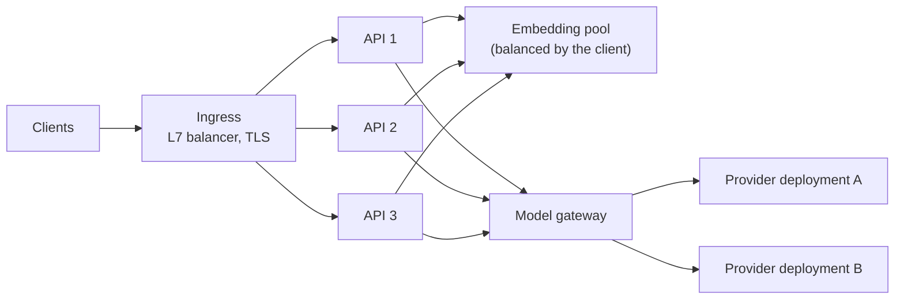

Once a service runs as several replicas, something must decide which replica receives each request. That component is the **load balancer**, and its job sounds trivial until you remember what a RAG request looks like: it may take 400 milliseconds or 40 seconds, it may stay open for half a minute while an answer streams out, and it may depend on a replica's warm cache or loaded model. A balancer that treats all requests as equal and all replicas as healthy will, sooner or later, send a long request to a replica that is already stuck on three others.

This lesson explains what load balancers do, the difference between balancing connections (layer 4) and requests (layer 7), the main selection algorithms and why least-connections-style policies beat round-robin when request durations vary, health checking, the special problems of streaming and long-lived connections, and how retries and timeouts interact with balancing. You will simulate four policies on heavy-tailed request times, with a healthy and a degraded fleet, and read the tail-latency numbers. How many replicas to run is the subject of [Horizontal scaling](/learn/production-architecture/horizontal-scaling); this lesson is about spreading traffic across them.

## Learning objectives

- Distinguish layer 4 from layer 7 load balancing and say what each can and cannot see.
- Compare round-robin, random, least-connections, power-of-two-choices and hash-based routing, and choose one for a given workload.
- Design health checks that remove failing replicas without causing a cascading outage.
- Explain what breaks for streaming responses and long-lived connections behind a balancer, and configure timeouts and draining accordingly.
- Calculate how retries at several layers multiply load, and set a retry budget.

## Prerequisites

- [Horizontal scaling](/learn/production-architecture/horizontal-scaling): replicas, statelessness and shared limits.
- [Scalable RAG systems](/learn/production-architecture/scalable-rag-systems): utilisation and why queues grow near 100 per cent.
- [Streaming APIs](/learn/backend-engineering/streaming-apis): how streamed answers reach the client.
- [Kubernetes fundamentals](/learn/deployment/kubernetes-fundamentals): Services, readiness and liveness probes.

## Why this matters

Variable request duration is the central fact of RAG traffic. A cached answer returns in tens of milliseconds; a question that triggers retrieval, reranking and a long generation holds a replica for many seconds. If requests are handed out by turns regardless of how busy each replica is, a replica that happens to receive several long requests in a row falls behind while its neighbours sit idle. Average utilisation looks healthy; the 99th-percentile latency is dreadful. The simulation later in this lesson shows how large the effect is.

The second reason is failure. Replicas die, hang, run out of memory and become slow without dying, which is the worst case, because a replica that is slow but still answers its health check keeps receiving its full share of traffic. The balancer is where those failures are either contained or amplified. A naive retry rule that sends a failed request to another replica can double the load on a struggling service; a health check that is too strict can eject every replica at once. Both are common causes of outages.

## The intuition

Picture the checkout area of a supermarket with eight tills. One arrangement has a single snaking queue that feeds whichever till is free. Another has a separate queue at each till and a greeter who sends each arriving shopper to a till by turns. The greeter is fair, but shoppers differ: one has a trolley of 80 items, another has a loaf of bread. A till that happens to receive three big trolleys has a queue twenty minutes long while the till next to it is idle. The single snaking queue never has that problem.

A load balancer cannot usually have a single queue (the replicas are separate machines and requests must be sent somewhere), so it approximates one. **Least-connections** is the greeter who glances at the tills and sends the shopper to the shortest queue. **Power of two choices** is the greeter who looks at two random tills and picks the shorter, which turns out to be nearly as good while looking at far less. Round-robin is the greeter who never looks. And a till whose scanner is broken (slow, not dead) fools the round-robin greeter completely, while the glancing greeter notices that its queue never shrinks.

## How it works

### Layers and placement

A **layer 4** balancer works on TCP connections. It sees addresses and ports, not HTTP, and forwards a whole connection to one backend. It is fast and simple, and it cannot route by path or header, retry a single request or see response codes. A **layer 7** balancer terminates the HTTP connection, reads each request, and forwards it, possibly over a different connection to a chosen backend. It can route by path (`/v1/answer` to one pool, `/v1/upload` to another), by header or tenant, retry an individual request, record per-request metrics and eject a backend that returns errors. It costs more CPU and adds one hop.

The distinction matters for an easy-to-miss reason: a balancer that balances **connections** is balanced only when each connection carries similar work. HTTP/2 and gRPC multiplex many requests over one long-lived connection; behind a layer 4 balancer, a client that opens one connection sends everything to one backend, and adding replicas changes nothing for it. Use a layer 7 balancer, or client-side balancing, for such traffic. Kubernetes Services distribute traffic per connection in their usual configuration, so a service-to-service call over a single persistent HTTP/2 connection can be pinned to one pod; a layer 7 proxy or a service mesh fixes that.

A RAG system has several places where balancing happens: the public ingress in front of the API, the calls from API replicas to embedding and reranking pools, the calls to model servers, and the clients that talk to vector database nodes. A hosted provider balances on its side; you still choose among your own deployments, regions or providers, which is the same problem one level up.



### Selection algorithms

1. **Round-robin** sends request $i$ to backend $i \bmod N$. It needs no information, spreads request counts evenly and ignores everything else. Weighted round-robin gives faster or larger machines a larger share.
2. **Random** is round-robin with noise; it is slightly worse for balance but needs no shared counter, which matters when several balancers run in parallel.
3. **Least-connections** sends the request to the backend with the fewest requests in flight. It adapts to long requests and to slow replicas automatically, because a slow replica's in-flight count stays high. Its weakness is needing accurate counts: with several balancers each sees only its own traffic, and it can send a burst to a newly started, empty backend.
4. **Power of two choices** picks two backends at random and sends the request to the less loaded. Remarkably, comparing just two removes most of the imbalance of pure random choice: in the theoretical balls-into-bins model, the maximum load drops from roughly $\log n / \log\log n$ to roughly $\log\log n$ (Mitzenmacher's analysis). It scales to many balancers because it needs only a sampled load, and it avoids herding onto a single least-loaded node.
5. **Hash-based (affinity) routing** sends requests with the same key to the same backend: a hash of the tenant, session or conversation, usually with consistent hashing so resizing moves few keys. Use it when locality pays: a replica's in-process cache, a conversation's history, or a model server that reuses cached computation for a shared prompt prefix. The costs are uneven load (one hot key means one hot replica) and stickiness that works against rebalancing, so treat affinity as an optimisation and not as something correctness relies on.

For RAG, the practical default for the API and for model-serving pools is least-connections or power-of-two-choices at layer 7, with affinity added only where a measured cache hit rate justifies it.

### Health checks

A balancer must stop sending traffic to a backend that cannot serve it. There are two sources of evidence.

- **Active checks**: the balancer calls an endpoint (`/healthz`, `/ready`) every few seconds and removes a backend after several consecutive failures, restoring it after several successes. Requiring consecutive results avoids flapping.
- **Passive checks (outlier detection)**: the balancer watches real traffic and ejects a backend that returns too many errors or timeouts, for a period that grows with repeated ejection. This catches the "answers its health check but fails real requests" replica.

Keep two ideas apart, as Kubernetes does. **Liveness** asks "is this process stuck beyond recovery?" and the answer is restart. **Readiness** asks "should this replica receive traffic right now?" and the answer is to remove it from rotation without killing it. A replica loading a model is alive and not ready; a replica that has lost its database connection might be ready or not depending on your design.

The subtle question is whether readiness should check dependencies. A **shallow** check ("the process is up") can pass while every request fails. A **deep** check (call the vector database and the embedding service) can fail on a brief dependency blip, and then every replica fails at once, the balancer has no healthy backends, and a partial degradation becomes a total outage. A good compromise is a readiness check that covers things local to the replica (model loaded, configuration valid, can open a connection to its own sidecar), with dependency health reported in metrics and handled by the application's [fault-tolerance logic](/learn/production-architecture/fault-tolerance) (timeouts, fallbacks, degraded answers). If you do check dependencies, make the balancer refuse to eject more than a set fraction of backends, which some proxies call a panic or minimum-healthy threshold: better to send traffic to possibly sick replicas than to none.

### Streaming and long-lived connections

An answer that streams for 30 seconds occupies a connection, a slot on the replica and a slot on the balancer for 30 seconds. Four consequences follow.

- **Timeouts.** Balancers have an idle timeout (no bytes in either direction) and often a total request timeout. A stream with a long gap before the first token, say while a long retrieval runs, can exceed the idle timeout and be cut. Set timeouts above your worst expected time-to-first-token, and send periodic comments or heartbeats on a server-sent-events stream so it never looks idle.
- **Buffering.** Some proxies buffer the response and release it in one piece, which destroys the point of streaming. Disable response buffering for streaming routes (the setting is proxy-specific; see your proxy's documentation) as [Streaming APIs](/learn/backend-engineering/streaming-apis) explains.
- **Connection draining.** When a replica is removed (a deployment, a scale-in), it must stop receiving new requests but finish the ones in flight. The balancer should mark it as draining; the replica should receive its termination signal, stop accepting work, wait for streams to finish up to a limit and only then exit. The grace period must exceed your longest legitimate stream.
- **Least-connections needs the right unit.** A connection count is a good proxy for load only if connections are requests. With streaming, it is: each stream is one in-flight request for its whole life, which is the correct signal.

### Retries, timeouts and hedging

Retrying a failed request on another backend turns a replica failure into a short delay, which is why balancers do it. It is also dangerous.

- Retry only **safe** requests. A read-only question is safe; a request that created an upload is safe only if idempotent. Retry on connection failure or 503, not on a 400.
- Retries multiply across layers. If a client, a gateway and an API replica each retry up to three times, one user click can become $3^3 = 27$ attempts against the bottom layer, which is how a struggling service is finished off. Apply retries at one layer where possible.
- Use a **retry budget**: allow retries only up to a fraction (say 10 per cent) of recent request volume. When the budget is spent, fail fast. This keeps retries helpful when failures are rare and prevents a retry storm when they are common.
- Use **deadlines**, not just timeouts: pass the remaining time budget downstream so that a replica does not spend ten seconds on a request whose client gave up after five.
- **Hedging** sends a second copy of a request to another backend if the first has not answered within, say, the 95th-percentile latency, and takes whichever finishes first. It trims tail latency at the cost of a few per cent extra load, but for expensive generation requests it can double cost, so use it for cheap, idempotent calls such as retrieval.

### Slow start and balancing across providers

A newly added replica has an empty cache and, for some runtimes, cold code paths. A least-connections balancer sees an empty backend and sends it a burst. Many proxies support **slow start**, ramping a new backend's share over a period. Balancing across **model deployments or providers** is the same problem at a higher level: weights, a fallback order, and passive health from error rates and rate-limit responses. A gateway that tracks each deployment's recent errors and remaining quota is a least-connections balancer whose "load" is the remaining budget.

## The mathematics

### Why separate queues are worse than a pooled queue

**Intuition.** A pooled queue never leaves a server idle while someone waits. Separate queues can.

For one queue feeding $c$ servers (the M/M/c model: random arrivals, exponential service times), the average time in the system is

$$
W = \bar{S} + \frac{P_{\text{wait}}\,\bar{S}}{c\,(1 - \rho)}
$$

where $\bar{S}$ is the mean service time, $\rho$ the utilisation and $P_{\text{wait}}$ the probability that an arrival finds all servers busy (the Erlang C formula). For $c$ separate single-server queues fed by random assignment, each is an M/M/1 queue with

$$
W = \frac{\bar{S}}{1 - \rho}
$$

**By hand.** With $c = 8$ and $\rho = 0.8$, the offered load is $a = 6.4$ and Erlang C gives $P_{\text{wait}} \approx 0.46$, so the pooled queue has $W = 1 + 0.46/(8 \times 0.2) = 1.29\,\bar{S}$. Eight separate queues give $1/0.2 = 5\,\bar{S}$, almost four times worse. Least-connections approximates the pooled queue and random assignment approximates the separate ones; power of two choices lands between. The same workload on the same hardware has very different latency depending only on how requests are assigned.

```python
import math

def erlang_c(c, a):
    """Probability an arrival must wait in an M/M/c queue; a = arrival rate x mean service time."""
    top = a**c / math.factorial(c) * c / (c - a)
    return top / (sum(a**k / math.factorial(k) for k in range(c)) + top)

c, rho, S = 8, 0.8, 1.0
a = rho * c
pw = erlang_c(c, a)
print(f"pooled queue (c=8):   {S + pw * S / (c * (1 - rho)):.2f} S, P(wait) = {pw:.2f}")
print(f"8 separate queues:    {S / (1 - rho):.2f} S")
print("worst-case attempts, 3 layers x 3 tries:", 3 ** 3)
```

```output
pooled queue (c=8):   1.29 S, P(wait) = 0.46
8 separate queues:    5.00 S
worst-case attempts, 3 layers x 3 tries: 27
```

### Retry amplification

If each of $L$ layers makes up to $r$ attempts, the worst case at the bottom is $r^L$ attempts per user request, as above. A retry budget of fraction $b$ bounds the extra load to a factor of $1 + b$ at each layer regardless of failures.

## In code

**The problem.** Compare four balancing policies on a fleet of 8 single-slot servers with heavy-tailed service times, first healthy and then with one server three times slower than the rest, and look at median and 99th-percentile latency.

**Dependencies.** NumPy only. This is a simulation: one request occupies one server for a lognormal service time (mean 1 time unit, sigma 1, so a few requests are very long), each server processes its queue in order, and the arrival rate gives 80 per cent nominal utilisation. It models policy behaviour, not a real proxy.

```bash
pip install numpy
```

```python
"""Compare load-balancing policies on servers with heavy-tailed service times."""
import heapq
import numpy as np


def simulate(policy, servers=8, rho=0.8, n=40000, seed=5, slow_factor=1.0):
    rng = np.random.default_rng(seed)
    speed = np.ones(servers)
    speed[0] = 1 / slow_factor                          # server 0 may be degraded
    sigma = 1.0                                         # heavy tail: a few very long requests
    mean_s = 1.0
    mu = np.log(mean_s) - sigma**2 / 2
    service = rng.lognormal(mu, sigma, n)
    rate = rho * servers / mean_s                       # nominal arrival rate
    arrivals = np.cumsum(rng.exponential(1 / rate, n))
    free_at = np.zeros(servers)                         # when each server finishes its queue
    in_system = [[] for _ in range(servers)]            # completion times of requests held
    rr = 0
    lat = np.empty(n)
    for i, t in enumerate(arrivals):
        for q in in_system:                             # drop requests already finished
            while q and q[0] <= t:
                heapq.heappop(q)
        load = np.array([len(q) for q in in_system])
        if policy == "random":
            s = rng.integers(servers)
        elif policy == "round-robin":
            s, rr = rr % servers, rr + 1
        elif policy == "least-connections":
            s = int(np.argmin(load))
        elif policy == "power-of-two":
            a, b = rng.choice(servers, 2, replace=False)
            s = a if load[a] <= load[b] else b
        start = max(t, free_at[s])
        done = start + service[i] / speed[s]
        free_at[s] = done
        heapq.heappush(in_system[s], done)
        lat[i] = done - t
    return np.percentile(lat, 50), np.percentile(lat, 99)


for title, kw in (("healthy fleet", {}), ("server 0 is 3x slower", {"slow_factor": 3.0})):
    print(title)
    for p in ("random", "round-robin", "least-connections", "power-of-two"):
        p50, p99 = simulate(p, **kw)
        print(f"  {p:18s} p50 {p50:6.2f}  p99 {p99:7.2f}")
```

```output
healthy fleet
  random             p50   4.13  p99   37.39
  round-robin        p50   2.38  p99   27.37
  least-connections  p50   0.93  p99    8.97
  power-of-two       p50   1.53  p99   12.41
server 0 is 3x slower
  random             p50   5.42  p99 7917.77
  round-robin        p50   3.15  p99 8142.23
  least-connections  p50   1.35  p99   14.76
  power-of-two       p50   2.38  p99   22.03
```

**The important lines.**

- `free_at[s]` is when server `s` will have finished everything already assigned to it, so a new request starts at `max(arrival, free_at)`. That is a first-come-first-served queue per server.
- `in_system` holds the completion times of requests each server still has, so `len(q)` after discarding finished ones is the **in-flight count** that least-connections and power-of-two compare.
- `speed[0] = 1 / slow_factor` makes one replica degraded but not dead: it still accepts requests, as a real "slow but alive" replica would.

**What the output means.** Times are in units of the mean service time. On the healthy fleet, least-connections cuts the 99th-percentile latency to about a third of round-robin's (8.97 against 27.37) and about a quarter of random's. Power of two choices, looking at only two servers, sits between at 12.41, recovering most of the benefit. Because the policy that never looks at load cannot see a long request coming, its median is worse too. With one degraded server the difference becomes dramatic: random and round-robin keep sending that server its full 1/8 share, which at one third of the speed is more than it can serve (it receives 0.8 requests per time unit and needs 3 units for each, so its utilisation is 2.4), so its queue grows without limit and the 99th percentile reaches the thousands. The two load-aware policies route around it, keeping p99 in the tens. Exact figures depend on the seed and on this simple model; the ordering and the size of the gaps are the lesson.

**Common errors.** Measuring only mean latency, which hides the tail where the policies differ. Simulating at low utilisation, where every policy looks the same; the differences appear at 70 to 90 per cent. Forgetting that the load-aware policies assume an accurate count, which several independent balancers only see in part.

**Extending it.** Add a "weighted" policy that sends traffic in proportion to speed; add a health check that ejects a server after its in-flight count exceeds a limit; add slow start by limiting a new server's share for its first 100 requests; add retries and watch the effect on load.

## A real-world example

A support-tooling company, the Kestrel team, runs a RAG assistant as 12 API pods behind a cloud layer 4 load balancer. After moving from plain JSON to streamed answers, users report that the assistant "hangs" for some people and not others. Dashboards show the pods at very different loads: three at their concurrency cap, several nearly idle. The cause is two-fold. Their gRPC client library keeps one connection per backend address and reuses it, so each client is pinned to whichever pod it first reached, and heavy users (long conversations with long answers) concentrate on a few pods. And the layer 4 balancer distributes new *connections*, not requests, so it cannot correct the skew.

They put a layer 7 proxy in front, configured for least-request balancing with outlier detection, and made two other changes. Readiness now reports false until the reranker model is loaded and a test inference has run, which stopped the cold pods that caused the "random" failures after each deployment. And the proxy's idle timeout was raised above the longest time-to-first-token, with a heartbeat comment sent on each stream every 15 seconds. After the change, the load across pods evened out. The fix was not more pods, but a better way of sharing the existing ones.

## Common mistakes

- **Round-robin for variable-length requests.** Long requests pile up on unlucky replicas and the tail latency rises while average utilisation looks fine.
- **Layer 4 balancing of multiplexed connections.** One long-lived HTTP/2 connection pins a client to one backend whatever the replica count.
- **Deep health checks that eject everything.** A dependency blip fails every replica's check together and turns a partial failure into an outage.
- **Retrying at every layer.** Attempts multiply ($r^L$) and a struggling service is overwhelmed by the retries.
- **Idle timeouts shorter than time-to-first-token.** Streams are cut before the first byte arrives.
- **Killing replicas without draining.** In-flight streams are truncated on every deployment.
- **Affinity as a requirement.** Correctness that depends on sticky routing fails when a replica is replaced.
- **Treating "slow" as "healthy".** A replica that answers its probe but takes ten times longer keeps its full share under round-robin.

## Best practices

- Use a layer 7 balancer with least-request or power-of-two-choices for API and model pools; add consistent-hash affinity only where a measured cache hit rate justifies it.
- Separate liveness from readiness; keep readiness about the replica itself (model loaded, configuration valid) and report dependency health through metrics and degraded-mode logic.
- Enable passive outlier detection as well as active checks, with a limit on the fraction of backends that may be ejected.
- Set idle and total timeouts from measured time-to-first-token and maximum answer length; heartbeat long streams; disable response buffering on streaming routes.
- Drain on shutdown: stop accepting work, finish in-flight requests, and set the grace period above the longest stream.
- Retry at one layer, only safe or idempotent requests, with a budget and a propagated deadline; consider hedging only for cheap idempotent calls.
- Ramp new replicas with slow start, and report p99 per backend so a degraded replica shows up.
- Load-test with realistic mixes of cached, short and long requests, not a uniform request.

## Performance considerations

A layer 7 balancer adds a hop, typically fractions of a millisecond to a few milliseconds, and TLS termination there has a CPU cost; both are small against seconds of generation, so the extra visibility is almost always worth it. The balancer is itself a service and can saturate: size it for the peak connection count (streaming makes connections long-lived, so connection count is requests per second times average duration, by Little's law) and run several instances. A pool of 20 requests per second with 30-second streams holds about 600 connections at once.

Policy choice moves latency at the same cost: the simulation's tail latency changed severalfold with no extra hardware. Least-connections is exact but needs accurate counts; power of two choices needs only two samples and tolerates stale information, which is why it suits fleets with many balancers. Hedging and retries spend capacity to buy latency, so cap them: a 10 per cent budget costs at most 10 per cent more load. With affinity, a high cache hit rate lowers cost and latency but may concentrate load; measure the hit rate against the imbalance.

## Security considerations

The balancer is the front door. Terminate TLS there with managed certificates and modern protocol settings, and re-encrypt to backends where the network is not trusted. Set limits on request size, header size and request rate per client at the edge, since a slow-read or slow-request attack ties up connection slots, and long streaming connections make you more exposed to it. Do not trust forwarding headers (`X-Forwarded-For`, a tenant header) from the internet: have the edge overwrite them, and let backends accept them only from the balancer. If routing uses a tenant identifier, derive it from the authenticated token rather than a client-supplied header. Keep health and metrics endpoints off the public listener, as they can reveal internals.

## Summary

- A load balancer's quality is measured in tail latency: with variable request lengths, policies that look at load (least-connections, power of two choices) are far better than ones that do not.
- Layer 7 balancing sees requests, so it can retry, eject and route by tenant or path; layer 4 balances connections, which breaks down for multiplexed or long-lived ones.
- Separate liveness from readiness, keep readiness local, add passive outlier detection and never let the balancer eject every backend.
- Streaming demands long idle timeouts, heartbeats, no response buffering and connection draining on shutdown.
- Retries multiply across layers; retry at one layer, only safe requests, within a budget and a deadline.
- Affinity routing is an optimisation for cache hits, not something correctness may rely on.

## Exercises

**1. (Calculation)** A streaming API receives 40 requests per second and each stream lasts 25 seconds on average. How many concurrent connections does the balancer hold, and how many per replica across 20 replicas?

<details>
<summary>Show solution</summary>

By Little's law, $L = \lambda W = 40 \times 25 = 1{,}000$ connections, or 50 per replica. Each replica's concurrency limit and the balancer's connection capacity must exceed these figures with headroom.

</details>

**2. (Reasoning)** Your gateway retries a failed call up to 3 times, the API retries the embedding call up to 3 times and the embedding client retries up to 2 times. The embedding service is struggling. What is the worst-case amplification and what would you change?

<details>
<summary>Show solution</summary>

$3 \times 3 \times 2 = 18$ attempts at the embedding service per user request in the worst case. Retry at one layer only (the one closest to the failing call, which knows whether the call is safe to repeat), add a retry budget so that retries stay below about 10 per cent of traffic, and propagate a deadline so that retries stop once the user has given up.

</details>

**3. (Code)** Add a `weighted` policy to the simulation for the degraded-server case, sending each request to server $j$ with probability proportional to its speed. Compare its p99 to least-connections.

<details>
<summary>Show solution</summary>

Add `elif policy == "weighted": s = rng.choice(servers, p=speed / speed.sum())` in the policy chain and include `"weighted"` in the loop. With known speeds the degraded server's share falls to 1/22 of traffic instead of 1/8, so it is no longer overloaded. Run on the lesson's seed, p99 is 76.32: finite, but about five times worse than least-connections (14.76) because weighted random still ignores the current queues. Weights need to be known in advance; least-connections discovers the slowness by itself.

</details>

**4. (Design)** Design the readiness check for an API replica that loads a reranker model at start-up and depends on a vector database. Say what the check does, what it deliberately omits, and what happens when the database is down.

<details>
<summary>Show solution</summary>

Readiness returns true only when the process has loaded the reranker, passed one test inference and read its configuration. It omits a live call to the database, so a database outage does not remove every replica at once. When the database is down, replicas stay in rotation; the application detects failures, applies timeouts and a circuit breaker, and returns a clear degraded response (for example "search is temporarily unavailable") with an alert on the error rate. If the load balancer supports it, set a floor on the fraction of backends that may be ejected.

</details>

## Check your understanding

```quiz
[
  {
    "q": "Requests to a RAG API vary from 50 ms to 30 s. Which policy is generally best at keeping tail latency low?",
    "options": [
      "Round-robin",
      "Random",
      "Least-connections or power of two choices",
      "Always send to the first replica"
    ],
    "answer": 2,
    "why": "Policies that consider in-flight load avoid piling long requests onto one replica, and they route around slow replicas. Round-robin and random ignore load."
  },
  {
    "q": "A gRPC client opens one HTTP/2 connection to a layer 4 balancer and sends thousands of requests on it. What happens?",
    "options": [
      "Requests are spread evenly across all replicas",
      "All requests go to the one replica that received the connection",
      "The balancer opens a new connection for each request",
      "The balancer rejects the connection"
    ],
    "answer": 1,
    "why": "A layer 4 balancer chooses a backend per connection. A multiplexed, long-lived connection therefore pins the client to one backend. A layer 7 proxy or client-side balancing is needed."
  },
  {
    "q": "Why can a readiness check that calls the vector database cause an outage?",
    "options": [
      "It slows every request by a fixed amount",
      "A brief database failure makes every replica report unready at once, leaving no backends",
      "Databases cannot be called from health checks",
      "It causes replicas to restart"
    ],
    "answer": 1,
    "why": "Replicas share the dependency, so they fail the check together. The balancer then has nothing healthy to send traffic to, turning a partial degradation into a total outage."
  },
  {
    "q": "A client, a gateway and an API each retry a failing call up to 3 times. What is the worst-case number of attempts reaching the bottom layer for one user request?",
    "options": [
      "9",
      "12",
      "27",
      "3"
    ],
    "answer": 2,
    "why": "Attempts multiply across layers: 3 x 3 x 3 = 27. Retrying at one layer and using a retry budget prevents this amplification."
  },
  {
    "q": "A deployment removes a replica that is mid-way through streaming several answers. What should the balancer and replica do?",
    "options": [
      "Close the connections immediately and let clients retry",
      "Stop sending new requests to it, let existing streams finish up to a grace period, then exit",
      "Keep sending requests until the process dies",
      "Move the in-flight streams to another replica"
    ],
    "answer": 1,
    "why": "Connection draining stops new work and lets in-flight streams complete. A stream cannot be moved between replicas, and cutting it off truncates answers on every deployment."
  }
]
```

## Further reading

- Michael Mitzenmacher, *The Power of Two Choices in Randomized Load Balancing*, IEEE Transactions on Parallel and Distributed Systems, 2001.
- Jeffrey Dean and Luiz André Barroso, *The Tail at Scale*, Communications of the ACM, 2013: hedged requests and tail-tolerant design.
- Envoy proxy documentation: load balancing policies, outlier detection and circuit breaking (envoyproxy.io/docs).
- Kubernetes documentation: *Services, Load Balancing, and Networking* and *Configure Liveness, Readiness and Startup Probes* (kubernetes.io/docs).
- Marc Brooker, *Timeouts, retries, and backoff with jitter*, Amazon Builders' Library.
- Google, *Site Reliability Engineering* (O'Reilly, 2016), chapters on load balancing in the datacenter and handling overload.
