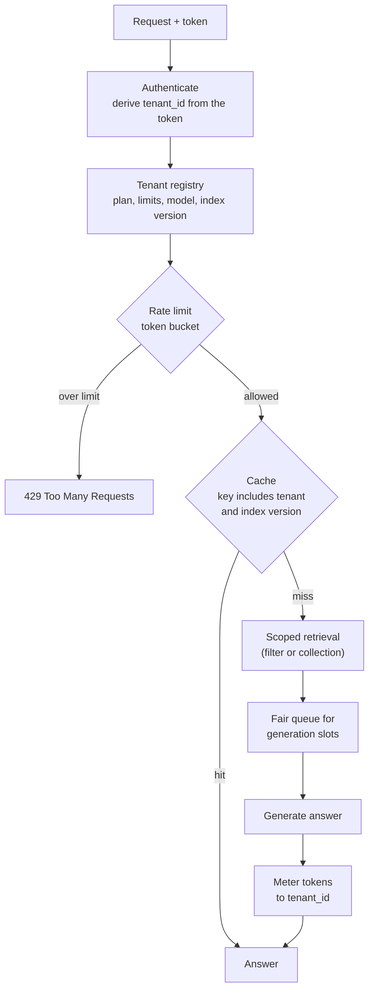

A **tenant** is a customer of a shared system: a company using your product, a department in a large organisation, sometimes a single user. A **multi-tenant** RAG system serves many tenants from one deployment while behaving, for each of them, as if it were theirs alone. The [vector-database lesson on multi-tenancy](/learn/advanced-vector-database-engineering/multi-tenancy) covered the data layer: how to store many tenants' chunks in one database and make sure a query only reads its own. This lesson covers everything around it, the **service layer**, where most of the remaining failures live.

A RAG request touches far more than the index. It carries an identity, picks a model and a prompt, hits a cache, waits for a language-model slot, spends tokens that someone must pay for, and writes logs. Each of those is shared by default, and each can leak data, starve a neighbour or hide whose bill is whose. You will build a small gateway simulation that shows the noisy-neighbour problem and compares two cures, and a cache demonstration that shows the most common silent leak.

## Learning objectives

- Identify the layers of a RAG service that must be tenant-aware beyond the vector store: identity, configuration, cache, compute, cost and telemetry.
- Design a tenant registry that makes each tenant's plan, limits, model and index version explicit configuration rather than scattered constants.
- Implement a token-bucket rate limiter and explain how its rate and burst parameters bound a tenant's admitted load.
- Compare FIFO, rate-limited and fair-queued scheduling of a shared generation pool, and predict which protects quiet tenants from a noisy one.
- Construct cache keys that cannot serve one tenant's answer to another, and explain why index version belongs in the key.

## Prerequisites

- [Multi-tenancy (vector databases)](/learn/advanced-vector-database-engineering/multi-tenancy): the silo, bridge and pool models and filter-based isolation in the index.
- [Scalable RAG systems](/learn/production-architecture/scalable-rag-systems): capacity of a stage and why queues form.
- [Authentication](/learn/backend-engineering/authentication): how a service establishes who is calling.
- [Query caching](/learn/performance-optimisation/query-caching): what is cached and how it is keyed.

## Why this matters

Imagine that the vector database is perfect: every query is filtered by tenant, verified on the way out, and tested. The service can still fail its tenants in at least four ways, none of which touches the index.

A cache keyed on the normalised question text returns the answer written for Kestrel to Orchard, because both asked "How long are exported reports kept?". A single customer's nightly bulk job fills the language-model queue, and every other customer's interactive questions wait a minute. A prompt template shared by all tenants contains one tenant's example of a "good answer", complete with that tenant's figures. A log line written for debugging contains the full retrieved text, and the log search tool is open to every engineer, including contractors who should not see customer data.

These are not exotic. They are the ordinary consequence of building a single-tenant system first and then pointing more customers at it. The aim of multi-tenant design is to find every shared resource and decide, deliberately, whether it is shared safely, partitioned, or metered.

## The intuition

An office building with many companies shares a lobby, lifts, electricity and a front desk. The security guard checks badges at the door, which is **identity**. Each company's floor has locked doors, which is **data isolation**. Nobody expects one company to use every lift for an hour, which is why the building has rules about moving furniture, **fair use of shared infrastructure**. Each tenant has its own lease terms, its own opening hours and its own signage, which is **per-tenant configuration**. The landlord reads each company's electricity meter, which is **metering**. And the post room never delivers one company's parcels to another because parcels are labelled with the recipient, which is **scoped caching**.

A building that only had locked floors would be secure and still unusable: one tenant could block the lifts, and the landlord could not bill anyone. Multi-tenant RAG needs all six.

## How it works

### The request path, tenant by tenant



Every box after authentication receives `tenant_id` from the **tenant context**, a small immutable object built once at the edge. Passing the context explicitly (rather than reading a global) means code that forgets it fails to compile or run, instead of quietly serving the wrong tenant.

### Identity: the tenant comes from the token

The rule from the data-layer lesson applies everywhere: `tenant_id` is derived from a verified credential, such as the claims in a signed token, and never from a field in the request body, a header the client controls, or a URL segment that was not checked against the token. A request that names a tenant different from its token's should be rejected, not silently corrected, and the mismatch logged as a security event. Background workers that act for a tenant (re-indexing, evaluation) take the tenant from the job record that the API wrote, and the job runner builds the same context.

### The tenant registry

Things that differ per tenant should live in one place: a **tenant registry**, a table or service holding each tenant's configuration. Typical entries:

| Field | Why it varies |
| --- | --- |
| Plan and rate limits | Enterprise customers pay for more throughput |
| Daily token quota | Caps spend and abuse |
| Embedding model and **index version** | Tenants indexed at different times, or with different models, cannot share a query vector space |
| Generation model and system prompt | Tone, language, refusal wording and permitted sources differ |
| Data location | Residency requirements may pin a tenant to a region |
| Isolation tier (pool, dedicated shard, silo) | Large or regulated tenants earn stronger isolation |

Two consequences follow. First, query-time code must read the embedding model from the registry, since a query embedded with the wrong model against a tenant's index returns confident nonsense with no error; the same problem as mixing models in any index (see [Index versioning](/learn/ci-cd-and-mlops/index-versioning)). Second, changing a tenant's tier (promoting it to a dedicated shard, say) becomes a registry update plus a data migration, not a code change.

### Per-tenant prompts and what they may contain

A system prompt is configuration, and configuration is a leak vector. Do not embed one tenant's data in a template shared by others. Few-shot examples, glossary terms and tone instructions that are tenant-specific belong in that tenant's registry entry and are interpolated per request. Treat tenant-supplied prompt text as untrusted too: a tenant admin can write instructions that try to override your safety rules ([Prompt injection](/learn/rag-security-fundamentals/prompt-injection)).

### Caching without leaks

A cache saves a retrieval and a generation when the same question recurs, which in a shared system happens constantly. A key is a statement of when two requests are interchangeable, and two requests from different tenants never are, even when the text is identical, because the retrieved context differs. A correct key combines:

1. the **tenant id**,
2. the **index version** (so that a reindex invalidates cached answers built from the old documents; see [Index versioning](/learn/ci-cd-and-mlops/index-versioning)),
3. any user-level **permission scope** if documents inside a tenant are access-controlled ([Document-level permissions](/learn/access-control-and-privacy/document-level-permissions)),
4. the normalised query, and the model and prompt version.

Semantic caches ([Semantic caching](/learn/performance-optimisation/semantic-caching)) match by similarity rather than equality, so the same rule is stricter there: the similarity search must be filtered by the same scope, or "similar enough" will cross a tenant boundary.

### Fairness on a shared pool

The language-model concurrency from [Scalable RAG systems](/learn/production-architecture/scalable-rag-systems) is a shared, scarce resource, and without a policy the heaviest user takes most of it. Two complementary tools exist.

**Rate limiting** bounds how much each tenant may send. The standard algorithm is the **token bucket**: a bucket holds up to $b$ tokens (the **burst**) and refills at $r$ tokens per second (the **rate**); each request removes one token, and a request that finds the bucket empty is rejected (HTTP 429) or told to retry later. It allows short bursts while enforcing a long-run average. Limits protect the pool only if they are set against its capacity: if the sum of every tenant's allowed rate exceeds what the pool can serve, a coincident burst still queues.

**Fair queueing** decides who is served next when slots free up. Instead of one first-in-first-out queue, keep one queue per tenant and serve the tenants in turn (round robin, or weighted round robin so that bigger plans get proportionally more turns). A tenant that floods its own queue only delays itself, because its neighbours' requests are always at the front of their own queues.

Used together, limits cap the damage a single tenant can do to the shared budget, and fair queueing ensures the leftover contention is shared evenly. Rejected or queued requests should return a clear signal (`Retry-After`) so well-behaved clients back off instead of retrying immediately.

> [!KEY]
> Isolation of data and isolation of capacity are separate problems. A system can have perfect data isolation and still let one tenant take everyone's throughput.

### Metering and cost attribution

A pooled system bills one provider account, so per-tenant cost exists only if you record it. On every request, attribute to `tenant_id`: input and output tokens (the provider returns them in the response's `usage` field), embedding tokens, rerank calls and the number of chunks retrieved. Aggregate by day. This serves three purposes: quotas (stop at a tenant's daily limit), billing or chargeback, and decisions, such as which tenants deserve a dedicated tier. The same label should appear on traces and metrics ([Cost tracking](/learn/rag-observability/cost-tracking)), so that "latency doubled" can be read as "for one tenant" or "for everyone".

### Telemetry is also data

Logs, traces and evaluation sets contain tenant documents and questions. Treat them as tenant data: restrict who can read them, redact or hash content that is not needed for debugging, keep retention aligned with each tenant's contract, and make sure tenant deletion covers them. Offboarding that removes vectors but leaves two years of retrieved text in a log index has not deleted anything. [Tenant isolation](/learn/access-control-and-privacy/tenant-isolation) and [Secure deletion](/learn/enterprise-rag-governance/secure-deletion) in later modules return to this.

## The mathematics

### Token bucket bounds

**Intuition.** A bucket that refills steadily and can hold a limited reserve lets a tenant send quickly for a short time and no faster than the refill rate in the long run.

Let the rate be $r$ requests per second and the burst $b$ requests. In any time window of length $T$ seconds, the number of requests the bucket can admit is at most

$$
N_{\max}(T) = b + rT
$$

$b$ is the full bucket spent at once, $rT$ the refills during the window. **By hand.** With Kestrel's configuration in the code below ($r = 3$, $b = 6$), over a 20-second window at most $6 + 3 \times 20 = 66$ requests are admitted, however fast Kestrel sends. Over 60 seconds, at most 186.

### Fair share when demand exceeds capacity

**Intuition.** Fairness is not "everyone gets the same" but "nobody gets less than they need unless someone else is taking more than their share". The standard definition is **max-min fairness**: raise every tenant's allocation equally, and stop raising a tenant once its demand is met.

**By hand.** Capacity is 4 requests per second. Demands: Orchard 1, Brightwater 1, Kestrel 12. Equal split is $4/3 \approx 1.33$ each; Orchard and Brightwater need only 1, so they are satisfied with 1 each, leaving $4 - 2 = 2$ for Kestrel. Kestrel receives 2 per second and queues the rest. A weighted version divides capacity in proportion to plan weights after satisfied tenants drop out. Round-robin queueing realises this allocation approximately without computing it.

## In code

**The problem.** Replay a 60-second trace on a shared generation pool of 8 slots (mean 2 s per request, so a capacity of 4 requests per second). Orchard and Brightwater send 1 request per second throughout. Kestrel also sends 1 per second, except for a 20-second bulk job at 12 per second. Compare four policies on the wait each tenant experiences: first-in-first-out, FIFO with per-tenant token buckets, fair queueing, and both together.

**Dependencies.** NumPy only; this is a simulation of the gateway's scheduling, not a web service.

```bash
pip install numpy
```

```python
"""Noisy-neighbour control for a shared generation pool: rate limits vs fair queueing."""
import heapq
from collections import deque
from dataclasses import dataclass
import numpy as np

@dataclass(frozen=True)
class TenantConfig:
    plan: str
    rate: float      # sustained requests per second allowed
    burst: float     # bucket size

REGISTRY = {
    "kestrel":     TenantConfig("enterprise", rate=3.0, burst=6),
    "orchard":     TenantConfig("standard",   rate=1.5, burst=3),
    "brightwater": TenantConfig("standard",   rate=1.5, burst=3),
}

class TokenBucket:
    def __init__(self, rate, burst):
        self.rate, self.burst, self.tokens, self.last = rate, burst, burst, 0.0
    def allow(self, now):
        self.tokens = min(self.burst, self.tokens + (now - self.last) * self.rate)
        self.last = now
        if self.tokens >= 1:
            self.tokens -= 1
            return True
        return False

def make_traffic(seed=5, horizon=60.0):
    """Poisson arrivals: orchard and brightwater at 1 req/s; kestrel at 1 req/s,
    except for a 20 s burst at 12 req/s starting at t = 20 (a bulk job)."""
    rng = np.random.default_rng(seed)
    jobs = []
    def poisson(rate, t0, t1, tenant):
        t = t0
        while True:
            t += rng.exponential(1 / rate)
            if t >= t1:
                return
            jobs.append((t, tenant, rng.lognormal(np.log(2.0) - 0.125, 0.5)))
    poisson(1.0, 0, horizon, "orchard")
    poisson(1.0, 0, horizon, "brightwater")
    poisson(1.0, 0, 20, "kestrel")
    poisson(12.0, 20, 40, "kestrel")
    poisson(1.0, 40, horizon, "kestrel")
    return sorted(jobs)

def run(jobs, slots, policy, limit):
    """Shared pool of `slots` generation slots. policy: 'fifo' or 'fair' (round robin)."""
    buckets = {t: TokenBucket(c.rate, c.burst) for t, c in REGISTRY.items()}
    queues = {t: deque() for t in REGISTRY}
    fifo = deque()
    busy, events, waits = 0, [], {t: [] for t in REGISTRY}
    rejected = {t: 0 for t in REGISTRY}
    rr = list(REGISTRY)
    def dispatch(now):
        nonlocal busy, rr
        while busy < slots:
            if policy == "fifo":
                if not fifo: return
                arr, tenant, svc = fifo.popleft()
            else:
                for _ in range(len(rr)):                    # next non-empty tenant, round robin
                    tenant = rr[0]; rr = rr[1:] + rr[:1]
                    if queues[tenant]: break
                else:
                    return
                arr, tenant, svc = queues[tenant].popleft()
            waits[tenant].append(now - arr)
            busy += 1
            heapq.heappush(events, (now + svc, "done"))
    for arr, tenant, svc in jobs:
        while events and events[0][0] <= arr:               # finish work before this arrival
            t_done, _ = heapq.heappop(events); busy -= 1; dispatch(t_done)
        if limit and not buckets[tenant].allow(arr):
            rejected[tenant] += 1
            continue
        (fifo if policy == "fifo" else queues[tenant]).append((arr, tenant, svc))
        dispatch(arr)
    while events:                                           # drain: finish all admitted work
        t_done, _ = heapq.heappop(events); busy -= 1; dispatch(t_done)
    return waits, rejected

jobs = make_traffic()
print("Offered load:", {t: sum(1 for j in jobs if j[1] == t) for t in REGISTRY})
print("Pool capacity: 8 slots / 2.0 s = 4.0 req/s\n")
print(f"{'scenario':<28}{'tenant':<13}{'served':>7}{'rejected':>9}{'p95 wait s':>11}")
for label, policy, limit in [("FIFO, no limits", "fifo", False),
                             ("FIFO + per-tenant limits", "fifo", True),
                             ("Fair queue, no limits", "fair", False),
                             ("Fair queue + limits", "fair", True)]:
    waits, rej = run(jobs, slots=8, policy=policy, limit=limit)
    for t in REGISTRY:
        p95 = np.percentile(waits[t], 95) if waits[t] else float("nan")
        print(f"{label:<28}{t:<13}{len(waits[t]):>7}{rej[t]:>9}{p95:>11.1f}")
    print()
```

**How it works.** `REGISTRY` stands in for the tenant registry: the limits are read from it, not hard-coded in the scheduler. `run` is an event-driven model of the pool: `events` is a heap of completion times, and every arrival first lets finished work free its slot. In FIFO mode one queue serves everyone in arrival order. In fair mode each tenant has its own queue and `dispatch` rotates through the tenants, taking from the next one that has work waiting. The token bucket is applied at admission, before queueing. Waits measure time from arrival to getting a slot, not service time.

```output
Offered load: {'kestrel': 294, 'orchard': 57, 'brightwater': 68}
Pool capacity: 8 slots / 2.0 s = 4.0 req/s

scenario                    tenant        served rejected p95 wait s
FIFO, no limits             kestrel          294        0       54.3
FIFO, no limits             orchard           57        0       55.1
FIFO, no limits             brightwater       68        0       55.2

FIFO + per-tenant limits    kestrel          101      193        6.7
FIFO + per-tenant limits    orchard           55        2        6.5
FIFO + per-tenant limits    brightwater       65        3        6.0

Fair queue, no limits       kestrel          294        0       62.9
Fair queue, no limits       orchard           57        0        1.5
Fair queue, no limits       brightwater       68        0        2.3

Fair queue + limits         kestrel          101      193       10.8
Fair queue + limits         orchard           55        2        1.5
Fair queue + limits         brightwater       65        3        1.1
```

**What the output means.** With no controls, Kestrel's burst raises the 95th-percentile wait of the quiet tenants to about 55 seconds: they did nothing wrong and are as slow as the offender. Per-tenant limits cut that to around 6 seconds by rejecting 193 of Kestrel's 294 requests, but they do not remove it, because the three limits add up to 6 requests per second against a pool capacity of 4. The limits bound each tenant, not the sum, so a coincident burst still queues. Fair queueing alone gives Orchard and Brightwater waits of 1.5 and 2.3 seconds, and Kestrel pays for its own flood with a 63-second tail. Together, the quiet tenants wait about a second, and Kestrel's wait drops to 10.8 seconds because the limiter rejects the excess instead of queueing it for a minute. Rejected requests are the price of the limit: whether to reject or to queue and delay is a product decision, and a bulk job should ideally be submitted through a batch path ([Queue-based pipelines](/learn/production-architecture/queue-based-pipelines)) rather than the interactive one.

**Common errors.** Setting limits per tenant without checking their sum against capacity (as above). Keeping limiter state in each API instance's memory, which multiplies the effective limit by the number of instances; production limiters keep counters in a shared store such as Redis or enforce at a gateway. Using the client's address instead of the tenant as the limiter key, so that one tenant behind one office address is limited with all its colleagues, or many tenants share one proxy. Not returning `Retry-After`, so clients retry at once.

Now the cache. The next program, which runs with the standard library, demonstrates the leak and its fix:

```python
"""Why a shared answer cache must be keyed by tenant (and by index version)."""
import hashlib

def key(query, tenant=None, index_version=None):
    norm = " ".join(query.lower().split())
    parts = [tenant or "-", index_version or "-", norm]
    return hashlib.sha256("|".join(parts).encode()).hexdigest()[:12]

answers = {"kestrel": "Reports are kept for 7 years.", "orchard": "Reports are deleted after 90 days."}
q = "How long are exported reports kept?"

shared = {}                                              # BUG: key ignores the tenant
shared[key(q)] = answers["kestrel"]                      # kestrel asks first
print("orchard, unscoped key :", shared.get(key(q)))

scoped = {}
scoped[key(q, "kestrel", "v7")] = answers["kestrel"]
print("orchard, scoped key   :", scoped.get(key(q, "orchard", "v7")))
print("kestrel, scoped key   :", scoped.get(key(q, "kestrel", "v7")))
print("kestrel after reindex :", scoped.get(key(q, "kestrel", "v8")))
```

```output
orchard, unscoped key : Reports are kept for 7 years.
orchard, scoped key   : None
kestrel, scoped key   : Reports are kept for 7 years.
kestrel after reindex : None
```

The first line is the leak: Orchard is told Kestrel's retention policy, with no error anywhere. The scoped key makes Orchard miss (and therefore retrieve from its own documents), still lets Kestrel hit, and after Kestrel's index moves from version `v7` to `v8` the old entry is simply never found, so no explicit invalidation is needed. Extend it with the user's permission scope when documents inside a tenant have different readers, and with a time-to-live so that stale entries expire even without a reindex.

## A real-world example

A fictional company, Northgate Insights, sells an analytics assistant to law firms. The first customers are loaded into a single pooled collection with a `tenant_id` filter, and the data layer is tested thoroughly. Six months in, two incidents occur in the same week.

In the first, a customer runs an overnight evaluation script through the public API, with no limits, using their own 40,000 sample questions. Morning users at every other firm see 30-second answers until the script finishes. The platform team adds a token bucket per tenant, sets the limits against measured pool capacity (the sum is deliberately kept near the pool's capacity, with a fair queue in front of the slots), and creates a separate low-priority "batch" lane for scripted use.

In the second, a partner at one firm notices that the assistant's answer to "What is our standard notice period?" quotes a figure from another firm's template. The response cache was keyed on the question alone, written during the first week when there was a single customer. The fix is a three-line change to the key, but the audit afterwards is the real work: the team lists every shared resource (cache, prompt templates, logging index, evaluation sets) and records, for each, whether it is partitioned, scoped by key, or deliberately shared. Two more gaps turn up: debug logs contain retrieved text readable by all staff, and the evaluation dataset mixes tenants' questions. Both are fixed before they matter.

## Common mistakes

- **Treating tenant filtering in the index as the whole job.** Caches, prompts, logs and queues leak or starve independently of the index.
- **Cache keys without the tenant.** One customer's answer is served to another with no error. Include tenant, index version and permission scope.
- **Taking the tenant from the request.** Anything the client sends can be forged. Derive it from the verified token.
- **Per-tenant limits that sum to more than capacity.** Each tenant is "within limits" and the pool still saturates. Check the sum, or add fair queueing.
- **Limiter state in process memory.** Ten API instances each allow the full rate, so the real limit is ten times higher.
- **One shared prompt with tenant examples.** Few-shot examples and glossaries contain tenant data. Keep them per-tenant and interpolate per request.
- **No per-tenant metering.** Without token counts by tenant, you cannot bill, cap or even explain a cost spike.
- **Ignoring telemetry in offboarding.** Deleting vectors while logs and caches keep the text leaves tenant data in the system.

## Best practices

- Build an immutable tenant context at the edge and pass it explicitly; make functions that need a tenant require it as a parameter.
- Keep per-tenant configuration (plan, limits, model, index version, prompt additions, tier) in a registry with an audit trail, not in code.
- Enforce limits at a gateway or with a shared counter, and combine them with fair queueing for the scarce generation pool.
- Offer a separate batch lane for bulk and scripted workloads so that they cannot compete with interactive users.
- Meter tokens and calls by tenant on every request and use the same label on logs, traces and metrics.
- Write a cross-tenant test that is part of CI: authenticate as tenant A, ask for tenant B's content, and assert nothing from B is returned, cached or logged.
- Review the list of shared resources whenever a new component (a cache, a queue, an evaluation store) is added.
- Decide a promotion path in advance: when a tenant outgrows the pool, what moves to a dedicated tier, and how.

## Performance considerations

Tenancy adds small constant costs per request: a registry lookup (cache it with a short time-to-live), a limiter check (one in-memory or Redis operation, typically well under a millisecond on a local network), and a metering write (do it asynchronously, off the response path). The larger cost is structural. A cache keyed per tenant has a lower hit rate than a global one, because the same question from ten tenants is ten entries; that is the price of correctness, and the way to recover hit rate is within a tenant (users of one company ask similar things), not across tenants.

Fair queueing slightly increases the mean wait of the heaviest tenant and sharply lowers the tail of everyone else, which is usually the right trade. Capacity planning becomes per tier: sum the expected peak of each tenant class, add the pooled long tail's statistical smoothing (many small tenants have less correlated peaks than one large one), and keep the headroom from [Scalable RAG systems](/learn/production-architecture/scalable-rag-systems). Dedicated tiers cost more, because idle capacity is reserved per tenant; that cost is what the customer pays for.

## Security considerations

Multi-tenancy is a security architecture, so assume that mistakes will happen and design for containment. Layer the defences: verified identity, scoped data access, a post-retrieval check that all returned chunks belong to the caller's tenant, scoped caches, and per-tenant limits. Treat a cross-tenant result as a security incident to log and alert on, not as an error to swallow. Do not trust model output to enforce isolation: the model sees whatever you put in its context, so isolation has to be decided before the prompt is built. Credentials used by background jobs should be scoped per tenant where practical, so that a bug in one job cannot reach another tenant's data. Side channels are subtle but real: shared rate limits or cache timing can reveal that another tenant exists or is active, which matters for regulated customers. The enforcement details (authorisation models, encryption keys per tenant) are developed in [Tenant isolation](/learn/access-control-and-privacy/tenant-isolation).

## Summary

- Multi-tenancy is more than index isolation: identity, configuration, caches, queues, cost and telemetry are all shared by default and must each be made safe.
- The tenant comes from a verified token and travels as an explicit, immutable context; per-tenant settings live in a registry.
- Cache keys must contain the tenant and the index version (and the permission scope where relevant), or one tenant's answer is served to another.
- Token buckets bound each tenant's admitted load by $b + rT$; they protect the pool only if limits are set against its capacity.
- Fair queueing lets a flooding tenant delay only itself, and works best together with limits and a batch lane.
- Meter tokens by tenant, and treat logs and traces as tenant data in offboarding.

## Exercises

**1.** A tenant's token bucket has rate 2 requests per second and burst 10. What is the most it can have admitted in the first 30 seconds, assuming a full bucket at the start? How long does an empty bucket take to refill completely?

<details><summary>Show solution</summary>

At most $10 + 2 \times 30 = 70$ requests. An empty bucket refills at 2 tokens per second, so it takes $10 / 2 = 5$ seconds.

</details>

**2.** Capacity is 10 requests per second. Demands are A: 2, B: 3, C: 20, D: 20. Compute the max-min fair allocation.

<details><summary>Show solution</summary>

The equal share is 2.5. A needs only 2, so it is satisfied with 2, leaving 8 for the other three, an equal share of 2.667. B's demand of 3 is above that, so B is not satisfied and nobody else is either. Final allocation: A 2, B 2.667, C 2.667, D 2.667.

</details>

**3.** An API runs on 6 instances, each with its own in-memory token bucket of rate 5 per second. A tenant's requests are spread evenly by the load balancer. What is the tenant's effective limit? What are two ways to enforce the intended 5 per second?

<details><summary>Show solution</summary>

Each instance admits 5 per second, so the tenant can send up to $6 \times 5 = 30$ per second. Fixes: keep the counter in a shared store that all instances update atomically (for example Redis, using a script or atomic operations), or enforce the limit at a single gateway in front of the instances. A cruder approximation is to divide the rate by the instance count (5/6 per instance), which works only if the balancer distributes evenly and the instance count is stable.

</details>

**4.** Extend the scheduler of this lesson with weighted round robin, where Kestrel (enterprise) gets two turns for each turn of the standard tenants. Predict the effect on the quiet tenants' waits, then implement it and check.

<details><summary>Show solution</summary>

Replace `rr = list(REGISTRY)` with `rr = ["kestrel", "kestrel", "orchard", "brightwater"]` (weights as repetition); the rotation already skips empty queues. When every tenant has work waiting, Kestrel gets half of the freed slots instead of a third, so the quiet tenants should wait somewhat longer than under plain round robin and Kestrel's tail should shrink. Running it gives p95 waits of 3.1 s (Orchard) and 5.7 s (Brightwater) without limits, and 2.6 s and 4.3 s with limits, against 1.5 and 2.3 s (no limits) for plain round robin and 55 s for FIFO. The quiet tenants remain protected because their demand fits inside their guaranteed share, which is the property to check whenever you change weights.

</details>

## Check your understanding

```quiz
[
  {
    "q": "An AskMeridian-style service has perfect tenant filtering in its vector index. Tenant B nevertheless receives an answer that contains tenant A's retention policy. Which is the most likely cause?",
    "options": ["The embedding model is too small", "The vector index returned too many results", "A response cache keyed on the normalised question text alone", "The token bucket refilled too slowly"],
    "answer": 2,
    "why": "Identical question text from two tenants hits the same cache entry unless the key includes the tenant. The index was never consulted."
  },
  {
    "q": "A token bucket has rate 4 per second and burst 8. What is the maximum number of requests it can admit in a 10-second window starting with a full bucket?",
    "options": ["40", "48", "32", "8"],
    "answer": 1,
    "why": "N_max = b + rT = 8 + 4 x 10 = 48: the stored burst plus the refills during the window."
  },
  {
    "q": "Three tenants each have a limit of 3 requests per second and the shared pool can serve 4 per second. What problem remains even when every tenant stays within its limit?",
    "options": ["The limits are too low for any tenant to be served", "The sum of limits (9) exceeds the capacity (4), so coincident load still queues", "Token buckets cannot allow bursts", "Rate limits make caching impossible"],
    "answer": 1,
    "why": "Per-tenant limits bound each tenant, not the total. Capacity planning or fair queueing must handle the sum."
  },
  {
    "q": "What does fair queueing (one queue per tenant, served in turn) do when one tenant floods the system?",
    "options": ["It drops the flooding tenant's requests", "It makes the flooding tenant's own requests wait while other tenants' requests are served promptly", "It delays every tenant equally", "It increases total capacity"],
    "answer": 1,
    "why": "Each tenant's queue is served in rotation, so the flood lengthens only the flooder's queue. It does not add capacity or drop requests."
  },
  {
    "q": "Why should the index version be part of the cache key?",
    "options": ["It makes keys shorter", "After a reindex, answers cached from the old documents are never matched again, so stale answers are not served", "It lets different tenants share entries", "It is required by the vector database"],
    "answer": 1,
    "why": "A new index version changes the key, so entries built from the old index simply miss; no explicit invalidation is needed."
  }
]
```

## Further reading

- Kleppmann, M. (2017), *Designing Data-Intensive Applications*, O'Reilly, for background on partitioning and shared resources.
- Beyer, B., Jones, C., Petoff, J. and Murphy, N. R. (eds.) (2016), *Site Reliability Engineering*, O'Reilly, available at https://sre.google/books/, the chapter on handling overload.
- Demers, A., Keshav, S. and Shenker, S. (1989), "Analysis and Simulation of a Fair Queueing Algorithm", *ACM SIGCOMM*, the paper that introduced fair queueing.
- Bertsekas, D. and Gallager, R. (1992), *Data Networks*, Prentice Hall, the treatment of max-min fairness.
- [Qdrant documentation](https://qdrant.tech/documentation/): multitenancy guidance.
- [OWASP Cheat Sheet Series](https://cheatsheetseries.owasp.org/): authorisation and multi-tenant guidance.
