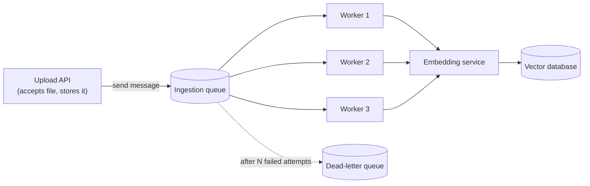
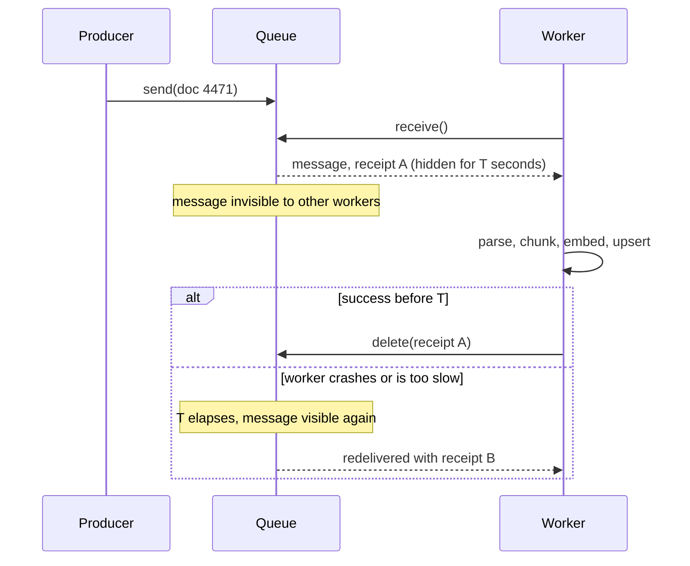

When a user uploads a 300-page PDF to a RAG product, nobody expects it to be searchable before the upload button finishes spinning. Parsing it, chunking it, embedding a thousand chunks and writing them to the vector database takes minutes, and the embedding provider may refuse some of the calls along the way. The request that accepted the file should not wait for any of that, and it must not lose the file if a worker dies halfway. A **queue** solves both problems: the producer writes a small message ("index document 4471") to durable storage and returns at once, and a pool of workers takes messages off the queue at its own pace.

This lesson explains queue-based pipelines for RAG: what a queue gives you, the delivery guarantee you really get (and why it forces your workers to be idempotent), visibility timeouts, retries with backoff, dead-letter queues, backpressure, and the arithmetic of draining a backlog. You will build a small reliable queue and simulate crashing workers and a poison document, with and without idempotent writes, and read the results. How ingestion work is split across workers and stages is the subject of [Distributed ingestion](/learn/production-architecture/distributed-ingestion); this lesson is the delivery mechanism underneath it.

## Learning objectives

- Explain what a queue decouples (producer from consumer in time, rate and failure) and when a RAG stage should be placed behind one.
- Distinguish at-most-once, at-least-once and exactly-once delivery, and explain why at-least-once plus an idempotent consumer is the practical design.
- Trace a message through receive, visibility timeout, acknowledgement, retry and dead-lettering.
- Calculate the time to drain a backlog from the arrival rate, the worker count and the per-message service time.
- Design a retry policy with capped exponential backoff and jitter, and decide which failures should never be retried.

## Prerequisites

- [Scalable RAG systems](/learn/production-architecture/scalable-rag-systems): the interactive and background paths, and Little's law.
- [Offline and online processing](/learn/rag-architecture-fundamentals/offline-and-online-processing): why ingestion is a separate workload from query serving.
- [Async endpoints](/learn/backend-engineering/async-endpoints): how an API can accept work and return before it finishes.
- [Error handling](/learn/backend-engineering/error-handling): transient versus permanent errors.

## Why this matters

Without a queue, background work is done in the request that triggered it, or in a thread the API process started and forgot. Redeploy the API mid-embedding and the work vanishes. Receive a hundred uploads at once and a hundred embedding calls start together and meet rate-limit errors. Let the vector database blink and every in-flight upload fails. The system works in a demo and silently loses documents in production.

A queue turns those failures into delays: the message is stored before the producer hears "accepted", workers pull at their own rate, and an outage makes messages reappear later. The price is eventual consistency (the document is not searchable yet), work that may be done twice, and a component whose depth and age you must watch.

## The intuition

Think of the post room at Meridian's head office. Staff drop parcels into a tray and walk away; they do not wait for the courier. The tray is the queue. Two clerks take parcels from it, one at a time. If forty parcels arrive at 09:00, the tray fills and empties over the morning, and nobody is blocked.

Now add complications. A clerk picks up a parcel, then goes home ill. The fix is a rule: a parcel taken from the tray goes into an "in progress" pile with a note, "if not signed off within ten minutes, put it back". A clerk who finishes signs the note and the parcel is removed for good. That is the **visibility timeout**. Its consequence: a clerk who is merely slow (twelve minutes) causes the parcel to be sent twice. Nothing is lost, but something is sometimes duplicated.

Finally, one parcel is addressed to "nobody, nowhere". Every clerk takes it, cannot deliver it, and it returns to the tray after ten minutes, again and again, for ever. The fix is a second rule: after four attempts, move the parcel to a "problem parcels" shelf for a person to look at. That shelf is the **dead-letter queue**. Everything in this lesson is those three ideas: a durable tray, a take-and-confirm protocol, and a shelf for what cannot be delivered.

## How it works

### What a queue decouples

A **message queue** is durable storage with an ordering and a protocol for handing messages to consumers. Producers and consumers are decoupled in three ways.

- **In time.** The producer does not wait for the consumer, and the consumer need not be running when the message is sent.
- **In rate.** The producer can send faster than the consumer works; the queue absorbs the difference as a backlog. This is **load levelling**.
- **In failure.** A crashed consumer does not fail the producer, and a crashed producer does not lose messages already sent.

In a RAG system the natural places for a queue are the stages that are slow, rate-limited or bursty and that nobody is actively waiting for: document parsing, embedding of new chunks, writing to the index, re-embedding after a model change, and evaluation jobs. The query path is the opposite: a user is waiting, so putting a queue in front of retrieval and generation would add delay for no benefit. Where the interactive path is overloaded, **load shedding** (refusing quickly with an error) beats queueing.



The message should be small and carry a **reference**, not the payload: a document identifier, the object-storage key of the uploaded file and a version. Messages stored with their data inflate the queue, hit size limits (a hosted queue typically caps message size, so check the service's documentation) and go stale when the document changes. A worker that receives a reference reads the current document from the source of truth.

### Delivery guarantees

After a worker has done its work but before its acknowledgement reaches the queue, the queue cannot know whether the work happened. Its choice defines the guarantee.

- **At-most-once.** The queue forgets a message when it hands it out. A crash loses it; duplicates are impossible.
- **At-least-once.** The queue keeps the message until acknowledged and redelivers on silence. Loss is impossible short of the queue failing, but duplicates are possible.
- **Exactly-once.** Between independent systems (a queue and a vector database) the effect and the acknowledgement cannot be made atomic, so the queue alone cannot guarantee it. Products using the name offer a producer-side deduplication window, or exactly-once inside one system that controls both ends. Read the fine print.

For ingestion, losing a document is worse than processing it twice, so choose at-least-once. That puts the burden on the consumer: **it must produce the same result when it sees the same message twice**, which is being **idempotent**. Indexing gets there by deriving every chunk's identifier from its content and origin (a hash of document identifier, version and chunk position) and writing with an **upsert** rather than an append.

> [!KEY]
> At-least-once delivery plus an idempotent consumer is the dependable pattern. "Exactly-once" in practice means at-least-once delivery with effects that are safe to repeat.

### The life of a message



1. **Send.** The producer writes the message. Only after the queue confirms durable storage does it tell the user "accepted".
2. **Receive.** A worker asks for a message. The queue returns one and starts a **visibility timeout**: for that period the message is invisible to other consumers. It is not deleted.
3. **Process.** The worker does the work. For long jobs it may periodically **extend** the timeout (a heartbeat) so that a healthy but slow job is not redelivered.
4. **Acknowledge.** On success the worker deletes the message using the receipt it received. The receipt identifies *this delivery*; if the message was redelivered in the meantime, the old receipt is stale and the delete is rejected or ignored, which is what you want.
5. **Retry.** If the worker crashes, or throws and does not acknowledge, the timeout elapses and the message becomes visible again. The queue counts deliveries (the **receive count**).
6. **Dead-letter.** When the receive count exceeds a limit, the queue moves the message to a **dead-letter queue** (DLQ) instead of delivering it again. This is called a redrive policy in some products.

Choosing the visibility timeout is a trade-off. Too short and healthy slow jobs are redelivered and run twice, concurrently. Too long and a crashed worker's message stays hidden, delaying recovery. A good rule is a timeout comfortably above the 99th-percentile processing time, with a heartbeat for jobs whose duration varies a lot, such as long PDFs.

### Retries, backoff and the dead-letter queue

Most failures in a RAG pipeline are **transient**: a rate-limit response, a connection reset, a vector database restarting. The right response is to try again, but not immediately. If a downstream service is struggling and fifty workers all retry at once, the retries become the load that keeps it down. The standard remedy is **capped exponential backoff with jitter**: wait longer after each failure, never more than a ceiling, and randomise the wait so retries do not synchronise.

Other failures are **permanent**: a PDF that is encrypted, a file with no extractable text, a message whose document has been deleted, a schema the code cannot read. Retrying cannot help, and four more attempts only waste capacity. A worker should classify the error. Transient errors are left unacknowledged (or explicitly released with a delay) so the queue retries them. Permanent errors should be sent to the dead-letter queue straight away with the reason attached, or acknowledged after the failure has been recorded in a status table so the user can see "could not read this file". Treat the receive-count limit as the safety net for failures you did not anticipate, not as the main strategy.

The dead-letter queue is not a bin. It is a work list for a human. Each entry needs an alert (a non-empty DLQ is an incident of low severity, not a curiosity), a way to see the original message and the last error, and a **redrive** procedure to send the messages back to the main queue once the underlying cause is fixed. Meridian's own Relay product behaves this way: it retries a failed delivery for up to 24 hours and then moves the event to a dead-letter queue kept for 14 days. The numbers differ between systems; the structure does not.

### Backpressure and ordering

A queue absorbs bursts but hides trouble: if producers outpace consumers for long, the backlog and the age of the oldest message keep growing. **Backpressure** pushes that pressure back to the source: refuse new uploads past a backlog limit (HTTP 429 or 503 with `Retry-After`), limit worker prefetch, give each tenant a quota, and use separate queues for interactive and bulk work. A customer who edits one paragraph should not wait behind another customer's re-index of two million pages. Priority is best done as two queues with workers that prefer the first.

**Ordering** is rarely provided. A standard queue has no strict order, and parallel workers lose it anyway. If "updated" and "deleted" for one document are processed in the wrong order, the deleted document comes back. Do not depend on arrival order: put an increasing **version** in every message and ignore any message older than what the index holds. Some queues offer message groups or partition keys that order messages within a group.

### Queue products

You do not need to build a queue. Managed services (Amazon SQS, Azure Service Bus, Google Cloud Pub/Sub) give acknowledgements, visibility or ack deadlines and dead-lettering with little operational work. RabbitMQ and Redis Streams offer the same ideas self-hosted; Kafka is a partitioned log with excellent throughput and replay, where per-message retry and dead-lettering are built by you. A table of jobs claimed with `SELECT ... FOR UPDATE SKIP LOCKED` is a respectable choice at modest volume. Pick the simplest product your team already runs, and look for acknowledgements, a visibility timeout, dead-lettering and visibility of depth and age.

## The mathematics

### Draining a backlog

**Intuition.** A backlog shrinks at the rate by which workers outpace arrivals. If they only just keep up, it never shrinks.

$$
T_{\text{drain}} = \frac{B}{\mu - \lambda}, \qquad \mu = \frac{c}{\bar{S}}
$$

$B$ is the number of messages waiting, $\lambda$ the arrival rate in messages per second, $\mu$ the processing capacity in messages per second, $c$ the number of workers and $\bar{S}$ the mean seconds one message occupies a worker. The formula only applies when $\mu > \lambda$; otherwise the backlog grows without limit.

**By hand.** After a bulk import, 12,000 documents are queued. Six workers each take 2 s per document, so $\mu = 6/2 = 3$ per second. Normal arrivals continue at $\lambda = 0.5$ per second. Then $T = 12{,}000 / (3 - 0.5) = 4{,}800$ s, which is 80 minutes. Doubling the workers gives $\mu = 6$ and $T = 12{,}000 / 5.5 \approx 2{,}182$ s, about 36 minutes. Note that doubling the workers cut the time by 55 per cent, not 50, because the steady arrivals consume a fixed slice of capacity. If $\mu$ were 0.6 per second the drain would take 12,000 / 0.1 = 120,000 s, more than a day: close to the arrival rate, the backlog barely moves.

### Duplicates under at-least-once delivery

**Intuition.** Every delivery has some chance of ending without acknowledgement, so some messages are processed more than once.

If each delivery independently fails to acknowledge with probability $p$, the number of deliveries until success is geometric, with mean

$$
\mathbb{E}[\text{deliveries}] = \frac{1}{1 - p}
$$

**By hand.** With $p = 0.25$, the mean is $1/0.75 = 1.33$, so about a third of messages cost an extra delivery and, without idempotency, an extra write. For 39 healthy documents we expect about 52 deliveries. The simulation below should land near that figure.

### Capped exponential backoff with full jitter

For attempt number $n$ (starting at 1), the wait before the next try is drawn uniformly:

$$
d_n \sim \text{Uniform}\left(0,\ \min(C,\ b \cdot 2^{\,n-1})\right)
$$

$b$ is the base delay and $C$ the cap. With $b = 5$ s and $C = 300$ s, the ceiling for attempts 1 to 7 is 5, 10, 20, 40, 80, 160 and 300 s (the seventh would be 320 but is capped). Drawing from zero to the ceiling, rather than waiting exactly the ceiling, spreads retries over time. This "full jitter" variant is described in an Amazon Builders' Library article on timeouts, retries and backoff with jitter; the principle is general.

```python
import random

def backoff_ceiling(attempt, base=5.0, cap=300.0):
    return min(cap, base * 2 ** (attempt - 1))

print([backoff_ceiling(n) for n in range(1, 8)])
rng = random.Random(0)
print([round(rng.uniform(0, backoff_ceiling(n)), 1) for n in range(1, 8)])
```

```output
[5.0, 10.0, 20.0, 40.0, 80.0, 160.0, 300.0]
[4.2, 7.6, 8.4, 10.4, 40.9, 64.8, 235.1]
```

The ceilings double and then flatten at the cap. The jittered waits depend on the seed and can be short even late on, which spreads retries across a fleet.

## In code

**The problem.** Show, with real numbers, that a queue with visibility timeouts never loses a message, that crashed workers cause duplicate deliveries, that a blind append then corrupts the index while an upsert with deterministic identifiers does not, and that a poison document ends in the dead-letter queue instead of looping for ever.

**Dependencies.** The Python standard library only. The queue is a simulation on a virtual clock (one "tick" is one unit of time), so the output is deterministic. It models the protocol of a hosted queue; it is not one.

```bash
python queue_sim.py
```

```python
"""A reliable queue with visibility timeouts, retries and a dead-letter queue, simulated on a virtual clock."""
import random
import hashlib
from dataclasses import dataclass


@dataclass
class Message:
    body: dict
    receive_count: int = 0
    visible_at: int = 0          # tick at which the message may be delivered
    receipt: int = 0             # changes on every delivery


class ReliableQueue:
    def __init__(self, visibility_timeout, max_receives):
        self.visibility_timeout = visibility_timeout
        self.max_receives = max_receives
        self.messages = []       # messages not yet acknowledged
        self.dead = []           # dead-letter queue
        self._receipt = 0

    def send(self, body):
        self.messages.append(Message(body))

    def receive(self, now):
        for m in self.messages:
            if m.visible_at <= now:
                if m.receive_count >= self.max_receives:
                    self.messages.remove(m)          # redrive policy: park it
                    self.dead.append(m)
                    return self.receive(now)
                m.receive_count += 1
                self._receipt += 1
                m.receipt = self._receipt
                m.visible_at = now + self.visibility_timeout
                return m, m.receipt
        return None

    def delete(self, message, receipt):
        # A stale receipt (the message was redelivered meanwhile) is ignored.
        if message.receipt == receipt and message in self.messages:
            self.messages.remove(message)

    def backlog(self):
        return len(self.messages)


def chunk_id(doc_id, version, n):
    return hashlib.sha256(f"{doc_id}:{version}:{n}".encode()).hexdigest()[:12]


def run(idempotent, seed=7, workers=3, docs=40, crash_rate=0.25):
    rng = random.Random(seed)
    queue = ReliableQueue(visibility_timeout=3, max_receives=4)
    for i in range(docs):
        queue.send({"doc_id": f"doc-{i:02d}", "version": 1, "poison": i == 13})
    index_dict, index_list, writes = {}, [], 0
    busy = {}                   # worker -> (message, receipt, finish_tick, crashes)
    now = 0
    while (queue.backlog() or busy) and now < 500:
        for w in range(workers):
            if w in busy and busy[w][2] <= now:
                msg, receipt, _, crashes = busy.pop(w)
                if crashes:
                    continue                    # worker died before acknowledging
                queue.delete(msg, receipt)
            if w not in busy:
                got = queue.receive(now)
                if got:
                    msg, receipt = got
                    body = msg.body
                    if body["poison"]:
                        busy[w] = (msg, receipt, now + 1, True)   # parser raises, no ack
                        continue
                    for n in range(2):          # two chunks per document, written first
                        cid = chunk_id(body["doc_id"], body["version"], n)
                        writes += 1
                        if idempotent:
                            index_dict[cid] = body["doc_id"]       # upsert by deterministic id
                        else:
                            index_list.append(body["doc_id"])      # blind append
                    busy[w] = (msg, receipt, now + 1, rng.random() < crash_rate)
        now += 1
    stored = len(index_dict) if idempotent else len(index_list)
    return {"ticks": now, "writes": writes, "stored_chunks": stored,
            "dead_lettered": [m.body["doc_id"] for m in queue.dead], "backlog": queue.backlog()}


for flag in (False, True):
    print("idempotent" if flag else "append    ", run(flag))
```

```output
append     {'ticks': 34, 'writes': 116, 'stored_chunks': 116, 'dead_lettered': ['doc-13'], 'backlog': 0}
idempotent {'ticks': 34, 'writes': 116, 'stored_chunks': 78, 'dead_lettered': ['doc-13'], 'backlog': 0}
```

**The important lines.**

- `receive` hides the message by setting `visible_at = now + visibility_timeout` and bumps `receive_count`. It does not delete anything. When the count has reached `max_receives`, the next attempt to hand the message out moves it to `self.dead` instead.
- `delete` compares the receipt, so an acknowledgement from a worker that was too slow (whose message has since been redelivered) does nothing.
- In `run`, a worker that "crashes" simply never calls `delete`, exactly as a killed process would. The message reappears after three ticks.
- The index write happens **before** the acknowledgement, and the crash happens after the write. That ordering is the realistic worst case: the effect happened but the queue was never told.
- `chunk_id` hashes the document identifier, version and chunk position. The same message always yields the same two identifiers, which is what makes the dictionary write an upsert.

**What the output means.** Forty documents were sent; document 13 is poison (the parser always fails). The remaining 39 documents have two chunks each, so the correct index holds 78 chunks. Both runs performed 116 chunk writes, which is 58 deliveries of a healthy document: more than the 39 you would need with no failures, and a little above the roughly 52 that the geometric formula predicts for 25 per cent crashes (a small sample, so it fluctuates). Each of those 19 extra deliveries came from a worker that wrote and then died before acknowledging. The blind append kept all 116 chunks, so 38 of them are duplicates, and searches would return the same passage several times. The idempotent version overwrote by identifier and ends with exactly 78. Both versions delivered every healthy message eventually (backlog 0), and `doc-13` was delivered four times, failed four times, and was moved to the dead-letter queue instead of occupying a worker for ever.

**Common errors.** Acknowledging before writing turns at-least-once into at-most-once. A visibility timeout shorter than the real job length makes every message run twice at once. A random chunk identifier (`uuid4()`) makes every retry create new points.

**Extending it.** Add a `release(message, now, delay)` method for backoff, a version check that ignores stale messages, and a second queue that workers prefer.

### The same protocol on a real broker

The sketch below uses Redis Streams with redis-py. It was **not executed** (no Redis server in the sandbox); it follows the documented `XADD`, `XGROUP CREATE`, `XREADGROUP`, `XACK` and `XAUTOCLAIM` commands, and the redis-py signatures were checked locally. Test it against a real server. A stream has no built-in dead-letter queue, so the receive limit is implemented here.

```python
import redis

r = redis.Redis(decode_responses=True)
STREAM, GROUP, DLQ, MAX_DELIVERIES = "ingest", "workers", "ingest:dead", 4

try:
    r.xgroup_create(STREAM, GROUP, id="0", mkstream=True)
except redis.ResponseError as exc:
    if "BUSYGROUP" not in str(exc):          # group already exists: fine
        raise

def handle(fields):
    ...                                      # parse, chunk, embed, upsert by deterministic id

def work_once(consumer, visibility_ms=60_000):
    stale = r.xautoclaim(STREAM, GROUP, consumer, min_idle_time=visibility_ms, count=10)[1]
    fresh = r.xreadgroup(GROUP, consumer, {STREAM: ">"}, count=10, block=2000) or []
    for entries in [stale] + [e for _, e in fresh]:
        for msg_id, fields in entries:
            times = r.xpending_range(STREAM, GROUP, msg_id, msg_id, 1)[0]["times_delivered"]
            if times > MAX_DELIVERIES:
                r.xadd(DLQ, {**fields, "original_id": msg_id})
                r.xack(STREAM, GROUP, msg_id)
                continue
            try:
                handle(fields)
            except Exception:
                continue                     # unacknowledged: claimed again later
            r.xack(STREAM, GROUP, msg_id)
```

The mechanism matches the simulation: an unacknowledged entry stays in the pending list, its idle time plays the visibility timeout, and the delivery count drives dead-lettering.

## A real-world example

A team at a legal-technology start-up, call them the Docket team, let customers upload case files into a RAG assistant. Their first design embedded each upload inside the HTTP request. A 900-page archive timed out at the load balancer, the browser retried, and two copies of the upload began embedding at once. The customer saw an error, but the index quietly received two copies of most chunks, and answers began to quote the same paragraph twice.

They moved to a queue. The upload API stores the file, sends `{upload_id, version}` and returns 202 Accepted with a status URL. Workers embed with a per-tenant concurrency cap and upsert chunks with identifiers derived from `upload_id`, page and position. An encrypted PDF is classified as permanent and recorded as "password protected"; anything reaching five deliveries goes to the dead-letter queue, which pages the on-call engineer if it stays non-empty for an hour. Two later lessons followed: the queue's age, not its depth, was the number that exposed a rate-limit problem, and a customer's 40,000-page import blocked everyone's small uploads until bulk and interactive work got separate queues and pools.

## Common mistakes

- **Acknowledging before the work is durable.** A crash after the acknowledgement loses the document, and nothing records that it was ever accepted.
- **Non-idempotent consumers.** Appending chunks with random identifiers turns every redelivery into duplicate search results.
- **A visibility timeout shorter than the slowest job.** Healthy workers are raced by their own retries and each message runs twice, concurrently.
- **Infinite retries, no dead-letter queue.** One poison message circulates for ever, wasting capacity and hiding in the noise.
- **Retrying permanent errors.** An encrypted PDF fails identically on every attempt; the retries only add load.
- **Monitoring depth but not age.** A queue of 500 messages may be fine or may be six hours behind; age of the oldest message is the number users feel.

## Best practices

- Send a small message containing identifiers and a version; read the document from the source of truth in the worker.
- Make every consumer idempotent: deterministic identifiers, upserts, and a check that ignores messages older than the stored version.
- Classify errors. Retry transient failures with capped exponential backoff and jitter; send permanent failures to the DLQ immediately with the reason.
- Set the visibility timeout above the 99th-percentile job time and heartbeat long jobs.
- Alert on the oldest message's age, the DLQ depth and the receive count of messages in flight, and write a redrive runbook before you need it.
- Use separate queues (and worker pools) for interactive and bulk work, and give each tenant a quota.

## Performance considerations

Throughput is limited by the slowest stage the workers call, not by the queue. If the embedding provider allows a fixed number of requests or tokens per minute (set out in its documentation and dependent on your account), more workers beyond the point of saturation produce rate-limit errors and retries, not speed. Estimate $\mu$ from the provider's limit and your batch size, then size workers to that.

Visibility timeouts add recovery latency: after a crash, the message waits out the remaining timeout before another worker can take it, so a 10-minute timeout means up to a 10-minute delay. A nightly job enqueuing 100,000 messages at 2 s each across 20 workers has $\mu = 10$ per second and takes about 10,000 s, nearly three hours; decide whether that is acceptable or whether to add workers for the window. Autoscaling workers on queue depth or age is covered in [Horizontal scaling](/learn/production-architecture/horizontal-scaling).

A hosted queue typically charges per request, so send one message per document, not per chunk, and use long polling where offered.

## Security considerations

Messages are input to a privileged process. Include the tenant identifier in the message and have the worker authorise the document against it; treat an object-storage key as a reference to validate, not a path to open.

Dead-letter queues and failure logs often retain document fragments or error messages that include them. Apply the same retention and access rules as the source documents, and scrub content from error text. Encrypt queues at rest where the service supports it, give producers permission to send only and workers permission to receive and delete only, and keep the redrive permission narrower still. A redrive can replay messages that were rejected for a reason (a malicious file), so check the cause before replaying.

## Summary

- A durable queue decouples the producer from the consumer in time, rate and failure, so background RAG work (parsing, embedding, indexing) survives crashes and bursts.
- Delivery is at-least-once: messages are never lost but may be delivered several times, so consumers must be idempotent, using deterministic identifiers and upserts.
- The visibility timeout, receipts, receive counts and a dead-letter queue give the retry protocol; transient errors are retried with capped exponential backoff and jitter, permanent errors go straight to the DLQ.
- Backpressure, per-tenant quotas and separate queues for interactive and bulk work prevent one source from starving the rest.
- Drain time is $B/(\mu - \lambda)$; watch the age of the oldest message, not just depth.
- Queues belong behind the background path, not in front of retrieval and generation, where waiting is part of the user's latency.

## Exercises

**1. (Calculation)** A queue holds 9,000 messages. Eight workers take 4 s per message and new messages arrive at 1 per second. How long does the backlog take to drain? How many workers would bring it under 30 minutes?

<details>
<summary>Show solution</summary>

$\mu = 8/4 = 2$ per second, so $T = 9000/(2-1) = 9000$ s, 2.5 hours. For 1,800 s: $\mu - 1 \ge 9000/1800 = 5$, so $\mu \ge 6$ per second and $c \ge 6 \times 4 = 24$ workers (if the downstream services can sustain that rate).

</details>

**2. (Reasoning)** A worker acknowledges a message and then writes the chunks to the index. Describe what goes wrong, and give the corrected order.

<details>
<summary>Show solution</summary>

If the worker crashes between the acknowledgement and the write, the queue has already discarded the message, so the document is never indexed and no retry occurs: the delivery has become at-most-once. Do the write first, then acknowledge. Because a crash between the two now causes a redelivery, the write must be an idempotent upsert.

</details>

**3. (Code)** Extend the simulation so that a worker reports a transient failure with `queue.release(msg, delay)` and waits using the capped exponential ceiling for the message's receive count. Why is the receive count the right input?

<details>
<summary>Show solution</summary>

Add `def release(self, message, now, delay): message.visible_at = now + delay` to `ReliableQueue`, and call it with `delay = backoff_ceiling(message.receive_count, base=1, cap=16) * rng.random()`. The receive count equals the attempts so far, the $n$ in the formula, and it travels with the message, so the delay is right even when a different worker retries.

</details>

**4. (Design)** Two messages arrive for the same document: `{"doc": 7, "version": 3, "op": "update"}` and then `{"doc": 7, "version": 4, "op": "delete"}`, but two workers process them in reverse order. Design a rule that prevents a deleted document from reappearing, and say what the index must store to support it.

<details>
<summary>Show solution</summary>

Store a per-document **last applied version** (and a tombstone flag) in the index metadata or a status table. A worker applies a message only if its version is greater than the stored one, using a conditional write so the check and the update are atomic. In the reverse order, the delete (version 4) is applied first and sets the version to 4 with a tombstone; the update (version 3) then sees 3 < 4 and is ignored. Keep tombstones at least as long as the maximum time a message can remain in flight, including its time in the dead-letter queue.

</details>

## Check your understanding

```quiz
[
  {
    "q": "A worker processes a message, writes to the vector database, then crashes before acknowledging. What does an at-least-once queue do?",
    "options": [
      "Marks the message as done because the write succeeded",
      "Makes the message visible again after the visibility timeout and delivers it to a worker again",
      "Deletes the message to avoid duplicates",
      "Moves the message straight to the dead-letter queue"
    ],
    "answer": 1,
    "why": "The queue cannot see the write; it only knows no acknowledgement arrived. It redelivers after the timeout, which is why the write must be idempotent."
  },
  {
    "q": "Which change makes a chunk-writing worker safe under redelivery?",
    "options": [
      "Using uuid4() for each chunk identifier",
      "Appending chunks and de-duplicating at query time",
      "Deriving chunk identifiers from document id, version and position, and upserting",
      "Acknowledging before writing"
    ],
    "answer": 2,
    "why": "Deterministic identifiers plus an upsert make a repeated message overwrite identical points. Random identifiers create new points each attempt, and acknowledging first risks loss."
  },
  {
    "q": "Eight workers take 5 s per message; 6,000 messages are waiting and 0.4 messages per second still arrive. Roughly how long until the queue is empty?",
    "options": [
      "About 83 minutes",
      "About 62 minutes",
      "About 3,750 seconds, because arrivals do not matter",
      "The queue never drains"
    ],
    "answer": 0,
    "why": "mu = 8/5 = 1.6 per second, so T = 6000 / (1.6 - 0.4) = 5,000 s, about 83 minutes. Ignoring arrivals would give 3,750 s, which is too optimistic."
  },
  {
    "q": "An encrypted PDF fails identically on every attempt. What should the worker do?",
    "options": [
      "Leave it unacknowledged so the queue retries it four more times",
      "Increase the visibility timeout",
      "Record the failure with a reason and send it to the dead-letter queue or acknowledge it, rather than retrying",
      "Delete the file from storage"
    ],
    "answer": 2,
    "why": "This is a permanent error; retries only waste capacity. The failure should be recorded so a person or the user can see why the document was not indexed."
  },
  {
    "q": "Why is the age of the oldest message a better alert than queue depth?",
    "options": [
      "Depth cannot be measured on hosted queues",
      "It shows how late the slowest work is, which is what users experience, whatever the queue's size",
      "Age is always smaller than depth",
      "Age counts only dead-lettered messages"
    ],
    "answer": 1,
    "why": "A deep queue with fast workers may be seconds behind; a shallow queue with stuck workers may be hours behind. Age measures delay directly."
  }
]
```

## Further reading

- Amazon Web Services, *Amazon SQS Developer Guide*: visibility timeout, dead-letter queues and standard versus FIFO queues (docs.aws.amazon.com/sqs).
- Redis documentation, *Redis Streams*: consumer groups, the pending entries list, `XACK` and `XAUTOCLAIM` (redis.io/docs).
- Marc Brooker, *Timeouts, retries, and backoff with jitter*, Amazon Builders' Library: the reasoning behind capped exponential backoff and jitter.
- Martin Kleppmann, *Designing Data-Intensive Applications* (O'Reilly, 2017), chapter 11 on stream processing, including message brokers and exactly-once semantics.
- Pat Helland, *Idempotence Is Not a Medical Condition*, ACM Queue, 2012.
