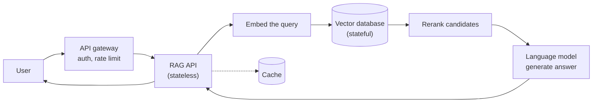

A RAG system that works for ten colleagues on a Tuesday afternoon tells you almost nothing about how it will behave for four hundred people at 09:00 on Monday, or for a customer-facing product with a hundred times the documents. **Scalability** is the ability to keep meeting your latency, quality and cost targets as the load grows, by adding resources rather than by rewriting the system. It is not the same as speed: a system can be fast at low load and collapse at high load, and a slow system can be perfectly scalable.

This lesson is the foundation of the module. It explains what "scale" means for RAG (there are four different kinds), how the stages of the pipeline differ in how they scale, how to reason about capacity with a little queueing theory instead of guesses, and where the bottleneck almost always turns out to be. You will build a small simulator of a four-stage request path and use it to watch latency stay flat until utilisation nears 100 per cent, then explode. The later lessons in the module ([Horizontal scaling](/learn/production-architecture/horizontal-scaling), [Load balancing](/learn/production-architecture/load-balancing), [Queue-based pipelines](/learn/production-architecture/queue-based-pipelines) and the others) are the techniques; this lesson is the thinking that tells you which one to reach for.

## Learning objectives

- Distinguish the four dimensions of RAG scale (corpus, query throughput, ingestion rate and tenant count) and name the component each one stresses first.
- Apply Little's law and the capacity formula `servers / service time` to find a pipeline's bottleneck and the concurrency it needs for a target request rate.
- Explain why latency rises sharply as utilisation approaches 100 per cent, and choose a target utilisation that leaves headroom.
- Estimate the memory an embedding index needs from the number of chunks, the dimension and the index overhead.
- Classify pipeline components as stateless or stateful and decide whether to scale each up, out, or by reducing the work it does.

## Prerequisites

- [Retrieval pipeline](/learn/rag-architecture-fundamentals/retrieval-pipeline): the stages a request passes through.
- [Offline and online processing](/learn/rag-architecture-fundamentals/offline-and-online-processing): why ingestion and query serving are separate workloads.
- [Latency optimisation](/learn/performance-optimisation/latency-optimisation): where the time in one request goes.
- [Docker](/learn/deployment/docker) and [Kubernetes fundamentals](/learn/deployment/kubernetes-fundamentals): what it means to run several copies of a service.

## Why this matters

Every RAG system that reaches production meets the same moment. A pilot succeeds, the audience widens, and the dashboards that were green turn amber: p95 latency drifts from four seconds to nine, the language-model provider starts returning rate-limit errors, a re-indexing job saturates the vector database just as the morning rush begins. None of this is a bug in the usual sense. Each component is doing what it was built to do; the system as a whole was simply never sized, and nobody knew which component would run out first.

Without a capacity model, teams respond to the symptoms they can see. They add replicas of the API (which was never the bottleneck), or they buy a bigger database node (which was not either), and the cost rises while the latency does not. With one, the question "what happens if traffic doubles?" has an arithmetic answer: this stage saturates at this rate, this many extra slots fix it, and it costs this much. A capacity model is a few lines of arithmetic. Its value is that it makes the next scaling decision a calculation rather than an argument.

## The intuition

Think of a restaurant on a Saturday night. A request is a table of diners. It passes through stations: the host seats them, a waiter takes the order, the kitchen cooks, a waiter serves. Each station has a number of staff and a time per table. The kitchen takes twenty minutes and has four cooks, so it can finish at most one table every five minutes, whatever the host does. Seat tables faster than that and nothing speeds up; a queue of seated, hungry, unserved diners simply grows. The only fix is at the kitchen: more cooks, faster dishes, or a shorter menu.

Now notice two things. First, the restaurant is not in trouble when the kitchen is 70 per cent busy; it is in trouble as it nears 100 per cent, because arrivals are irregular. Three tables arriving together create a queue even if the average rate is fine, and when the kitchen has no spare capacity the queue never drains. Second, adding a second host does nothing for the diners already waiting for food. Scaling means finding the busiest station and fixing that one.

A RAG pipeline is the same shape. A request is embedded, searched, perhaps reranked, and finally handed to a language model that takes seconds to write the answer. The generation stage is the kitchen.

## How it works

### Four things that can grow

"Scale" is four separate quantities, and a system can be comfortable on three and failing on the fourth. Ask which of them is growing before you design anything.

| Dimension | What grows | First component to feel it | Typical response |
| --- | --- | --- | --- |
| **Corpus size** | Number of chunks in the index | Vector database memory and index build time | Quantisation, sharding, tiered storage |
| **Query throughput** | Questions per second | Language-model concurrency, then reranker | More slots, caching, replicas, load shedding |
| **Ingestion rate** | New or changed documents per hour | Embedding service, parsing workers | Queues and parallel workers |
| **Tenant count** | Customers with separate data and quotas | Isolation logic, per-tenant configuration, noisy neighbours | [Multi-tenant design](/learn/production-architecture/multi-tenant-rag) |

AskMeridian, with 400 staff and a few thousand handbook and runbook chunks, is small on all four. A product team that exposes the same architecture to ten thousand customers, each with their own corpus, has grown on every axis at once, and what worked for Meridian's internal tool needs rethinking along each of them.

### The path of one request



Each box has a different scaling character, and the character decides the technique.

**The API layer is stateless.** It holds no data between requests, so you can run five copies as easily as one and put a [load balancer](/learn/production-architecture/load-balancing) in front. Scaling it out is nearly free, which is why it is the least interesting part.

**The embedding step** is cheap per request when the query is short (a few milliseconds on a CPU for a small model, and an API round trip for a hosted one) but it has two catches. A hosted embedding service has a rate limit, and a local model has a fixed number of cores or GPU slots. Embedding is also the stage that [ingestion](/learn/production-architecture/distributed-ingestion) hammers hardest, so query-time and index-time embedding should not share a pool unless you want a bulk upload to slow every user.

**The vector database is stateful.** It owns the data, so you cannot simply start another copy. You scale reads by adding replicas (identical copies), and you scale capacity by sharding (splitting the data), both explained in [Replication](/learn/advanced-vector-database-engineering/replication) and [Sharding](/learn/advanced-vector-database-engineering/sharding). The cost is operational: state must be kept consistent, moved and backed up.

**The reranker** is a neural model that reads each candidate chunk together with the query, so its cost grows with the number of candidates and the chunk length. It is typically the second-slowest stage, and it is compute-bound, so it scales by adding workers or by reranking fewer candidates.

**The language model** is nearly always the bottleneck, for a reason of arithmetic rather than engineering. Generating an answer takes seconds because the model produces tokens one after another. Whether you call a provider or run your own, there is a ceiling on concurrent generations: a provider enforces rate limits (requests and tokens per minute, which vary by account tier and are set out in its documentation), and a self-hosted model has finite accelerator memory for the key-value caches of in-flight requests. A single answer occupies a slot for its whole duration. Retrieval stages take tens of milliseconds; a generation slot is held for thousands.

> [!KEY]
> Scale the component that saturates first, not the one that is easiest to scale. In a RAG pipeline the cheap, stateless parts are almost never the limit; the slow, rate-limited generation step is.

### Scaling up, scaling out, and doing less

There are three ways to raise a stage's capacity, and the third is the most overlooked.

1. **Scale up (vertical):** give the same instance more CPU, memory or a faster accelerator. It is simple and has no coordination cost, but it has a ceiling, the price rises faster than the capacity near the top of a catalogue, and one big instance is one point of failure.
2. **Scale out (horizontal):** run more instances behind a balancer. It has no theoretical ceiling for stateless work and improves availability, but needs the stage to be stateless or its state to be partitioned. [Horizontal scaling](/learn/production-architecture/horizontal-scaling) develops this.
3. **Do less work per request:** cache repeated queries ([Query caching](/learn/performance-optimisation/query-caching), [Semantic caching](/learn/performance-optimisation/semantic-caching)), rerank 20 candidates instead of 100, send fewer context tokens ([Token budgets](/learn/cost-engineering/token-budgets)), choose a smaller model for easy questions ([Model selection](/learn/cost-engineering/model-selection)). Work you do not do costs no capacity at all.

### Decouple what does not need to be synchronous

A user waiting for an answer needs an answer in seconds. Nobody is waiting for a PDF to be re-indexed. Splitting the **interactive path** (query serving) from the **background path** (ingestion, re-embedding, evaluation, cleanup) is the single most useful structural decision for scalability, because the two have opposite needs: the interactive path wants low latency and spare capacity, while the background path wants high throughput and tolerates delay. If both share a pool, whichever is busier starves the other. Give them separate workers, separate quotas with the embedding service, and ideally separate read capacity on the vector database. Connecting them through a durable queue ([Queue-based pipelines](/learn/production-architecture/queue-based-pipelines)) lets the background work be absorbed at its own pace.

## The mathematics

### Capacity of a stage

**Intuition.** A stage with several identical workers, each taking a fixed time per request, can finish at most as many requests per second as the workers can do in total.

$$
\mu = \frac{c}{\bar{S}}
$$

Here $\mu$ is the stage's capacity in requests per second, $c$ is the number of requests it can process concurrently (workers, threads, accelerator slots or the provider's concurrency limit), and $\bar{S}$ is the mean time in seconds one request occupies a slot. The system's capacity is the smallest $\mu$ over all stages. **Utilisation** is $\rho = \lambda / \mu$, where $\lambda$ is the arrival rate in requests per second.

**By hand.** Generation has $c = 20$ slots and $\bar{S} = 3$ s, so $\mu = 20 / 3 \approx 6.67$ requests per second. Rerank with $c = 2$ and $\bar{S} = 0.08$ s gives 25 per second, far above that. The generation stage sets the system ceiling.

### Little's law

**Intuition.** If requests arrive at a steady rate and each stays in a stage for a while, the number in the stage at any moment is just rate times duration.

$$
L = \lambda W
$$

$L$ is the average number of requests inside the stage, $\lambda$ the arrival rate and $W$ the average time each spends there, waiting included. The law needs no assumption about the shape of the arrivals or of the service times, only a stable system.

**By hand.** To serve $\lambda = 8$ requests per second with $W = 3$ s of generation, you need on average $L = 24$ concurrent generations. With 20 slots, you are already over capacity; you need at least 24, and in practice well above that, as the next section shows.

### Why queues explode near 100 per cent

Arrivals are random, so even when the average load is below capacity, bursts form queues. For the simplest queueing model (one server, random arrivals, exponentially distributed service times, the **M/M/1 queue**), the average time a request spends in the system is

$$
W = \frac{\bar{S}}{1 - \rho}
$$

with $\bar{S}$ the mean service time and $\rho$ the utilisation. Time in the system is the service time multiplied by $1/(1-\rho)$. At $\rho = 0.5$ that factor is 2; at 0.9 it is 10; at 0.99 it is 100. Multi-server stages behave better at moderate load, but the shape is the same: delay is nearly flat, then vertical. This is the formal reason for the rule of thumb that you plan for a utilisation well below 100 per cent. A target of 60 to 70 per cent peak utilisation for interactive stages is common practice, with the exact figure chosen from your latency target and how bursty your traffic is. Treat any specific figure as an assumption to be tested.

### Index memory

A float32 vector costs 4 bytes per dimension. For $n$ chunks of dimension $d$:

$$
M_{\text{vectors}} = n \cdot d \cdot 4 \text{ bytes}
$$

**By hand.** Ten million chunks at $d = 384$: $10^7 \times 384 \times 4 = 15.36 \times 10^9$ bytes, about 15.4 GB. A graph index such as HNSW ([HNSW](/learn/vector-indexing-algorithms/hnsw)) stores neighbour lists on top of that; the overhead per vector depends on the implementation and its connectivity parameter, but on the order of a hundred bytes per vector is a reasonable planning assumption, here adding about 1 GB. Payload (metadata) and replicas multiply the total again: three replicas of 16.4 GB need roughly 49 GB of RAM across the cluster before headroom. [Quantisation](/learn/cost-engineering/quantisation) can shrink the vectors several-fold, at some recall cost that you should measure.

## In code

**The problem.** Find the bottleneck of a four-stage RAG path and see what happens to latency as load approaches its capacity, then check that adding capacity at the bottleneck (and only there) moves the ceiling.

**Dependencies.** NumPy only. The simulator is a model, not a benchmark: the stage sizes and times are assumptions chosen to be plausible, and real systems have additional effects (batching, cold caches, retries) that it leaves out.

```bash
pip install numpy
```

```python
"""Capacity model and queueing simulation of a four-stage RAG request path."""
import heapq
from dataclasses import dataclass
import numpy as np

@dataclass(frozen=True)
class Stage:
    name: str
    servers: int          # concurrent slots (workers, GPU batch slots, API concurrency)
    mean_s: float         # mean service time in seconds

def capacity(stages):
    """Max sustainable requests/second per stage: servers / mean service time."""
    return {s.name: s.servers / s.mean_s for s in stages}

def simulate(stages, rate, n=20000, seed=11):
    rng = np.random.default_rng(seed)
    arrivals = np.cumsum(rng.exponential(1 / rate, n))
    # lognormal service times with sigma 0.5 and the requested mean
    sigma = 0.5
    free = {s.name: [0.0] * s.servers for s in stages}   # time each server becomes free
    for s in stages:
        heapq.heapify(free[s.name])
    latencies, waits = [], {s.name: [] for s in stages}
    for t0 in arrivals:
        t = t0
        for s in stages:
            mu = np.log(s.mean_s) - sigma**2 / 2
            service = rng.lognormal(mu, sigma)
            earliest = heapq.heappop(free[s.name])
            start = max(t, earliest)
            waits[s.name].append(start - t)
            t = start + service
            heapq.heappush(free[s.name], t)
        latencies.append(t - t0)
    lat = np.array(latencies[n // 10:])           # drop warm-up
    worst = max(stages, key=lambda s: np.mean(waits[s.name][n // 10:]))
    return np.percentile(lat, 50), np.percentile(lat, 95), worst.name

pipeline = [Stage("embed", 2, 0.030), Stage("search", 4, 0.020),
            Stage("rerank", 2, 0.080), Stage("generate", 20, 3.0)]

print("Capacity per stage (requests/second):")
for name, cap in capacity(pipeline).items():
    print(f"  {name:<9}{cap:7.1f}")

def sweep(stages, rates):
    cap = min(capacity(stages).values())
    print(f"\nSystem capacity = {cap:.2f} req/s")
    print(f"{'rate':>6} {'util':>6} {'p50 s':>7} {'p95 s':>7}  longest queue")
    for r in rates:
        p50, p95, w = simulate(stages, r)
        print(f"{r:6.1f} {r/cap:6.0%} {p50:7.2f} {p95:7.2f}  {w}")

sweep(pipeline, [2, 4, 5, 6, 6.5])
bigger = [s if s.name != "generate" else Stage("generate", 40, 3.0) for s in pipeline]
print("\nAfter doubling generation slots to 40:")
sweep(bigger, [6, 8, 10, 12])
```

**How it works.** Each stage is a pool of servers; a heap holds the time each server next becomes free. A request arriving at a stage at time $t$ starts at $\max(t, \text{earliest free server})$, so the gap is its queueing delay, and finishes one service time later. Arrivals are a Poisson process (exponential gaps), the standard model of independent users. Service times are lognormal with the stated mean, which gives the long right tail that real model calls have. The first tenth of requests is discarded so that the empty start-up system does not flatter the figures.

```output
Capacity per stage (requests/second):
  embed       66.7
  search     200.0
  rerank      25.0
  generate     6.7

System capacity = 6.67 req/s
  rate   util   p50 s   p95 s  longest queue
   2.0    30%    2.78    6.22  rerank
   4.0    60%    2.79    6.24  generate
   5.0    75%    2.85    6.31  generate
   6.0    90%    3.32    6.97  generate
   6.5    98%    5.67   11.65  generate

After doubling generation slots to 40:

System capacity = 13.33 req/s
  rate   util   p50 s   p95 s  longest queue
   6.0    45%    2.78    6.22  rerank
   8.0    60%    2.78    6.23  rerank
  10.0    75%    2.80    6.25  generate
  12.0    90%    3.01    6.46  generate
```

**What the output means.** Up to 75 per cent utilisation the median stays within a few per cent of the pure service time of about 2.8 seconds, and the 95th percentile barely moves. At 90 per cent the median has risen by about 20 per cent and the tail by 0.7 s; at 98 per cent the median doubles and the p95 nearly doubles with it. Past 100 per cent the queue would grow without bound for as long as the load lasted. The "longest queue" column shows where requests wait: at low load, queueing anywhere is negligible and the label is noise (rerank only wins by a hair), while above 60 per cent it is consistently generation. Doubling the generation slots doubles the system ceiling to 13.3 requests per second, and at 12 requests per second (90 per cent of the new ceiling) the latency profile resembles the earlier 90 per cent row, a little better because 40 slots smooth bursts more than 20 do. The ceiling would not have moved had we added embedding workers instead.

**Common errors.** Mean service time is not the number to use if your times have a heavy tail; measure p50 and p95 from production traces and sanity-check against the mean. Capacity per slot assumes slots are independent; a provider's token-per-minute limit is a second ceiling that the formula does not see, so compute that one too (requests per second multiplied by tokens per request must stay below the tokens-per-minute allowance divided by 60). And the simulator assumes work arrives without retries; real clients retry on timeout, which raises the arrival rate precisely when the system is slowest, a feedback loop that [Fault tolerance](/learn/production-architecture/fault-tolerance) addresses.

**Extending it.** Add a cache stage that skips the rest of the path for a fraction of requests, model batching in the reranker, or add a deadline after which requests are dropped and see how much load shedding protects the tail.

## A real-world example

The platform team at a fictional company, Halden Legal, runs a contract-search assistant on the same shape of pipeline. Adoption grows from one practice group to six, and every Monday between 09:00 and 10:00 the team sees timeouts. The first instinct is to scale the API deployment from 4 to 12 pods. Nothing improves.

The team then writes down the capacity of each stage from measured service times. The API pods are idle; retrieval has plenty of room; generation, with a provider concurrency limit of 30 and a mean of 6 seconds per long legal answer, tops out at 5 requests per second. Monday's peak is about 6. The system was over capacity for an hour a week, and every retry made it worse.

They make three changes in order of cost. Answers to the 20 most common clause-lookup questions are cached, which removes about a fifth of generations; the prompt's context is trimmed from 12 chunks to 6 after an evaluation shows no loss in answer quality, shortening generation; and they request a higher concurrency limit from the provider, with a fallback to a smaller model when the queue exceeds a threshold. The next Monday the peak reaches 70 per cent of the new ceiling. Nothing about the API tier changed, and the 12 pods are reduced to 6.

## Common mistakes

- **Scaling the easy tier.** Adding API replicas when generation is the bottleneck raises cost and leaves latency unchanged. Find the saturated stage first.
- **Planning for the average load.** Average traffic ignores peaks and burstiness, and queues form below 100 per cent utilisation. Size for the peak, with headroom.
- **Running at 95 per cent "to save money".** The latency cost of the last few per cent of utilisation is enormous, and a small traffic spike turns into an outage.
- **Sharing one pool between queries and ingestion.** A bulk upload then slows every user. Separate the pools or throttle ingestion.
- **Ignoring provider limits.** Requests per minute and tokens per minute are ceilings that no amount of your own hardware raises. Know them before launch.
- **Forgetting that state does not scale like code.** A stateless API doubles by doubling replicas; an index does not. Plan sharding and replication before the corpus is too large to move easily.
- **Load-testing with unrealistic queries.** Ten identical queries hit the cache and report excellent numbers. Test with a realistic mix, including long ones.

## Best practices

- Write the capacity of every stage in a table (slots, mean time, requests per second) and keep it next to the architecture diagram.
- Plan peak utilisation of interactive stages at around 60 to 70 per cent, then verify with a load test that p95 meets the target there.
- Separate the interactive and background paths: distinct workers, quotas and, where possible, replicas.
- Reduce work before adding capacity: caching, fewer candidates, shorter context, a smaller model for easy questions.
- Put limits at the edge: per-user rate limits and a bounded queue, so overload is rejected quickly instead of queued indefinitely.
- Measure the saturation signals continuously (queue depth, slot utilisation, provider rate-limit responses), not only request latency, which rises last. [RAG observability](/learn/rag-observability) covers instrumentation.
- Revisit the capacity table whenever the prompt, model, chunk size or candidate count changes, since each changes service times.

## Performance considerations

Capacity is cheap to compute and expensive to ignore, so reason with the formulas first. Cost scales with the slots you hold: if a generation slot costs the same whether busy or idle (as with reserved capacity), running at 40 per cent utilisation means paying 2.5 times what the work requires, which is the price of headroom. If you pay per token, idle capacity is free but the provider's limits still bind. Autoscaling ([Kubernetes fundamentals](/learn/deployment/kubernetes-fundamentals) explains the rule) helps stateless tiers follow the daily curve, but it reacts in tens of seconds to minutes, so it does not absorb a burst that lasts seconds; a bounded queue and shedding do.

Tail latency compounds across stages. If each of five stages has a 1 per cent chance of a slow response, the chance that at least one is slow in a request is $1 - 0.99^5 \approx 4.9$ per cent, so the request p95 is shaped by the tails of every stage, not the medians. Fan-out to many shards worsens this ([Sharding](/learn/advanced-vector-database-engineering/sharding)).

## Security considerations

Scale changes the attack surface. An unauthenticated or generously rate-limited endpoint turns your capacity (and your provider bill) into something an attacker can spend: a loop of long queries is a denial of service on generation slots and a financial one on token costs. Per-user and per-tenant rate limits, a cap on query length and on output tokens, and a bounded queue are as much security controls as performance ones. Caches introduce a second concern: a cache shared across users must be keyed so that one user's cached answer, built from documents they may read, is never served to another who may not. [Multi-tenant RAG](/learn/production-architecture/multi-tenant-rag) takes this up.

## Summary

- Scale has four dimensions (corpus, throughput, ingestion, tenants); identify which one is growing before choosing a technique.
- Capacity of a stage is slots divided by mean service time; the system's capacity is its smallest stage, and in RAG that is usually generation.
- Latency stays flat until utilisation nears 100 per cent and then climbs steeply, so plan peak utilisation well below it.
- Little's law ($L = \lambda W$) converts a target rate and latency into the concurrency you must provision.
- Stateless tiers scale out easily; stateful ones (the vector database) need replication and sharding; doing less work per request is often the cheapest scaling move.
- Separate interactive from background work so that ingestion cannot starve users.

## Exercises

**1.** A stage has 8 slots and a mean service time of 0.25 s. What is its capacity, and at what arrival rate is it 75 per cent utilised?

<details><summary>Show solution</summary>

Capacity is $8 / 0.25 = 32$ requests per second. At 75 per cent utilisation the arrival rate is $0.75 \times 32 = 24$ requests per second.

</details>

**2.** A RAG service must handle 15 requests per second at peak. Generation takes 4 s on average and you want 65 per cent peak utilisation. How many generation slots do you need? Which provider limit besides concurrency should you check, and how?

<details><summary>Show solution</summary>

By Little's law the average concurrency at peak is $15 \times 4 = 60$. At 65 per cent utilisation the slots needed are $60 / 0.65 \approx 92.3$, so 93. Also check the tokens-per-minute allowance: with, say, 3,000 input and 400 output tokens per request (assumed), 15 requests per second is $15 \times 60 \times 3400 = 3.06$ million tokens per minute, which must fit within the account's limit (read the provider's current documentation, since limits depend on the account tier and may count input and output separately).

</details>

**3.** Estimate the RAM for 25 million chunks of 768 dimensions in float32 with 3 replicas, assuming 100 bytes of index overhead per vector. Then say what happens to the figure if the vectors are quantised to 1 byte per dimension (ignore the effect on overhead).

<details><summary>Show solution</summary>

Per vector: $768 \times 4 = 3072$ bytes plus 100, so 3172 bytes. For $2.5 \times 10^7$ vectors that is $7.93 \times 10^{10}$ bytes, about 79.3 GB; three replicas give about 238 GB. With 1 byte per dimension the vector part is 768 bytes, so 868 bytes per vector, about 21.7 GB, or 65 GB across three replicas, roughly 3.7 times less. The saving costs some recall, which must be measured on your own queries.

</details>

**4.** Modify the simulator to add a cache that answers 25 per cent of requests in 5 ms, skipping every later stage. Run the sweep at 8 requests per second on the original 20-slot pipeline and report p50 and p95. Explain the result.

<details><summary>Show solution</summary>

Draw a uniform random number per request; if below 0.25, set the finish time to arrival plus 0.005 and `continue` before the stage loop. Only 75 per cent of requests reach generation, so the effective rate there is 6 per second (90 per cent of capacity) even though 8 requests arrive. The median then falls (a quarter of requests are near-instant), but the p95 is set by the requests that miss the cache and see the 90 per cent queueing profile, close to the 6 per second row of the earlier table. The cache lifted the ceiling on offered load from 6.7 to about 8.9 requests per second (6.67 / 0.75), but only for traffic whose repetition really matches the hit rate.

</details>

## Check your understanding

```quiz
[
  {
    "q": "A pipeline has these stages, each with its slot count and mean time per request: embed 4 slots at 0.05 s, search 8 slots at 0.02 s, rerank 3 slots at 0.15 s, generate 10 slots at 2 s. Which stage limits the system?",
    "options": ["Embed, at 80 requests per second", "Search, at 400 requests per second", "Rerank, at 20 requests per second", "Generate, at 5 requests per second"],
    "answer": 3,
    "why": "Capacity is slots divided by mean time: embed 80, search 400, rerank 20, generate 5. The smallest capacity sets the system ceiling."
  },
  {
    "q": "Requests arrive at 12 per second and each spends 2.5 seconds in the generation stage on average. By Little's law, how many requests are in generation at once, on average?",
    "options": ["4.8", "14.5", "30", "0.21"],
    "answer": 2,
    "why": "L = lambda times W = 12 times 2.5 = 30 concurrent requests, so you need at least 30 slots, and more for headroom."
  },
  {
    "q": "Why does p95 latency rise sharply as utilisation goes from 90 to 98 per cent, even though the system is still below capacity?",
    "options": ["Servers run slower when they are busy", "Random bursts form queues that cannot drain when there is almost no spare capacity", "Caches stop working at high load", "The load balancer adds delay per request"],
    "answer": 1,
    "why": "With irregular arrivals a burst creates a queue; the spare capacity is what drains it, and at 98 per cent there is almost none. Delay grows like 1 over (1 minus utilisation)."
  },
  {
    "q": "Generation is the bottleneck of AskMeridian at peak. Which change addresses it most directly?",
    "options": ["Doubling the number of stateless API replicas", "Adding embedding workers", "Increasing generation concurrency or reducing the work per generation, for example with caching and a shorter context", "Moving the vector database to a larger node"],
    "answer": 2,
    "why": "Only changes at the saturated stage move the ceiling. The other options scale components that are not the limit."
  },
  {
    "q": "Which statement about scaling the pipeline's components is correct?",
    "options": ["The vector database scales out as easily as the API because both are just services", "The stateless API scales out by running more copies, while the vector database needs replication and sharding to manage its state", "Stateless components cannot be scaled horizontally", "Scaling up always costs less than scaling out"],
    "answer": 1,
    "why": "Statelessness is what makes copies interchangeable. A database owns data, so more capacity requires copying or splitting that data."
  }
]
```

## Further reading

- Little, J. D. C. (1961), "A Proof for the Queuing Formula: L = λW", *Operations Research*, the original proof of Little's law.
- Kleppmann, M. (2017), *Designing Data-Intensive Applications*, O'Reilly, chapter 1 on reliability, scalability and maintainability, including the discussion of percentiles and tail latency.
- Dean, J. and Barroso, L. A. (2013), "The Tail at Scale", *Communications of the ACM*, on how tail latency compounds across components.
- Beyer, B., Jones, C., Petoff, J. and Murphy, N. R. (eds.) (2016), *Site Reliability Engineering*, O'Reilly, freely available at https://sre.google/books/, the chapters on service level objectives and load balancing.
- [Kubernetes documentation](https://kubernetes.io/docs/home/): the Horizontal Pod Autoscaler concepts.
