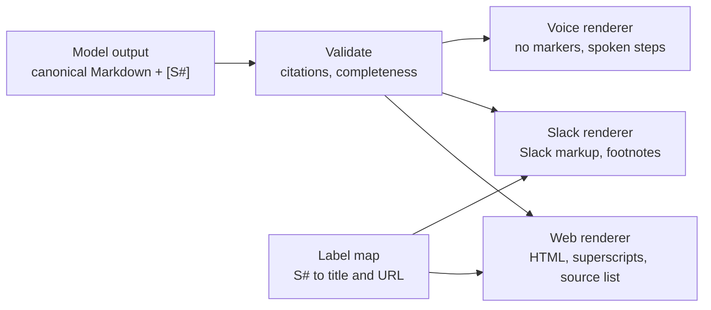

A grounded, well-cited answer can still fail its user. It can bury the one sentence they needed under four paragraphs, arrive as raw asterisks and hash signs in a chat client that cannot render Markdown, read citation markers aloud in a voice assistant, or include an image link that quietly sends data to someone else's server. **Answer formatting** is the part of prompt engineering, and of the code around it, that decides the shape of an answer: its structure, its length, its markup, and how it reaches each channel the system serves.

This lesson separates two jobs that are often mixed up. The **model** is responsible for the answer's logical shape: lead with the answer, use a list for steps, stay within a length. The **application** is responsible for the answer's presentation: turning citation markers into links or footnotes, converting markup for each channel, and removing anything unsafe. Getting that division right makes formatting both consistent and secure.

## Learning objectives

- Write format instructions that specify the answer's structure, length and permitted markup, matched to what the renderer supports.
- Explain why the model should produce one canonical format and the application should render it per channel.
- Implement renderers that turn one Markdown answer with `[S#]` markers into HTML, Slack text and speech-ready text.
- Sanitise model-generated Markdown so that images and links cannot leak data or send users to untrusted sites.
- Decide when an answer should be structured data instead of prose, and request it with validated structured output.

## Prerequisites

- [System prompts](/learn/prompt-engineering-for-rag/system-prompts): the format section and where it sits.
- [Citation instructions](/learn/prompt-engineering-for-rag/citation-instructions): the `[S1]` marker grammar that rendering resolves.
- [Context injection](/learn/prompt-engineering-for-rag/context-injection): the label map from ids to titles and URLs.

## Why this matters

AskMeridian is used in three places: a web page on the intranet, a Slack app, and, since a pilot last year, a voice line that staff on the road can call. The first version used one prompt and sent the model's text unchanged to all three. Each channel broke differently. On the web, answers rendered well but were often long, with the actual answer in the third paragraph. In Slack, `**bold**` appeared with its asterisks, because Slack's own markup uses single asterisks, and Markdown links appeared as raw brackets. On the voice line, the speech engine read "open bracket S one close bracket" after every sentence.

Then a security review found something worse. A test page planted in the wiki contained an instruction asking assistants to include an image whose URL carried "a summary of the conversation". The web front end rendered Markdown images. Had the model complied, the user's browser would have fetched that URL automatically, sending whatever was in it to the attacker's server, without any click. Formatting is not only cosmetic: what the client renders automatically is an output channel, and it must be controlled.

## The intuition

A newspaper's reporter writes one story. The sub-editors then lay it out for the print edition, the website and the radio bulletin. The reporter's job is to put the most important fact first, keep it to the commissioned length, and break a sequence of events into clear steps. The reporter does not choose the typeface or decide how the radio presenter will say the footnotes. And the sub-editor will not print a photograph a stranger slipped into the copy without checking where it came from.

The model is the reporter. Your rendering code is the sub-editors, one per channel, and also the picture desk that refuses unverified images.

## How it works

### The shape of a good RAG answer

Most RAG questions are practical: how many, how often, how do I, am I allowed. For these, one structure works well, and it is worth stating explicitly in the system prompt:

1. **The direct answer first**, in one or two sentences, with citations. "Yes, up to 5 unused days carry over [S1]."
2. **Supporting detail**, only as much as the user needs to act: conditions, deadlines, exceptions. "They must be used by 31 March [S1]."
3. **Steps as a numbered list** when the answer is a procedure, one action per item.
4. **Gaps and caveats last**: what the sources do not cover, or a conflict between versions ([Handling missing information](/learn/prompt-engineering-for-rag/handling-missing-information)).

Putting the answer first is sometimes called *bottom line up front*. It helps the reader, who may read only the first line, and it helps evaluation, because a judge or a test can check the first sentence. It also discourages a common model habit of restating the question and summarising the sources before answering.

Tables suit comparisons ("Standard versus Enterprise plan"), but only where the renderer supports them. Headings rarely belong in a chat answer of 100 words; they belong in long reports.

### Length

Say how long, and say what to do when more is needed. "Keep answers under 120 words unless the user asks for detail or the procedure has more than five steps" gives the model a target and a principled exception. Word limits are followed approximately, not exactly, so do not build anything that depends on an exact count.

Do not use `max_tokens` as a length control. It is a hard cut-off: the model does not know it is coming, and the answer simply stops mid-sentence, possibly mid-citation. When it happens, the response's `stop_reason` is `"max_tokens"`, and the application should treat the answer as incomplete, not show it as finished. Set `max_tokens` comfortably above the longest answer you want, and control length with instructions.

### Telling the model what the renderer supports

The model cannot see your front end. Tell it, in the format section of the system prompt, what will be rendered and what will not:

```text
<format>
Your answer is rendered as Markdown. Supported: paragraphs, **bold**, numbered and bulleted lists.
Not supported: headings, tables, images, raw HTML. Do not include URLs; the application adds links
to sources from your citations.
Lead with the direct answer in one or two sentences. Number the steps of a procedure, one per line.
Keep answers under 120 words unless the user asks for more detail.
</format>
```

Two details matter. First, the instruction says not to write URLs: the application resolves `[S1]` to the source's URL from the label map, so any URL the model writes is either copied from a source or invented, and neither should become a link. Second, the style of your prompt influences the style of the answer. Anthropic's guidance notes that writing the prompt itself in heavy Markdown tends to produce Markdown-heavy output; if you want plain prose, write the prompt in plain prose.

### One canonical format, many renderers

It is tempting to have the model produce each channel's format directly: "if the channel is Slack, use Slack markup". Resist it. Every per-channel variation in the prompt is a variation in model behaviour that must be tested, and the model will occasionally mix formats. Conversions such as `**bold**` to `*bold*` or a numbered list to "first, then, finally" are deterministic, so do them in code.

The design is therefore:

1. The model always produces the **canonical answer**: a restricted subset of Markdown with `[S#]` citation markers.
2. The application **validates** it (citations exist, required parts are present).
3. A **renderer per channel** converts it: HTML for the web, Slack's own markup for Slack, plain speech text for voice.
4. Each renderer **sanitises** as it converts: no images, links only to allowed hosts, no raw HTML.



There are legitimate exceptions. Voice answers benefit from being *written* differently (shorter sentences, numbers spoken naturally, no lists longer than about three items), and a renderer cannot shorten an answer well. For a channel whose constraints change the content and not only the markup, pass the channel in the request context and add one line to the format section: "If the request context says the channel is voice, answer in at most three short sentences." Keep such branches few.

### Markdown is an output channel

Model output rendered in a browser or chat client is not inert. Two Markdown constructs deserve special treatment.

- **Images.** `` makes the client fetch the URL automatically when the answer is displayed. If an injected instruction persuades the model to put conversation content in that URL, the data leaves without any user action. This exfiltration technique has been demonstrated publicly against several LLM-powered products. The robust fix is to not render images from model output at all, or to render only images from an allowlist of your own hosts.
- **Links.** A link needs a click, but a link labelled "the IT portal" that points to a look-alike login page is a phishing vector, and the model may have copied it from a poisoned source. Render links only to hosts on an allowlist, and preferably only links the application itself created from the label map.
- **Raw HTML.** Disable it in the Markdown renderer; `<script>` or an `onerror` attribute in an answer is a cross-site scripting bug, regardless of how it got there.

Sanitisation belongs in code, after generation. A prompt instruction "do not include images" lowers the frequency; only the renderer makes it impossible.

### When the answer should be data

Some consumers of an answer are programs: a ticketing integration that needs a status and a list of source ids, a form that needs a yes/no and a reason. For these, prose plus parsing is fragile. Ask for **structured output** instead: a JSON object that matches a schema. With the Anthropic SDK, `client.messages.parse(..., output_format=MyModel)` validates the response against a Pydantic model and returns it as `response.parsed_output`. A typical RAG schema has fields such as `status` (answered, partial, not_found), `answer` (the canonical Markdown), and `citations` (a list of source ids). The renderers in this lesson then work on the `answer` field. [Structured outputs](/learn/generation-strategies/structured-outputs) and [JSON generation](/learn/generation-strategies/json-generation) cover the techniques in depth.

### Streaming

When an answer is streamed, formatting arrives in fragments: `**Meri` in one piece, `dian VPN**` in the next, `[S` here and `1]` there. Render from an accumulated buffer, not from individual pieces, and re-render the whole buffer as it grows (Markdown renderers are fast enough for short answers). Hold back an incomplete trailing marker or link until it closes, so that the user never sees half a citation become a link. [Streaming responses](/learn/generation-strategies/streaming-responses) covers the mechanics.

## In code

The problem: one canonical answer from the model must be shown on three channels, with citations resolved through the label map and unsafe Markdown removed. The answer below includes the problems found in Meridian's security review: an image whose URL carries data, a link to an unapproved host, and a citation to `S7`, which does not exist.

Dependencies: `markdown-it-py`, a CommonMark-compliant Markdown parser for Python, which exposes the parsed token stream so it can be inspected and modified before rendering.

```bash
pip install markdown-it-py
```

```python
"""Render one model answer for three channels, resolving citations and sanitising Markdown."""
import re
from urllib.parse import urlparse

from markdown_it import MarkdownIt

LABELS = {  # the label map from context injection: id -> (title, url)
    "S1": ("IT Runbook / Network access", "https://intranet.meridian.example/runbooks/network"),
    "S2": ("Employee Handbook / Remote work", "https://intranet.meridian.example/handbook/remote"),
}
ALLOWED_HOSTS = ("intranet.meridian.example",)

answer = """You need the VPN whenever you use public Wi-Fi [S1].

To connect:
1. Open the **Meridian VPN** client [S1].
2. Sign in with your staff account [S1].
3. If you see error E-4021, update the client from the IT portal [S1].

You can work remotely up to 3 days a week [S2].
 See [the portal](https://evil.example/login) [S7]."""

CITE = re.compile(r"\s*\[(S\d+)\]")


def allowed(url):
    parsed = urlparse(url)
    return parsed.scheme == "https" and parsed.hostname in ALLOWED_HOSTS


def citations_in_order(text):
    seen = []
    for sid in CITE.findall(text):
        if sid in LABELS and sid not in seen:
            seen.append(sid)
    return seen


def to_html(text):
    order = citations_in_order(text)
    # Citations become numbered superscripts; unknown ids are dropped (and should be logged).
    def repl(m):
        sid = m.group(1)
        return f"<sup>{order.index(sid) + 1}</sup>" if sid in LABELS else ""
    md = MarkdownIt("commonmark", {"html": False})  # raw HTML in the answer is shown as text
    tokens = md.parse(CITE.sub(lambda m: f" @@{m.group(1)}@@", text))
    for tok in tokens:
        for child in tok.children or []:
            if child.type == "image":  # images can leak data through their URL: drop them
                child.type, child.tag, child.content, child.children = "text", "", "", None
            if child.type == "link_open":
                if not allowed(child.attrGet("href") or ""):
                    child.attrSet("href", "#blocked")
    html = md.renderer.render(tokens, md.options, {})
    html = re.sub(r" ?@@(S\d+)@@", repl, html)
    refs = "".join(f'<li><a href="{LABELS[s][1]}">{LABELS[s][0]}</a></li>' for s in order)
    return html + f"<ol class=\"sources\">{refs}</ol>"


def to_slack(text):
    order = citations_in_order(text)
    text = CITE.sub(lambda m: f" [{order.index(m.group(1)) + 1}]" if m.group(1) in LABELS else "", text)
    text = re.sub(r"!\[[^\]]*\]\([^)]*\)", "", text)                       # no images
    text = re.sub(r"\[([^\]]+)\]\((https?://[^)]+)\)",
                  lambda m: f"<{m.group(2)}|{m.group(1)}>" if allowed(m.group(2))
                  else m.group(1), text)                                    # allowlisted links only
    text = re.sub(r"\*\*(.+?)\*\*", r"*\1*", text)                          # Slack bold is *x*
    refs = "\n".join(f"[{i}] <{LABELS[s][1]}|{LABELS[s][0]}>" for i, s in enumerate(order, 1))
    return text.strip() + "\n\n" + refs


def to_speech(text):
    text = CITE.sub("", text)
    text = re.sub(r"!\[[^\]]*\]\([^)]*\)", "", text)
    text = re.sub(r"\[([^\]]+)\]\([^)]*\)", r"\1", text)
    text = re.sub(r"\*\*(.+?)\*\*", r"\1", text)
    steps = re.findall(r"^\d+\.\s+(.*)$", text, flags=re.M)
    words = ["First", "Then", "Finally"] if len(steps) == 3 else [f"Step {i}" for i in range(1, len(steps) + 1)]
    for w, s in zip(words, steps):
        text = re.sub(rf"^\d+\.\s+{re.escape(s)}$", f"{w}, {s[0].lower()}{s[1:]}", text, flags=re.M)
    text = text.replace("E-4021", "E 4 0 2 1")
    return re.sub(r"\s+", " ", text).strip()


print("=== web (HTML) ===", to_html(answer), sep="\n")
print("\n=== Slack ===", to_slack(answer), sep="\n")
print("\n=== voice ===", to_speech(answer), sep="\n")
```

```output
=== web (HTML) ===
<p>You need the VPN whenever you use public Wi-Fi<sup>1</sup>.</p>
<p>To connect:</p>
<ol>
<li>Open the <strong>Meridian VPN</strong> client<sup>1</sup>.</li>
<li>Sign in with your staff account<sup>1</sup>.</li>
<li>If you see error E-4021, update the client from the IT portal<sup>1</sup>.</li>
</ol>
<p>You can work remotely up to 3 days a week<sup>2</sup>.
 See <a href="#blocked">the portal</a>.</p>
<ol class="sources"><li><a href="https://intranet.meridian.example/runbooks/network">IT Runbook / Network access</a></li><li><a href="https://intranet.meridian.example/handbook/remote">Employee Handbook / Remote work</a></li></ol>

=== Slack ===
You need the VPN whenever you use public Wi-Fi [1].

To connect:
1. Open the *Meridian VPN* client [1].
2. Sign in with your staff account [1].
3. If you see error E-4021, update the client from the IT portal [1].

You can work remotely up to 3 days a week [2].
 See the portal.

[1] <https://intranet.meridian.example/runbooks/network|IT Runbook / Network access>
[2] <https://intranet.meridian.example/handbook/remote|Employee Handbook / Remote work>

=== voice ===
You need the VPN whenever you use public Wi-Fi. To connect: First, open the Meridian VPN client. Then, sign in with your staff account. Finally, if you see error E 4 0 2 1, update the client from the IT portal. You can work remotely up to 3 days a week. See the portal.
```

The important lines:

- `citations_in_order` numbers sources by first appearance, the convention readers expect from footnotes, and ignores ids missing from the label map. All three renderers use it, so numbering is identical across channels.
- In `to_html`, citation markers are first replaced by placeholders (`@@S1@@`) so that the Markdown parser does not treat `[S1]` as the start of a link reference. After rendering, placeholders become superscripts; an unknown id such as `S7` becomes nothing.
- `MarkdownIt("commonmark", {"html": False})` disables raw HTML: any `<script>` in the answer would be rendered as visible text, not executed.
- The token loop is the sanitiser. It works on the parsed structure, not on the text, so it cannot be fooled by unusual spacing or nesting the way a regular expression can. Images are turned into empty text; links to hosts not on the allowlist are neutralised.
- `allowed` parses the URL and compares the exact hostname and scheme. A substring test such as `"intranet.meridian.example" in url` would accept `https://evil.example/intranet.meridian.example`.
- `to_slack` produces Slack's own markup: `*bold*` and `<url|text>` links. `to_speech` removes markers and markup, turns a three-step list into "First, Then, Finally", and spells out the error code so a speech engine does not read "E minus four thousand and twenty-one".

What the output means. All three channels show the same content and the same source numbering. The tracking image has vanished from every channel. The phishing link survives only as the words "the portal", never as a clickable link, and the phantom `S7` citation has disappeared rather than becoming a broken footnote. In production, each of these removals should also be logged: an answer that contained an image or an unapproved link is a strong signal of injected content in a retrieved source.

Common errors: sanitising with regular expressions over the HTML after rendering (easily bypassed; sanitise the token stream or use a dedicated HTML sanitiser); forgetting that Slack text itself must have `&`, `<` and `>` escaped as `&amp;`, `&lt;` and `&gt;` (the example's text contains none, but real answers will); and rendering the label map's titles without escaping them in HTML, since titles come from documents.

### Requesting a structured answer

This version was not executed here, because it needs an API key. It asks for a validated object whose `answer` field is the canonical Markdown, which the renderers above then consume.

```python
from typing import Literal

import anthropic
from pydantic import BaseModel


class RagAnswer(BaseModel):
    status: Literal["answered", "partial", "not_found"]
    answer: str            # canonical Markdown with [S#] markers
    citations: list[str]   # source ids used, e.g. ["S1", "S2"]


client = anthropic.Anthropic()  # reads ANTHROPIC_API_KEY from the environment

response = client.messages.parse(
    model="claude-opus-5-5",
    max_tokens=1024,
    system=system_prompt,
    messages=[{"role": "user", "content": user_turn}],
    output_format=RagAnswer,
)
result = response.parsed_output
if result.status != "not_found":
    html = to_html(result.answer)
```

The `status` field makes refusal detection a field comparison rather than a string match, and `citations` lets you check existence without parsing. Still parse the markers in `answer`: a model can list `S1` in `citations` while citing `S2` in the text, and that disagreement is worth catching.

To extend the renderers: add a channel for email (HTML with inline footnotes), cap voice answers at a fixed number of sentences and offer to send the full answer by message, and add a test that feeds each renderer a hostile answer (images, `javascript:` links, raw HTML) and asserts none survives.

## A real-world example

After the security review, Meridian's Platform team rebuilt AskMeridian's output path around one canonical format. The system prompt's format section was rewritten to describe the restricted Markdown subset and to forbid URLs. Three renderers replaced the old "send text as is" code, each built on the parsed token stream, each with the same host allowlist. The voice line gained one prompt rule, passed through the request context, limiting answers to three short sentences, because shortening is content work the renderer cannot do.

The team also added the sanitiser's removals to their monitoring. Within a fortnight, the monitor flagged a handful of answers containing links to an external file-sharing site. All came from questions about one topic, and all cited the same wiki page, which a well-meaning employee had edited to point colleagues to a personal copy of a form. Nothing malicious, but exactly the kind of link the allowlist exists to stop; the HR team replaced the page. Without logging the removals, the team would never have known the page existed.

A smaller change had a visible effect on satisfaction comments: moving the direct answer to the first sentence. Before, the model often began "Based on the provided documents, Meridian's policy on remote work states that...". The format instruction now includes one short example of an answer-first reply, and the habit largely disappeared.

## Common mistakes

- **Sending model output unchanged to every channel.** Markdown appears raw in Slack, markers are read aloud by voice engines, and formats mix.
- **Asking the model to emit each channel's markup.** More prompt branches, more inconsistency, and conversions that code does perfectly are done imperfectly.
- **Rendering images from model output.** A data-carrying image URL is fetched automatically, leaking data without any click.
- **Allowlisting by substring.** `evil.example/intranet.meridian.example` passes a substring check.
- **Using `max_tokens` to control length.** Answers stop mid-sentence; length belongs in instructions, and a `max_tokens` stop means "incomplete".
- **Restating the question before answering.** The answer moves out of the first line, where users and evaluators look for it.
- **Sanitising with a prompt instruction alone.** "Do not include images" reduces frequency; it does not guarantee absence.

## Best practices

- Instruct answer-first structure, numbered steps for procedures, caveats last, and a length target with a stated exception.
- Tell the model exactly which markup the renderer supports, and write the prompt in the style you want back.
- Have the model produce one canonical format; convert and sanitise per channel in deterministic code.
- Resolve citations only through the label map; never turn model-written URLs into links.
- Sanitise the parsed token stream: no images, no raw HTML, links only to exact allowlisted hosts; log every removal.
- Use structured output when a program consumes the answer, and cross-check its fields against the text.

## Performance considerations

Formatting choices change output length, and output tokens dominate generation time. Suppose, as an assumption, that the model generates 50 tokens per second. A 250-token answer takes about 5 seconds to finish; an answer-first, 120-word answer of about 160 tokens takes about 3.2 seconds, and with streaming its first sentence, the part most users need, is visible in well under a second after generation starts. Shorter answers are also cheaper, at the output-token rate, which is typically several times the input rate.

Rendering is negligible by comparison: parsing and rendering a few hundred words of Markdown takes on the order of a millisecond in Python. When streaming, re-rendering the whole buffer on every chunk is quadratic in principle, but for answers of a few hundred tokens the total remains small; throttle re-rendering to, say, every 50 milliseconds if answers are long.

Structured output adds a little: JSON field names and quoting are extra output tokens, typically tens per answer.

## Security considerations

- **Rendered output is an exfiltration channel.** Images and auto-loading content can send data to any URL the model writes. Remove images from model output or restrict them to your own hosts.
- **Links are a phishing channel.** Render only links created from the label map, or links to exactly allowlisted hosts with `https`.
- **Raw HTML is a scripting channel.** Disable HTML in the Markdown renderer, and escape anything from documents (such as titles) that you insert into HTML yourself.
- **Removals are signals.** Log every stripped image or blocked link with the source ids of the answer; it is one of the cheapest detectors of injected content you will have ([Output validation](/learn/rag-security-fundamentals/output-validation)).

## Summary

- The model controls the answer's logical shape (answer first, steps, length); the application controls presentation and safety.
- Tell the model what the renderer supports, specify length by instruction, and treat a `max_tokens` stop as incomplete.
- Produce one canonical format (restricted Markdown with `[S#]`) and render it per channel in code.
- Model-generated Markdown is an output channel: sanitise the parsed tokens, drop images, allowlist link hosts exactly, disable raw HTML.
- Use validated structured output when a program consumes the answer, with the canonical Markdown in one field.

## Exercises

1. Rewrite this format instruction to be operational: "Format your answers nicely and keep them reasonably short."

<details><summary>Show solution</summary>

"Lead with the direct answer in one or two sentences. Then add only the conditions or deadlines the user needs to act. For procedures, number the steps, one action per line. Use **bold** sparingly; do not use headings, tables, images or URLs. Keep answers under 120 words unless the user asks for more detail or the procedure has more than five steps."

</details>

2. Which of these URLs does `allowed()` accept, and why? (a) `https://intranet.meridian.example/handbook` (b) `http://intranet.meridian.example/handbook` (c) `https://intranet.meridian.example.evil.example/` (d) `https://evil.example/?next=intranet.meridian.example`

<details><summary>Show solution</summary>

Only (a). (b) fails the scheme check (`http`). (c) has the hostname `intranet.meridian.example.evil.example`, which is not equal to the allowlisted host. (d) has the hostname `evil.example`; the allowlisted name appears only in the query string. A naive substring test with no scheme check would accept all four.

</details>

3. Extend `to_html` so that it returns, as well as the HTML, a list of the removals it made (images, blocked links, unknown citation ids), and print them for the example answer.

<details><summary>Show solution</summary>

```python
def to_html_with_report(text):
    removed = [f"unknown citation {sid}" for sid in CITE.findall(text) if sid not in LABELS]
    md = MarkdownIt("commonmark", {"html": False})
    tokens = md.parse(CITE.sub(lambda m: f" @@{m.group(1)}@@", text))
    for tok in tokens:
        for child in tok.children or []:
            if child.type == "image":
                removed.append(f"image {child.attrGet('src')}")
                child.type, child.tag, child.content, child.children = "text", "", "", None
            elif child.type == "link_open" and not allowed(child.attrGet("href") or ""):
                removed.append(f"link {child.attrGet('href')}")
                child.attrSet("href", "#blocked")
    return md.renderer.render(tokens, md.options, {}), removed

print(to_html_with_report(answer)[1])
# ['unknown citation S7', 'image https://tracker.evil.example/p.png?q=salary', 'link https://evil.example/login']
```

Superscript substitution and the source list are as in `to_html`; they are omitted here to keep the focus on the report. Log the report with the answer's source ids.

</details>

4. Design decision: Meridian wants AskMeridian answers to appear inside the Meridian Reports product, whose help panel renders only plain text with no links. Users still need to know where answers come from. Design the rendering.

<details><summary>Show solution</summary>

Add a fourth renderer that strips all markup, turns lists into numbered plain lines ("1) ..."), and replaces `[S#]` markers with bracketed numbers matching a plain-text source list at the end: "Sources: [1] IT Runbook, Network access; [2] Employee Handbook, Remote work". Since nothing is clickable, include enough of each title for a user to find the page in the intranet search, and, if the panel allows, a "copy source titles" action. No prompt change is needed, because the canonical answer is unchanged; this is purely a renderer.

</details>

## Check your understanding

```quiz
[
  {
    "q": "Why should the application, not the model, convert answers into each channel's markup?",
    "options": [
      "Models cannot produce Slack markup",
      "Deterministic conversion is consistent and testable, while per-channel prompt branches add variation and mixed formats",
      "It makes the answer shorter",
      "The API forbids Markdown"
    ],
    "answer": 1,
    "why": "Markup conversion is mechanical; code does it perfectly every time, and the prompt stays simple."
  },
  {
    "q": "An answer contains . What happens if the web client renders it?",
    "options": [
      "Nothing until the user clicks it",
      "The model is blocked by the API",
      "The browser fetches the URL automatically, sending the data in it to the attacker's server",
      "The image is shown but no request is made"
    ],
    "answer": 2,
    "why": "Images load automatically, so a data-carrying image URL leaks without any user action."
  },
  {
    "q": "A response ends with stop_reason equal to max_tokens. What should the application do?",
    "options": [
      "Show it as a complete answer",
      "Delete the citations and show it",
      "Lower max_tokens next time",
      "Treat the answer as incomplete: do not present it as finished, and retry or fall back"
    ],
    "answer": 3,
    "why": "max_tokens is a hard cut-off; the answer stopped mid-way and may be missing its conclusion or citations."
  },
  {
    "q": "Why does the sanitiser modify markdown-it tokens rather than run regular expressions over the rendered HTML?",
    "options": [
      "The parsed structure identifies images and links reliably, while text patterns can be bypassed by unusual spacing or nesting",
      "Regular expressions are slower",
      "markdown-it cannot render images",
      "HTML has no links"
    ],
    "answer": 0,
    "why": "Working on the parser's tokens means you act on what will actually be rendered, not on a guess from the text."
  },
  {
    "q": "Which answer structure is recommended for practical RAG questions?",
    "options": [
      "Restate the question, summarise every source, then answer",
      "Direct answer first, then needed detail, steps as a list, caveats last",
      "A table of all sources",
      "Headings for each source"
    ],
    "answer": 1,
    "why": "Answer-first puts the needed fact where users and evaluators look, with detail and gaps following."
  }
]
```

## Further reading

- Anthropic, *Claude Developer Platform documentation*: prompt engineering guidance on controlling output format, and structured outputs. [platform.claude.com/docs](https://platform.claude.com/docs)
- CommonMark specification. [spec.commonmark.org](https://spec.commonmark.org/)
- markdown-it-py documentation. [markdown-it-py.readthedocs.io](https://markdown-it-py.readthedocs.io/)
- Slack API documentation, *Formatting text for app surfaces* (mrkdwn and escaping). [api.slack.com](https://api.slack.com/)
- OWASP, *Top 10 for Large Language Model Applications*, on improper output handling. [owasp.org/www-project-top-10-for-large-language-model-applications](https://owasp.org/www-project-top-10-for-large-language-model-applications/)
