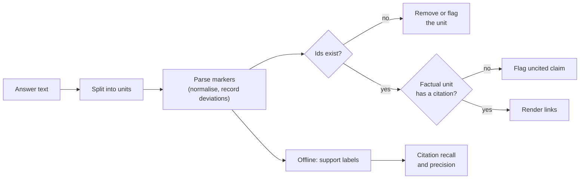

A citation turns an answer from "trust me" into "check me". In a RAG system it is a marker that ties a statement in the answer to a source the model was given, so the user can verify the statement, the interface can link to the document, and your code can test whether the statement is actually supported. [Response generation](/learn/rag-architecture-fundamentals/response-generation) introduced citations and the three levels of checking (existence, coverage, support). This lesson is about the instructions themselves: what a citation instruction must specify, how fine-grained citations should be, a format grammar that is easy for the model to produce and for code to parse, what should *not* be cited, how prompted markers compare with a provider's native citation feature, and how to measure citation quality with two standard metrics, citation recall and citation precision.

## Learning objectives

- Write a citation instruction that fixes the label, granularity, placement, multiple-source syntax and exceptions.
- Choose a citation granularity for a given product and justify it.
- Implement a tolerant citation parser that normalises common format deviations and reports them.
- Compute citation recall and citation precision by hand and in code, including citations that are jointly necessary.
- Compare prompted citation markers with native API citations and pick one for a given system.

## Prerequisites

- [Response generation](/learn/rag-architecture-fundamentals/response-generation): citations and the existence, coverage and support checks.
- [Context injection](/learn/prompt-engineering-for-rag/context-injection): short source ids and the label map.
- [Grounded generation](/learn/prompt-engineering-for-rag/grounded-generation): what it means for a source to support a claim.

## Why this matters

A citation that is missing costs the user the ability to check. A citation that is wrong costs more: it lends authority to a statement the source does not make. A user who clicks `[S2]` and finds a page about something else loses trust in every other citation as well.

Citation failures are common when the instruction is underspecified. Ask for "sources" and you may get a list at the end that does not say which sentence came from where. Ask for "citations" and you may get `[1]`, `(Source 1)`, `[S1, S3]`, `[S1-S3]` and "according to the handbook" in the same week, which no front end can render consistently. And a model asked to cite every sentence will cheerfully cite "I hope this helps [S1]."

Research on deployed systems shows that citations cannot simply be assumed to be accurate. Liu, Zhang and Liang (2023) audited several generative search engines and found that a large share of their generated statements were not fully supported by the citations given, and that many citations did not support the sentence they were attached to. A citation is a claim made by the model, and like any other claim it needs a precise instruction and a check.

## The intuition

Think of the footnotes in a well-edited report. Every factual sentence has one; opinions, transitions and the conclusion do not. Each footnote points to one specific document, not "see the bibliography". When a sentence combines two facts from two documents, it has two footnotes. The footnote numbers all look the same, so the typesetter can format them automatically. And an editor checking the report takes each footnoted sentence, opens the cited document, and asks two questions: does the document say this? And was every footnote needed, or is one of them just decoration?

Those two editor's questions are citation recall and citation precision.

## How it works

### What a citation instruction must specify

A complete citation instruction answers six questions. Leave any one open and the model answers it differently from request to request.

1. **The target.** Which identifier to use: the short id from the source block (`S1`), never titles or URLs, which the model may alter.
2. **The granularity.** What unit carries a citation: the answer, a paragraph, a sentence, a clause.
3. **The placement.** Where the marker goes: for example, at the end of the sentence, before the full stop.
4. **Multiple sources.** The exact syntax when two sources support one statement.
5. **Exceptions.** Which sentences carry no citation.
6. **An example.** One literal example of a correctly cited sentence, and one of a multiple-source citation.

A system-prompt section that answers all six (the version AskMeridian uses):

```text
<citations>
Cite the source of every sentence that states a fact, using the id from its source tag.
Put the citation at the end of the sentence, before the full stop: Annual leave is 25 days [S1].
If a sentence uses facts from two sources, cite both as adjacent brackets: [S2][S4].
Never write ranges or lists inside one bracket, and never cite an id that is not in the sources.
Do not cite sentences that state what the sources do not cover, or the fixed refusal sentence.
</citations>
```

### Granularity

| Granularity | What the user gets | Cost and risk |
| --- | --- | --- |
| Source list at the end | "Sources: handbook, IT runbook" | Cheap; says nothing about which statement came from where |
| Per paragraph | One or two markers per paragraph | Coarse; a paragraph mixing sources is unverifiable |
| Per sentence | A marker after each factual sentence | The usual default: easy to instruct, parse and check |
| Per clause | Markers inside sentences | Precise for compound sentences; more markers, harder to read |
| Per quotation | The exact cited span, as in [Grounded generation](/learn/prompt-engineering-for-rag/grounded-generation) | Most verifiable; longest output |

Per sentence is the established default because the sentence is the natural unit of a claim, a sentence splitter can find it, and the user can see at a glance what each marker covers. Two refinements help. First, ask for short sentences: a sentence with one claim needs one citation, so compound sentences are where precision suffers. Second, for list items and table rows, treat each item or row as the unit, and say so in the instruction.

### A format grammar for markers

Choose a marker format that is short, unambiguous, unlikely to occur naturally in source text, and regular enough for a single regular expression. `[S1]` meets these criteria: square brackets, a letter, digits. It cannot be confused with a numbered list (`1.`), a reference in a source document (`[1]`), or a date. Earlier lessons in this course used both `[1]` and `[S1]`; either works if used consistently.

For multiple sources, adjacent brackets (`[S2][S4]`) are easier for the model to produce consistently and for code to parse than a list inside one bracket (`[S2, S4]`) or a range (`[S2-S4]`). Ranges are especially risky: `[S1-S3]` asserts that S2 also supports the sentence, which the model rarely means. Forbid them in the instruction, and make the parser tolerant anyway: models occasionally deviate, and a parser that silently drops a deviating marker produces an uncited sentence the user never sees as such. The right behaviour is to **normalise and report**: accept `[S1, S3]` as two citations, record that the format deviated, and track the deviation rate as a quality signal for prompt changes.

### What should not carry a citation

A model that has been told to cite "every sentence" will cite things that have no source. Exclude explicitly:

- **Statements of absence.** "The handbook does not mention exceptions." No source says this; it is an observation about the sources. A citation here would point to a document that, by definition, does not contain the claim.
- **The refusal sentence.** It must stay exact so that code can detect it ([System prompts](/learn/prompt-engineering-for-rag/system-prompts)).
- **Labelled general background**, if your grounding policy allows it (for example, explaining what a VPN is). Citing it to a source that does not say it is a false attribution.
- **Courtesy and transitions.** "Here is what the policies say." Nothing to cite.

### Prompted markers versus native citations

Some providers return citations as structured data rather than text markers. With Anthropic's Messages API, if you pass sources as document content blocks with citations enabled ([Context injection](/learn/prompt-engineering-for-rag/context-injection)), the response arrives as a sequence of text blocks, and each block that makes a sourced claim carries a `citations` list. For plain-text documents each citation includes the document's index and title, the exact `cited_text`, and its start and end character positions in that document.

| | Prompted markers (`[S1]`) | Native citations |
| --- | --- | --- |
| Portability | Any model | One provider's API |
| What is cited | A whole source | An exact span, with its location |
| Parsing | Your regular expression; format deviations possible | Structured fields; no parsing |
| Existence check | Needed (the model can cite S7 of 5) | Indices refer to documents you supplied |
| Support check | Needed | Still needed: the span exists, but whether it supports the claim is a separate question |
| Control of placement | Full, via instructions | The API decides how text is split into cited blocks |

The cited span in a native citation is extracted from your document, which removes fabricated quotations. It does not remove the possibility that a real span is attached to a claim it does not fully support. Native citations raise the floor; they do not replace evaluation.

### The citation pipeline

1. Inject sources with short ids and keep the label map ([Context injection](/learn/prompt-engineering-for-rag/context-injection)).
2. Instruct granularity, placement, syntax and exceptions in the system prompt.
3. Generate.
4. Split the answer into units (sentences, list items) and parse each unit's markers, normalising and recording deviations.
5. Check existence: every cited id is in the label map.
6. Check coverage: every factual unit has at least one citation.
7. Check support, by cheap heuristics online and by a judge model or annotators offline, and compute citation recall and precision on samples.
8. Render: replace markers with links or footnotes ([Answer formatting](/learn/prompt-engineering-for-rag/answer-formatting)).



## The mathematics

Two metrics, introduced for the ALCE benchmark by Gao and colleagues (2023), measure citation quality. They are defined over **statements** (here, sentences) and the **citations** attached to them, and they need a judgement of whether a set of sources supports a statement. In ALCE that judgement comes from an entailment model; in your own evaluation it can come from annotators or a judge model. The definitions below follow ALCE's, simplified to sentence-level statements.

### Citation recall

**Intuition.** Of the statements in the answer, how many are fully supported by the sources they cite? A statement with no citation, or whose cited sources do not together support it, counts as a miss.

$$
\text{citation recall} = \frac{1}{|S|} \sum_{s \in S} \mathbb{1}\left[\, C_s \neq \varnothing \ \text{and}\ \text{supp}(C_s, s) \,\right]
$$

- $S$ is the set of statements and $|S|$ their number.
- $C_s$ is the set of sources cited by statement $s$ (valid ids only).
- $\text{supp}(C, s)$ is true when the sources in $C$, taken together, support $s$. "Together" matters: a sentence that combines two facts may need both sources.
- $\mathbb{1}[\cdot]$ is 1 when the condition holds and 0 otherwise.

### Citation precision

**Intuition.** Of the citations given, how many were needed? A citation is **irrelevant** if it does not support the statement on its own *and* the statement is still supported when it is removed. Such a citation adds nothing but an extra link that sends the user to the wrong place.

$$
\text{irr}(c, s) = \neg\,\text{supp}(\{c\}, s) \ \wedge\ \text{supp}(C_s \setminus \{c\}, s)
$$

$$
\text{citation precision} = \frac{\sum_{s \in S} \sum_{c \in K_s} \mathbb{1}\left[\, \text{supp}(C_s, s) \ \text{and}\ \neg\,\text{irr}(c, s) \,\right]}{\sum_{s \in S} |K_s|}
$$

- $K_s$ is every citation attached to $s$, including invalid ones (an id that was never supplied can never be precise).
- $c$ is one citation; $C_s \setminus \{c\}$ is the cited set without it.
- A citation only earns precision if its statement is supported at all.

The two-part irrelevance test is what lets jointly necessary citations count. In "The equipment budget is £400, but contractors are not eligible [S2][S4]", neither S2 nor S4 supports the whole sentence alone, but removing either breaks support, so both are relevant.

### Worked by hand

AskMeridian's answer has five sentences. Support labels (which sets of sources support each sentence) were assigned by an annotator.

| # | Sentence (abridged) | Cited | Supported by | Recall | Citations precise |
| --- | --- | --- | --- | --- | --- |
| 1 | Remote up to 3 days | S2 | S2 | 1 | S2: yes |
| 2 | £400, contractors not eligible | S2, S4 | S2 and S4 together | 1 | S2: yes; S4: yes |
| 3 | Laptops every 3 years | S1, S3 | S3 | 1 | S1: no (irrelevant); S3: yes |
| 4 | VPN on public Wi-Fi | S3 | S3 | 1 | S3: yes |
| 5 | Lost laptops to the desk | S5 (not supplied) | S4 | 0 | S5: no |

Sentence 3: S1 alone does not support it, and removing S1 leaves {S3}, which does, so S1 is irrelevant. Sentence 5 has no valid citation, so recall is 0 and its one citation is imprecise.

- Citation recall = (1 + 1 + 1 + 1 + 0) / 5 = 4/5 = **0.80**.
- Citation precision: 7 citations in total (1 + 2 + 2 + 1 + 1), of which 5 are precise, so 5/7 ≈ **0.71**.

The program in the next section computes exactly these numbers from the same labels.

## In code

The problem: parse the citation markers in an answer tolerantly, report format deviations and citations to sources that were never supplied, and compute citation recall and precision given support labels.

The code uses only the standard library. Support labels are hand-written here, as minimal sets of sources that together support each sentence. In practice they come from annotators on a sample of answers, or from a judge model ([LLM-as-a-judge](/learn/testing-and-benchmarking/llm-as-a-judge)); the metric code is the same either way.

```python
"""Parse citation markers tolerantly, then score citation recall and precision (ALCE-style)."""
import re

VALID = {"S1", "S2", "S3", "S4"}
MARKER = re.compile(r"\[([^\[\]]*\bS\d+[^\[\]]*)\]")  # a bracket group that mentions at least one S-id


def split_sentences(text: str) -> list[str]:
    return [s.strip() for s in re.split(r"(?<=[.!?])\s+(?=[A-Z])", text) if s.strip()]


def parse_citations(sentence: str) -> tuple[set[str], list[str]]:
    """Return every cited id (valid or not) and a list of format problems for one sentence."""
    ids, problems = set(), []
    for group in MARKER.findall(sentence):
        if re.fullmatch(r"S\d+", group):
            ids.add(group)
            continue
        problems.append(f"non-canonical marker [{group}]")
        found = re.findall(r"S\d+", group)
        if re.search(r"S\d+\s*[-–]\s*S\d+", group):  # a range such as S1-S3
            lo, hi = (int(x) for x in re.findall(r"S(\d+)", group)[:2])
            found = [f"S{i}" for i in range(lo, hi + 1)]
        ids.update(found)
    for sid in ids - VALID:
        problems.append(f"cites {sid}, which was never supplied")
    return ids, problems


answer = (
    "You can work remotely up to 3 days a week [S2]. "
    "The equipment budget is £400, but contractors are not eligible [S2][S4]. "
    "Laptops are replaced every 3 years [S1, S3]. "
    "On public Wi-Fi you must use the VPN [S3]. "
    "Lost laptops go to the support desk at once [S5]."
)

# Gold support: for each sentence, the minimal sets of sources that together support it
# (from human annotation or an entailment model; hand-labelled here).
GOLD = [
    [{"S2"}],          # remote days: S2 alone
    [{"S2", "S4"}],    # budget from S2, contractor exclusion from S4: needs both
    [{"S3"}],          # laptop cycle: S3 only (S1 is the remote-work page)
    [{"S3"}],          # VPN: S3
    [{"S4"}],          # lost laptops: S4 says it, but S5 was cited
]


def supports(gold_sets, cited: set[str]) -> bool:
    return any(g <= cited for g in gold_sets)


sentences = split_sentences(answer)
recall_hits, precise, total_citations = 0, 0, 0
for i, (sentence, gold) in enumerate(zip(sentences, GOLD), 1):
    all_ids, problems = parse_citations(sentence)
    cited = all_ids & VALID
    total_citations += len(all_ids - VALID)  # a citation to a missing source can never be precise
    ok = supports(gold, cited)
    recall_hits += ok
    for c in sorted(cited):
        total_citations += 1
        # A citation is irrelevant if it does not support the sentence alone
        # AND the remaining citations still support it without it.
        irrelevant = not supports(gold, {c}) and supports(gold, cited - {c})
        # If the cited set does not support the sentence at all, no citation earns precision.
        precise += ok and not irrelevant
    print(f"{i}. cited={sorted(all_ids)} supported={ok} {problems if problems else ''}")

print(f"\ncitation recall    = {recall_hits}/{len(sentences)} = {recall_hits / len(sentences):.2f}")
print(f"citation precision = {precise}/{total_citations} = {precise / total_citations:.2f}")
```

```output
1. cited=['S2'] supported=True 
2. cited=['S2', 'S4'] supported=True 
3. cited=['S1', 'S3'] supported=True ['non-canonical marker [S1, S3]']
4. cited=['S3'] supported=True 
5. cited=['S5'] supported=False ['cites S5, which was never supplied']

citation recall    = 4/5 = 0.80
citation precision = 5/7 = 0.71
```

The important lines:

- `MARKER` matches any bracket group that contains an `S`-id, so it catches the canonical `[S1]` and the deviations `[S1, S3]` and `[S1-S3]` alike. A stricter pattern would silently miss the deviations, which is worse than catching and reporting them.
- `parse_citations` accepts the canonical form directly, and for anything else records a problem and extracts the ids, expanding a range explicitly. Expanding a range is a judgement call: it is what the marker literally says, and the precision metric then penalises any id in the range that was not needed.
- `supports` encodes joint support. Gold labels are lists of minimal sets; a cited set supports the sentence if it contains any of them. Sentence 2's gold is one set of two sources, so neither alone suffices.
- The precision loop implements the two-part irrelevance test from the maths section, and invalid citations are added to the denominator.

What the output means. Recall of 0.80 says one sentence in five is not backed by what it cites: here, the lost-laptop sentence citing a source that does not exist. Precision of 0.71 says roughly one citation in three or four is noise: the redundant S1 and the phantom S5. For the user, the S1 problem is subtle: the sentence is correct and correctly supported by S3, but clicking S1 shows the remote-work page. The parser also reports one format deviation, which, tracked over time, tells you whether a prompt change has made the model less consistent.

Common errors: splitting sentences on every full stop (abbreviations such as "e.g." and figures such as "1.5" break the split; use a proper sentence splitter for real text); counting a statement of absence as an uncited claim (exclude it before scoring, matching the instruction's exceptions); and computing precision only over valid citations, which hides phantom ids.

### Native citations, converted to markers

This code was not executed here, because it needs an API key. It sends the sources as document blocks with citations enabled and converts the structured citations back into `[S#]` markers, so that the same rendering and metrics code works for both approaches.

```python
import anthropic

client = anthropic.Anthropic()  # reads ANTHROPIC_API_KEY from the environment

docs = [
    {"type": "document", "source": {"type": "text", "media_type": "text/plain", "data": text},
     "title": title, "citations": {"enabled": True}}
    for title, text in sources  # sources: list of (title, text) in label order
]
response = client.messages.create(
    model="claude-opus-5-5",
    max_tokens=1024,
    system="Answer only from the provided documents. If the answer is not there, say you don't know.",
    messages=[{"role": "user", "content": docs + [{"type": "text", "text": question}]}],
)

parts = []
for block in response.content:
    if block.type != "text":
        continue
    parts.append(block.text)
    for c in block.citations or []:
        parts.append(f"[S{c.document_index + 1}]")  # document_index is 0-based
answer = "".join(parts)
```

The output depends on the model. Note that native citations attach to *text blocks*, whose boundaries the API chooses, so a marker may land mid-sentence rather than at its end; if your metrics assume per-sentence markers, attribute each marker to the sentence in which its text block ends. Keep the `cited_text` of each citation as well: it is the span you show the user on hover, and the input to support checks.

To extend the parser: handle list items as units (split on line starts such as `- ` or `1. `), exclude statements of absence by pattern ("do not mention", "does not cover"), and log deviation counts per prompt version.

## A real-world example

The support team at Meridian asked for AskMeridian's answers to show a hover card with the exact cited passage. The Platform team's first implementation turned each `[S#]` into a card showing the whole chunk. Users complained that the cards were long and that, for some answers, the card did not obviously contain the claim.

A sample of 200 answers was labelled for support, and citation recall and precision were computed. Recall was reasonable, but precision was noticeably lower, and almost all imprecise citations had the same cause: the model, told to cite "the sources used", attached two or three ids to sentences that needed one, especially in answers that drew on both the handbook and the IT runbook. The instruction said nothing about citing only what supports the sentence.

Two changes followed. The citation section gained a sentence: "Cite only the sources that state the fact in this sentence; do not add sources for related information." And the team moved the high-traffic HR flows to native citations, so the hover card shows the exact `cited_text` span rather than the chunk. They kept prompted markers for the product-documentation assistant, which runs on a different model provider, and used the same metrics code for both by converting native citations into markers, as above. Re-running the labelled sample after the instruction change showed fewer multi-source citations on single-fact sentences. The team now recomputes both metrics on a fresh labelled sample whenever the citation instruction or the model changes.

## Common mistakes

- **Asking for "sources" without specifying granularity.** The model produces a list at the end, and no statement can be checked individually.
- **No syntax for multiple sources.** The model invents lists and ranges; ranges assert support from sources in between.
- **A strict parser that drops deviating markers.** Sentences silently become uncited, and the deviation never shows up in metrics.
- **Citing statements of absence and the refusal.** The citation points to a source that, by definition, does not say the cited thing; the refusal stops matching its exact string.
- **Citing titles or URLs.** The model alters them; existence checks then fail on correct citations.
- **Treating native citations as proof of support.** The span exists in the document; whether it supports the claim still needs checking.
- **Measuring only recall.** Answers that cite everything look perfect on recall while sending users to irrelevant pages.

## Best practices

- Specify target, granularity, placement, multiple-source syntax and exceptions, with literal examples.
- Cite per sentence by default; ask for short, single-claim sentences; treat list items and table rows as units.
- Use adjacent brackets for multiple sources and forbid ranges.
- Parse tolerantly, normalise deviations, and record the deviation rate per prompt version.
- Instruct "cite only the sources that state this fact" to protect precision.
- Measure citation recall and precision on labelled samples whenever the prompt, model or retriever changes.
- Prefer native citations where verifiable spans matter and provider lock-in is acceptable; convert them to your canonical markers so downstream code is shared.

## Performance considerations

Each `[S1]` marker costs a few output tokens. A 6-sentence answer with an average of 1.3 citations per sentence adds about 8 markers; at roughly 3 to 4 tokens per marker in a typical tokeniser, that is about 30 output tokens, a modest share of a 150-token answer. Clause-level citations or quotations multiply this. Native citations return `cited_text` in the response; check the provider's documentation for how those fields are billed, since that has changed between API versions.

Parsing and existence checks are microseconds. Support checking is where cost lives: a judge-model call per sentence turns one generation into seven model calls for a six-sentence answer. Run support checks on a sample offline, and online only for high-stakes flows or when a cheap heuristic (such as the number check in [Grounded generation](/learn/prompt-engineering-for-rag/grounded-generation)) raises a flag.

## Security considerations

- **Citations can launder injected content.** A planted sentence in a retrieved document, repeated with a valid citation, looks more trustworthy, not less. Citation checks verify attribution, not the source's integrity; corpus controls handle that ([Data poisoning](/learn/rag-security-fundamentals/data-poisoning)).
- **Resolve markers only through your label map.** If the model writes a URL or an id outside the map, do not render it as a link. Rendering model-written URLs lets an injected instruction turn a citation into a link to an attacker's site.
- **Check access at render time.** A citation link must point to a document the user is allowed to open. If retrieval is already filtered by permission, this holds automatically; if any cached or shared answer is shown to a different user, re-check.

## Summary

- A citation instruction must fix the target id, granularity, placement, multiple-source syntax and exceptions, with literal examples.
- Per-sentence citation is the established default; short single-claim sentences make it precise.
- Use a regular marker grammar (`[S1]`, adjacent brackets for several), parse tolerantly, and track deviations.
- Citation recall asks whether each statement is supported by what it cites; citation precision asks whether each citation was needed.
- Native citations return exact spans and remove fabricated quotations, but support still needs checking.

## Exercises

1. An answer sentence reads "Expenses over £75 need a receipt and must be submitted within 30 days [S3-S5]." Only S3 was retrieved with this information; S4 and S5 are about leave. What does the parser report, and how does this sentence affect citation precision?

<details><summary>Show solution</summary>

The parser reports a non-canonical marker `[S3-S5]` and expands it to S3, S4 and S5. S3 supports the sentence alone, so recall for this sentence is 1. For precision, S4 and S5 each fail to support it alone, and removing either leaves a set (still containing S3) that supports it, so both are irrelevant. Precision for this sentence is 1 of 3 citations. The fix is in the instruction: forbid ranges and say to cite only sources that state the fact.

</details>

2. Compute citation recall and precision by hand: sentence A cites [S1] and is supported by S1; sentence B cites [S1][S2] and is supported only by S1 and S2 together; sentence C cites [S2][S3] and is supported by S3 alone; sentence D has no citation.

<details><summary>Show solution</summary>

Recall: A yes, B yes, C yes (the cited set contains S3), D no: 3/4 = 0.75. Precision: A has 1 precise citation. B: neither alone supports, removing either breaks support, so both are precise (2). C: S2 alone does not support, and removing it leaves {S3}, which does, so S2 is irrelevant; S3 is precise (1). D has no citations. Total citations 1 + 2 + 2 = 5, precise 4, so precision = 4/5 = 0.80.

</details>

3. Extend the code so that sentences matching a statement-of-absence pattern ("does not mention", "do not cover", "doesn't say") are excluded from both metrics, and so that a citation on such a sentence is reported as a problem.

<details><summary>Show solution</summary>

```python
ABSENCE = re.compile(r"\b(does not|do not|doesn't|don't) (mention|cover|say|specify)\b", re.I)

def is_absence(sentence: str) -> bool:
    return bool(ABSENCE.search(sentence))

# Inside the loop, before scoring:
#     if is_absence(sentence):
#         if all_ids:
#             print(f"{i}. statement of absence should not be cited: {sorted(all_ids)}")
#         continue
```

The `GOLD` list must then skip these sentences too, or be keyed by sentence text rather than position, so that labels stay aligned.

</details>

4. Design decision: Meridian Reports' customer-facing help assistant will answer from public product documentation, and the legal team wants every answer to be auditable for a year. Would you choose prompted markers or native citations, at what granularity, and what would you store?

<details><summary>Show solution</summary>

Native citations at span level are the stronger choice for auditability, because each claim comes with the exact `cited_text` and its location in a specific document, which survives later edits to the docs if you store it. Store, per answer: the question, the prompt version, the model id, each source's document id and version (or a content hash), the full answer, and every citation's cited text, document index and character range. If the team needs provider portability, use prompted per-sentence markers plus quote-then-answer, and store the verified quotes instead. Either way, sample answers for support labelling and keep the citation recall and precision trend.

</details>

## Check your understanding

```quiz
[
  {
    "q": "Why are adjacent brackets such as [S2][S4] preferred to a range such as [S2-S4]?",
    "options": [
      "Ranges are longer",
      "A range asserts that every source in between also supports the sentence",
      "Ranges cannot be parsed by regular expressions",
      "Adjacent brackets are required by the API"
    ],
    "answer": 1,
    "why": "[S2-S4] literally cites S3 as well; adjacent brackets cite exactly the sources intended."
  },
  {
    "q": "A sentence cites [S1][S3]; S3 alone supports it and S1 does not. Under the ALCE-style definition, which citation is irrelevant?",
    "options": [
      "S3",
      "Both",
      "Neither",
      "S1"
    ],
    "answer": 3,
    "why": "S1 does not support the sentence alone, and the sentence remains supported without it, so S1 is irrelevant."
  },
  {
    "q": "Which sentence should carry no citation?",
    "options": [
      "The handbook does not mention exceptions to the carry-over rule.",
      "Up to 5 unused days carry over.",
      "VPN is required on public Wi-Fi.",
      "Expenses over £75 need a receipt."
    ],
    "answer": 0,
    "why": "A statement of absence is an observation about the sources; no source states it, so a citation would be a false attribution."
  },
  {
    "q": "What remains necessary even with native API citations?",
    "options": [
      "Parsing markers with regular expressions",
      "Checking that cited document indices exist",
      "Checking that the cited span actually supports the claim",
      "Escaping the cited text"
    ],
    "answer": 2,
    "why": "The span is guaranteed to come from the document, but whether it supports the claim attached to it is a separate question."
  },
  {
    "q": "An answer cites every source on every sentence. Which metric reveals the problem?",
    "options": [
      "Citation recall",
      "Citation precision",
      "Answer length",
      "Format deviation rate"
    ],
    "answer": 1,
    "why": "Over-citation keeps recall high but adds many irrelevant citations, which lowers precision."
  }
]
```

## Further reading

- Gao, T., Yen, H., Yu, J. and Chen, D. (2023). *Enabling Large Language Models to Generate Text with Citations* (ALCE). [arxiv.org/abs/2305.14627](https://arxiv.org/abs/2305.14627)
- Liu, N. F., Zhang, T. and Liang, P. (2023). *Evaluating Verifiability in Generative Search Engines*. [arxiv.org/abs/2304.09848](https://arxiv.org/abs/2304.09848)
- Anthropic, *Claude Developer Platform documentation*: citations, document content blocks and search result blocks. [platform.claude.com/docs](https://platform.claude.com/docs)
- Bohnet, B. et al. (2022). *Attributed Question Answering: Evaluation and Modeling for Attributed Large Language Models*. [arxiv.org/abs/2212.08037](https://arxiv.org/abs/2212.08037)
- Rashkin, H. et al. (2021). *Measuring Attribution in Natural Language Generation Models* (the AIS framework). Computational Linguistics, 2023.
