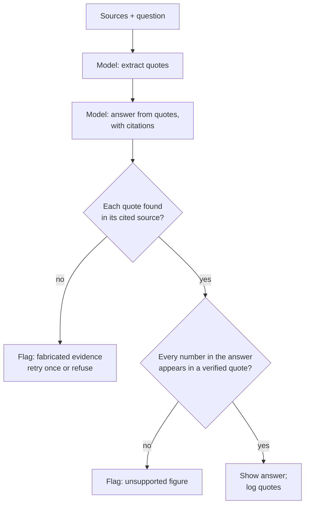

A RAG answer is **grounded** when every claim in it can be traced to the sources the model was given. That sounds like a single rule ("answer only from the context"), and in [Response generation](/learn/rag-architecture-fundamentals/response-generation) it was one clause of a contract. In practice it raises questions that one sentence of instructions cannot settle. May the model add 25 and 5? May it say that "holiday" means annual leave? What should it do when two sources disagree, or when a source contradicts something the model is confident it knows?

This lesson is about the prompt engineering of grounding: defining exactly which operations on the sources are permitted, the techniques that make a model stay within them (the most effective being *quote, then answer*), how to handle conflicts between sources and between a source and the model's own memory, and how to verify, cheaply and deterministically, that the quotes a model relied on really exist.

## Learning objectives

- Distinguish a grounded answer from a correct one, and give an example of each without the other.
- Write a grounding policy that states which operations on the sources are allowed: extraction, paraphrase, combination, arithmetic, inference.
- Apply the quote-then-answer technique and explain why it improves both faithfulness and verifiability.
- Write prompt rules for conflicts between sources and between sources and the model's prior knowledge.
- Implement a verifier that checks quoted evidence against the sources and flags answer numbers with no verified support.

## Prerequisites

- [Response generation](/learn/rag-architecture-fundamentals/response-generation): the grounded-answer contract and post-generation checks.
- [Hallucinations and factual reliability](/learn/introduction-to-rag/hallucinations-and-factual-reliability): intrinsic and extrinsic hallucination, and atomic claims.
- [Parametric versus non-parametric knowledge](/learn/introduction-to-rag/parametric-versus-non-parametric-knowledge): what the model knows from training versus what it is given.
- [Context injection](/learn/prompt-engineering-for-rag/context-injection): how sources are labelled and escaped.

## Why this matters

A model given sources does not automatically confine itself to them. It has read a great deal of text during training, and it is tuned to be helpful. When the sources are incomplete, the path of least resistance is to fill the gap with what is typical, and what is typical is often wrong for one particular company.

For AskMeridian, the dangerous answers are not wild inventions. They are plausible ones. "Unused leave may be paid out at the end of the year" is true at many employers and false at Meridian. "Contractors can claim the equipment budget with manager approval" sounds like a reasonable policy and contradicts the handbook. A user cannot tell these from grounded answers, because they read the same and may even carry a citation to a source that is about leave or equipment but does not say this.

Grounding failures also hide inside correct-looking answers. A model that writes "you can carry over up to 5 days [S1]" when S1 is the remote-work policy has produced a true sentence with a false attribution. The user who clicks the citation finds nothing, and trust falls even though the fact was right. The goal is an answer whose every claim is true *to the sources*, and visibly so.

## The intuition

Imagine an open-book exam with an unusual rule: you may only write things you can point to in the book. A good student does two things. First, before writing the answer, they find the relevant passages and copy the key lines onto scrap paper. Then they write the answer from the scrap paper, not from memory. If a line they need is not in the book, they say so, even if they are sure they remember it from a lecture.

The scrap paper is the trick. It forces the search to happen before the writing, makes it obvious when nothing relevant was found, and lets the examiner check each copied line against the book in seconds. That is quote-then-answer.

The exam also needs a clear rule about what counts as "in the book". If the book says "25 days of leave" and "5 days carry over", may you write "at most 30 days in one leave year"? Most examiners would say yes, as long as you show the working. Whether they also accept "most people take their leave in summer" (true in general, not in the book) is exactly the kind of thing you must decide in advance and write down.

## How it works

### Grounded is not the same as correct

Two properties of an answer are easy to conflate:

- **Faithfulness** (or groundedness): every claim is supported by the supplied sources.
- **Correctness**: every claim is true in the world.

They come apart in both directions. If S1 is the superseded 2023 handbook saying laptops are refreshed every 4 years, the answer "every 4 years [S1]" is faithful and incorrect: the fault lies in retrieval or the corpus. If the sources say nothing about bank holidays and the model writes the correct number of English bank holidays from memory, the answer is correct and unfaithful: true, but unverifiable from your documents, and therefore unpredictable. Next time the memory may be wrong.

Prompt engineering controls faithfulness. Correctness additionally depends on the corpus and the retriever. Keeping the two apart is what lets you assign each failure to the right part of the system; the evaluation side of this is [Faithfulness](/learn/generation-evaluation/faithfulness) and [Answer correctness](/learn/generation-evaluation/answer-correctness).

### What counts as "in the sources": a grounding policy

"Answer only from the sources" leaves open which operations on the sources are allowed. Write them down. A policy for AskMeridian:

| Operation | Example | Allowed? |
| --- | --- | --- |
| Extraction | "Annual leave is 25 days [S1]." | Yes |
| Paraphrase | "You get 25 days off each year [S1]." | Yes, if the meaning is unchanged |
| Combination across sources | "You can work remotely 3 days a week [S2] and must use VPN on public Wi-Fi [S3]." | Yes, each part cited |
| Simple arithmetic | "With 5 carried-over days, at most 30 days in one leave year [S1]." | Yes, show the inputs |
| Interpreting the question | Understanding that "holiday" means annual leave | Yes; this is language, not a fact |
| Inference beyond the text | "So you can probably carry over more with approval." | No |
| General knowledge as fact | "UK law requires at least 28 days including bank holidays." | No, unless a source says it |

The line that matters is between using general knowledge to *understand* (language, units, what a VPN is) and using it to *assert* facts the user will act on. Put that distinction in the system prompt in plain words: "You may use general knowledge to understand the question and the sources, but every fact you state must come from the sources."

Arithmetic and combination deserve explicit permission. Without it, a strictly instructed model sometimes refuses questions whose answer requires adding two numbers from the same paragraph, which is grounded but not literally stated. With permission and a request to show the inputs, the inference is both allowed and checkable.

### Why models drift from the sources

Three pressures pull an answer away from the sources, and each suggests a counter-measure.

1. **Helpfulness.** Models are trained to answer. An incomplete context creates pressure to complete the answer anyway. Counter: an explicit, respectable way out (the refusal and partial-answer rules of [Refusal behaviour](/learn/prompt-engineering-for-rag/refusal-behaviour) and [Handling missing information](/learn/prompt-engineering-for-rag/handling-missing-information)), and a reason in the prompt why an invented answer is worse than none.
2. **Prior knowledge.** When a source says something unusual, the model's training may say something different. Research on such **knowledge conflicts** has found both behaviours. Longpre and colleagues (2021), studying question-answering models of that time, found that when a passage's answer was replaced with a different entity, models often still produced the answer they had memorised. Xie and colleagues (2023), studying larger instruction-tuned models, found them generally receptive to external evidence that contradicted their memory when that evidence was coherent and convincing, though less so when the context mixed supporting and conflicting evidence. The safe conclusion for an engineer is that you cannot assume either behaviour; you must state the rule and test it with questions whose correct, sourced answer is atypical.
3. **Fluency over fidelity.** Writing a smooth paragraph encourages small embellishments: "up to 3 days a week, *depending on your team*". The qualifier sounds harmless and is unsupported. Counter: ask for short answers, cite per sentence, and verify.

### Quote, then answer

The single most effective prompt technique for grounding is to make the model **extract the relevant quotations first, then answer using only them**. Anthropic's guidance on long documents and on reducing hallucinations recommends this pattern, and its logic is straightforward:

1. The model searches the sources before it writes the answer, not while writing it, so the answer is conditioned on the evidence it has just reproduced.
2. If no quotation is relevant, the empty quote list is a visible signal, to the model and to your code, that the honest answer is a refusal.
3. Quotations are verifiable by plain string matching. A paraphrased answer can only be checked semantically; a quotation can be checked exactly.

The instruction looks like this (pseudocode for the relevant part of the system prompt):

```text
First, find the sentences in the sources that are relevant to the question.
Copy them word for word inside <quotes>, one <quote source="S1">...</quote> per sentence.
If no sentence is relevant, write <quotes></quotes>.
Then write your answer inside <answer>, using only the information in your quotes,
citing the source id after each sentence.
```

The output then has two parts. The application verifies the quotes, shows the user only the `<answer>` part, and keeps the quotes for logging and for the citation display ("this is the sentence the answer relied on").



The technique has costs. The quotes are output tokens, which are slower and dearer than input tokens, and they delay the start of the visible answer when streaming. It also tends to make answers more literal. For a high-stakes assistant (HR policy, security procedures), those costs are usually worth it. For a low-stakes one, a lighter alternative is to skip the quotes and rely on per-sentence citations, checked afterwards. Native citation features, such as those described in [Citation instructions](/learn/prompt-engineering-for-rag/citation-instructions), achieve a similar effect at the API level: the provider returns the exact cited text with each claim.

### Conflicting sources

Retrieval often returns sources that disagree: the 2023 and 2025 handbooks, a wiki tip and an official runbook, a product page for the Standard plan and another for Enterprise. Unless the prompt says otherwise, the model resolves the conflict silently, and not consistently. Three rules cover most cases:

1. **Prefer by explicit authority metadata, not by persuasiveness.** If the injection step marks sources as `status="current"` or `superseded`, or `doc_type="policy"` versus `wiki`, tell the model which wins. Never ask the model to judge authority from the text itself; a confident wiki page reads as authoritative as a policy.
2. **Surface the conflict.** "The current handbook says laptops are refreshed every 3 years [S1]; an older 2023 version said 4 years [S2]." Users often have the old figure in mind; naming the change prevents a follow-up ticket.
3. **When there is no basis for choosing, say so.** Two current sources that disagree indicate a corpus problem. The answer should present both, cited, and the system should log the conflict for the document owners.

Most of this is decided by metadata that injection must supply. A rule like "prefer the newer source" is useless if no dates are in the prompt.

### Conflicts with the model's own knowledge

When a source states something the model believes is false, what should happen? For an internal assistant whose sources are the organisation's own policies, the source wins: Meridian's leave policy is whatever Meridian's handbook says. Say so in the prompt, with the reason. For a public-facing assistant over third-party content, you might instead want the model to flag a source that looks wrong, for example a product page that states a technically impossible figure. That is a policy choice, not a default, and it should be explicit.

### Allowing the model to show its working

Arithmetic and multi-step combination are where faithful answers most often go wrong without anyone noticing. Asking the model to state the inputs ("25 days [S1] plus up to 5 carried over [S1] gives at most 30") makes the reasoning checkable and catches errors that a bare "30 days" would hide. Models that support extended reasoning modes may also do their working before answering; that improves accuracy on multi-step questions but the reasoning is not itself a citation, so still require the inputs to appear, cited, in the answer.

## In code

The problem: a model has responded in quote-then-answer form. Before showing the answer, the application must check that each quote really appears in the source it names (allowing for trivial differences in whitespace, curly quotes and HTML escaping), and that every number in the answer is present in some verified quote.

This runs with the Python standard library only. No model is called: the three responses below are written to represent the three outcomes that matter (faithful, quote drifted into paraphrase, fabricated evidence), so that the verifier can be tested deterministically. In production the response comes from the model call shown afterwards.

```python
"""Verify a quote-then-answer response: are the quotes really in the sources, and do the answer's numbers come from them?"""
import html
import re
import unicodedata
from difflib import SequenceMatcher

SOURCES = {
    "S1": "Annual leave is 25 days per year. Up to 5 unused days carry over and must be used by 31 March.",
    "S2": "Staff may work remotely up to 3 days a week. The home-office equipment budget is £400. "
          "Contractors are not eligible for the equipment budget.",
    "S3": "Expenses must be submitted within 30 days. Anything over £75 needs a receipt.",
}


def normalise(text: str) -> str:
    text = html.unescape(unicodedata.normalize("NFKC", text))
    text = text.replace("’", "'").replace("‘", "'").replace("“", '"').replace("”", '"')
    text = text.replace("–", "-").replace("—", "-")
    return re.sub(r"\s+", " ", text).strip().lower()


def best_match(quote: str, source: str) -> float:
    """Highest similarity between the quote and any same-length window of the source (1.0 = verbatim)."""
    q, s = normalise(quote), normalise(source)
    if q in s:
        return 1.0
    words, n = s.split(), len(q.split())
    windows = [" ".join(words[i:i + n]) for i in range(max(1, len(words) - n + 1))]
    return max(SequenceMatcher(None, q, w).ratio() for w in windows)


def parse(response: str):
    quotes = re.findall(r'<quote source="(S\d+)">(.*?)</quote>', response, flags=re.S)
    answer = re.search(r"<answer>(.*?)</answer>", response, flags=re.S)
    return quotes, (answer.group(1).strip() if answer else "")


def verify(response: str, exact=0.97, near=0.85):
    quotes, answer = parse(response)
    verified_text = []
    for sid, text in quotes:
        score = best_match(text, SOURCES[sid]) if sid in SOURCES else 0.0
        status = "verbatim" if score >= exact else "near" if score >= near else "NOT FOUND"
        if score >= near:
            verified_text.append(normalise(text))
        print(f"  quote {sid} {status:9s} {score:.2f}  {text[:55]!r}")
    # Every number in the answer must appear in at least one verified quote.
    evidence = " ".join(verified_text)
    claims = re.sub(r"\[S\d+\]", "", answer)  # citation markers are not claims
    numbers = re.findall(r"\d+(?:\.\d+)?", claims)
    unsupported = [n for n in numbers if not re.search(rf"(?<![\d.]){n}(?!\.?\d)", evidence)]
    print("  answer numbers without a verified quote:", unsupported or "none")


cases = {
    "faithful": """<quotes>
<quote source="S1">Up to 5 unused days carry over and must be used by 31 March.</quote>
</quotes>
<answer>You can carry over up to 5 unused days, and you must use them by 31 March [S1].</answer>""",
    "quote drifted": """<quotes>
<quote source="S2">Staff can work remotely up to three days each week.</quote>
<quote source="S2">The home-office equipment budget is £400.</quote>
</quotes>
<answer>You can work from home up to 3 days a week [S2], and claim up to £400 for equipment [S2].</answer>""",
    "fabricated": """<quotes>
<quote source="S3">Expenses must be submitted within 30 days.</quote>
<quote source="S1">Parental leave is 26 weeks at full pay.</quote>
</quotes>
<answer>Parental leave is 26 weeks at full pay [S1]; claim related expenses within 30 days [S3].</answer>""",
}

for name, response in cases.items():
    print(name)
    verify(response)
```

```output
faithful
  quote S1 verbatim  1.00  'Up to 5 unused days carry over and must be used by 31 M'
  answer numbers without a verified quote: none
quote drifted
  quote S2 near      0.86  'Staff can work remotely up to three days each week.'
  quote S2 verbatim  1.00  'The home-office equipment budget is £400.'
  answer numbers without a verified quote: ['3']
fabricated
  quote S3 verbatim  1.00  'Expenses must be submitted within 30 days.'
  quote S1 NOT FOUND 0.59  'Parental leave is 26 weeks at full pay.'
  answer numbers without a verified quote: ['26']
```

The important lines:

- `normalise()` removes differences that do not change meaning: Unicode compatibility forms (NFKC), HTML entities left by escaping at injection, typographic quotes and dashes, whitespace and case. Without it, a verbatim quote fails on a curly apostrophe.
- `best_match()` first tries an exact substring test, which is fast and decisive. Only if that fails does it slide a window the length of the quote across the source and take the best `SequenceMatcher` ratio, a similarity between 0 and 1 based on matching character runs. This distinguishes "nearly verbatim" from "not there".
- The two thresholds create three bands. **Verbatim** (0.97 and above) passes. **Near** (0.85 to 0.97) means the model rewrote the quote; it counts as evidence, but is worth logging, because quote drift is an early sign the model is paraphrasing from memory. **Not found** is fabricated evidence.
- The number check strips citation markers first (otherwise the `2` in `[S2]` looks like a claim), then requires every number in the answer to appear, as a whole number, in some verified quote. The look-around assertions stop `5` matching inside `25`.

What the output means. The faithful case passes cleanly. The drifted case is subtle: the model's quote said "three days each week" while the source says "3 days a week", so the quote is only near, and the answer's `3` has no verified quote containing that figure. The fact happens to be right, but the evidence chain is broken, and that is exactly when a wrong figure would also slip through. The fabricated case is caught twice: the parental leave quote does not exist in S1 (similarity 0.59), and the answer's `26` has no support. The application should not show this answer; a retry with the finding ("your quote from S1 does not appear in S1") or a refusal is the right response.

Common errors: comparing against escaped source text (every `&amp;` becomes a mismatch); thresholds tuned on three examples (tune them on a few hundred logged quotes); and treating the number check as a full faithfulness check. It catches wrong figures, not wrong words ("must" versus "may"), which need the claim-level checks of [Hallucination detection](/learn/generation-evaluation/hallucination-detection).

### Producing the response

This call was not executed here, because it needs an API key. `system_prompt` is the static prompt from [System prompts](/learn/prompt-engineering-for-rag/system-prompts) with its grounding section extended by the quote-then-answer instruction, and `user_turn` is built as in [Context injection](/learn/prompt-engineering-for-rag/context-injection).

```python
import anthropic

client = anthropic.Anthropic()  # reads ANTHROPIC_API_KEY from the environment

response = client.messages.create(
    model="claude-opus-5-5",
    max_tokens=1024,
    system=system_prompt,
    messages=[{"role": "user", "content": user_turn}],
)
text = "".join(block.text for block in response.content if block.type == "text")
if response.stop_reason == "max_tokens":
    raise RuntimeError("answer cut off; do not verify or show a partial answer")
verify(text)
```

Check `stop_reason` before verifying: a response cut off by the token limit may have quotes and no `<answer>`. To extend the example: return a structured result instead of printing, so that the application can decide between showing, retrying and refusing; and add a check that every source id cited in `<answer>` also has at least one verified quote, which links the answer's citations to the evidence.

## A real-world example

Meridian's HR team ran a review of AskMeridian answers about leave and found a recurring pattern. Asked "Can I carry over more than 5 days if my manager agrees?", the assistant answered "Generally no, but managers may approve exceptions in special circumstances [S1]." S1 says nothing about exceptions. The model had produced what most employers' policies say.

The Platform team's first instinct was to add "NEVER add information not in the sources" in capitals. In testing, that made the assistant refuse "How many leave days can I have in one year, including carry-over?", a question whose answer needs 25 plus 5, because it was no longer sure arithmetic was allowed.

The fix that worked was the grounding policy and the quote-then-answer form. The system prompt now listed the allowed operations (paraphrase, combination, arithmetic with inputs shown) and stated that general knowledge may be used to understand questions but not to state facts. The model was asked to quote first. On the manager question, the quotes contained only S1's carry-over sentence, and the answer became "The handbook allows up to 5 unused days to carry over [S1]; it does not mention exceptions." The verifier added a second layer: in the following weeks it flagged a small number of near-match quotes, and reviewing them showed the model paraphrasing a policy from an older handbook that had not been retrieved at all, which led the team to remove stale pages from the index.

## Common mistakes

- **Equating grounded with correct.** A faithful answer from a stale source is still wrong; a correct answer from memory is still ungrounded and unpredictable.
- **"Answer only from the context" with no policy on arithmetic and combination.** The model either refuses legitimate derived answers or invents inferences, inconsistently.
- **Letting the model judge which conflicting source is authoritative from the text.** Confident wording wins over official status. Use injected metadata.
- **Resolving conflicts silently.** The user, who may remember the old policy, gets a different answer with no explanation.
- **Shouting the grounding rule.** Over-application turns into refusals of answerable questions.
- **Verifying quotes against escaped or unnormalised text.** Genuine quotes fail, the check gets disabled, and fabricated ones then pass.
- **Treating the number check as complete.** It catches wrong figures, not wrong modal verbs, conditions or exceptions.

## Best practices

- Write a grounding policy listing permitted operations; allow paraphrase, combination and arithmetic with inputs shown.
- Distinguish understanding (language, general concepts) from asserting (facts the user acts on); only the second must be sourced.
- Use quote-then-answer for high-stakes domains, and verify every quote deterministically before display.
- Inject authority and date metadata, and state in the prompt how to resolve conflicts and that conflicts must be mentioned.
- Build regression questions whose correct, sourced answer is atypical (unusual policies), and questions whose answer requires arithmetic.
- Log near-match quotes as well as failures; drift is an early signal.

## Performance considerations

Quote-then-answer adds output tokens. If the quotes average 60 tokens and the answer 120, the response grows by half. Output tokens are generated one at a time, so at an assumed generation speed of 50 tokens per second, 60 extra tokens add about 1.2 seconds before the answer is complete, and, if you stream only the `<answer>` part, about 1.2 seconds before the first visible word. Output tokens are also priced several times higher than input tokens by most providers (check current pricing); at 100,000 requests a day, 60 extra output tokens per request is 6 million output tokens a day.

The verifier itself is cheap. The exact substring test is linear in the source length. The fuzzy fallback compares the quote with every window of the source, so it is roughly proportional to the number of windows times the quote length; for a few sources of a few hundred words it takes milliseconds. Run the exact test first and the fuzzy one only on failure, as the code does.

## Security considerations

- **A planted instruction can ask the model to quote it.** Quote verification confirms that a quotation exists in a source, not that the source is trustworthy. A verified quote from a poisoned wiki page is still poison. Authority metadata and corpus controls address this; see [Data poisoning](/learn/rag-security-fundamentals/data-poisoning).
- **Do not show the raw quotes block unfiltered.** It contains source text verbatim, which may include content the user should see only in context, or text formatted to look like an instruction to the user. Render it through the same sanitisation as the answer ([Answer formatting](/learn/prompt-engineering-for-rag/answer-formatting)).
- **Conflict rules can be gamed.** If "newest wins", anyone who can publish a newer page wins. Take dates and status from the document registry, not from the document text.

## Summary

- Grounded means supported by the supplied sources; correct means true. Prompting controls the first; corpus and retrieval also govern the second.
- A grounding policy states which operations are allowed: extraction, paraphrase, combination and arithmetic with inputs shown, but not inference beyond the text or general knowledge stated as fact.
- Models drift through helpfulness, prior knowledge and fluency; research shows both over-reliance on memory and readiness to follow context, so the rule must be explicit and tested.
- Quote-then-answer makes the model find evidence before writing and makes that evidence checkable by string matching.
- Conflicts are resolved with injected authority metadata, and are surfaced to the user rather than settled silently.

## Exercises

1. Classify each statement, given only S1 ("Annual leave is 25 days per year. Up to 5 unused days carry over and must be used by 31 March."): (a) "You get 25 days' leave [S1]." (b) "If you carry over 5 days you could have 30 days in one leave year [S1]." (c) "Carried-over days are lost if not used by 31 March [S1]." (d) "Most UK firms also give bank holidays on top [S1]."

<details><summary>Show solution</summary>

(a) Extraction: grounded. (b) Arithmetic combining two facts from S1, with the inputs implied: grounded under a policy that allows arithmetic, though better if the inputs are stated. (c) An inference: S1 says they "must be used by 31 March" but not what happens otherwise. "Lost" is a plausible reading but not stated; a strict policy would phrase it as "must be used by 31 March" and stop. (d) General knowledge presented as a fact and wrongly cited: ungrounded, and a false attribution.

</details>

2. Two sources are retrieved: S1, the 2025 handbook (`status="current"`), says the support desk is open 08:00 to 18:00; S2, the 2023 handbook (`status="superseded"`), says 09:00 to 17:00. Write the conflict rule for the system prompt and the ideal answer to "When is the support desk open?"

<details><summary>Show solution</summary>

Rule: "Sources carry a status attribute. If sources disagree, rely on the one with status current, and mention briefly that an older version said something different, citing it." Answer: "The support desk is open 08:00 to 18:00 UK time [S1]. An older 2023 version of the handbook gave 09:00 to 17:00 [S2], so you may see those hours in older material."

</details>

3. Extend `verify()` so that it also reports any source id cited in the `<answer>` that has no verified quote, and test it on the "fabricated" case.

<details><summary>Show solution</summary>

```python
def cited_without_evidence(response: str, exact=0.97, near=0.85) -> list[str]:
    quotes, answer = parse(response)
    supported = {sid for sid, text in quotes
                 if sid in SOURCES and best_match(text, SOURCES[sid]) >= near}
    cited = set(re.findall(r"\[(S\d+)\]", answer))
    return sorted(cited - supported)

print(cited_without_evidence(cases["fabricated"]))  # ['S1']
```

S1 is cited for the parental leave sentence, but its only quote failed verification, so the citation has no evidence behind it.

</details>

4. Design decision: AskMeridian's product-documentation assistant answers developers' questions about Meridian Sync's API. Developers complain that it refuses to explain general concepts such as "what is an idempotency key?" because the docs do not define them. How would you change the grounding policy without letting unsupported claims about Meridian Sync's behaviour through?

<details><summary>Show solution</summary>

Split claims into two classes in the policy. General technical concepts may be explained from general knowledge, but must be labelled as general background and must not carry a citation. Claims about how Meridian Sync behaves (limits, endpoints, error codes, defaults) must come from the sources with citations, and if absent, the assistant says the documentation does not cover it. Add regression cases for both: a concept question that should be answered, and a product-behaviour question absent from the docs that should not be.

</details>

## Check your understanding

```quiz
[
  {
    "q": "The only retrieved source is the superseded 2023 handbook, and the answer says laptops are refreshed every 4 years, citing it. How should this be classified?",
    "options": [
      "Faithful but incorrect: the fault is in retrieval or the corpus",
      "Unfaithful and incorrect",
      "Faithful and correct",
      "Unfaithful but correct"
    ],
    "answer": 0,
    "why": "The claim matches the cited source, so it is grounded, but the source is out of date, so the answer is wrong."
  },
  {
    "q": "What is the main reason quote-then-answer improves verifiability?",
    "options": [
      "It shortens the answer",
      "It removes the need for a system prompt",
      "Quotations can be checked against the sources by exact string matching",
      "It prevents the model from using arithmetic"
    ],
    "answer": 2,
    "why": "A verbatim quote either occurs in the source or it does not, which deterministic code can check; a paraphrase needs semantic judgement."
  },
  {
    "q": "Which grounding policy statement best separates acceptable from unacceptable use of general knowledge?",
    "options": [
      "Never use any general knowledge",
      "Use general knowledge only when the sources are short",
      "Use general knowledge whenever you are confident",
      "Use general knowledge to understand the question and sources, but state only facts that come from the sources"
    ],
    "answer": 3,
    "why": "Understanding language and concepts is necessary; asserting facts the user will act on must be sourced."
  },
  {
    "q": "Two current sources disagree and nothing in the metadata says which is authoritative. What should the answer do?",
    "options": [
      "Pick the more confidently worded source",
      "Present both, cited, and the system should log the conflict for the document owners",
      "Refuse without explanation",
      "Average the two figures"
    ],
    "answer": 1,
    "why": "Without a basis for choosing, the honest answer shows the conflict; the conflict itself is a corpus bug to fix."
  },
  {
    "q": "In the verifier, why are citation markers removed before extracting numbers from the answer?",
    "options": [
      "Otherwise the digit in a marker such as [S2] is treated as a numeric claim",
      "Because citations are always wrong",
      "To make the answer shorter",
      "Because SequenceMatcher cannot read brackets"
    ],
    "answer": 0,
    "why": "The 2 in [S2] is a label, not a fact; leaving it in produces false 'unsupported number' flags."
  }
]
```

## Further reading

- Anthropic, *Claude Developer Platform documentation*: long-context prompting tips (quote extraction) and the guide to reducing hallucinations. [platform.claude.com/docs](https://platform.claude.com/docs)
- Longpre, S., Perisetla, K., Chen, A., Ramesh, N., DuBois, C. and Singh, S. (2021). *Entity-Based Knowledge Conflicts in Question Answering*. EMNLP 2021.
- Xie, J., Zhang, K., Chen, J., Lou, R. and Su, Y. (2023). *Adaptive Chameleon or Stubborn Sloth: Revealing the Behavior of Large Language Models in Knowledge Conflicts*. ICLR 2024.
- Maynez, J., Narayan, S., Bohnet, B. and McDonald, R. (2020). *On Faithfulness and Factuality in Abstractive Summarization*. ACL 2020. The distinction between faithful and factual text.
- Python documentation, `difflib.SequenceMatcher`. [docs.python.org/3/library/difflib.html](https://docs.python.org/3/library/difflib.html)
