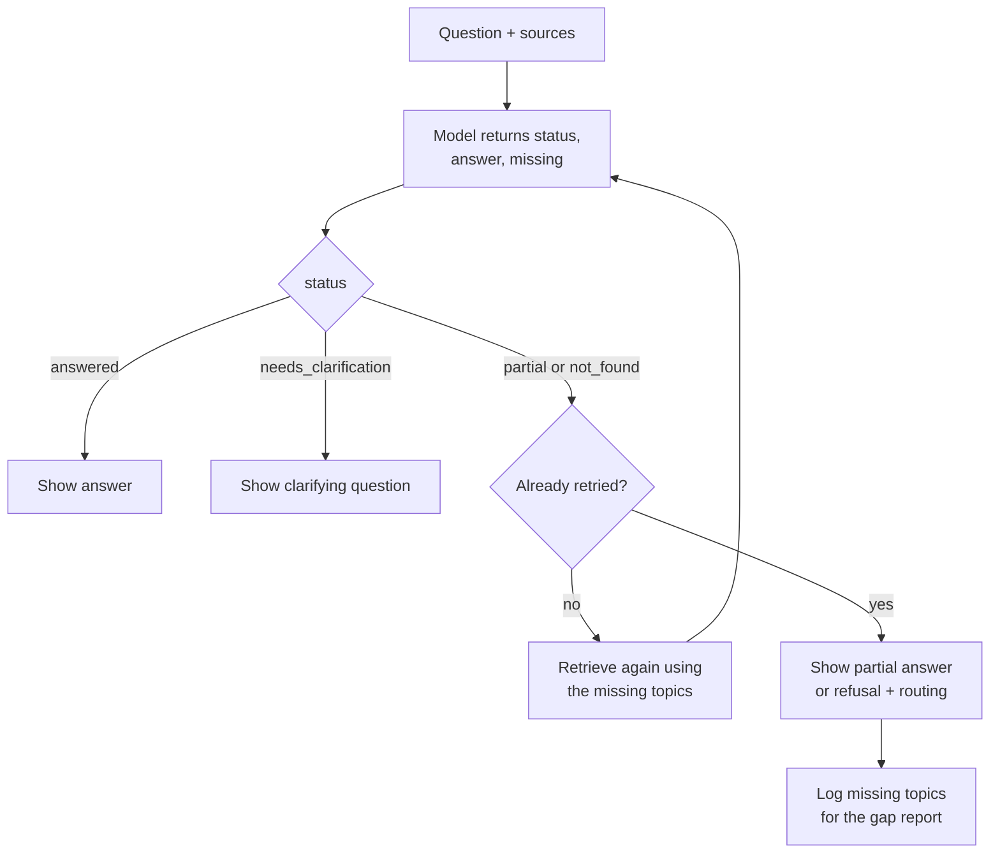

Refusal handles the clean case: the documents say nothing about the question. Most real gaps are messier. The sources answer half of a two-part question. The question is ambiguous, and the answer depends on which reading the user meant. The answer is in the corpus but the retriever missed it. The information exists, but in a system the assistant cannot see, such as the user's own leave balance. Each of these needs a different response, and a single "I can't find that" serves none of them well.

This lesson covers **handling missing information**: recognising the kind of gap, choosing between a partial answer, a clarifying question, another retrieval attempt, a stated assumption or a hand-off, instructing the model to report gaps in a form code can use, and closing the loop so that recurring gaps become documentation fixes rather than permanent refusals. It builds directly on [Refusal behaviour](/learn/prompt-engineering-for-rag/refusal-behaviour), which owns the decision to decline outright.

## Learning objectives

- Distinguish six kinds of missing information and name the right response to each.
- Write instructions for partial answers that state precisely what the sources do not cover, without citations on the gap.
- Decide when to ask a clarifying question and when to answer with a stated assumption.
- Request a structured answer that separates covered parts, missing parts and any clarifying question.
- Build a gap report that clusters logged gaps and ranks them for document owners.

## Prerequisites

- [Refusal behaviour](/learn/prompt-engineering-for-rag/refusal-behaviour): when to decline and how refusals are detected.
- [Grounded generation](/learn/prompt-engineering-for-rag/grounded-generation): what counts as support, and conflicting sources.
- [Citation instructions](/learn/prompt-engineering-for-rag/citation-instructions): why statements of absence carry no citation.
- [Embeddings](/learn/understanding-large-language-models/embeddings): the vectors used to cluster gaps.

## Why this matters

Consider three questions put to AskMeridian.

"How many days of annual leave do I get, and is there extra leave for long service?" The handbook covers the first part and is silent on the second. If the system refuses, the user loses a correct answer it could have given. If it answers both parts, the second is invented. The right response is the first part, cited, and an explicit statement that long-service leave is not covered.

"How many days can I work from home?" The answer is 3 days a week, but for some teams, in a real company, the answer might depend on role or office. If the corpus has one rule, answer it; if it had separate rules per office and the user's office is unknown, the system should either ask or answer for each office. Guessing one silently is wrong for some users every time.

"How many days of leave do I have left this year?" The handbook knows the entitlement; it does not know this user's balance. That information lives in the HR system. A refusal is technically correct and practically useless; the good answer gives the entitlement, says the balance is not available here, and points to where it is.

Each of these is common, and a system that collapses them all into refusal or, worse, into confident completion, is either unhelpful or untrustworthy. Logged properly, they are also the most valuable feedback the system produces: a precise list of what staff need to know and the documentation does not say.

## The intuition

A good reference librarian, asked something the library only partly covers, does not say "we have nothing". They hand you the book that covers the first half, tell you plainly that nothing here covers the second half, and suggest who would know. If your question could mean two things, they ask which you mean before fetching anything, unless both answers are short, in which case they give you both. If they suspect the book exists but is misshelved, they look again before giving up. And at the end of the week they tell the acquisitions team which subjects people kept asking about.

Each of those habits is one of this lesson's techniques.

## How it works

### Six kinds of missing information

| Kind | Example | Right response |
| --- | --- | --- |
| **Not in the corpus** | "How much parental leave do we get?" | Refuse, with routing ([Refusal behaviour](/learn/prompt-engineering-for-rag/refusal-behaviour)); log the gap |
| **Partly covered** | "Annual leave, and long-service leave?" | Answer the covered part with citations; state the uncovered part plainly |
| **In the corpus, not retrieved** | The answer is in a runbook that ranked eleventh | Retry retrieval differently before concluding it is absent |
| **Ambiguous question** | "What's the expenses limit?" (receipt threshold or a spending cap?) | Ask a clarifying question, or answer each reading briefly |
| **Depends on facts about the user** | "How many days of leave do I have left?" | Answer the general rule; say the personal figure is elsewhere; point to the system of record |
| **Outdated or conflicting** | Two handbook versions disagree | Prefer by metadata and surface the conflict ([Grounded generation](/learn/prompt-engineering-for-rag/grounded-generation)) |

The model can recognise several of these from the sources and question alone: partly covered, ambiguous, user-specific. It cannot, by itself, distinguish "not in the corpus" from "not retrieved", because it sees only what retrieval returned. That distinction needs the application.

### Partial answers

A partial answer has three parts: the covered part with citations, a plain statement of what is not covered, and, where useful, where to find it. Two rules matter.

- **The gap statement carries no citation.** "The handbook does not mention long-service leave" is an observation about the sources. As [Citation instructions](/learn/prompt-engineering-for-rag/citation-instructions) explained, citing it to a source that does not contain the claim is a false attribution.
- **The gap statement must be specific.** "Some information may not be available" helps nobody. "The sources do not say whether long-service leave exists" tells the user exactly what to ask HR.

A partial answer must not be padded to look complete. The pressure to fill the gap is strongest exactly here, because the model has already started answering and a smooth paragraph seems to want a second half. The grounding policy and the instruction "state what is not covered rather than completing it from general knowledge" are what resist it.

### Retry before concluding it is absent

When the model reports that the sources do not cover a question, the system has learnt that the *retrieved* sources do not cover it. Before telling the user the documentation is silent, a system can try once more, differently:

1. Rewrite the query, expand abbreviations, or generate alternative phrasings ([Query rewriting](/learn/advanced-retrieval/query-rewriting), [Multi-query retrieval](/learn/advanced-retrieval/multi-query-retrieval)).
2. Search with a different method, for example keyword search for an exact identifier when the first pass was dense retrieval.
3. Widen the candidate pool (a larger top-k before reranking).
4. Use the model's own description of what is missing as the new query. "Long-service leave entitlement" is often a better query than the user's original sentence.

This is a bounded loop, usually one extra attempt, not an open-ended search. Letting the model decide when and how many times to search is the subject of [Dynamic retrieval](/learn/agentic-rag/dynamic-retrieval) and [Iterative search](/learn/agentic-rag/iterative-search). The cost is a second retrieval and a second model call for the subset of questions that hit a gap; for many systems that is a small fraction of traffic and well worth it.

### Clarify or assume?

An ambiguous question is one where different readings have materially different answers, and nothing in the question or the request context settles which reading is meant. There are three options:

- **Ask a clarifying question.** Best when the readings diverge sharply and a wrong guess is costly, and when the user is in an interactive channel. "Do you mean the receipt threshold for claims, or a limit on what you can spend?"
- **Answer each reading briefly.** Best when there are two readings and both answers are short. "Claims over £75 need a receipt [S3]. The handbook does not set an overall spending limit." This often beats asking, because it costs the user no extra turn.
- **Answer the most likely reading and state the assumption.** Acceptable when one reading is far more likely and the cost of being wrong is low. "Assuming you mean the receipt threshold: claims over £75 need a receipt [S3]."

Clarifying questions have costs: an extra round trip, and some users find them evasive. Over-asking is the clarification equivalent of over-refusal. The instruction should say *when* to ask, not merely that the model may: "Ask one short clarifying question only if the question has two or more readings with different answers in the sources, and the request context does not show which applies. Otherwise answer each reading briefly or state your assumption." Note the reference to the request context: if the application injected the user's office or plan ([Context injection](/learn/prompt-engineering-for-rag/context-injection)), many apparent ambiguities disappear.

### Information that lives elsewhere

Questions about the user's own data (leave balance, expense claim status, laptop due date) cannot be answered from policy documents. The general rule is in the documents; the personal value is in a system of record. The model should give the rule, say plainly that the personal figure is not available here, and point to where it is. If the assistant has tools that can query those systems, this becomes a tool-use problem ([Tool-based retrieval](/learn/agentic-rag/tool-based-retrieval)); without tools, the hand-off is the honest answer. The instruction must stop the model from inventing a plausible personal figure, which it otherwise sometimes does by applying the rule to imagined usage.

### Reporting gaps in a structured form

Prose answers hide gaps from code. If the application is to route, retry and log, the model should report what it could not answer in a field, not only in a sentence. A structured answer for this purpose has:

- `status`: `answered`, `partial`, `not_found` or `needs_clarification`.
- `answer`: the canonical Markdown with citations, covering what the sources support.
- `missing`: a short list of the specific pieces of information the sources did not contain, phrased as topics ("long-service leave entitlement").
- `clarifying_question`: present only when `status` is `needs_clarification`.

With validated structured output ([Answer formatting](/learn/prompt-engineering-for-rag/answer-formatting)), the application can retry retrieval using `missing` as the query, show the clarifying question as a quick-reply prompt, and log `missing` for the gap report.

### The decision flow



### Closing the loop: the gap report

Every partial answer and refusal names something staff needed and the documentation did not provide. Collected over a week, those names form a remarkably precise backlog for documentation owners. The raw log is not usable as is: the same gap appears in many phrasings ("maternity leave", "parental leave pay", "leave for new fathers"). Clustering by meaning groups them, and counting cluster sizes ranks them. The report goes to the owners of each area, such as the HR team for the handbook. When a cluster is fixed by new documentation, the questions in it start being answered, which the refusal rate by topic will show. This loop is part of the system's lifecycle described in [End-to-end RAG lifecycle](/learn/rag-architecture-fundamentals/end-to-end-rag-lifecycle).

## In code

The problem: a week of AskMeridian logs contains the `missing` field from every refused or partial answer. Produce a report for document owners that groups gaps by meaning and ranks them by how often staff hit them.

Dependencies: `sentence-transformers` with `all-MiniLM-L6-v2` for 384-dimensional embeddings, and scikit-learn for clustering. Both run locally; encoding is deterministic, and agglomerative clustering involves no randomness, so the output is reproducible.

```bash
pip install sentence-transformers scikit-learn
```

```python
"""Turn a week of logged gaps into a report for document owners: cluster the missing topics, rank by volume."""
from collections import Counter

import numpy as np
from sentence_transformers import SentenceTransformer
from sklearn.cluster import AgglomerativeClustering

# Each log row: the "missing" field the model reported for a refused or partial answer, and the outcome.
GAPS = [
    ("parental leave entitlement", "refused"),
    ("how long maternity leave lasts", "refused"),
    ("shared parental leave pay", "partial"),
    ("paternity leave for new fathers", "refused"),
    ("pension contribution percentage", "refused"),
    ("employer pension matching", "refused"),
    ("whether the cycle-to-work scheme exists", "refused"),
    ("meaning of error E-5003", "refused"),
    ("what error E-5003 means on the VPN", "partial"),
    ("how to book a meeting room", "refused"),
    ("reserving a meeting room for clients", "partial"),
    ("parental leave for adoptive parents", "partial"),
]

texts = [g for g, _ in GAPS]
model = SentenceTransformer("sentence-transformers/all-MiniLM-L6-v2")
emb = model.encode(texts, normalize_embeddings=True)

# Average-linkage clustering on cosine distance; the threshold decides how similar a cluster must be.
clusterer = AgglomerativeClustering(n_clusters=None, metric="cosine", linkage="average", distance_threshold=0.6)
labels = clusterer.fit_predict(emb)

report = []
for c in set(labels):
    idx = np.where(labels == c)[0]
    centroid = emb[idx].mean(axis=0)
    rep = idx[np.argmax(emb[idx] @ centroid)]           # the member closest to the centroid names the cluster
    outcomes = Counter(GAPS[i][1] for i in idx)
    report.append((len(idx), texts[rep], dict(outcomes), [texts[i] for i in idx]))

for size, name, outcomes, members in sorted(report, key=lambda r: (-r[0], r[1])):
    print(f"{size} x {name!r}  {outcomes}")
    for m in members:
        if m != name:
            print(f"      - {m}")
```

```output
5 x 'parental leave entitlement'  {'refused': 3, 'partial': 2}
      - how long maternity leave lasts
      - shared parental leave pay
      - paternity leave for new fathers
      - parental leave for adoptive parents
2 x 'how to book a meeting room'  {'refused': 1, 'partial': 1}
      - reserving a meeting room for clients
2 x 'meaning of error E-5003'  {'refused': 1, 'partial': 1}
      - what error E-5003 means on the VPN
2 x 'pension contribution percentage'  {'refused': 2}
      - employer pension matching
1 x 'whether the cycle-to-work scheme exists'  {'refused': 1}
```

The important lines:

- The input is the model's `missing` field, not the user's question. Questions mix covered and uncovered parts ("annual leave, and long-service leave?"); the `missing` field isolates the gap, which makes clusters far cleaner.
- `normalize_embeddings=True` makes every vector unit length, so cosine distance is meaningful and the dot product with the centroid ranks members by closeness.
- `AgglomerativeClustering` with `n_clusters=None` and a `distance_threshold` does not need the number of clusters in advance, which you never know for gaps. It starts with each gap alone and repeatedly merges the closest groups (by average cosine distance between their members) until no pair is closer than the threshold.
- Each cluster is named by its most central member rather than by a generated label, which keeps the report grounded in what was actually logged.
- The outcome counts separate gaps that caused refusals from those that produced partial answers, which helps owners judge urgency.

What the output means. The parental leave cluster is the clear priority: five gaps in one week, phrased five different ways (maternity, paternity, shared, adoptive), all landing together. A keyword report would have split them. The meeting-room, pension and E-5003 clusters follow. In the real report, each cluster would carry the owning team (HR for leave and pensions, IT for the error code, Facilities for rooms), which can be assigned from the source categories the questions were routed to.

The threshold is a judgement call. Lower it and clusters split ("maternity" apart from "paternity"); raise it and unrelated gaps merge (pension with parental leave, both "employee benefits"). Tune it by reading the clusters for a few weeks of real logs. Common errors: clustering raw user questions instead of the `missing` field; clustering without normalised embeddings; and producing the report without owners, so that it is read once and never acted upon.

### Asking for the structured gap fields

This code was not executed here, because it needs an API key. It requests the structured answer described above with validated structured output.

```python
from typing import Literal, Optional

import anthropic
from pydantic import BaseModel


class GapAwareAnswer(BaseModel):
    status: Literal["answered", "partial", "not_found", "needs_clarification"]
    answer: str                       # canonical Markdown with [S#] citations; empty if not_found
    missing: list[str]                # specific topics the sources do not cover
    clarifying_question: Optional[str] = None


client = anthropic.Anthropic()  # reads ANTHROPIC_API_KEY from the environment

response = client.messages.parse(
    model="claude-opus-5-5",
    max_tokens=1024,
    system=system_prompt,   # includes the partial-answer and clarification rules
    messages=[{"role": "user", "content": user_turn}],
    output_format=GapAwareAnswer,
)
result = response.parsed_output
if result.status in ("partial", "not_found") and not already_retried:
    retry_query = "; ".join(result.missing) or question
```

The system prompt section that goes with it:

```text
<missing_information>
If the sources answer only part of the question, answer that part with citations, set status
to "partial", and list each uncovered topic in "missing" as a short noun phrase.
In the answer, state plainly what the sources do not cover; do not cite that statement.
If the question asks for a personal figure (a balance, a status, a date for this user), give the
general rule from the sources and say that the personal figure is not available here.
Set status to "needs_clarification" and ask one short question only if the question has two or
more readings with different answers in the sources and the request context does not settle it.
Otherwise answer each reading briefly, or state your assumption.
</missing_information>
```

To extend the example: attach each cluster to an owning team, track cluster sizes week on week so that a fixed gap shows up as a shrinking cluster, and before the report is sent, re-run retrieval for each cluster's representative against the current index to drop gaps that have been fixed since they were logged.

## A real-world example

When AskMeridian launched, its refusal rate was tracked as a single number. It looked acceptable, and nobody looked further. Six months later, the HR team asked why so many staff were still emailing them questions the assistant "should" answer.

The Platform team added the structured `missing` field and ran the gap report described above on a month of logs. The largest cluster, by a wide margin, was parental and family leave in its various forms. The handbook genuinely did not cover it: the policy existed as a separate PDF on the HR intranet that had never been added to the index. The second largest cluster was personal figures: leave balances, expense claim status. These were not documentation gaps at all; they were questions for systems of record, and the assistant had been refusing them with "I can't find that in Meridian's documentation", which users found baffling.

The fixes were different for each. HR added the family-leave policy to the indexed corpus, and within a week that cluster disappeared from the report. For personal figures, the team changed the instruction so that the assistant gives the general rule and points to the HR self-service portal, and opened a separate project to give the assistant a read-only tool for leave balances. The single refusal-rate number had hidden both problems; the clustered gaps made each one obvious and assignable.

## Common mistakes

- **Collapsing every gap into refusal.** Users lose the half of the answer the sources did support.
- **Padding a partial answer to look complete.** The uncovered half is filled from general knowledge, exactly where errors are most likely.
- **Vague gap statements.** "Some information may be unavailable" tells the user nothing to act on.
- **Citing the gap statement.** A citation on "the sources do not mention X" points to a source that does not contain the claim.
- **Concluding "not in the corpus" after one retrieval.** Retrieval misses look identical to corpus gaps from inside the prompt.
- **Asking clarifying questions by default.** Extra turns for questions that could have been answered for both readings, or settled by request context.
- **Inventing personal figures.** Applying a rule to imagined usage produces a confident, wrong balance.
- **Logging refusals as one number.** The gaps behind them, and their owners, stay invisible.

## Best practices

- Teach the model the kinds of gap and the response to each, in a dedicated system-prompt section.
- Answer covered parts with citations and state uncovered parts specifically, without citations.
- Retry retrieval once, using the model's own description of what is missing, before telling the user the documentation is silent.
- Ask a clarifying question only when readings diverge materially and request context cannot settle it; otherwise answer each reading or state the assumption.
- For personal data, give the rule and point to the system of record, or add a tool.
- Return `status` and `missing` as structured fields; cluster `missing` weekly into a gap report with owners.

## Performance considerations

The retry costs a second retrieval and a second model call, but only on the questions that hit a gap. Suppose, as an assumption, that 15 per cent of 20,000 daily questions come back partial or not found, and that each model call costs 3,000 input and 250 output tokens. The retry adds 3,000 calls a day, or 9 million input and 750,000 output tokens. At assumed prices of 3 and 15 dollars per million, that is 27 plus about 11, roughly 38 dollars a day, and it adds a few seconds to those users' answers. Whether it pays off depends on how many retries find the answer; measure the recovery rate on a sample and drop the retry if it rarely helps.

Clarifying questions add a user round trip, which is far slower than any model call. Use them sparingly. The gap report is a batch job: embedding a few thousand short phrases with a small local model takes seconds on a CPU, and agglomerative clustering on a few thousand items is fast; at hundreds of thousands of items its memory grows with the square of the count, so sample or use a different clustering method at that scale.

## Security considerations

- **Gap logs contain user questions.** They may include personal details ("my maternity leave after my miscarriage"). Apply the same retention and access rules as other logs, and strip or pseudonymise identifiers before sending reports to document owners ([Sensitive data exposure](/learn/rag-security-fundamentals/sensitive-data-exposure)).
- **Gaps can reveal restricted documents.** If a user's question is a gap only because access filtering removed the answer, reporting it as a corpus gap would mislead owners and could hint at restricted content. Record whether filtering removed candidates, and exclude those from the gap report.
- **Retries widen retrieval, not permissions.** A second attempt must use the same access filters as the first.
- **Clarifying questions must not echo injected text.** If a clarifying question is built from source text, an injected document could steer what the assistant asks the user. Keep clarifying questions short and generated from the user's question.

## Summary

- Missing information comes in kinds (not in the corpus, partly covered, not retrieved, ambiguous, personal, outdated), and each has a distinct right response.
- Partial answers give the covered part with citations and a specific, uncited statement of the gap.
- A bounded retry with the model's own description of the gap distinguishes retrieval misses from corpus gaps.
- Clarify only when readings diverge and context cannot settle it; otherwise answer each reading or state the assumption.
- Structured `status` and `missing` fields let the application route, retry and log; clustered gaps become a ranked backlog for document owners.

## Exercises

1. For each question, name the kind of missing information and the best response: (a) "What's the laptop refresh cycle, and can I choose a Mac?" (the corpus covers only the cycle); (b) "When is my laptop due for replacement?"; (c) "What's the limit for expenses?"

<details><summary>Show solution</summary>

(a) Partly covered: "Laptops are refreshed every 3 years [S1]. The sources do not say whether you can choose the model or operating system." (b) Depends on facts about the user: give the 3-year rule, say the user's own due date is not available here, and point to the IT asset portal or support desk. (c) Ambiguous: answer both readings briefly ("Claims over £75 need a receipt [S3]. The handbook does not set an overall spending limit."), since both answers are short.

</details>

2. Write the gap statement for a partial answer to "How many leave days do I get, and can I buy extra days?", given only the annual leave source. Explain why it has no citation.

<details><summary>Show solution</summary>

"Annual leave is 25 days per year [S1]. The sources do not say whether you can buy extra leave days; HR can confirm." The second sentence states an absence: no source says it, so any citation would point to a document that does not contain the claim. The suggested contact is added by the application or allowed by the routing rule, not drawn from a source.

</details>

3. Modify the gap report so that it prints, for each cluster, the share of the week's total gaps it represents, and only reports clusters with at least two members.

<details><summary>Show solution</summary>

```python
total = len(GAPS)
for size, name, outcomes, members in sorted(report, key=lambda r: (-r[0], r[1])):
    if size < 2:
        continue
    print(f"{size / total:5.0%}  {name!r}  {outcomes}")
```

With the example data this prints four clusters: parental leave at 42 per cent and the other three at 17 per cent each. The singleton cycle-to-work gap is dropped; in practice, keep singletons in a separate "long tail" list rather than discarding them, since a new topic always starts as a singleton.

</details>

4. Design decision: AskMeridian's retry on gaps costs about 38 dollars a day (from the performance section) and a sample shows it finds the answer for 1 in 12 retried questions. Should you keep it?

<details><summary>Show solution</summary>

Of 3,000 retries a day, about 250 now get a correct answer instead of a refusal or partial answer. That is roughly 15 cents per recovered answer. Compare it with the cost of the alternative: each unrecovered question may become an email or a ticket to HR or IT, which costs minutes of staff time, far more than 15 cents. Keep it, but also look at *why* the first retrieval missed those 250: if most are vocabulary mismatches, improving the first pass (hybrid search, query rewriting) would recover them without the retry's latency.

</details>

## Check your understanding

```quiz
[
  {
    "q": "Why can the model not tell, on its own, whether information is absent from the corpus or merely not retrieved?",
    "options": [
      "It sees only the retrieved sources, which look the same in both cases",
      "Models cannot read the corpus index format",
      "The corpus is encrypted",
      "Because retrieval runs after generation"
    ],
    "answer": 0,
    "why": "From inside the prompt, a retrieval miss and a corpus gap are identical; only the application can retry or check the wider corpus."
  },
  {
    "q": "Which is the best response to 'What's the expenses limit?' when the sources mention only a £75 receipt threshold?",
    "options": [
      "Refuse",
      "Ask which of five possible meanings the user intended",
      "Say the limit is £75 without qualification",
      "Answer briefly for both readings: the receipt threshold, and that no overall limit is stated"
    ],
    "answer": 3,
    "why": "Both answers are short, so answering each reading avoids an extra turn while staying grounded."
  },
  {
    "q": "In the gap report, why cluster the model's 'missing' field rather than the users' questions?",
    "options": [
      "Questions are too short to embed",
      "Questions often mix covered and uncovered parts; the missing field isolates the gap itself",
      "The missing field is always in English",
      "Clustering questions requires a GPU"
    ],
    "answer": 1,
    "why": "Isolating the uncovered topic produces cleaner clusters that map directly to documentation work."
  },
  {
    "q": "A user asks how many leave days they have left. What should the assistant do without access to the HR system?",
    "options": [
      "Estimate the balance from typical usage",
      "Refuse with the standard sentence only",
      "Give the general entitlement from the sources, say the personal balance is not available here, and point to where it is",
      "Ask the user how many days they have taken, then compute it"
    ],
    "answer": 2,
    "why": "The rule is in the documents and the personal figure is in a system of record; the honest answer gives the first and routes to the second."
  },
  {
    "q": "What does AgglomerativeClustering with n_clusters=None and a distance_threshold provide for gap reports?",
    "options": [
      "It discovers the number of clusters from the data instead of needing it in advance",
      "It guarantees exactly ten clusters",
      "It labels clusters with generated names",
      "It removes duplicate log rows"
    ],
    "answer": 0,
    "why": "Groups are merged until none are closer than the threshold, so the number of gap topics emerges from the data."
  }
]
```

## Further reading

- Rajpurkar, P., Jia, R. and Liang, P. (2018). *Know What You Don't Know: Unanswerable Questions for SQuAD*. [arxiv.org/abs/1806.03822](https://arxiv.org/abs/1806.03822)
- Min, S., Michael, J., Hajishirzi, H. and Zettlemoyer, L. (2020). *AmbigQA: Answering Ambiguous Open-domain Questions*. [arxiv.org/abs/2004.10645](https://arxiv.org/abs/2004.10645)
- Anthropic, *Claude Developer Platform documentation*: structured outputs and prompt engineering guidance. [platform.claude.com/docs](https://platform.claude.com/docs)
- scikit-learn documentation, *Hierarchical clustering* (`AgglomerativeClustering`). [scikit-learn.org](https://scikit-learn.org/stable/modules/clustering.html#hierarchical-clustering)
- Sentence Transformers documentation. [sbert.net](https://www.sbert.net/)
