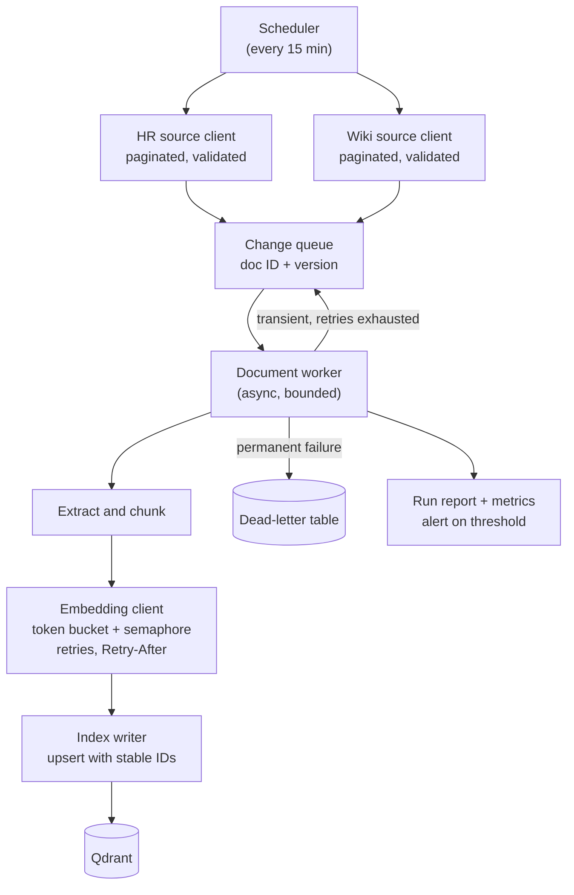

This assessment covers all ten lessons of *Python for RAG Engineering*: Python fundamentals, functions and classes, object-oriented design, type hints, dataclasses and Pydantic, asynchronous programming, exception handling, virtual environments, dependency management and working with APIs. The multiple-choice section has 19 questions, including several that ask what a piece of code prints; the pass mark is 14 correct (about 75%). The conceptual questions, coding exercises, design challenge and troubleshooting scenarios are not scored automatically: attempt each one before opening its answer, and treat any you could not answer as a pointer back to the relevant lesson. The coding solutions need Python 3.11 or later, `httpx` and `pydantic`; they run offline and their output was produced by running them. Rate limits and latencies that appear in questions are assumptions for practice, not figures from any provider.

```quiz
[
  {
    "q": "What does this print?\n```python\na = [1, 2]\nb = a\nb.append(3)\nprint(a)\n```",
    "options": [
      "[1, 2]",
      "[1, 2, 3]",
      "[3]",
      "An error, because b is a copy"
    ],
    "answer": 1,
    "why": "Assignment binds a second name to the same list object. Mutating it through b is visible through a."
  },
  {
    "q": "An ingestion job must check, for each of 2 million incoming chunk IDs, whether it has already been indexed. Which container should hold the already-indexed IDs?",
    "options": [
      "A list, because it keeps insertion order",
      "A tuple, because it is immutable",
      "A set, because membership tests take constant time on average",
      "A string with the IDs joined by commas"
    ],
    "answer": 2,
    "why": "A set is a hash table: `x in s` is constant time on average, whereas `x in list` scans the list, which makes the whole job quadratic."
  },
  {
    "q": "What does this print?\n```python\ndef add(chunk, seen=[]):\n    seen.append(chunk)\n    return seen\n\nadd(\"a\")\nprint(add(\"b\"))\n```",
    "options": [
      "['a', 'b']",
      "['b']",
      "['a']",
      "A TypeError"
    ],
    "answer": 0,
    "why": "The default list is created once, when the function is defined, and shared by every call that does not pass `seen`. Use `seen=None` and create the list inside."
  },
  {
    "q": "A function decorated with `@functools.lru_cache` is called with a list of chunk IDs as its argument. What happens?",
    "options": [
      "The list is converted to a tuple automatically",
      "The result is cached by the list's identity",
      "The cache is silently bypassed",
      "TypeError: unhashable type: 'list'"
    ],
    "answer": 3,
    "why": "lru_cache uses the arguments as dictionary keys, so they must be hashable. Pass a tuple or frozenset instead."
  },
  {
    "q": "`Retriever` is an abstract base class with an `@abstractmethod` called `retrieve`. A subclass forgets to implement `retrieve`. When is the mistake reported?",
    "options": [
      "When the module is imported",
      "When you try to create an instance of the subclass",
      "Only when `retrieve` is called",
      "Never; Python does not check abstract methods"
    ],
    "answer": 1,
    "why": "Python raises TypeError at instantiation: it cannot instantiate an abstract class without an implementation for the abstract method."
  },
  {
    "q": "AskMeridian's `HybridRetriever` needs an embedding model, a vector index and a keyword index, any of which may be swapped for a different implementation. Which design fits best?",
    "options": [
      "Inherit from all three classes with multiple inheritance",
      "Copy the code of all three into one large class",
      "Composition: pass the three components into the retriever's constructor",
      "Make the three components global variables"
    ],
    "answer": 2,
    "why": "The retriever has these parts rather than being a kind of each. Composition lets each part be replaced (for example by a fake in tests) without changing the retriever."
  },
  {
    "q": "What does this print?\n```python\ndef double(k: int) -> int:\n    return k * 2\n\nprint(double(\"ab\"))\n```",
    "options": [
      "A TypeError, because \"ab\" is not an int",
      "4",
      "None",
      "abab"
    ],
    "answer": 3,
    "why": "Annotations are metadata and are not enforced at run time. A static type checker would flag the call; the interpreter does not."
  },
  {
    "q": "What does a `typing.Protocol` let you express?",
    "options": [
      "That any object with the required methods is acceptable, whether or not it inherits from a particular class",
      "That a class may have only one instance",
      "That arguments are checked at run time",
      "That a function must be asynchronous"
    ],
    "answer": 0,
    "why": "Protocols are structural: a type checker accepts any object whose methods match, which suits swappable components such as embedders and rerankers."
  },
  {
    "q": "A Pydantic model has a field `days: int`. Validating `{\"days\": \"25\"}` in the default (lax) mode gives what result?",
    "options": [
      "A ValidationError",
      "The integer 25",
      "The string \"25\"",
      "None"
    ],
    "answer": 1,
    "why": "Lax mode coerces a numeric string to int. In strict mode the same input raises a ValidationError."
  },
  {
    "q": "Which data in a RAG pipeline most clearly calls for a Pydantic model rather than a plain dataclass?",
    "options": [
      "An internal tuple of (score, chunk_id) produced and consumed in one function",
      "A loop counter",
      "The JSON body returned by a third-party embedding API",
      "A constant holding the chunk size"
    ],
    "answer": 2,
    "why": "Data crossing a trust boundary needs validation; Pydantic checks types and constraints at parse time. Internal, trusted records can be lighter dataclasses."
  },
  {
    "q": "What does this print?\n```python\nasync def work(name, delay):\n    await asyncio.sleep(delay)\n    return name\n\nasync def main():\n    print(await asyncio.gather(work(\"slow\", 0.2), work(\"fast\", 0.1)))\n\nasyncio.run(main())\n```",
    "options": [
      "['fast', 'slow']",
      "['slow']",
      "['fast']",
      "['slow', 'fast']"
    ],
    "answer": 3,
    "why": "gather returns results in the order the awaitables were passed, regardless of which finished first."
  },
  {
    "q": "An `async def` FastAPI endpoint calls a local tokeniser that takes 200 ms of CPU time per request. Under concurrent load, every request becomes slow. What is the most direct fix?",
    "options": [
      "Add more `await` keywords in front of the tokeniser call",
      "Run the tokeniser with `await asyncio.to_thread(...)` (or move it to a separate worker), so the event loop is not blocked",
      "Increase the HTTP client's timeout",
      "Wrap the call in `asyncio.gather`"
    ],
    "answer": 1,
    "why": "A synchronous call blocks the single event-loop thread. `await` only works on awaitables; moving the work to a thread or process frees the loop."
  },
  {
    "q": "A handler lists `except Exception:` first and `except ValueError:` second. What happens when the try block raises ValueError?",
    "options": [
      "The ValueError clause runs, because it is more specific",
      "Both clauses run",
      "The Exception clause runs and the ValueError clause never does",
      "A SyntaxError is raised"
    ],
    "answer": 2,
    "why": "Clauses are tested in order and the first match wins. ValueError is a subclass of Exception, so the general clause catches it."
  },
  {
    "q": "A request passes through two layers, each of which makes up to 4 attempts at the layer below. In the worst case, how many calls reach the bottom service for one user request?",
    "options": [
      "16",
      "8",
      "4",
      "6"
    ],
    "answer": 0,
    "why": "Attempts multiply across layers: 4 x 4 = 16. Retry in one layer only."
  },
  {
    "q": "Which error is it reasonable to retry with exponential backoff?",
    "options": [
      "401 Unauthorized",
      "422 Unprocessable Entity",
      "A ValidationError from your own Pydantic model",
      "503 Service Unavailable"
    ],
    "answer": 3,
    "why": "503 describes a temporary state of the server. The others will fail the same way on every attempt."
  },
  {
    "q": "A developer runs `pip install httpx`, which succeeds, but `python app.py` raises ModuleNotFoundError for httpx. What is the most likely cause?",
    "options": [
      "httpx does not support the installed Python version",
      "The `pip` command belongs to a different interpreter or environment from `python`",
      "The package index is down",
      "The script needs to be compiled first"
    ],
    "answer": 1,
    "why": "pip installs into the environment of the interpreter running it. `python -m pip install httpx` installs where `python` will look."
  },
  {
    "q": "Which of the versions 1.3.9, 1.4.2, 1.9.0 and 2.0.0 does the specifier `~=1.4` admit?",
    "options": [
      "1.4.2 only",
      "1.4.2, 1.9.0 and 2.0.0",
      "1.4.2 and 1.9.0",
      "All four"
    ],
    "answer": 2,
    "why": "~=1.4 means >=1.4 and ==1.*: any 1.x from 1.4 upwards, but not 2.0."
  },
  {
    "q": "An embedding API returns `429 Too Many Requests` with the header `Retry-After: 10`. What should a batch ingestion client do?",
    "options": [
      "Wait 10 seconds, retry the same request, and consider slowing its rate limiter",
      "Retry immediately",
      "Give up and mark the documents as permanently failed",
      "Switch to a new API key and continue at full speed"
    ],
    "answer": 0,
    "why": "429 is transient and Retry-After states how long to wait. Persistent 429s also mean the client's pacing exceeds the real limit."
  },
  {
    "q": "A request that appends 500 chunks to the vector index times out, and the client retries it. Later, retrieval shows each of those chunks twice. What would have prevented this?",
    "options": [
      "A longer timeout",
      "Making the write idempotent, for example upserting points with stable IDs derived from the documents",
      "Disabling retries for every request",
      "Using GET instead of POST"
    ],
    "answer": 1,
    "why": "The first request had succeeded on the server before the response was lost. With stable IDs, repeating an upsert overwrites the same points instead of adding new ones."
  }
]
```

## Conceptual questions

**1.** Explain the difference between concurrency and parallelism. For each of these AskMeridian workloads, say which one helps and which Python tool you would use: (a) calling the embedding API for 5,000 batches; (b) parsing 20,000 PDFs; (c) running a dense search and a keyword search for one question.

<details><summary>Show model answer</summary>

**Concurrency** means several tasks are in progress over the same period, interleaved by one worker that switches whenever a task is waiting. **Parallelism** means several tasks execute at the same instant on separate CPU cores. Concurrency helps when time is spent waiting (I/O-bound work); parallelism helps when time is spent computing (CPU-bound work).

(a) **Concurrency.** Each call is mostly waiting on the network. Use `asyncio` with an async HTTP client, a semaphore sized from the provider's limits (Little's law), and batching.

(b) **Parallelism.** Parsing is CPU work in Python code, which threads do not speed up under the global interpreter lock. Use a process pool (`concurrent.futures.ProcessPoolExecutor`) or several worker processes, each handling a share of the files.

(c) **Concurrency.** Both searches are network calls to independent services; run them together with `asyncio.TaskGroup` or `gather`, so the question waits for the slower search rather than the sum of both.

</details>

**2.** A colleague argues: "We use type hints everywhere, so we don't need Pydantic." Explain what each provides, and where in a RAG pipeline you need both.

<details><summary>Show model answer</summary>

Type hints are annotations read by tools. A static type checker such as mypy or Pyright uses them before the program runs to find calls that pass the wrong kinds of value between *your own* functions. At run time, Python ignores them: `double("ab")` with `k: int` happily returns `"abab"`.

Pydantic uses the same annotations to **validate data at run time**. It checks (and, in lax mode, coerces) values as they enter the program and raises a `ValidationError` describing every problem.

The two cover different risks. Inside the program, where every value was produced by your own typed code, static checking catches most mistakes cheaply. At the boundaries, data comes from somewhere a type checker cannot see: JSON from an embedding API, records from the HR content system, configuration from environment variables, structured output from a language model. Those values must be validated at run time, which is Pydantic's job. A RAG pipeline therefore uses type hints throughout and Pydantic models at each boundary where untrusted data enters.

</details>

**3.** Describe the difference between a transient and a permanent error, give two examples of each from a RAG system, and explain why retrying a permanent error is harmful rather than merely useless.

<details><summary>Show model answer</summary>

A **transient** error reflects a bad moment: the same operation is likely to succeed if tried again later. Examples: a `503` from the vector database while it restarts; a connection reset or timeout on a call to the embedding API; a `429` rate-limit response.

A **permanent** error reflects a bad operation: it will fail identically every time until something changes. Examples: a `401` because the API key is wrong; a chunk that exceeds the embedding model's maximum input length; a PDF that is encrypted; a `ValidationError` because the response shape changed.

Retrying a permanent error is harmful for three reasons. It **adds latency**: a user waits through several backoff periods for a request that could never succeed. It **adds cost and load**: each attempt may be billed and adds traffic to a service that may already be struggling. And it **hides the real problem**: the logs show a stream of retries rather than one clear failure, so the fix (a new key, a chunking change) is delayed.

</details>

**4.** Explain the difference between the dependencies declared in `pyproject.toml` and those recorded in a lock file. Why do applications need both, and why should a library you publish not ship exact pins?

<details><summary>Show model answer</summary>

`pyproject.toml` declares **direct** dependencies as **ranges** (for example `pydantic>=2.6,<3`): the versions the project is known or expected to work with. A **lock file** records the result of resolving those ranges at one moment: an **exact** version of every package, direct and transitive, usually with a hash of each file.

An application needs both. The ranges tell the resolver what is acceptable when the team deliberately upgrades; the lock file makes every installation (laptops, continuous integration, production images) identical between upgrades, so that a rebuild cannot silently pull in a new transitive version. In RAG this matters for correctness: a changed embedding or tokenisation library can change stored vectors without any error.

A library is installed into *other people's* environments, alongside their other dependencies. If it pins `pydantic==2.6.1`, any application that needs a different 2.x release cannot install it, and resolution fails. Libraries should declare the widest ranges they genuinely support and leave exact pinning to the application.

</details>

**5.** A Pydantic model, a dataclass and a plain dictionary could each represent a retrieved chunk inside AskMeridian's query path. Compare them on validation, cost and safety, and recommend where each belongs.

<details><summary>Show model answer</summary>

A **plain dictionary** has no declared shape. Typos in keys (`chunk["socre"]`) are only discovered when the code runs, and a type checker can say little about it. It costs nothing to create, but it is the least safe option and is best kept to throwaway code or the moment just before serialisation.

A **dataclass** declares fields and types, generates `__init__`, `__repr__` and `__eq__`, and can be `frozen` (immutable) and use `slots` (less memory). It performs **no run-time validation**, but a static type checker understands it fully. Creating one is cheap.

A **Pydantic model** declares the same fields and **validates** them at construction: types, constraints such as `min_length` or `ge=0`, custom validators, and options such as `extra="forbid"`. It can also serialise to JSON and produce a JSON Schema. Validation costs time, which matters when creating many objects in a hot loop.

Recommendation: use Pydantic models where data **enters** the system (API responses, documents from source systems, request bodies, configuration, model outputs parsed as JSON); once validated, internal records passed between trusted functions (scored candidates during ranking, say) can be frozen dataclasses. Avoid bare dictionaries for anything that lives longer than a few lines.

</details>

## Coding exercises

**1.** Write `async def embed_corpus(chunks, batch_size, limit, timeout)` that embeds chunks in batches with at most `limit` requests in flight, gives each request `timeout` seconds, and returns the vectors **aligned with the input chunks** (with `None` for chunks whose batch failed) together with the indices of failed batches. An outage (`EmbeddingUnavailable`) or a timeout should fail only its own batch; any other exception is a bug and should propagate. Test it against the fake embedding function below, which makes batch 2 fail and batch 4 hang.

<details><summary>Show solution</summary>

```python
import asyncio
import time

class EmbeddingUnavailable(Exception):
    pass

async def fake_embed(batch: list[str]) -> list[list[float]]:
    """Stands in for an embedding API: 0.1 s per call; batch 2 always fails; batch 4 hangs."""
    if batch[0] == "chunk 4":
        raise EmbeddingUnavailable("503 from embedding service")
    if batch[0] == "chunk 8":
        await asyncio.sleep(5)                      # a stalled request
    await asyncio.sleep(0.1)
    return [[float(t.split()[1]), 1.0] for t in batch]

async def embed_corpus(chunks: list[str], batch_size: int, limit: int,
                       timeout: float) -> tuple[list[list[float] | None], list[int]]:
    batches = [chunks[i:i + batch_size] for i in range(0, len(chunks), batch_size)]
    sem = asyncio.Semaphore(limit)

    async def run(batch: list[str]) -> list[list[float]]:
        async with sem:
            async with asyncio.timeout(timeout):
                return await fake_embed(batch)

    results = await asyncio.gather(*(run(b) for b in batches), return_exceptions=True)
    vectors: list[list[float] | None] = []
    failed: list[int] = []
    for i, (batch, result) in enumerate(zip(batches, results)):
        if isinstance(result, (EmbeddingUnavailable, TimeoutError)):
            failed.append(i)
            vectors.extend([None] * len(batch))     # keep positions aligned with chunks
        elif isinstance(result, BaseException):
            raise result                            # a bug, not an outage: stop
        else:
            vectors.extend(result)
    return vectors, failed

async def main() -> None:
    chunks = [f"chunk {i}" for i in range(12)]
    start = time.perf_counter()
    vectors, failed = await embed_corpus(chunks, batch_size=2, limit=3, timeout=0.5)
    print(f"took {time.perf_counter() - start:.1f} s")
    print("failed batches:", failed)
    print("embedded:", sum(v is not None for v in vectors), "of", len(chunks))
    print("first vectors:", vectors[:5])

asyncio.run(main())
```

```output
took 0.6 s
failed batches: [2, 4]
embedded: 8 of 12
first vectors: [[0.0, 1.0], [1.0, 1.0], [2.0, 1.0], [3.0, 1.0], None]
```

Points to check in your own solution:

- `gather(..., return_exceptions=True)` keeps healthy batches when one fails; a `TaskGroup` would cancel them all.
- The semaphore is acquired *outside* the timeout, so time spent waiting for a free slot does not count against a request's budget.
- Results are aligned by position: a failed batch contributes one `None` per chunk, so `vectors[i]` always belongs to `chunks[i]`.
- The stalled batch costs only its 0.5 s timeout; the whole run takes 0.6 s instead of the 5 s it would without one.
- Unexpected exception types are re-raised, so a bug cannot hide as "failed batches".

</details>

**2.** Write a decorator factory `retry_transient(attempts, base, cap, sleep, rng)` that retries a function when it raises `TransientError`, waiting with full-jitter exponential backoff, and lets every other exception through immediately. It must preserve the decorated function's name and docstring, and on giving up it should add a note to the exception saying how many attempts were made. Make it type-correct with `ParamSpec`.

<details><summary>Show solution</summary>

```python
import functools
import random
import time
from collections.abc import Callable
from typing import ParamSpec, TypeVar

P = ParamSpec("P")
R = TypeVar("R")

class TransientError(Exception):
    """Raise (or subclass) this for failures that are worth retrying."""

def retry_transient(attempts: int = 3, base: float = 0.5, cap: float = 8.0,
                    sleep: Callable[[float], None] = time.sleep,
                    rng: random.Random | None = None) -> Callable[[Callable[P, R]], Callable[P, R]]:
    rng = rng or random.Random()
    def decorator(func: Callable[P, R]) -> Callable[P, R]:
        @functools.wraps(func)                       # keep the name, docstring and signature
        def wrapper(*args: P.args, **kwargs: P.kwargs) -> R:
            for attempt in range(attempts):
                try:
                    return func(*args, **kwargs)
                except TransientError as exc:
                    if attempt == attempts - 1:
                        exc.add_note(f"gave up after {attempts} attempts")
                        raise
                    delay = rng.uniform(0, min(cap, base * 2 ** attempt))
                    print(f"  {func.__name__}: {exc}; retrying in {delay:.2f} s")
                    sleep(delay)
            raise AssertionError("unreachable")
        return wrapper
    return decorator

calls = {"search": 0}

@retry_transient(attempts=3, sleep=lambda s: None, rng=random.Random(3))
def search(query: str, k: int = 5) -> list[str]:
    """Search the AskMeridian index."""
    calls["search"] += 1
    if calls["search"] == 1:
        raise TransientError("qdrant: connection reset")
    if not query.strip():
        raise ValueError("empty query")
    return [f"leave-policy#{i}" for i in range(1, k + 1)][:2]

print(search.__name__, "-", search.__doc__)
print(search("How many days carry over?"))
try:
    search("   ")
except ValueError as exc:
    print("not retried:", exc, "| total calls:", calls["search"])
```

```output
search - Search the AskMeridian index.
  search: qdrant: connection reset; retrying in 0.12 s
['leave-policy#1', 'leave-policy#2']
not retried: empty query | total calls: 3
```

The first call failed transiently and was retried once; the empty query raised `ValueError`, which went straight through (three calls in total, not five). `functools.wraps` is why `search.__name__` and `search.__doc__` still describe the original function. `ParamSpec` lets a type checker see that the decorated `search` still takes `(query: str, k: int = 5)` and returns `list[str]`. `rng` defaults to `None` and is created inside, which avoids the shared-mutable-default trap for anything that should not be shared; `sleep` and `rng` are injectable so the test runs instantly and reproducibly.

</details>

**3.** The HR content system serves documents through a cursor-paginated API. Write a generator `load_documents(client, rejected)` that walks every page, validates the page envelope with one Pydantic model and each item with another (`id`, `title`, `owner`, `updated` as a date, non-empty `text`), yields valid documents, and records each invalid item's ID and the first failing field in `rejected` without stopping. Test it with `httpx.MockTransport`.

<details><summary>Show solution</summary>

```python
from collections.abc import Iterator
from datetime import date

import httpx
from pydantic import BaseModel, Field, ValidationError

RECORDS = [
    {"id": "hb-1", "title": "Annual leave", "owner": "HR", "updated": "2026-09-01",
     "text": "Annual leave is 25 days."},
    {"id": "hb-2", "title": "Remote work", "owner": "HR", "updated": "2026-09-14",
     "text": "Remote work: up to 3 days a week."},
    {"id": "hb-3", "title": "Expenses", "owner": "HR", "updated": "not a date",
     "text": "Expenses must be submitted within 30 days."},
    {"id": "rb-1", "title": "VPN", "owner": "IT", "updated": "2026-08-30", "text": ""},
    {"id": "rb-2", "title": "Passwords", "owner": "IT", "updated": "2026-10-02",
     "text": "Passwords must be rotated every 90 days."},
]

def fake_api(request: httpx.Request) -> httpx.Response:
    start = int(request.url.params.get("cursor") or 0)
    page = RECORDS[start:start + 2]
    nxt = str(start + 2) if start + 2 < len(RECORDS) else None
    return httpx.Response(200, json={"items": page, "next_cursor": nxt})

class SourceDocument(BaseModel):
    id: str
    title: str
    owner: str
    updated: date
    text: str = Field(min_length=1)

class Page(BaseModel):
    items: list[dict]
    next_cursor: str | None

def load_documents(client: httpx.Client, rejected: list[tuple[str, str]]) -> Iterator[SourceDocument]:
    cursor: str | None = None
    while True:
        params = {"limit": 2} | ({"cursor": cursor} if cursor else {})
        response = client.get("/api/documents", params=params)
        response.raise_for_status()
        page = Page.model_validate(response.json())       # the envelope must be valid
        for raw in page.items:
            try:
                yield SourceDocument.model_validate(raw)    # each item is checked separately
            except ValidationError as exc:
                field = ".".join(str(p) for p in exc.errors()[0]["loc"])
                rejected.append((raw.get("id", "?"), field))
        if page.next_cursor is None:
            return
        cursor = page.next_cursor

rejected: list[tuple[str, str]] = []
with httpx.Client(base_url="https://content.example.internal",
                  transport=httpx.MockTransport(fake_api)) as client:
    docs = list(load_documents(client, rejected))
print("loaded:", [(d.id, d.updated.isoformat()) for d in docs])
print("rejected:", rejected)
```

```output
loaded: [('hb-1', '2026-09-01'), ('hb-2', '2026-09-14'), ('rb-2', '2026-10-02')]
rejected: [('hb-3', 'updated'), ('rb-1', 'text')]
```

The design separates two kinds of invalid data. A malformed **envelope** (no `items`, a wrong cursor type) means the API contract has broken, so `Page.model_validate` raises and stops the job. A malformed **item** is one bad document, so it is recorded and skipped, exactly the per-item isolation pattern from [Exception handling](/learn/python-for-rag-engineering/exception-handling). Pydantic parsed the valid `updated` strings into `date` objects. Because the function is a generator, only one page is held in memory at a time.

</details>

## Architecture design challenge

Meridian wants a new **document sync service** for AskMeridian. Every 15 minutes it must pull changed pages from the HR content system's paginated API and changed runbooks from the IT wiki's API, extract text, embed it with a hosted embedding API (assume limits of 600 requests and 1,000,000 tokens per minute, batches of up to 64 texts), and upsert the results into the Qdrant cluster. A typical run sees a few hundred changed chunks; a quarterly handbook revision changes about 40,000. The service must never leave the index half-updated for a document, must not starve the live AskMeridian API of embedding quota, and must tell the Platform team when something goes wrong.

Design the Python service: its components and their interfaces, how concurrency, rate limiting, retries and validation work, how failures are isolated and reported, and how environments and dependencies are managed. Justify the main trade-offs.

<details><summary>Show reference design</summary>

**Components.**



**Interfaces.** Each source is a class satisfying a `Protocol` with one method, `changed_since(ts) -> Iterator[SourceDocument]`, where `SourceDocument` is a Pydantic model; the embedder satisfies `Embedder.embed(texts) -> list[Vector]`; the writer satisfies `IndexWriter.replace_document(doc_id, version, chunks)`. Components are composed in a `SyncService` constructor, so tests can substitute fakes.

**Concurrency and pacing.** The run is asynchronous: an `httpx.AsyncClient` per external service, created once. Documents are processed by a bounded set of worker tasks. The embedding client combines a **token bucket** (for the token limit) with a **semaphore** (for in-flight requests). With 64 texts of about 250 tokens, a batch is about 16,000 tokens, so the token limit allows roughly $1{,}000{,}000 / 16{,}000 \approx 62$ requests per minute, far below the 600-request limit. To protect the live API, the sync service gets its **own API key**, or, if that is impossible, its bucket is set to a fraction of the quota (say 60%). A 40,000-chunk revision needs $40{,}000 / 64 = 625$ requests: about 10 minutes at 62 per minute with its own key, but about 17 minutes at 60% of a shared quota (roughly 37 per minute), longer than the 15-minute interval. Either way, the scheduler must skip a run while the previous one is still in progress.

**Retries and validation.** Retries live only in the client closest to each service: transport errors, `408`, `429` and 5xx are retried with full-jitter backoff, honouring `Retry-After`, with a cap on attempts and a per-run deadline. Other 4xx fail fast. Every response is validated with Pydantic; batched embedding results are matched to inputs by index. CPU-heavy extraction runs in a process pool via `run_in_executor`, so it does not block the event loop.

**Consistency.** Chunk IDs are derived deterministically from (document ID, document version, chunk position), making upserts idempotent and retries safe. For each document, the writer upserts the new version's chunks and then deletes the previous version's chunks by a filter on `doc_id` and `version`; if anything fails before the delete, the old version is still complete, and the document is re-queued. (Queries should filter to the latest version, or tolerate a brief overlap.)

**Failure isolation and reporting.** Each document is the unit of failure. Permanent errors (unparseable files, validation failures, over-long inputs after splitting) go to a dead-letter table with the document ID, owner and error; transient failures that exhaust retries are re-queued for the next run. The run ends with a structured report (counts processed, skipped, dead-lettered, tokens used), metrics, and an alert if the dead-letter rate exceeds a threshold or the run fails entirely. Errors in the report and logs contain identifiers, not document text or keys.

**Environments and dependencies.** The sync service is its own deployable unit with its own `pyproject.toml` and committed lock file with hashes; it carries the parsing libraries, which the live API does not. Its container image installs from the lock file. Upgrades of the parsing or embedding libraries go through a branch with a retrieval regression test, and the embedding model and library version are written into index metadata so that the query service can detect a mismatch.

**Trade-offs.**

- *Async plus a process pool* versus *a thread pool for everything*: more moving parts, but network waits overlap cheaply and CPU work gets real parallelism.
- *Upsert-then-delete per document* versus *a full blue-green rebuild per run*: much cheaper for small changes, at the cost of a brief window where two versions coexist; quarterly revisions could still use a full rebuild if the overlap is unacceptable.
- *A separate key* versus *a shared key with a lower bucket*: separate keys isolate failures and make usage visible per workload; the fallback wastes some quota as headroom.
- *Queue-and-retry next run* versus *retrying aggressively within a run*: slightly staler data during an outage, but no retry storms against a struggling provider.

</details>

## Troubleshooting scenarios

**1.** After the AskMeridian API service was moved to `async def` FastAPI endpoints, median latency is unchanged with one user, but with 30 concurrent users requests take many seconds and health checks occasionally time out, which makes the orchestrator restart the service. CPU usage is low. What is the likely cause, how do you confirm it, and how do you fix it?

<details><summary>Show diagnosis and fix</summary>

**Diagnosis.** Something in the request path blocks the event loop: a synchronous HTTP client (`requests`), a synchronous database or vector database client, `time.sleep`, or file I/O called inside an `async def` endpoint. While it blocks, no other request, including the health check, can make progress, so requests queue behind each other. Low CPU fits: the process is waiting on the network, but waiting in a way that holds the only thread. With one user there is nothing to queue behind, so single-user latency looks normal.

**Confirm.** Run the service with asyncio debug mode (`PYTHONASYNCIODEBUG=1`, or `loop.set_debug(True)`), which logs callbacks that hold the loop for longer than a threshold (100 ms by default) and points to the offending code. Add timestamps at the start and end of each stage: blocked services show stages from different requests never overlapping. Search the code path for `requests`, `time.sleep` and synchronous client classes.

**Fix.** Replace synchronous clients with asynchronous ones (`httpx.AsyncClient`, `AsyncAnthropic`, `AsyncQdrantClient`), created once at start-up and shared. Wrap any remaining blocking call in `await asyncio.to_thread(...)`. Alternatively, declare an endpoint with plain `def`, which FastAPI runs in a thread pool, if it cannot be made fully asynchronous. Add a load test with concurrent requests to continuous integration, and a lint rule against blocking imports in the service package.

</details>

**2.** The nightly ingestion job's dashboard shows green every night, but staff report that AskMeridian cannot answer questions about several runbooks added last month. The runbooks exist in the IT wiki. The job's log contains a few lines like `WARNING retrying embed in 2.0 s` and nothing else unusual. What could be happening, and how do you find out?

<details><summary>Show diagnosis and fix</summary>

**Candidates.**

- **Swallowed exceptions.** A broad `except Exception: pass` (or `except: continue`) around per-document processing hides failures, so the job "succeeds" while documents are skipped.
- **Incomplete pagination.** The wiki client reads only the first page of changed documents, or stops early because it misreads the end-of-pages signal; documents beyond the first page are never fetched.
- **Retries exhausted and dropped.** The embedding client gives up after its retries and returns an empty list or `None` instead of raising, so the documents are "processed" with no vectors.
- **Validation dropping items silently.** A changed field in the wiki's API (for example a renamed `text` field) makes new items fail validation, and the failures are discarded rather than recorded.

**Find out.** Pick one missing runbook and trace it: is it in the API response (call the wiki API directly, page by page)? Did the job fetch it (add or check a log line per document ID)? Did it reach the embedding stage, and did vectors come back? Is it in Qdrant (search by `doc_id` filter)? Count documents at each stage of a run; the stage where counts drop is the culprit. Grep the code for broad exception handlers and for functions that return `None` on failure.

**Fix.** Catch only expected per-document errors, record each failure with the document ID in a dead-letter table, and make the run's status "completed with failures" when there are any, with an alert above a threshold. Make the pagination loop run until the API's end signal and test it against a fake with several pages. Make the embedding client raise after exhausting retries. Report per-stage counts in every run so that a gap between "fetched" and "indexed" is visible on the dashboard.

</details>

**3.** A developer rebuilt the ingestion worker's Docker image to apply an operating-system patch. No application code changed. The next morning, the worker crashes at start-up with `AttributeError: module 'numpy' has no attribute 'float_'`, raised from inside a third-party library. What happened, and what changes prevent it?

<details><summary>Show diagnosis and fix</summary>

**Diagnosis.** The image installs dependencies without a lock file (or from a requirements file with only lower bounds), so the rebuild resolved the newest versions available that day. NumPy crossed a major version (NumPy 2.0 removed several old aliases, including `np.float_`), while a third-party library in the image still used the removed alias. The application code did not change; its transitive dependencies did.

**Confirm.** Compare `pip freeze` (or `importlib.metadata` versions) from the old and new images: NumPy's major version will differ. The traceback shows the failing call inside the third-party library, not in Meridian's code.

**Fix.** Immediately, roll back to the previous image, or add an upper bound (`numpy<2`) until the library is updated. Properly: declare dependencies in `pyproject.toml`, generate a lock file with hashes, commit it, and install from it in the Dockerfile, so that rebuilding an image reproduces the same packages. Upgrade NumPy deliberately in a branch, together with a version of the third-party library that supports it, with tests (including retrieval regression tests) run in continuous integration. Add a start-up check that compares installed versions with the lock file and refuses to run on drift.

</details>
