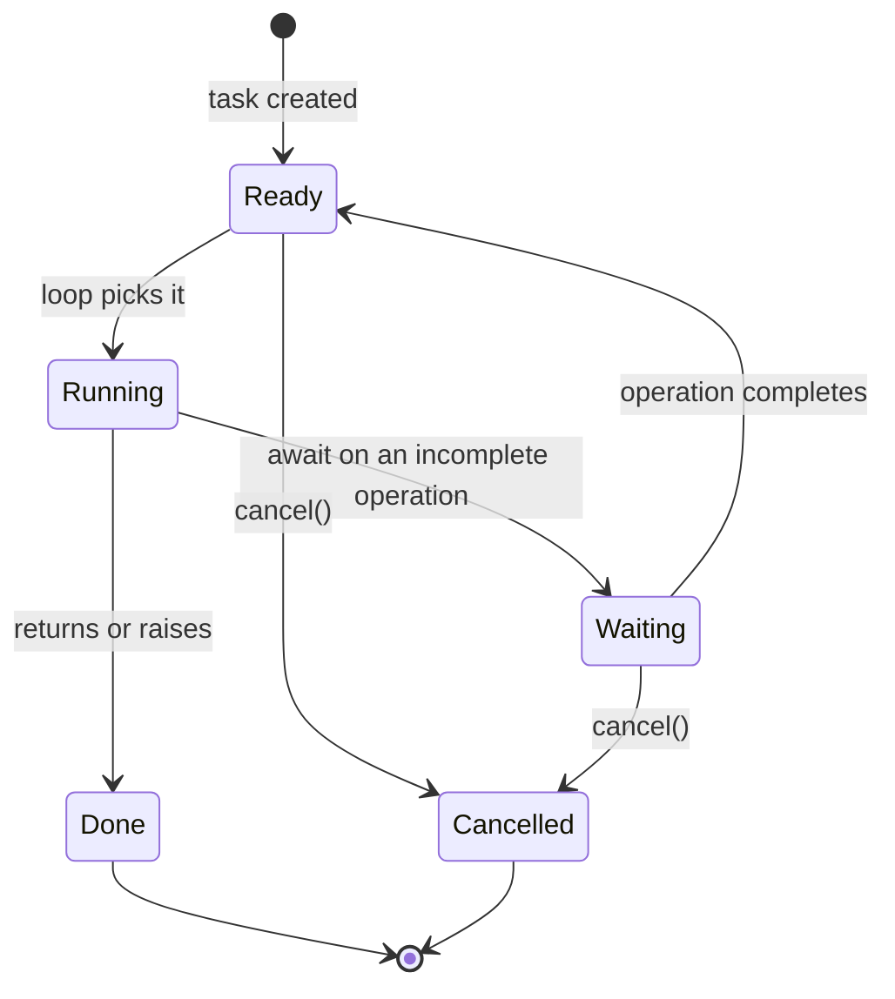

A RAG system spends most of its life waiting. It waits for an embedding service to return a vector, for a vector database to return neighbours, for a reranker to score candidates, and for a language model to stream an answer. Each wait is idle time for your program: nothing is computed, nothing is decided, the process simply sits on a network socket. **Asynchronous programming** is the technique that lets one Python process use those idle moments to make progress on other work, so that ten waits of half a second each cost half a second in total rather than five.

This lesson teaches `asyncio`, the standard-library framework for asynchronous Python, from first principles: what a coroutine is, what the event loop does, how `await` hands control back, and how to run work concurrently, limit it, time it out and cancel it. It also covers the trap that catches nearly everyone, a blocking call hidden inside asynchronous code, and how to move such calls out of the way. Tuning a whole production pipeline for latency is the subject of [Async execution](/learn/performance-optimisation/async-execution) later in the course; here you learn the language-level mechanism it rests on.

## Learning objectives

- Explain the difference between concurrency and parallelism, and say which kinds of RAG work benefit from each.
- Write coroutines with `async def` and `await`, and run several concurrently with `asyncio.gather` and `asyncio.TaskGroup`.
- Bound concurrency with `asyncio.Semaphore` and bound waiting time with `asyncio.timeout`.
- Identify a blocking call inside asynchronous code and move it off the event loop with `asyncio.to_thread`.
- Estimate, with arithmetic, the wall-clock time of a batch job under a given concurrency limit.

## Prerequisites

- [Functions and classes](/learn/python-for-rag-engineering/functions-and-classes): defining and calling functions, and what a return value is.
- [Type hints](/learn/python-for-rag-engineering/type-hints): reading signatures such as `async def fetch(doc_id: str) -> str`.
- [Model inference](/learn/understanding-large-language-models/model-inference): why a call to a language model takes seconds, and what streaming is.
- [Retrieval pipeline](/learn/rag-architecture-fundamentals/retrieval-pipeline): the stages (embed, search, rerank) whose waits this lesson overlaps.

## Why this matters

Consider the online path of AskMeridian, the internal assistant that answers Meridian staff questions from the handbook and IT runbooks. For one question it must embed the query, search the Qdrant vector index, run a keyword search, rerank the merged candidates and call the language model. Written as ordinary sequential Python, every stage waits for the previous one even when it does not need its result. The dense search and the keyword search are independent, yet the keyword search does not start until the dense search has finished.

The offline path is worse. Re-indexing the handbook after an update means embedding thousands of chunks. If each request to an embedding service takes most of a second and you send them one at a time, a job that could take seconds takes minutes, and the CPU is idle for nearly all of it.

The obvious fix, starting many threads, works but is heavy and error-prone at scale. Asynchronous Python gives you a lighter tool: thousands of in-flight network calls in one thread, with explicit points where switching can happen. Most modern client libraries a RAG engineer uses offer an asynchronous interface for exactly this reason: `httpx.AsyncClient`, the Anthropic SDK's `AsyncAnthropic`, Qdrant's `AsyncQdrantClient`, and the `async def` endpoints of FastAPI. To use any of them correctly you need to understand what `await` actually does, and what goes wrong when you get it wrong. The failures are rarely crashes. They are services that are mysteriously slow, that freeze under load, or that hammer a provider until it rate-limits you.

## The intuition

Picture a chef in a small kitchen with one pair of hands. She puts pasta on to boil (ten minutes), puts bread in the oven (eight minutes) and starts a sauce. A chef who worked **sequentially** would stand and watch the pasta for ten minutes before even touching the bread. Our chef does not: the moment a dish only needs waiting, she moves on to something that needs her hands. She is still one person doing one thing at a time, yet three dishes progress together. That is **concurrency**: several tasks in progress over the same period, interleaved by one worker.

**Parallelism** is hiring a second chef. Two pairs of hands work at literally the same instant. It helps when the work is chopping (pure effort) rather than boiling (pure waiting).

Two details of the kitchen carry over exactly to Python:

- The chef switches only at moments she chooses, when a dish says "now I just wait". If she gets absorbed in kneading dough for twenty minutes, the pasta boils over, because nobody else is watching it. In `asyncio`, those chosen moments are the `await` expressions, and kneading dough is a **blocking call**.
- The kitchen has finite burners. Putting forty pans on four burners does not make dinner faster; it makes a mess. In `asyncio`, you limit how many operations are in flight at once, because the service you are calling has finite capacity too.

## How it works

### Concurrency, parallelism and where RAG time goes

Work falls into two kinds:

- **I/O-bound** work spends its time waiting for something outside the CPU: a network response, a disk read, a database query. Calling an embedding API, a vector database or a language model is I/O-bound from your program's point of view, even though a GPU somewhere is working hard.
- **CPU-bound** work keeps the processor busy: tokenising a large corpus, parsing PDFs, running an embedding model on your own machine.

Asynchronous programming helps I/O-bound work. It does nothing for CPU-bound work, because there is no waiting to overlap. For CPU-bound work you need parallelism: several processes, or native code that runs outside Python's interpreter lock. In the standard CPython interpreter, the **global interpreter lock (GIL)** lets only one thread execute Python bytecode at a time, so pure-Python CPU work does not speed up with threads. (Libraries such as NumPy and PyTorch release the lock inside their heavy numeric routines, and recent CPython versions offer an optional free-threaded build, but neither changes the basic picture for ordinary Python code.)

A RAG service is mostly I/O-bound on its online path. That is why async fits it so well.

### Coroutines and `await`

A function defined with `async def` is a **coroutine function**. Calling it does not run its body. It returns a **coroutine object**: a paused computation that can be started and resumed.

```python
async def fetch(doc_id: str) -> str:
    await asyncio.sleep(0.5)
    return f"<text of {doc_id}>"

c = fetch("handbook-leave")   # nothing has run yet; c is a coroutine object
```

The body runs only when something drives it, and the thing that drives coroutines is the **event loop**. Inside a coroutine, `await x` means: "I need the result of `x`; if it is not ready, suspend me and let the loop run something else, then resume me here when it is." You can only `await` inside an `async def`. You can `await` three kinds of object, collectively called **awaitables**: coroutines, tasks and futures (low-level placeholders for a result that will arrive later).

### The event loop

The event loop is a scheduler that runs in one thread. Step by step:

1. `asyncio.run(main())` creates a loop, wraps `main()` in a task and starts running it.
2. The loop picks a task that is ready and runs it until that task reaches an `await` on something not yet complete.
3. At that point the task is suspended. Whatever it is waiting for (a timer, a socket becoming readable) is registered with the loop, along with a note to wake the task when it completes.
4. The loop picks the next ready task and runs it until its next suspension, and so on.
5. When no task is ready, the loop asks the operating system to sleep until one of the registered events happens (data arrives on a socket, a timer expires), then wakes the corresponding tasks.
6. When `main()` returns, `asyncio.run` cancels any tasks still pending, closes the loop and returns `main()`'s result.

The step-through below shows two workers sharing one loop. Watch the order of the printed lines.

```trace
{
  "title": "Two coroutines interleaving on one event loop",
  "code": [
    "async def worker(name, delay):",
    "    print(f\"{name} starts\")",
    "    await asyncio.sleep(delay)",
    "    print(f\"{name} ends\")",
    "",
    "async def main():",
    "    await asyncio.gather(worker(\"A\", 0.2), worker(\"B\", 0.1))",
    "",
    "asyncio.run(main())"
  ],
  "steps": [
    {"line": 9, "vars": {"clock": "0.0 s"}, "out": [], "note": "asyncio.run creates the event loop and starts main() as a task."},
    {"line": 7, "vars": {"clock": "0.0 s", "ready": "[A, B]"}, "out": [], "note": "gather wraps both coroutines in tasks and schedules them. main() suspends until both finish."},
    {"line": 2, "vars": {"clock": "0.0 s", "running": "A"}, "out": ["A starts"], "note": "The loop runs task A until its first await."},
    {"line": 3, "vars": {"clock": "0.0 s", "waiting": "A until 0.2 s"}, "out": ["A starts"], "note": "A awaits a timer. It is suspended and the loop moves on."},
    {"line": 2, "vars": {"clock": "0.0 s", "running": "B"}, "out": ["A starts", "B starts"], "note": "B starts at once, without waiting for A."},
    {"line": 3, "vars": {"clock": "0.0 s", "waiting": "A until 0.2 s, B until 0.1 s"}, "out": ["A starts", "B starts"], "note": "Both are suspended. The loop sleeps until the earliest timer."},
    {"line": 4, "vars": {"clock": "0.1 s", "running": "B"}, "out": ["A starts", "B starts", "B ends"], "note": "B's timer fires first, so B resumes and finishes, although it started second."},
    {"line": 4, "vars": {"clock": "0.2 s", "running": "A"}, "out": ["A starts", "B starts", "B ends", "A ends"], "note": "A resumes. Total time is 0.2 s, the longer of the two waits, not their sum."},
    {"line": 7, "vars": {"clock": "0.2 s", "result": "[None, None]"}, "out": ["A starts", "B starts", "B ends", "A ends"], "note": "Both tasks are done, so gather returns their results in the order they were passed, and main() resumes."}
  ]
}
```



Three consequences of this design matter in practice.

- **Switching happens only at `await`.** Between two `await`s, a coroutine runs without interruption. That makes shared state much easier to reason about than with threads, where a switch can happen between any two bytecode instructions.
- **One slow non-awaiting call stalls everything.** If a coroutine calls `time.sleep(2)`, a synchronous HTTP library or a CPU-heavy function, it never reaches an `await`, so the loop cannot run anything else for the duration. Every other request your service is handling freezes.
- **Async is contagious.** Only a coroutine can `await`, so a function that needs to await something must itself be `async`, and so must its caller, up to the entry point (`asyncio.run`, or a framework such as FastAPI that runs the loop for you).

### Tasks: running coroutines concurrently

Awaiting a coroutine directly runs it to completion before the next line, which is sequential. To run several at once you turn them into **tasks**, which the loop schedules independently.

- `asyncio.create_task(coro)` schedules one coroutine and returns a `Task` immediately. Keep a reference to it: the loop holds tasks only weakly, and the Python documentation warns that a task with no other reference can be garbage-collected before it finishes.
- `asyncio.gather(*coros)` schedules several and waits for all, returning results **in the order you passed them**, not the order they finished.
- `asyncio.TaskGroup` (Python 3.11 and later) is a context manager. Tasks created with `tg.create_task(...)` inside `async with asyncio.TaskGroup() as tg:` are all awaited when the block exits.

`gather` and `TaskGroup` differ in what happens when something fails, which is the difference that matters in production:

| | `gather` (default) | `gather(return_exceptions=True)` | `TaskGroup` |
| --- | --- | --- | --- |
| One task raises | The first exception propagates to the caller; the other tasks keep running unattended | Exceptions are returned as values in the result list | All other tasks in the group are cancelled; the errors are raised together as an `ExceptionGroup` |
| Good for | Quick scripts | Best-effort fan-out where partial results are useful | Work where one failure makes the rest pointless, and you want no orphaned tasks |

The way `ExceptionGroup` is caught, with `except*`, is covered in [Exception handling](/learn/python-for-rag-engineering/exception-handling).

### Limiting concurrency

Starting 10,000 embedding requests at once does not finish 10,000 times faster. The provider enforces rate limits and will reject the excess; your connection pool has a maximum size; memory fills with pending responses. You need a cap on the number of operations **in flight**.

An `asyncio.Semaphore(n)` is a counter that allows at most `n` holders at a time. `async with sem:` takes a slot, waiting if none is free, and releases it on exit. Wrapping each request in it caps concurrency at `n` while still letting you create all the tasks up front. Choosing `n` is arithmetic, covered in the mathematics section below.

### Timeouts and cancellation

Any network call can hang. `async with asyncio.timeout(seconds):` (Python 3.11 and later; `asyncio.wait_for` is the older equivalent) cancels the code inside if it has not finished in time and raises `TimeoutError` at the `async with`. Cancellation in `asyncio` works by raising `asyncio.CancelledError` inside the cancelled task at its current `await`. The task can run cleanup in `finally` blocks, but it should let the `CancelledError` propagate: swallowing it breaks timeouts and `TaskGroup`, which rely on it.

In RAG, timeouts express a **latency budget**: "the reranker gets 500 ms; if it has not answered, use the first-stage order". Degrading gracefully like this is usually better than making the user wait.

### Getting blocking work off the loop

Some work you cannot make asynchronous: a library with no async interface, or CPU-bound work such as running a local [Sentence Transformers](/learn/embedding-models/sentence-transformers) model. `await asyncio.to_thread(func, *args)` runs `func` in a worker thread and suspends the coroutine until it returns, so the loop keeps serving other tasks meanwhile. For blocking I/O this is a complete fix. For CPU-bound pure-Python work the GIL still limits throughput, but at least the loop stays responsive; for heavy CPU work, a process pool (`loop.run_in_executor` with a `concurrent.futures.ProcessPoolExecutor`) gives real parallelism.

## The mathematics

### Wall-clock time of a batch

**Intuition.** If every request takes about the same time, running them in rounds of `c` at a time takes as many rounds as it takes to get through the list, times the length of one round.

$$
T_{\text{seq}} = n \, t, \qquad T_{c} \approx \left\lceil \frac{n}{c} \right\rceil t
$$

Here $n$ is the number of requests, $t$ the latency of one request in seconds, $c$ the concurrency limit (maximum requests in flight) and $\lceil \cdot \rceil$ rounds up to a whole number. With no limit, $c \ge n$ and $T \approx t$: the batch takes as long as its slowest request. The formula assumes uniform latency and a server that does not slow down under load; real latencies vary, so treat it as an estimate.

**By hand.** Embed 10,000 chunks in batches of 100 texts per request, so $n = 100$ requests, with an assumed $t = 0.8$ s.

- Sequential: $100 \times 0.8 = 80$ s.
- $c = 8$: $\lceil 100/8 \rceil = \lceil 12.5 \rceil = 13$ rounds, so $13 \times 0.8 = 10.4$ s.

### How much concurrency is enough: Little's law

**Intuition.** If requests arrive at a steady rate and each stays in the system for a fixed time, the number inside at any moment is the rate times the stay. Little's law, from queueing theory, states this for any stable system:

$$
L = \lambda W
$$

$L$ is the average number of requests in flight, $\lambda$ (lambda) is the throughput in requests per second, and $W$ is the average time each request takes, in seconds.

**By hand.** Suppose (an assumption; check your provider's documentation for real limits) your account allows 600 requests per minute, so $\lambda = 10$ requests per second, and each takes $W = 0.8$ s. Then $L = 10 \times 0.8 = 8$. A concurrency limit of about 8 is enough to use the whole quota; a limit of 50 would only produce rejected requests.

```python
import math

# Embedding 10,000 chunks in batches of 100 texts per request.
chunks, batch = 10_000, 100
requests = math.ceil(chunks / batch)
latency = 0.8            # assumed seconds per request
for limit in (1, 4, 8, 16):
    rounds = math.ceil(requests / limit)
    print(f"limit {limit:>2}: {rounds:>3} rounds x {latency} s = {rounds * latency:6.1f} s")

# Little's law: requests in flight = arrival rate x time each spends in the system.
rpm_limit = 600                       # assumed provider limit, requests per minute
rate = rpm_limit / 60                 # requests per second
print(f"in flight needed to use the whole limit: {rate} req/s x {latency} s = {rate * latency:.0f}")
```

```output
limit  1: 100 rounds x 0.8 s =   80.0 s
limit  4:  25 rounds x 0.8 s =   20.0 s
limit  8:  13 rounds x 0.8 s =   10.4 s
limit 16:   7 rounds x 0.8 s =    5.6 s
in flight needed to use the whole limit: 10.0 req/s x 0.8 s = 8
```

Read the two results together: the formula says a limit of 16 would finish in 5.6 s, but at 600 requests per minute the provider will not accept more than about 8 in flight, so the real floor is near 10 s. The rate limit, not your code, sets the speed.

## In code

All examples below use only the standard library and Python 3.11 or later. They simulate network latency with `asyncio.sleep`, so they run anywhere, with no API key, and the timings are reproducible.

```bash
python --version   # 3.11 or later for TaskGroup and asyncio.timeout
```

### Example 1: sequential, concurrent and bounded

**The problem.** AskMeridian's re-indexing job downloads six documents from an internal file service. Each download takes about half a second. Compare three strategies.

```python
import asyncio
import time

DOCS = ["handbook-leave", "handbook-remote", "handbook-expenses",
        "runbook-vpn", "runbook-passwords", "runbook-laptops"]

async def fetch(doc_id: str) -> str:
    """Pretend to download one document: 0.5 s of waiting on the network."""
    await asyncio.sleep(0.5)          # the coroutine pauses here; the loop runs others
    return f"<text of {doc_id}>"

async def one_after_another() -> list[str]:
    results = []
    for doc_id in DOCS:
        results.append(await fetch(doc_id))   # wait for each before starting the next
    return results

async def all_at_once() -> list[str]:
    return await asyncio.gather(*(fetch(d) for d in DOCS))

async def at_most(limit: int) -> list[str]:
    sem = asyncio.Semaphore(limit)
    async def guarded(doc_id: str) -> str:
        async with sem:                       # at most `limit` fetches in flight
            return await fetch(doc_id)
    return await asyncio.gather(*(guarded(d) for d in DOCS))

async def main() -> None:
    for name, strategy in [("sequential", one_after_another),
                           ("gather", all_at_once),
                           ("gather, limit 2", lambda: at_most(2))]:
        start = time.perf_counter()
        texts = await strategy()
        elapsed = time.perf_counter() - start
        print(f"{name:<16} {len(texts)} docs in {elapsed:.1f} s   first: {texts[0]}")

asyncio.run(main())
```

```output
sequential       6 docs in 3.0 s   first: <text of handbook-leave>
gather           6 docs in 0.5 s   first: <text of handbook-leave>
gather, limit 2  6 docs in 1.5 s   first: <text of handbook-leave>
```

**The important lines.**

- `await fetch(doc_id)` inside a `for` loop is sequential, even though it is asynchronous code. Writing `async` does not make anything concurrent; creating several tasks does.
- `asyncio.gather(*(fetch(d) for d in DOCS))` turns each coroutine into a task and waits for all six. Results come back in input order, which is why `texts[0]` is always the leave document.
- `async with sem:` inside `guarded` lets two fetches proceed and makes the rest wait for a free slot.

**What the output means.** Sequential time is the sum of the waits, $6 \times 0.5 = 3.0$ s. Unbounded `gather` overlaps all six waits, so the batch takes as long as one fetch. With a limit of 2 there are $\lceil 6/2 \rceil = 3$ rounds, so 1.5 s, exactly as the formula predicts.

### Example 2: the blocking-call trap

**The problem.** A developer calls a local embedding model from inside a coroutine. The model's `encode` method is ordinary synchronous code. What happens to everything else on the loop?

The function `embed_blocking` stands in for such a call; `heartbeat` is a task that should tick every 0.1 s whenever the loop is free.

```python
import asyncio
import time

def embed_blocking(text: str) -> list[float]:
    """Stands in for a CPU-bound or blocking call, e.g. a local embedding model."""
    time.sleep(0.5)                       # blocks the whole thread
    return [float(len(text))]

async def heartbeat(stop: asyncio.Event) -> int:
    """Ticks every 0.1 s while the loop is free. Counts how often it got to run."""
    ticks = 0
    while not stop.is_set():
        ticks += 1
        await asyncio.sleep(0.1)
    return ticks

async def run(label: str, use_thread: bool) -> None:
    stop = asyncio.Event()
    beat = asyncio.create_task(heartbeat(stop))
    start = time.perf_counter()
    for text in ["annual leave", "remote work", "expenses"]:
        if use_thread:
            await asyncio.to_thread(embed_blocking, text)   # runs in a worker thread
        else:
            embed_blocking(text)                            # runs on the event loop
    stop.set()
    ticks = await beat
    print(f"{label:<22} took {time.perf_counter() - start:.1f} s, heartbeat ran {ticks} times")

async def main() -> None:
    await run("blocking call in loop", use_thread=False)
    await run("asyncio.to_thread", use_thread=True)

asyncio.run(main())
```

```output
blocking call in loop  took 1.5 s, heartbeat ran 0 times
asyncio.to_thread      took 1.6 s, heartbeat ran 16 times
```

(The heartbeat count in the second line varies by one or two between runs, because it depends on exactly when the threads finish.)

**What the output means.** Both versions take about 1.5 s for the three embeddings: `to_thread` does not make the work itself faster. The difference is what *else* could happen meanwhile. With the blocking call on the loop, the heartbeat never ran at all: `create_task` scheduled it, but the loop did not get control back until the work was finished and `stop` was already set. In a web service, the heartbeat is every other user's request. With `to_thread`, the loop stayed free and the heartbeat ticked throughout.

**Errors people commonly hit.** `time.sleep` instead of `await asyncio.sleep`, `requests.get` instead of an async HTTP client, and a synchronous database driver inside an `async def` endpoint are the three commonest versions of this bug. None raises an error. The symptom is a service whose latency climbs steeply as concurrent users increase.

### Example 3: a retrieval fan-out with a latency budget

**The problem.** For each question, AskMeridian runs a dense search and a keyword search, merges the candidates, and asks a hosted reranker to reorder them. The two searches are independent and should overlap. The reranker is occasionally slow, and the team has decided it gets a budget of 0.5 s, after which the first-stage order is used.

```python
import asyncio
import time

T0 = time.perf_counter()

def log(msg: str) -> None:
    print(f"[{time.perf_counter() - T0:4.1f} s] {msg}")

async def dense_search(query: str) -> list[str]:
    await asyncio.sleep(0.3)                     # embed the query, then vector search
    log("dense search done")
    return ["leave-policy#2", "leave-policy#1", "remote-work#1"]

async def sparse_search(query: str) -> list[str]:
    await asyncio.sleep(0.2)                     # BM25 over an inverted index
    log("sparse search done")
    return ["leave-policy#2", "carry-over-faq#1"]

async def rerank(query: str, ids: list[str], delay: float) -> list[str]:
    await asyncio.sleep(delay)                   # a hosted reranker, sometimes slow
    log("rerank done")
    return sorted(ids)

async def retrieve(query: str, rerank_delay: float, budget: float = 0.5) -> list[str]:
    async with asyncio.TaskGroup() as tg:        # both searches run concurrently
        dense = tg.create_task(dense_search(query))
        sparse = tg.create_task(sparse_search(query))
    # Leaving the block means both tasks have finished successfully.
    candidates = list(dict.fromkeys(dense.result() + sparse.result()))  # merge, keep order
    try:
        async with asyncio.timeout(budget):      # the reranker gets a time budget
            return await rerank(query, candidates, rerank_delay)
    except TimeoutError:
        log(f"rerank exceeded {budget} s; using first-stage order")
        return candidates

async def main() -> None:
    global T0
    for delay in (0.2, 2.0):
        T0 = time.perf_counter()
        print(f"--- reranker latency {delay} s")
        result = await retrieve("How many leave days carry over?", rerank_delay=delay)
        log(f"result: {result}")

asyncio.run(main())
```

```output
--- reranker latency 0.2 s
[ 0.2 s] sparse search done
[ 0.3 s] dense search done
[ 0.5 s] rerank done
[ 0.5 s] result: ['carry-over-faq#1', 'leave-policy#1', 'leave-policy#2', 'remote-work#1']
--- reranker latency 2.0 s
[ 0.2 s] sparse search done
[ 0.3 s] dense search done
[ 0.8 s] rerank exceeded 0.5 s; using first-stage order
[ 0.8 s] result: ['leave-policy#2', 'leave-policy#1', 'remote-work#1', 'carry-over-faq#1']
```

**The important lines.**

- The `TaskGroup` block exits only when both searches are done, at 0.3 s (the slower of the two), not 0.5 s (their sum).
- `dict.fromkeys(...)` is a compact way to de-duplicate while keeping first-seen order; `leave-policy#2` was found by both searches. Real systems merge with a proper fusion method such as [Reciprocal Rank Fusion](/learn/hybrid-search/reciprocal-rank-fusion).
- `asyncio.timeout(budget)` cancels `rerank` at 0.8 s (0.3 s of search plus the 0.5 s budget) and raises `TimeoutError`, which the code turns into a graceful fallback. The cancelled reranker never prints "rerank done".

**Extending it.** Make `sparse_search` raise `ConnectionError` and observe that the `TaskGroup` cancels the dense search and raises an `ExceptionGroup`. Then decide whether AskMeridian should fail the request or carry on with dense results only, and implement that with `gather(..., return_exceptions=True)`.

### Example 4: failure semantics of `gather` and `TaskGroup`

```python
import asyncio

async def search(name: str, delay: float, fail: bool = False) -> str:
    try:
        await asyncio.sleep(delay)
        if fail:
            raise ConnectionError(f"{name}: index unreachable")
        return f"{name}: 3 hits"
    except asyncio.CancelledError:
        print(f"  {name} was cancelled")
        raise                                   # always re-raise CancelledError

async def with_gather() -> None:
    print("gather(return_exceptions=True):")
    results = await asyncio.gather(
        search("dense", 0.3), search("sparse", 0.1, fail=True),
        return_exceptions=True,
    )
    for r in results:
        print("  ", type(r).__name__, "-", r)

async def with_taskgroup() -> None:
    print("TaskGroup:")
    try:
        async with asyncio.TaskGroup() as tg:
            tg.create_task(search("dense", 0.3))
            tg.create_task(search("sparse", 0.1, fail=True))
    except* ConnectionError as group:
        for exc in group.exceptions:
            print("  caught:", exc)

asyncio.run(with_gather())
asyncio.run(with_taskgroup())
```

```output
gather(return_exceptions=True):
   str - dense: 3 hits
   ConnectionError - sparse: index unreachable
TaskGroup:
  dense was cancelled
  caught: sparse: index unreachable
```

**What the output means.** With `return_exceptions=True`, the dense search finished and its result sits next to the sparse search's exception: you can carry on with partial results. With a `TaskGroup`, the sparse failure at 0.1 s cancelled the dense search, which had not finished, and the error arrived wrapped in an `ExceptionGroup`. Neither is right in general; choose by asking whether a partial answer is acceptable.

### Using real asynchronous clients

The same patterns apply unchanged to real clients. The sketch below calls the language model asynchronously with the Anthropic SDK, bounding concurrency with a semaphore. It needs the `anthropic` package and an `ANTHROPIC_API_KEY` environment variable and was not executed for this lesson.

```bash
pip install anthropic
```

```python
import asyncio
import anthropic

client = anthropic.AsyncAnthropic()  # reads ANTHROPIC_API_KEY from the environment
limit = asyncio.Semaphore(4)

async def answer(question: str, context: str) -> str:
    prompt = f"Context:\n{context}\n\nQuestion: {question}"
    async with limit:
        response = await client.messages.create(
            model="claude-opus-5-5",
            max_tokens=1024,
            system="Answer only from the provided context. If the answer is not there, say you don't know.",
            messages=[{"role": "user", "content": prompt}],
        )
    return "".join(block.text for block in response.content if block.type == "text")

async def main() -> None:
    context = "Annual leave is 25 days. Up to 5 unused days carry over and must be used by 31 March."
    questions = ["How many days of annual leave do I get?", "When must carried-over days be used?"]
    answers = await asyncio.gather(*(answer(q, context) for q in questions))
    for q, a in zip(questions, answers):
        print(q, "->", a)

asyncio.run(main())
```

`AsyncAnthropic` has the same methods as `Anthropic`, but they are coroutines, so each call is awaited. One client is created and shared: clients hold a pool of network connections, and creating one per request throws that pool away.

## A real-world example

The Platform team at Meridian, which owns AskMeridian, moved the service's HTTP layer to FastAPI and converted its endpoints to `async def`. Load testing before the change showed acceptable latency at a handful of concurrent users. After the change, latency at low load was unchanged, but at twenty concurrent users it climbed steadily until requests timed out, which was worse than before.

Aisha, the engineer investigating, added a log line at the start and end of each pipeline stage with timestamps. The pattern was immediate: stages never overlapped across requests. Request two's retrieval started only when request one's generation had finished. The cause was a helper deep in the retrieval code that still used a synchronous HTTP library to call the reranker. In a synchronous endpoint, FastAPI runs the handler in a thread pool, so the blocking call only blocked one thread. In an `async def` endpoint, the handler runs on the event loop itself, so the same blocking call froze every request on the server.

The fix was to replace the synchronous client with `httpx.AsyncClient`, shared across requests, and to wrap the one remaining blocking dependency, a local tokeniser, in `asyncio.to_thread`. The team then added two guards: a lint rule that flags `requests` and `time.sleep` imports inside the service package, and a test that runs ten concurrent requests against stubbed dependencies and asserts the total time is close to that of one. The general lesson they recorded: converting a function to `async def` is a promise that it never blocks, and the promise covers everything it calls.

## Common mistakes

- **Calling a coroutine without awaiting it.** `fetch(doc_id)` on its own creates a coroutine object and discards it; nothing runs, and Python later warns "coroutine ... was never awaited". The code appears to work but silently does nothing.
- **Awaiting in a loop and expecting concurrency.** `for x in xs: await f(x)` is sequential. Concurrency comes from creating several tasks before awaiting them.
- **Blocking the event loop.** `time.sleep`, synchronous HTTP or database clients, file parsing and local model inference inside a coroutine stall every other task. The result is a service that degrades sharply under load without any error.
- **Unbounded fan-out.** `gather` over 10,000 requests opens as many connections as the pool allows and sends the rest into a queue or a rate limit, producing errors and retries that make the job slower than a bounded one.
- **Swallowing `CancelledError`.** A bare `except BaseException:` or a `try`/`except asyncio.CancelledError: pass` prevents timeouts and task groups from stopping the task, so "timed-out" work keeps running.
- **Losing track of background tasks.** A task created with `create_task` and never stored can be garbage-collected mid-flight, and an exception inside it may only appear as a log message when it is destroyed.
- **Calling `asyncio.run` inside a running loop.** In Jupyter, or inside an async framework, a loop is already running and `asyncio.run` raises `RuntimeError`. Use `await` directly there.

## Best practices

- Use asynchronous clients for network I/O on any path that serves concurrent users: `httpx.AsyncClient`, `AsyncAnthropic`, `AsyncQdrantClient`. Create one client per process and reuse it.
- Bound every fan-out with a semaphore, and derive the limit from the provider's rate limit and typical latency with Little's law rather than guessing.
- Give every external call a timeout, and decide in advance what the fallback is when it fires (skip reranking, return a partial answer, or fail fast).
- Prefer `TaskGroup` when all results are required, and `gather(..., return_exceptions=True)` when partial results are useful; avoid plain `gather` in services, where failures would leave orphaned tasks.
- Move unavoidable blocking calls to `asyncio.to_thread`, and CPU-heavy batch work (parsing, local embedding of a corpus) to a process pool or a separate worker, not the request path.
- Keep asynchronous code at the edges. Pure functions that transform data (chunking, scoring, prompt assembly) can stay synchronous and be called from coroutines; only code that waits needs to be `async`.

## Performance considerations

The benefit of async is bounded by the share of time spent waiting. If a request spends 950 ms waiting on three services and 50 ms computing, overlapping the independent waits can cut wall-clock time substantially; if it spends 900 ms in local CPU work, async changes almost nothing.

The cost of a coroutine is small: a task is an ordinary Python object, so tens of thousands can be in flight in one process, far more than is practical with one thread each. The limiting resources are elsewhere:

- **Rate limits.** By Little's law, the useful concurrency is about $\lambda W$. Beyond that, extra in-flight requests are rejected, and retries add load.
- **Connection pools.** HTTP clients cap open connections (`httpx` allows 100 per client by default, configurable with `httpx.Limits`). Requests beyond the cap wait for a connection, which shows up as latency that is not the server's fault.
- **Memory.** Each in-flight request holds its payload and response. Embedding responses for 10,000 chunks at 384 dimensions as Python lists of floats are many times larger than the same data as a NumPy array; collect results into arrays as they arrive rather than holding raw responses.
- **Tail latency.** A fan-out to several services finishes when the slowest one does. If each of three services is slower than 1 s on 1% of calls, independently, roughly 3% of fan-outs will be ($1 - 0.99^3 \approx 0.0297$). Timeouts on each branch cap the damage.

## Summary

- Asynchronous Python lets one thread make progress on many I/O-bound operations by switching at `await` points; it does not speed up CPU-bound work.
- The event loop runs one task at a time until it awaits something incomplete, then runs another. A blocking call never reaches an `await`, so it stalls everything.
- Concurrency comes from tasks (`create_task`, `gather`, `TaskGroup`), not from the `async` keyword. `TaskGroup` cancels siblings on failure; `gather(return_exceptions=True)` returns partial results.
- Bound fan-out with a semaphore sized by Little's law, and bound waiting with `asyncio.timeout` plus an explicit fallback.
- Move unavoidable blocking calls to `asyncio.to_thread`, and keep heavy CPU work off the request path.

## Exercises

**1.** A coroutine does `await asyncio.sleep(1)` three times in sequence. Another runs three `asyncio.sleep(1)` calls with `gather`. How long does each take, and why?

<details><summary>Show solution</summary>

The sequential version takes about 3 s: each `await` waits for its sleep to finish before the next starts. The `gather` version takes about 1 s: all three timers are registered at once and the loop sleeps until they expire together. Concurrency comes from having several tasks waiting at the same time.

</details>

**2.** AskMeridian must embed 24,000 chunks in batches of 96 texts per request. Assume each request takes 1.2 s and the provider allows 300 requests per minute. What concurrency limit would you set, and roughly how long will the job take?

<details><summary>Show solution</summary>

Requests: $\lceil 24{,}000 / 96 \rceil = 250$.

Throughput limit: $\lambda = 300 / 60 = 5$ requests per second. Little's law gives $L = 5 \times 1.2 = 6$ requests in flight. A limit of 6 uses the whole quota; more only produces rejections.

Time: $\lceil 250 / 6 \rceil = 42$ rounds of 1.2 s, about 50 s. Cross-check from the rate limit alone: 250 requests at 5 per second is 50 s. The two agree, which confirms the limit is set where the quota, not the code, is the bottleneck.

</details>

**3.** Modify Example 3 so that if the keyword search raises `ConnectionError`, retrieval continues with dense results only and logs a warning, but if the dense search fails the whole request fails.

<details><summary>Show solution</summary>

Use `gather` with `return_exceptions=True` and inspect each result:

```python
async def retrieve(query: str, rerank_delay: float, budget: float = 0.5) -> list[str]:
    dense, sparse = await asyncio.gather(
        dense_search(query), sparse_search(query), return_exceptions=True
    )
    if isinstance(dense, BaseException):
        raise dense                                  # dense is essential
    if isinstance(sparse, BaseException):
        log(f"sparse search failed ({sparse}); continuing with dense only")
        sparse = []
    candidates = list(dict.fromkeys(dense + sparse))
    try:
        async with asyncio.timeout(budget):
            return await rerank(query, candidates, rerank_delay)
    except TimeoutError:
        log(f"rerank exceeded {budget} s; using first-stage order")
        return candidates
```

A `TaskGroup` would be wrong here: a sparse failure would cancel the dense search, which is exactly the result you want to keep. Note that a `CancelledError` delivered to `retrieve` itself still propagates normally; `return_exceptions=True` only affects exceptions raised inside the gathered awaitables.

</details>

**4.** Design decision. AskMeridian runs a local cross-encoder reranker on CPU inside its FastAPI service. Scoring 20 candidates takes about 150 ms of pure computation. Under load, latency rises sharply. Compare three options: call it directly in the `async def` endpoint, wrap it in `asyncio.to_thread`, or move it to a separate reranking service called over HTTP. What does each do to responsiveness and throughput?

<details><summary>Show solution</summary>

- **Directly in the endpoint.** Each call blocks the event loop for 150 ms, so the process serves at most about 6 to 7 reranks per second and every other request (including cheap health checks) freezes during each one. This is the cause of the rising latency.
- **`asyncio.to_thread`.** The loop stays responsive: health checks and the I/O parts of other requests proceed. Throughput depends on whether the model library releases the GIL during its numeric work (PyTorch generally does inside its tensor operations), so threads can give some real parallelism, but they compete for the same CPU cores as the service. It is the quickest fix.
- **A separate service.** The reranker gets its own processes and hardware (possibly a GPU), scales independently, and the RAG service calls it with an async client and a timeout. It adds a network hop and operational overhead, but separates CPU-bound and I/O-bound work cleanly.

A sensible path is `to_thread` immediately, then a separate service once reranking load justifies its own capacity planning. Either way, measure latency at realistic concurrency before and after.

</details>

## Check your understanding

```quiz
[
  {
    "q": "What does calling `fetch(\"doc-1\")` do, where `fetch` is defined with `async def`?",
    "options": [
      "Runs the body of fetch in a background thread",
      "Runs fetch to completion and returns its result",
      "Creates a coroutine object; the body does not run until it is awaited or scheduled as a task",
      "Raises an error because coroutines cannot be called"
    ],
    "answer": 2,
    "why": "Calling a coroutine function only creates a coroutine object. Its body runs when the event loop drives it, through await or a task."
  },
  {
    "q": "A FastAPI `async def` endpoint calls `requests.get()` to reach a reranker that takes 300 ms. What is the main consequence under concurrent load?",
    "options": [
      "The event loop is blocked for 300 ms per call, so all other requests on that process stall",
      "Nothing; FastAPI automatically converts requests.get into an asynchronous call",
      "The request is sent twice",
      "Python raises a RuntimeWarning and the call is skipped"
    ],
    "answer": 0,
    "why": "requests.get is synchronous and never yields to the loop. Inside an async endpoint it blocks the single event-loop thread, so every concurrent request waits."
  },
  {
    "q": "Inside an `asyncio.TaskGroup`, one of three tasks raises `ConnectionError`. What happens?",
    "options": [
      "The other two tasks finish and the error is returned as a value",
      "The error is silently logged and ignored",
      "The event loop shuts down",
      "The remaining tasks are cancelled and the error is raised as part of an ExceptionGroup when the block exits"
    ],
    "answer": 3,
    "why": "TaskGroup cancels the other tasks in the group when one fails and raises the collected errors as an ExceptionGroup, so no task is left running unattended."
  },
  {
    "q": "A provider allows 1,200 requests per minute and each request takes 0.5 s. By Little's law, roughly how many requests should be in flight to use the whole limit?",
    "options": [
      "2",
      "10",
      "600",
      "1,200"
    ],
    "answer": 1,
    "why": "Throughput is 1,200 / 60 = 20 requests per second, and L = 20 x 0.5 = 10 requests in flight."
  },
  {
    "q": "Which kind of work does `asyncio` speed up?",
    "options": [
      "Tokenising a large corpus in pure Python",
      "Running a local embedding model on the CPU",
      "Many independent calls to a remote embedding service",
      "Sorting a large list in memory"
    ],
    "answer": 2,
    "why": "asyncio overlaps waiting. Remote calls are I/O-bound and spend most of their time waiting; the other options are CPU-bound and need parallelism instead."
  }
]
```

## Further reading

- Python documentation, [`asyncio`: Asynchronous I/O](https://docs.python.org/3/library/asyncio.html), especially the pages on coroutines and tasks, and on developing with asyncio (which covers blocking calls and debug mode).
- PEP 492, "Coroutines with async and await syntax" (Selivanov, 2015): the proposal that introduced `async def` and `await`.
- PEP 654, "Exception Groups and except*" (Katriel, Selivanov and van Rossum, 2021): the basis of `TaskGroup` error handling.
- HTTPX documentation, [Async support](https://www.python-httpx.org/async/).
- Little, J. D. C. (1961), "A Proof for the Queuing Formula: L = λW", *Operations Research* 9(3).
- FastAPI documentation, [Concurrency and async / await](https://fastapi.tiangolo.com/async/).
