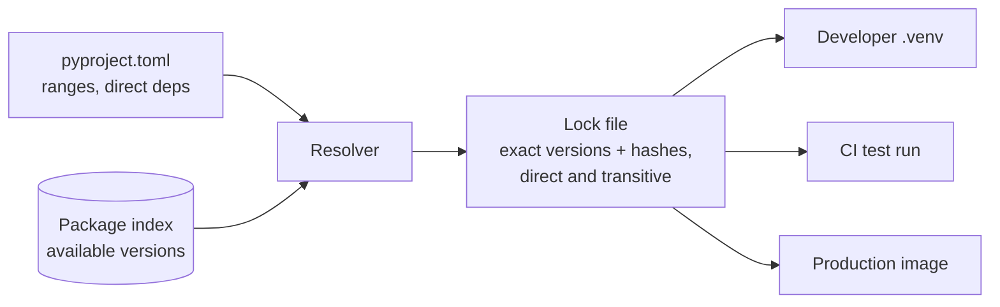

A virtual environment gives a project its own shelf of packages. This lesson is about deciding what goes on that shelf and making sure it is exactly the same everywhere the project runs: on your laptop, on a colleague's, in continuous integration and in production. That is **dependency management**: declaring which packages your code needs, letting a resolver pick versions that all work together, recording the result in a lock file, and updating it deliberately rather than by accident.

RAG projects make this harder than average. A modest AskMeridian service depends directly on perhaps a dozen packages (an HTTP client, Pydantic, the Anthropic SDK, a vector database client, an embedding library, a web framework) and, through them, on a hundred or more. Several of those move fast and have made breaking changes in recent years. This lesson teaches the vocabulary (specifiers, markers, transitive dependencies, resolution, locking), the mechanism of resolution, and a workflow that keeps builds reproducible without freezing the project in the past. It assumes you have read [Virtual environments](/learn/python-for-rag-engineering/virtual-environments).

## Learning objectives

- Read and write PEP 440 version specifiers and PEP 508 environment markers, and predict which versions they allow.
- Explain how a dependency resolver searches for a consistent set of versions, and why some sets of requirements have no solution.
- Distinguish declared (abstract) dependencies from locked (concrete) ones, and set up a `pyproject.toml` plus lock file workflow.
- Verify that an environment matches its lock file, and explain what hash pinning protects against.
- Plan safe dependency upgrades for a RAG service, including large native packages such as PyTorch.

## Prerequisites

- [Virtual environments](/learn/python-for-rag-engineering/virtual-environments): where packages are installed and how Python finds them.
- [Exception handling](/learn/python-for-rag-engineering/exception-handling): reading the errors that version mismatches produce.

## Why this matters

Three failures recur in RAG teams that do not manage dependencies deliberately.

**"It works on my machine."** A developer installs `qdrant-client` without a version. A month later a new team member installs the same project and gets a newer release, whose behaviour differs in some detail the code relied on. Same code, different results, and nobody can say why, because nothing recorded which versions the working setup used.

**Silent upgrades in production.** A container image is rebuilt to apply an operating-system security patch. The `pip install` inside the build resolves fresh versions. A transitive dependency (a package you never asked for, required by one you did) has had a major release in the meantime. The service starts, passes its health check, and then fails on the first real request. Nothing in your repository changed.

**Stuck upgrades.** The opposite failure: a team pins everything exactly, never updates, and a year later needs a security fix or a new model feature from one library. The upgrade now drags in dozens of other changes at once, conflicts appear everywhere, and the work takes weeks.

Recent history shows these are not hypothetical. Pydantic 2 (2023) changed much of its public interface; NumPy 2.0 (2024) changed its binary interface, so compiled packages built against NumPy 1 had to be rebuilt; LangChain split into several separately versioned packages. A RAG project that depends on these needs a process that makes such changes deliberate, tested and reversible.

## The intuition

Think of a recipe and a shopping receipt.

The **recipe** says "flour, 500 g; any plain flour will do; eggs, large". It states requirements flexibly, because any shop's plain flour works. That is what a project declares in `pyproject.toml`: `httpx>=0.27`, meaning any recent enough version.

The **receipt** from the day the cake came out perfectly says exactly which brand of flour, which batch of eggs, which shop. If a later cake comes out wrong, the receipt lets you buy precisely the same things again and find out whether the ingredients or the baking changed. That is a **lock file**: the exact version of every package, including the ones you never asked for directly, and a fingerprint of each file.

You need both. The recipe tells a resolver what is acceptable when you deliberately go shopping again (upgrading). The receipt makes every other bake identical.

## How it works

### Direct and transitive dependencies

A **direct dependency** is a package your code imports and that you declare. A **transitive dependency** is one required by your dependencies. Installing the Anthropic SDK, for example, also installs an HTTP client, Pydantic and several smaller packages. You never asked for them, but your code runs on them, and their versions can break it just as surely.

The full set forms a **dependency graph**. A **diamond** occurs when two of your dependencies both require the same third package, possibly with different version ranges. Only one version of a package can be installed in an environment, so the ranges must overlap.

### Version numbers and specifiers (PEP 440)

Python package versions follow PEP 440. Most look like `MAJOR.MINOR.PATCH` (for example `2.11.3`), with optional pre-release suffixes (`2.5.0rc1`, `3.0.0a2`) that sort *before* the release they lead to. Versions compare numerically, part by part, so `2.11.3` is newer than `2.5.0`.

Many projects follow **semantic versioning**: a major release may break compatibility, a minor one adds features compatibly, a patch only fixes bugs. Many do not (pip itself uses calendar-based versions such as `24.0`), and even those that do sometimes break things in minor releases. Treat version numbers as a hint, and tests as the evidence.

A **specifier** constrains acceptable versions:

| Specifier | Means | Typical use |
| --- | --- | --- |
| `==2.4.1` | Exactly this version | Lock files |
| `>=2.0,<3` | At least 2.0, below 3 | Libraries declaring a compatible range |
| `~=2.4` | Compatible release: `>=2.4` and `==2.*` | "Any 2.x from 2.4 on" |
| `~=2.4.0` | `>=2.4.0` and `==2.4.*` | "Patch updates only" |
| `!=2.5.0` | Anything but this version | Excluding a known-bad release |

By default, resolvers ignore pre-releases unless a specifier names one explicitly or no final release satisfies the requirement.

### Environment markers (PEP 508)

A requirement can apply only on some platforms: `torch>=2.3; platform_machine == "x86_64"` or `tomli; python_version < "3.11"`. The part after the semicolon is an **environment marker**, evaluated against the machine doing the installation. Markers let one dependency list serve Linux servers, Apple-silicon laptops and Windows desktops.

### Declaring dependencies: `pyproject.toml`

The standard place to declare a project's metadata and dependencies is `pyproject.toml`, under the `[project]` table defined by PEP 621:

```toml
[project]
name = "askmeridian-api"
version = "0.4.0"
requires-python = ">=3.11"
dependencies = [
    "fastapi>=0.110",
    "httpx>=0.27,<1",
    "pydantic>=2.6,<3",
    "anthropic>=0.40",
    "qdrant-client>=1.9",
    "tenacity>=8.2",
]

[project.optional-dependencies]
local-embeddings = ["sentence-transformers>=3.0"]

[dependency-groups]
dev = ["pytest>=8", "ruff"]
```

(The lower bounds here are illustrative; set yours to versions you have actually tested.)

- `requires-python` states which Python versions the project supports; installers refuse to install it elsewhere.
- `dependencies` lists direct runtime dependencies as **ranges**. Lower bounds say "I use features from this version on". Upper bounds on a major version (`<3`) say "I have not tested the next major release", which is reasonable for an application but should be used sparingly in a library, because they cause conflicts for everyone who depends on it.
- `[project.optional-dependencies]` declares **extras** that users can opt into: `pip install "askmeridian-api[local-embeddings]"`. Here they keep PyTorch out of the default installation.
- `[dependency-groups]` (PEP 735) holds dependencies needed only for development, such as test tools, which are never published as part of the package.

### Resolution

Given the declared ranges, a **resolver** must choose one version of every package in the graph such that every constraint holds at once. Step by step, the approach used by modern resolvers, in simplified form:

1. Take the next unresolved requirement.
2. List the versions of that package that satisfy every constraint gathered so far, newest first.
3. Tentatively pick the newest, and add *its* requirements to the list of unresolved ones.
4. If a later requirement cannot be satisfied with the choices made so far, undo the most recent choice and try the next candidate (**backtracking**).
5. Stop when every requirement is satisfied (a solution) or every combination has been tried (no solution: a **resolution conflict**).

pip has used a backtracking resolver by default since version 20.3 (2020); uv and Poetry use more sophisticated algorithms with the same goal. Searching all combinations can in principle take a very long time, which is why resolvers use heuristics, and why a tighter set of requirements sometimes resolves faster.



### Locking

A **lock file** records the resolver's answer: the exact version of every package, direct and transitive, and usually a cryptographic **hash** of each file to be downloaded. Installing from it does no resolution at all; it reproduces the same environment every time. Common forms:

| Tool | Declared in | Lock file | Install from the lock |
| --- | --- | --- | --- |
| pip-tools | `requirements.in` or `pyproject.toml` | `requirements.txt` with `==` pins (and hashes with `--generate-hashes`) | `pip install -r requirements.txt` or `pip-sync` |
| uv | `pyproject.toml` | `uv.lock` | `uv sync` |
| Poetry | `pyproject.toml` | `poetry.lock` | `poetry install` |
| pip alone | | `pip freeze > requirements.txt` (versions only, no hashes, records whatever happens to be installed) | `pip install -r requirements.txt` |

`pip freeze` is the weakest option: it captures the current environment, including anything installed by hand, and makes no distinction between what you need and what is lying around. PEP 751 (accepted in 2025) defines a standard, tool-independent lock file format, `pylock.toml`; tool support is still developing, so check the documentation of the tools you use.

Commit the lock file. Applications (services, pipelines, notebooks you rerun) should always install from one. Libraries published for others are different: they declare ranges and leave locking to the application that installs them.

### Hashes

A hash pin records the SHA-256 digest of each exact file. With hashes present, `pip install --require-hashes -r requirements.txt` refuses any file whose digest does not match, and refuses any requirement without a hash. That protects against a file being replaced on a mirror or in transit, and against an attacker publishing a different file under a version you already locked. It does not protect against a malicious version you deliberately locked in the first place; reviewing what you add is still your job.

### Updating deliberately

A lock file freezes versions; it does not keep them current. The workflow that balances reproducibility with currency:

1. Update on purpose, in a branch: `uv lock --upgrade-package qdrant-client`, `pip-compile --upgrade-package qdrant-client`, or a full upgrade.
2. Read the changelog for anything that crossed a major version.
3. Let continuous integration rebuild the environment from the new lock file and run the full test suite, including retrieval-quality checks.
4. Merge, deploy, and keep the previous lock file in history so that rollback is a revert.

Bots such as Dependabot and Renovate can open these update branches automatically, and `pip-audit` (from the Python Packaging Authority) checks a lock file or environment against known vulnerability databases.

### Native packages: PyTorch and friends

Some RAG dependencies contain compiled code built for specific platforms. PyTorch is the largest: it publishes different builds for CPU-only machines and for different CUDA versions, and the GPU builds come from PyTorch's own package index (for example `pip install torch --index-url https://download.pytorch.org/whl/cpu` for a CPU-only build). The lock file must therefore be resolved for the platform you deploy to, which tools handle with markers, per-platform lock files, or by building inside the target container. Keep such packages out of components that do not need them, as the previous lesson recommended.

## In code

Examples 1 and 2 use the `packaging` library, which implements the standards pip itself follows; Example 3 uses only the standard library. All three were run.

```bash
pip install packaging
```

### Example 1: what a specifier allows

**The problem.** Before writing ranges into `pyproject.toml`, check what they actually admit against a list of available versions.

```python
from packaging.requirements import Requirement
from packaging.specifiers import SpecifierSet
from packaging.version import Version

available = ["1.9.0", "2.0.0", "2.4.1", "2.5.0rc1", "2.5.0", "2.11.3", "3.0.0"]

for spec in ["==2.4.1", ">=2.0,<3", "~=2.4", "~=2.4.0", ">=2,!=2.5.0,<3", ">=2.5.0rc1"]:
    s = SpecifierSet(spec)
    allowed = list(s.filter(available))     # applies the PEP 440 pre-release rules
    print(f"{spec:<16} -> {allowed}")

print()
print("ordering is numeric, not alphabetical:", Version("2.11.3") > Version("2.5.0"))
print("a release candidate sorts before its release:", Version("2.5.0rc1") < Version("2.5.0"))

req = Requirement('torch>=2.3; platform_machine == "x86_64" and python_version >= "3.10"')
print()
print("name:", req.name, "| specifier:", req.specifier, "| marker:", req.marker)
for env in [{"platform_machine": "x86_64", "python_version": "3.12"},
            {"platform_machine": "arm64", "python_version": "3.12"}]:
    print(f"  applies on {env['platform_machine']}:", req.marker.evaluate(env))
```

```output
==2.4.1          -> ['2.4.1']
>=2.0,<3         -> ['2.0.0', '2.4.1', '2.5.0', '2.11.3']
~=2.4            -> ['2.4.1', '2.5.0', '2.11.3']
~=2.4.0          -> ['2.4.1']
>=2,!=2.5.0,<3   -> ['2.0.0', '2.4.1', '2.11.3']
>=2.5.0rc1       -> ['2.5.0rc1', '2.5.0', '2.11.3', '3.0.0']

name: torch | specifier: >=2.3 | marker: platform_machine == "x86_64" and python_version >= "3.10"
  applies on x86_64: True
  applies on arm64: False
```

**What the output means.**

- `~=2.4` admits every 2.x from 2.4 upwards, including 2.11.3, but not 3.0.0. `~=2.4.0` admits only 2.4.x. The number of components you write changes the meaning considerably.
- The release candidate `2.5.0rc1` is excluded from every range except the one that names a pre-release explicitly.
- `2.11.3 > 2.5.0` is true. Compared as strings, "2.11.3" would sort before "2.5.0"; never compare versions with string operations.
- The marker is evaluated against an environment dictionary; `packaging` fills in the real values of the current machine when you call `evaluate()` without arguments.

### Example 2: a resolver, in miniature

**The problem.** Understand why `pip install` sometimes takes a long time, and what a resolution conflict really means. The index below is fictional: `askmeridian` needs `ragkit` and `vecdb-client`, both of which depend on `httpwire` with different ranges (a diamond).

```python
from packaging.specifiers import SpecifierSet
from packaging.version import Version

# A fictional package index: package -> version -> its own requirements.
INDEX = {
    "ragkit": {
        "1.0": {"httpwire": ">=0.20,<0.25"},
        "1.1": {"httpwire": ">=0.23,<0.26"},
        "1.2": {"httpwire": ">=0.27"},
    },
    "vecdb-client": {
        "2.0": {"httpwire": "<0.26"},
        "2.1": {"httpwire": ">=0.24,<0.28"},
    },
    "httpwire": {v: {} for v in ["0.20", "0.23", "0.24", "0.25", "0.27", "0.28"]},
}

def resolve(requirements, pinned=None, depth=0):
    """Depth-first backtracking: try the newest allowed version of each package."""
    pinned = dict(pinned or {})
    if not requirements:
        return pinned
    (name, spec), rest = requirements[0], requirements[1:]
    # Every constraint on `name` seen so far must hold at once.
    if name in pinned:
        if Version(pinned[name]) in SpecifierSet(spec):
            return resolve(rest, pinned, depth)
        print("  " * depth + f"conflict: {name}=={pinned[name]} does not satisfy {spec}")
        return None
    candidates = sorted(SpecifierSet(spec).filter(INDEX[name]), key=Version, reverse=True)
    for version in candidates:
        print("  " * depth + f"try {name}=={version}")
        deps = list(INDEX[name][version].items())
        result = resolve(deps + rest, {**pinned, name: version}, depth + 1)
        if result is not None:
            return result
        print("  " * depth + f"backtrack from {name}=={version}")
    return None

print("Resolving askmeridian: ragkit>=1.0, vecdb-client>=2.0")
print("solution:", resolve([("ragkit", ">=1.0"), ("vecdb-client", ">=2.0")]))
print()
print("Resolving with ragkit>=1.2 and vecdb-client==2.0")
print("solution:", resolve([("ragkit", ">=1.2"), ("vecdb-client", "==2.0")]))
```

```output
Resolving askmeridian: ragkit>=1.0, vecdb-client>=2.0
try ragkit==1.2
  try httpwire==0.28
    try vecdb-client==2.1
      conflict: httpwire==0.28 does not satisfy >=0.24,<0.28
    backtrack from vecdb-client==2.1
    try vecdb-client==2.0
      conflict: httpwire==0.28 does not satisfy <0.26
    backtrack from vecdb-client==2.0
  backtrack from httpwire==0.28
  try httpwire==0.27
    try vecdb-client==2.1
solution: {'ragkit': '1.2', 'httpwire': '0.27', 'vecdb-client': '2.1'}

Resolving with ragkit>=1.2 and vecdb-client==2.0
try ragkit==1.2
  try httpwire==0.28
    try vecdb-client==2.0
      conflict: httpwire==0.28 does not satisfy <0.26
    backtrack from vecdb-client==2.0
  backtrack from httpwire==0.28
  try httpwire==0.27
    try vecdb-client==2.0
      conflict: httpwire==0.27 does not satisfy <0.26
    backtrack from vecdb-client==2.0
  backtrack from httpwire==0.27
backtrack from ragkit==1.2
solution: None
```

**The important lines.**

- `requirements` is a work list. Picking a version prepends that version's own requirements (`deps + rest`), so the graph is explored depth-first.
- When a package is already pinned, a new constraint on it is checked rather than re-chosen. That is where diamond conflicts surface.
- Returning `None` signals failure upwards, and the caller tries its next candidate: that loop is backtracking.

**What the output means.** In the first case the newest `httpwire` (0.28) satisfied `ragkit` but neither `vecdb-client`, so the resolver backed off to 0.27, which satisfies both `ragkit 1.2` (`>=0.27`) and `vecdb-client 2.1` (`<0.28`). Note that the answer is *not* "the newest of everything": `httpwire` 0.28 exists but cannot be used. In the second case the ranges cannot overlap: `ragkit>=1.2` needs `httpwire>=0.27` and `vecdb-client==2.0` needs `<0.26`. No amount of searching helps. Real tools report this as a resolution error naming the packages involved; the fix is to relax one of *your* constraints (allow `vecdb-client` 2.1) or wait for a release that widens a range.

Real indexes have hundreds of versions per package, so a naive search like this can explore enormous numbers of combinations. That is why real resolvers are cleverer, and why a resolver occasionally appears to hang while backtracking through old releases; adding a sensible lower bound to a direct dependency often fixes it.

### Example 3: does this environment match the lock file?

**The problem.** AskMeridian's ingestion worker should refuse to run if its environment has drifted from the lock file. Also, see what a hash pin catches.

```python
import hashlib
from importlib.metadata import version, PackageNotFoundError

# Part 1: does the running environment match the lock file?
LOCKED = {"httpx": "0.28.1", "pydantic": "2.14.3", "numpy": "2.4.0", "tenacity": "9.2.1",
          "qdrant-client": "1.20.0", "rank-bm25": "0.2.2", "faiss-gpu": "1.8.0"}

drift = 0
for name, pinned in LOCKED.items():
    try:
        installed = version(name)
    except PackageNotFoundError:
        installed = None
    status = "ok" if installed == pinned else ("MISSING" if installed is None else "DRIFT")
    drift += status != "ok"
    print(f"{name:<14} locked {pinned:<8} installed {installed or '-':<8} {status}")
print(f"{drift} package(s) differ from the lock file")

# Part 2: what a hash pin protects against.
artifact = b"pretend these bytes are a downloaded wheel file"
pinned_hash = hashlib.sha256(artifact).hexdigest()
print("\nsha256 recorded in the lock file:", pinned_hash[:16] + "...")

for label, data in [("same file", artifact),
                    ("one byte changed", artifact.replace(b"wheel", b"wheal"))]:
    actual = hashlib.sha256(data).hexdigest()
    print(f"{label:<17} {actual[:16]}...  {'accept' if actual == pinned_hash else 'REJECT'}")
```

The output below comes from the environment used to write this lesson; yours will show your own installed versions.

```output
httpx          locked 0.28.1   installed 0.28.1   ok
pydantic       locked 2.14.3   installed 2.14.3   ok
numpy          locked 2.4.0    installed 2.5.4    DRIFT
tenacity       locked 9.2.1    installed 9.2.1    ok
qdrant-client  locked 1.20.0   installed 1.20.0   ok
rank-bm25      locked 0.2.2    installed 0.2.2    ok
faiss-gpu      locked 1.8.0    installed -        MISSING
2 package(s) differ from the lock file

sha256 recorded in the lock file: 67c3de4bc89528f9...
same file         67c3de4bc89528f9...  accept
one byte changed  6075412689426dd9...  REJECT
```

**What the output means.** NumPy has drifted: someone (or some other install) upgraded it after the environment was built from the lock. `faiss-gpu` is missing, perhaps because the environment was built on a machine without GPU packages. Either would change behaviour silently; the check makes them loud. In the second part, changing four bytes of the file produces a completely different digest, so a hash-checking installer rejects it.

**Errors people commonly hit.** Distribution names and import names differ (`qdrant-client` is imported as `qdrant_client`, `PyMuPDF` as `pymupdf` or `fitz`); `importlib.metadata.version` needs the distribution name. In a real project, parse the lock file rather than copying versions into a dictionary; `pip check` separately confirms that installed packages' own requirements are satisfied.

**Extending it.** Read the pins from `requirements.txt` with `packaging.requirements.Requirement`, run the check at worker start-up, and exit with an error on drift.

## A real-world example

The Platform team rebuilt AskMeridian's ingestion image on a Monday to pick up an operating-system patch. Their `requirements.txt` listed direct dependencies with lower bounds only (`sentence-transformers>=2.2`, `qdrant-client>=1.7` and so on) and no lock file. The build succeeded and the nightly job ran without errors.

On Wednesday, Priya on the support desk reported that AskMeridian had started answering questions about the VPN with passages about expenses. Investigation showed that retrieval quality had collapsed for newly indexed documents only. The fresh build had resolved a newer major version of the embedding library, which changed a default related to how embeddings were normalised. Documents indexed after Monday sat in a slightly different vector space from those indexed before, and from the queries, which were embedded by the API service's older environment. Nothing crashed. Similarity scores were simply wrong.

The team made four changes. They moved both services to `pyproject.toml` with tested ranges and committed lock files with hashes, so that rebuilding an image reproduced exactly the same packages. They made the embedding model name and the embedding library version part of the index metadata, and the API service refused to query an index built with a different combination. They added a small retrieval regression test (ten known questions and the chunks that should be retrieved for them) to the upgrade pipeline, so that a dependency change that hurts retrieval fails in continuous integration. And they moved upgrades to a weekly, reviewed branch. The lesson: in RAG, a dependency change can corrupt data without raising an error, so reproducibility is a correctness issue, not a convenience. [Index versioning](/learn/ci-cd-and-mlops/index-versioning) develops the index side of this.

## Common mistakes

- **No versions at all.** `pip install qdrant-client sentence-transformers` in a Dockerfile installs whatever is newest on the day of the build, so two builds of the same commit can behave differently.
- **Exact pins in a library's declared dependencies.** A library that requires `pydantic==2.6.1` conflicts with every application that needs any other 2.x version. Libraries declare ranges; applications lock.
- **Treating `pip freeze` output as the dependency list.** It mixes direct and transitive dependencies with whatever was installed by hand, so nobody can tell later which packages are actually needed or safe to remove.
- **Locking but never updating.** Security fixes are missed, and the eventual forced upgrade crosses several major versions at once.
- **Upgrading everything at once without tests.** When something breaks, you cannot tell which of forty changes caused it.
- **Ignoring transitive dependencies.** Your code can be broken by a package you never named; only a lock file controls them.
- **Mixing package indexes carelessly.** `--extra-index-url` makes pip consider every index and choose the highest version, which is how **dependency confusion** attacks work: a public package with the same name as your private one and a higher version number gets installed instead.

## Best practices

- Declare direct dependencies in `pyproject.toml` with tested lower bounds, and upper bounds on major versions only where you have reason to expect breakage.
- Generate a lock file with a tool (uv, pip-tools, Poetry), include hashes, commit it, and install from it everywhere: development, continuous integration and production.
- Keep development-only tools in a dependency group and optional heavy features (local embedding models) in extras.
- Upgrade on a schedule, one package or a small group at a time, in a branch, with the changelog read and the full test suite run, including retrieval-quality regression tests.
- Record the versions that affect stored data (embedding model, embedding library, tokeniser) in the index's metadata, and check them at query time.
- Scan for known vulnerabilities with `pip-audit` or your platform's equivalent, and automate update proposals with Dependabot or Renovate.
- Use a single, explicitly configured package index for private packages, or reserve their names on the public index.

## Performance considerations

- **Resolution time.** Resolving from scratch means downloading metadata for many candidate versions and possibly backtracking; it can take from seconds to minutes. Installing from a lock file skips resolution entirely, which is one reason continuous integration should install from the lock.
- **Download and install time.** Suppose (as an assumption) a RAG worker's environment is 3 GB, dominated by a GPU build of PyTorch. On a 100 Mbit/s link, about 12.5 MB/s, downloading it takes $3000 / 12.5 = 240$ s, four minutes per build without a cache. Caching (pip's and uv's caches locally, and Docker layer caching in builds) removes most of that; so does keeping such packages out of components that do not need them.
- **Image size and cold starts.** Every gigabyte in a container image is pulled by every new instance before it can serve traffic. A lean API service image starts faster when scaling out.
- **Import time.** Heavy packages also cost time at start-up when imported. Importing a deep-learning framework can take seconds; a service that imports it but never uses it pays that cost on every start.

## Security considerations

Your dependencies run with all the permissions of your service, which holds API keys and reads private documents. The software supply chain is part of your attack surface.

- **Typosquatting.** Malicious packages are published under names one letter away from popular ones. Copy package names from official documentation, and review every new direct dependency.
- **Dependency confusion.** As above: never let a public index outrank a private one for your internal package names.
- **Compromised releases.** A legitimate package's maintainer account can be compromised and a malicious version published. Lock files with hashes mean you only receive a new version when you deliberately upgrade, giving the community time to spot problems; they cannot help if you lock the bad version.
- **Install-time code execution.** Building a package from a source distribution runs its build scripts. Prefer pre-built wheels, and never install with elevated privileges.
- **Known vulnerabilities.** Scan the lock file in continuous integration and treat findings in network-facing packages (HTTP clients, web frameworks, parsers that handle untrusted documents) as urgent. Document parsers deserve special attention in RAG: they process files that anyone able to add a document can control.

## Summary

- Direct dependencies are what you declare; transitive ones come with them. Both affect behaviour, and only a lock file controls both.
- PEP 440 specifiers (`>=`, `<`, `~=`, `==`, `!=`) and PEP 508 markers express acceptable versions and platforms; check them with the `packaging` library rather than intuition.
- A resolver searches, with backtracking, for one version of every package that satisfies all constraints; a conflict means the ranges cannot overlap and a constraint must change.
- Declare ranges in `pyproject.toml`, lock exact versions with hashes, commit the lock, and install from it everywhere.
- Upgrade deliberately and incrementally, with tests that include retrieval quality, because in RAG a dependency change can silently change stored embeddings.
- Treat dependencies as part of your attack surface: review additions, use hashes, scan for vulnerabilities and control your indexes.

## Exercises

**1.** For the available versions `1.4.0, 1.5.2, 2.0.0b1, 2.0.0, 2.1.0, 2.10.0`, which versions does each specifier admit: (a) `~=2.0`, (b) `>=1.5,<2.1`, (c) `~=1.4.0`? Check your answers with `SpecifierSet.filter`.

<details><summary>Show solution</summary>

(a) `~=2.0` means `>=2.0` and `==2.*`: **2.0.0, 2.1.0, 2.10.0**. The beta `2.0.0b1` is excluded (it is a pre-release, and it is also below 2.0.0).

(b) `>=1.5,<2.1`: **1.5.2, 2.0.0**. The beta is excluded because pre-releases are skipped unless requested.

(c) `~=1.4.0` means `>=1.4.0` and `==1.4.*`: **1.4.0** only.

```python
from packaging.specifiers import SpecifierSet

available = ["1.4.0", "1.5.2", "2.0.0b1", "2.0.0", "2.1.0", "2.10.0"]
for spec in ["~=2.0", ">=1.5,<2.1", "~=1.4.0"]:
    print(f"{spec:<12} {list(SpecifierSet(spec).filter(available))}")
```

```output
~=2.0        ['2.0.0', '2.1.0', '2.10.0']
>=1.5,<2.1   ['1.5.2', '2.0.0']
~=1.4.0      ['1.4.0']
```

</details>

**2.** In Example 2's index, `askmeridian` adds a third direct requirement, `httpwire<0.25`. Without running the code, work out the solution (if any). Then explain what the resolver output tells you to change.

<details><summary>Show solution</summary>

`httpwire<0.25` allows 0.20, 0.23 and 0.24. `ragkit` 1.2 needs `>=0.27`, so it is out; `ragkit` 1.1 needs `>=0.23,<0.26`, leaving 0.23 or 0.24; `ragkit` 1.0 needs `>=0.20,<0.25`. `vecdb-client` 2.1 needs `>=0.24,<0.28`, so with 0.24 it works; `vecdb-client` 2.0 needs `<0.26`.

Trying newest first: `ragkit` 1.1 with `httpwire` 0.24 and `vecdb-client` 2.1 satisfies everything. Solution: `ragkit==1.1, httpwire==0.24, vecdb-client==2.1`. Running the resolver with the extra requirement confirms it.

The lesson: your direct pin on `httpwire` forced an *older* `ragkit`. If `ragkit` 1.2 has a fix you need, your own constraint is what is holding it back, and relaxing `httpwire<0.25` is the change to consider. Resolution output tells you which constraints are binding.

</details>

**3.** Write a function `check_lock(path)` that reads a pip-style `requirements.txt` containing lines such as `httpx==0.28.1` (ignore blank lines, comments and `--hash` continuation lines), compares each pin with the installed version, and returns the drifted or missing packages. Use `packaging.requirements.Requirement` to parse each line.

<details><summary>Show solution</summary>

```python
from importlib.metadata import version, PackageNotFoundError
from pathlib import Path
from packaging.requirements import Requirement
import tempfile

def check_lock(path: Path) -> dict[str, tuple[str, str | None]]:
    """Return {name: (locked, installed)} for every package that does not match."""
    problems = {}
    for raw in path.read_text().splitlines():
        line = raw.split("#", 1)[0].strip().rstrip("\\").strip()
        if not line or line.startswith("--"):
            continue
        req = Requirement(line)
        if req.marker is not None and not req.marker.evaluate():
            continue                                  # not for this platform
        pins = [s.version for s in req.specifier if s.operator == "=="]
        if len(pins) != 1:
            raise ValueError(f"not an exact pin: {line}")
        try:
            installed = version(req.name)
        except PackageNotFoundError:
            installed = None
        if installed != pins[0]:
            problems[req.name] = (pins[0], installed)
    return problems

lock = """\
# generated lock file
httpx==0.28.1 \\
    --hash=sha256:0000000000000000000000000000000000000000000000000000000000000000
pydantic==2.14.3
numpy==2.4.0
faiss-gpu==1.8.0 ; platform_system == "Linux"
"""
with tempfile.TemporaryDirectory() as d:
    p = Path(d) / "requirements.txt"
    p.write_text(lock)
    print(check_lock(p))
```

Run on a Mac in the environment used for this lesson:

```output
{'numpy': ('2.4.0', '2.5.4')}
```

`faiss-gpu` is not reported because its marker restricts it to Linux, so it does not apply on this machine. The hash line is skipped because it starts with `--` after stripping. Your output depends on your installed versions.

</details>

**4.** Design decision. AskMeridian's API service has a lock file but has not been updated for 14 months. A security advisory affects its HTTP client, and the fixed version requires a newer Pydantic, which in turn conflicts with the pinned vector database client. Plan the upgrade, and describe the process that would stop this happening again.

<details><summary>Show solution</summary>

**Plan.**

1. Create a branch. Upgrade only what the fix requires, using targeted upgrades (`uv lock --upgrade-package httpx --upgrade-package pydantic --upgrade-package qdrant-client`, or the pip-tools equivalent), and let the resolver report what else must move.
2. Read the changelogs of every package that crosses a major version, particularly Pydantic and the vector database client, and fix the code they affect.
3. Run the full test suite plus the retrieval regression set in continuous integration. Check that embeddings and stored payloads are unaffected (they should be, since the embedding stack has not changed; if it had, the index might need rebuilding).
4. Deploy to a staging environment, then production, keeping the previous lock file so that rollback is a revert.

If the conflict cannot be resolved quickly, a temporary mitigation may be possible (for example, a configuration change that avoids the vulnerable code path), but the upgrade should still happen promptly.

**Prevention.** Automate update proposals weekly (Dependabot or Renovate), merge small updates routinely when tests pass, run `pip-audit` in continuous integration, and assign an owner for the dependency review. Small, frequent upgrades keep each change understandable; the 14-month gap is what turned a one-line security fix into a multi-package migration.

</details>

## Check your understanding

```quiz
[
  {
    "q": "Which versions does `~=2.4` admit?",
    "options": [
      "Only 2.4.x",
      "Any 2.x from 2.4 upwards, but not 3.0",
      "Any version from 2.4 upwards, including 3.0",
      "Exactly 2.4.0"
    ],
    "answer": 1,
    "why": "The compatible-release operator with two components means >=2.4 and ==2.*. Writing ~=2.4.0 would restrict it to 2.4.x."
  },
  {
    "q": "What is the main purpose of a lock file?",
    "options": [
      "To list only the direct dependencies of a library",
      "To speed up Python imports",
      "To record the exact versions (and usually hashes) of every direct and transitive dependency, so installs are reproducible",
      "To prevent anyone from upgrading packages"
    ],
    "answer": 2,
    "why": "A lock file freezes the resolver's answer. Installing from it reproduces the same environment; upgrades still happen, but deliberately."
  },
  {
    "q": "A resolver reports that `ragkit>=1.2` (which needs httpwire>=0.27) and `vecdb-client==2.0` (which needs httpwire<0.26) cannot be installed together. What is the right response?",
    "options": [
      "Install both with --no-deps and hope",
      "Run the install again; resolution is random",
      "Change one of your own constraints, for example allow a vecdb-client version whose range overlaps",
      "Install two versions of httpwire side by side in the same environment"
    ],
    "answer": 2,
    "why": "The ranges do not overlap, so no search can succeed, and one environment can hold only one version of a package. A constraint has to change."
  },
  {
    "q": "Which statement about a Python library published for other projects to use is best practice?",
    "options": [
      "It should declare compatible ranges and leave exact locking to the applications that install it",
      "It should pin every dependency with ==",
      "It should declare no dependencies at all",
      "It should ship its own lock file and force applications to use it"
    ],
    "answer": 0,
    "why": "Exact pins in a library cause conflicts in every application that depends on it. Applications lock; libraries declare ranges."
  },
  {
    "q": "What does installing with `--require-hashes` protect against?",
    "options": [
      "A malicious version that you deliberately added to the lock file",
      "A package file that differs from the one recorded when the lock was made",
      "Bugs in the latest release of a package",
      "Slow downloads"
    ],
    "answer": 1,
    "why": "Hash checking rejects any file whose digest does not match the recorded one. It cannot judge whether the recorded version itself was safe."
  }
]
```

## Further reading

- Python Packaging User Guide, [Version specifiers](https://packaging.python.org/en/latest/specifications/version-specifiers/) (the current form of PEP 440) and [Dependency specifiers](https://packaging.python.org/en/latest/specifications/dependency-specifiers/) (PEP 508).
- Python Packaging User Guide, [Writing your pyproject.toml](https://packaging.python.org/en/latest/guides/writing-pyproject-toml/).
- pip documentation, [Dependency Resolution](https://pip.pypa.io/en/stable/topics/dependency-resolution/) and [Secure installs](https://pip.pypa.io/en/stable/topics/secure-installs/) (hash-checking mode).
- PEP 751, "A file format to record Python dependencies for installation reproducibility" (2025).
- uv documentation, [docs.astral.sh/uv](https://docs.astral.sh/uv/), on projects, locking and syncing.
- `packaging` library documentation, [packaging.pypa.io](https://packaging.pypa.io/).
