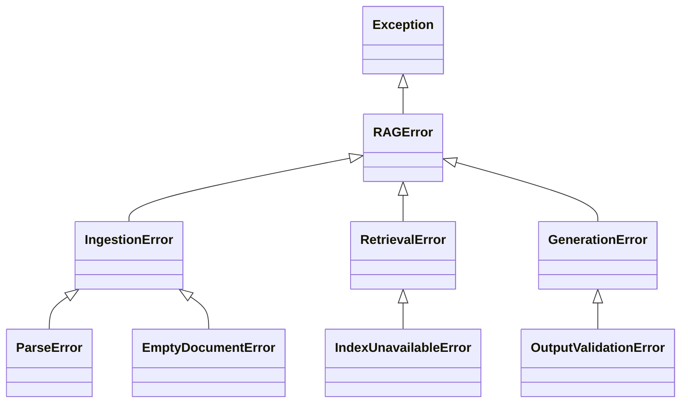
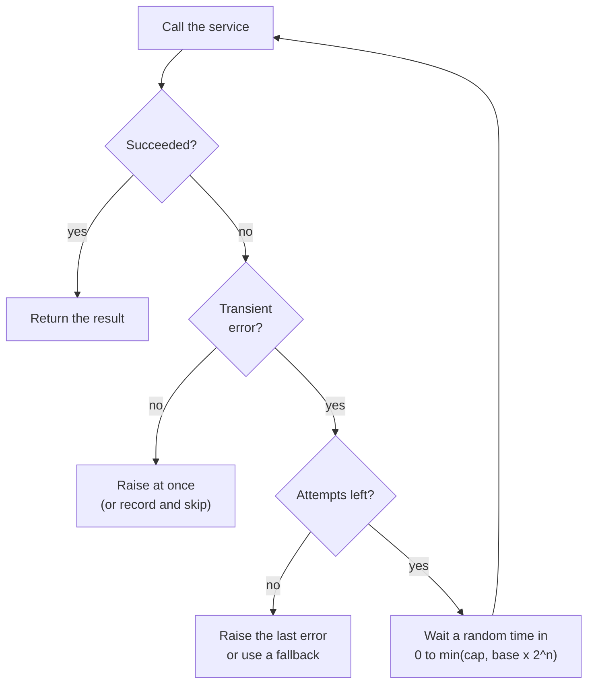

A RAG system is a chain of components that fail in different ways. A PDF turns out to be a scanned image with no text. An embedding service drops a connection. A vector database is restarting. A language model returns JSON with a missing brace. None of these is exotic; at any real volume, each happens every day. What separates a reliable system from a fragile one is not whether errors occur but what the code does when they do: whether one corrupt file halts the indexing of ten thousand good ones, whether a two-second network blip becomes a failed answer, and whether the engineer on call can tell from the logs what actually went wrong.

This lesson teaches Python's exception mechanism from the ground up, then turns it into an engineering discipline for RAG: designing an exception hierarchy, translating low-level errors into meaningful ones without losing the cause, isolating failures so that a batch survives its bad items, deciding which errors are worth retrying, and retrying with exponential backoff and jitter. HTTP status codes and rate-limit headers are specific to web APIs and belong to [Working with APIs](/learn/python-for-rag-engineering/working-with-apis); here you build the general machinery that lesson applies.

## Learning objectives

- Trace the flow of control through `try`, `except`, `else` and `finally`, and predict which blocks run for a given exception.
- Design a small exception hierarchy for a RAG application and translate library errors into it with `raise ... from`.
- Classify an error as transient or permanent and justify whether it should be retried.
- Implement exponential backoff with full jitter by hand and with the `tenacity` library, and calculate its worst-case and expected waiting time.
- Isolate per-item failures in a batch job and report them with an `ExceptionGroup` handled by `except*`.

## Prerequisites

- [Functions and classes](/learn/python-for-rag-engineering/functions-and-classes) and [OOP](/learn/python-for-rag-engineering/oop): exceptions are classes, and hierarchies use inheritance.
- [Async programming](/learn/python-for-rag-engineering/async-programming): `TaskGroup` raises `ExceptionGroup`, and cancellation is delivered as an exception.
- [Indexing pipeline](/learn/rag-architecture-fundamentals/indexing-pipeline): the batch job whose failures this lesson isolates.

## Why this matters

Without deliberate error handling, a RAG system fails in one of two bad ways.

The first is **too fragile**. An unhandled exception propagates to the top and kills the process. In an indexing job this means one malformed handbook page stops the indexing of every page after it, and someone has to notice, fix the file and start again. In a query service it means a brief blip in the embedding service shows the user an error page, when waiting half a second and trying again would have worked.

The second is **too tolerant**. Someone wraps everything in `try: ... except Exception: pass`, and the system never crashes. It also never tells anyone that 30% of documents silently failed to index, so AskMeridian confidently answers "I don't know" about policies that exist, and nobody can work out why. Swallowed errors convert loud, diagnosable failures into quiet wrong answers, which in a RAG system are the most expensive kind.

Good error handling sits between these: it catches the errors you have a plan for, at the level where the plan can be carried out, and lets everything else propagate loudly with its full history.

## The intuition

Think of a postal sorting office. Most letters go straight through. Some are problems, and the office has a policy for each kind:

- A letter with **no address at all** will never be deliverable, however often you try. It goes to a dead-letter office with a note saying why. The sorting line keeps moving.
- A letter for a house where **nobody answered the door** might well be deliverable tomorrow. The postman tries again, but not every five minutes all afternoon, and not at exactly the same moment as every other postman on the round: he waits a while, a little longer each time, and gives up after a few attempts.
- If the **sorting machine itself breaks**, that is not a letter problem. Nobody at the machine can fix it, so the problem is escalated immediately to someone who can.

Those three policies are the heart of this lesson: record and continue for permanent item failures, retry with growing, randomised waits for transient failures, and escalate what you cannot handle. Python's exceptions are the mechanism that carries each problem to the place with the right policy.

## How it works

### What an exception is

An **exception** is an object that represents an error, together with a change in control flow. When code executes `raise SomeError("message")`, Python stops executing the current function and unwinds the **call stack** (the chain of functions that called each other to get here), looking for a `try` block with a matching `except` clause. If it finds one, execution continues in that handler. If it reaches the top of the program, Python prints a **traceback** (the stack at the moment of the error, innermost call last) and exits.

Exceptions are instances of classes, and every built-in one descends from `BaseException`:

```text
BaseException
├── KeyboardInterrupt, SystemExit      (stop requests: do not catch casually)
├── asyncio.CancelledError             (task cancellation, since Python 3.8)
├── BaseExceptionGroup
│   └── ExceptionGroup
└── Exception                          (everything an application normally handles)
    ├── ValueError, TypeError, KeyError, ...
    ├── OSError
    │   ├── FileNotFoundError, PermissionError
    │   └── ConnectionError, TimeoutError
    └── your own exception classes
```

`except Exception` catches application errors but deliberately not the three stop signals. That is why a bare `except:` or `except BaseException:` is almost always a bug: it catches Ctrl-C, `sys.exit()` and asyncio cancellation, and stops them from working.

### The four clauses

```text
try:        code that might raise
except E:   runs if the try block raised E (or a subclass of E)
else:       runs if the try block raised nothing
finally:    runs in every case, after the others, even on return or an unhandled error
```

The order in which Python processes them, step by step:

1. Run the `try` block.
2. If it raises, compare the exception against each `except` clause **in order**. The first clause whose class matches (the exception is an instance of that class or a subclass) runs. Later clauses are not considered.
3. If no clause matches, the exception keeps propagating, after `finally` runs.
4. If the `try` block did not raise, run `else`. Code in `else` is not protected by the `except` clauses, which is the point: you only catch errors from the line you meant to guard.
5. Run `finally`, whatever happened. Use it (or, better, a `with` statement) to release resources: close files, return connections to a pool.

Because the first match wins, order handlers from most specific to most general. An `except IngestionError` placed before `except ParseError` would swallow every parse error before the specific handler could see it.

### Designing an exception hierarchy

Library exceptions describe what went wrong mechanically: `json.JSONDecodeError`, `httpx.ConnectError`, `KeyError`. Callers of your code care about what it means for them: *this document cannot be ingested*, *retrieval is unavailable*. A small hierarchy of your own exception classes gives callers names for those meanings:



With this, a caller can catch `IngestionError` to handle every ingestion problem one way, or `ParseError` to handle one kind specially, or `RAGError` at the top of a request handler to return a friendly message for anything the application raised on purpose. Keep the hierarchy shallow; a dozen classes is plenty for most services. Give each class useful attributes (the document identifier, the stage), not just a message string, so that handlers can act on them without parsing text.

### Translating errors without losing the cause

When you catch a low-level error and raise a domain error in its place, use `raise NewError(...) from exc`. This sets the new exception's `__cause__` to the original, and the traceback shows both, joined by "The above exception was the direct cause of the following exception". Without `from`, Python still records the original as `__context__` and prints "During handling of the above exception, another exception occurred", which wrongly suggests a second, unrelated bug in your handler. `raise NewError(...) from None` hides the original entirely; reserve it for cases where the low-level detail would only confuse, and never use it to hide information you might need when debugging.

### Transient and permanent errors

The most consequential decision about an error is whether trying again could succeed.

| | Transient | Permanent |
| --- | --- | --- |
| Meaning | The operation was fine; the moment was bad | The operation itself is wrong |
| RAG examples | Connection reset, timeout, service overloaded or restarting, rate limit | Malformed file, invalid input, text too long for the model, wrong credentials, missing collection |
| Right response | Retry after a wait, a limited number of times | Fail fast; record it; fix the input or configuration |
| Retrying it causes | Usually success | Wasted time and money, and extra load on a struggling service |

Some cases are ambiguous. A timeout on a request that *creates* something (adding vectors to an index) may have succeeded on the server even though the response never arrived. Retrying it is only safe if the operation is **idempotent**: doing it twice has the same effect as doing it once. Upserting points by a stable identifier is idempotent; appending them with new random identifiers is not, and would create duplicates. [Document identifiers](/learn/document-engineering/document-identifiers) covers how to make ingestion idempotent.

### Retrying well: exponential backoff with jitter

A naive retry loop tries again immediately. If the service failed because it was overloaded, an immediate retry adds load at the worst moment. **Exponential backoff** waits longer after each failure, typically doubling. But if a thousand clients all failed at the same moment, plain exponential backoff makes them all retry at the same moments too, producing synchronised waves of load (a **thundering herd**). **Jitter** randomises each wait so that retries spread out. The recommended default, analysed in the AWS Architecture Blog article cited below, is **full jitter**: wait a uniformly random time between zero and the exponential ceiling.



Every retry policy needs three limits: a maximum number of attempts, a cap on the single longest wait, and (for anything a user is waiting on) a total time budget. Without them, a long outage turns into requests that hang for minutes.

### Isolating failures in a batch

In batch work, the unit of failure should be the item, not the batch. The pattern is: catch the expected per-item errors inside the loop, record each failure with enough context to act on it (identifier, error, whether it is retryable), keep going, and report at the end. Items that failed permanently go to a **dead-letter** list for a human or another process to deal with; items that failed transiently can be re-queued.

Unexpected errors (a `TypeError` from a bug in your code) should *not* be caught per item. If your chunker has a bug, every document will hit it, and you want the job to stop immediately rather than record ten thousand identical failures.

### Exception groups and `except*`

Sometimes several errors genuinely happen together: concurrent tasks in an `asyncio.TaskGroup`, or a batch whose failures you want to raise to the caller as one. Python 3.11 added `ExceptionGroup`, an exception that contains a list of exceptions, and `except*`, which matches *the parts of a group* by type. Each `except*` clause receives a sub-group containing only the matching exceptions; several clauses can run for the same group, and anything unmatched propagates. Python 3.11 also added `exc.add_note("...")`, which attaches extra context to an exception without changing its type or message; notes are printed with the traceback.

### Where to handle errors

A useful rule: **catch an exception at the lowest level that can do something useful about it, and no lower.**

- The function that calls the embedding service can retry a transient error, so retry logic lives there.
- The indexing loop can skip one document and continue, so per-document isolation lives there.
- The HTTP request handler can turn any remaining `RAGError` into a polite message and a status code, so the final catch-all lives there, together with logging the full traceback.

Code in between should usually let exceptions pass through untouched.

## The mathematics

### Backoff delays

**Intuition.** Each failed attempt doubles the longest you are willing to wait, up to a cap; full jitter then picks a random wait below that ceiling, so on average you wait half of it.

$$
c_n = \min\!\left(C,\; b \cdot 2^{n}\right), \qquad d_n \sim \mathcal{U}(0, c_n), \qquad \mathbb{E}[d_n] = \frac{c_n}{2}
$$

$n$ is the retry number counted from 0, $b$ the base delay in seconds, $C$ the cap in seconds, $c_n$ the ceiling for retry $n$, $d_n$ the actual wait, and $\mathcal{U}(0, c_n)$ the uniform distribution between 0 and $c_n$. $\mathbb{E}[d_n]$ is the expected (average) wait.

**By hand.** With $b = 0.5$ s, $C = 8$ s and 5 attempts, there are 4 waits, with ceilings $0.5, 1, 2, 4$ s.

- Worst-case total wait: $0.5 + 1 + 2 + 4 = 7.5$ s.
- Expected total wait: $7.5 / 2 = 3.75$ s.

So a user-facing call with this policy can add up to 7.5 s of waiting before the error surfaces. If that is longer than your latency budget, you need fewer attempts or a smaller base.

### Why a few retries help so much, and when they do not

If each attempt failed independently with probability $p$, the probability that all $k$ attempts fail would be

$$
P(\text{all fail}) = p^{k}
$$

With $p = 0.1$: one attempt fails 10% of the time, three attempts all fail $0.1^3 = 0.001$ (0.1%) of the time. That is the case for retrying transient errors. But the independence assumption breaks in exactly the situation you most care about: during an outage, failures are correlated, and $p$ is close to 1 for every attempt. Retries then add load without adding success.

### Retry amplification

If a request passes through $L$ layers and each layer makes up to $a$ attempts, the bottom layer can receive up to $a^{L}$ calls for one user request. With three layers making 3 attempts each, that is $3^3 = 27$ calls. This is how well-meant retries turn a struggling service into a failed one. Retry at one layer only, usually the one closest to the failing call.

```python
import random

base, cap, attempts = 0.5, 8.0, 5
ceilings = [min(cap, base * 2 ** n) for n in range(attempts - 1)]
print("ceilings:", ceilings)
print("worst-case total wait:", sum(ceilings), "s")
print("expected total wait (full jitter):", sum(c / 2 for c in ceilings), "s")

# Check the expectation by simulation.
rng = random.Random(0)
trials = 100_000
mean = sum(sum(rng.uniform(0, c) for c in ceilings) for _ in range(trials)) / trials
print(f"simulated mean over {trials:,} trials: {mean:.3f} s")

# Probability that every attempt fails, if failures were independent.
p = 0.1
for k in (1, 3, 5):
    print(f"p={p}, {k} attempt(s): all fail with probability {p ** k:.5f}")

# Retry amplification: three layers, each making up to 3 attempts.
print("worst-case calls reaching the bottom layer:", 3 ** 3)
```

```output
ceilings: [0.5, 1.0, 2.0, 4.0]
worst-case total wait: 7.5 s
expected total wait (full jitter): 3.75 s
simulated mean over 100,000 trials: 3.754 s
p=0.1, 1 attempt(s): all fail with probability 0.10000
p=0.1, 3 attempt(s): all fail with probability 0.00100
p=0.1, 5 attempt(s): all fail with probability 0.00001
worst-case calls reaching the bottom layer: 27
```

The simulated mean agrees with the hand calculation to two decimal places.

## In code

Examples 1, 2 and 4 use only the standard library. Example 3 uses `tenacity`, a widely used retry library. All four were run with Python 3.11 or later.

```bash
pip install tenacity
```

### Example 1: a hierarchy, translation and the four clauses

**The problem.** AskMeridian's loader reads documents exported as JSON. Some exports are malformed and some contain no text. The loader should report each kind clearly and keep going.

```python
import json

# --- A small exception hierarchy for the ingestion side of a RAG system ------
class RAGError(Exception):
    """Base class for every error this application raises on purpose."""

class IngestionError(RAGError):
    """A document could not be turned into chunks."""
    def __init__(self, doc_id: str, reason: str):
        super().__init__(f"{doc_id}: {reason}")
        self.doc_id = doc_id

class ParseError(IngestionError):
    """The source file is malformed. Retrying will not help."""

class EmptyDocumentError(IngestionError):
    """The document parsed but contains no text worth indexing."""

# --- The function that raises them ------------------------------------------
def load_document(doc_id: str, raw: str) -> dict:
    try:
        record = json.loads(raw)
    except json.JSONDecodeError as exc:
        # Translate a low-level error into a domain error, keeping the cause.
        raise ParseError(doc_id, "invalid JSON") from exc
    text = record.get("text", "").strip()
    if not text:
        raise EmptyDocumentError(doc_id, "no text to index")
    return {"id": doc_id, "text": text, "owner": record.get("owner", "unknown")}

sources = {
    "handbook-leave": '{"text": "Annual leave is 25 days.", "owner": "HR"}',
    "handbook-remote": '{"text": "Remote work: up to 3 days a week", "owner": "HR"',   # missing brace
    "runbook-blank": '{"text": "   ", "owner": "IT"}',
}

for doc_id, raw in sources.items():
    try:
        doc = load_document(doc_id, raw)
    except ParseError as exc:
        print(f"PARSE  {exc}  (cause: {type(exc.__cause__).__name__}: {exc.__cause__})")
    except IngestionError as exc:              # catches EmptyDocumentError too
        print(f"SKIP   {type(exc).__name__}: {exc}")
    else:                                      # runs only if no exception was raised
        print(f"OK     {doc['id']} -> {doc['text']!r}")
    finally:                                   # runs in every case
        print(f"       finished {doc_id}")
```

```output
OK     handbook-leave -> 'Annual leave is 25 days.'
       finished handbook-leave
PARSE  handbook-remote: invalid JSON  (cause: JSONDecodeError: Expecting ',' delimiter: line 1 column 59 (char 58))
       finished handbook-remote
SKIP   EmptyDocumentError: runbook-blank: no text to index
       finished runbook-blank
```

**The important lines.**

- `IngestionError.__init__` stores `doc_id` as an attribute, so handlers can use it without parsing the message.
- `raise ParseError(...) from exc` keeps the original `JSONDecodeError` as `__cause__`; the handler prints it, showing the exact column where the JSON broke.
- `except ParseError` comes before `except IngestionError`. Reversed, the general clause would catch parse errors too and the specific one would never run.
- `else` runs only for the good document, and `finally` runs for all three.

To see what `from` does to a traceback, here is a minimal version left uncaught. It was run as `python - < chain.py`, so the file name appears as `<stdin>`:

```python
class MetadataError(Exception):
    """A document's metadata is invalid."""

def parse_review_year(doc_id: str, value: str) -> int:
    try:
        return int(value)
    except ValueError as exc:
        raise MetadataError(f"{doc_id}: review_year must be a year, got {value!r}") from exc

parse_review_year("handbook-leave", "twenty-twenty-four")
```

```output
Traceback (most recent call last):
  File "<stdin>", line 6, in parse_review_year
ValueError: invalid literal for int() with base 10: 'twenty-twenty-four'

The above exception was the direct cause of the following exception:

Traceback (most recent call last):
  File "<stdin>", line 10, in <module>
  File "<stdin>", line 8, in parse_review_year
MetadataError: handbook-leave: review_year must be a year, got 'twenty-twenty-four'
```

Read a chained traceback from the bottom up: the last line is what your code reported, and the section above it is what actually went wrong underneath.

### Example 2: retries with full jitter, by hand

**The problem.** Calls to an embedding service occasionally fail with timeouts and 503 responses, which are transient, and occasionally with "input too long", which is permanent. Retry only the first kind.

```python
import random
import time

class TransientError(Exception):
    """Worth retrying: a timeout, a dropped connection, an overloaded server."""

class PermanentError(Exception):
    """Not worth retrying: bad input, bad credentials, a missing resource."""

def full_jitter(attempt: int, base: float, cap: float, rng: random.Random) -> float:
    """Wait a random time between 0 and min(cap, base * 2**attempt) seconds."""
    return rng.uniform(0, min(cap, base * 2 ** attempt))

def call_with_retries(func, *, attempts=5, base=0.5, cap=8.0,
                      rng=random.Random(), sleep=time.sleep):
    for attempt in range(attempts):
        try:
            return func()
        except PermanentError:
            raise                                   # retrying cannot help
        except TransientError as exc:
            if attempt == attempts - 1:
                raise                               # out of attempts: let it propagate
            delay = full_jitter(attempt, base, cap, rng)
            print(f"  attempt {attempt + 1} failed ({exc}); waiting {delay:.2f} s")
            sleep(delay)

def scripted(outcomes):
    """A fake embedding call that fails according to a script, then succeeds."""
    script = iter(outcomes)
    def embed():
        outcome = next(script)
        if outcome == "ok":
            return [0.12, -0.40, 0.33]
        raise outcome
    return embed

rng = random.Random(42)        # seeded so this demo is reproducible; do not seed in production
no_sleep = lambda s: None      # skip the real waiting in the demo

print("A: two timeouts, then success")
result = call_with_retries(scripted([TransientError("timeout")] * 2 + ["ok"]), rng=rng, sleep=no_sleep)
print("  result:", result)

print("B: a bad request")
try:
    call_with_retries(scripted([PermanentError("400 input too long")]), rng=rng, sleep=no_sleep)
except PermanentError as exc:
    print("  gave up at once:", exc)

print("C: the service stays down")
try:
    call_with_retries(scripted([TransientError("503 unavailable")] * 5), rng=rng, sleep=no_sleep)
except TransientError as exc:
    print("  gave up after 5 attempts:", exc)
```

```output
A: two timeouts, then success
  attempt 1 failed (timeout); waiting 0.32 s
  attempt 2 failed (timeout); waiting 0.03 s
  result: [0.12, -0.4, 0.33]
B: a bad request
  gave up at once: 400 input too long
C: the service stays down
  attempt 1 failed (503 unavailable); waiting 0.14 s
  attempt 2 failed (503 unavailable); waiting 0.22 s
  attempt 3 failed (503 unavailable); waiting 1.47 s
  attempt 4 failed (503 unavailable); waiting 2.71 s
  gave up after 5 attempts: 503 unavailable
```

**The important lines.**

- `except PermanentError: raise` is a bare `raise`, which re-raises the current exception unchanged, with its original traceback.
- On the last attempt the transient error is re-raised rather than swallowed, so the caller learns that the service is down.
- `sleep` and `rng` are parameters. That makes the function testable: the demo passes a seeded generator and a sleep that does nothing, so it runs instantly and prints the same delays every time.

**What the output means.** In scenario C the ceilings were 0.5, 1, 2 and 4 s, and each wait fell somewhere below its ceiling. The second wait in scenario A (0.03 s) is shorter than the first: with full jitter that is normal, because only the *ceiling* grows. Scenario B made exactly one call.

### Example 3: the same policy with `tenacity`

Hand-written retry loops are worth understanding, but in production a maintained library is less error-prone. `tenacity` expresses the policy as a decorator. `wait_random_exponential` is full jitter: a random wait up to `multiplier * 2**n`, capped at `max`.

```python
import logging
import random
from tenacity import (retry, retry_if_exception_type, stop_after_attempt,
                      wait_random_exponential, before_sleep_log)

logging.basicConfig(level=logging.WARNING, format="%(levelname)s %(message)s")
log = logging.getLogger("askmeridian.embed")
random.seed(7)                     # tenacity draws its jitter from `random`; seeded for the demo only

class TransientError(Exception):
    pass

calls = 0

@retry(
    retry=retry_if_exception_type(TransientError),         # only retry what is worth retrying
    stop=stop_after_attempt(4),                            # at most 4 calls in total
    wait=wait_random_exponential(multiplier=0.05, max=1),  # full jitter; small for the demo
    before_sleep=before_sleep_log(log, logging.WARNING),   # log every retry
    reraise=True,                                          # re-raise the original error at the end
)
def embed(texts: list[str]) -> list[list[float]]:
    global calls
    calls += 1
    if calls < 3:
        raise TransientError(f"connection reset (call {calls})")
    return [[0.1, 0.2] for _ in texts]

vectors = embed(["Annual leave is 25 days.", "VPN is required on public Wi-Fi."])
print(f"succeeded on call {calls}, got {len(vectors)} vectors")
```

```output
WARNING Retrying __main__.embed in 0.0162 seconds as it raised TransientError: connection reset (call 1).
WARNING Retrying __main__.embed in 0.0151 seconds as it raised TransientError: connection reset (call 2).
succeeded on call 3, got 2 vectors
```

**Errors people commonly hit.** Without `reraise=True`, tenacity raises its own `RetryError` after the last attempt, wrapping the real exception; handlers that expect the original type then miss it. Without a `retry=` condition, tenacity retries on *every* exception, including permanent ones and bugs in your own code. `tenacity` also supports `async def` functions with the same decorator, sleeping with `asyncio.sleep` so the event loop stays free.

> [!WARNING]
> Many client SDKs already retry. The Anthropic Python SDK, for example, retries connection errors, rate limits and server errors twice by default with exponential backoff, configurable with the `max_retries` client option. Wrapping such a client in your own retry decorator multiplies the attempts. Decide on one layer and configure the other to match.

### Example 4: partial failure in a batch, reported as a group

**The problem.** The nightly job ingests many documents. One unreadable scan, or a temporary embedding outage for one document, must not stop the rest. At the end, the job should hand its caller one exception describing all failures, so the caller can re-queue the retryable ones and send the others to the document owner.

```python
import logging
from dataclasses import dataclass

logging.basicConfig(level=logging.INFO, format="%(levelname)-7s %(name)s: %(message)s")
log = logging.getLogger("askmeridian.ingest")

class IngestionError(Exception):
    pass

class ParseError(IngestionError):
    pass

class EmbeddingUnavailable(IngestionError):
    pass

@dataclass
class Failure:
    doc_id: str
    error: str
    retryable: bool

def ingest_one(doc_id: str, text: str) -> int:
    if not text.strip():
        raise ParseError(f"{doc_id}: empty after extraction")
    if "E-4021" in text:
        raise EmbeddingUnavailable(f"{doc_id}: embedding service returned 503")
    return len(text.split(". "))               # pretend: number of chunks indexed

def ingest_batch(docs: dict[str, str]) -> tuple[int, list[Failure]]:
    indexed, failures = 0, []
    for doc_id, text in docs.items():
        try:
            indexed += ingest_one(doc_id, text)
        except IngestionError as exc:
            # One bad document must not stop the other 999. Record it and move on.
            retryable = isinstance(exc, EmbeddingUnavailable)
            failures.append(Failure(doc_id, str(exc), retryable))
            log.warning("skipped %s (%s)", doc_id, type(exc).__name__)
    return indexed, failures

def raise_if_any(failures: list[Failure]) -> None:
    """Turn the collected failures into one ExceptionGroup for the caller."""
    errors = []
    for f in failures:
        cls = EmbeddingUnavailable if f.retryable else ParseError
        exc = cls(f.error)
        exc.add_note(f"document: {f.doc_id}")
        errors.append(exc)
    if errors:
        raise ExceptionGroup("batch had failures", errors)

docs = {
    "handbook-leave":   "Annual leave is 25 days. Up to 5 unused days carry over.",
    "handbook-scan":    "   ",
    "runbook-atlas":    "Error E-4021 means the VPN client is out of date.",
    "runbook-password": "Passwords must be rotated every 90 days. VPN is required on public Wi-Fi.",
}
indexed, failures = ingest_batch(docs)
log.info("indexed %d chunks, %d documents failed", indexed, len(failures))

try:
    raise_if_any(failures)
except* EmbeddingUnavailable as group:
    print("re-queue for later:", [e.__notes__[0] for e in group.exceptions])
except* ParseError as group:
    print("send to the content owner:", [e.__notes__[0] for e in group.exceptions])
```

```output
WARNING askmeridian.ingest: skipped handbook-scan (ParseError)
WARNING askmeridian.ingest: skipped runbook-atlas (EmbeddingUnavailable)
INFO    askmeridian.ingest: indexed 4 chunks, 2 documents failed
re-queue for later: ['document: runbook-atlas']
send to the content owner: ['document: handbook-scan']
```

(The fake `ingest_one` pretends that any text mentioning E-4021 hits an embedding outage, purely to produce a transient failure on demand.)

**The important lines.**

- The `try` inside the loop catches only `IngestionError`. A `TypeError` from a bug would stop the job, which is what you want.
- `Failure` records whether each error is retryable, decided once, where the exception type is known.
- `ExceptionGroup("batch had failures", errors)` bundles both failures into one exception, and `exc.add_note(...)` attaches the document identifier.
- Both `except*` clauses ran, each receiving only its matching part of the group. With plain `except`, only one clause could run.

**Extending it.** Write the `failures` list to a dead-letter table with a timestamp, and add a separate job that retries the retryable ones with the backoff policy from Example 2. Add a threshold: if more than, say, 20% of a batch fails, abort and alert, because that pattern points to a systemic fault rather than bad documents.

## A real-world example

Meridian's Platform team noticed that AskMeridian could not answer questions about the 2024 expenses policy, although the HR team confirmed the page had been published weeks earlier. The nightly indexing job's dashboard showed every run as successful.

Tom, the engineer who picked up the ticket, found the cause in the loader:

```python
for doc in documents:
    try:
        index(doc)
    except Exception:
        pass
```

A change in the HR content system had started exporting some pages with a byte-order mark at the start of the file, which the JSON parser rejected. Every affected page raised, every exception was swallowed, and the job reported success because nothing propagated. Nobody had decided that malformed pages should be ignored; the `except Exception: pass` had been added months earlier to stop a different, long-fixed crash.

The fix had four parts. The broad handler was replaced by one catching `IngestionError`, with the parser's errors translated into `ParseError` using `from`. Each failure was logged with the document identifier and written to a dead-letter table. The job's final status became "completed with failures" whenever the dead-letter count was non-zero, with an alert above a threshold. And the byte-order mark was handled in the loader (decoding with Python's `utf-8-sig` codec strips it), which [Encoding and Unicode](/learn/data-processing/encoding-and-unicode) covers. The lesson the team recorded: a job that cannot fail cannot tell you it is failing.

## Common mistakes

- **`except Exception: pass`, or a bare `except:`.** Errors vanish, and data silently goes missing from the index. A bare `except:` additionally swallows Ctrl-C, `sys.exit()` and task cancellation.
- **Catching too early.** Handling an error deep inside a helper that cannot do anything useful about it (returning `None`, say) pushes the problem to a caller who now gets a confusing `TypeError` far from the cause.
- **Raising a new exception without `from`.** The traceback reports "during handling of the above exception, another exception occurred", which reads like a second bug, and in some logging setups the original detail is lost.
- **Retrying permanent errors.** Retrying an authentication failure or an over-long input wastes time and money, and in user-facing paths multiplies latency for a request that can never succeed.
- **Retrying without jitter, a cap or a budget.** Synchronised retries from many workers form load spikes; uncapped exponential waits can reach minutes; unbounded attempts turn an outage into hung requests.
- **Retrying at every layer.** Attempts multiply across layers ($a^L$), so a brief slowdown at the bottom becomes an overload.
- **Retrying non-idempotent writes.** A timed-out insert that actually succeeded is inserted again, producing duplicate chunks that crowd out other results at retrieval time.
- **Logging an exception at every level it passes through.** One failure appears five times in the logs, and the real cause is buried. Log once, where it is handled.

## Best practices

- Define a small exception hierarchy rooted in one application base class, and translate library errors into it at module boundaries with `raise ... from exc`.
- Catch the narrowest exception type that you have a plan for, at the lowest level that can carry out that plan.
- Classify errors as transient or permanent once, close to where they occur, and retry only transient ones.
- Use exponential backoff with full jitter, a cap on each wait, a maximum number of attempts and an overall deadline; prefer a maintained library such as `tenacity` and check whether your SDK already retries.
- Make writes idempotent (upsert by stable identifier) so that retries are safe.
- In batch jobs, isolate failures per item, record them in a dead-letter store with context, and make the job's final status reflect them.
- Log handled errors with `logger.exception(...)` (inside an `except` block it records the traceback) or `logger.warning(..., exc_info=True)`, once, with identifiers that let you find the item again.
- Use `with` statements for resources, so cleanup happens however the block exits.

## Performance considerations

Raising and catching an exception is cheap compared with any network call; there is no reason to avoid exceptions for performance in RAG code. Python's style of trying an operation and handling the failure ("easier to ask forgiveness than permission") is idiomatic and usually as fast as checking first.

Where performance does matter is in what error handling does to latency and load:

- **Retries add latency.** With the policy above (base 0.5 s, cap 8 s, five attempts), a request that eventually fails waits on average 3.75 s and at worst 7.5 s on top of the attempts themselves. For an interactive answer, two attempts with a small base are often the right budget; batch jobs can afford more.
- **Retries add load.** If 5% of calls fail transiently and each is retried once, the service receives about 5% more traffic. During an incident, when most calls fail, the same policy can nearly double traffic exactly when the service can least absorb it. Some systems cap the share of traffic that may be retries (a **retry budget**) for this reason.
- **Fail fast on permanent errors.** A permanent error detected on the first attempt costs one call; the same error inside a five-attempt retry loop costs five calls plus several seconds.
- **Batch isolation costs nothing extra.** Catching per item adds negligible overhead and saves a full re-run when one item fails.

## Security considerations

- **Error messages can leak secrets.** Exception messages and tracebacks may include request URLs (sometimes with keys in query strings), headers, file paths, connection strings or fragments of documents. Never return raw exception text or tracebacks to end users; return a generic message with a request identifier, and keep the detail in access-controlled logs.
- **Errors can leak content across permissions.** An error such as "cannot parse salary-bands-2024.pdf" shown to a user who is not allowed to see that file reveals that it exists. Apply the same access rules to error messages as to answers.
- **Documents are untrusted input.** A crafted file can be designed to crash a parser or exhaust memory. Catch parser errors per document, set size and time limits on parsing, and treat a document that fails repeatedly as suspicious rather than retrying it indefinitely.
- **Do not let an exception skip a security check.** Code like `try: check_permission(user, doc) except Exception: pass` turns every error in the permission check into "allowed". Security checks must fail closed: on any error, deny.

## Summary

- Exceptions carry an error up the call stack to the first matching handler; `else` runs when nothing was raised and `finally` runs always.
- A shallow, application-specific exception hierarchy, with low-level errors translated using `raise ... from`, lets callers handle failures by meaning while keeping the full cause.
- The key decision is transient versus permanent: retry the first with exponential backoff, full jitter, a cap and a budget; fail fast on the second.
- Retries multiply across layers and repeat non-idempotent writes, so retry at one layer and make writes idempotent.
- In batch work, isolate failures per item, record them in a dead-letter store, and report them, if needed, as an `ExceptionGroup` handled with `except*`.
- Never swallow exceptions silently, never show raw errors to users, and make security checks fail closed.

## Exercises

**1.** Predict the output, then explain why.

```python
def f():
    try:
        print("try")
        return "from try"
    except ValueError:
        print("except")
    else:
        print("else")
    finally:
        print("finally")

print(f())
```

<details><summary>Show solution</summary>

```output
try
finally
from try
```

The `try` block returns before reaching its end, so `else` does not run: `else` runs only when the `try` block completes normally without raising. `finally` runs on the way out of the function, after the return value has been computed but before the caller receives it, so "finally" is printed before `print(f())` prints the value. No exception was raised, so `except` does not run.

</details>

**2.** Classify each error as transient, permanent or ambiguous, and say what AskMeridian should do: (a) the embedding service returns "input exceeds the maximum number of tokens"; (b) the connection to the Qdrant cluster is reset while upserting points with stable identifiers; (c) the language model call times out after 30 seconds; (d) a PDF from the IT runbooks raises an error in the parser because it is encrypted.

<details><summary>Show solution</summary>

(a) **Permanent.** The same input will be rejected every time. Do not retry; split the chunk (a chunking fix) and log the document identifier.

(b) **Transient, and safe to retry.** The upsert may or may not have been applied, but upserting the same points with the same identifiers is idempotent, so retrying with backoff is safe.

(c) **Ambiguous.** It may be a transient slowdown (retry once, within the user's latency budget), or the request may be too large and consistently slow (a permanent property of the request). A single retry, a shorter context or streaming are reasonable responses; repeated retries of the same slow request are not.

(d) **Permanent** for this pipeline. Retrying will not decrypt it. Record it in the dead-letter store and notify the runbook owners.

</details>

**3.** Write an asynchronous version of `call_with_retries` from Example 2, using `asyncio.sleep`, and add an overall deadline in seconds: if the next wait would pass the deadline, stop retrying and raise the last error. Test it with the scripted function wrapped in a coroutine.

<details><summary>Show solution</summary>

```python
import asyncio
import random
import time

class TransientError(Exception):
    pass

class PermanentError(Exception):
    pass

async def call_with_retries_async(func, *, attempts=5, base=0.5, cap=8.0,
                                  deadline=5.0, rng=random.Random()):
    start = time.monotonic()
    for attempt in range(attempts):
        try:
            return await func()
        except PermanentError:
            raise
        except TransientError as exc:
            delay = rng.uniform(0, min(cap, base * 2 ** attempt))
            elapsed = time.monotonic() - start
            if attempt == attempts - 1 or elapsed + delay > deadline:
                raise
            print(f"  attempt {attempt + 1} failed ({exc}); waiting {delay:.2f} s")
            await asyncio.sleep(delay)

def scripted(outcomes):
    script = iter(outcomes)
    async def embed():
        outcome = next(script)
        if outcome == "ok":
            return [0.12, -0.40, 0.33]
        raise outcome
    return embed

async def main():
    rng = random.Random(42)
    print(await call_with_retries_async(
        scripted([TransientError("timeout")] * 2 + ["ok"]), base=0.05, rng=rng))
    try:
        await call_with_retries_async(
            scripted([TransientError("503")] * 5), base=0.5, deadline=1.0, rng=rng)
    except TransientError as exc:
        print("gave up before the deadline:", exc)

asyncio.run(main())
```

```output
  attempt 1 failed (timeout); waiting 0.03 s
  attempt 2 failed (timeout); waiting 0.00 s
[0.12, -0.4, 0.33]
  attempt 1 failed (503); waiting 0.14 s
  attempt 2 failed (503); waiting 0.22 s
gave up before the deadline: 503
```

`time.monotonic()` is used for elapsed time because, unlike `time.time()`, it never jumps when the system clock is adjusted. The deadline check comes before sleeping, so the function never sleeps past its budget only to give up afterwards. The third wait drawn was 1.47 s, which would have pushed the total past the 1-second deadline, so the function stopped after two waits.

</details>

**4.** Design decision. A request to AskMeridian passes through the web handler, a retrieval service and an embedding client. Currently the handler retries the whole request twice on any error, the retrieval service retries its calls three times, and the embedding client uses an SDK that retries twice by default. During a brief embedding-service slowdown, the embedding service's traffic spiked and it fell over completely. Explain the spike numerically and propose a retry design.

<details><summary>Show solution</summary>

Count attempts multiplicatively. The handler makes up to 3 attempts (1 + 2 retries); each makes up to 3 retrieval attempts; each of those makes up to 3 embedding calls (1 + 2 SDK retries). Worst case: $3 \times 3 \times 3 = 27$ embedding calls for one user request. When the service slowed, timeouts turned most requests into worst-case ones, so its load rose by an order of magnitude at the moment it was already struggling.

A better design:

- Retry in **one place**, closest to the failing call: keep the SDK's retries (or configure `max_retries` explicitly), with backoff and jitter.
- Remove retries from the retrieval service for embedding failures, and remove the handler's blanket retry. The handler should map remaining errors to a clear response.
- Give the whole request a **deadline**, and pass the remaining time down so inner calls do not retry beyond it.
- Retry only transient errors, and consider a retry budget (for example, retries may not exceed 10% of calls over a minute) so that during an outage the system fails fast instead of amplifying load. A **circuit breaker** (stop calling a dependency for a short period after repeated failures) is the standard next step; [Fault tolerance](/learn/production-architecture/fault-tolerance) covers it.

</details>

## Check your understanding

```quiz
[
  {
    "q": "Why is `except BaseException:` (or a bare `except:`) usually a bug in an asyncio service?",
    "options": [
      "It is slower than except Exception",
      "It also catches KeyboardInterrupt, SystemExit and asyncio.CancelledError, so stopping and timeouts stop working",
      "It cannot catch exceptions raised by libraries",
      "It is a syntax error since Python 3.11"
    ],
    "answer": 1,
    "why": "Those three stop signals inherit from BaseException but not Exception. Catching them prevents shutdown, Ctrl-C and task cancellation from working."
  },
  {
    "q": "What does `raise ParseError(\"bad file\") from exc` add compared with `raise ParseError(\"bad file\")` inside an except block?",
    "options": [
      "It sets __cause__ so the traceback presents exc as the direct cause of the new error",
      "It suppresses the original exception entirely",
      "It retries the original operation",
      "Nothing; the two are identical"
    ],
    "answer": 0,
    "why": "from exc records an explicit cause. Without it, the original is kept only as implicit context, and the traceback suggests a second error occurred while handling the first."
  },
  {
    "q": "Which of these errors is it reasonable to retry with backoff?",
    "options": [
      "401 Unauthorized from an embedding API",
      "A chunk that exceeds the model's maximum input length",
      "A 503 Service Unavailable from the vector database",
      "A TypeError raised inside your own chunking code"
    ],
    "answer": 2,
    "why": "A 503 says the service is temporarily unable to respond, so a later attempt may succeed. The others will fail identically every time."
  },
  {
    "q": "With full jitter, base 1 s, a cap of 10 s and four retries, what is the worst-case total wait?",
    "options": [
      "4 s",
      "7.5 s",
      "10 s",
      "15 s"
    ],
    "answer": 3,
    "why": "The ceilings are 1, 2, 4 and 8 s (all below the 10 s cap), which sum to 15 s. The expected total is half of that, 7.5 s."
  },
  {
    "q": "An `ExceptionGroup` contains a ParseError and an EmbeddingUnavailable error. Handlers are `except* ParseError` and `except* EmbeddingUnavailable`. What happens?",
    "options": [
      "Only the first matching handler runs",
      "Both handlers run, each receiving the part of the group that matches its type",
      "Neither runs, because the group itself is not a ParseError",
      "A TypeError is raised because except* needs a single type"
    ],
    "answer": 1,
    "why": "except* splits the group. Each clause gets the sub-group of matching exceptions, so several clauses can run for one group."
  }
]
```

## Further reading

- Python documentation, [Errors and Exceptions](https://docs.python.org/3/tutorial/errors.html) (tutorial), and [Built-in Exceptions](https://docs.python.org/3/library/exceptions.html) for the full hierarchy.
- PEP 3134, "Exception Chaining and Embedded Tracebacks" (Yee, 2005): the origin of `__cause__`, `__context__` and `raise ... from`.
- PEP 654, "Exception Groups and except*" (Katriel, Selivanov and van Rossum, 2021).
- Brooker, M. (2015), "Exponential Backoff And Jitter", [AWS Architecture Blog](https://aws.amazon.com/blogs/architecture/exponential-backoff-and-jitter/): the comparison of jitter strategies behind full jitter.
- Beyer, Jones, Petoff and Murphy (eds.) (2016), *Site Reliability Engineering*, O'Reilly, chapter 22, "Addressing Cascading Failures", on retry amplification and retry budgets.
- Tenacity documentation, [tenacity.readthedocs.io](https://tenacity.readthedocs.io/).
