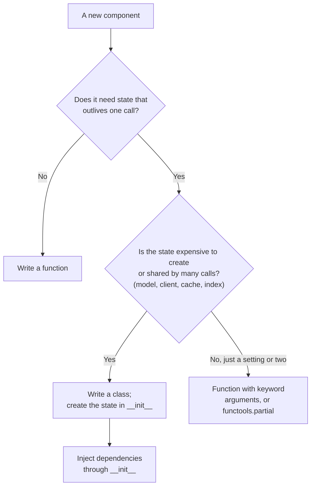

A RAG system is assembled from small, replaceable parts: a function that cleans text, another that chunks it, a component that embeds, another that searches, one that builds the prompt. In Python those parts are **functions** and **classes**. How you shape them decides whether you can swap the embedding model in an afternoon, test the retriever without a network connection, or cache the expensive calls without breaking anything.

This lesson covers both building blocks with a RAG engineer's priorities. For functions: how arguments are bound, how to design a signature that cannot be called wrongly, the default-value trap, scope, and functions as values that you can pass around, wrap and decorate. For classes: what a class actually is, how `self` works, the difference between class and instance attributes, and when a class is the right tool rather than a function. The next lesson, [OOP](/learn/python-for-rag-engineering/oop), builds on this with inheritance, abstract interfaces and composition.

## Learning objectives

- Design function signatures with keyword-only parameters and safe defaults, and explain why a mutable default is shared between calls.
- Use functions as values: pass a function as an argument, return one from another function, and explain what a closure captures.
- Write a decorator with `functools.wraps`, and use `functools.lru_cache` while avoiding its two common traps.
- Define a class with `__init__`, instance attributes, methods and `__repr__`, and distinguish instance attributes from class attributes.
- Decide whether a given RAG component should be a function or a class, and justify the choice.

## Prerequisites

- [Python fundamentals](/learn/python-for-rag-engineering/python-fundamentals): names and references, mutability and generators.
- [Embeddings](/learn/understanding-large-language-models/embeddings): what an embedding vector is, since the main example caches them.
- [Retrieval pipeline](/learn/rag-architecture-fundamentals/retrieval-pipeline): the embed, search and return steps the code imitates.

## Why this matters

Three problems that show up in almost every RAG codebase trace back to how functions and classes are written:

- **Functions that are easy to call wrongly.** `search("vpn", 5, True, None, "it")` compiles and runs. Which argument is `k`, which is the filter, and what does `True` switch on? When the signature is reordered during a refactor, every positional caller silently passes the wrong values.
- **State in the wrong place.** An embedding model takes seconds to load and hundreds of megabytes of memory. Code that loads it inside a function called per query is unusably slow; code that loads it in a module-level global is impossible to test without the model. A class that receives the model when it is created solves both.
- **Repeated expensive work.** Embedding the same popular question thousands of times a day costs latency and, with a hosted model, money. A cache is the obvious fix, and a careless cache (one that hands out mutable objects, or never forgets anything) creates subtle bugs and memory leaks.

## The intuition

A **function** is a recipe card with blanks: "boil `water` for `minutes` minutes". Each time you use the card you fill in the blanks, follow the steps and get a result. The card itself does not remember anything between uses. That makes functions easy to reason about and easy to test: same inputs, same output.

A **class** is a design for a kitchen station. Each station built from it (an **instance**, or object) has its own stock on the shelves (its **attributes**) and a set of procedures its cook can perform using that stock (its **methods**). Two stations built from the same design have separate shelves. You build a station when the work needs something that should be set up once and kept around: an oven that takes ten minutes to heat, a cache of things already prepared, a counter of how many dishes went out.

A **decorator** is a laminated sleeve you slide a recipe card into, with extra instructions printed on the sleeve: "start a timer before you begin, write down the time when you finish". The recipe inside is unchanged; the sleeve adds behaviour around it.

## How it works

### What happens when you call a function

`def` is an executable statement. When Python runs it, it creates a **function object** (holding the code, the default values and the function's name) and binds the name to it. Calling the function then proceeds like this:

1. Python evaluates the arguments in the call, left to right.
2. It creates a fresh **local namespace** for this call.
3. It binds each argument to a parameter name in that namespace: positional arguments first, then keyword arguments by name, then defaults for anything not supplied. A missing required parameter, or one supplied twice, raises `TypeError` before any of the body runs.
4. It runs the body. Names assigned inside the body are local to this call.
5. `return` hands a value back (a function with no `return` returns `None`), and the local namespace is discarded unless something still refers to it, which is how closures work (below).

Because arguments are bound like assignments, the rule from the fundamentals lesson applies: a function receives references, not copies. If you pass a list and the function appends to it, the caller's list changes.

### Designing a signature

Python offers several kinds of parameter. Used deliberately, they make wrong calls impossible rather than merely unlikely.

| Syntax | Kind | Use it for |
| --- | --- | --- |
| `def f(query)` | Positional or keyword | The one or two obvious inputs |
| `def f(query, k=5)` | With a default | Optional settings with a sensible value |
| `def f(query, *, k=5)` | Keyword-only (after `*`) | Settings; the caller must write `k=5` |
| `def f(text, /)` | Positional-only (before `/`) | Inputs whose parameter name is not part of the contract |
| `def f(*texts)` | Variable positional | Any number of extra positional arguments, gathered into a tuple |
| `def f(**options)` | Variable keyword | Any number of extra keyword arguments, gathered into a dict |

The most useful habit for RAG code is the bare `*`: put the main input first and make every tuning knob keyword-only. `retrieve("annual leave", k=3, min_score=0.2)` documents itself at the call site, and adding or reordering knobs later breaks no caller.

`*args` and `**kwargs` are mostly for code that forwards arguments it does not inspect, such as decorators (below). In ordinary functions they hide the real parameters from readers and tools, so prefer explicit names.

### Defaults are evaluated once

A default value is computed **once, when `def` runs**, and stored on the function object. Every call that omits the argument receives that same object. For immutable defaults (`5`, `"handbook"`, `None`) that is harmless. For a mutable default it is a bug:

```python
# 1. Default values are evaluated once, when def runs
def add_tag(tag, tags=[]):
    tags.append(tag)
    return tags

print(add_tag("leave"))
print(add_tag("vpn"))                     # surprise: the same list again
print(add_tag.__defaults__)

def add_tag_fixed(tag, tags=None):
    if tags is None:
        tags = []                         # a fresh list on every call
    tags.append(tag)
    return tags

print(add_tag_fixed("leave"), add_tag_fixed("vpn"))

# 2. Keyword-only parameters
def retrieve(query, *, k=5, min_score=0.0):
    return f"query={query!r} k={k} min_score={min_score}"

print(retrieve("annual leave", k=3))
try:
    retrieve("annual leave", 3)
except TypeError as e:
    print("TypeError:", e)
```

```output
['leave']
['leave', 'vpn']
(['leave', 'vpn'],)
['leave'] ['vpn']
query='annual leave' k=3 min_score=0.0
TypeError: retrieve() takes 1 positional argument but 2 were given
```

`add_tag.__defaults__` shows the shared list living on the function object. The fix is the `None` sentinel: default to `None` and create the fresh object inside the body. The same applies to `{}` and `set()` defaults, and to defaults computed from the clock (`created=datetime.now()` records the moment the module was imported, not the moment of the call).

### Scope: where names are looked up

When the body of a function uses a name, Python searches four places in order, known as **LEGB**:

1. **Local**: names assigned in this call.
2. **Enclosing**: names in any function this one is defined inside.
3. **Global**: names at the top level of the module.
4. **Built-in**: `len`, `print`, `sorted` and the rest.

Reading a global from inside a function works; *assigning* to a name inside a function makes it local unless you declare it `global` (or `nonlocal` for an enclosing function). Treat that as a warning sign. A function that reads module-level configuration or a module-level model has a hidden input: you cannot see it in the signature, and a test cannot replace it. Pass dependencies in as parameters, or give them to a class when it is created.

### Functions are values

A function is an ordinary object. You can store it in a variable, put it in a dict, pass it as an argument and return it from another function. That is how most configurable behaviour in RAG code is expressed:

- `sorted(results, key=lambda r: r[1], reverse=True)` passes a function that extracts the sort key. A **lambda** is a one-expression anonymous function; use it for short keys like this, and `def` for anything with a name worth reading.
- A retriever can take `embed_fn` as a parameter, so production passes a real model and a test passes a fake that returns fixed vectors.
- A dict such as `{"bm25": bm25_search, "dense": dense_search}` chooses a strategy by name from configuration.

A function defined inside another function can use the outer function's variables even after the outer function has returned. The inner function together with those captured variables is a **closure**:

```python
# 3. Closures: a function that remembers values from where it was made
def make_prefixer(prefix):
    def add_prefix(text):
        return prefix + text
    return add_prefix

as_query = make_prefixer("query: ")
as_passage = make_prefixer("passage: ")
print(as_query("how much leave?"), "|", as_passage("Annual leave is 25 days."))
print(as_query.__closure__[0].cell_contents)
```

```output
query: how much leave? | passage: Annual leave is 25 days.
query: 
```

This is a real pattern: some embedding models, such as the E5 family, expect inputs to start with `query: ` or `passage: `, and building one prefixing function per side keeps the two from being mixed up. Closures capture *variables*, not values: a closure created in a loop that refers to the loop variable sees its final value, a classic surprise. `functools.partial(fn, k=3)` is the standard-library way to pre-fill some arguments of an existing function without writing a closure by hand.

### Decorators

A **decorator** is a function that takes a function and returns a replacement, usually a wrapper that does something before and after calling the original. The `@` syntax is shorthand:

```python
@timed
def retrieve(...): ...
# means exactly:
def retrieve(...): ...
retrieve = timed(retrieve)
```

Inside a decorator, the wrapper takes `*args, **kwargs` and forwards them unchanged, so it works for any signature. Always decorate the wrapper with `@functools.wraps(fn)`, which copies the original's `__name__`, `__doc__` and other metadata onto the wrapper. Without it, every decorated function reports its name as `wrapper`, which ruins log messages, tracebacks and documentation.

The standard library ships a decorator every RAG engineer meets early: `functools.lru_cache(maxsize=N)` remembers the results of the last N distinct calls and returns the stored result when called with the same arguments again ("LRU" means least recently used: when full, it discards the entry that has gone unused longest). It has two traps, both demonstrated here:

```python
from functools import lru_cache

@lru_cache(maxsize=1024)
def query_terms(query):
    return query.lower().split()          # returns a mutable list

terms = query_terms("Annual Leave")
terms.append("holiday")                   # the caller "just adds a synonym"
print(query_terms("Annual Leave"))        # the cached value has changed
print(query_terms.cache_info())

try:
    query_terms(["annual", "leave"])
except TypeError as e:
    print("TypeError:", e)
```

```output
['annual', 'leave', 'holiday']
CacheInfo(hits=1, misses=1, maxsize=1024, currsize=1)
TypeError: unhashable type: 'list'
```

1. **It returns the same object every time.** A caller that mutates the result has modified the cache, and every later caller receives the modified version. Cache only immutable results (return a tuple, not a list), or copy on the way out.
2. **Arguments must be hashable**, because they become dictionary keys. A list or a NumPy array argument raises `TypeError`.

A third trap is less visible: `lru_cache` on a *method* includes `self` in the key, so the cache keeps every instance alive for as long as the function exists. For per-object caches, store a dict on the object, as the main example below does.

### Classes: state plus behaviour

A **class** is a template for objects. The `class` statement creates a class object; calling the class (`Chunk(...)`) creates a new **instance** and runs its `__init__` method to set it up. The step-by-step mechanism:

1. `Chunk("hr-001#0", "Annual leave ...")` creates an empty instance.
2. Python calls `Chunk.__init__(instance, "hr-001#0", "Annual leave ...")`. The first parameter, conventionally named `self`, is the new instance.
3. `__init__` assigns **instance attributes** such as `self.text = text`. These live in the instance's own namespace (its `__dict__`), separate for every instance.
4. Calling a method, `a.n_words()`, is translated into `Chunk.n_words(a)`: Python looks the method up on the class and passes the instance as `self`. There is no hidden magic beyond that.
5. Looking up `a.something` checks the instance's own attributes first, then the class.

That last rule creates the most common class bug. Attributes assigned in the class body, outside any method, are **class attributes**: one value stored on the class and shared by every instance.

```python
class Chunk:
    source_system = "handbook"     # class attribute: one value shared by all instances
    tags = []                      # a mutable class attribute: almost always a bug

    def __init__(self, chunk_id, text):
        self.chunk_id = chunk_id   # instance attributes: one per object
        self.text = text

    def n_words(self):
        return len(self.text.split())

    def __repr__(self):
        return f"Chunk({self.chunk_id!r}, {self.n_words()} words)"


a = Chunk("hr-001#0", "Annual leave is 25 days per year.")
b = Chunk("it-001#0", "VPN is required on public Wi-Fi.")
a.tags.append("leave")
print(a, b)
print(b.tags)                         # b sees a's tag: there is only one list
print(a.n_words() == Chunk.n_words(a))
print(vars(a))                        # the instance's own attributes
```

```output
Chunk('hr-001#0', 7 words) Chunk('it-001#0', 6 words)
['leave']
True
{'chunk_id': 'hr-001#0', 'text': 'Annual leave is 25 days per year.'}
```

`vars(a)` shows that `tags` is not on the instance at all; `a.tags` found the class's list. Immutable class attributes, like a constant `source_system`, are fine. Anything mutable and per-object belongs in `__init__`.

`__repr__` is one of Python's **special methods** (named with double underscores, often called "dunder" methods): Python calls it whenever it needs a developer-facing text version of the object, in the interactive prompt, in `print` of a list, and in debuggers. Define it on every class you write; the default, `<__main__.Chunk object at 0x10a3f...>`, tells you nothing when you are reading logs. The [OOP lesson](/learn/python-for-rag-engineering/oop) covers the other special methods, and [Dataclasses and Pydantic](/learn/python-for-rag-engineering/dataclasses-and-pydantic) shows how to have `__init__` and `__repr__` written for you.

### Function or class?

The two are not rivals. Most RAG code is functions, with classes where something must be set up once and kept.



| Component | Shape | Why |
| --- | --- | --- |
| Normalise whitespace in a string | Function | Pure transformation; no state |
| Split text into chunks of n tokens | Function (maybe a generator) | Settings are just arguments |
| Embedder wrapping a loaded model and a cache | Class | Expensive model, cache and counters persist between calls |
| Retriever holding an index and a client | Class | The index is built once and queried many times |
| Prompt template filler | Function | Inputs in, string out |

## The mathematics

### Expected latency with a cache

**Intuition.** A cache makes some requests very fast (hits) and leaves the rest as slow as before (misses). The average time per request is a weighted average of the two, weighted by how often each happens.

$$
\mathbb{E}[t] = h \cdot t_{\text{hit}} + (1 - h) \cdot t_{\text{miss}}
$$

$\mathbb{E}[t]$ is the expected (average) time per request; $h$ is the **hit rate**, the fraction of requests whose result is already in the cache, between 0 and 1; $t_{\text{hit}}$ is the time to serve a request from the cache; $t_{\text{miss}}$ is the time to compute it from scratch (here, a call to an embedding model).

**By hand.** Assume an embedding call takes 40 ms (an assumption for illustration; hosted latency varies by provider, region and load), a cache lookup takes 0.01 ms, and 30% of queries repeat an earlier one exactly. Then $\mathbb{E}[t] = 0.3 \times 0.01 + 0.7 \times 40 = 0.003 + 28 = 28.003$ ms. The cache saves 30% of the embedding time, no more: the miss term dominates, so the hit rate is what matters, not how fast the cache is.

**In Python:**

```python
def expected_latency(hit_rate, t_hit_ms, t_miss_ms):
    return hit_rate * t_hit_ms + (1 - hit_rate) * t_miss_ms

for h in (0.0, 0.3, 0.6, 0.9):
    print(f"hit rate {h:.0%}: {expected_latency(h, 0.01, 40):6.2f} ms")
```

```output
hit rate 0%:  40.00 ms
hit rate 30%:  28.00 ms
hit rate 60%:  16.01 ms
hit rate 90%:   4.01 ms
```

Exact-text caches only hit when a query repeats character for character, so real hit rates depend on your traffic; measure them rather than assume. Caching by meaning rather than exact text is [semantic caching](/learn/performance-optimisation/semantic-caching), a later topic.

## In code

**The problem.** Build a small retriever whose embedding step is cached, whose model can be swapped for a fake in tests, whose search settings cannot be passed in the wrong order, and whose calls are timed, all with plain functions and one class.

**Dependencies.** `sentence-transformers` (which installs PyTorch) and NumPy. The first run downloads the `all-MiniLM-L6-v2` model, about 90 MB.

```bash
pip install sentence-transformers numpy
```

```python
import functools
import time

import numpy as np
from sentence_transformers import SentenceTransformer


def timed(fn):
    """Decorator: print how long each call to fn takes."""
    @functools.wraps(fn)
    def wrapper(*args, **kwargs):
        start = time.perf_counter()
        result = fn(*args, **kwargs)
        print(f"  [{fn.__name__} took {(time.perf_counter() - start) * 1000:.2f} ms]")
        return result
    return wrapper


class CachedEmbedder:
    """Wraps any embedding function with an in-memory cache keyed by exact text."""

    def __init__(self, embed_fn, max_items=10_000):
        self._embed_fn = embed_fn          # injected: a real model, an API client or a fake
        self._cache = {}                   # text -> 1-D NumPy vector
        self.max_items = max_items
        self.hits = 0
        self.misses = 0

    def embed(self, texts):
        """Return one row per text, calling the model only for texts not yet cached."""
        missing = [t for t in dict.fromkeys(texts) if t not in self._cache]
        self.hits += len(texts) - len(missing)
        self.misses += len(missing)
        fresh = {}
        if missing:
            vectors = self._embed_fn(missing)          # one batched call for all misses
            fresh = dict(zip(missing, vectors, strict=True))
            for text, vec in fresh.items():
                if len(self._cache) < self.max_items:
                    self._cache[text] = vec
        # np.stack copies, so callers can never modify the cached vectors
        return np.stack([fresh[t] if t in fresh else self._cache[t] for t in texts])

    def __repr__(self):
        return f"CachedEmbedder(cached={len(self._cache)}, hits={self.hits}, misses={self.misses})"


@timed
def retrieve(query, chunk_ids, chunk_vectors, *, embedder, k=3):
    """Return the k chunk ids most similar to the query, with their scores."""
    q = embedder.embed([query])[0]
    scores = chunk_vectors @ q                   # vectors are unit length: dot = cosine
    best = np.argsort(-scores)[:k]
    return [(chunk_ids[i], round(float(scores[i]), 3)) for i in best]


chunks = {
    "leave":    "Annual leave is 25 days per year. Up to 5 unused days carry over to 31 March.",
    "remote":   "Staff may work remotely up to 3 days a week; the equipment budget is £400.",
    "expenses": "Expenses must be submitted within 30 days. Anything over £75 needs a receipt.",
    "password": "Passwords must be rotated every 90 days.",
    "vpn":      "VPN is required on public Wi-Fi.",
    "laptop":   "Laptops are refreshed every 3 years.",
}

model = SentenceTransformer("sentence-transformers/all-MiniLM-L6-v2")
embedder = CachedEmbedder(lambda texts: model.encode(texts, normalize_embeddings=True))

chunk_ids = list(chunks)
chunk_vectors = embedder.embed(list(chunks.values()))
print(chunk_vectors.shape, embedder)

for query in ["How many days of holiday do I get?",
              "Do I need a receipt for a £120 dinner?",
              "How many days of holiday do I get?"]:     # repeated on purpose
    print(query)
    print(" ", retrieve(query, chunk_ids, chunk_vectors, embedder=embedder, k=2))

print(embedder)
print(retrieve.__name__, "|", retrieve.__doc__)
```

The output below is from a real run on a laptop CPU. The scores will be identical on your machine up to the last digit or so; the timings will differ.

```output
(6, 384) CachedEmbedder(cached=6, hits=0, misses=6)
How many days of holiday do I get?
  [retrieve took 7.15 ms]
  [('leave', 0.477), ('remote', 0.287)]
Do I need a receipt for a £120 dinner?
  [retrieve took 6.34 ms]
  [('expenses', 0.618), ('remote', 0.186)]
How many days of holiday do I get?
  [retrieve took 0.01 ms]
  [('leave', 0.477), ('remote', 0.287)]
CachedEmbedder(cached=8, hits=1, misses=8)
retrieve | Return the k chunk ids most similar to the query, with their scores.
```

**The important lines.**

- `CachedEmbedder(lambda texts: model.encode(texts, normalize_embeddings=True))` is **dependency injection**: the class receives the function it should call rather than creating a model itself. The class does not know or care whether `embed_fn` is a local model, a hosted API or a fake. A unit test can pass `lambda texts: np.ones((len(texts), 384))` and run in milliseconds with no download.
- `self._cache = {}` inside `__init__` gives every embedder its own cache. Written in the class body, all embedders would share one. The leading underscore is a convention meaning "internal; do not touch from outside".
- `dict.fromkeys(texts)` removes repeated texts while keeping their order, so a batch containing the same text twice embeds it once.
- `vectors = self._embed_fn(missing)` makes **one batched call** for all the cache misses. Models and APIs process a batch far more efficiently than the same texts one at a time.
- `zip(missing, vectors, strict=True)` raises an error if the model returns a different number of vectors than texts sent, instead of silently mispairing them.
- `np.stack(...)` builds a new array, so a caller that modifies the result cannot corrupt the cache: the trap `lru_cache` fell into above.
- `if len(self._cache) < self.max_items` bounds memory. A cache without a bound is a memory leak with a delay.
- `*, embedder, k=3` in `retrieve` makes both keyword-only. `embedder` has no default, so it is a *required* keyword argument.
- `@timed` wraps `retrieve`; thanks to `functools.wraps`, `retrieve.__name__` and `retrieve.__doc__` still describe the original function.

**What the output means.** Indexing the six chunks costs six misses. The first two queries each miss once and take several milliseconds, almost all of it running the model. The repeated query is a hit and takes about a hundredth of a millisecond, the cost of a dictionary lookup and a 6 × 384 matrix product. The rankings are sensible: "holiday" finds the annual-leave chunk although the words differ, and the receipt question finds the expenses chunk. Notice the scores: 0.477 for a correct match is not "47.7% relevant"; it is a position on this model's own scale.

**Errors people commonly hit.**

- `TypeError: retrieve() missing 1 required keyword-only argument: 'embedder'` when calling without `embedder=`. That is the signature doing its job.
- Defining `embed` without `self` as its first parameter, then getting `TypeError: embed() takes 1 positional argument but 2 were given`: Python passed the instance plus your argument.
- Forgetting `functools.wraps`, so logs and profilers attribute every call to `wrapper`.
- Caching by a normalised key (for example lower-cased) while embedding the original text, so two different texts share one vector. Key the cache on exactly what you embed.

**Extending it.** Make the cache evict the least recently used entry when full (exercise 3); key it on `(model_name, text)` so that switching models cannot return stale vectors; and move the cache to Redis so that several server processes share it, which [Caching](/learn/performance-optimisation/caching) discusses.

## A real-world example

When Meridian's Platform team first wrote AskMeridian's retrieval service, the search entry point looked like this:

```python
def search(q, k=5, rerank=True, filters=None, collection="handbook"): ...
```

It was called from the web handler, the Slack bot and an evaluation script, all positionally: `search(question, 8, False, None, "runbooks")`. When Aisha added a `min_score` parameter, she put it after `k`, where it made sense to her. Every positional call now passed `rerank` into `min_score` and shifted the rest along. `False` is equal to 0 in Python, so the evaluation script's threshold became zero and its runbook collection name landed in `filters`. Nothing raised an error. The evaluation numbers moved slightly, and it took two days to work out why.

The team's fix was a signature rule: the query is the only positional parameter; everything else is keyword-only.

```python
def search(query, /, *, k=5, rerank=True, min_score=0.0, filters=None, collection="handbook"): ...
```

A second change followed from a load test. The handler created a new embedding model inside the request function, which took several seconds per request. Moving it into a `Retriever` class that loads the model once in `__init__`, created at application start-up and injected into the handlers, removed that cost entirely and gave the tests a place to inject a fake.

## Common mistakes

- **Mutable default arguments.** `def f(x, seen=set())` shares one set across every call, so state leaks between unrelated requests.
- **Positional settings.** Long positional signatures break silently when parameters are added or reordered. Make settings keyword-only.
- **Hidden global dependencies.** Functions that read a global model or config object cannot be tested in isolation and behave differently depending on import order.
- **Mutable class attributes.** A list or dict in the class body is shared by every instance; per-object state belongs in `__init__`.
- **Caches that hand out mutable objects.** A caller that edits a cached list or array corrupts every future result.
- **Unbounded caches.** A dict that is never pruned grows until the process is killed.
- **Decorators without `functools.wraps`.** Every function is reported as `wrapper` in logs and tracebacks.
- **Closures in loops.** Lambdas created in a loop all see the loop variable's final value. Bind it as a default argument or use `functools.partial`.

## Best practices

- Keep functions small and pure where you can: inputs in, output out, no side effects. They are trivial to test and to reuse.
- Put the main input first and make every option keyword-only with `*`.
- Use `None` as the default for anything mutable and create the real object inside the function.
- Inject dependencies (models, clients, stores) through parameters or `__init__`; create them once at start-up.
- Give every class a useful `__repr__`, and create all instance attributes in `__init__` so an object's shape is visible in one place.
- Write a docstring for every public function and class: one line saying what it returns, then anything surprising.
- Cache only deterministic, immutable results, bound the cache's size, and include everything that affects the result (such as the model name) in the key.

## Performance considerations

**Function calls are cheap; the work inside is not.** A Python function call costs on the order of tens of nanoseconds of overhead. Splitting code into small functions has no measurable cost next to an embedding call measured in milliseconds or a model call measured in seconds.

**Load once, use many times.** Loading `all-MiniLM-L6-v2` from disk takes on the order of a second or two and holds about 90 MB of weights in memory. Doing that per request would add that delay to every query; doing it once in `__init__` amortises it over the life of the process. The same applies to HTTP clients, which reuse connections between requests.

**Batch inside the class.** Sending 64 texts in one call costs far less than 64 calls, because per-call overhead (network round trip, tokenisation set-up, GPU kernel launches) is paid once. A class that collects misses and embeds them together, like `CachedEmbedder`, gets this for free.

**Cache memory is arithmetic.** Each cached 384-dimensional `float32` vector is $384 \times 4 = 1{,}536$ bytes of data, plus around 100 bytes of NumPy object overhead and the key string. A bound of 10,000 entries therefore costs roughly 16 to 20 MB, which is affordable; 10 million would not be.

## Security considerations

- **Cache keys can leak data across users.** If a cache stores *answers* keyed only by question text, one user can receive an answer generated from documents they are not allowed to see. Any cache downstream of access control must include the user's permissions (or tenant) in its key. Embedding caches are safer because a vector of a query reveals little, but the same reasoning applies to cached retrieval results.
- **Do not log full arguments in decorators.** A timing or logging decorator that prints `args` will write user questions, and possibly personal data or credentials passed as arguments, into log files.
- **Do not build functions from strings.** Choose behaviour from a fixed dict of functions (`{"bm25": bm25_search}`), never by evaluating a name supplied in a request.

## Summary

- Calling a function binds arguments to parameters in a fresh local namespace; functions receive references, not copies.
- Keyword-only parameters (after `*`) make settings self-documenting and immune to reordering; mutable defaults are created once and shared, so default to `None`.
- Functions are values: pass them in to make behaviour configurable, return them to build closures, and wrap them with decorators that use `functools.wraps`.
- `lru_cache` returns the same object every time and needs hashable arguments; cache only immutable results.
- A class bundles state with behaviour; instance attributes belong in `__init__`, and mutable class attributes are shared by every instance.
- Use functions by default and a class when something expensive must be created once and kept: a model, a client, a cache or an index.

## Exercises

**1.** Predict what this prints, then explain the fix.

```python
def record(event, log={}):
    log[event] = log.get(event, 0) + 1
    return log

record("query")
record("query")
print(record("click"))
```

<details><summary>Show solution</summary>

```output
{'query': 2, 'click': 1}
```

The default dict is created once when `def` runs and reused by every call that omits `log`, so counts accumulate across calls. If this were a per-request event log, every request would see every earlier request's events. Fix: `def record(event, log=None):` and `if log is None: log = {}` in the body. If accumulation across calls is actually wanted, make it explicit with a class that owns the dict.

</details>

**2.** Rewrite this signature so that the call below it is impossible and every setting must be named. Then explain what changes for existing callers.

```python
def build_prompt(question, chunks, max_chunks=5, cite=True, style="concise"): ...
build_prompt(q, retrieved, 3, False, "detailed")
```

<details><summary>Show solution</summary>

```python
def build_prompt(question, chunks, *, max_chunks=5, cite=True, style="concise"): ...
build_prompt(q, retrieved, max_chunks=3, cite=False, style="detailed")
```

The two real inputs remain positional; everything after `*` is keyword-only. Existing positional callers now fail immediately with `TypeError: build_prompt() takes 2 positional arguments but 5 were given`. That is the point: the breakage is loud and happens once, at the call site, instead of silently passing values into the wrong parameters after some future reorder. Fix each call site by naming the arguments.

</details>

**3.** Modify `CachedEmbedder` so that, when full, it evicts the least recently used entry instead of refusing new ones. Test it with a fake embedding function and `max_items=2`, and print the cache contents after each call for the sequence `["a b"], ["c"], ["a b"], ["d e f"], ["c"]`.

<details><summary>Show solution</summary>

`collections.OrderedDict` keeps entries in order and has `move_to_end` and `popitem(last=False)`, which are exactly the operations an LRU cache needs.

```python
from collections import OrderedDict

import numpy as np


class LRUEmbedder:
    def __init__(self, embed_fn, max_items=2):
        self._embed_fn = embed_fn
        self._cache = OrderedDict()          # oldest entry first
        self.max_items = max_items
        self.calls = 0                       # how many times the model was called

    def embed(self, texts):
        missing = [t for t in dict.fromkeys(texts) if t not in self._cache]
        if missing:
            self.calls += 1
            for text, vec in zip(missing, self._embed_fn(missing), strict=True):
                self._cache[text] = vec
        for t in texts:
            self._cache.move_to_end(t)       # mark as most recently used
        rows = np.stack([self._cache[t] for t in texts])
        while len(self._cache) > self.max_items:
            self._cache.popitem(last=False)  # evict the least recently used
        return rows


def fake_embed(texts):                       # deterministic stand-in for a model
    return [np.array([len(t), t.count(" ")], dtype=float) for t in texts]

e = LRUEmbedder(fake_embed, max_items=2)
for batch in (["a b"], ["c"], ["a b"], ["d e f"], ["c"]):
    e.embed(batch)
    print(batch, "cache:", list(e._cache), "model calls:", e.calls)
```

```output
['a b'] cache: ['a b'] model calls: 1
['c'] cache: ['a b', 'c'] model calls: 2
['a b'] cache: ['c', 'a b'] model calls: 2
['d e f'] cache: ['a b', 'd e f'] model calls: 3
['c'] cache: ['d e f', 'c'] model calls: 4
```

The third call is a hit and moves "a b" to the most recent end, so when "d e f" arrives it is "c" that is evicted, which is why the final "c" costs a model call. Rows are built before eviction so that a single batch larger than `max_items` still returns every vector.

</details>

**4.** Design decision. A teammate proposes a module `rerank.py` containing a global `MODEL = CrossEncoder(...)` loaded at import time and a function `rerank(query, chunks)` that uses it. List the problems with this design and sketch a better one.

<details><summary>Show solution</summary>

Problems: importing the module (including from a test, or from a script that only needs a helper in the same file) loads the model, which is slow and needs the weights to be present; tests cannot substitute a fake model without monkey-patching a global; the model choice is fixed in code, so evaluating a second reranker means editing the module; and there is no clear place for configuration such as batch size or device.

A better design is a class that receives what it needs when created:

```python
class Reranker:
    """Re-scores (query, chunk) pairs with a cross-encoder."""

    def __init__(self, score_pairs, *, batch_size=32):
        self._score_pairs = score_pairs      # e.g. CrossEncoder(name).predict, or a fake
        self.batch_size = batch_size

    def rerank(self, query, chunks, *, top_n=5):
        scores = self._score_pairs([(query, c) for c in chunks])
        ranked = sorted(zip(chunks, scores), key=lambda p: p[1], reverse=True)
        return ranked[:top_n]
```

The application creates one `Reranker(CrossEncoder(name).predict)` at start-up and passes it to whatever needs it; tests pass `Reranker(lambda pairs: [len(c) for _, c in pairs])`. Cross-encoders themselves are covered in [Cross-encoders](/learn/reranking-fundamentals/cross-encoders).

</details>

## Check your understanding

```quiz
[
  {
    "q": "What does this print?\n```python\ndef f(x, acc=[]):\n    acc.append(x)\n    return len(acc)\n\nf(1); f(2)\nprint(f(3))\n```",
    "options": ["1", "3", "0", "It raises TypeError"],
    "answer": 1,
    "why": "The default list is created once and shared by every call that omits acc, so it holds three items by the third call."
  },
  {
    "q": "Given `def retrieve(query, *, k=5): ...`, which call is valid?",
    "options": ["retrieve(\"vpn\", 3)", "retrieve(k=3)", "retrieve(\"vpn\", k=3)", "retrieve(3, \"vpn\")"],
    "answer": 2,
    "why": "Parameters after the bare * are keyword-only, so k must be passed by name; query is required."
  },
  {
    "q": "A function decorated with @lru_cache returns a list. A caller appends to the returned list. What happens on the next call with the same argument?",
    "options": ["The function runs again because the list changed", "A copy of the original list is returned", "lru_cache raises an error about mutation", "The modified list is returned, because the cache stores that same object"],
    "answer": 3,
    "why": "lru_cache returns the identical object it stored, so mutations by any caller are seen by every later caller."
  },
  {
    "q": "In a class body you write `cache = {}` (outside any method). What is true?",
    "options": ["Every instance shares one dict unless it assigns its own self.cache", "Each instance gets its own empty dict automatically", "The dict is recreated on every method call", "It is a syntax error outside __init__"],
    "answer": 0,
    "why": "Assignments in the class body create class attributes, stored once on the class and found by attribute lookup from every instance."
  },
  {
    "q": "Which component is the strongest candidate for a class rather than a function?",
    "options": ["A function that collapses whitespace in a string", "An embedder that loads a model and keeps a cache of vectors", "A function that formats retrieved chunks into a prompt", "A function that counts the tokens in a string"],
    "answer": 1,
    "why": "It has expensive state (the model) and state that persists between calls (the cache), which is exactly what a class is for."
  }
]
```

## Further reading

- The Python Tutorial, section 4.8 ("More on defining functions") and chapter 9 ("Classes"), [docs.python.org/3/tutorial](https://docs.python.org/3/tutorial/).
- The `functools` module documentation (`wraps`, `lru_cache`, `partial`), [docs.python.org/3/library/functools.html](https://docs.python.org/3/library/functools.html).
- PEP 3102, "Keyword-Only Arguments" (Talin, 2006), and PEP 570, "Python Positional-Only Parameters" (Hastings and others, 2018), [peps.python.org](https://peps.python.org/).
- PEP 318, "Decorators for Functions and Methods" (Smith and others, 2003), [peps.python.org/pep-0318](https://peps.python.org/pep-0318/).
- Luciano Ramalho (2022), *Fluent Python*, 2nd edition, O'Reilly: chapter 7 (functions as first-class objects) and chapter 9 (decorators and closures).
