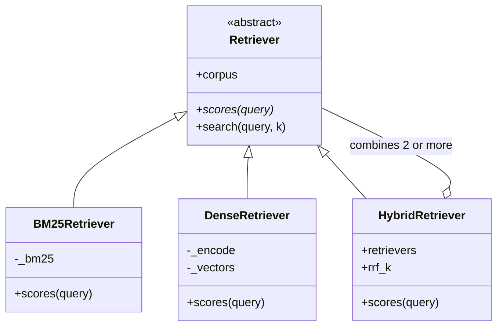

Every serious RAG system ends up with several things that do the same job in different ways: two or three retrievers, a couple of embedding models, a reranker that can be switched off, a real language model in production and a fake one in tests. **Object-oriented programming** (OOP) is the set of techniques for organising code around that situation: define what a component must do once, write several interchangeable implementations, and let the rest of the system use whichever one it is given without caring which.

[Functions and classes](/learn/python-for-rag-engineering/functions-and-classes) showed what a class is and how `self` works. This lesson is about using classes *together*: encapsulation with properties, inheritance and `super()`, abstract base classes that define a contract, polymorphism and duck typing, the special methods that make your objects behave like built-in types, and composition, the technique that usually beats inheritance. The running example is a family of retrievers (BM25, dense and a hybrid of the two) that all answer to the same `search` call.

## Learning objectives

- Define an abstract base class with `abc.ABC` and `@abstractmethod`, and explain what Python enforces and what it does not.
- Implement subclasses that reuse shared behaviour through inheritance and `super()`, and read a class's method resolution order.
- Make a class behave like a built-in container or value by implementing `__len__`, `__iter__`, `__getitem__`, `__contains__`, `__eq__` and `__hash__` correctly.
- Use a property and a `classmethod` alternative constructor to control how objects are read and created.
- Choose between inheritance and composition for a given RAG component and justify the choice.

## Prerequisites

- [Functions and classes](/learn/python-for-rag-engineering/functions-and-classes): `__init__`, `self`, instance and class attributes, dependency injection.
- [Query-document matching](/learn/rag-architecture-fundamentals/query-document-matching): lexical and semantic matching, which the example retrievers implement.
- [Retrieval pipeline](/learn/rag-architecture-fundamentals/retrieval-pipeline): where retrievers sit in the system.

## Why this matters

Imagine AskMeridian's code without these techniques. The web handler calls `bm25_search(index, query, 5)`. An experiment adds `dense_search(model, vectors, query, top=5)`, with different argument names and a different return format. A third developer adds `hybrid(index, model, vectors, query)`. Now every caller (the web handler, the Slack bot, the evaluation script) contains an `if` chain choosing between them, and every new retriever means editing every caller. Results come back as lists of tuples in one place and dicts in another, so a bug in one formatter appears only when one particular retriever is configured.

The object-oriented answer is a **contract**: every retriever is an object with a `search(query, k)` method that returns the same shape. Callers depend on the contract, not on any particular retriever. Adding a retriever means writing one new class; swapping one means changing one line of configuration; testing a caller means handing it a fake that honours the contract. This is the single most valuable structural idea in RAG engineering code, and frameworks such as LangChain and LlamaIndex are built on it (their `BaseRetriever` classes are exactly this pattern).

## The intuition

Think of the electrical sockets in a building. The socket is a contract: a shape, a voltage and a frequency. A kettle, a laptop charger and a lamp each implement that contract in their own way, and the wiring in the walls neither knows nor cares which one is plugged in. That is **polymorphism**: one interface, many implementations, chosen at the moment of use.

Inheritance and composition are two ways of building a new appliance. **Inheritance** says "a travel kettle *is a* kettle, with these differences": it starts from an existing design and modifies it. **Composition** says "a coffee machine *has a* kettle and *has a* grinder": it builds something new out of whole parts that keep their own designs. Inheritance is convenient when the new thing really is a variation of the old one. Composition is more flexible, because parts can be swapped independently, and it is what experienced engineers reach for first.

## How it works

### Encapsulation: controlling access to state

**Encapsulation** means an object keeps its internal state behind a small set of operations, so callers cannot put it into an invalid condition. Python does not enforce privacy. It relies on conventions:

- A single leading underscore (`self._vectors`) means "internal; not part of the public interface". Nothing stops access, but linters warn and readers understand.
- A double leading underscore (`self.__secret`) triggers **name mangling**: Python renames it to `_ClassName__secret`, which avoids accidental clashes in subclasses. It is not security, and it is rarely needed.

To expose a value without letting callers replace it, use a **property**: a method that is read like an attribute. Without a setter, assignment fails.

```python
class ChunkRef:
    """Identifies one chunk of one version of one document."""

    def __init__(self, doc_id, version, chunk_no):
        self._key = (doc_id, version, chunk_no)

    @property
    def doc_id(self):                 # read-only: there is no setter
        return self._key[0]

    def __eq__(self, other):
        if not isinstance(other, ChunkRef):
            return NotImplemented
        return self._key == other._key

    def __hash__(self):               # equal objects must have equal hashes
        return hash(self._key)

    def __repr__(self):
        return f"ChunkRef{self._key}"


a = ChunkRef("hr-handbook", 3, 0)
b = ChunkRef("hr-handbook", 3, 0)
print(a == b, a is b, len({a, b}))
print(a.doc_id)
try:
    a.doc_id = "it-runbook"
except AttributeError as e:
    print("AttributeError:", e)


class NoHash:
    def __init__(self, k):
        self.k = k
    def __eq__(self, other):
        return self.k == other.k

try:
    {NoHash(1)}
except TypeError as e:
    print("TypeError:", e)
```

```output
True False 1
hr-handbook
AttributeError: property 'doc_id' of 'ChunkRef' object has no setter
TypeError: cannot use 'NoHash' as a set element (unhashable type: 'NoHash')
```

Properties also let you start with a plain attribute and later turn it into a computed or validated value without changing any caller, which is why Python code does not need Java-style `get_x()` methods.

### Special methods: making objects behave like built-ins

Python's syntax and built-in functions are implemented by calling **special methods** on objects. Implement the method and your object joins in:

| You write | Python calls | Implement it to make your object |
| --- | --- | --- |
| `len(corpus)` | `corpus.__len__()` | Have a size |
| `corpus[0]` | `corpus.__getitem__(0)` | Indexable |
| `for c in corpus` | `corpus.__iter__()` | Iterable |
| `"vpn-err" in corpus` | `corpus.__contains__("vpn-err")` | Support membership tests |
| `a == b` | `a.__eq__(b)` | Comparable by value |
| `{a}`, `d[a]` | `a.__hash__()` | Usable in sets and as dict keys |
| `repr(a)` | `a.__repr__()` | Readable in logs and debuggers |

The equality and hashing pair has a rule that the `ChunkRef` example demonstrates: **objects that compare equal must have equal hashes**. Python enforces half of it: a class that defines `__eq__` without `__hash__` has its hash set to `None`, so its instances cannot go into sets or be dict keys, as `NoHash` shows. The safe way to honour the rule is to compute both from the same immutable tuple, as `ChunkRef` does with `self._key`. Do not make objects hashable if the fields used in `__eq__` can change after creation: an object whose hash changes while it is inside a set becomes impossible to find.

Returning `NotImplemented` (a special constant, not an exception) from `__eq__` tells Python "I do not know how to compare with that type"; Python then tries the other operand and finally falls back to identity, so `ChunkRef(...) == "hr-handbook"` is simply `False`.

### Inheritance and `super()`

A **subclass** is declared with the base class in parentheses: `class BM25Retriever(Retriever)`. It inherits every attribute and method of its base, and can **override** any of them by defining a method with the same name. Inside an override, `super().method(...)` calls the next implementation along, usually the base class's, which lets a subclass extend behaviour rather than replace it. The most common use is in `__init__`:

```python
class BM25Retriever(Retriever):
    def __init__(self, corpus):
        super().__init__(corpus)          # let the base set up what it owns
        self._bm25 = ...                  # then add what this subclass needs
```

When a class has several bases, Python needs a rule for which version of a method wins. It computes a **method resolution order** (MRO), a single list of classes, using an algorithm called C3 linearisation. Its guarantees are that a class comes before its bases and that the order in which you listed the bases is preserved. `super()` means "the next class in the MRO of the object", not "my parent", which matters as soon as there is more than one base:

```python
class Base:
    def describe(self):
        return ["Base"]

class Logged(Base):
    def describe(self):
        return ["Logged"] + super().describe()

class Cached(Base):
    def describe(self):
        return ["Cached"] + super().describe()

class Service(Logged, Cached):
    def describe(self):
        return ["Service"] + super().describe()

print(Service().describe())
print([c.__name__ for c in Service.__mro__])
```

```output
['Service', 'Logged', 'Cached', 'Base']
['Service', 'Logged', 'Cached', 'Base', 'object']
```

`Logged`'s `super()` call went to `Cached`, a class `Logged` knows nothing about, because that is next in `Service`'s MRO. This cooperative behaviour is powerful and easy to get wrong; most RAG code should avoid multiple inheritance except for small "mixin" classes that add one independent capability.

### Abstract base classes: writing down the contract

An **abstract base class** (ABC) defines an interface that subclasses must fill in. In Python you inherit from `abc.ABC` and mark the methods every subclass must provide with `@abstractmethod`:

```python
from abc import ABC, abstractmethod

class Retriever(ABC):
    @abstractmethod
    def scores(self, query):
        """Return one relevance score per chunk, in corpus order."""

    def search(self, query, k=3):
        ...  # concrete: written once, shared by all subclasses, uses self.scores()
```

What Python enforces:

1. You cannot instantiate a class that still has abstract methods. `Retriever(corpus)` raises `TypeError` at creation time, as does a subclass that forgot to implement `scores`. The mistake surfaces when the object is built, not halfway through a request.
2. `isinstance(obj, Retriever)` is true for every subclass, so code can check that it was handed something that claims the contract.

What Python does *not* enforce: the signature of the override or the type it returns. A subclass whose `scores` takes different arguments or returns a dict will be accepted until it is called. Static type checkers close that gap (see [Type hints](/learn/python-for-rag-engineering/type-hints)).

An ABC can mix abstract and concrete methods. This is the **template method** pattern: the base class implements the algorithm (`search` sorts scores and formats results) and delegates one step (`scores`) to subclasses. Every retriever then returns results in exactly the same format, because only one piece of code produces that format.

### Polymorphism and duck typing

**Polymorphism** means calling the same method on objects of different classes and getting each class's own behaviour. A loop `for r in (bm25, dense, hybrid): r.search(q)` runs three different algorithms through one line.

Python does not actually require a shared base class for this. Any object with a suitable `search` method works, a style called **duck typing** ("if it walks like a duck and quacks like a duck"). The ABC adds two things duck typing lacks: an early error when a method is missing, and a single place that documents the contract. The type-hints lesson introduces a third option, `typing.Protocol`, which describes the contract for static checkers without requiring inheritance at all. The three approaches compared:

| Approach | Requires inheritance | Checked when | Good for |
| --- | --- | --- | --- |
| Duck typing | No | When the method is called | Small scripts; quick fakes |
| ABC | Yes | When an object is created | Your own family of components with shared code |
| Protocol | No | By a static type checker, before running | Accepting third-party objects you cannot change |

### Composition: building from parts

**Composition** means an object holds other objects and delegates work to them. A hybrid retriever is not a special kind of BM25 retriever, nor a special kind of dense retriever; it *has* one of each and combines their output. Written by composition, it works with *any* two retrievers, including ones written next year.



The diagram shows both relationships: the hollow-triangle arrows are inheritance ("is a"), and the diamond is composition ("has"). The hybrid both *is* a retriever (so it can be used anywhere one is expected) and *has* retrievers. That combination, where a wrapper honours the same interface as the parts it wraps, is extremely common: rerankers, caches, permission filters and logging layers are all naturally written this way.

The rule of thumb "favour composition over inheritance" comes from the classic *Design Patterns* book (Gamma, Helm, Johnson and Vlissides, 1994). The reasons are practical. Deep inheritance chains spread one behaviour across many files, a change to a base class ripples into every subclass, and you cannot combine two variations (a cached *and* logged *and* filtered retriever) without an explosion of subclasses. Wrappers compose freely: `Logged(Cached(Filtered(bm25)))`.

### Alternative constructors and static methods

A **classmethod** receives the class itself (conventionally `cls`) instead of an instance. Its standard use is an **alternative constructor**: another way to build an object, such as `Corpus.from_lines(lines)` or `Corpus.from_jsonl(path)`. Because it calls `cls(...)` rather than naming the class, it also builds the right type when called on a subclass. A **staticmethod** receives neither and is just a function that lives in the class's namespace; a module-level function is usually clearer.

## In code

**The problem.** Build three interchangeable retrievers over the same Meridian corpus (lexical BM25, dense embeddings, and a hybrid that fuses them) behind one abstract contract, plus a corpus class that behaves like a Python sequence. Then run the same queries through all three with one loop.

**Dependencies.** `rank-bm25` for BM25 scoring, `sentence-transformers` for embeddings, NumPy. The first run downloads the `all-MiniLM-L6-v2` model (about 90 MB).

```bash
pip install rank-bm25 sentence-transformers numpy
```

```python
import re
from abc import ABC, abstractmethod

import numpy as np
from rank_bm25 import BM25Okapi
from sentence_transformers import SentenceTransformer


class Corpus:
    """An ordered, read-only collection of chunks that behaves like a Python sequence."""

    def __init__(self, chunks):
        self._ids = list(chunks)
        self._texts = [chunks[i] for i in self._ids]

    @classmethod
    def from_lines(cls, lines):
        """Alternative constructor: 'id | text' lines."""
        pairs = (line.split(" | ", 1) for line in lines if line.strip())
        return cls({cid.strip(): text.strip() for cid, text in pairs})

    def __len__(self):
        return len(self._ids)

    def __getitem__(self, i):
        return self._ids[i], self._texts[i]

    def __iter__(self):
        return iter(zip(self._ids, self._texts))

    def __contains__(self, chunk_id):
        return chunk_id in self._ids

    @property
    def texts(self):
        return tuple(self._texts)          # a read-only view for callers

    def __repr__(self):
        return f"Corpus({len(self)} chunks)"


class Retriever(ABC):
    """The contract every retriever honours: search(query, k) -> [(chunk_id, score)]."""

    def __init__(self, corpus):
        self.corpus = corpus

    @abstractmethod
    def scores(self, query):
        """Return one relevance score per chunk, in corpus order."""

    def search(self, query, k=3):           # shared behaviour, written once
        s = np.asarray(self.scores(query), dtype=float)
        best = np.argsort(-s, kind="stable")[:k]
        return [(self.corpus[i][0], round(float(s[i]), 4)) for i in best]

    def __repr__(self):
        return f"{type(self).__name__}({self.corpus!r})"


def tokenise(text):
    return re.findall(r"[a-z0-9]+", text.lower())


class BM25Retriever(Retriever):
    def __init__(self, corpus):
        super().__init__(corpus)
        self._bm25 = BM25Okapi([tokenise(t) for t in corpus.texts])

    def scores(self, query):
        return self._bm25.get_scores(tokenise(query))


class DenseRetriever(Retriever):
    def __init__(self, corpus, encode):
        super().__init__(corpus)
        self._encode = encode                       # injected embedding function
        self._vectors = encode(list(corpus.texts))

    def scores(self, query):
        return self._vectors @ self._encode([query])[0]


class HybridRetriever(Retriever):
    """Composition: owns two retrievers and fuses their rankings (reciprocal rank fusion)."""

    def __init__(self, corpus, *retrievers, rrf_k=60):
        super().__init__(corpus)
        self.retrievers = retrievers
        self.rrf_k = rrf_k

    def scores(self, query):
        fused = np.zeros(len(self.corpus))
        for r in self.retrievers:
            order = np.argsort(-np.asarray(r.scores(query), dtype=float), kind="stable")
            for rank, i in enumerate(order, start=1):
                fused[i] += 1 / (self.rrf_k + rank)
        return fused


corpus = Corpus.from_lines("""
leave    | Annual leave is 25 days per year; up to 5 unused days carry over to 31 March.
remote   | Staff may work remotely up to 3 days a week.
expenses | Expenses must be submitted within 30 days; anything over £75 needs a receipt.
vpn-err  | Error E-4021: the VPN client is out of date. Update it from the IT portal.
vpn-cert | Error E-4012: the VPN certificate has expired. Reinstall it from the IT portal.
laptop   | Laptops are refreshed every 3 years.
""".splitlines())
print(corpus, len(corpus), "vpn-err" in corpus, corpus[0][0])

model = SentenceTransformer("sentence-transformers/all-MiniLM-L6-v2")
encode = lambda texts: model.encode(texts, normalize_embeddings=True)

bm25 = BM25Retriever(corpus)
dense = DenseRetriever(corpus, encode)
hybrid = HybridRetriever(corpus, bm25, dense)

for query in ["How much holiday do I get?", "What does E-4021 mean?"]:
    print(f"\n{query}")
    for r in (bm25, dense, hybrid):            # polymorphism: one call, three behaviours
        print(f"  {type(r).__name__:<16}{r.search(query, k=2)}")

print()
print(HybridRetriever.__mro__)
print(isinstance(hybrid, Retriever))
try:
    Retriever(corpus)
except TypeError as e:
    print("TypeError:", e)
```

```output
Corpus(6 chunks) 6 True leave

How much holiday do I get?
  BM25Retriever   [('leave', 0.0), ('remote', 0.0)]
  DenseRetriever  [('leave', 0.3628), ('expenses', 0.3193)]
  HybridRetriever [('leave', 0.0328), ('remote', 0.032)]

What does E-4021 mean?
  BM25Retriever   [('vpn-err', 1.6873), ('vpn-cert', 0.5612)]
  DenseRetriever  [('vpn-err', 0.4196), ('vpn-cert', 0.2713)]
  HybridRetriever [('vpn-err', 0.0328), ('vpn-cert', 0.0323)]

(<class '__main__.HybridRetriever'>, <class '__main__.Retriever'>, <class 'abc.ABC'>, <class 'object'>)
True
TypeError: Can't instantiate abstract class Retriever without an implementation for abstract method 'scores'
```

**The important lines.**

- `Corpus` implements `__len__`, `__getitem__`, `__iter__` and `__contains__`, so `len(corpus)`, `corpus[0]`, `for ... in corpus` and `"vpn-err" in corpus` all work as they would on a list. The `texts` property returns a tuple, so callers cannot append to the corpus's internal list.
- `Corpus.from_lines` is an alternative constructor. It parses, then calls `cls(...)`, so the ordinary `__init__` still does the actual set-up.
- `Retriever.search` is the template method. Sorting, cutting to `k` and formatting live here once; subclasses only implement `scores`. `kind="stable"` makes ties keep corpus order, so results are reproducible.
- Each subclass calls `super().__init__(corpus)` before adding its own state. Forgetting it leaves `self.corpus` unset, and the failure appears later, in `search`.
- `DenseRetriever` receives `encode` rather than a model name: the same dependency injection as in the previous lesson, so a test can pass a fake encoder.
- `HybridRetriever(corpus, bm25, dense)` is composition. It calls each part's `scores`, converts the scores to ranks, and adds $\frac{1}{60 + \text{rank}}$ for each ranking, a method called reciprocal rank fusion that [Reciprocal rank fusion](/learn/hybrid-search/reciprocal-rank-fusion) explains properly. Because it only relies on the `Retriever` contract, it would fuse any retrievers you give it.

**What the output means.**

- "How much holiday do I get?" shares no word with any chunk, so BM25 scores every chunk 0.0. Its "ranking" is just corpus order, and `leave` coming first is an accident of where it sits in the list. The dense retriever genuinely finds the leave chunk. The hybrid also puts `leave` first, but look at why: `leave` is first in both rankings (once by accident, once on merit). In second place, `remote` (BM25 rank 2, dense rank 3) and `expenses` (BM25 rank 3, dense rank 2) receive exactly the same fused score, and the stable sort breaks the tie by corpus order. When one retriever has no signal, fusing it in adds noise. That is a retrieval lesson, but OOP made it cheap to see: three retrievers, one loop, identical output format.
- For "What does E-4021 mean?", BM25 separates the two VPN error chunks decisively (1.69 against 0.56) because "4021" is a rare exact term. The dense retriever also gets it right here, by a smaller margin. Both agree, so the hybrid does too.
- The MRO shows that `HybridRetriever` inherits from `Retriever`, which inherits from `ABC`. `Retriever(corpus)` fails at construction because `scores` is abstract.

**Errors people commonly hit.**

- `TypeError: Can't instantiate abstract class BM25Retriever without an implementation for abstract method 'scores'`: a typo in the method name (`score` instead of `scores`) means the abstract method was never overridden.
- `AttributeError: 'DenseRetriever' object has no attribute 'corpus'`: the subclass's `__init__` did not call `super().__init__`.
- A subclass returning a list of `(id, score)` pairs from `scores` instead of one score per chunk. Python accepts it; NumPy then produces nonsense or an error inside `search`. A type annotation on the abstract method lets a checker catch this.
- Implementing `__eq__` on a class used as a dict key and forgetting `__hash__`, which makes it unhashable.

**Extending it.** Add a `PermissionFilteredRetriever` wrapper (exercise 2), a `CachedRetriever` wrapper that memoises `scores` by query, and a `FakeRetriever(scores_by_query)` for unit tests of code that consumes retrievers.

## A real-world example

When AskMeridian added a reranking stage, the first implementation was inheritance: `RerankedDenseRetriever(DenseRetriever)`, which overrode `search` to call the parent and then rescore. It worked. Two months later the team wanted reranking on the BM25 retriever for the runbook collection, so someone wrote `RerankedBM25Retriever(BM25Retriever)`, copying the reranking code. Then a request arrived to add a permissions filter to both. The class list was heading for `FilteredRerankedDenseRetriever`, with every combination needing its own class and each copy of the reranking code drifting slightly from the others. A bug fix to score normalisation was applied to one copy and not the other.

Ravi, who owned the retrieval service, refactored to composition. `Retriever` stayed the abstract contract. Reranking became `RerankingRetriever(inner, reranker, candidates=50)`, which asks any inner retriever for 50 candidates and rescores them. Filtering became `FilteredRetriever(inner, policy)`. The production stack became a configuration expression, `FilteredRetriever(RerankingRetriever(HybridRetriever(bm25, dense), reranker), policy)`, and the evaluation script could test each layer in isolation by wrapping a `FakeRetriever`. The number of retriever classes went down, and the duplicated reranking code disappeared. The design rule the team wrote down: subclass only to implement the contract; add behaviour by wrapping.

## Common mistakes

- **Deep inheritance for combinations of features.** Each new combination needs a new subclass, and shared logic gets copied between them. Use wrappers that honour the same interface.
- **Forgetting `super().__init__()`.** Attributes the base class sets up are missing, and the error appears far from the cause.
- **Defining `__eq__` without `__hash__`, or hashing mutable fields.** The first makes objects unhashable; the second makes them vanish from sets and dicts after they change.
- **Overriding a method with a different signature.** Callers written against the base class break only when they meet that subclass.
- **Using inheritance to share a helper function.** If a subclass relationship exists only to reuse one function, make it a module-level function instead.
- **Treating underscore attributes as private.** They are a convention; code (and tests) that reach into `_internals` couple themselves to implementation details that will change.
- **Abstract classes with nothing abstract.** A base class that every caller instantiates directly is not a contract; it is a concrete class with confusing inheritance.

## Best practices

- Define one small abstract contract per kind of component (retriever, embedder, reranker, generator) and make callers depend on it, not on concrete classes.
- Keep the contract minimal: one or two abstract methods, with shared behaviour implemented once in the base as template methods.
- Add cross-cutting behaviour (caching, logging, filtering, reranking) as wrappers that implement the same contract, so they stack in any order.
- Write a fake implementation of each contract for tests; if writing the fake is hard, the contract is too big.
- Implement `__repr__` everywhere and the container methods where an object genuinely is a collection.
- Derive `__eq__` and `__hash__` from one immutable tuple of fields, or let a frozen dataclass generate them (next lesson but one).

## Performance considerations

**Method calls are not a bottleneck.** An attribute lookup through an MRO and a method call cost tens of nanoseconds. Three layers of wrappers around a retriever add well under a microsecond, against a search that takes milliseconds.

**Where wrappers do cost, they cost multiplicatively.** A reranking wrapper that requests 50 candidates from an inner hybrid retriever makes the inner layer do more work than `k=5` would. Composition makes the stack easy to build; you still have to reason about what each layer asks of the one below. For example, cross-encoder reranking of 50 candidates is 50 model evaluations per query, ten times the work of reranking 5.

**Python-level loops in hot paths.** `HybridRetriever.scores` loops over every chunk in Python for each retriever. For six chunks that is nothing; for a million it is about a million interpreted iterations per retriever, on the order of a second. Real hybrid search fuses only the top candidates from each retriever (say 100 each), which is what [Hybrid retrieval architecture](/learn/hybrid-search/hybrid-retrieval-architecture) describes.

**Memory per object.** Every instance has a `__dict__` of its attributes, roughly a hundred bytes or more. That is irrelevant for a handful of retriever objects and significant for millions of small chunk objects, where `__slots__` (or a dataclass with `slots=True`) removes the per-instance dict.

## Security considerations

Wrappers are a good place to enforce rules that every request must pass, and a dangerous place to get the order wrong.

- **Permission filtering must happen before results leave the retrieval layer**, and ideally inside the store's query as a filter, so that restricted chunks never become candidates. A filter applied *after* top-k can leave the user with fewer results; a filter applied after generation is too late, because the model has already read the text. [Document-level permissions](/learn/access-control-and-privacy/document-level-permissions) covers the full design.
- **Do not let configuration choose arbitrary classes.** Building components from a config file is common; map names to an allow-list of classes (`{"bm25": BM25Retriever}`) rather than importing whatever class name the config contains.

## Summary

- An abstract base class (`abc.ABC` plus `@abstractmethod`) writes down a contract; Python refuses to create objects that do not implement it, but does not check signatures or return types.
- Inheritance reuses and overrides behaviour; `super()` follows the method resolution order, which is not always "the parent".
- Special methods let objects work with `len`, indexing, iteration, `in`, `==` and hashing; equal objects must hash equally, and hashed fields must not change.
- Properties expose state read-only or computed; classmethods provide alternative constructors.
- Polymorphism lets one call run many implementations; composition, wrapping objects that honour the same contract, combines behaviours without a subclass for every combination.

## Exercises

**1.** Predict the output, then check the MRO by hand.

```python
class A:
    def name(self): return "A"
class B(A):
    def name(self): return "B>" + super().name()
class C(A):
    def name(self): return "C>" + super().name()
class D(C, B):
    pass
print(D().name())
```

<details><summary>Show solution</summary>

```output
C>B>A
```

`D` defines no `name`, so lookup follows `D.__mro__`, which is `D, C, B, A, object`: `D` first, then its bases in the order listed (`C` before `B`), with the shared base `A` after both. `C.name` runs first; its `super()` is the next class in `D`'s MRO, which is `B`, not `A`; `B`'s `super()` is `A`.

</details>

**2.** Write a `PermissionFilteredRetriever` that wraps any `Retriever` and only ever returns chunks whose ids are in an allowed set. It must itself be a `Retriever`. Test it on the lesson's corpus with HR chunks allowed (`leave`, `remote`, `expenses`) and an IT query.

<details><summary>Show solution</summary>

```python
class PermissionFilteredRetriever(Retriever):
    """Wraps any retriever and removes chunks the caller may not see."""

    def __init__(self, inner, allowed_ids):
        super().__init__(inner.corpus)
        self.inner = inner
        self.allowed = frozenset(allowed_ids)

    def scores(self, query):
        s = np.asarray(self.inner.scores(query), dtype=float)
        for i, (chunk_id, _) in enumerate(self.corpus):
            if chunk_id not in self.allowed:
                s[i] = -np.inf                   # can never be ranked
        return s

    def search(self, query, k=3):
        return [(cid, sc) for cid, sc in super().search(query, k) if sc != float("-inf")]


hr_only = PermissionFilteredRetriever(BM25Retriever(corpus), {"leave", "remote", "expenses"})
print(hr_only)
print(hr_only.search("What does E-4021 mean?", k=3))
print(hr_only.search("expenses receipt", k=5))
```

```output
PermissionFilteredRetriever(Corpus(6 chunks))
[('leave', 0.0), ('remote', 0.0), ('expenses', 0.0)]
[('expenses', 2.5682), ('leave', 0.0), ('remote', 0.0)]
```

The IT chunks can never appear: their scores are set to minus infinity and stripped from the results, so even `k=5` returns only the three allowed chunks. Note what the output also reveals: with the IT chunks removed, the IT query returns HR chunks with a score of 0.0. A real system would add a minimum score so that "nothing relevant you may see" produces no results rather than irrelevant ones. Because the wrapper is itself a `Retriever`, it can be wrapped again or fused by `HybridRetriever`.

</details>

**3.** A teammate wants a `CachedDenseRetriever(DenseRetriever)` subclass that caches query embeddings. Argue for composition instead, and sketch the class.

<details><summary>Show solution</summary>

Caching has nothing to do with *dense* retrieval specifically: BM25 scoring and hybrid scoring are just as cacheable. A subclass ties the cache to one retriever and would need copying for each other one (`CachedBM25Retriever`, `CachedHybridRetriever`). A wrapper works with all of them:

```python
class CachedRetriever(Retriever):
    def __init__(self, inner, max_items=10_000):
        super().__init__(inner.corpus)
        self.inner = inner
        self.max_items = max_items
        self._cache = {}

    def scores(self, query):
        if query not in self._cache:
            if len(self._cache) >= self.max_items:
                self._cache.pop(next(iter(self._cache)))   # drop the oldest entry
            self._cache[query] = np.asarray(self.inner.scores(query), dtype=float)
        return self._cache[query].copy()                     # never hand out the cached array
```

It honours the contract, so `CachedRetriever(HybridRetriever(corpus, bm25, dense))` works unchanged. Caching the *embedding* rather than the scores, as the teammate intended, is still possible by wrapping the `encode` function passed to `DenseRetriever` (the `CachedEmbedder` from the previous lesson), which is composition again. One caveat: cached scores become stale if the corpus changes, so the cache must be cleared on re-indexing.

</details>

**4.** Design decision. AskMeridian will support three generators: Claude in production, a local open-source model for offline evaluation, and a deterministic fake for unit tests. Design the contract: name the abstract class, its abstract method or methods, their parameters and return value, and say what you would deliberately leave out of the contract.

<details><summary>Show solution</summary>

A minimal contract:

```python
class Generator(ABC):
    @abstractmethod
    def generate(self, *, system, prompt, max_tokens):
        """Return the model's answer text for one prompt."""
```

Possibly a second abstract method, `stream(...)`, yielding text pieces, if the application streams answers; if not every implementation can stream, give the base class a concrete default that calls `generate` and yields the whole answer once.

Deliberately leave out anything provider-specific: model names, API keys, retry settings, sampling parameters and the provider's response objects. Those are constructor arguments of the concrete class (`ClaudeGenerator(client, model=...)`), and the method returns plain `str`, so no caller ever touches an SDK response. Token usage, which callers do need for cost tracking, can be returned in a small result object (`text`, `input_tokens`, `output_tokens`) defined by you rather than by any vendor. The fake returns a fixed or templated answer and records the prompts it was given, so tests can assert on the prompt. Calling the Anthropic SDK itself is covered in [Working with APIs](/learn/python-for-rag-engineering/working-with-apis).

</details>

## Check your understanding

```quiz
[
  {
    "q": "A subclass of an ABC forgets to implement one abstract method. When does Python report the problem?",
    "options": ["When the module is imported", "When an instance of the subclass is created", "When the missing method is called", "Never; abstract methods are documentation only"],
    "answer": 1,
    "why": "ABCMeta checks for unimplemented abstract methods at instantiation and raises TypeError then."
  },
  {
    "q": "A class defines __eq__ but not __hash__. What happens when you put an instance in a set?",
    "options": ["It works, using identity-based hashing", "It works, hashing all attributes automatically", "Python silently stores it in a list instead", "TypeError: the class is unhashable"],
    "answer": 3,
    "why": "Defining __eq__ without __hash__ sets __hash__ to None, so instances cannot be set members or dict keys."
  },
  {
    "q": "Which design best supports adding caching, logging and permission filtering to any retriever in any combination?",
    "options": ["Wrapper classes that implement the Retriever contract and hold an inner retriever", "A subclass for every combination of features", "Boolean flags on one large retriever class", "Module-level functions that modify a global retriever"],
    "answer": 0,
    "why": "Composition with a shared interface lets each wrapper stack on any other, without a class per combination."
  },
  {
    "q": "In `class D(B, C)` where B and C both subclass A, what does super() inside B's method refer to when called on a D instance?",
    "options": ["A, B's parent", "object", "C, the next class in D's MRO", "B itself"],
    "answer": 2,
    "why": "super() follows the method resolution order of the instance's class, which is D, B, C, A, object."
  },
  {
    "q": "What is the main purpose of `Corpus.from_lines` being a classmethod rather than a function?",
    "options": ["It runs faster", "It provides an alternative constructor that also builds subclasses correctly via cls", "It makes the method private", "It is required for properties to work"],
    "answer": 1,
    "why": "A classmethod receives the class it was called on, so cls(...) constructs the right type, including subclasses."
  }
]
```

## Further reading

- The Python Tutorial, chapter 9 ("Classes"), sections on inheritance and private variables, [docs.python.org/3/tutorial/classes.html](https://docs.python.org/3/tutorial/classes.html).
- The `abc` module documentation, [docs.python.org/3/library/abc.html](https://docs.python.org/3/library/abc.html).
- The Python Language Reference, "Data model", section 3.3 ("Special method names"), [docs.python.org/3/reference/datamodel.html](https://docs.python.org/3/reference/datamodel.html).
- "The Python 2.3 Method Resolution Order" by Michele Simionato, which explains C3 linearisation, [docs.python.org/3/howto/mro.html](https://docs.python.org/3/howto/mro.html).
- Gamma, Helm, Johnson and Vlissides (1994), *Design Patterns: Elements of Reusable Object-Oriented Software*, Addison-Wesley: the Strategy, Decorator and Template Method patterns.
- Luciano Ramalho (2022), *Fluent Python*, 2nd edition, O'Reilly: chapters 13 (interfaces, protocols and ABCs) and 14 (inheritance).
