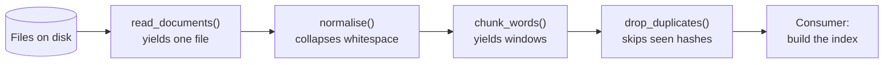

Almost every RAG system you will build is, underneath the frameworks, a Python program that reads a lot of text, cuts it up, attaches labels to the pieces, puts them somewhere searchable and moves them around again at query time. The language features that matter most for that work are not the exotic ones. They are the everyday ones: how Python names and shares objects, how it represents text, which container to reach for, and how to walk through a large collection without loading all of it into memory.

This lesson is not a syntax tutorial; it assumes you can already write a loop and a function. It explains the parts of core Python that RAG code leans on hardest, why each behaves as it does, and the bugs that follow from misunderstanding it. You will finish by building a small ingestion pipeline (read files, normalise, chunk, de-duplicate, index) from nothing but the standard library.

## Learning objectives

- Explain the difference between a name and an object, and predict when a change made through one name is visible through another.
- Distinguish `str` from `bytes`, and encode and decode text explicitly as UTF-8.
- Choose between a list, tuple, dict and set for a given RAG task, and justify the choice by its membership cost and mutability.
- Write generator functions and chain them into a lazy pipeline that processes a corpus one document at a time.
- Read and write files safely with `pathlib` and the `with` statement.

## Prerequisites

- [Indexing pipeline](/learn/rag-architecture-fundamentals/indexing-pipeline): the load, clean, chunk and index stages that the code in this lesson imitates.
- [Tokens and tokenisation](/learn/understanding-large-language-models/tokens-and-tokenisation): why "a word" and "a token" are different things.
- Enough Python to write a `for` loop, an `if` statement and a function. If you have never written any Python, work through the first five chapters of the official Python tutorial first.

## Why this matters

RAG pipelines fail in ways that look like retrieval problems but are really Python problems. Three examples from the kind of code this course builds:

- **A shared list.** An ingestion script builds one `metadata` dictionary and reuses it for every chunk, updating the page number each time. Every chunk in the index ends up claiming to come from the last page. Nothing crashed; the citations are simply wrong. The cause is that Python never copies an object unless you ask it to.
- **A quadratic loop.** A de-duplication step keeps the hashes it has seen in a list and checks `if h not in seen`. On a 2,000-document test corpus it takes a second. On the real 200,000-chunk handbook export it runs for hours, because each check scans the whole list.
- **An exhausted memory.** A loader reads every PDF's text into one big list before chunking starts. It works in development and is killed by the operating system in production, where the corpus is a hundred times larger.

None of these needs an advanced feature to fix. Each needs an accurate model of what Python is doing. The rest of this module builds on that model: [functions and classes](/learn/python-for-rag-engineering/functions-and-classes), [type hints](/learn/python-for-rag-engineering/type-hints) and [async programming](/learn/python-for-rag-engineering/async-programming) all assume it.

## The intuition

Think of Python objects as boxes in a warehouse, and of variable names as luggage tags tied to the boxes. When you write `batch = chunk_ids`, you do not build a second box and copy the contents across. You tie a second tag to the same box. Anyone who opens the box through either tag sees the same contents, and anyone who adds something through one tag has added it for both.

Some boxes are sealed (strings, numbers, tuples): you cannot change what is inside, only make a new box and move the tag. Others are open crates (lists, dicts, sets): their contents can change while every tag stays attached.

The second picture is about **laziness**. Suppose you need to process every document on a long shelf. You could carry the whole shelf to your desk first, which needs a very large desk. Or you could fetch one document, deal with it, put it back and fetch the next. A Python **generator** is the second approach written as code: a function that hands you one item, pauses, and resumes where it left off when you ask for the next.

## How it works

### Names, objects and references

Every value in Python is an **object**: a chunk of memory with a type, a value and an identity (in CPython, its memory address, returned by `id()`). A **name** (a variable) is a reference to an object, not a container that holds a value. Assignment binds a name to an object; it never copies.

Three consequences follow:

1. `b = a` makes `b` refer to the same object as `a`. If that object is **mutable** (it can be changed in place, like a list or dict), changes made through `b` are visible through `a`. This is called **aliasing**.
2. `==` asks "do these two objects have equal values?" and `is` asks "are these the same object?". Two lists with the same contents are `==` but not `is`. Use `is` only for singletons such as `None` (`if result is None`).
3. A copy has to be requested. `copy.copy(x)` (or `list(x)`, `dict(x)`, `x.copy()`) makes a **shallow copy**: a new outer container whose items are references to the *same* inner objects. `copy.deepcopy(x)` recursively copies the inner objects too.

```python
import copy

# Two names, one object
chunk_ids = ["hr-001", "hr-002"]
batch = chunk_ids               # no copy: a second label on the same list
batch.append("it-001")
print(chunk_ids)                # the "other" list changed too
print(batch is chunk_ids, id(batch) == id(chunk_ids))

# Equal is not the same as identical
a = ["leave", "remote"]
b = ["leave", "remote"]
print(a == b, a is b)

# Shallow and deep copies
doc = {"id": "hr-001", "tags": ["policy", "leave"]}
shallow = copy.copy(doc)
deep = copy.deepcopy(doc)
shallow["tags"].append("2024")
print(doc["tags"])              # shallow copy shares the inner list
print(deep["tags"])
```

```output
['hr-001', 'hr-002', 'it-001']
True True
True False
['policy', 'leave', '2024']
['policy', 'leave']
```

The shallow-copy line is the one that bites RAG code. Chunk metadata is usually a dictionary that contains lists (tags, headings, access groups). Copying the dictionary shallowly and then appending to a list inside it changes the original document's metadata as well.

**Immutable** types (`int`, `float`, `str`, `bytes`, `tuple`, `frozenset`, `None`) cannot be changed in place, so aliasing them is harmless. Every "modification" creates a new object: `title.strip().lower()` returns a new string and leaves `title` as it was.

### Text: `str` and `bytes`

A Python `str` is an immutable sequence of Unicode **code points**: abstract character numbers, independent of how they are stored. A `bytes` object is an immutable sequence of integers from 0 to 255: raw data as it sits in a file or travels over a network. Converting between them needs an **encoding**, a rule for turning code points into bytes. In RAG work that encoding should almost always be UTF-8.

```python
s = "Budget: £400"
data = s.encode("utf-8")
print(len(s), len(data), data)
print(data.decode("utf-8") == s)
```

```output
12 13 b'Budget: \xc2\xa3400'
True
```

The string has 12 characters but 13 bytes, because UTF-8 needs two bytes for "£". Three practical rules follow:

- **Decode at the edge, work in `str`, encode at the edge.** Bytes arrive from files and HTTP responses; turn them into `str` immediately, do all your processing on `str`, and encode only when writing out or hashing.
- **Always pass `encoding="utf-8"` when opening text files.** Without it, Python uses a platform default, and a pipeline that works on a Mac can fail on a Windows build server. (Python 3.15 makes UTF-8 the default text encoding on all platforms, but code that states it explicitly works on every version you will meet.)
- **Length depends on what you count.** Characters, bytes and model tokens are three different numbers for the same text. Chunk-size limits are usually in tokens, storage limits in bytes.

Text arriving from real documents has plenty of Unicode surprises (non-breaking spaces, ligatures, combining accents). Those belong to [Encoding and Unicode](/learn/data-processing/encoding-and-unicode); here the point is only to keep `str` and `bytes` straight.

Strings come with a rich set of methods you will use constantly: `split()` with no argument splits on any run of whitespace, `" ".join(words)` reverses it, `strip()`, `lower()`, `startswith()`, `replace()`, and slicing (`text[:200]` is the first 200 characters). **f-strings** (`f"{doc_id}#{n}"`) build strings from values, and accept format specifications such as `f"{score:.3f}"` for three decimal places.

### Numbers

`int` has arbitrary precision: `2 ** 100` is computed exactly. `float` is a 64-bit IEEE 754 binary floating-point number, which cannot represent most decimal fractions exactly:

```python
import math
print(0.1 + 0.2 == 0.3, math.isclose(0.1 + 0.2, 0.3))
print(2 ** 100)
```

```output
False True
1267650600228229401496703205376
```

This matters whenever you compare similarity scores. Two chunks whose cosine "should" be equal can differ in the last few bits, so compare with `math.isclose` (or `numpy.isclose`) and never test a float score for exact equality. Large arrays of embedding numbers live in NumPy arrays rather than Python lists, a choice the [Performance considerations](#performance-considerations) section explains.

### The four containers

Most RAG data structures are combinations of four built-in containers. Choosing correctly is mostly about two questions: *does it need to change?* and *will I look things up in it?*

| Type | Literal | Ordered | Mutable | Lookup `x in c` | Typical RAG use |
| --- | --- | --- | --- | --- | --- |
| `list` | `[a, b]` | Yes | Yes | Scans every item | Chunks of a document in order; search results |
| `tuple` | `(a, b)` | Yes | No | Scans every item | A fixed record such as `(chunk_id, score)`; dictionary keys |
| `dict` | `{k: v}` | Insertion order | Yes | Hash lookup on keys | Metadata; `chunk_id → text`; an inverted index |
| `set` | `{a, b}` | No | Yes | Hash lookup | Seen hashes for de-duplication; allowed groups |

Two terms in the table need defining:

- A **hash** is an integer computed from an object's value, used to decide where the object is stored inside a dict or set. Looking up a key means computing its hash and jumping almost straight to the right slot, so the cost does not grow with the size of the container. A list has no such shortcut; `x in my_list` compares `x` with each element in turn.
- An object is **hashable** if it has a hash that never changes. Immutable built-ins are hashable; lists, dicts and sets are not, so they cannot be dict keys or set members. That is why a pair of identifiers used as a key is written as a tuple, `(doc_id, chunk_no)`, not a list.

Since Python 3.7, dicts keep keys in insertion order as a language guarantee, which is why a dict of chunks prints in the order you added them.

### Iteration, comprehensions and generators

Python's `for` loop works on any **iterable**: an object that can hand out an **iterator**, which in turn produces items one at a time until it is exhausted. Lists, dicts (over their keys), strings, files (over their lines) and ranges are all iterable. A few built-ins make loops clearer and less error-prone:

- `enumerate(chunks)` yields `(index, item)` pairs, so you never maintain a counter by hand.
- `zip(ids, texts, strict=True)` walks two sequences in step; `strict=True` raises an error if their lengths differ, which catches the classic bug of a list of embeddings that is one shorter than the list of chunks.
- `sorted(results, key=lambda r: r[1], reverse=True)` sorts by score without changing the original list.

A **comprehension** builds a container from a loop in one expression: `[t.lower() for t in texts]`, `{cid: len(t) for cid, t in chunks.items()}`, `{h for h in hashes}`. Change the brackets to parentheses and you get a **generator expression**, `(t.lower() for t in texts)`, which produces the same items lazily, one at a time, without building a list.

A **generator function** is a function containing `yield`. Calling it does not run its body; it returns a generator object. Each time the consumer asks for the next item (a `for` loop does this automatically), the body runs until the next `yield`, hands over that value, and freezes with all its local variables intact. When the body finishes, the generator is exhausted.

Step through a word chunker to watch this happen. Notice that nothing in `chunk_words` runs until the `for` loop asks for the first chunk, and that execution bounces between the loop and the generator.

```trace
{
  "title": "A generator that yields overlapping word windows",
  "code": [
    "def chunk_words(words, size=4, overlap=1):",
    "    step = size - overlap",
    "    for start in range(0, len(words) - overlap, step):",
    "        yield \" \".join(words[start:start + size])",
    "",
    "words = \"Passwords must be rotated every 90 days. VPN is required\".split()",
    "for chunk in chunk_words(words):",
    "    print(chunk)"
  ],
  "steps": [
    {"line": 6, "vars": {"len(words)": "10"}, "note": "The text is split on whitespace into 10 words."},
    {"line": 7, "vars": {"len(words)": "10"}, "note": "Calling chunk_words creates a generator object. None of its body has run yet."},
    {"line": 2, "vars": {"step": "3"}, "note": "The loop asks for the first item, so the body starts. Each window advances 3 words, so neighbours share 1 word."},
    {"line": 3, "vars": {"step": "3", "start": "0"}, "note": "range(0, 9, 3) will produce 0, 3 and 6."},
    {"line": 4, "vars": {"step": "3", "start": "0"}, "note": "yield hands words 0 to 3 to the loop and freezes the generator here."},
    {"line": 8, "vars": {"chunk": "'Passwords must be rotated'"}, "out": ["Passwords must be rotated"], "note": "Back in the caller. The generator is paused, keeping start and step."},
    {"line": 3, "vars": {"step": "3", "start": "3"}, "note": "The loop asks for the next item; the generator resumes after its yield."},
    {"line": 8, "vars": {"chunk": "'rotated every 90 days.'"}, "out": ["Passwords must be rotated", "rotated every 90 days."], "note": "The word 'rotated' appears in both windows: that is the overlap."},
    {"line": 3, "vars": {"step": "3", "start": "6"}, "note": "Third window."},
    {"line": 8, "vars": {"chunk": "'days. VPN is required'"}, "out": ["Passwords must be rotated", "rotated every 90 days.", "days. VPN is required"], "note": "The last window ends exactly at the end of the text."},
    {"line": 3, "vars": {"step": "3", "start": "(range exhausted)"}, "note": "Stopping at len(words) - overlap avoids a fourth window holding only 'required', which the previous window already covers. The generator finishes and the for loop ends."}
  ]
}
```

Chain generators and you get a **lazy pipeline**: each stage pulls one item from the stage before it, transforms it and passes it on. Only one document is in flight at a time, however large the corpus.



The step-by-step mechanism of a pull-based pipeline:

1. The consumer at the end asks the last generator for one item.
2. That generator, needing input, asks the generator before it, and so on back to the source.
3. The source reads one file and yields it; each stage transforms it and yields the result forward.
4. The consumer handles the item, then asks for the next one. Memory use stays roughly constant at "one document plus whatever the consumer keeps".

Two caveats. A generator can be consumed **once**: iterate it a second time and you get nothing, silently. And laziness means errors surface late: a file that fails to decode raises its exception when the consumer reaches it, not when you build the pipeline. [Exception handling](/learn/python-for-rag-engineering/exception-handling) covers what to do about that.

### Files and paths

The `pathlib` module represents file-system paths as objects. `Path("corpus") / "hr" / "leave.txt"` joins parts with the right separator for the operating system; `path.rglob("*.txt")` finds files recursively; `path.read_text(encoding="utf-8")` and `path.write_text(text, encoding="utf-8")` read and write whole files; `path.relative_to(root)` gives a stable identifier that does not depend on where the corpus happens to be mounted.

For anything longer than a one-liner, open files with a **`with` statement**:

```python
with path.open(encoding="utf-8") as f:
    text = f.read()
```

`with` calls the file's clean-up code when the block ends, even if an exception is raised inside it, so the file handle is always closed. An ingestion job that opens thousands of files without closing them can hit the operating system's limit on open files. The same `with` pattern is used for database connections, HTTP clients and locks; objects that support it are called **context managers**.

### Modules and scripts

A `.py` file is a **module**. `import chunking` runs `chunking.py` once and gives you its names as `chunking.chunk_words`. Code that should run only when the file is executed directly, not when it is imported by a test or another module, goes under:

```python
if __name__ == "__main__":
    main()
```

Keep reusable logic in functions at module level and put only the "run this now" call under that guard. That one habit is what lets you import your chunker into a test file without starting a full ingestion run.

## The mathematics

### Why the container choice changes the order of growth

**Intuition.** De-duplicating chunks means asking, for each new chunk, "have I seen this before?". If the answer requires looking at everything seen so far, the total work grows with the *square* of the number of chunks. If the answer takes a constant amount of work, the total grows *linearly*.

With a list, checking item $i$ against the $i$ items kept before it costs up to $i$ comparisons. Over $n$ distinct items:

$$
C_{\text{list}}(n) = \sum_{i=0}^{n-1} i = \frac{n(n-1)}{2}
$$

With a set, each check costs on average a constant $c$ (one hash computation and, usually, one comparison):

$$
C_{\text{set}}(n) \approx c \cdot n
$$

Here $n$ is the number of chunks, $i$ is the position of the chunk being checked, $C$ is the number of comparisons, and $c$ is a small constant that does not depend on $n$. In big-O notation, the list approach is $O(n^2)$ and the set approach is $O(n)$ on average.

**By hand.** Take $n = 20{,}000$ distinct chunks, each appearing twice (so $2n$ items to check).

- First occurrences: chunk $i$ is compared with the $i$ chunks kept before it, giving $\frac{n(n-1)}{2} = \frac{20{,}000 \times 19{,}999}{2} = 199{,}990{,}000$ comparisons.
- Second occurrences: the repeat of chunk $i$ scans until it reaches its twin at position $i$, which is $i + 1$ comparisons, giving $\frac{n(n+1)}{2} = 200{,}010{,}000$.
- Total: $400{,}000{,}000$ comparisons, which is exactly $n^2$. With a set it is $2n = 40{,}000$ hash lookups.

Multiply $n$ by 10 (a realistic 200,000 chunks) and the list approach does 100 times as much work, the set approach 10 times as much.

**In Python.** The script below measures both and also compares the memory of a materialised list with a generator. The timings are from the machine used to write this lesson; yours will differ, but the ratio will be similar.

```python
import sys
import time

n = 20_000
texts = [f"chunk number {i}" for i in range(n)] * 2   # every chunk appears twice

def dedupe_with_list(items):
    kept = []
    for t in items:
        if t not in kept:          # scans the list: O(len(kept))
            kept.append(t)
    return kept

def dedupe_with_set(items):
    seen, kept = set(), []
    for t in items:
        if t not in seen:          # hash lookup: O(1) on average
            seen.add(t)
            kept.append(t)
    return kept

for fn in (dedupe_with_list, dedupe_with_set):
    start = time.perf_counter()
    result = fn(texts)
    elapsed = time.perf_counter() - start
    print(f"{fn.__name__:<17} kept={len(result):>6}  {elapsed:.3f} s")

# Comparisons the list version makes, by the formula
first_pass = n * (n - 1) // 2      # each new item scans all items kept so far
second_pass = n * (n + 1) // 2     # each repeat scans until it finds its twin
print(f"list comparisons ~ {first_pass + second_pass:,}")

# Memory: a materialised list versus a generator over the same values
as_list = [float(i) for i in range(1_000_000)]
as_gen = (float(i) for i in range(1_000_000))
print("list object:", sys.getsizeof(as_list), "bytes (pointers only)")
print("one float:  ", sys.getsizeof(1.0), "bytes")
print("generator:  ", sys.getsizeof(as_gen), "bytes")
```

```output
dedupe_with_list  kept= 20000  1.638 s
dedupe_with_set   kept= 20000  0.001 s
list comparisons ~ 400,000,000
list object: 8448728 bytes (pointers only)
one float:   24 bytes
generator:   224 bytes
```

The set version is more than a thousand times faster here, and the gap widens as $n$ grows. The memory lines show the second lesson: the list object alone holds a million 8-byte pointers (about 8.4 MB), each pointing to a separate 24-byte float object, roughly 32 MB in total. The generator is a couple of hundred bytes, whatever the length of the sequence it will produce.

## In code

**The problem.** Turn a folder of Meridian handbook and runbook files into chunks, drop exact duplicates, and build a keyword index that can answer a query, using only the standard library and keeping memory use independent of corpus size.

**Dependencies.** None beyond Python 3.10 or later (the code uses nothing newer).

```bash
python --version   # 3.10 or later
```

The code first writes five small files into a temporary folder so the example is self-contained. Note that `it/security-copy.txt` is a byte-for-byte copy of `it/security.txt`, as happens when someone duplicates a page in a wiki.

```python
import hashlib
import re
import tempfile
from collections import Counter
from pathlib import Path

# --- 1. Create a tiny corpus on disk (stands in for an export of the handbook) ---
CORPUS = {
    "hr/leave.txt": "Annual leave is 25 days per year.\n\nUp to 5 unused days carry over and must be used by 31 March.",
    "hr/remote.txt": "Staff may work remotely up to 3 days a week.   The home-office equipment budget is £400.",
    "finance/expenses.txt": "Expenses must be submitted within 30 days. Anything over £75 needs a receipt.",
    "it/security.txt": "Passwords must be rotated every 90 days. VPN is required on public Wi-Fi.",
    "it/security-copy.txt": "Passwords must be rotated every 90 days. VPN is required on public Wi-Fi.",
}

root = Path(tempfile.mkdtemp())
for rel_path, text in CORPUS.items():
    path = root / rel_path
    path.parent.mkdir(parents=True, exist_ok=True)
    path.write_text(text, encoding="utf-8")

# --- 2. A lazy pipeline built from generators ---------------------------------
def read_documents(folder):
    """Yield (doc_id, text) one file at a time; never holds the whole corpus."""
    for path in sorted(folder.rglob("*.txt")):
        with path.open(encoding="utf-8") as f:
            yield path.relative_to(folder).as_posix(), f.read()

def normalise(docs):
    for doc_id, text in docs:
        yield doc_id, re.sub(r"\s+", " ", text).strip()

def chunk_words(docs, size=8, overlap=2):
    step = size - overlap
    for doc_id, text in docs:
        words = text.split()
        for n, start in enumerate(range(0, max(len(words) - overlap, 1), step)):
            yield f"{doc_id}#{n}", " ".join(words[start:start + size])

def drop_duplicates(chunks):
    seen = set()                               # hashes of chunk texts already emitted
    for chunk_id, text in chunks:
        digest = hashlib.sha256(text.encode("utf-8")).hexdigest()
        if digest in seen:
            continue
        seen.add(digest)
        yield chunk_id, text

pipeline = drop_duplicates(chunk_words(normalise(read_documents(root))))
print(type(pipeline).__name__)                 # nothing has been read yet

chunks = dict(pipeline)                        # now the pipeline runs, end to end
for chunk_id, text in chunks.items():
    print(f"{chunk_id:<26} {text}")

# --- 3. An inverted index: term -> set of chunk ids -----------------------------
def terms(text):
    return re.findall(r"[a-z0-9£]+", text.lower())

index = {}
for chunk_id, text in chunks.items():
    for term in set(terms(text)):
        index.setdefault(term, set()).add(chunk_id)

def search(query, k=3):
    votes = Counter()
    for term in set(terms(query)):
        for chunk_id in index.get(term, ()):
            votes[chunk_id] += 1
    return votes.most_common(k)

print()
print("chunks:", len(chunks), " terms:", len(index))
print("'days' appears in:", sorted(index["days"]))
print(search("how many unused days carry over?"))
print(search("VPN on public wi-fi"))
```

```output
generator
finance/expenses.txt#0     Expenses must be submitted within 30 days. Anything
finance/expenses.txt#1     days. Anything over £75 needs a receipt.
hr/leave.txt#0             Annual leave is 25 days per year. Up
hr/leave.txt#1             year. Up to 5 unused days carry over
hr/leave.txt#2             carry over and must be used by 31
hr/leave.txt#3             by 31 March.
hr/remote.txt#0            Staff may work remotely up to 3 days
hr/remote.txt#1            3 days a week. The home-office equipment budget
hr/remote.txt#2            equipment budget is £400.
it/security-copy.txt#0     Passwords must be rotated every 90 days. VPN
it/security-copy.txt#1     days. VPN is required on public Wi-Fi.

chunks: 11  terms: 51
'days' appears in: ['finance/expenses.txt#0', 'finance/expenses.txt#1', 'hr/leave.txt#0', 'hr/leave.txt#1', 'hr/remote.txt#0', 'hr/remote.txt#1', 'it/security-copy.txt#0', 'it/security-copy.txt#1']
[('hr/leave.txt#1', 4), ('hr/leave.txt#2', 2), ('finance/expenses.txt#1', 2)]
[('it/security-copy.txt#1', 5), ('it/security-copy.txt#0', 1)]
```

**The important lines.**

- `pipeline = drop_duplicates(chunk_words(normalise(read_documents(root))))` composes four generators. The first `print` shows that this line only builds the chain; no file has been opened yet.
- `dict(pipeline)` is the consumer. It pulls items through every stage until the source is exhausted. In a production pipeline the consumer would write each chunk to a vector store instead of collecting them all.
- `with path.open(encoding="utf-8") as f` closes each file as soon as it has been read, and states the encoding rather than trusting a platform default.
- `path.relative_to(folder).as_posix()` builds the document identifier from the path inside the corpus, with forward slashes on every operating system, so identifiers do not change if the corpus moves.
- `hashlib.sha256(text.encode("utf-8")).hexdigest()` hashes the bytes of the chunk. Hashing needs bytes, so the `str` is encoded at exactly this edge. Storing 64-character digests in the set, rather than whole chunk texts, keeps its memory predictable.
- `index.setdefault(term, set()).add(chunk_id)` builds an **inverted index**, a map from each term to the set of chunks containing it. `setdefault` returns the existing set or inserts a new empty one. Iterating `set(terms(text))` adds each chunk once per distinct term.
- `index.get(term, ())` returns an empty tuple for unknown query terms instead of raising `KeyError`.

**What the output means.**

- The two security files produced identical chunks, and only one copy survived. Notice *which* copy: `security-copy.txt` sorts before `security.txt` (a hyphen sorts before a dot), so the copy was read first and the original was dropped as the duplicate. That is the kind of detail that decides which document a citation points to. A real pipeline needs a rule for which duplicate is canonical; [Duplicate detection](/learn/data-processing/duplicate-detection) and [Document identifiers](/learn/document-engineering/document-identifiers) take that up.
- The chunks overlap by two words (`hr/leave.txt#0` ends "year. Up" and `#1` begins "year. Up"), so a sentence cut at a boundary still appears whole in one of the neighbours. The windows here are absurdly small (8 words) so that the output fits on a page; [Chunk size](/learn/chunking-fundamentals/chunk-size) explains how to choose a real one.
- The query "how many unused days carry over?" ranks `hr/leave.txt#1` first because it shares four distinct terms (*unused*, *days*, *carry*, *over*). This is plain term counting with no weighting; "days" appears in eight of the eleven chunks and should count for much less than "unused". [Query-document matching](/learn/rag-architecture-fundamentals/query-document-matching) showed how TF-IDF fixes that.

**Errors people commonly hit.**

- `UnicodeDecodeError` when a file is not UTF-8 (often Windows-1252 exports from older tools). Decide deliberately: fix the export, detect the encoding, or open with `errors="replace"` and log the file.
- Iterating `pipeline` a second time and getting no chunks. Generators are single-use; build a new chain or materialise the result once.
- `TypeError: unhashable type: 'list'` from trying to use a list as a dict key or set member. Use a tuple.
- A `KeyError` from `index[term]` on a query term that never occurred. Use `.get()` with a default.

**Extending it.** Replace the word windows with token windows using `tiktoken`; record the source path and chunk number in a metadata dict for each chunk (and create a new dict per chunk, for the reason in the next section); and swap the voting search for scikit-learn's `TfidfVectorizer` to weight rare terms.

## A real-world example

Meridian's Platform team runs a nightly job that re-ingests the IT runbooks into AskMeridian's Qdrant cluster. After a change to add section headings to chunk metadata, Tomás, the engineer on support rotation, received a report that every answer citing the VPN runbook claimed to come from its last section, "Escalation".

The ingestion code looked reasonable:

```python
meta = {"source": path.as_posix(), "section": None}
for section, text in sections:
    meta["section"] = section
    chunks.append({"text": text, "meta": meta})
```

Each chunk dictionary held a reference to the *same* `meta` dictionary. The loop updated that one object on every iteration, so when the batch was finally written to the vector store, every chunk's metadata showed the value from the last iteration. No exception, no warning; the text of each chunk was correct and only the citations were wrong, which is why it passed a quick visual check.

The fix was one line: build a new dictionary inside the loop, `{"source": path.as_posix(), "section": section}`. The review that followed added a test asserting that two chunks from different sections have different metadata, and a team convention that per-chunk records are created fresh, never updated in place. Later in this module the team replaced the dictionaries with immutable records (see [Dataclasses and Pydantic](/learn/python-for-rag-engineering/dataclasses-and-pydantic)), which makes this class of bug impossible rather than merely unlikely.

## Common mistakes

- **Assuming assignment copies.** `b = a` followed by `b.append(...)` changes `a`. In ingestion code this shows up as shared metadata and as "my list of results changed after I returned it".
- **Making a shallow copy of nested data and mutating the inside.** `dict(meta)` copies the outer dict only; the `tags` list inside is still shared.
- **Testing membership in a list inside a loop.** It turns a linear job into a quadratic one, invisible on test data and crippling at production scale.
- **Opening files without an encoding.** The pipeline works on one machine and raises `UnicodeDecodeError`, or silently produces garbled text, on another.
- **Loading the whole corpus before processing it.** Memory use grows with corpus size, and the job dies on the first large export.
- **Re-iterating an exhausted generator.** The second pass sees nothing and no error is raised, so a "count" step followed by a "process" step processes zero items.
- **Comparing float scores with `==`.** Rounding differences make equal-in-theory scores unequal, breaking ties and thresholds unpredictably.

## Best practices

- Create a new object for each record you produce, especially metadata dictionaries; treat records as immutable once built.
- Use a set or dict whenever you will ask "have I seen this?" or "what belongs to this key?".
- Write ingestion stages as generators that take an iterable and yield results, so they compose and stream.
- Decode bytes to `str` as soon as data enters your program, always specify `encoding="utf-8"`, and encode only at the output edge.
- Use `pathlib` for paths and build document identifiers from paths relative to the corpus root.
- Use `with` for every resource that must be released: files, network clients, database connections.
- Pass `strict=True` to `zip` when pairing chunks with their embeddings or ids.

## Performance considerations

**Algorithmic cost dominates.** As the mathematics section showed, the difference between $O(n)$ and $O(n^2)$ outweighs any micro-optimisation. Before tuning anything, ask what each loop does inside it.

**Python objects are large.** A Python `float` object is 24 bytes, and a list stores an 8-byte pointer to each one. One million 384-dimensional embeddings held as lists of floats would need about $10^6 \times 384 \times (24 + 8) \approx 12.3$ GB. The same numbers in a NumPy `float32` array need $10^6 \times 384 \times 4 \approx 1.5$ GB, because NumPy stores raw numbers contiguously with no per-number object. Keep vectors in NumPy arrays (or let the vector database hold them), never in nested lists.

**Laziness bounds memory, not time.** A generator pipeline uses memory proportional to one item, but the total work is the same as the eager version. When a stage is slow because it waits on the network (an embedding API), the fix is concurrency, which [Async programming](/learn/python-for-rag-engineering/async-programming) covers, or batching.

**String building.** Repeated `s += piece` in a loop can copy the growing string each time; collect pieces in a list and call `"".join(pieces)` once.

**Interpreted loops are slow per iteration.** A pure-Python loop costs on the order of tens of nanoseconds per simple operation. That is fine for orchestrating thousands of documents and wrong for multiplying millions of numbers, which belongs in NumPy or a compiled library.

## Security considerations

Ingestion code reads files that other people wrote, and some query-time code builds paths or objects from user input.

- **Never deserialise untrusted data with `pickle`.** Loading a pickle can execute arbitrary code by design. Use JSON for data exchange and treat a pickle file of embeddings received from elsewhere as executable.
- **Never call `eval()` or `exec()` on text from documents, users or model output.** It runs that text as Python.
- **Contain paths built from input.** If a user or an upstream system supplies a filename, resolve it and check it stays inside the corpus folder: `(root / name).resolve().is_relative_to(root.resolve())`. Without this, `../../etc/passwd` walks out of the corpus.
- **Hashing for de-duplication is not security.** SHA-256 is fine for identifying identical text; it does not prove a document is authentic or authorised.

## Summary

- Names are references to objects; assignment never copies. Mutable objects (lists, dicts, sets) changed through one name change for every name, and shallow copies share their inner objects.
- `str` is Unicode text and `bytes` is raw data. Decode at the input edge, work in `str`, encode at the output edge, and always say `encoding="utf-8"`.
- Pick containers by mutability and lookup: dicts and sets give constant-time average lookup through hashing; lists and tuples scan.
- Generators yield items one at a time; chained, they form a lazy pipeline whose memory use does not grow with the corpus. They are single-use.
- `pathlib` and `with` make file handling portable and leak-free, and the `if __name__ == "__main__"` guard keeps modules importable.

## Exercises

**1.** Predict the output, then run it to check.

```python
defaults = {"source": "handbook", "tags": []}
a = dict(defaults)
b = dict(defaults)
a["tags"].append("leave")
b["source"] = "runbook"
print(defaults)
```

<details><summary>Show solution</summary>

```output
{'source': 'handbook', 'tags': ['leave']}
```

`dict(defaults)` makes a shallow copy. Setting `b["source"]` rebinds a key in `b`'s own outer dict, so `defaults["source"]` is unaffected. But `a["tags"]`, `b["tags"]` and `defaults["tags"]` are all the same list object, so appending through `a` shows up in `defaults` (and in `b`). Use `copy.deepcopy(defaults)`, or build the dict fresh with a new list, `{"source": "handbook", "tags": []}`, for each record.

</details>

**2.** The function below is meant to count chunks and then return them, but `process` always receives nothing. Explain why and fix it without materialising the whole corpus twice.

```python
def count_then_process(chunks):
    total = sum(1 for _ in chunks)
    print("chunks:", total)
    return process(chunks)
```

<details><summary>Show solution</summary>

If `chunks` is a generator, `sum(1 for _ in chunks)` consumes it completely. By the time `process(chunks)` runs, the generator is exhausted and yields nothing. No error is raised.

Two fixes. If you need the total before processing, the data has to exist twice in some form: either materialise once (`chunks = list(chunks)`) and accept the memory, or re-create the generator from its source. Usually better is to count *while* processing, so the stream is read only once:

```python
def process_and_count(chunks):
    total = 0
    for chunk in chunks:
        handle(chunk)
        total += 1
    print("chunks:", total)
```

</details>

**3.** Extend the `In code` pipeline so that each chunk carries a metadata dictionary with `source`, `chunk_no` and `n_words`, and so that the duplicate kept is the one from the alphabetically *last* path rather than the first. Print the metadata of the surviving security chunks.

<details><summary>Show solution</summary>

Yield a tuple of `(chunk_id, text, meta)` from the chunker, creating a new dict for every chunk. To keep the last duplicate, read the files in reverse order (`sorted(..., reverse=True)`), so the last path is seen first and wins; restore the original order afterwards if you need it.

```python
def read_documents(folder):
    for path in sorted(folder.rglob("*.txt"), reverse=True):
        with path.open(encoding="utf-8") as f:
            yield path.relative_to(folder).as_posix(), f.read()

def chunk_words(docs, size=8, overlap=2):
    step = size - overlap
    for doc_id, text in docs:
        words = text.split()
        for n, start in enumerate(range(0, max(len(words) - overlap, 1), step)):
            piece = words[start:start + size]
            meta = {"source": doc_id, "chunk_no": n, "n_words": len(piece)}  # new dict each time
            yield f"{doc_id}#{n}", " ".join(piece), meta

def drop_duplicates(chunks):
    seen = set()
    for chunk_id, text, meta in chunks:
        digest = hashlib.sha256(text.encode("utf-8")).hexdigest()
        if digest not in seen:
            seen.add(digest)
            yield chunk_id, text, meta

for chunk_id, text, meta in drop_duplicates(chunk_words(normalise(read_documents(root)))):
    if meta["source"].startswith("it/"):
        print(meta)
```

With the corpus from the lesson this prints:

```output
{'source': 'it/security.txt', 'chunk_no': 0, 'n_words': 8}
{'source': 'it/security.txt', 'chunk_no': 1, 'n_words': 7}
```

Reversing the read order is the simplest rule here; a production rule would more likely prefer the most recently modified file or a designated canonical source.

</details>

**4.** Design decision. AskMeridian must ingest a 40 GB export of the support desk's ticket history: one JSON object per line, around 30 million lines. You need to drop exact duplicate ticket bodies and write chunks to the vector store. Sketch the pipeline's stages, say which container holds the de-duplication state, and estimate its memory.

<details><summary>Show solution</summary>

Stream it: a generator that reads the file line by line (`for line in f:` reads one line at a time), parses each line with `json.loads`, normalises, de-duplicates, chunks, and hands batches to the writer. No stage holds more than one ticket, except the de-duplication state and the current batch.

De-duplication state must be a set (constant-time membership). Storing whole ticket bodies would approach the size of the data. Store fixed-size digests instead: `hashlib.sha256(body.encode()).digest()` gives 32 raw bytes. A Python `bytes` object of 32 bytes costs about 65 bytes including object overhead, plus roughly 8 to 16 bytes of set slot overhead per entry, so about 80 bytes per distinct ticket. For 30 million tickets that is $3 \times 10^7 \times 80 \approx 2.4$ GB in the worst case, which fits on a normal worker. If it did not, you could keep a shorter prefix of the digest (accepting a tiny collision risk), shard the work by the digest's first byte, or keep the seen set in an external store such as Redis.

Batch the writes (for example 256 chunks per request) so the vector store is not called 30 million times, and record progress so a crash can resume rather than restart.

</details>

## Check your understanding

```quiz
[
  {
    "q": "What does this print?\n```python\nresults = [\"a\", \"b\"]\ntop = results\ntop.append(\"c\")\nprint(len(results))\n```",
    "options": ["2", "3", "It raises an error", "1"],
    "answer": 1,
    "why": "top and results are two names for the same list object, so appending through top changes the list that results refers to."
  },
  {
    "q": "You must check, for each of 500,000 incoming chunk hashes, whether it has been seen before. Which container should hold the seen hashes?",
    "options": ["A list, because it keeps insertion order", "A tuple, because it is immutable", "A set, because membership is a hash lookup", "A string with the hashes concatenated"],
    "answer": 2,
    "why": "A set answers 'x in seen' in constant time on average. A list or tuple scans every element, making the whole job quadratic."
  },
  {
    "q": "The string \"£400\" has how many characters and how many UTF-8 bytes?",
    "options": ["4 characters, 5 bytes", "4 characters, 4 bytes", "5 characters, 5 bytes", "4 characters, 8 bytes"],
    "answer": 0,
    "why": "len() of a str counts code points (4). UTF-8 encodes the pound sign as two bytes and each ASCII character as one, giving 5."
  },
  {
    "q": "A generator pipeline is built with `p = clean(read(folder))`, then `n = len(list(p))`, then `for c in p: index(c)`. How many chunks are indexed?",
    "options": ["n", "2n", "It raises TypeError", "0"],
    "answer": 3,
    "why": "list(p) consumes the generator completely. Iterating it again yields nothing, silently."
  },
  {
    "q": "Why is a tuple, not a list, used for a dictionary key such as (doc_id, chunk_no)?",
    "options": ["Tuples are faster to print", "Tuples are immutable and therefore hashable", "Lists cannot hold strings and integers together", "Dictionaries sort their keys and tuples sort faster"],
    "answer": 1,
    "why": "Dict keys must have a hash that never changes. Lists are mutable, so Python refuses to hash them."
  }
]
```

## Further reading

- The Python Tutorial, especially sections 3 to 5 and 9.9 to 9.10 (iterators and generators), [docs.python.org/3/tutorial](https://docs.python.org/3/tutorial/).
- The Python Language Reference, "Data model", which defines objects, identity, mutability and hashability, [docs.python.org/3/reference/datamodel.html](https://docs.python.org/3/reference/datamodel.html).
- The `pathlib` module documentation, [docs.python.org/3/library/pathlib.html](https://docs.python.org/3/library/pathlib.html).
- Luciano Ramalho (2022), *Fluent Python*, 2nd edition, O'Reilly: chapters 2 and 3 (sequences, dicts and sets) and chapter 6 (object references, mutability and copying).
- PEP 255, "Simple Generators" (Schemenauer, Peters and Hetland, 2001), and PEP 289, "Generator Expressions" (Hettinger, 2002), [peps.python.org](https://peps.python.org/).
