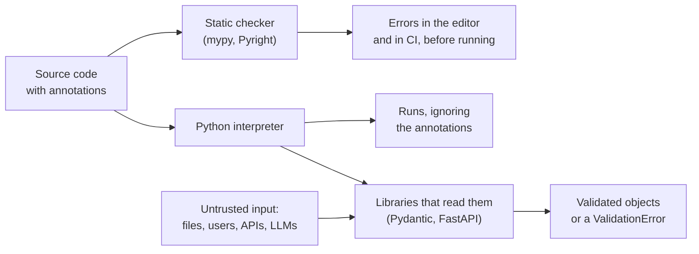

RAG code moves a small number of data shapes through many hands: chunk identifiers, metadata dictionaries, matrices of embeddings, lists of `(id, score)` pairs, model responses. Each hand-off is a chance to pass the wrong thing: a document id where a chunk id was expected, a score list where an index list was expected, `None` where a string was promised. Python will usually let you, and the mistake surfaces far away, as a wrong citation or an exception deep inside NumPy.

**Type hints** are annotations that say what each variable, parameter and return value is meant to hold. Python itself ignores them at run time, but tools read them: a **static type checker** such as mypy or Pyright reads the whole codebase without running it and reports every place where the annotations contradict each other, and libraries such as Pydantic use the same annotations to validate data while the program runs. This lesson teaches the type system you will meet in RAG code, from `list[str]` and `X | None` up to protocols, generics, `NewType` and `TypedDict`, and shows where static checking ends and run-time validation has to take over.

## Learning objectives

- Annotate functions, variables and classes using built-in generics, unions, `Literal`, `Callable` and the abstract collection types.
- Explain why annotations are not enforced at run time, and name the two kinds of tool that do use them.
- Use `NewType`, `TypedDict` and type aliases to make RAG data shapes explicit and distinguishable.
- Define a `Protocol` and a generic function, and explain how structural typing differs from inheriting an abstract base class.
- Read a type checker's error, decide whether it reveals a real bug, and narrow an optional value correctly.

## Prerequisites

- [Functions and classes](/learn/python-for-rag-engineering/functions-and-classes): signatures, keyword-only parameters, functions as values.
- [OOP](/learn/python-for-rag-engineering/oop): abstract base classes and the retriever contract that protocols generalise.
- [Embeddings](/learn/understanding-large-language-models/embeddings): the vectors and matrices whose types appear in the examples.

## Why this matters

Python's flexibility is a gift in a notebook and a liability in a service that six people change every week. Consider what dynamic typing allows:

```python
def make_chunk_id(doc_id: str, n: int) -> str:
    return f"{doc_id}#{n}"

print(make_chunk_id(42, 0))          # an int where a str was promised: runs fine
print(make_chunk_id("hr", "0"))      # a str where an int was promised: also runs
```

```output
42#0
hr#0
```

Both calls break the annotated contract, and neither fails. In a pipeline, the first produces chunk ids that no longer match the document registry; the second works today and breaks the day someone writes `n + 1`. Errors of this kind are the expensive sort: they are found by users, not by the developer who introduced them.

A type checker finds them before the code runs, in the editor or in continuous integration (CI). It also makes refactoring safe: rename a field, change a return type from `list[str]` to `list[ChunkId]`, and the checker lists every place that must change. And annotations are documentation that cannot drift out of date, because the checker fails when they do. In a RAG codebase, where most bugs are wrong data in the right place rather than crashes, that is unusually valuable.

## The intuition

Think of the labels on the pipes in a building's plant room: "cold water", "hot water", "gas". The labels do not change what flows through the pipes; you could connect the gas line to the kettle and the pipes would not stop you. What the labels allow is an *inspector*, who can walk the building before anyone turns a tap and check that every joint connects two pipes with the same label.

Type hints are the labels. The static checker is the inspector, working on the drawings (your source code) before anything runs. Run-time validation, which Pydantic provides, is a different job: a meter at the building's *inlet* that tests what the utility company actually delivers, because no inspection of the drawings can tell you what will arrive from outside. You want both: an inspector for everything inside, and meters wherever data enters from files, users, APIs and language models.

## How it works

### Annotations are metadata

The syntax is a colon after a name and an arrow before a function's return type:

```python
from typing import get_type_hints

def top_k(scores: list[float], k: int = 5) -> list[int]:
    """Indices of the k highest scores."""
    return sorted(range(len(scores)), key=scores.__getitem__, reverse=True)[:k]

print(top_k.__annotations__)
print(top_k([0.2, 0.9, 0.5], k=2))
```

```output
{'scores': list[float], 'k': <class 'int'>, 'return': list[int]}
[1, 2]
```

What happens to an annotation, step by step:

1. When Python compiles the function, it records the annotations but does not check anything against them.
2. Since Python 3.14, annotations are **evaluated lazily** (PEP 649 and PEP 749): the expressions are only computed when something asks for them, for example through `typing.get_type_hints()` or the new `annotationlib` module. This is why a class can refer to itself in its own annotations without quotes. On older versions you will see `from __future__ import annotations`, which stores every annotation as a string for a similar effect.
3. At run time the function behaves exactly as if the annotations were absent. Passing `k="2"` raises nothing until the slice `[:k]` fails inside `sorted(...)`, with an error that says nothing about types.
4. A **static type checker** (mypy and Pyright are the two most widely used) parses your source, infers the type of every expression, and checks each assignment, call and return against the annotations.
5. **Run-time libraries** (Pydantic, FastAPI, `dataclasses`) read the same annotations with `get_type_hints` and act on them: validating input, generating JSON Schema, building `__init__` methods.



Typing in Python is **gradual**: unannotated code is treated as type `Any`, which is compatible with everything, so you can add annotations module by module and the checker only enforces what you have written.

### The everyday vocabulary

| Annotation | Means | RAG example |
| --- | --- | --- |
| `int`, `str`, `float`, `bool`, `bytes` | That type (an `int` is also accepted where `float` is expected) | `k: int`, `score: float` |
| `list[str]`, `dict[str, int]`, `set[str]` | A container whose items have the given type (Python 3.9+) | `ids: list[str]` |
| `tuple[str, float]` | A fixed-length tuple with per-position types | One `(chunk_id, score)` result |
| `tuple[float, ...]` | A tuple of any length, all floats | An immutable vector |
| `X \| Y` | Either type (Python 3.10+; older code writes `Union[X, Y]`) | `str \| bytes` |
| `X \| None` | Either an X or `None` (older: `Optional[X]`) | `page: int \| None` |
| `Literal["dense", "sparse"]` | Exactly one of these values | A search mode |
| `Callable[[str], list[float]]` | A function taking a `str` and returning a list of floats | An injected embedding function |
| `Any` | Opt out of checking for this value | Untyped third-party data |
| `object` | Any value, but you may only do what every object supports | A truly generic logger argument |

Two rules of thumb sharpen these:

- **Accept abstract types, return concrete ones.** A parameter that only iterates should be `Iterable[str]` and one that also indexes and takes `len()` should be `Sequence[str]` (both from `collections.abc`), so callers may pass a list, a tuple or a generator as appropriate. A return value should be the concrete `list[str]`, so callers know they can append to it.
- **Prefer `object` to `Any` when you mean "anything".** `Any` turns checking off in both directions and spreads silently; `object` keeps checking on and forces you to narrow before use.

### Optional values and narrowing

`X | None` is the most useful annotation in RAG code, because so much is legitimately absent: a chunk without a page number, a retrieval with no result above the threshold, a model response with no text block. The checker will not let you use an `int | None` as an `int` until you have proved, in the code, that it is not `None`. That proof is called **narrowing**:

```python
def best_page(pages: list[int]) -> int | None:
    return max(pages) if pages else None

page = best_page([])
print(page + 1)            # checker: Unsupported operand types for + ("None" and "int")

if page is not None:
    print(page + 1)        # fine: inside this branch, page is int
```

The checker follows `if x is None`, `isinstance(x, str)`, early `return`s and `assert x is not None` to know the narrowed type in each branch. Most of the real bugs a checker finds in RAG code are this pattern: a function that can return nothing, called by code that assumed it never does.

### Naming your data: aliases, `NewType`, `Literal` and `TypedDict`

Plain `str` is the type of a chunk id, a document id, a query, a model name and a chunk's text. A checker cannot tell them apart, so it cannot catch you mixing them. Four tools fix that:

- A **type alias** gives a long type a short name. Python 3.12 added the `type` statement: `type Matrix = npt.NDArray[np.float32]`. An alias is interchangeable with what it stands for; it is for readability.
- **`NewType`** creates a *distinct* type for the checker: `ChunkId = NewType("ChunkId", str)`. At run time `ChunkId("hr#0")` is just the string `"hr#0"` (no cost), but the checker rejects a plain `str` or a `DocumentId` where a `ChunkId` is required. This catches the classic mix-up between document and chunk identifiers, which [Document identifiers](/learn/document-engineering/document-identifiers) treats in depth.
- **`Literal`** restricts a value to a fixed set. `mode: Literal["dense", "sparse", "hybrid"]` turns a typo such as `"semantic"` into a checker error instead of a run-time `KeyError`.
- **`TypedDict`** describes a dictionary with known keys and per-key value types. It is the right annotation for JSON-shaped data such as chunk metadata, which stays a plain dict at run time. Keys can be marked `NotRequired[...]`.

### Protocols: structural typing

The [OOP lesson](/learn/python-for-rag-engineering/oop) defined a contract with an abstract base class, which every implementation must inherit. A **`Protocol`** describes a contract by *shape* instead: any class that has the right methods with compatible signatures satisfies it, whether or not it has ever heard of the protocol. This is **structural typing**, a checked form of duck typing:

```python
from typing import Protocol

class Embedder(Protocol):
    def encode(self, texts: Sequence[str]) -> Matrix: ...
```

Now `search(query, embedder: Embedder, ...)` accepts a `SentenceTransformer` wrapper, a hosted-API client wrapper or a test fake, and the checker verifies each one's `encode` signature at the call site. Protocols are the natural choice when the implementations come from code you do not control, such as a third-party library's client class. Python does not check protocols at run time unless you decorate them with `@runtime_checkable`, and even then `isinstance` only checks that the method names exist, not their signatures.

### Generics: types with parameters

`list[str]` is a **generic** type: `list` takes a type parameter. You can write your own generic functions and classes so that the output type follows the input type. Python 3.12 introduced a compact syntax (PEP 695):

```python
def batched[T](items: Iterable[T], size: int) -> Iterator[list[T]]: ...
```

`T` is a **type variable**. Calling `batched(chunk_ids, 64)` with `list[ChunkId]` gives `Iterator[list[ChunkId]]`; calling it with texts gives batches of `str`. Without the type variable you would have to annotate the result as `list[Any]` and lose all checking downstream. Code written for Python 3.11 and earlier declares `T = TypeVar("T")` at module level instead; the meaning is the same. (The standard library's `itertools.batched`, added in 3.12, yields tuples rather than lists.)

### The limits of the type system

Type hints describe *kinds* of values, not every property you care about:

- **No array shapes or dtypes in practice.** `npt.NDArray[np.float32]` records the element type, but no mainstream checker verifies that a matrix has 384 columns. Dimension mismatches between an embedding model and an index remain run-time errors; check them explicitly at start-up.
- **No value constraints.** "A score between 0 and 1" or "a non-empty list" is not a type. Pydantic's field constraints express these at run time, as the [next lesson](/learn/python-for-rag-engineering/dataclasses-and-pydantic) shows.
- **No guarantees about external data.** `json.loads` returns `Any`. Annotating the result as `ChunkMeta` is a promise you are making, not a check, as the main example below demonstrates.
- **Escape hatches exist.** `typing.cast(T, x)` tells the checker to believe you, and `# type: ignore` silences a line. Both are sometimes necessary with untyped libraries; each is a place a bug can hide, so keep them rare and commented.

## In code

**The problem.** Annotate a small dense-search module so that a checker can catch identifier mix-ups, invalid modes, bad embedders and unhandled `None`, and then show that the annotations do nothing at run time unless a validating library is asked to use them.

**Dependencies.** NumPy and Pydantic (for the run-time validation at the end). The code uses Python 3.12 syntax (`type` aliases and `def f[T]`). A type checker is installed separately.

```bash
pip install numpy pydantic mypy
```

The embedder here is a toy that hashes words into 16 buckets, so the example runs instantly and deterministically. It stands in for a real model; what matters is its type.

```python
from collections.abc import Callable, Iterable, Iterator, Sequence
from typing import Literal, NewType, Protocol, TypedDict

import numpy as np
import numpy.typing as npt
from pydantic import TypeAdapter, ValidationError

# --- Names for things that are "just strings" but must not be mixed up ---------
DocumentId = NewType("DocumentId", str)
ChunkId = NewType("ChunkId", str)

type Matrix = npt.NDArray[np.float32]          # a type alias (Python 3.12+ syntax)
type SearchMode = Literal["dense", "sparse", "hybrid"]


class ChunkMeta(TypedDict):
    """The shape of the metadata dict stored with each chunk."""
    doc_id: DocumentId
    section: str
    page: int | None


class Embedder(Protocol):
    """Anything with this method is an Embedder; no inheritance needed."""
    def encode(self, texts: Sequence[str]) -> Matrix: ...


def chunk_id(doc_id: DocumentId, n: int) -> ChunkId:
    return ChunkId(f"{doc_id}#{n}")


def batched[T](items: Iterable[T], size: int) -> Iterator[list[T]]:
    """Generic: yields lists of whatever type the input holds."""
    batch: list[T] = []
    for item in items:
        batch.append(item)
        if len(batch) == size:
            yield batch
            batch = []
    if batch:
        yield batch


def search(query: str, embedder: Embedder, matrix: Matrix, ids: Sequence[ChunkId],
           *, k: int = 3, mode: SearchMode = "dense",
           on_result: Callable[[ChunkId, float], None] | None = None) -> list[tuple[ChunkId, float]]:
    if mode != "dense":
        raise NotImplementedError(mode)
    scores = matrix @ embedder.encode([query])[0]
    best = np.argsort(-scores)[:k]
    results = [(ids[i], round(float(scores[i]), 3)) for i in best]
    if on_result is not None:
        for cid, s in results:
            on_result(cid, s)
    return results


class HashingEmbedder:
    """A toy embedder: it never mentions Embedder, yet satisfies the Protocol."""
    def __init__(self, dim: int = 16) -> None:
        self.dim = dim

    def encode(self, texts: Sequence[str]) -> Matrix:
        out = np.zeros((len(texts), self.dim), dtype=np.float32)
        for row, text in enumerate(texts):
            for word in text.lower().split():
                out[row, sum(map(ord, word)) % self.dim] += 1.0
        norms = np.linalg.norm(out, axis=1, keepdims=True)
        return out / np.where(norms == 0, 1, norms)


texts = ["annual leave is 25 days", "vpn is required on public wi-fi",
         "expenses need a receipt over £75", "passwords rotate every 90 days"]
doc = DocumentId("hr-handbook")
ids = [chunk_id(doc, n) for n in range(len(texts))]
emb = HashingEmbedder()
matrix = np.vstack([emb.encode(b) for b in batched(texts, 3)])
print(matrix.shape, matrix.dtype, list(batched(ids, 3)))
print(search("how many days of annual leave", emb, matrix, ids, k=2,
             on_result=lambda cid, s: print(f"  hit {cid} {s:.3f}")))

# Type hints are not checked at run time ...
meta_from_json = {"doc_id": "hr-handbook", "section": "Leave", "page": "four"}
bad: ChunkMeta = meta_from_json          # accepted silently
print(bad["page"])

# ... unless you ask a library to validate against them
try:
    TypeAdapter(ChunkMeta).validate_python(meta_from_json)
except ValidationError as e:
    print(e.errors()[0]["loc"], e.errors()[0]["msg"])
print(TypeAdapter(ChunkMeta).validate_python({"doc_id": "hr", "section": "Leave", "page": "4"}))
```

```output
(4, 16) float32 [['hr-handbook#0', 'hr-handbook#1', 'hr-handbook#2'], ['hr-handbook#3']]
  hit hr-handbook#0 0.474
  hit hr-handbook#1 0.375
[('hr-handbook#0', 0.474), ('hr-handbook#1', 0.375)]
four
('page',) Input should be a valid integer, unable to parse string as an integer
{'doc_id': 'hr', 'section': 'Leave', 'page': 4}
```

**The important lines.**

- `DocumentId = NewType("DocumentId", str)` and `ChunkId = ...` cost nothing at run time (the printed ids are plain strings) but are distinct types to a checker. `chunk_id` takes a `DocumentId` and returns a `ChunkId`, so the two cannot be swapped without the checker noticing.
- `type Matrix = npt.NDArray[np.float32]` names the embedding-matrix type once. If you later switch to `float16`, one line changes.
- `class Embedder(Protocol)` declares the shape every embedder must have. `HashingEmbedder` does not inherit from it, yet `search(..., emb, ...)` is accepted, because its `encode` has a compatible signature.
- `def batched[T](...)` is generic: `batched(texts, 3)` is checked as producing `list[str]` batches and `batched(ids, 3)` as `list[ChunkId]` batches.
- `on_result: Callable[[ChunkId, float], None] | None = None` types an optional callback. Inside `search`, `if on_result is not None` narrows it before the call.
- `bad: ChunkMeta = meta_from_json` shows the boundary problem. `meta_from_json` came from "outside" and has a string page; the annotation is accepted by Python and the wrong value flows on. (A checker would infer `meta_from_json` as `dict[str, str]` here and complain; with real `json.loads` output, typed `Any`, it would not.)
- `TypeAdapter(ChunkMeta).validate_python(...)` asks Pydantic to enforce the very same annotation at run time. It rejects `"four"` and converts `"4"` to `4`, which previews the next lesson.

**What a type checker reports.** Suppose a teammate adds these lines to the module. This block was **not executed with mypy** for this lesson (mypy is not installed in the environment used to run the examples); the messages below are illustrative of mypy's format and wording, and exact text varies between versions.

```python
chunk_id("hr-handbook", 0)                                   # plain str, not DocumentId
search("leave", emb, matrix, ids, mode="semantic")           # not an allowed mode
meta: ChunkMeta = {"doc_id": doc, "section": "Leave"}        # missing key

class ListEmbedder:
    def encode(self, text: str) -> list[float]: ...          # wrong shape for Embedder

search("leave", ListEmbedder(), matrix, ids)
```

```text
search.py:72: error: Argument 1 to "chunk_id" has incompatible type "str"; expected "DocumentId"  [arg-type]
search.py:73: error: Argument "mode" to "search" has incompatible type "Literal['semantic']"; expected "Literal['dense', 'sparse', 'hybrid']"  [arg-type]
search.py:74: error: Missing key "page" for TypedDict "ChunkMeta"  [typeddict-item]
search.py:79: error: Argument 2 to "search" has incompatible type "ListEmbedder"; expected "Embedder"  [arg-type]
search.py:79: note: Following member(s) of "ListEmbedder" have conflicts:
search.py:79: note:     Expected:
search.py:79: note:         def encode(self, texts: Sequence[str]) -> ndarray[...]
search.py:79: note:     Got:
search.py:79: note:         def encode(self, text: str) -> list[float]
Found 4 errors in 1 file (checked 1 source file)
```

Every one of those lines would run without complaint until, much later, something downstream misbehaved. Run the checker with `mypy search.py` (or `pyright search.py`); in CI, run it on the whole package and fail the build on errors.

**Errors people commonly hit.**

- `error: Incompatible return value type (got "int | None", expected "int")`: a function promises a value but has a path that returns nothing. Usually a real bug.
- `error: Skipping analyzing "some_lib": module is installed, but missing library stubs or py.typed marker`: the library ships no type information. Install its stubs package if one exists, or configure the checker to treat it as `Any`.
- Annotating a parameter as `list[str]` and getting errors when callers pass tuples. Use `Sequence[str]`.
- Expecting `isinstance(x, ChunkId)` to work. `NewType` is not a class at run time; it is erased to `str`.

**Extending it.** Add a `Reranker` protocol and a generic `top_n` function (exercise 3); run mypy with `--strict` on the module and fix what it reports; and replace the `TypedDict` with a Pydantic model so that metadata is validated whenever it is loaded.

## A real-world example

AskMeridian's ingestion code identified documents by path (`hr/leave-policy.md`) and chunks by path plus position (`hr/leave-policy.md#3`). Both were `str` throughout. A change to the deletion job, written to remove a retired document's chunks from Qdrant, passed a document id to a function that expected chunk ids. The function looked each one up, found nothing (no chunk has an id without a `#`), and reported success. The retired 2023 handbook's chunks stayed in the index, and for three weeks AskMeridian occasionally answered from it, quoting the old 4-year laptop cycle and the £250 equipment budget.

When Chen from the Platform team investigated, the fix itself was small. The follow-up was not: the team introduced `DocumentId` and `ChunkId` as `NewType`s, annotated the ingestion and deletion modules, and added mypy to CI for those packages only, with `disallow_untyped_defs` enabled there and nowhere else. The first run reported 41 errors. Most were noise from untyped helpers, which were annotated over a week, but three were real: the deletion bug (already fixed), a function that could return `None` when a document had no sections, and a call site that passed a page number as a string. The lesson they recorded: types are cheapest in the code that moves identifiers between systems, because that is where mix-ups are silent.

## Common mistakes

- **Believing annotations are enforced.** Python runs code whose annotations are wrong. Without a checker in CI, hints are comments that may be lies.
- **Typing external data with an annotation instead of validation.** `meta: ChunkMeta = json.loads(line)` checks nothing. Validate data that crosses a boundary.
- **Sprinkling `Any`.** Every `Any` switches off checking for everything that touches that value, and it spreads through return values.
- **Over-precise parameter types.** `list[str]` where `Sequence[str]` or `Iterable[str]` would do forces callers into needless conversions.
- **Ignoring `None` in return types.** Writing `-> str` on a function that can return `None` hides the most common bug class the checker could have found.
- **Silencing errors wholesale.** A file full of `# type: ignore` or `cast` gives false confidence; each one should have a reason.
- **Annotating everything on day one in a large untyped codebase.** The error count is overwhelming and the effort stalls. Start with the modules where silent mix-ups cost most.

## Best practices

- Annotate every public function's parameters and return type; let the checker infer local variables.
- Run a type checker in CI and in your editor. Start lenient across the codebase and strict (`--strict` in mypy, or `strict` mode in Pyright) in new or critical packages.
- Give distinct meanings distinct types: `NewType` for identifiers, `Literal` for modes and flags, `TypedDict` or Pydantic models for structured records.
- Use `Protocol` for injected dependencies (embedders, retrievers, generators, clocks) so fakes and real implementations are both checked.
- Validate at boundaries (files, HTTP requests, model output) and trust types inside them.
- Check the things types cannot express, such as embedding dimension, once at start-up with an explicit assertion and a clear message.

## Performance considerations

**Zero run-time cost, mostly.** Annotations do not change how code executes. With lazy evaluation in Python 3.14 and later, they are not even computed unless something reads them. `NewType` calls are cheap identity functions. On older versions, annotations are evaluated once at definition time, which affects import time only marginally.

**Checker cost is a CI cost.** A full mypy or Pyright run over a medium codebase takes seconds to a minute or two; incremental modes and caches make repeat runs much faster. That is cheap next to a test suite that loads embedding models.

**Run-time validation does cost.** Libraries that act on annotations, such as Pydantic, do real work per object. Validating each of 10 million chunks at ingestion is measurable; the next lesson quantifies it. The usual pattern is to validate once at the boundary and pass validated objects around without re-checking.

## Security considerations

A type checker is not a security control. It reasons about your code, not about what an attacker sends. A `str` annotation on a `query` parameter says nothing about its length, its content or whether it contains a prompt injection; a `ChunkMeta` annotation does not stop a malicious document from supplying `"section": "<script>..."`. Treat every value from outside the process (HTTP bodies, uploaded documents, model output) as unvalidated, whatever its annotation says, and validate it with explicit constraints, as [Request validation](/learn/backend-engineering/request-validation) and [Output validation](/learn/rag-security-fundamentals/output-validation) describe.

## Summary

- Type hints annotate what values should be; Python ignores them at run time, static checkers verify them before running, and libraries such as Pydantic enforce them at run time when asked.
- The everyday vocabulary is built-in generics (`list[str]`), unions (`X | None`), `Literal`, `Callable`, and the abstract `Iterable` and `Sequence` for parameters.
- `X | None` forces callers to handle absence; narrowing with `if x is not None` is where many real bugs are caught.
- `NewType`, `TypedDict`, `Literal` and aliases give RAG data shapes names a checker can tell apart.
- `Protocol` checks dependencies by shape without inheritance; generics such as `def batched[T]` let output types follow input types.
- Types cannot express shapes, value ranges or the truth of external data: validate at boundaries.

## Exercises

**1.** Add precise annotations to this function. It accepts any iterable of `(chunk_id, score)` pairs and returns the ids whose score reaches the threshold, or `None` if none do.

```python
def above(results, threshold=0.5):
    kept = [cid for cid, score in results if score >= threshold]
    return kept or None
```

<details><summary>Show solution</summary>

```python
from collections.abc import Iterable

def above(results: Iterable[tuple[str, float]], threshold: float = 0.5) -> list[str] | None:
    kept = [cid for cid, score in results if score >= threshold]
    return kept or None
```

The parameter is `Iterable`, because the function only loops once, so callers can pass a list, a tuple or a generator. The return is concrete (`list[str]`) and includes `None`, so every caller is forced to handle the empty case. If the codebase defines `ChunkId`, use it instead of `str`. Many teams would also change the design to return an empty list rather than `None`, which removes the need for narrowing; the annotation makes that trade-off visible.

</details>

**2.** A checker reports `Item "None" of "Chunk | None" has no attribute "text"` on the last line. Is it a real bug? Fix it two different ways and say when each is appropriate.

```python
def find(chunks: dict[str, Chunk], chunk_id: str) -> Chunk | None:
    return chunks.get(chunk_id)

print(find(index, cited_id).text)
```

<details><summary>Show solution</summary>

It is a real bug: if the model cites an id that is not in the index (a hallucinated or stale citation), `find` returns `None` and the attribute access raises `AttributeError` in production.

Fix 1, handle absence where it is expected:

```python
chunk = find(index, cited_id)
if chunk is None:
    print(f"Unknown citation {cited_id!r}")
else:
    print(chunk.text)
```

Use this when absence is a normal outcome, as it is for ids that come from model output.

Fix 2, make absence impossible by contract and fail loudly:

```python
def get(chunks: dict[str, Chunk], chunk_id: str) -> Chunk:
    return chunks[chunk_id]          # raises KeyError with the id if missing
```

Use this when a missing id indicates a programming error (for example, ids your own code just produced), so a clear exception is better than a branch that should never run. Do not use `assert chunk is not None` for data from outside: assertions can be disabled with `python -O`.

</details>

**3.** Write a `Reranker` protocol with a method `score(query, passages)` returning one float per passage, a generic function `top_n[T](items, scores, n)` returning the `n` best `(item, score)` pairs, a toy reranker that scores by word overlap, and a `rerank` function that uses them. Run it on three Meridian passages.

<details><summary>Show solution</summary>

```python
from collections.abc import Callable, Sequence
from typing import Protocol


class Reranker(Protocol):
    def score(self, query: str, passages: Sequence[str]) -> list[float]: ...


def top_n[T](items: Sequence[T], scores: Sequence[float], n: int) -> list[tuple[T, float]]:
    ranked = sorted(zip(items, scores, strict=True), key=lambda p: p[1], reverse=True)
    return ranked[:n]


class OverlapReranker:
    """Toy reranker: fraction of query words present in the passage."""
    def score(self, query: str, passages: Sequence[str]) -> list[float]:
        q = set(query.lower().split())
        return [len(q & set(p.lower().split())) / len(q) for p in passages]


def rerank(query: str, passages: Sequence[str], reranker: Reranker, n: int = 2) -> list[tuple[str, float]]:
    return top_n(passages, reranker.score(query, passages), n)


passages = ["annual leave is 25 days", "unused leave days carry over", "vpn is required"]
print(rerank("how many leave days carry over", passages, OverlapReranker()))
print(top_n([101, 102, 103], [0.1, 0.7, 0.4], 1))
```

```output
[('unused leave days carry over', 0.6666666666666666), ('annual leave is 25 days', 0.3333333333333333)]
[(102, 0.7)]
```

Because `top_n` is generic, the checker knows the first call returns `list[tuple[str, float]]` and the second `list[tuple[int, float]]`. `OverlapReranker` satisfies `Reranker` without inheriting from it; a real cross-encoder wrapper with the same `score` signature would too.

</details>

**4.** Design decision. AskMeridian's codebase is about 15,000 lines with almost no annotations. You have two weeks of one engineer's time. Plan how to introduce type checking: which tool settings, which modules first, what CI enforces, and how you will avoid a permanent wall of ignored errors.

<details><summary>Show solution</summary>

A workable plan:

1. **Add the checker with lenient global settings** (mypy's defaults, which do not check the bodies of unannotated functions) and run it in CI in report-only mode for the first few days to see the baseline.
2. **Pick the high-value modules first**: the ones that move identifiers and metadata between systems (ingestion, deletion and re-indexing, citation handling) and the public interfaces of retrieval and generation. Introduce `NewType`s for document and chunk ids and `Protocol`s for the embedder, retriever and generator.
3. **Make those modules strict** with per-module configuration (for example `disallow_untyped_defs` and `strict_optional` for `askmeridian.ingest.*`), and make CI fail on errors in them. Leave the rest lenient.
4. **Ratchet**: each subsequent change that touches an untyped module annotates the functions it changes; once a module is clean, move it into the strict list. Track the count of `# type: ignore` comments and require a reason after each one.
5. **Pair with run-time validation at the boundaries** (loading documents, API requests, model output) so that the typed core receives data that actually matches its types.

What to avoid: turning on `--strict` everywhere on day one, which produces thousands of errors and an ignore-file that never shrinks.

</details>

## Check your understanding

```quiz
[
  {
    "q": "What happens when this runs?\n```python\ndef f(k: int) -> int:\n    return k * 2\nprint(f(\"ab\"))\n```",
    "options": ["TypeError: expected int", "It prints abab", "It prints None", "A static checker error stops the program"],
    "answer": 1,
    "why": "Python does not enforce annotations at run time. \"ab\" * 2 is valid string repetition, so it prints abab; only a static checker would flag the call."
  },
  {
    "q": "Which parameter annotation is best for a function that only loops once over the chunk texts it receives?",
    "options": ["list[str]", "Iterable[str]", "Any", "tuple[str, ...]"],
    "answer": 1,
    "why": "Accept the most abstract type that supports what you do. Iterable allows lists, tuples and generators alike."
  },
  {
    "q": "What does `ChunkId = NewType(\"ChunkId\", str)` give you?",
    "options": ["A subclass of str with extra validation at run time", "A distinct type for the static checker, erased to plain str at run time", "An alias identical to str in every way", "A dataclass with one field"],
    "answer": 1,
    "why": "NewType creates a type the checker treats as distinct, while at run time ChunkId(x) simply returns x."
  },
  {
    "q": "A class has an `encode(self, texts: Sequence[str]) -> Matrix` method but does not inherit from the `Embedder` Protocol. A function expects an `Embedder`. What does a static checker say?",
    "options": ["Error: the class must inherit from Embedder", "Error: Protocols cannot be used as parameter types", "Nothing; the class matches the Protocol structurally", "It depends on @runtime_checkable"],
    "answer": 2,
    "why": "Protocols use structural typing: a class conforms if its members have compatible signatures, without inheritance. runtime_checkable only affects isinstance at run time."
  },
  {
    "q": "Why is `meta: ChunkMeta = json.loads(line)` not a safe way to get trustworthy metadata?",
    "options": ["json.loads returns Any, so the annotation is an unchecked promise and nothing validates the data", "TypedDict cannot hold strings", "Annotations on variables are syntax errors", "json.loads always returns a list"],
    "answer": 0,
    "why": "Static checkers accept Any into any type, and Python ignores the annotation. Data from outside must be validated, for example with Pydantic."
  }
]
```

## Further reading

- The `typing` module documentation, and the "Static Typing with Python" specification and guides, [typing.python.org](https://typing.python.org/).
- PEP 484, "Type Hints" (van Rossum, Lehtosalo and Langa, 2014), and PEP 544, "Protocols: Structural subtyping" (Levkivskyi, Lehtosalo and Langa, 2017), [peps.python.org](https://peps.python.org/).
- PEP 695, "Type Parameter Syntax" (Traut, 2022), and PEP 649, "Deferred Evaluation Of Annotations Using Descriptors" (Hastings, 2021), [peps.python.org](https://peps.python.org/).
- mypy documentation, especially "Using mypy with an existing codebase", [mypy.readthedocs.io](https://mypy.readthedocs.io/).
- Pyright documentation, [microsoft.github.io/pyright](https://microsoft.github.io/pyright/).
- Luciano Ramalho (2022), *Fluent Python*, 2nd edition, O'Reilly: chapters 8 and 15 (type hints in functions, and more about type hints).
