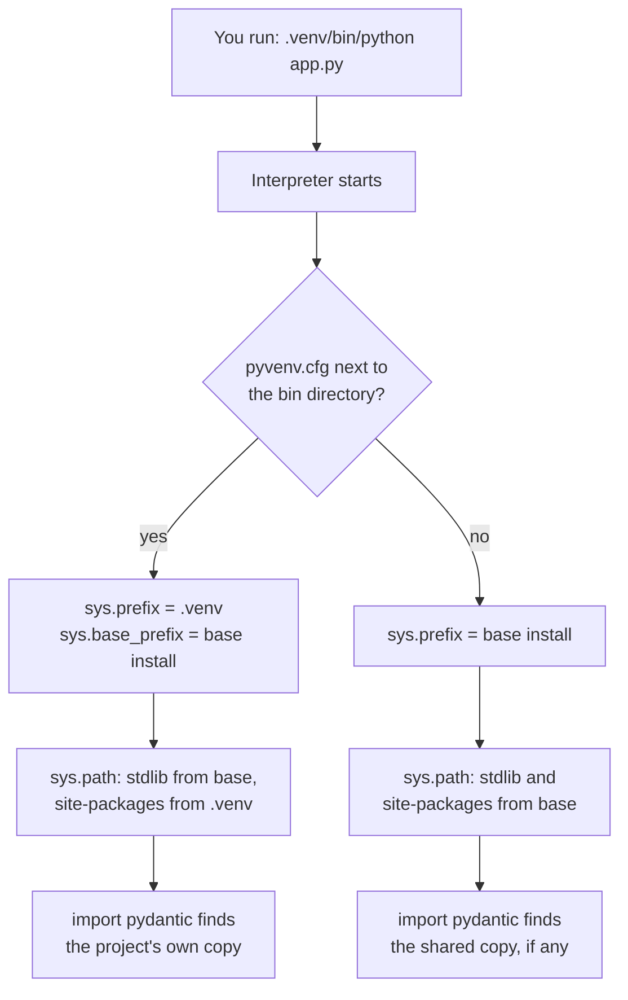

Every Python project you build in this course depends on other people's code: an HTTP client, a validation library, an embedding model library, a vector database client, perhaps a framework such as LangChain. Those packages have to live somewhere on disk, and the Python interpreter has to find them. If every project on your machine shares one place, they eventually collide: the ingestion pipeline needs one version of a library, the evaluation notebook needs another, and upgrading for one silently breaks the other.

A **virtual environment** is the standard answer: a self-contained directory holding one project's installed packages, used by a Python interpreter that looks there and nowhere else. This lesson explains what a virtual environment physically is, how Python decides where to find packages, what "activating" really does, and how to organise environments for the different parts of a RAG system. Choosing *which* versions to install and recording them reproducibly is the next lesson, [Dependency management](/learn/python-for-rag-engineering/dependency-management).

## Learning objectives

- Explain how the Python interpreter locates installed packages through `sys.prefix` and `sys.path`, and how a virtual environment changes that.
- Create, activate, use and delete a virtual environment with the standard `venv` module, on macOS, Linux and Windows.
- Diagnose the commonest environment errors, such as a package that "is installed" but cannot be imported.
- Decide how many environments a RAG project needs and which tool (`venv`, `uv`, conda, containers) suits each situation.

## Prerequisites

- [Python fundamentals](/learn/python-for-rag-engineering/python-fundamentals): running a script, importing a module.
- Basic use of a terminal: changing directory, running a command.

## Why this matters

Without isolation, every `pip install` changes a single shared pool of packages, usually the one belonging to the system's Python. Three problems follow.

**Conflicts.** Suppose Meridian's ingestion pipeline was written against Pydantic 1 and the new AskMeridian API service needs Pydantic 2, whose interface changed substantially. Only one version can be installed in a given location. Whichever project you installed last wins, and the other breaks with errors that have nothing to do with your code.

**Unreproducibility.** A shared pool accumulates packages from every project you have ever worked on. Your code may quietly depend on something you installed months ago for something else. It runs on your laptop and fails on a colleague's, in continuous integration and in production, and nobody can say which packages it really needs.

**Damage to the system.** On many Linux distributions and on macOS with Homebrew, the system's Python is used by operating-system tools. Installing or upgrading packages there can break those tools, which is why current versions of these systems refuse a plain `pip install` outside a virtual environment with an "externally-managed-environment" error (the mechanism is defined in PEP 668).

RAG projects are particularly exposed. Their dependency trees are large (an embedding library alone can pull in PyTorch, Transformers and dozens of others), they move quickly, and they often combine heavy offline components with lightweight online services that have no business sharing packages.

## The intuition

Think of a workshop shared by several carpenters. If everyone keeps tools on one wall, sooner or later someone replaces the chisel another person relied on, or borrows a saw and never returns it. The fix is a toolbox per job: each carpenter packs exactly the tools that job needs, at the sizes it needs, and nobody else touches them. The building (the operating system), the workbench and the electricity (the Python interpreter and its standard library) are still shared; only the tools are separated.

A virtual environment is that toolbox. It does not contain a whole new Python. It contains a pointer to an existing interpreter and a private shelf of packages. When you run Python "from" the environment, it uses the shared interpreter but reaches only for the private shelf.

## How it works

### How Python finds a package

When you write `import pydantic`, Python searches the directories listed in `sys.path`, in order, for a module or package called `pydantic`, and uses the first it finds. `sys.path` is built when the interpreter starts, from:

1. The directory of the script being run (or the current directory in an interactive session).
2. Any directories in the `PYTHONPATH` environment variable.
3. The standard library directories of the interpreter.
4. The **site-packages** directory, where installed third-party packages live. Its location is derived from `sys.prefix`, the root directory of the Python installation in use.

So "which packages can I import?" reduces to "what is `sys.prefix`?". A virtual environment works by changing `sys.prefix`.

### What a virtual environment is, physically

`python -m venv .venv` creates a directory, conventionally called `.venv` in the project root, with this layout on macOS and Linux:

```text
.venv/
├── pyvenv.cfg                 the marker file: where the base interpreter is
├── bin/                       (Scripts\ on Windows)
│   ├── python -> python3.x    a link to, or copy of, the base interpreter
│   ├── activate               shell scripts that adjust PATH
│   └── pip                    installed command-line tools appear here
├── include/
└── lib/python3.x/site-packages/   the private package shelf
```

The key file is `pyvenv.cfg`. On a Mac with Homebrew's Python it looks like this (project path shortened):

```text
home = /opt/homebrew/opt/python@3.15/bin
include-system-site-packages = false
version = 3.15.2
executable = /opt/homebrew/Cellar/python@3.15/3.15.2/Frameworks/Python.framework/Versions/3.15/bin/python3.15
command = /opt/homebrew/opt/python@3.15/bin/python3.15 -m venv /Users/you/askmeridian/.venv
```

At start-up, the interpreter looks for a `pyvenv.cfg` one directory above its own executable. If it finds one, it sets `sys.prefix` to the environment directory and `sys.base_prefix` to the original installation. The standard library still comes from the base installation (via `home`); site-packages comes from the environment. With `include-system-site-packages = false` (the default), the base installation's site-packages is not on `sys.path` at all.



The whole mechanism, step by step:

1. `python -m venv .venv` writes `pyvenv.cfg`, links or copies the interpreter into `.venv/bin`, creates an empty `site-packages`, and by default installs pip into it.
2. You run `.venv/bin/python` (directly, or because activation put `.venv/bin` first on your `PATH`).
3. That interpreter finds `pyvenv.cfg` and sets `sys.prefix` to `.venv`.
4. `sys.path` is built with the environment's `site-packages` in place of the base one.
5. `python -m pip install x` run by that interpreter installs into `sys.prefix`, which is the environment.
6. Imports resolve against the environment's packages only.

Two consequences matter in practice. First, the environment is tied to the base interpreter it was created from: its version, and its location. If that interpreter is upgraded or removed (a Homebrew upgrade from one minor version to the next is a common cause), the environment breaks and must be recreated. Second, environments are **not relocatable**: installed command-line scripts start with a "shebang" line containing the absolute path of the environment's Python, so moving or copying the directory leaves those scripts pointing at the old location. Treat an environment as disposable and rebuildable, never as something to copy, zip or commit.

### What activation does, and does not do

`source .venv/bin/activate` (macOS and Linux) or `.venv\Scripts\activate` (Windows) is a convenience, not a requirement. It:

- puts `.venv/bin` at the front of the `PATH` environment variable, so typing `python` or `pip` finds the environment's versions first;
- sets the `VIRTUAL_ENV` environment variable to the environment's path;
- changes the shell prompt to show the environment's name;
- defines a `deactivate` command that undoes all three.

It does **not** change anything inside Python. A process that runs `.venv/bin/python` directly gets exactly the same environment without activation, which is how you should run things in scripts, cron jobs, systemd services and Dockerfiles: name the interpreter explicitly. Activation only affects the shell it was run in; a new terminal tab starts unactivated.

### `python -m pip`, not `pip`

`pip` installs into the environment of the Python interpreter that runs it. The bare `pip` command is whatever `pip` comes first on your `PATH`, which may belong to a different interpreter from the `python` that comes first. `python -m pip install ...` removes the ambiguity: it runs pip with that specific interpreter, so packages go where that interpreter will look. The same applies to other tools: `python -m pytest`, `python -m uvicorn`.

### The tools around `venv`

`venv` is in the standard library and enough for most projects. Other tools build on the same idea or solve neighbouring problems:

| Tool | What it does | When it is the right choice |
| --- | --- | --- |
| `venv` | Creates an environment from an existing interpreter | Always available; the baseline |
| `uv` | A fast package and project manager written in Rust; `uv venv` creates environments and `uv sync` creates and fills `.venv` from a lock file | Teams that want fast installs and an integrated lock-file workflow |
| pyenv | Installs and switches between several Python *versions* | You need Python 3.11 for one project and 3.13 for another |
| conda | Environments that can also contain non-Python software (compilers, CUDA libraries) | Scientific stacks with complex native dependencies |
| Containers (Docker) | Isolate the whole operating system user space | Deployment; [Docker](/learn/deployment/docker) covers it |

These are not exclusive. A common production arrangement is a Docker image built from a specific Python version, with dependencies installed from a lock file; a common development arrangement is pyenv or uv to provide the interpreter plus a `.venv` per project.

### How many environments does a RAG project need?

One per **deployable unit with distinct dependencies**, plus one for each kind of exploratory work that would otherwise pollute them. For AskMeridian, the Platform team settled on:

- **Ingestion worker**: document parsers (PyMuPDF, pypdf), a local embedding model (Sentence Transformers, hence PyTorch), the Qdrant client. Heavy, runs offline.
- **API service**: FastAPI, the Anthropic SDK, the Qdrant client, an HTTP client. Light; must start fast and have a small attack surface.
- **Evaluation and notebooks**: everything above plus pandas, plotting and evaluation libraries; changes often.

Keeping PyTorch (which, depending on the build, can occupy from hundreds of megabytes to several gigabytes) out of the API service's environment makes its container images smaller and its deployments faster, and means a vulnerability in a parsing library cannot be reached through the API.

## In code

The examples below use only the standard library. They were run on macOS with Python 3.15; the commands are identical for any Python from 3.11 upwards.

### Example 1: create, use and inspect an environment

**The problem.** Set up an isolated environment for the AskMeridian API service and confirm that it really is isolated.

**Commands.** On macOS or Linux:

```bash
cd askmeridian
python3 -m venv .venv                 # create
source .venv/bin/activate             # activate (optional; changes PATH)
python -m pip install --upgrade pip   # tools inside the environment
python -m pip install httpx pydantic  # project dependencies
deactivate                            # leave
```

On Windows (PowerShell):

```bash
py -m venv .venv
.venv\Scripts\Activate.ps1
python -m pip install httpx pydantic
```

To see which interpreter and which packages a given Python uses, save this as `inspect_env.py` in the project root:

```python
import sys
from importlib.metadata import distributions
from pathlib import Path

here = Path.cwd()

def show(p: str) -> str:
    """Paths inside this project are shown relative to it; others are summarised."""
    path = Path(p).absolute()
    return f"./{path.relative_to(here)}" if path.is_relative_to(here) else "(elsewhere)"

names = {d.metadata["Name"].lower() for d in distributions()}
print("  sys.prefix:   ", show(sys.prefix))
print("  in a venv:    ", sys.prefix != sys.base_prefix)
print("  site-packages:", [show(p) for p in sys.path if p.endswith("site-packages")])
print("  distributions:", len(names), "| numpy:", "numpy" in names, "| pydantic:", "pydantic" in names)
```

Run it with three different interpreters: the base Python, the environment of another project that has many packages installed, and the new, empty `.venv`:

```bash
python3 inspect_env.py                            # base interpreter
~/other-project/.venv/bin/python inspect_env.py   # another project's environment
.venv/bin/python inspect_env.py                   # this project's new environment
```

```output
base interpreter
  sys.prefix:    (elsewhere)
  in a venv:     False
  site-packages: ['(elsewhere)']
  distributions: 1 | numpy: False | pydantic: False
another project's venv
  sys.prefix:    (elsewhere)
  in a venv:     True
  site-packages: ['(elsewhere)']
  distributions: 205 | numpy: True | pydantic: True
new .venv
  sys.prefix:    ./.venv
  in a venv:     True
  site-packages: ['./.venv/lib/python3.15/site-packages']
  distributions: 1 | numpy: False | pydantic: False
```

(The three headings were printed by the shell between the runs.)

**The important lines.**

- `sys.prefix != sys.base_prefix` is the check the Python documentation recommends for "am I in a virtual environment?".
- `importlib.metadata.distributions()` lists the installed distributions visible to *this* interpreter, which is exactly what it can import.
- The script prints paths relative to the project so you can see at a glance whether the environment lives inside it.

**What the output means.** The same script gives three different answers because three interpreters ran it. The other project's environment has 205 distributions, including NumPy and Pydantic; the new environment, created from the same base, has only pip (the one distribution counted). Nothing installed for one project is visible to another. The new environment's `site-packages` is inside the project, at `./.venv/lib/python3.15/site-packages`, which is where `python -m pip install` will put packages.

**Errors people commonly hit.**

- `ModuleNotFoundError` for a package you just installed: pip and Python belong to different environments. Run `python -m pip install ...` with the same `python` that runs your code, and check with `python -c "import sys; print(sys.prefix)"`.
- `error: externally-managed-environment` from pip: you are installing into a system Python that forbids it. Create and use a virtual environment; do not override the protection with `--break-system-packages` unless you understand exactly what you are changing.
- An editor or notebook that ignores your environment: IDEs and Jupyter pick their own interpreter. Select `.venv/bin/python` in the editor, and for Jupyter register the environment as a kernel with `python -m ipykernel install --user --name askmeridian` (after installing `ipykernel` into it).

### Example 2: refuse to run in the wrong environment

**The problem.** AskMeridian's ingestion script was once run by mistake with another project's environment, which happened to contain an older parser library; it produced subtly different text and polluted the index. Add a guard that stops the script unless it is running in the project's own environment on a supported Python.

```python
import sys
from pathlib import Path

def check_environment(project_root: Path, min_version: tuple[int, int] = (3, 11)) -> list[str]:
    """Return a list of problems with the interpreter running this code."""
    problems = []
    if sys.version_info[:2] < min_version:
        problems.append(f"Python {sys.version_info[0]}.{sys.version_info[1]} is older than "
                        f"{min_version[0]}.{min_version[1]}")
    if sys.prefix == sys.base_prefix:
        problems.append("not running inside a virtual environment")
    elif not Path(sys.prefix).absolute().is_relative_to(project_root.absolute()):
        problems.append("running inside a virtual environment that belongs to another project")
    return problems

if __name__ == "__main__":
    problems = check_environment(Path.cwd())
    print("OK" if not problems else "\n".join(f"problem: {p}" for p in problems))
```

Run with the same three interpreters as before:

```output
base:
problem: not running inside a virtual environment
other venv:
problem: running inside a virtual environment that belongs to another project
project venv:
OK
```

**Extending it.** In a real script, call `check_environment` at start-up and exit with `sys.exit(1)` if it returns problems. In containers, where the image itself is the isolation and there may be no virtual environment, make the venv check configurable. A stricter version compares installed versions against the lock file, which the next lesson shows.

## A real-world example

Meridian's Platform team kept AskMeridian's ingestion code and its API service in one repository with one `.venv`. It worked for months. Then a developer added an evaluation notebook and installed a newer version of an LLM framework into the shared environment to try a feature. The upgrade pulled in a newer version of a shared HTTP library as a transitive dependency. The notebook worked. The next morning, the API service's tests failed with an `AttributeError` deep inside the vector database client, which had relied on behaviour the newer HTTP library had removed.

Nothing in the API service's code had changed. Its environment had, because it was shared with code that had nothing to do with serving requests.

The team made three changes. They split the repository's environments by deployable unit (ingestion, API, evaluation), each with its own dependency list and lock file, and each created by a single documented command. They made every service's start-up script call its environment's interpreter by path rather than relying on activation. And they rebuilt environments from scratch in continuous integration on every change, so that "works on my machine" could no longer depend on a package someone had once installed by hand. The insight they recorded: an environment is part of the build, so it must be created by a script, never curated by hand.

## Common mistakes

- **Installing into the system Python** with `sudo pip install` or `--break-system-packages`. It can break operating-system tools, and your project now depends on an unrecorded global state.
- **One environment for everything.** Unrelated projects or components share packages, so upgrading for one breaks another.
- **Running bare `pip`.** It may belong to a different interpreter from `python`, so packages land somewhere your code cannot see. Use `python -m pip`.
- **Committing `.venv` to version control.** It is large, platform-specific and not relocatable. Add it to `.gitignore` and commit the dependency list instead.
- **Copying or moving an environment.** Scripts inside contain absolute paths to the old location and stop working. Recreate it instead.
- **Relying on activation in automation.** Cron jobs, services and Dockerfiles do not run your shell's activation. Call `.venv/bin/python` explicitly.
- **Treating a virtual environment as a security boundary.** It isolates package versions only; code in it runs with your full user permissions.

## Best practices

- Create one virtual environment per project, or per deployable unit within a project, at `.venv` in its root, and add `.venv/` to `.gitignore`.
- Create environments with a script or a single documented command from a recorded dependency list, so they can be rebuilt at any time; delete and recreate rather than repair.
- Pin the Python version as well as the packages (for example with a `.python-version` file read by pyenv or uv, and `requires-python` in `pyproject.toml`).
- Always invoke tools through the environment's interpreter: `python -m pip`, `python -m pytest`, `.venv/bin/python script.py`.
- Keep heavy, offline-only dependencies (PyTorch, parsers, evaluation libraries) out of the environment of the latency-sensitive API service.
- Rebuild environments from scratch in continuous integration, so undeclared dependencies are caught before production.

## Performance considerations

A virtual environment adds no runtime cost: once the interpreter has started, imports are as fast as from any other site-packages directory. The costs are disk space and installation time.

- **Disk.** Each environment holds its own copy of every package. If three environments each contain PyTorch at, say, 1 GB (an assumed size; CPU-only builds are smaller and builds bundling GPU libraries larger), that is 3 GB for one library. This is one more reason to keep it only where it is needed.
- **Install time.** Downloading is avoided by pip's cache, which is shared between environments, but pip still unpacks a full copy into each one. uv keeps a global cache and, where the file system allows, links files from it into environments instead of copying them, which makes creating a populated environment much faster and saves disk. Measure on your own machine rather than trusting quoted figures.
- **Container builds.** In Docker, install dependencies in a layer that comes before copying your source code, so that changing a line of code does not reinstall every package. [Docker](/learn/deployment/docker) covers this layer ordering.

## Security considerations

- **Installing a package runs code.** Building a package from a source distribution can execute arbitrary code at install time, and any package runs arbitrary code when imported. An environment limits *which versions* are visible, not what that code can do. Only install packages you intend to, from the index you intend to; [Dependency management](/learn/python-for-rag-engineering/dependency-management) covers pinning and hash checking.
- **Never install with `sudo`.** Running pip as root gives every installed package's install-time code root privileges.
- **Keep secrets out of the environment directory.** API keys belong in environment variables or a secret manager, not in files inside `.venv` or in a `.env` file committed to the repository.
- **Smaller environments are smaller attack surfaces.** A service whose environment contains only what it needs has fewer packages whose vulnerabilities can affect it.

## Summary

- Python finds packages through `sys.path`, whose site-packages entry is derived from `sys.prefix`; a virtual environment works by changing `sys.prefix` to a private directory.
- An environment is a directory with a `pyvenv.cfg`, an interpreter link, and its own `site-packages`; it reuses the base interpreter and standard library.
- Activation only edits `PATH` and the prompt for the current shell; running `.venv/bin/python` directly is equivalent and is what automation should do.
- Use `python -m pip` so that packages go into the environment of the interpreter you will run.
- Environments are disposable and not relocatable: create them from a recorded dependency list by script, never commit or copy them.
- Separate environments by deployable unit; keep heavy offline dependencies away from the online API.

## Exercises

**1.** A colleague runs `pip install pydantic`, sees "Successfully installed", then runs `python app.py` and gets `ModuleNotFoundError: No module named 'pydantic'`. List two commands that would diagnose the problem and the fix.

<details><summary>Show solution</summary>

Diagnose which interpreter each command uses:

```bash
which python pip          # on Windows: where python pip
python -c "import sys; print(sys.prefix)"
pip --version             # prints the location and the Python it belongs to
```

If `pip --version` reports a different Python or location from `sys.prefix`, pip installed into another environment. The fix is to install with the interpreter that runs the code: `python -m pip install pydantic`. If `python` is not the project's environment at all, activate it or run `.venv/bin/python app.py`.

</details>

**2.** Explain why copying a working `.venv` directory to a server, with the same operating system and Python version, may still fail, and what to do instead.

<details><summary>Show solution</summary>

`pyvenv.cfg` records the location of the base interpreter (`home`), and installed scripts in `.venv/bin` begin with a shebang containing the absolute path of the environment's Python. On the server those paths may not exist, so the interpreter cannot find its standard library or the scripts point at a non-existent Python. Compiled extensions may also have been built for a different CPU architecture or system library version.

Instead, copy the dependency list (ideally a lock file), create a fresh environment on the server with `python -m venv .venv`, and install from the lock file. In container-based deployment, do the same inside the image build.

</details>

**3.** Extend Example 2 so that it also checks that a list of required packages is installed in the running environment, using `importlib.metadata.version`, and reports any that are missing. Test it with `["pydantic", "httpx", "not-a-real-package"]`.

<details><summary>Show solution</summary>

```python
import sys
from importlib.metadata import version, PackageNotFoundError

def missing_packages(required: list[str]) -> list[str]:
    missing = []
    for name in required:
        try:
            version(name)
        except PackageNotFoundError:
            missing.append(name)
    return missing

required = ["pydantic", "httpx", "not-a-real-package"]
for name in required:
    try:
        print(f"{name:<20} {version(name)}")
    except PackageNotFoundError:
        print(f"{name:<20} MISSING")
print("missing:", missing_packages(required))
```

Run in an environment with Pydantic and HTTPX installed, it printed:

```output
pydantic             2.14.3
httpx                0.28.1
not-a-real-package   MISSING
missing: ['not-a-real-package']
```

Your version numbers will differ. `version()` looks up installed *distribution* metadata, which is why it is the right tool here: it checks what is installed without importing it, so it is fast and cannot trigger import-time side effects. Note that distribution names and import names can differ (the distribution `PyMuPDF` is imported as `fitz` or `pymupdf`), so check distribution names.

</details>

**4.** Design decision. AskMeridian has four pieces of Python code: the nightly ingestion worker (PDF parsing, local embeddings on a GPU), the FastAPI service, an evaluation suite run in continuous integration, and analysts' Jupyter notebooks. Propose an environment layout, say which tool creates each environment, and explain one risk your design removes.

<details><summary>Show solution</summary>

One reasonable design:

- **Ingestion worker**: its own dependency list including PyTorch with GPU support. Because GPU builds depend on system libraries, build it as a Docker image from a CUDA-enabled base image, with the Python dependencies installed from a lock file. conda is a reasonable alternative if the team already uses it.
- **API service**: a separate, minimal dependency list (FastAPI, the Anthropic SDK, the Qdrant client, an HTTP client), no PyTorch. A lock file, a `.venv` for development and a slim Docker image for production.
- **Evaluation suite**: its own environment, which may include the API service's package plus evaluation libraries, rebuilt from scratch in continuous integration on every run.
- **Notebooks**: a separate environment, registered as a Jupyter kernel, that analysts may change freely; its contents never feed into production builds.

Tooling: `uv` (or `venv` plus pip-tools) to create the development environments from lock files, pyenv or uv to pin the Python version, Docker for the deployed units.

Risk removed: an experimental upgrade in a notebook or the evaluation suite can no longer change the API service's dependencies, which was the failure in the real-world example. A second benefit: the API image no longer carries gigabytes of GPU libraries, so it builds and deploys faster and exposes fewer packages.

</details>

## Check your understanding

```quiz
[
  {
    "q": "What does `source .venv/bin/activate` actually change?",
    "options": [
      "It copies the project's packages into the system Python",
      "It puts .venv/bin first on PATH, sets VIRTUAL_ENV and changes the prompt, for the current shell only",
      "It permanently changes which Python the whole computer uses",
      "It starts a new Python process that stays running in the background"
    ],
    "answer": 1,
    "why": "Activation is a shell convenience. Running .venv/bin/python directly has the same effect inside Python, with no activation at all."
  },
  {
    "q": "How does a Python interpreter know that it is running inside a virtual environment?",
    "options": [
      "It reads the VIRTUAL_ENV environment variable",
      "It checks whether the current directory is called .venv",
      "It asks pip",
      "It finds a pyvenv.cfg file one directory above its executable and sets sys.prefix accordingly"
    ],
    "answer": 3,
    "why": "The pyvenv.cfg marker drives sys.prefix and therefore site-packages. VIRTUAL_ENV is set by activation but is not what the interpreter uses."
  },
  {
    "q": "Why is `python -m pip install x` preferred over `pip install x`?",
    "options": [
      "It installs into the environment of exactly the interpreter you name, avoiding a mismatch between pip and python",
      "It downloads packages faster",
      "It skips dependency resolution",
      "It installs packages for every Python on the machine"
    ],
    "answer": 0,
    "why": "pip installs into the environment of the Python running it. python -m pip guarantees that is the same python you will use to run your code."
  },
  {
    "q": "Which of these should be committed to version control?",
    "options": [
      "The .venv directory",
      "The site-packages directory",
      "The dependency list or lock file used to recreate the environment",
      "The compiled .pyc files"
    ],
    "answer": 2,
    "why": "Environments are platform-specific, large and not relocatable. Commit the recipe and rebuild the environment wherever it is needed."
  },
  {
    "q": "A virtual environment is created with Python 3.12 from Homebrew. Homebrew later upgrades to Python 3.13 and removes 3.12. What is the most likely result?",
    "options": [
      "The environment silently upgrades itself to 3.13",
      "Nothing changes, because the environment contains a full copy of Python",
      "Only packages with compiled code stop working",
      "The environment breaks, because its interpreter link and pyvenv.cfg point to an interpreter that no longer exists"
    ],
    "answer": 3,
    "why": "An environment depends on its base interpreter. When that is removed, the environment must be recreated with the new Python."
  }
]
```

## Further reading

- Python documentation, [`venv`: Creation of virtual environments](https://docs.python.org/3/library/venv.html), including how venvs work and the `sys.prefix` check.
- Python Packaging User Guide, [Installing packages using pip and virtual environments](https://packaging.python.org/en/latest/guides/installing-using-pip-and-virtual-environments/).
- PEP 405, "Python Virtual Environments" (Meyer, 2011): the design of `venv` and `pyvenv.cfg`.
- PEP 668, "Marking Python base environments as externally managed" (2021): the origin of the "externally-managed-environment" error.
- Python documentation, [The initialization of the `sys.path` module search path](https://docs.python.org/3/library/sys_path_init.html).
- uv documentation, [docs.astral.sh/uv](https://docs.astral.sh/uv/).
