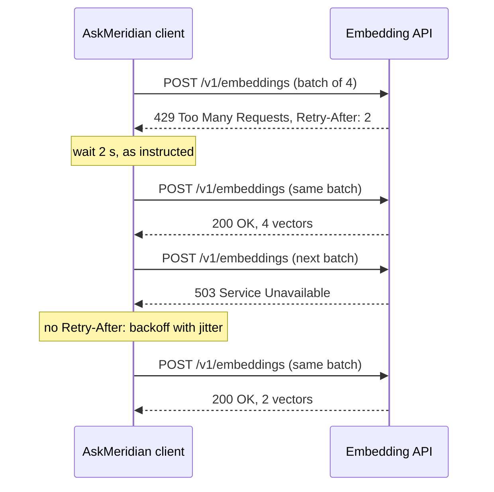

Almost every component of a RAG system is reached through an API. The embedding model is usually a hosted service. The language model is an HTTP endpoint. The vector database, the reranker, the document management system the handbook lives in, the ticketing system that holds IT runbooks: each is a server you send requests to and receive responses from. A RAG engineer spends a surprising share of their time writing and debugging the code at those boundaries, and most production incidents in RAG systems start there: a timeout nobody set, a rate limit nobody respected, a response nobody validated.

This lesson teaches how to work with web APIs from Python properly: the anatomy of an HTTP request and response, what status codes mean for your code, authentication, timeouts, retries that respect the server's instructions, batching, pagination, client-side rate limiting, and validating what comes back. It applies the retry and error-classification machinery from [Exception handling](/learn/python-for-rag-engineering/exception-handling) and the concurrency from [Async programming](/learn/python-for-rag-engineering/async-programming) to real HTTP clients. Building your *own* API (the service AskMeridian exposes to its users) is the subject of the [Backend Engineering](/learn/backend-engineering) module.

## Learning objectives

- Describe the parts of an HTTP request and response, and map each status-code class to an action your client should take.
- Build a reusable API client with `httpx` that authenticates from the environment, sets timeouts, batches inputs, retries transient failures honouring `Retry-After`, and validates responses with Pydantic.
- Consume a cursor-paginated endpoint completely and correctly.
- Implement a token-bucket rate limiter and calculate when a burst of requests will be sent.
- Call the Anthropic Messages API with sensible timeout, retry and error-handling settings.

## Prerequisites

- [Dataclasses and Pydantic](/learn/python-for-rag-engineering/dataclasses-and-pydantic): defining models and validating data against them.
- [Async programming](/learn/python-for-rag-engineering/async-programming): coroutines, `gather` and semaphores.
- [Exception handling](/learn/python-for-rag-engineering/exception-handling): transient and permanent errors, backoff with jitter.
- [Model inference](/learn/understanding-large-language-models/model-inference): why a language model call takes seconds and what streaming changes.

## Why this matters

Code that calls an API works on the first try in development almost every time. The problems appear under real conditions:

- **No timeout.** The popular `requests` library has no default timeout, so a server that accepts a connection and then stalls blocks the caller forever. One hung call in an ingestion job means a job that never finishes and never fails.
- **Ignoring rate limits.** Embedding 50,000 chunks as fast as possible earns a wall of `429 Too Many Requests` responses. Without handling, the job crashes; with naive retries, it hammers the provider and gets throttled harder.
- **Trusting responses.** An API changes a field name, returns an error page with a `200` status, or returns results in a different order. Without validation, malformed data flows silently into the index or the prompt.
- **Partial data.** An endpoint returns results in pages of 100. Code that reads only the first page indexes 100 handbook pages and silently skips the rest.
- **Leaked keys.** An API key is hard-coded, logged in a request dump, or committed to a repository.

Each of these produces a RAG system that is unreliable, expensive or insecure, and most produce no error message. A disciplined client fixes all of them in one place.

## The intuition

Calling an API is like ordering from a busy kitchen through a hatch. You hand over a slip (the request) that says what you want, with your table number (authentication) and any details (the body). The kitchen hands back a plate with a ticket (the response and its status code).

A good diner knows the kitchen's conventions. If the ticket says "we're swamped, come back in two minutes" (`429` with `Retry-After: 120`), you come back in two minutes, not every five seconds. If it says "we don't serve that" (`400`), asking again will not change the answer. If the hatch stays shut for ten minutes, you stop waiting (a timeout) rather than standing there all night. If your order is for forty people, you hand over a few large slips rather than forty small ones (batching), and if the menu is long, you read it page by page until there are no more pages (pagination). And you check that what arrives is what you ordered before serving it (validation).

## How it works

### Anatomy of an HTTP exchange

An HTTP **request** has:

1. A **method**: `GET` (read), `POST` (create or compute), `PUT` (replace), `PATCH` (modify), `DELETE` (remove).
2. A **URL**: scheme, host, path and optional query parameters, such as `https://api.example.com/v1/pages?limit=100&cursor=abc`.
3. **Headers**: metadata as name and value pairs, such as `Authorization: Bearer <key>`, `Content-Type: application/json`.
4. An optional **body**: for most RAG APIs, a JSON document such as `{"model": "...", "input": ["text one", "text two"]}`.

A **response** has a **status code**, headers and a body. The status code is the first thing your code must look at, because it tells you which of a few completely different situations you are in:

| Class | Meaning | Examples | What the client should do |
| --- | --- | --- | --- |
| 2xx | Success | `200 OK`, `201 Created` | Validate and use the body |
| 3xx | Redirection | `301`, `307` | Usually followed automatically (in `httpx`, only if you enable `follow_redirects`) |
| 4xx | Your request is wrong | `400` bad input, `401` bad credentials, `403` not allowed, `404` not found, `413`/`422` invalid or too large | Do not retry; fix the request. Exceptions: `408` and `429` |
| 429 | Too many requests | Rate limit exceeded | Wait (as long as `Retry-After` says, if present) and retry |
| 5xx | The server failed | `500`, `502`, `503`, `504` | Retry with backoff, a limited number of times |

`408 Request Timeout` and `429` are the 4xx codes that describe a moment rather than a mistake, which is why they are retryable. The `Retry-After` header, defined in the HTTP standard, gives either a number of seconds or a date; when a server sends it, it is better information than any backoff formula. Some providers also use non-standard codes; Anthropic's API, for example, documents a `529` status for an overloaded service.



### Idempotency and safe retries

A method is **idempotent** if sending the same request twice has the same effect as sending it once. `GET`, `PUT` and `DELETE` are idempotent by definition; `POST` is not in general. That matters when a request times out: you do not know whether the server processed it. Retrying a `POST` that computes embeddings is harmless (the worst case is paying twice). Retrying a `POST` that appends documents to an index may create duplicates. Some APIs accept an **idempotency key**, a unique identifier you send in a header so the server can recognise and ignore a repeat; others offer upsert operations keyed by your own document identifiers. Use one or the other for any write you might retry.

### Authentication

Most APIs RAG engineers use authenticate with an **API key**: a secret string sent in a header on every request. The header name varies by provider (`Authorization: Bearer <key>` is common; Anthropic's API uses `x-api-key`, which its SDK sets for you). Three rules apply everywhere:

- Read keys from environment variables or a secret manager, never from source code.
- Never log the headers of a request that carries a key.
- Use separate keys per environment (development, production) and per service, so that one can be revoked without breaking the others.

Internal APIs often use OAuth 2.0 tokens instead, which expire and must be refreshed; the shape of the client is the same, with a step that obtains or renews the token.

### Timeouts

A network call can stall at several points, and `httpx` lets you bound each one separately:

- **connect**: establishing the connection. Should be short (a few seconds); if it fails, the server is unreachable.
- **read**: waiting for data once connected. Must cover the server's processing time, so it depends on the endpoint: a fraction of a second for a vector search, tens of seconds or more for a long, non-streamed language model answer.
- **write**: sending the request body.
- **pool**: waiting for a free connection from the client's own pool.

`httpx` applies a 5-second default to all four. That is a sensible guard, but too short for some language model calls, so set timeouts explicitly per client. For long generations, stream the response instead of raising the read timeout indefinitely; [Model inference](/learn/understanding-large-language-models/model-inference) explains why.

### Clients, connections and reuse

Opening a new HTTPS connection costs several network round trips (TCP and TLS handshakes) before the first byte of your request is sent. An `httpx.Client` (or `httpx.AsyncClient`) keeps a pool of open connections and reuses them across requests. Create one client per external service when your application starts, configure it once (base URL, headers, timeouts), and reuse it. Creating a client per request, or using module-level helpers such as `httpx.post`, discards the pool every time.

### Batching

Most embedding APIs accept a list of inputs per request, up to a provider-specific limit on the number of inputs and on total tokens. Sending 100 texts in one request instead of 100 requests cuts overhead and counts once against request-based rate limits. The client must split the input into batches that respect the limits and reassemble the results **in order**: match each output to its input by the index the API returns, rather than assuming the list order was preserved.

### Pagination

Endpoints that list things (documents in a content system, points in a collection) return results in **pages**. Two common schemes:

- **Offset pagination**: `?offset=200&limit=100`. Simple, but if items are added or removed while you page through, you can skip or repeat items.
- **Cursor pagination**: each response includes an opaque `next_cursor` (sometimes a `next` URL); you pass it back to get the next page, and stop when it is absent. Stable under concurrent changes, and the more common choice in modern APIs.

Either way, the client must loop until the API says there is nothing more, not stop after the first page.

### Rate limiting on the client side

Providers enforce limits, commonly in requests per minute and tokens per minute. Reacting to `429` responses works, but it is better to avoid them: a **client-side rate limiter** spaces your requests so you stay under the limit. The standard algorithm is the **token bucket**, described in the mathematics section below. For concurrency (how many requests are in flight at once), use a semaphore sized with Little's law, as in [Async programming](/learn/python-for-rag-engineering/async-programming). The two controls are complementary: one limits rate, the other limits simultaneity.

### Validating responses

A response body is untrusted data from outside your program. Parse it into a Pydantic model before using it. Validation catches a changed field name, a `null` where a list was expected or an error page served with a `200` status, and turns them into a clear `ValidationError` at the boundary, instead of an `AttributeError` or a silently wrong index three stages later.

### The client, step by step

Putting it together, a well-behaved call does this:

1. Take a configured, shared client (base URL, auth header from the environment, timeouts).
2. Split inputs into batches within the provider's limits; wait for the rate limiter.
3. Send the request.
4. On a transport error (timeout, connection reset), treat it as transient.
5. On a 2xx status, validate the body and return it.
6. On `408`, `429` or 5xx, wait (using `Retry-After` if present, otherwise backoff with jitter) and retry, up to a limit.
7. On any other 4xx, raise a descriptive error at once.
8. Reassemble batched results in input order.

## The mathematics

### The token bucket

**Intuition.** Imagine a bucket that holds up to $B$ tokens and is refilled at a steady $r$ tokens per second. Each request removes one token. If the bucket has a token, the request goes immediately; if not, it waits until one has dripped in. A full bucket allows a burst of $B$ requests at once; after that, requests flow at the refill rate.

$$
\text{tokens}(t) = \min\!\big(B,\; \text{tokens}(t_0) + r\,(t - t_0)\big)
$$

$B$ is the bucket's capacity (the largest burst), $r$ the refill rate in tokens per second, $t_0$ the time of the last update and $t$ the current time. The $\min$ stops the bucket overfilling during quiet periods.

If $n$ requests arrive together at a full bucket, the $k$-th request (counting from 1) can be sent at

$$
t_k = \max\!\left(0,\; \frac{k - B}{r}\right)
$$

**By hand.** With $r = 2$ per second and $B = 5$, twelve requests arrive at once. Requests 1 to 5 go immediately. Request 6 waits $(6 - 5)/2 = 0.5$ s, request 7 waits 1 s, and request 12 waits $(12 - 5)/2 = 3.5$ s.

### Choosing the rate from a tokens-per-minute limit

Language model and embedding providers often limit **tokens** per minute as well as requests. If the limit is $T$ tokens per minute and an average request uses $\bar{x}$ tokens, the sustainable request rate is

$$
r = \frac{T}{60\,\bar{x}} \text{ requests per second}
$$

**By hand.** With an assumed limit of $T = 1{,}000{,}000$ tokens per minute and batches averaging $\bar{x} = 25{,}000$ tokens (100 chunks of about 250 tokens), $r = 1{,}000{,}000 / (60 \times 25{,}000) \approx 0.67$ requests per second, or 40 requests per minute. A request-based limit of hundreds per minute would never be the binding constraint; the token limit is. Use the lower of the two rates.

```python
class TokenBucket:
    """Allow `rate` requests per second on average, with bursts of up to `capacity`."""

    def __init__(self, rate: float, capacity: float, now: float = 0.0):
        self.rate, self.capacity = rate, capacity
        self.tokens, self.updated = capacity, now        # start full

    def wait_time(self, now: float, cost: float = 1.0) -> float:
        """Seconds to wait before a request costing `cost` tokens may be sent; 0 if now."""
        self.tokens = min(self.capacity, self.tokens + (now - self.updated) * self.rate)
        self.updated = now
        if self.tokens >= cost:
            self.tokens -= cost
            return 0.0
        wait = (cost - self.tokens) / self.rate
        self.tokens -= cost                              # reserve: the balance goes negative
        return wait

# 2 requests per second on average, bursts of up to 5. Twelve requests arrive at t = 0.
bucket = TokenBucket(rate=2.0, capacity=5)
send_times = [round(bucket.wait_time(now=0.0), 2) for _ in range(12)]
print("send at (s):", send_times)
print("last request sent at", send_times[-1], "s; formula (12 - 5) / 2 =", (12 - 5) / 2)

# After a quiet spell, the bucket refills, but never above its capacity.
print("tokens after 30 s idle:", min(bucket.capacity, bucket.tokens + 30 * bucket.rate))
```

```output
send at (s): [0.0, 0.0, 0.0, 0.0, 0.0, 0.5, 1.0, 1.5, 2.0, 2.5, 3.0, 3.5]
last request sent at 3.5 s; formula (12 - 5) / 2 = 3.5
tokens after 30 s idle: 5
```

The time is passed in rather than read from a clock, which makes the class easy to test. Allowing the balance to go negative is how each waiting request **reserves** its future token, so that concurrent callers queue in order rather than all waking at the same moment. The `cost` parameter lets the same bucket count model tokens instead of requests: pass the estimated token count of each batch.

## In code

The examples run offline. They use `httpx.MockTransport`, a feature of `httpx` that routes requests to a Python function instead of the network, so the fake server's behaviour (rate limits, failures, pages) is exactly reproducible. The client code is the same code you would point at a real service; only the `transport` argument differs.

```bash
pip install httpx pydantic
```

### Example 1: a robust embedding client

**The problem.** AskMeridian's ingestion job calls a hosted embedding service. The service accepts at most four inputs per request, sometimes rate-limits with `Retry-After`, occasionally returns `503`, and rejects over-long inputs with `400`. Write a client that handles all of this.

```python
import json
import os
import random
import time

import httpx
from pydantic import BaseModel

# ---------------------------------------------------------------------------
# A fake embedding service, so the example runs offline. It behaves like many
# real ones: bearer-token auth, a batch limit, one 429 and one 503 to recover from.
# ---------------------------------------------------------------------------
script = iter(["429", "ok", "503", "ok", "ok", "ok"])     # what the server does per call

def fake_service(request: httpx.Request) -> httpx.Response:
    if request.headers.get("authorization") != "Bearer test-key":
        return httpx.Response(401, json={"error": "invalid API key"})
    body = json.loads(request.content)
    if len(body["input"]) > 4:
        return httpx.Response(400, json={"error": "at most 4 inputs per request"})
    if any(len(t) > 200 for t in body["input"]):
        return httpx.Response(400, json={"error": "input too long"})
    outcome = next(script)
    if outcome == "429":
        return httpx.Response(429, headers={"Retry-After": "2"}, json={"error": "rate limited"})
    if outcome == "503":
        return httpx.Response(503, json={"error": "overloaded"})
    data = [{"index": i, "embedding": [round(len(t) / 100, 2), 0.5]} for i, t in enumerate(body["input"])]
    return httpx.Response(200, json={"data": data, "model": body["model"],
                                     "usage": {"tokens": sum(len(t.split()) for t in body["input"])}})

# ---------------------------------------------------------------------------
# The client: the part you would actually write.
# ---------------------------------------------------------------------------
class EmbeddingItem(BaseModel):
    index: int
    embedding: list[float]

class EmbeddingResponse(BaseModel):
    data: list[EmbeddingItem]
    model: str

class EmbeddingAPIError(Exception):
    def __init__(self, status: int, message: str):
        super().__init__(f"HTTP {status}: {message}")
        self.status = status

RETRYABLE = {408, 429, 500, 502, 503, 504}

class EmbeddingClient:
    def __init__(self, base_url: str, *, transport=None, max_attempts=4, batch_size=4,
                 sleep=time.sleep, rng=random.Random()):
        self.http = httpx.Client(
            base_url=base_url,
            headers={"Authorization": f"Bearer {os.environ['EMBED_API_KEY']}"},
            timeout=httpx.Timeout(10.0, connect=3.0),   # never wait forever
            transport=transport,
        )
        self.max_attempts, self.batch_size = max_attempts, batch_size
        self.sleep, self.rng = sleep, rng

    def _post(self, payload: dict) -> dict:
        for attempt in range(1, self.max_attempts + 1):
            try:
                response = self.http.post("/v1/embeddings", json=payload)
            except httpx.TransportError as exc:          # connect/read timeouts, resets
                status, message = None, repr(exc)
                wait = self.rng.uniform(0, 2 ** (attempt - 1))      # full jitter
            else:
                if response.is_success:
                    return response.json()
                status, message = response.status_code, response.json().get("error", "")
                if status not in RETRYABLE:
                    raise EmbeddingAPIError(status, message)          # permanent: fail fast
                retry_after = response.headers.get("Retry-After")       # the server's own advice
                wait = float(retry_after) if retry_after else self.rng.uniform(0, 2 ** (attempt - 1))
            if attempt == self.max_attempts:
                raise EmbeddingAPIError(status or 0, f"gave up: {message}")
            print(f"  {status} {message!r}: retry {attempt} in {wait:.2f} s")
            self.sleep(wait)

    def embed(self, texts: list[str], model: str = "meridian-embed-small") -> list[list[float]]:
        vectors: list[list[float]] = []
        for start in range(0, len(texts), self.batch_size):        # respect the batch limit
            batch = texts[start:start + self.batch_size]
            parsed = EmbeddingResponse.model_validate(self._post({"model": model, "input": batch}))
            ordered = sorted(parsed.data, key=lambda item: item.index)   # never trust order
            vectors.extend(item.embedding for item in ordered)
        return vectors

os.environ.setdefault("EMBED_API_KEY", "test-key")      # demo only: real keys come from the environment
client = EmbeddingClient("https://embed.example.internal", transport=httpx.MockTransport(fake_service),
                         sleep=lambda s: None, rng=random.Random(1))
texts = ["Annual leave is 25 days.", "Up to 5 unused days carry over.",
         "Remote work: up to 3 days a week.", "The equipment budget is £400.",
         "Expenses over £75 need a receipt.", "Passwords rotate every 90 days."]
vectors = client.embed(texts)
print(f"embedded {len(vectors)} texts; first vector {vectors[0]}")

try:
    client.embed(["x" * 500])
except EmbeddingAPIError as exc:
    print("permanent error:", exc)
```

```output
  429 'rate limited': retry 1 in 2.00 s
  503 'overloaded': retry 1 in 0.13 s
embedded 6 texts; first vector [0.24, 0.5]
permanent error: HTTP 400: input too long
```

**The important lines.**

- `httpx.Client(base_url=..., headers=..., timeout=...)` configures everything once. The key comes from `os.environ`; if it is missing, the client fails at construction with a `KeyError` that names the variable, which is better than an authentication error at the first request.
- `httpx.Timeout(10.0, connect=3.0)` sets 10 s for read, write and pool, and 3 s to connect.
- `except httpx.TransportError` catches network-level failures, including `httpx.TimeoutException`; they are retried as transient.
- `if status not in RETRYABLE: raise` sends `400`, `401`, `403`, `404` and the like straight to the caller.
- `Retry-After` overrides the backoff calculation. (This client assumes the seconds form of the header; a production client should also handle the date form, or use a library that does.)
- `EmbeddingResponse.model_validate(...)` checks the shape of every response, and `sorted(..., key=item.index)` restores input order before results are appended.

**What the output means.** Six texts with a batch size of 4 made two batches. The first batch was rate-limited, waited the 2 s the server asked for, and succeeded. The second hit a `503` with no `Retry-After`, so it used a jittered backoff (0.13 s) and succeeded. The over-long input raised immediately, with no retries. (The demo replaces `sleep` with a function that does nothing, so it runs instantly.)

**Errors people commonly hit.**

- `httpx.ReadTimeout` on long requests: the read timeout is shorter than the server's processing time. Raise it for that endpoint, or stream.
- `json.JSONDecodeError` when handling an error: some gateways return HTML error pages for `502` and `504`. Read `response.text` if `response.json()` fails, rather than letting the error handler crash. The demo's `response.json().get("error")` would need that guard in production.
- `pydantic.ValidationError` after a provider update: the response shape changed. That is validation doing its job; update the model deliberately.

**Extending it.** Add the token bucket from the mathematics section before each request; record `usage.tokens` from each response for [cost tracking](/learn/rag-observability/cost-tracking); and split batches by estimated token count as well as by number of inputs.

### Example 2: reading every page

**The problem.** The HR team's content system exposes the employee handbook through a cursor-paginated API. The ingestion job must fetch every page, not just the first.

```python
from collections.abc import Iterator
import httpx

PAGES = [  # what the fake content API holds: 7 handbook pages
    {"id": f"hb-{n}", "title": t, "updated": "2026-10-0" + str(n)}
    for n, t in enumerate(["Annual leave", "Remote work", "Expenses", "Equipment budget",
                           "Passwords", "VPN", "Laptop refresh"], start=1)
]

def fake_content_api(request: httpx.Request) -> httpx.Response:
    limit = int(request.url.params.get("limit", 3))
    cursor = request.url.params.get("cursor")
    start = int(cursor) if cursor else 0
    page = PAGES[start:start + limit]
    next_cursor = str(start + limit) if start + limit < len(PAGES) else None
    return httpx.Response(200, json={"items": page, "next_cursor": next_cursor})

def iter_pages(client: httpx.Client, path: str, limit: int = 3) -> Iterator[dict]:
    """Yield every item from a cursor-paginated endpoint, one page at a time."""
    params = {"limit": limit}
    while True:
        response = client.get(path, params=params)
        response.raise_for_status()                 # turn 4xx/5xx into httpx.HTTPStatusError
        body = response.json()
        print(f"  fetched page with cursor={params.get('cursor')}: {len(body['items'])} items")
        yield from body["items"]
        if not body["next_cursor"]:
            return
        params["cursor"] = body["next_cursor"]

with httpx.Client(base_url="https://content.example.internal",
                  transport=httpx.MockTransport(fake_content_api)) as client:
    titles = [item["title"] for item in iter_pages(client, "/api/pages")]
print(titles)
```

```output
  fetched page with cursor=None: 3 items
  fetched page with cursor=3: 3 items
  fetched page with cursor=6: 1 items
['Annual leave', 'Remote work', 'Expenses', 'Equipment budget', 'Passwords', 'VPN', 'Laptop refresh']
```

**The important lines.**

- `iter_pages` is a **generator**: it yields items one at a time and fetches the next page only when the caller asks for more. A job processing a million records never holds them all in memory.
- The loop ends only when `next_cursor` is empty. The cursor is treated as opaque: the client passes back exactly what it received and never constructs one itself (the fake server happens to use numbers; real ones usually do not).
- `response.raise_for_status()` raises `httpx.HTTPStatusError` for 4xx and 5xx; combine it with the retry logic of Example 1 in production.
- `with httpx.Client(...) as client:` closes the connection pool when the block ends.

### Example 3: concurrent requests with a limit

**The problem.** Embed 20 chunks, one per request (to make the effect visible), with different concurrency limits, using `httpx.AsyncClient`. The fake server takes 0.2 s per request and records how many requests it is handling at once.

```python
import asyncio
import time
import httpx

IN_FLIGHT = {"now": 0, "max": 0}

async def slow_embedding_service(request: httpx.Request) -> httpx.Response:
    IN_FLIGHT["now"] += 1
    IN_FLIGHT["max"] = max(IN_FLIGHT["max"], IN_FLIGHT["now"])
    await asyncio.sleep(0.2)                                  # simulated network + model time
    IN_FLIGHT["now"] -= 1
    return httpx.Response(200, json={"data": [{"index": 0, "embedding": [0.1, 0.2]}]})

async def embed_all(texts: list[str], limit: int) -> int:
    sem = asyncio.Semaphore(limit)
    async with httpx.AsyncClient(base_url="https://embed.example.internal",
                                 transport=httpx.MockTransport(slow_embedding_service)) as client:
        async def one(text: str) -> list[float]:
            async with sem:
                r = await client.post("/v1/embeddings", json={"input": [text]})
                r.raise_for_status()
                return r.json()["data"][0]["embedding"]
        vectors = await asyncio.gather(*(one(t) for t in texts))
    return len(vectors)

async def main() -> None:
    texts = [f"chunk {i}" for i in range(20)]
    for limit in (1, 5, 20):
        IN_FLIGHT["max"] = 0
        start = time.perf_counter()
        n = await embed_all(texts, limit)
        print(f"limit {limit:>2}: {n} vectors in {time.perf_counter() - start:.1f} s, "
              f"at most {IN_FLIGHT['max']} requests in flight")

asyncio.run(main())
```

```output
limit  1: 20 vectors in 4.0 s, at most 1 requests in flight
limit  5: 20 vectors in 0.8 s, at most 5 requests in flight
limit 20: 20 vectors in 0.2 s, at most 20 requests in flight
```

**What the output means.** The times follow $\lceil n/c \rceil \times t$ exactly: $20 \times 0.2 = 4.0$ s, $4 \times 0.2 = 0.8$ s, $1 \times 0.2 = 0.2$ s. The server-side counter confirms the semaphore did its job: never more than `limit` requests at once. Against a real provider, the limit of 20 would likely trigger rate limiting; the right limit comes from the provider's quota, as computed in the previous lessons. In practice you would also batch several texts per request, which reduces the number of requests far more than concurrency does.

### Example 4: calling the Anthropic API

The Anthropic Python SDK wraps the same ideas in a ready-made client: it reads the key from the environment, sets timeouts, retries connection errors, `408`, `409`, `429` and 5xx responses with exponential backoff (twice by default), and raises typed exceptions for the rest. Your job is to configure it and handle what remains. This example needs the `anthropic` package and an `ANTHROPIC_API_KEY` environment variable and was not executed for this lesson.

```bash
pip install anthropic
```

```python
import logging
import anthropic

log = logging.getLogger("askmeridian.generate")

client = anthropic.Anthropic(   # reads ANTHROPIC_API_KEY from the environment
    max_retries=3,              # the SDK's own retries; do not wrap another retry loop around it
    timeout=60.0,               # seconds; stream instead if answers can be long
)

def answer(question: str, context: str) -> str | None:
    prompt = f"Context:\n{context}\n\nQuestion: {question}"
    try:
        response = client.messages.create(
            model="claude-opus-5-5",
            max_tokens=1024,
            system="Answer only from the provided context. If the answer is not there, say you don't know.",
            messages=[{"role": "user", "content": prompt}],
        )
    except anthropic.RateLimitError:
        log.warning("rate limited after SDK retries")
        return None                                  # caller shows "busy, try again"
    except anthropic.APIStatusError as exc:          # any other non-2xx response
        log.error("model API returned %s", exc.status_code)
        raise
    except anthropic.APIConnectionError:             # network failure or timeout after retries
        log.error("could not reach the model API")
        raise
    log.info("tokens in=%d out=%d", response.usage.input_tokens, response.usage.output_tokens)
    return "".join(block.text for block in response.content if block.type == "text")
```

**The important lines.**

- `RateLimitError` is a subclass of `APIStatusError`, so it must come first. `APITimeoutError` is a subclass of `APIConnectionError`, so the last clause covers timeouts too.
- `exc.status_code` is logged, but not the request or its headers, which would include the key.
- `response.usage` gives input and output token counts for every call; record them, because they are what you are billed for.
- The `try` block covers only the API call. Code that processes the response sits after it, so a bug there is not mistaken for an API failure.

## A real-world example

The Platform team's first AskMeridian ingestion job embedded the IT runbooks with a simple loop: one `requests.post` per chunk, no timeout, and `response.json()["data"][0]["embedding"]` on whatever came back. It ran well on a hundred test chunks. On the full corpus it failed in three different ways over a week.

On Monday the job hung overnight: one request stalled after connecting, and with no timeout it waited until someone killed the process. On Tuesday, with a timeout added, the job crashed after a few thousand chunks with a `KeyError: 'data'`: the provider had started returning `429` responses, whose body had no `data` field, and the code had not looked at the status code. On Wednesday a hurried fix retried every non-200 response immediately, in a tight loop; the job finished, but the provider's dashboard showed thousands of rejected requests, and the team's account was temporarily throttled, which also slowed the live AskMeridian service sharing the same key.

Sam rewrote the client along the lines of Example 1: a shared `httpx.Client` with explicit timeouts; batches of inputs instead of one chunk per request; a token bucket sized from the provider's documented limits; retries only for transient statuses, honouring `Retry-After`; Pydantic validation of every response; and separate API keys for the batch job and the live service, so a heavy ingestion run could never throttle user traffic. The full corpus then embedded in a fraction of the time with no rejected requests. The note in the team's runbook: an API client is not finished until it has a timeout, a status check, a retry policy, a rate limit and a schema.

## Common mistakes

- **No timeout.** A stalled server blocks the caller indefinitely; batch jobs hang and request handlers pile up.
- **Not checking the status code.** Reading `response.json()["data"]` from a `429` or `500` response produces a `KeyError` far from the real cause, or worse, indexes an error message as content.
- **Retrying every error, immediately.** Retrying `400`s wastes money and time; retrying `429`s without waiting deepens the throttling.
- **Ignoring `Retry-After`.** The server has told you exactly how long to wait; any formula is a worse guess.
- **Reading only the first page.** The index silently contains a fraction of the source.
- **One request per text.** Per-request overhead and request-count limits dominate; batch inputs whenever the API allows.
- **A new client per request.** Every call pays for a fresh TCP and TLS handshake, and connection limits stop working.
- **Assuming result order.** Some APIs return batch results with explicit indices; matching by position can attach the wrong vector to a chunk, which quietly corrupts retrieval.
- **Hard-coded or logged keys.** Keys in source code end up in version control; keys in logs end up in places with weaker access control.

## Best practices

- Create one configured client per external service and reuse it; close it on shutdown (`with` or `client.close()`).
- Set explicit connect and read timeouts for every client, sized to the endpoint; stream long generations.
- Classify statuses: retry transport errors, `408`, `429` and 5xx with backoff and jitter, honouring `Retry-After`; fail fast on other 4xx.
- Prefer the provider's official SDK when one exists, configure its built-in retries and timeouts, and retry in one layer only.
- Batch inputs up to the provider's limits, and pace requests with a token bucket sized from the documented rate and token limits.
- Validate every response with a Pydantic model, and match batched results to inputs by index.
- Loop through paginated endpoints until the API signals the end, using generators to keep memory flat.
- Keep keys in environment variables or a secret manager, use separate keys per environment and workload, and never log headers.
- Record request counts, latencies, status codes and token usage per call; they are the basis of [cost tracking](/learn/rag-observability/cost-tracking) and debugging.

## Performance considerations

- **Connection reuse.** A new HTTPS connection costs roughly two to three network round trips before the request is sent. At an assumed 30 ms round trip to the provider, that is 60 to 90 ms of pure overhead per request without reuse; with a shared client it is paid once.
- **Batching.** Embedding 10,000 chunks one per request at an assumed 200 ms each is 2,000 s of request time. In batches of 100, it is 100 requests; even if each takes 800 ms, that is 80 s sequentially, and about 10 s with eight in flight. Batching usually matters more than concurrency.
- **The binding limit.** Compute the rate allowed by each limit (requests per minute, tokens per minute) and plan for the lowest. The token-limit example above shows that a generous request limit can be irrelevant when batches are large.
- **Payload size.** Requesting 1,536-dimensional float vectors as JSON for 100 texts returns over 150,000 numbers as text, which is several hundred kilobytes per response. Some providers offer base64 or reduced-dimension output; check the documentation before assuming JSON floats are the only option.
- **Tail latency.** Long-running requests hold connections and semaphore slots. Timeouts sized near the endpoint's normal latency, plus a retry, often produce lower overall latency than generous timeouts.

## Security considerations

- **Secrets.** Load API keys from the environment or a secret manager; scope each key to one service and environment; rotate them; never print, log or commit them. Error messages and exception reprs can include URLs and headers, so scrub them before logging.
- **TLS verification.** Never disable certificate verification (`verify=False`) to "fix" a certificate error; it lets anyone on the network path read your keys and data. Fix the certificate chain or configure the correct certificate authority bundle.
- **Untrusted responses.** API responses, like documents, are input from outside your trust boundary. Validate their structure; cap their size; and remember that text from a content API may contain instructions aimed at your language model, which is the subject of [Indirect prompt injection](/learn/rag-security-fundamentals/indirect-prompt-injection).
- **Server-side request forgery.** If your system fetches URLs that users supply (a "summarise this page" feature, a web loader), an attacker can point it at internal addresses such as cloud metadata services. Allow-list destinations and block private address ranges.
- **Data leaving your boundary.** Every request to a hosted embedding or language model sends document text to a third party. Check what each provider's terms allow and what your organisation permits before sending personal or confidential data.

## Summary

- Every HTTP exchange is method, URL, headers and body in; status, headers and body out. The status class decides the action: use 2xx, fix 4xx, wait and retry `408`, `429` and 5xx.
- A good client is configured once and reused: base URL, key from the environment, explicit timeouts, connection pooling.
- Retry transient failures with backoff and jitter, honouring `Retry-After`; make retried writes idempotent; retry in one layer only.
- Batch inputs, pace requests with a token bucket sized from both request and token limits, and bound concurrency with a semaphore.
- Read paginated endpoints to the end with a generator, and validate every response with Pydantic, matching batched results by index.
- Keep keys secret and scoped, keep TLS verification on, and treat response content as untrusted.

## Exercises

**1.** For each response, say what AskMeridian's embedding client should do: (a) `401 Unauthorized`; (b) `429` with `Retry-After: 30`; (c) `502 Bad Gateway` with an HTML body; (d) `200 OK` whose JSON has no `data` field; (e) `httpx.ConnectTimeout`.

<details><summary>Show solution</summary>

(a) Fail immediately with a clear error: the key is missing, wrong or revoked. Retrying cannot help, and repeated failed authentication can get a key or IP address blocked.

(b) Wait 30 s and retry. If the job is interactive and 30 s exceeds the latency budget, fail fast with a "busy" message instead; for a batch job, also slow the token bucket, since the limit is evidently lower than assumed.

(c) Retry with backoff: a `502` is a transient gateway failure. The handler must not call `response.json()` unconditionally; read `response.text` for logging.

(d) Treat as a validation failure: the Pydantic model raises `ValidationError`. Do not retry blindly; log the body (scrubbed) and alert, because the provider's contract may have changed.

(e) Retry with backoff: the connection could not be established in time, so the request was never processed, and retrying is safe even for non-idempotent operations.

</details>

**2.** A provider allows 3,000 requests per minute and 2,000,000 tokens per minute. Your ingestion batches average 40 texts of 300 tokens each. What request rate should the token bucket allow, and how long will 120,000 chunks take at that rate?

<details><summary>Show solution</summary>

Tokens per request: $40 \times 300 = 12{,}000$.

Rate allowed by the token limit: $2{,}000{,}000 / 12{,}000 \approx 166.7$ requests per minute, about 2.78 per second.

Rate allowed by the request limit: 3,000 per minute, 50 per second. The token limit binds, so set the bucket to about 2.7 requests per second (slightly below the limit to leave headroom for the live service if it shares the quota, or better, give it a separate key).

Requests needed: $120{,}000 / 40 = 3{,}000$. Time: $3{,}000 / 166.7 \approx 18$ minutes. Equivalently, total tokens $120{,}000 \times 300 = 36{,}000{,}000$ divided by 2,000,000 per minute is 18 minutes.

</details>

**3.** Extend Example 1's client so that it accepts a `TokenBucket` (from the mathematics section) and waits for it before every request, using the real clock (`time.monotonic()`). Test it with the fake service and a bucket of rate 4 per second, capacity 1, embedding 12 texts in batches of 4, and report how long the three requests took.

<details><summary>Show solution</summary>

Add a `bucket` parameter and wait before each `post`:

```python
class PacedEmbeddingClient(EmbeddingClient):
    def __init__(self, *args, bucket: TokenBucket, **kwargs):
        super().__init__(*args, **kwargs)
        self.bucket = bucket

    def _post(self, payload: dict) -> dict:
        wait = self.bucket.wait_time(now=time.monotonic())
        if wait > 0:
            time.sleep(wait)
        return super()._post(payload)

script = iter(["ok"] * 10)                       # a well-behaved server this time
bucket = TokenBucket(rate=4.0, capacity=1, now=time.monotonic())
paced = PacedEmbeddingClient("https://embed.example.internal",
                             transport=httpx.MockTransport(fake_service), bucket=bucket)
start = time.monotonic()
vectors = paced.embed([f"chunk {i}" for i in range(12)])
print(f"{len(vectors)} vectors in {time.monotonic() - start:.2f} s")
```

```output
12 vectors in 0.51 s
```

The first request uses the single token immediately; the second and third each wait a quarter of a second, so the total is about 0.5 s. (Timings vary by a few milliseconds between runs.) Note that the bucket paces each *attempt*, so retries are counted against the rate too, which is correct: the provider counts them. The `TokenBucket` here is not thread-safe or async-aware; for concurrent use, protect it with a lock or use an asynchronous version that awaits `asyncio.sleep`.

</details>

**4.** Design decision. AskMeridian's live API and its nightly ingestion job both call the same embedding provider with the same key. During large re-indexing runs, users see slow answers and occasional "service busy" errors. Propose changes to the clients and configuration, and say how you would verify they worked.

<details><summary>Show solution</summary>

Diagnosis: both workloads share one rate limit. The batch job, which has no latency requirement, consumes the quota that interactive queries need, so queries hit `429`s and wait.

Changes:

- **Separate keys (and, if the provider supports it, separate quotas or projects)** for the live service and the batch job, so each has its own limit and its own usage reporting.
- **Pace the batch job** with a token bucket set below its quota, rather than letting it run until rejected.
- **Prioritise interactive traffic.** If keys cannot be separated, reserve part of the quota for live queries (for example, the batch bucket runs at 70% of the limit), and schedule large re-indexing runs out of hours.
- **Fail fast for users.** The live client should have a short retry budget (one retry, honouring short `Retry-After` values) and then a clear message, rather than long waits.
- **Cache query embeddings** for repeated questions, reducing live calls; [Query caching](/learn/performance-optimisation/query-caching) covers this.

Verification: record status codes, latency and `Retry-After` values per client and per key; during the next re-indexing run, the live client's `429` rate should be near zero and its latency unchanged from quiet periods, while the batch job's throughput matches its configured rate.

</details>

## Check your understanding

```quiz
[
  {
    "q": "An embedding request returns `400 Bad Request` with the message \"input too long\". What should the client do?",
    "options": [
      "Retry immediately",
      "Retry with exponential backoff up to five times",
      "Fail fast with a descriptive error; the request must change before it can succeed",
      "Wait for the Retry-After header"
    ],
    "answer": 2,
    "why": "A 400 describes a problem with the request itself. Sending the same request again will be rejected the same way."
  },
  {
    "q": "Why does the client in Example 1 sort each batch's results by their `index` field?",
    "options": [
      "To make the vectors smaller",
      "Because Pydantic requires sorted lists",
      "To improve retrieval quality by ranking the vectors",
      "So that each vector is attached to the text it belongs to, without assuming the API preserved order"
    ],
    "answer": 3,
    "why": "Matching by the returned index is robust; matching by position silently assigns wrong vectors to chunks if order ever differs."
  },
  {
    "q": "A token bucket has capacity 10 and refills at 5 tokens per second. Twenty requests arrive at once to a full bucket. When can the 20th be sent?",
    "options": [
      "After 2 seconds",
      "Immediately",
      "After 4 seconds",
      "After 10 seconds"
    ],
    "answer": 0,
    "why": "The first 10 go at once; the k-th waits (k - 10) / 5 seconds, so the 20th waits (20 - 10) / 5 = 2 seconds."
  },
  {
    "q": "What is the main benefit of creating one `httpx.Client` and reusing it, rather than calling `httpx.post` for every request?",
    "options": [
      "It disables timeouts",
      "It keeps a pool of open connections, avoiding a new TCP and TLS handshake on every request",
      "It automatically retries every error",
      "It encrypts the API key"
    ],
    "answer": 1,
    "why": "Module-level helpers create and discard a client each time. A shared client reuses connections and centralises configuration."
  },
  {
    "q": "A paginated endpoint returns `{\"items\": [...], \"next_cursor\": \"eyJwIjoyfQ\"}`. What should the client do next?",
    "options": [
      "Stop; the first page contains the most relevant items",
      "Decode the cursor and increment the number inside it",
      "Request the same URL again without parameters",
      "Send the cursor back exactly as received to get the next page, and stop only when no cursor is returned"
    ],
    "answer": 3,
    "why": "Cursors are opaque. Pass them back unchanged and loop until the API signals there are no more pages."
  }
]
```

## Further reading

- HTTPX documentation, [python-httpx.org](https://www.python-httpx.org/), especially the pages on clients, timeouts and transports (including `MockTransport`).
- Fielding, Nottingham and Reschke (eds.) (2022), RFC 9110, "HTTP Semantics": the definitions of methods, idempotency, status codes and `Retry-After`.
- Anthropic documentation, [API errors](https://docs.anthropic.com/en/api/errors) and the [Python SDK](https://github.com/anthropics/anthropic-sdk-python) README (retries, timeouts and error types).
- Pydantic documentation, [docs.pydantic.dev](https://docs.pydantic.dev/), on validating untrusted data with models.
- Brooker, M. (2015), "Exponential Backoff And Jitter", AWS Architecture Blog.
- Tanenbaum and Wetherall, *Computer Networks* (5th edition, 2011), the material on traffic shaping, which covers the token bucket algorithm.
