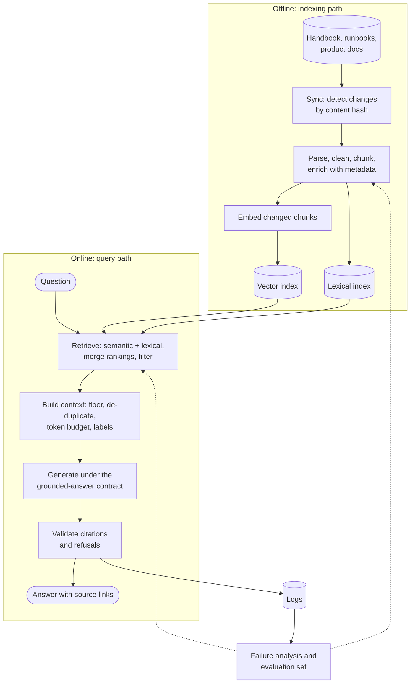

This assessment covers all nine lessons of **RAG Architecture Fundamentals**: the traditional architecture and its two paths, the indexing, retrieval and generation pipelines, offline and online processing, query-document matching, context construction, response generation and the end-to-end lifecycle. Answer the 20 multiple-choice questions first; the pass mark is 70% (14 of 20). Then work through the open questions, the coding exercises, the design challenge and the troubleshooting scenarios, writing your own answer to each before opening the model answer. The written parts are not scored, but they are where you find out whether you can use the ideas and not merely recognise them.

```quiz
[
  {
    "q": "In the traditional RAG architecture, which work belongs to the query path, performed for every question?",
    "options": [
      "Parsing source documents and splitting them into chunks",
      "Embedding every chunk and storing the vectors",
      "Embedding the question, searching the index, building the prompt and calling the model",
      "Choosing the chunk size and the embedding model"
    ],
    "answer": 2,
    "why": "The indexing path runs when documents change; the query path runs per request and consists of embedding the question, retrieving, assembling the prompt and generating."
  },
  {
    "q": "Which sequence gives the indexing pipeline's stages in the correct order?",
    "options": [
      "Load, parse, clean, chunk, enrich, embed, store",
      "Load, chunk, parse, embed, clean, enrich, store",
      "Parse, load, embed, chunk, clean, store, enrich",
      "Load, parse, embed, chunk, clean, enrich, store"
    ],
    "answer": 0,
    "why": "Text must be extracted and cleaned before it can be split; chunks must exist and carry their metadata before they are embedded and written to the index."
  },
  {
    "q": "Why are documents split into chunks before embedding, instead of embedding each whole document as one vector?",
    "options": [
      "Embedding models can only process one sentence at a time",
      "A single vector for a long document blurs many topics together, and whole documents are too large to place in a prompt",
      "Chunking removes duplicated documents from the corpus",
      "Vector indexes cannot store vectors for documents longer than a page"
    ],
    "answer": 1,
    "why": "A focused passage gives a focused vector that matches specific questions, and a passage-sized unit is what fits, several at a time, into the context."
  },
  {
    "q": "In the retrieval pipeline, what is the purpose of the rerank stage?",
    "options": [
      "To embed the query a second time with a larger model",
      "To remove chunks the user is not permitted to read",
      "To increase the number of candidates before the top-k cut",
      "To rescore a small set of candidates with a slower, more accurate method"
    ],
    "answer": 3,
    "why": "Reranking is too expensive to run over the whole index, so it is applied to the few candidates that survived the first-stage search, to put the best of them at the top."
  },
  {
    "q": "AskMeridian's index contains both the 2023 and the 2025 editions of the handbook. Users asking about current policy sometimes get 2023 text. Which retrieval-pipeline stage is designed to address this directly?",
    "options": [
      "Query embedding",
      "Top-k",
      "Metadata filtering",
      "Streaming"
    ],
    "answer": 2,
    "why": "A filter on metadata (edition, status or date) restricts the search to chunks that satisfy a condition. Similarity alone cannot tell a current policy from a superseded one. Removing the old edition from the index is the other half of the fix."
  },
  {
    "q": "Which of these is a post-processing step in the generation pipeline?",
    "options": [
      "Splitting documents on headings",
      "Checking that the citations in the answer refer to supplied sources",
      "Computing IDF weights for the vocabulary",
      "Building the vector index"
    ],
    "answer": 1,
    "why": "Post-processing happens after the model has produced text: validating citations, detecting refusals, formatting and attaching source links."
  },
  {
    "q": "Which computation is normally done offline rather than per request?",
    "options": [
      "Embedding the document chunks",
      "Embedding the user's question",
      "Assembling the context under a token budget",
      "Validating the answer's citations"
    ],
    "answer": 0,
    "why": "Chunk embeddings depend only on the documents, so they are precomputed once and reused by every query. Everything that depends on the question must happen online."
  },
  {
    "q": "A team re-deploys the query service with a newer embedding model but does not rebuild the index. No errors are raised. What will users observe?",
    "options": [
      "Slightly better retrieval, because the new model is stronger",
      "No change, because the index is unaffected by the query model",
      "Slower responses and identical results",
      "Poor, seemingly random retrieval, because query and chunk vectors come from different models"
    ],
    "answer": 3,
    "why": "Vectors from two different models do not share a space, so similarities between them are meaningless. If the dimensions happen to match there is not even an error to warn you."
  },
  {
    "q": "What is the main cost of precomputing everything offline?",
    "options": [
      "Queries become slower",
      "The index reflects the documents as they were when it was built, so it can be out of date",
      "The embedding model must be retrained for each query",
      "Answers can no longer cite their sources"
    ],
    "answer": 1,
    "why": "Precomputation buys fast queries at the price of freshness: until the offline path runs again, changes in the sources are not visible to retrieval."
  },
  {
    "q": "A user asks \"how do I get my money back for a train ticket?\". The relevant chunk says \"Expenses must be submitted within 30 days.\" A TF-IDF retriever does not rank it first. Why?",
    "options": [
      "The chunk is too short for TF-IDF",
      "TF-IDF cannot process questions",
      "The query and the chunk share almost no terms: a vocabulary mismatch",
      "The IDF of \"expenses\" is zero"
    ],
    "answer": 2,
    "why": "Lexical matching needs shared terms. The user describes the concept in different words from the author, so the relevant chunk gets little or no score."
  },
  {
    "q": "What does this print?\n```python\nimport numpy as np\nq = np.array([3.0, 4.0])\nd = np.array([4.0, 3.0])\nprint(round(float(q @ d / (np.linalg.norm(q) * np.linalg.norm(d))), 2))\n```",
    "options": ["0.96", "24.0", "1.0", "0.48"],
    "answer": 0,
    "why": "The dot product is 3*4 + 4*3 = 24. Both vectors have length 5, so the cosine is 24 / 25 = 0.96."
  },
  {
    "q": "In a corpus of 10,000 chunks, which query term will carry the highest IDF weight?",
    "options": [
      "\"the\", found in 9,800 chunks",
      "\"policy\", found in 2,500 chunks",
      "\"vpn\", found in 300 chunks",
      "\"E-4021\", found in 1 chunk"
    ],
    "answer": 3,
    "why": "IDF rises as the number of chunks containing the term falls. A term found in a single chunk is the strongest evidence for that chunk."
  },
  {
    "q": "What does this print?\n```python\nbudget, used, kept = 50, 0, []\nfor name, cost in [(\"a\", 30), (\"b\", 30), (\"c\", 15), (\"d\", 5)]:\n    if used + cost > budget:\n        break\n    kept.append(name)\n    used += cost\nprint(kept, used)\n```",
    "options": [
      "['a', 'c', 'd'] 50",
      "['a'] 30",
      "['a', 'b'] 60",
      "['a', 'c'] 45"
    ],
    "answer": 1,
    "why": "The loop uses break, the 'stop' policy: when b does not fit, selection ends, even though c and d would have fitted. With continue the result would be ['a', 'c', 'd'] 50."
  },
  {
    "q": "A retriever returns ten candidates. The top three are the same paragraph copied in three documents. The context builder takes the top four. What is the likely effect, and the fix?",
    "options": [
      "Answers become more reliable because the fact is repeated; no fix is needed",
      "The model refuses to answer; raise the output limit",
      "Three of four slots carry one fact, so other needed chunks are left out; de-duplicate before selecting",
      "The request exceeds the context window; shorten the system prompt"
    ],
    "answer": 2,
    "why": "Duplicates consume budget without adding information and push distinct chunks out of the context. Removing them before selection lets the budget go to different facts."
  },
  {
    "q": "When the supplied sources do not contain the answer, what should a well-designed RAG system do?",
    "options": [
      "Answer from the model's general knowledge, with a disclaimer",
      "Return the most similar chunk verbatim",
      "Retry with a higher temperature",
      "Return a fixed refusal sentence that the application can detect"
    ],
    "answer": 3,
    "why": "A refusal is the correct output when the corpus is silent. Fixing its wording lets code detect it, count it and route the user elsewhere."
  },
  {
    "q": "What does this print?\n```python\nimport re\nanswer = \"Leave is 25 days [S1]. Carry over 5 [S1][S2].\"\nfound = re.findall(r\"\\[S\\d+\\]\", answer)\nprint(len(found), len(set(found)))\n```",
    "options": ["2 2", "3 3", "3 2", "2 1"],
    "answer": 2,
    "why": "There are three citation markers in the text ([S1], [S1], [S2]) and two distinct labels."
  },
  {
    "q": "An answer cites [S4], but only S1 to S3 were supplied in the request. Which statement is correct?",
    "options": [
      "This is caught by an existence check against the request's label map, with no model needed",
      "This can only be detected by a second model acting as judge",
      "This is acceptable if S4 exists somewhere in the corpus",
      "This indicates that the retriever's top-k was too small"
    ],
    "answer": 0,
    "why": "Whether a cited label is among those supplied is a set-membership test. A document elsewhere in the corpus cannot have been the model's source for this answer."
  },
  {
    "q": "A source document was edited this morning; the index is synchronised nightly. In the lifecycle's terms, what state is the document in this afternoon?",
    "options": ["New", "Stale", "Deleted", "Indexed"],
    "answer": 1,
    "why": "The source has changed and the index still holds the old content without knowing it. Answers will be grounded in, and cite, out-of-date text."
  },
  {
    "q": "An incremental sync compares per-chunk content hashes. Which change will it fail to handle correctly on its own?",
    "options": [
      "One paragraph of a document is rewritten",
      "A new document is added",
      "A document is removed from the source",
      "The embedding model is replaced and the documents are unchanged"
    ],
    "answer": 3,
    "why": "The hash covers the text, which has not changed, so every chunk is skipped and keeps its old-model vector. A model change requires a full rebuild."
  },
  {
    "q": "Logs for a wrong answer show that the chunk containing the correct information was not among the retrieved candidates at all. Which change cannot fix this?",
    "options": [
      "Adding lexical matching alongside embeddings",
      "Changing how documents are chunked",
      "Rewriting the system prompt to stress accuracy",
      "Rewriting or expanding the query before searching"
    ],
    "answer": 2,
    "why": "If the needed text never reaches the model, no instruction to the model can supply it. The fault is in matching, so the fix must be in indexing or retrieval."
  }
]
```

## Conceptual questions

**1.** The traditional architecture separates an indexing path from a query path. Explain what each path precomputes or computes, why the split exists, and the one rule that ties the two together.

<details><summary>Show model answer</summary>

The **indexing path** runs when documents change. It loads, parses, cleans and chunks documents, attaches metadata, embeds each chunk and stores the results. Everything it produces depends only on the documents, so it can be computed once and reused by every query.

The **query path** runs for each question. It processes and embeds the query, searches the index, filters, cuts to the top k and optionally reranks; then it builds the context, calls the model and post-processes the answer. Everything here depends on the question, so none of it can be done in advance.

The split exists because the expensive, question-independent work (embedding the whole corpus) would be impossibly slow per request, while the question-dependent work is small. The price is freshness: the index is a snapshot.

The rule tying them together is consistency of representation: the query must be embedded with the same model, and prepared with the same preprocessing, as the chunks. Otherwise the two sets of vectors are not comparable and retrieval fails silently.

</details>

**2.** Describe one query that lexical matching answers well and semantic matching answers badly, and one where the reverse is true. Explain each in terms of how the scoring function works.

<details><summary>Show model answer</summary>

**Lexical good, semantic bad:** "What does error E-4021 mean?" when the index also contains E-4012. Lexical scoring rewards shared terms weighted by rarity; "4021" appears in one chunk and has a very high IDF, so that chunk wins clearly. An embedding compresses each chunk into a vector of meaning; two chunks about VPN errors that differ by a digit have nearly the same meaning and nearly the same vector, so the ranking between them is close to arbitrary.

**Semantic good, lexical bad:** "How much holiday am I entitled to?" when the handbook says "annual leave is 25 days". The query and chunk share no content words, so a term-overlap score is zero or is driven by incidental function words. An embedding model places "holiday" and "annual leave" close together, so the cosine similarity between query and chunk is high.

The general statement: lexical scoring is exact and has no notion of synonymy; semantic scoring captures meaning and loses exact detail. Their failures are complementary, which is the argument for combining them.

</details>

**3.** A colleague says: "Our model has a very large context window, so we should just include the top 50 chunks and let the model sort it out." Give three distinct reasons to construct the context more carefully.

<details><summary>Show model answer</summary>

1. **Cost and latency.** Every input token is paid for on every request and must be processed before the first output token appears. Fifty chunks of 300 tokens is 15,000 tokens per request; if eight chunks carry the answer, most of that spend buys nothing.
2. **Answer quality.** Irrelevant or marginal chunks are material the model may draw on. More text also means the relevant passage is a smaller share of the input, and studies of long contexts have found that models use information in the middle of a long input less reliably than information at the ends.
3. **Verifiability and control.** A deliberately built context has de-duplicated content, short labels and clear delimiters, which is what makes citation and post-generation validation possible. A raw dump of 50 chunks, with duplicates and superseded versions, gives conflicting statements and no principled way to choose between them.

A fourth, if wanted: without a relevance floor, an unanswerable question still receives 50 chunks, which encourages an answer where a refusal was correct.

</details>

**4.** Why is "I don't know" a correct output of a RAG system? Describe how to make refusals useful to the people who operate the system.

<details><summary>Show model answer</summary>

A RAG system's promise is that answers come from its corpus. When the corpus does not contain the answer, the only output consistent with that promise is to say so. The alternative is an answer from the model's general knowledge, which may be wrong for this organisation and which the user cannot distinguish from a grounded one. A system that never refuses is one whose errors are invisible.

To make refusals useful: fix the wording so code can detect them exactly; allow partial answers that state what the sources do not cover; return the refusal without calling the model when retrieval finds nothing above the relevance floor; and log and chart the refusal rate. Clusters of refusals on a subject identify gaps in the corpus (a document to write or ingest), and a sudden rise after a deployment signals a retrieval or indexing fault. Refusals on questions known to be answerable (false refusals) should be in the evaluation set.

</details>

**5.** Distinguish the freshness loop from the improvement loop in the lifecycle. For each, say what triggers it, what it changes and how you know it worked.

<details><summary>Show model answer</summary>

The **freshness loop** keeps the index in agreement with its sources. It is triggered by document changes (detected by notifications, timestamps or content hashes) and runs frequently: continuously, hourly or nightly. It changes the *data*: new chunks are embedded and inserted, changed chunks replaced, removed chunks deleted. It worked if the freshness lag (the time between a source change and the index reflecting it) is within target, and if the sync's counts of embedded, unchanged and deleted chunks are plausible.

The **improvement loop** makes the system better at answering. It is triggered by evidence from monitoring: failed validations, refusals, poor feedback. It runs on a slower cadence. It changes the *system*: chunking, matching, context construction, prompt or model. Each failure is first classified by stage (corpus, matching, context, generation), then one change is made and the evaluation set is re-run. It worked if the evaluation numbers improve with no regressions, and the failed questions, now added to the set, pass.

The two interact: some changes made by the improvement loop (a new embedding model, a new chunker) invalidate the whole index and require a full rebuild, which the incremental freshness loop cannot provide.

</details>

## Coding exercises

**1. A retriever that can return nothing.** Using scikit-learn's `TfidfVectorizer`, write `retrieve(query, k=2, min_score=0.2)` over the six chunks below. It must return at most `k` chunks, best first, and must return an empty list when no chunk reaches `min_score`. Test it with one question the corpus answers, one that needs a small inference, and one it cannot answer. Chunks: "Annual leave is 25 days per year." / "Up to 5 unused days carry over and must be used by 31 March." / "Staff may work remotely up to 3 days a week." / "Expenses must be submitted within 30 days." / "Anything over £75 needs a receipt." / "The support desk is open 08:00 to 18:00 UK time."

<details><summary>Show solution</summary>

```python
import numpy as np
from sklearn.feature_extraction.text import TfidfVectorizer

chunks = [
    "Annual leave is 25 days per year.",
    "Up to 5 unused days carry over and must be used by 31 March.",
    "Staff may work remotely up to 3 days a week.",
    "Expenses must be submitted within 30 days.",
    "Anything over £75 needs a receipt.",
    "The support desk is open 08:00 to 18:00 UK time.",
]

vectoriser = TfidfVectorizer(stop_words="english")
matrix = vectoriser.fit_transform(chunks)          # offline: built once


def retrieve(query: str, k: int = 2, min_score: float = 0.2) -> list[tuple[float, str]]:
    q = vectoriser.transform([query])              # online: same vectoriser as indexing
    scores = (matrix @ q.T).toarray().ravel()
    order = np.argsort(-scores)[:k]
    return [(round(float(scores[i]), 3), chunks[i]) for i in order if scores[i] >= min_score]


for query in ["When is the support desk open?",
              "Do I need a receipt for a £90 taxi?",
              "What is the dress code?"]:
    print(query)
    hits = retrieve(query)
    for score, text in hits:
        print(f"  {score:.3f}  {text}")
    if not hits:
        print("  (nothing above the threshold: answer \"I don't know\")")
```

```output
When is the support desk open?
  0.522  The support desk is open 08:00 to 18:00 UK time.
Do I need a receipt for a £90 taxi?
  0.577  Anything over £75 needs a receipt.
What is the dress code?
  (nothing above the threshold: answer "I don't know")
```

Three things to notice. The vectoriser is fitted once on the chunks (offline) and only `transform` is called on queries (online). The threshold is applied after the top-k cut, so the function can return fewer than `k` results, or none. And `stop_words="english"` matters: without it, "What is the dress code?" matches the support-desk chunk on "is" and "the" with a score above the threshold, and the function would return an irrelevant chunk instead of nothing. A relevance floor is only as good as the scores beneath it.

</details>

**2. From chunks to prompt to checked answer.** Write `build_prompt(question, chunks, max_words)` that selects chunks best-first under a word budget (skip a chunk that does not fit and continue), wraps each in `<source id="S1" title="...">` tags with consecutive labels, and returns the prompt and the list of labels. Then write `invalid_citations(answer, labels)` that returns the cited labels that were not supplied. Use words rather than tokens so the exercise needs no tokeniser.

<details><summary>Show solution</summary>

```python
import re


def build_prompt(question: str, chunks: list[dict], max_words: int) -> tuple[str, list[str]]:
    blocks, labels, used = [], [], 0
    for chunk in sorted(chunks, key=lambda c: c["score"], reverse=True):
        cost = len(chunk["text"].split())
        if used + cost > max_words:
            continue                                   # try the next, smaller chunk
        label = f"S{len(labels) + 1}"
        blocks.append(f'<source id="{label}" title="{chunk["source"]}">\n{chunk["text"]}\n</source>')
        labels.append(label)
        used += cost
    prompt = "\n".join(blocks) + f"\n\nQuestion: {question}\nCite sources as [S1], [S2]."
    return prompt, labels


def invalid_citations(answer: str, labels: list[str]) -> list[str]:
    return sorted({c for c in re.findall(r"\[(S\d+)\]", answer) if c not in labels})


chunks = [
    {"source": "IT Runbook > Accounts", "score": 0.71,
     "text": "Passwords must be rotated every 90 days."},
    {"source": "IT Runbook > Network", "score": 0.66,
     "text": "VPN is required on public Wi-Fi."},
    {"source": "IT Runbook > Hardware", "score": 0.30,
     "text": "Laptops are replaced on a 3-year refresh cycle. The support desk is open "
             "08:00 to 18:00 UK time."},
    {"source": "Employee Handbook > Remote work", "score": 0.28,
     "text": "Staff may work remotely up to 3 days a week."},
]

prompt, labels = build_prompt("How often must I change my password?", chunks, max_words=24)
print(prompt)
print("\nlabels:", labels)
print(invalid_citations("Every 90 days [S1], and use the VPN on public Wi-Fi [S2].", labels))
print(invalid_citations("Every 90 days [S1]; laptops are replaced every 3 years [S4].", labels))
```

```output
<source id="S1" title="IT Runbook > Accounts">
Passwords must be rotated every 90 days.
</source>
<source id="S2" title="IT Runbook > Network">
VPN is required on public Wi-Fi.
</source>
<source id="S3" title="Employee Handbook > Remote work">
Staff may work remotely up to 3 days a week.
</source>

Question: How often must I change my password?
Cite sources as [S1], [S2].

labels: ['S1', 'S2', 'S3']
[]
['S4']
```

With a budget of 24 words, the two best chunks use 13. The third candidate (18 words) does not fit and is skipped; the fourth (10 words) does fit and becomes `S3`. Labels follow the kept chunks, so they are consecutive even though a candidate was skipped. This also shows the hazard of skip-and-continue: the remote-work chunk scored only 0.28 and is irrelevant to a password question, so a real builder would apply a relevance floor first. The second test answer cites `[S4]`, which was never supplied, and is reported.

</details>

**3. Planning an incremental sync.** Given `indexed`, a mapping from document ID to the content hash stored at the last sync, and `source`, a mapping from document ID to current text, write `plan(indexed, source)` that returns which documents to add, update, delete and skip. A change in whitespace alone must not count as an update.

<details><summary>Show solution</summary>

```python
import hashlib


def digest(text: str) -> str:
    return hashlib.sha256(" ".join(text.split()).encode("utf-8")).hexdigest()


def plan(indexed: dict[str, str], source: dict[str, str]) -> dict[str, list[str]]:
    """indexed maps doc_id -> stored hash; source maps doc_id -> current text."""
    current = {doc_id: digest(text) for doc_id, text in source.items()}
    return {
        "add":    sorted(d for d in current if d not in indexed),
        "update": sorted(d for d in current if d in indexed and indexed[d] != current[d]),
        "delete": sorted(d for d in indexed if d not in current),
        "skip":   sorted(d for d in current if indexed.get(d) == current[d]),
    }


yesterday = {
    "leave":    "Annual leave is 25 days per year.",
    "expenses": "Expenses must be submitted within 30 days.",
    "password": "Passwords must be rotated every 90 days.",
    "pager":    "Pagers are issued by the facilities team.",
}
indexed = {doc_id: digest(text) for doc_id, text in yesterday.items()}

today = {
    "leave":    "Annual  leave is 25 days per year.",            # whitespace only
    "expenses": "Expenses must be submitted within 30 days. Anything over £75 needs a receipt.",
    "password": "Passwords must be rotated every 90 days.",
    "laptops":  "Laptops are replaced on a 3-year refresh cycle.",
}

for action, doc_ids in plan(indexed, today).items():
    print(f"{action:<7}{doc_ids}")
```

```output
add    ['laptops']
update ['expenses']
delete ['pager']
skip   ['leave', 'password']
```

`digest` collapses runs of whitespace before hashing, so the double space in today's "leave" text produces the same hash as yesterday's and the document is skipped. "expenses" gained a sentence and must be re-chunked and re-embedded; "laptops" is new; "pager" has disappeared from the source and must be deleted from the index. Only two of the five documents involved need any embedding work.

</details>

## Architecture design challenge

**Brief.** Design the first production version of AskMeridian for Meridian's 400 staff. Sources: the employee handbook (about 200 pages, edited a few times a month), about 300 IT runbooks (edited daily, each identified by a code such as NET-114, and consulted during incidents), and product documentation (large, edited weekly). Requirements: every answer cites its sources; the assistant refuses when the sources are silent; runbook changes are searchable within an hour; staff often paste runbook codes and error codes into their questions; and the team must be able to tell, after any change, whether the system got better or worse.

Sketch the architecture: both paths, the stores, and where each requirement is met. State the trade-offs you are making.

<details><summary>Show reference design</summary>



**How each requirement is met.**

- **Citations.** The context builder gives each chunk a short label and keeps the label map; the system prompt requires a citation per sentence; the validator checks that every cited label was supplied; the application renders links from the map.
- **Refusal.** A relevance floor in retrieval and context construction means an unanswerable question yields an empty context, in which case the application returns the fixed refusal without calling the model. The contract also instructs the model to use the fixed sentence when the supplied sources do not contain the answer.
- **Runbooks searchable within an hour.** The sync runs per collection on its own schedule: runbooks every 15 to 30 minutes, the handbook and product documentation nightly. Per-chunk content hashes keep each run cheap, since only changed chunks are embedded. Deletions are part of every sync.
- **Codes pasted into questions.** Two matchers over the same chunks: a lexical index for exact identifiers and an embedding index for natural-language questions, with their rankings merged. Chunks carry metadata (collection, runbook code, edition, last modified) for filtering.
- **Knowing whether a change helped.** Every request logs the question, the retrieved chunk IDs with scores, the context's chunk IDs and digests, the answer and the validation result. An evaluation set with questions of each type (policy paraphrases, runbook codes, unanswerable questions) is run before each change, and diagnosed production failures are added to it.

**Trade-offs.**

- *Two indexes instead of one.* More to build and keep in step, justified by a known, large class of identifier queries that embeddings handle poorly. If measurement showed few such queries, the lexical index could be dropped.
- *Frequent incremental sync instead of event-driven ingestion.* Polling every 15 minutes meets the one-hour requirement simply. An event-driven design would reduce the lag to seconds at the cost of integration work with each source system; not needed yet.
- *A relevance floor.* It prevents answers built on irrelevant chunks, at the risk of false refusals if set too high. It has to be tuned on the evaluation set, separately for each matcher's score scale.
- *Validation with one retry, then refusal.* Protects users from invalid citations and makes a small share of requests slower. For incident runbooks, where a wrong step is costly, the strict policy is the right default.
- *No reranker, query rewriting or caching in version one.* Each is a likely later improvement; each should be added only when the logs show the failure it addresses, and verified against the evaluation set.
- *Embedding model changes are full rebuilds.* The design accepts the cost of building a second index and holding both during the switch, in exchange for never serving a mixed index.

</details>

## Troubleshooting scenarios

**1.** On Tuesday the team deployed a release described as "upgrade embedding model in the API service". From Wednesday, users report that AskMeridian returns irrelevant sources for nearly every question, though questions containing exact runbook codes still work. There are no errors in the logs and latency is normal. What happened, how do you confirm it, and what is the fix?

<details><summary>Show diagnosis and fix</summary>

**Diagnosis.** The query path now embeds questions with the new model while the index still holds vectors from the old one. Vectors from different models are not comparable, so semantic matching returns essentially arbitrary chunks. Runbook-code questions still work because they are served by the lexical index, which does not depend on the embedding model. The absence of errors is typical: if the two models happen to produce vectors of the same dimension, the search runs normally on meaningless similarities.

**Confirm.** Compare the embedding model recorded in the index metadata with the one configured in the API service. Run a few evaluation questions through semantic retrieval alone and observe that known-good chunks no longer appear in the top results. Check when the indexing job last performed a full run.

**Fix.** Immediately: roll the API service back to the old model. Properly: build a complete new index with the new model alongside the old one, run the evaluation set against it, and switch the query path and the index together. To prevent recurrence, store the model name with the index and have the query service refuse to start if its configured model differs.

</details>

**2.** HR reports that AskMeridian told an employee the expenses deadline is 60 days, citing the handbook. The handbook says 30 days and has said so for a year. The citation link opens the correct handbook page, which says 30 days. Where could the 60 have come from, and how do you find out?

<details><summary>Show diagnosis and fix</summary>

**Candidates, in pipeline order.**

1. *A stale or superseded chunk.* An older edition of the handbook, or a draft, is still in the index with a 60-day figure. The link resolves to the document's current URL, so it shows today's text, not the text the model was given.
2. *A different document.* Another indexed document (a regional policy, a product-documentation page about customer expenses) says 60 days and was retrieved alongside the handbook; the model merged them or attached the wrong label.
3. *A generation error.* The context said 30 and the model wrote 60.

**How to find out.** Look at the logged context for that request, not the live document. If the logged chunk text says 60, it is case 1 or 2: check the chunk's document ID, digest and indexing time. If the context says 30 everywhere, it is case 3.

**Fixes.** Case 1: the sync is not deleting superseded content; fix deletions, purge the old chunks, and add edition or status metadata with a filter. Case 2: add source-authority metadata and prefer the handbook for policy questions; make titles in the context specific enough for the model to tell sources apart. Case 3: the number check from response generation (every figure in a sentence must appear in the source it cites) would have caught this before display; enable it with a retry.

In all cases, log the content digest of every cited chunk so that this question can be answered in a minute instead of a day, and add the question to the evaluation set.

</details>

**3.** AskMeridian answers well at the start of a conversation. After ten or so turns, answers become vague, stop citing sources, and occasionally the request fails with a context-length error. Single-turn questions are unaffected. Diagnose and fix.

<details><summary>Show diagnosis and fix</summary>

**Diagnosis.** Conversation history is being included without a cap. Each turn adds the previous question and answer, so the fixed parts of the prompt grow. One of two things then happens, depending on how the prompt is assembled. If the chunk budget is computed as what remains, it shrinks turn by turn until few or no chunks fit, and the model, with little context, answers vaguely and has nothing to cite. If the chunk budget is fixed, the total eventually exceeds the context window and the request fails, or an upstream component truncates the prompt silently, typically cutting the context.

**Confirm.** Log token counts per component (system prompt, history, context, question) for each turn of a long conversation. History will rise steadily while context falls or the total reaches the limit.

**Fix.** Give history its own cap: keep only the most recent turns, or replace older turns with a short summary. Compute the chunk budget explicitly from the input limit minus the capped components, and assert in code that the assembled request is within the limit before sending. Strip citation markers from earlier answers when re-sending them, since their labels refer to earlier contexts. Add a multi-turn conversation to the evaluation set so the regression is caught if the cap is ever removed.

</details>
