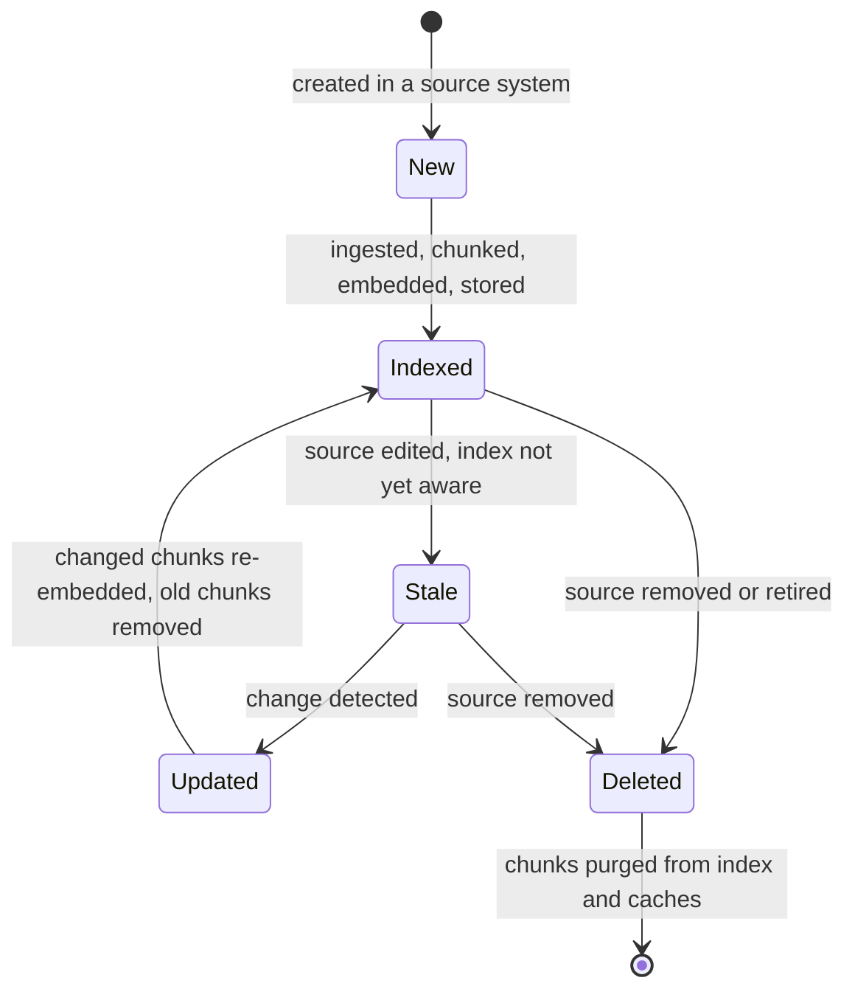
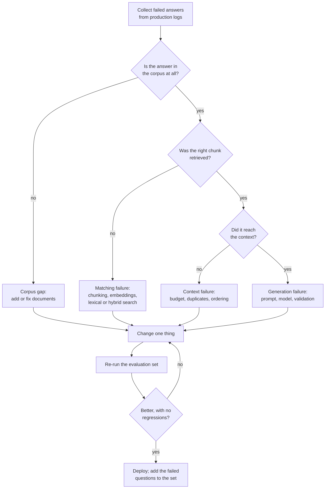

The earlier lessons of this module followed a single question through the system: matched against chunks, assembled into a context, answered and checked. That journey lasts a few seconds. The system itself lasts for years, and over those years everything it depends on changes: policies are rewritten, documents are retired, users ask new kinds of question, and better models appear. This lesson is about the life of the **system** rather than the life of a request: build, evaluate, deploy, monitor, update documents, re-index and improve, and then round again.

It is also the last lesson of Phase 1. By the end you will have seen every part of a RAG system at least once in outline, and the closing section maps each part to the phase of the curriculum that treats it properly.

## Learning objectives

- Name the stages of the RAG system lifecycle and say what each produces for the next.
- Trace a document through its lifecycle states (new, indexed, stale, updated, deleted) and identify what moves it between them.
- Implement incremental re-indexing by content hash and explain when it is not sufficient and a full rebuild is required.
- Classify a failed answer by the stage that caused it and choose the corresponding fix.
- Explain why an evaluation set is needed before any change to a running system.

## Prerequisites

- [Traditional RAG architecture](/learn/rag-architecture-fundamentals/traditional-rag-architecture) and [Offline and online processing](/learn/rag-architecture-fundamentals/offline-and-online-processing): the two paths this lesson keeps in step over time.
- [Indexing pipeline](/learn/rag-architecture-fundamentals/indexing-pipeline): the stages that re-indexing repeats.
- [Query-document matching](/learn/rag-architecture-fundamentals/query-document-matching), [Context construction](/learn/rag-architecture-fundamentals/context-construction) and [Response generation](/learn/rag-architecture-fundamentals/response-generation): the stages a failure can be traced to.

## Why this matters

A RAG system that is correct on launch day begins to go wrong the following morning, without a line of code changing. The index is a snapshot of the documents as they were when it was built. When Meridian's HR team edits the handbook, the handbook is right and the index is not, and AskMeridian will go on quoting the old policy, with a citation, in a confident tone. This is arguably worse than a hallucination: the answer is grounded, cited and passes every check in the previous lesson. It is merely out of date.

The opposite problem is change without measurement. Someone adjusts the chunk size or swaps the embedding model because a handful of answers looked poor. Those answers improve; others, unobserved, get worse. Without a fixed set of test questions run before and after, "improvement" is a matter of opinion.

The lifecycle exists to deal with both. It keeps the index faithful to its sources as they change, and it turns observations from production into changes that are verified before they ship.

## The intuition

Think of a staffed library rather than a search engine. Opening the library (buying the books, cataloguing them, arranging the shelves) is a large job done once. Keeping it useful is a different job that never ends. New editions arrive and the old ones must be withdrawn, or readers will be given superseded advice. Books are lost or recalled. The librarians notice which questions they could not answer and order books to fill the gap. Now and then they conclude that the catalogue scheme itself is the problem and recatalogue the whole collection, which is expensive and done rarely.

Every one of those activities has a counterpart in a RAG system. Opening day is the initial build. New editions are document updates; withdrawing the old one is deleting stale chunks. The unanswered questions are your refusal logs. Recataloguing everything is a full re-index after changing the chunking or the embedding model.

## How it works

### The stages

1. **Build.** Run the [indexing pipeline](/learn/rag-architecture-fundamentals/indexing-pipeline) over the initial corpus and assemble the retrieval and generation pipelines around the index. The output is a working system and, just as important, a recorded configuration: chunking settings, embedding model, prompt, generation model.
2. **Evaluate.** Before anyone depends on it, run a fixed set of test questions, each with the source that should be retrieved and the facts a good answer must contain. Such a set is often called a [golden dataset](/learn/testing-and-benchmarking/golden-datasets). The output is a baseline: numbers for retrieval and answer quality that later versions must match or beat.
3. **Deploy.** Put the pipeline behind an interface that users or other systems can call, with the configuration versioned so that any answer can be traced to the exact settings that produced it.
4. **Monitor.** Record what happens in production: questions, retrieved chunk IDs and scores, answers, validation results, refusals, latency, token usage and user feedback.
5. **Update documents.** Detect that sources have been added, changed or removed.
6. **Re-index.** Bring the index back into agreement with the sources, incrementally where possible and fully where necessary.
7. **Improve.** Analyse the failures that monitoring exposed, change one thing, re-run the evaluation, and deploy only if the numbers hold. Then return to step 4.

Steps 4 to 7 are two loops running at different speeds. The **freshness loop** (update documents, re-index) runs continuously or daily and changes the *data*. The **improvement loop** (monitor, analyse, change, evaluate, deploy) runs weekly or monthly and changes the *system*.

### The lifecycle of a document

From the index's point of view, each document is always in one of five states.



- **New.** The document exists in a source system and is not yet searchable. Questions about it get a refusal or, worse, an answer from an older document on the same subject.
- **Indexed.** Its chunks are in the index and match the source. This is the only healthy resting state.
- **Stale.** The source has changed and the index still holds the old content. Nothing in the system knows yet. This is the dangerous state, because answers are confidently wrong and well cited.
- **Updated.** The change has been detected and the document is queued for, or undergoing, re-indexing.
- **Deleted.** The source is gone. Its chunks must be removed from the index, and from anything derived from it, such as cached answers.

The time a document spends in the *new* or *stale* state is the system's **freshness lag**: the delay between a change in the source and the index reflecting it. [Offline and online processing](/learn/rag-architecture-fundamentals/offline-and-online-processing) introduced freshness as a property of the offline path; here it becomes a number you choose and measure. A nightly job gives a lag of up to 24 hours. Whether that is acceptable depends on the content: fine for a handbook, not for an incident runbook.

### Detecting change with content hashes

To move a document out of the *stale* state, the system must notice the change. Three signals are in common use: a notification from the source system, a last-modified timestamp, and a **content hash**.

A **hash function** maps any text to a short fixed-length fingerprint (a **digest**), such that the same text always gives the same digest and any change to the text gives, in practice, a different one. SHA-256 is a standard choice. Store the digest with each chunk at indexing time. On each sync, recompute digests from the current sources and compare:

| In sources | In index | Meaning | Action |
| --- | --- | --- | --- |
| digest present | same digest present | unchanged | skip: no embedding call |
| digest present | absent | new or changed content | embed and insert |
| absent | digest present | content removed or superseded | delete |

Hashing has two advantages over timestamps. It ignores edits that change nothing (a file re-saved with a new modified time). And when applied per chunk, it limits the work to the parts of a document that actually changed: editing one paragraph of a fifty-page handbook re-embeds a few chunks, not the whole document. Normalise the text before hashing (collapse whitespace, for example) so that insignificant differences do not trigger re-embedding.

### When incremental is not enough

Content hashing answers one question: *has the text changed?* It is blind to changes in how the text is processed. A **full re-index** is required when:

- **The embedding model changes.** Vectors from different models are not comparable, as [Offline and online processing](/learn/rag-architecture-fundamentals/offline-and-online-processing) established. Every chunk must be re-embedded, and the query path must switch models at the same moment.
- **The chunking or cleaning logic changes.** The same documents now produce different chunks.
- **The index is suspected to be corrupt or out of step**, for instance after a failed sync.

The safe way to do a full re-index is to build the new index alongside the old one, run the evaluation set against it, and switch traffic only when it passes, keeping the old index available for rollback. Phase 14 covers this under [reindexing](/learn/ci-cd-and-mlops/reindexing) and [index versioning](/learn/ci-cd-and-mlops/index-versioning).

> [!KEY]
> A content hash tells you the text is unchanged. It does not tell you the vector is still valid. Record the embedding model and the pipeline version alongside every chunk, and treat a change to either as a reason to rebuild.

### The improvement loop

Monitoring produces a stream of failures: refusals, validation failures, thumbs-down ratings, complaints. The improvement loop turns them into verified changes. Its central step is **classification**: deciding which stage caused each failure, because each stage has a different fix.



Three disciplines make the loop work. **Ask the questions in order**: there is no point tuning the prompt for a question whose answer is not in the corpus. **Change one thing at a time**, or you cannot attribute the result. And **add each diagnosed failure to the evaluation set**, so that the set grows to cover what real users ask and a fixed problem cannot quietly return. Running the full set before every change is [regression testing](/learn/testing-and-benchmarking/regression-testing).

## In code

**The problem.** Show the freshness loop in miniature: build an index, answer a question, change a policy in the source, observe the stale answer, re-index incrementally by content hash, and observe the answer and its source change, while counting how many chunks were actually re-embedded.

**Dependencies.** NumPy and scikit-learn.

```bash
pip install numpy scikit-learn
```

Two simplifications. The "embedding model" is scikit-learn's `HashingVectorizer`, chosen because, like a real embedding model, it is **stateless**: the vector for a text depends only on that text, so one chunk can be embedded without recomputing any other. (A TF-IDF vectoriser would not do: its weights depend on the whole corpus.) And "answering" means returning the best-matching chunk with its source, which is enough to see which version of the text an answer would be built on.

The example changes Meridian's home-office equipment budget from £400 to £500. That change is hypothetical and confined to this demonstration; everywhere else in the curriculum the budget remains £400.

```python
import hashlib
import re

import numpy as np
from sklearn.feature_extraction.text import HashingVectorizer

# A stateless stand-in for an embedding model: the vector for a text depends
# only on that text, so one chunk can be embedded without touching the others.
_vectoriser = HashingVectorizer(n_features=2**12, alternate_sign=False, norm="l2")
embed_calls = 0


def embed(text: str) -> np.ndarray:
    global embed_calls
    embed_calls += 1
    return _vectoriser.transform([text]).toarray()[0]


def chunk(text: str) -> list[str]:
    return [s.strip() for s in re.split(r"(?<=[.!?])\s+", text) if s.strip()]


def content_hash(text: str) -> str:
    normalised = " ".join(text.split()).lower()
    return hashlib.sha256(normalised.encode("utf-8")).hexdigest()[:12]


index: dict[tuple[str, str], dict] = {}     # (doc_id, content hash) -> entry


def sync(corpus: dict[str, str]) -> dict[str, int]:
    """Make the index match the corpus, embedding only chunks whose content is new."""
    stats = {"embedded": 0, "unchanged": 0, "deleted": 0}
    wanted = {}
    for doc_id, text in corpus.items():
        for piece in chunk(text):
            wanted[(doc_id, content_hash(piece))] = piece

    for key in list(index):                  # in the index, no longer in the source
        if key not in wanted:
            del index[key]
            stats["deleted"] += 1

    for key, piece in wanted.items():
        if key in index:                     # same document, same content: skip
            stats["unchanged"] += 1
        else:
            index[key] = {"text": piece, "vector": embed(piece)}
            stats["embedded"] += 1
    return stats


def ask(question: str) -> str:
    q = embed(question)
    (doc_id, digest), entry = max(index.items(), key=lambda kv: float(kv[1]["vector"] @ q))
    return f"{entry['text']}  [{doc_id} @ {digest}]"


corpus = {
    "handbook/leave":    "Annual leave is 25 days per year. Up to 5 unused days carry over "
                         "and must be used by 31 March.",
    "handbook/remote":   "Staff may work remotely up to 3 days a week. "
                         "The home-office equipment budget is £400.",
    "handbook/expenses": "Expenses must be submitted within 30 days. "
                         "Anything over £75 needs a receipt.",
    "it/accounts":       "Passwords must be rotated every 90 days. "
                         "VPN is required on public Wi-Fi.",
    "it/fax-gateway":    "The fax gateway is restarted from the server room console.",
}
question = "What is the home-office equipment budget?"

print("1. Initial build")
print("  ", sync(corpus), "| embed calls so far:", embed_calls)
print("   answer:", ask(question))

print("\n2. The policy changes in the source, but nothing has re-indexed yet")
corpus["handbook/remote"] = ("Staff may work remotely up to 3 days a week. "
                             "The home-office equipment budget is £500.")
print("   answer:", ask(question), "<- stale")

print("\n3. Incremental re-index: one edit, one retired document, one new document")
del corpus["it/fax-gateway"]
corpus["it/hardware"] = "Laptops are replaced on a 3-year refresh cycle."
before = embed_calls
print("  ", sync(corpus), "| new embed calls:", embed_calls - before)
print("   answer:", ask(question))

print("\n4. Running the sync again changes nothing")
before = embed_calls
print("  ", sync(corpus), "| new embed calls:", embed_calls - before)
print("   chunks in index:", len(index))
```

```output
1. Initial build
   {'embedded': 9, 'unchanged': 0, 'deleted': 0} | embed calls so far: 9
   answer: The home-office equipment budget is £400.  [handbook/remote @ 1662b6667614]

2. The policy changes in the source, but nothing has re-indexed yet
   answer: The home-office equipment budget is £400.  [handbook/remote @ 1662b6667614] <- stale

3. Incremental re-index: one edit, one retired document, one new document
   {'embedded': 2, 'unchanged': 7, 'deleted': 2} | new embed calls: 2
   answer: The home-office equipment budget is £500.  [handbook/remote @ 8d8ac7f5e8b2]

4. Running the sync again changes nothing
   {'embedded': 0, 'unchanged': 9, 'deleted': 0} | new embed calls: 0
   chunks in index: 9
```

**The important lines.**

- `content_hash` normalises whitespace and case before hashing, so a re-saved file with a stray double space is recognised as unchanged. The digest is cut to 12 characters to keep the printout readable; store the full digest in a real system.
- The index key is `(doc_id, content hash)`. Identity is defined by *which document* and *what text*, not by position, so inserting a sentence at the top of a document does not disturb the keys of the sentences below it.
- `sync` computes the set of keys the sources imply (`wanted`), deletes every index entry not in it, and embeds every wanted key not yet in the index. Everything else is skipped.
- `embed_calls` counts invocations of the stand-in model, which is the cost that incremental indexing exists to avoid.

**What the output means.**

1. The initial build embeds all nine chunks (two sentences in each of four documents, one in the fifth).
2. After the handbook is edited, the answer is unchanged. The index has no way of knowing the source moved; the document is in the *stale* state, and the system is giving a cited, out-of-date answer.
3. The sync embeds exactly two chunks: the edited sentence and the one sentence of the new hardware document. It deletes two: the old £400 sentence and the retired fax-gateway page. The seven untouched chunks, including the unedited first sentence of the remote-work document, cost nothing. The answer now quotes £500, and the digest in the source reference has changed from `1662b6667614` to `8d8ac7f5e8b2`, so a log entry can show which version of the text an answer used.
4. Running the sync again does nothing. An operation that can be repeated without further effect is **idempotent**, the property the [Indexing pipeline](/learn/rag-architecture-fundamentals/indexing-pipeline) lesson asked of every ingestion job, and it is what makes a sync safe to re-run after a crash.

**Errors people commonly hit.**

- Hashing raw bytes of a file whose export includes a timestamp or a page counter: every document appears changed on every run. Hash the cleaned text, not the file.
- Keying chunks by position (`doc#3`). Inserting a paragraph shifts every later chunk, and all of them are needlessly re-embedded, or worse, mismatched.
- Forgetting deletions. A sync that only adds and updates leaves retired documents answering questions indefinitely.
- Inserting new chunks before removing old ones without a guard, so that for a moment the index holds both the £400 and the £500 sentence. Make the swap for one document atomic, or mark old chunks inactive first.

**Extending it.** Store a `first_seen` timestamp and the embedding model name with each entry. Have `sync` return the list of changed document IDs so that cached answers citing them can be invalidated. Replace the stand-in with a real embedding model and note that the number of calls, and so the cost, is identical.

## A real-world example

Meridian's platform team decided to move AskMeridian to a newer embedding model that had scored better on their evaluation set in an offline test. Lukas updated the model name in the ingestion job's configuration and in the query service, and deployed both on a Friday. The nightly sync ran as usual.

On Monday the support desk reported that AskMeridian "had forgotten the handbook". Questions about leave and expenses, which had worked for months, now returned unrelated chunks or refusals, while questions about two runbooks edited over the weekend worked perfectly.

The sync had done exactly what it was written to do. It compared content hashes, found that the handbook's text had not changed, and skipped it. Only the chunks of the two edited runbooks were re-embedded, with the new model. The index now held vectors from two different models, and the query service embedded every question with the new one. Queries could be compared meaningfully with a handful of chunks and with nothing else.

The immediate fix was a rollback of the query service to the old model. The lasting fix had three parts: the embedding model's name became part of the hash key, so that a model change invalidates every chunk; model changes were made by building a complete new index beside the old one; and the switch was gated on the evaluation set passing against the new index. The team also noted that their monitoring had not caught the fault over the weekend, and added an alert on the refusal rate.

## Common mistakes

- **Treating indexing as a one-off project.** The index drifts from its sources from the first day; without a freshness loop every answer slowly becomes suspect.
- **Handling additions and edits but not deletions.** Retired and superseded documents keep being retrieved and cited.
- **Relying on content hashes when the pipeline itself has changed.** A new embedding model or chunker with unchanged text is skipped by the sync, leaving a mixed index.
- **Changing the system without an evaluation set.** Improvements are anecdotal and regressions go unseen.
- **Changing several things at once.** When the numbers move, nobody knows which change moved them.
- **Not logging which chunks, and which versions, produced an answer.** A complaint about a wrong answer cannot be investigated after the document has changed again.
- **Fixing symptoms at the wrong stage.** Rewriting the prompt because an answer was wrong, when the needed document was never in the corpus.

## Best practices

- Decide a freshness target for each document collection and measure the actual lag against it.
- Store with every chunk: document ID, content digest, embedding model, pipeline version and indexing time.
- Make the sync idempotent and safe to re-run, and have it report counts of embedded, unchanged and deleted chunks. A sudden jump in any of them is a signal.
- Rebuild into a new index for model or chunking changes; evaluate; then switch; keep the old index for rollback.
- Build the evaluation set before launch and add every diagnosed production failure to it.
- Classify failures in pipeline order (corpus, matching, context, generation) before choosing a fix.
- Propagate deletions to everything derived from a document, including answer caches.

## Performance considerations

Incremental indexing is a cost decision that can be reasoned through with arithmetic. Suppose the corpus is 200,000 chunks and 0.5% of them change on a typical day. A full nightly rebuild makes 200,000 embedding calls; an incremental sync makes $200{,}000 \times 0.005 = 1{,}000$, two hundred times fewer. Over a 30-day month that is 6 million against 30,000. If an embedding call costs $c$, the bill is $6{,}000{,}000c$ or $30{,}000c$.

The comparison step is not free. Hashing requires reading and chunking every document on every run, even though no model is called. SHA-256 over a few megabytes of text takes a fraction of a second, so for most corpora the cost is in fetching and parsing the documents, not in hashing them. Where sources can announce their own changes (a webhook, a change feed), the sync can skip even that and process only what it is told about; [incremental ingestion](/learn/understanding-document-ingestion/incremental-ingestion) and [event-driven ingestion](/learn/understanding-document-ingestion/event-driven-ingestion) cover these designs.

A full re-index has a different profile: its duration is roughly the number of chunks divided by the embedding throughput. At 500 chunks per second, 200,000 chunks take 400 seconds; 20 million take about 11 hours, which is long enough that the corpus changes during the rebuild and the changes must be replayed afterwards. During a side-by-side rebuild you also hold two indexes, so plan for twice the storage.

Evaluation has a cost too. An evaluation set of 200 questions means 200 full pipeline runs, including model calls, per candidate change. That is why such sets stay in the hundreds, not the hundreds of thousands.

## Security considerations

The lifecycle is where several security properties are won or lost.

- **Deletion must really delete.** When a document is removed for legal or privacy reasons, its chunks, its vectors, cached answers that quote it and, where policy requires, log entries containing its text must all go. An index that still returns a "deleted" document is a compliance failure. See [secure deletion](/learn/enterprise-rag-governance/secure-deletion).
- **Permission changes are updates too.** If access to a document is revoked in the source system and the index still carries the old permission metadata, the stale state becomes a data leak. Sync permissions on the same loop as content, or check them live at query time.
- **The update path is an attack surface.** Anyone who can edit a source document can change what the assistant says tomorrow. Restrict who can write to indexed sources, and keep a record of what changed and when.
- **Traceability.** Logging the content digest of each cited chunk lets you reconstruct, later, exactly what text an answer was based on. That is the basis of [data lineage](/learn/enterprise-rag-governance/data-lineage) and of any investigation into a harmful answer.

## Summary

- A request lives for seconds; the system lives for years, and its sources, its users' questions and the available models all change during that time.
- The lifecycle is build, evaluate, deploy, monitor, update documents, re-index, improve. The freshness loop changes the data; the improvement loop changes the system.
- A document is new, indexed, stale, updated or deleted. The stale state is the dangerous one: answers are grounded, cited and wrong.
- Content hashes per chunk make re-indexing incremental: unchanged text is skipped, changed text is re-embedded, removed text is deleted.
- Hashes detect changed text, not a changed pipeline. A new embedding model or chunker requires a full rebuild, evaluated before the switch.
- Improvement starts by classifying each failure by stage (corpus, matching, context, generation) and ends with the evaluation set confirming the change.

## Where the curriculum goes from here

Phase 1 has given you the outline of the whole system. Each later phase takes one part and builds it properly.

| Phase | Subject | What it adds to the outline | Start at |
| --- | --- | --- | --- |
| 2 | Python and data engineering | The typed, asynchronous Python and text handling the pipelines are written in | [Python for RAG Engineering](/learn/python-for-rag-engineering) |
| 3 | Document ingestion | Getting real documents (PDFs, HTML, scans, tables) into clean text, in batch and incrementally | [Understanding Document Ingestion](/learn/understanding-document-ingestion) |
| 4 | Chunking | Where to cut documents, and how to measure whether the cuts are good | [Chunking Fundamentals](/learn/chunking-fundamentals) |
| 5 | Embeddings | The models and mathematics behind semantic matching | [Embedding Fundamentals](/learn/embedding-fundamentals) |
| 6 | Vector databases | Storing and searching millions of vectors; index algorithms and updates | [Vector Database Fundamentals](/learn/vector-database-fundamentals) |
| 7 | Retrieval | Dense, sparse and hybrid search; query rewriting and decomposition | [Retrieval Fundamentals](/learn/retrieval-fundamentals) |
| 8 | Reranking | A second, more accurate pass over the candidates; diversity and thresholds | [Reranking Fundamentals](/learn/reranking-fundamentals) |
| 9 | Generation and context engineering | Prompts, context selection and ordering, citations, streaming | [Prompt Engineering for RAG](/learn/prompt-engineering-for-rag) |
| 10 | Advanced architectures | Corrective, graph, hierarchical, agentic and multimodal RAG | [Advanced RAG Patterns](/learn/advanced-rag-patterns) |
| 11 | Frameworks | LangChain, LlamaIndex, Haystack, DSPy, and when to write your own | [LangChain for RAG](/learn/langchain-for-rag) |
| 12 | Evaluation and testing | The metrics and test sets behind the "evaluate" stage | [Retrieval Evaluation](/learn/retrieval-evaluation) |
| 13 | Observability and performance | The logs, traces and cost tracking behind the "monitor" stage | [RAG Observability](/learn/rag-observability) |
| 14 | Production and MLOps | Serving, deployment, index versioning, reindexing and rollback | [Backend Engineering](/learn/backend-engineering) |
| 15 | Security and governance | Prompt injection, access control, privacy, deletion and audit | [RAG Security Fundamentals](/learn/rag-security-fundamentals) |
| 16 | Research and capstones | Current research, system design, and eight systems to build | [Capstone Projects](/learn/capstone-projects) |

Before moving on, take the [module assessment](/learn/rag-architecture-fundamentals/assessment) and then the [Phase 1 exam](/exam/1).

## Exercises

**1.** For each event, give the document's state before and after, using the five states in this lesson: (a) HR publishes a new parental-leave policy to the handbook site; the nightly sync has not yet run. (b) The sync runs and processes it. (c) HR corrects a figure in the policy at 10:00; a user asks about it at 10:05. (d) The policy is withdrawn and the sync removes its chunks.

<details><summary>Show solution</summary>

(a) Before: the document did not exist. After: **New**. It exists in the source and is not searchable; questions about parental leave are refused or answered from some other document.

(b) New to **Indexed**.

(c) Indexed to **Stale** at 10:00. At 10:05 the user receives the uncorrected figure, with a citation. Nothing in the system has noticed the change. This is the case the freshness target is about: with a nightly sync the document stays stale for up to a day.

(d) Indexed (or Stale) to **Deleted**, and once its chunks and any cached answers are purged it leaves the lifecycle. Between the withdrawal and the sync it was effectively stale: the source said "gone" and the index still served it.

</details>

**2.** In the code example, the hash covers only the chunk's text. Change `content_hash` so that switching the embedding model or the chunking version causes every chunk to be re-embedded on the next sync. What does `sync` report immediately after such a switch, and why is this still not a safe way to change the embedding model in production?

<details><summary>Show solution</summary>

Include a pipeline identifier in the hashed material:

```python
PIPELINE = "hashing-4096|sentence-chunks-v1"

def content_hash(text: str) -> str:
    normalised = " ".join(text.split()).lower()
    return hashlib.sha256(f"{PIPELINE}\n{normalised}".encode("utf-8")).hexdigest()[:12]
```

With the lesson's final corpus, running `sync` with the same `PIPELINE` reports `{'embedded': 0, 'unchanged': 9, 'deleted': 0}`. After changing `PIPELINE` to another value, the next `sync` reports `{'embedded': 9, 'unchanged': 0, 'deleted': 9}`: every key has changed, so every old entry is deleted and every chunk is embedded afresh.

It is correct but not safe as a production procedure, for three reasons. The index is rebuilt in place, so while the sync is running it is partly empty or mixed. The query path must switch to the new model at exactly the moment the rebuild completes. And there is no opportunity to evaluate the new index before users are exposed to it, nor to roll back. The production approach is to build a second index under the new pipeline version, evaluate it, switch traffic, and retire the old one later.

</details>

**3.** A corpus has 600,000 chunks. On an average day 0.2% of chunks change. An embedding call costs $c$ and the embedding service handles 300 chunks per second. Compare a nightly full rebuild with a nightly incremental sync on monthly embedding cost (30 days) and on the duration of each run. Then name one situation in which you would still run a full rebuild.

<details><summary>Show solution</summary>

**Full rebuild.** Each run embeds 600,000 chunks: $600{,}000 / 300 = 2{,}000$ seconds, about 33 minutes. Monthly cost: $600{,}000 \times 30 = 18{,}000{,}000c$.

**Incremental.** Each run embeds $600{,}000 \times 0.002 = 1{,}200$ chunks: $1{,}200 / 300 = 4$ seconds of embedding (plus the time to read and hash the sources). Monthly cost: $1{,}200 \times 30 = 36{,}000c$.

The incremental sync costs 500 times less in embedding calls and finishes in seconds, which also means it could run hourly instead of nightly and cut the freshness lag from 24 hours to one.

A full rebuild is still needed when the embedding model, the chunking strategy or the cleaning logic changes, or when the index is suspected to have drifted from the sources (for example after a failed or interrupted sync). Some teams also schedule an occasional full rebuild as a consistency check and compare its result with the incrementally maintained index.

</details>

**4.** Design decision. A week of AskMeridian logs shows four recurring failures: (a) refusals on every question about the new cycle-to-work scheme; (b) questions quoting runbook numbers such as "NET-114" return the wrong runbook; (c) answers about expenses mention the 30-day deadline and omit the £75 receipt rule, although both chunks are in the retriever's top ten; (d) answers occasionally cite a source label that was not supplied. Classify each by stage and propose the first fix to try and how you would confirm it.

<details><summary>Show solution</summary>

(a) **Corpus gap.** Check whether any document about the scheme is in the index. If the scheme's policy was published and never ingested, the document is in the *new* state: fix the ingestion source list or the sync. If no document exists, ask HR to write one. No retrieval or prompt change can help. Confirm by re-asking after the document is indexed.

(b) **Matching failure.** The right chunk exists and is not ranked first: the exact-identifier weakness of embedding search from [Query-document matching](/learn/rag-architecture-fundamentals/query-document-matching). First fix: add lexical matching alongside the embeddings and merge the rankings. Confirm with evaluation questions that quote runbook numbers, checking that the correct chunk now appears in the top results, and that paraphrase-style questions have not regressed.

(c) **Context failure.** The needed chunk was retrieved (top ten) and did not reach the model. Inspect the assembled context: probable causes are a cut-off at the top few chunks, duplicates occupying the slots, or too small a token budget, as in [Context construction](/learn/rag-architecture-fundamentals/context-construction). Fix the cause that the logged contexts show. Confirm that both chunks appear in the context for the test questions.

(d) **Generation failure.** The model emitted an invalid citation; see [Response generation](/learn/rag-architecture-fundamentals/response-generation). First check for an application cause (stale labels in conversation history, an unclear format in the prompt), then enforce the existence check with one retry and a refusal fallback. Confirm by the validation failure rate in monitoring.

In every case, add the failing questions to the evaluation set and re-run the whole set before deploying, so that each fix is shown not to break the others.

</details>

## Check your understanding

```quiz
[
  {
    "q": "A policy document is edited in the source system at 09:00. The index is synchronised nightly at 02:00. What state is the document in at midday, and what do users experience?",
    "options": [
      "New: the document cannot be found at all",
      "Stale: answers are grounded in and cite the old text",
      "Updated: answers use the new text but without citations",
      "Deleted: questions about it are refused"
    ],
    "answer": 1,
    "why": "The source has changed and the index has not yet been told. The old chunks are still retrieved and cited, so the answer looks valid and is out of date."
  },
  {
    "q": "During an incremental sync, a chunk's content hash matches the one stored in the index. What should the sync do?",
    "options": [
      "Skip it: the text is unchanged, so no embedding call is needed",
      "Re-embed it to refresh the vector",
      "Delete it and insert it again",
      "Mark the whole document as stale"
    ],
    "answer": 0,
    "why": "An identical digest means identical text. Skipping unchanged chunks is the entire saving of incremental indexing."
  },
  {
    "q": "A team switches to a new embedding model and lets the usual content-hash sync run. Most chunks are unchanged. What is the result?",
    "options": [
      "The sync detects the model change and re-embeds everything",
      "Nothing changes, because the query path still uses the old model",
      "The index contains vectors from two models, and queries no longer match the unchanged chunks",
      "The index becomes smaller because old vectors are compressed"
    ],
    "answer": 2,
    "why": "A hash of the text cannot see a change of model. Unchanged chunks keep old-model vectors, which are not comparable with queries embedded by the new model. A model change needs a full rebuild."
  },
  {
    "q": "What does this print?\n```python\nindexed = {\"a\": \"h1\", \"b\": \"h2\", \"c\": \"h3\"}\ncurrent = {\"a\": \"h1\", \"b\": \"h9\", \"d\": \"h4\"}\nembed = [k for k in current if indexed.get(k) != current[k]]\ndelete = [k for k in indexed if k not in current]\nprint(embed, delete)\n```",
    "options": [
      "['b'] ['c']",
      "['a', 'b', 'd'] []",
      "['d'] ['b', 'c']",
      "['b', 'd'] ['c']"
    ],
    "answer": 3,
    "why": "b has a different hash and d is absent from the index, so both need embedding. c is in the index and no longer in the sources, so it is deleted. a is unchanged."
  },
  {
    "q": "Logs show that the correct chunk was retrieved in the top ten and was present in the context, yet the answer contradicts it. Where should the investigation start?",
    "options": [
      "The corpus: the document must be missing",
      "The embedding model: matching has failed",
      "Generation: the prompt, the model and the post-generation checks",
      "The sync job: the document must be stale"
    ],
    "answer": 2,
    "why": "Corpus, matching and context construction all did their jobs: the right text reached the model. The remaining stage is generation."
  }
]
```

## Further reading

- Lewis et al. (2020), "Retrieval-Augmented Generation for Knowledge-Intensive NLP Tasks", [arXiv:2005.11401](https://arxiv.org/abs/2005.11401).
- Barnett et al. (2024), "Seven Failure Points When Engineering a Retrieval Augmented Generation System", [arXiv:2401.05856](https://arxiv.org/abs/2401.05856).
- Sculley et al. (2015), "Hidden Technical Debt in Machine Learning Systems", *Advances in Neural Information Processing Systems 28*.
- Python documentation, [`hashlib`: secure hashes and message digests](https://docs.python.org/3/library/hashlib.html).
- scikit-learn documentation, [`HashingVectorizer`](https://scikit-learn.org/stable/modules/generated/sklearn.feature_extraction.text.HashingVectorizer.html).
