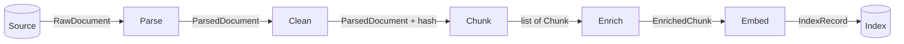
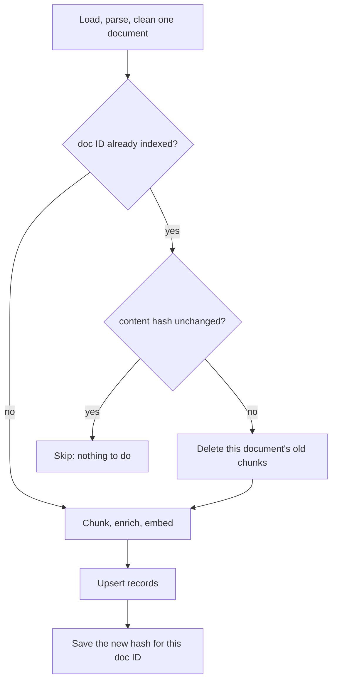

[Traditional RAG architecture](/learn/rag-architecture-fundamentals/traditional-rag-architecture) drew the indexing path as four boxes. In a real system it is seven stages: **load, parse, clean, chunk, enrich, embed, store**. This lesson walks a document through all seven, defines the exact type each stage hands to the next, and builds a miniature pipeline that prints what every stage produced.

It also introduces the property that separates a pipeline you can run once from a pipeline you can run every night: **idempotency**, which means running it again on unchanged input leaves the index exactly as it was. Idempotency depends on giving every document and every chunk a stable identifier, so document IDs are introduced here too.

## Learning objectives

- List the seven stages of an indexing pipeline and state the input and output type of each.
- Explain what information each stage adds or removes, and what breaks downstream if it is skipped.
- Implement a small indexing pipeline whose stages are separate, typed functions.
- Design document and chunk identifiers that make re-running the pipeline idempotent.
- Use a content hash to skip unchanged documents and to replace changed ones without leaving stale chunks.

## Prerequisites

- [Traditional RAG architecture](/learn/rag-architecture-fundamentals/traditional-rag-architecture)
- [Embeddings](/learn/understanding-large-language-models/embeddings)
- [Tokens and tokenisation](/learn/understanding-large-language-models/tokens-and-tokenisation)

## Why this matters

A retriever can only return what the indexing pipeline put in the index, in the form the pipeline left it. If the parser kept the navigation menu, the menu is now searchable text. If the chunker cut a sentence in half, neither half answers the question. If a page was edited and the pipeline added the new chunks without removing the old ones, the index now holds two contradictory versions of the policy, and which one the user gets depends on which happens to score higher.

None of these failures raises an error. They surface weeks later as "the assistant gave a strange answer", far from their cause. A pipeline built from small stages with explicit types between them is how you make such problems findable: you can print the output of any stage for any document and see exactly where the text went wrong.

## The intuition

Picture a commercial kitchen preparing ingredients before service. Deliveries arrive in crates (load). Someone unpacks them and discards the packaging (parse). Vegetables are washed and trimmed (clean), then cut to the size the recipes need (chunk). Each tub is labelled with its contents, date and allergens (enrich). Finally the tubs go onto the shelf in a fixed place where the cooks can find them without looking (embed and store).

Two details of that kitchen matter. First, each station does one job and passes on something the next station can rely on: nobody downstream washes vegetables again. Second, every tub has a label that says which delivery it came from. When a supplier recalls a batch, the kitchen can find and throw away exactly the tubs made from it. Without the labels it would have to throw away everything, or risk serving something it should not. Those labels are document IDs.

## How it works

### The seven stages and their types



The label on each arrow is the type that travels along it. Read the table as a contract: each stage may assume its input is well formed and must guarantee its output is.

| # | Stage | Input | Output | What it adds or removes |
| --- | --- | --- | --- | --- |
| 1 | Load | A location (path, URL, query) | `RawDocument`: bytes, a URI and a media type | Fetches the bytes; knows nothing about their meaning |
| 2 | Parse | `RawDocument` | `ParsedDocument`: text, title, a document ID | Removes the file format (HTML tags, PDF layout) |
| 3 | Clean | `ParsedDocument` | `ParsedDocument` with a content hash | Removes noise: boilerplate, stray whitespace, odd characters |
| 4 | Chunk | `ParsedDocument` | A list of `Chunk`, each with a chunk ID | Splits text into retrievable passages |
| 5 | Enrich | `Chunk` | `EnrichedChunk`: chunk plus metadata | Adds what search and citation will need: source, title, owner, permissions |
| 6 | Embed | `EnrichedChunk` | `IndexRecord`: chunk ID, vector, text, metadata | Adds the vector |
| 7 | Store | `IndexRecord` | A row in the index | Makes it searchable and durable |

Step by step, for one document:

1. **Load** reads the bytes and records where they came from. The URI (a file path, a URL, a database key) is the document's identity in the source system.
2. **Parse** chooses a parser from the media type and extracts text and structure. This is where format-specific knowledge lives, and nowhere else.
3. **Clean** normalises the text so that the same content always produces the same string, then computes a hash of it.
4. **Chunk** splits the cleaned text and gives each piece an ID that ties it to its parent document.
5. **Enrich** attaches metadata to each chunk. Some comes from the source system (path, author, last modified), some from the document (title, section heading), some is computed (language, department).
6. **Embed** sends chunk text to the embedding model, usually in batches, and pairs each vector with its chunk.
7. **Store** writes the records to the index with an **upsert**: insert if the ID is new, overwrite if it exists.

Each stage has a whole phase of the curriculum behind it: parsing and cleaning in [Document Ingestion and Processing](/learn/advanced-document-parsing), chunking in [Chunking Fundamentals](/learn/chunking-fundamentals), embedding in [Embedding Fundamentals](/learn/embedding-fundamentals), storage in [Vector Database Fundamentals](/learn/vector-database-fundamentals). Here the subject is the shape: what flows between them.

### Why the order is what it is

The order is not arbitrary. Cleaning comes before chunking because a chunk boundary chosen on dirty text is a boundary in the wrong place: a repeated page footer in the middle of a paragraph splits it. Enriching comes before embedding because metadata is often part of what gets embedded; in the code below the document title is prepended to each chunk's text, so the vector for "Up to 5 unused days carry over" knows it is about annual leave. Embedding comes last before storage because it is the expensive stage, so everything that could reject or skip a document should happen before it.

### Identifiers

Two identifiers hold the pipeline together.

A **document ID** names a document across time. It must stay the same when the content is edited, otherwise the pipeline cannot tell "this page changed" from "a new page appeared". Deriving it from the document's location in the source system (here, a hash of the URI) achieves that. It must not be random: a random ID generated on each run makes every run look like a batch of new documents.

A **chunk ID** names one chunk and must lead back to its document. Here it is `doc_id:position`. That makes two operations cheap: "delete every chunk of this document" (match the prefix) and "show me the neighbours of this chunk" (position plus or minus one). [Document identifiers](/learn/document-engineering/document-identifiers) examines the alternatives, including IDs derived from content.

A third value, the **content hash**, is not an identifier but a fingerprint: a short digest of the cleaned text that changes whenever the text does. Comparing today's hash with the one stored at the last run answers "has this document changed?" without comparing the text itself.

### Idempotency

An operation is **idempotent** if doing it twice has the same effect as doing it once. An indexing pipeline has to be, because it will be re-run: on a schedule, after a crash halfway through, after a fix to one parser. A pipeline that is not idempotent duplicates chunks on each run, and duplicates crowd other results out of the top-k.

Three mechanisms together give idempotency:

1. **Stable IDs**, so the same chunk gets the same ID on every run.
2. **Upserts**, so writing an existing ID overwrites instead of adding.
3. **Delete-then-write per document**, so that when a document shrinks from five chunks to three, chunks four and five do not linger.

The content hash adds efficiency on top: unchanged documents skip the expensive stages entirely.



> [!KEY]
> Stable IDs plus upserts stop duplicates. Deleting a document's old chunks before writing its new ones stops stale leftovers. A content hash stops wasted work. A pipeline needs all three before it is safe to schedule.

## In code

The problem: build every stage as its own function with a declared input and output type, run the pipeline over three small Meridian documents in two formats, and show what each stage produced. Then run it again, and once more after an edit, to see idempotency working.

The embedding stage uses scikit-learn's `HashingVectorizer`, which maps each word to one of a fixed number of positions by hashing it. It is a crude stand-in for a neural embedding model, chosen because it shares one important property with real ones: it is **stateless**. Any text can be embedded on its own, at any time, without reference to the rest of the corpus. (TF-IDF, used in the previous lesson, must be fitted on the whole corpus first, which makes incremental updates awkward.)

```bash
pip install scikit-learn numpy
```

```python
import hashlib
import re
from dataclasses import dataclass, field
from html.parser import HTMLParser

import numpy as np
from sklearn.feature_extraction.text import HashingVectorizer


# ---------- the type each stage hands to the next ----------
@dataclass(frozen=True)
class RawDocument:            # load ->
    uri: str                  # where it came from: the stable identity of the document
    mime_type: str
    content: bytes


@dataclass(frozen=True)
class ParsedDocument:         # parse -> and clean ->
    doc_id: str
    title: str
    text: str
    content_hash: str = ""    # filled in by clean()


@dataclass(frozen=True)
class Chunk:                  # chunk ->
    chunk_id: str
    doc_id: str
    position: int
    text: str


@dataclass(frozen=True)
class EnrichedChunk:          # enrich ->
    chunk: Chunk
    metadata: dict


@dataclass(frozen=True)
class IndexRecord:            # embed -> store
    chunk_id: str
    vector: np.ndarray
    text: str
    metadata: dict


def sha(text: str, n: int = 12) -> str:
    return hashlib.sha256(text.encode("utf-8")).hexdigest()[:n]


# ---------- stage 1: load ----------
SOURCE_SYSTEM = {
    "handbook/leave.html": (
        "text/html",
        "<html><head><title>Annual leave</title></head><body><nav>Home | HR | IT</nav>"
        "<h1>Annual leave</h1><p>Annual leave is 25 days per year.</p>"
        "<p>Up to 5 unused days carry   over and must be used by 31&nbsp;March.</p>"
        "<footer>Meridian internal. Do not distribute.</footer></body></html>",
    ),
    "handbook/expenses.md": (
        "text/markdown",
        "# Expenses\n\nExpenses must be submitted within 30 days.\n\n"
        "Any expense over £75 needs a receipt.\n\nMeridian internal. Do not distribute.\n",
    ),
    "it/security.md": (
        "text/markdown",
        "# Security basics\n\nPasswords must be rotated every 90 days.\n\n"
        "The VPN is required on public Wi-Fi.\n\nMeridian internal. Do not distribute.\n",
    ),
}


def load(source: dict) -> list[RawDocument]:
    return [RawDocument(uri, mime, body.encode("utf-8")) for uri, (mime, body) in source.items()]


# ---------- stage 2: parse ----------
class _TextExtractor(HTMLParser):
    BLOCKS = {"p", "h1", "h2", "h3", "li", "title"}
    SKIP = {"nav", "script", "style"}

    def __init__(self):
        super().__init__()
        self.blocks, self.title, self._stack = [], "", []

    def handle_starttag(self, tag, attrs):
        self._stack.append(tag)
        if tag in self.BLOCKS | {"footer"}:
            self.blocks.append("")

    def handle_endtag(self, tag):
        if tag in self._stack:
            while self._stack.pop() != tag:
                pass

    def handle_data(self, data):
        if not self._stack or self.SKIP & set(self._stack):
            return
        if self._stack[-1] == "title":
            self.title = data.strip()
        elif self.blocks:
            self.blocks[-1] += data


def parse(raw: RawDocument) -> ParsedDocument:
    body = raw.content.decode("utf-8")
    if raw.mime_type == "text/html":
        extractor = _TextExtractor()
        extractor.feed(body)
        title = extractor.title
        blocks = [b for b in extractor.blocks if b.strip() and b.strip() != title]
    elif raw.mime_type == "text/markdown":
        lines = [line for line in body.split("\n\n") if line.strip()]
        title = lines[0].lstrip("# ").strip()
        blocks = lines[1:]
    else:
        raise ValueError(f"no parser for {raw.mime_type} ({raw.uri})")
    return ParsedDocument(doc_id=sha(raw.uri), title=title, text="\n\n".join(blocks))


# ---------- stage 3: clean ----------
BOILERPLATE = re.compile(r"^Meridian internal\. Do not distribute\.$")


def clean(doc: ParsedDocument) -> ParsedDocument:
    paragraphs = []
    for paragraph in doc.text.split("\n\n"):
        paragraph = re.sub(r"\s+", " ", paragraph.replace(" ", " ")).strip()
        if paragraph and not BOILERPLATE.match(paragraph):
            paragraphs.append(paragraph)
    text = "\n\n".join(paragraphs)
    return ParsedDocument(doc.doc_id, doc.title, text, content_hash=sha(text))


# ---------- stage 4: chunk ----------
def chunk(doc: ParsedDocument) -> list[Chunk]:
    return [
        Chunk(chunk_id=f"{doc.doc_id}:{position}", doc_id=doc.doc_id, position=position, text=text)
        for position, text in enumerate(doc.text.split("\n\n"))
    ]


# ---------- stage 5: enrich ----------
def enrich(piece: Chunk, doc: ParsedDocument, raw: RawDocument) -> EnrichedChunk:
    metadata = {
        "source": raw.uri,
        "title": doc.title,
        "department": "it" if raw.uri.startswith("it/") else "hr",
        "doc_hash": doc.content_hash,
    }
    return EnrichedChunk(piece, metadata)


# ---------- stage 6: embed ----------
EMBEDDER = HashingVectorizer(n_features=256, norm="l2", alternate_sign=False)


def embed(pieces: list[EnrichedChunk]) -> list[IndexRecord]:
    # the title is embedded with the text so that the vector knows what the chunk is about
    texts = [f"{p.metadata['title']}. {p.chunk.text}" for p in pieces]
    vectors = EMBEDDER.transform(texts).toarray().astype(np.float32)
    return [IndexRecord(p.chunk.chunk_id, v, p.chunk.text, p.metadata) for p, v in zip(pieces, vectors)]


# ---------- stage 7: store ----------
@dataclass
class InMemoryIndex:
    records: dict[str, IndexRecord] = field(default_factory=dict)
    doc_hashes: dict[str, str] = field(default_factory=dict)   # doc_id -> content hash last indexed

    def delete_document(self, doc_id: str) -> int:
        stale = [cid for cid in self.records if cid.startswith(doc_id + ":")]
        for cid in stale:
            del self.records[cid]
        return len(stale)

    def upsert(self, records: list[IndexRecord]) -> None:
        for record in records:
            self.records[record.chunk_id] = record     # same id overwrites: no duplicates


# ---------- the pipeline ----------
def run_pipeline(source: dict, index: InMemoryIndex, verbose: bool = False) -> dict:
    stats = {"documents": 0, "skipped": 0, "deleted": 0, "upserted": 0}
    for raw in load(source):
        stats["documents"] += 1
        parsed = parse(raw)
        cleaned = clean(parsed)
        if index.doc_hashes.get(cleaned.doc_id) == cleaned.content_hash:
            stats["skipped"] += 1                      # unchanged since the last run
            continue
        chunks = chunk(cleaned)
        enriched = [enrich(c, cleaned, raw) for c in chunks]
        records = embed(enriched)
        stats["deleted"] += index.delete_document(cleaned.doc_id)
        index.upsert(records)
        index.doc_hashes[cleaned.doc_id] = cleaned.content_hash
        stats["upserted"] += len(records)
        if verbose:
            print(f"== {raw.uri}")
            print(f"load    RawDocument     {raw.mime_type}, {len(raw.content)} bytes")
            print(f"parse   ParsedDocument  doc_id={parsed.doc_id} title={parsed.title!r} {len(parsed.text)} chars")
            print(f"clean   ParsedDocument  {len(cleaned.text)} chars, hash={cleaned.content_hash}")
            print(f"chunk   {len(chunks)} x Chunk       {[c.chunk_id for c in chunks]}")
            print(f"enrich  EnrichedChunk   {enriched[0].metadata}")
            print(f"embed   IndexRecord     vector shape {records[0].vector.shape}, "
                  f"{int((records[0].vector > 0).sum())} non-zero, norm {np.linalg.norm(records[0].vector):.2f}")
    return stats


index = InMemoryIndex()
print("run 1:", run_pipeline(SOURCE_SYSTEM, index, verbose=True), "| index size", len(index.records))
print("run 2:", run_pipeline(SOURCE_SYSTEM, index), "| index size", len(index.records))

# Someone edits the security page: one paragraph is added.
mime, body = SOURCE_SYSTEM["it/security.md"]
SOURCE_SYSTEM["it/security.md"] = (
    mime,
    body.replace("The VPN is required on public Wi-Fi.",
                 "The VPN is required on public Wi-Fi.\n\nReport a lost laptop to the support desk at once."),
)
print("run 3:", run_pipeline(SOURCE_SYSTEM, index), "| index size", len(index.records))
print()
for record in index.records.values():
    print(f"{record.chunk_id}  {record.metadata['department']:<3} {record.text}")
```

```output
== handbook/leave.html
load    RawDocument     text/html, 280 bytes
parse   ParsedDocument  doc_id=0713ac9bee77 title='Annual leave' 136 chars
clean   ParsedDocument  95 chars, hash=4a47e75183c9
chunk   2 x Chunk       ['0713ac9bee77:0', '0713ac9bee77:1']
enrich  EnrichedChunk   {'source': 'handbook/leave.html', 'title': 'Annual leave', 'department': 'hr', 'doc_hash': '4a47e75183c9'}
embed   IndexRecord     vector shape (256,), 7 non-zero, norm 1.00
== handbook/expenses.md
load    RawDocument     text/markdown, 134 bytes
parse   ParsedDocument  doc_id=496c09376a75 title='Expenses' 121 chars
clean   ParsedDocument  81 chars, hash=738af2e413f1
chunk   2 x Chunk       ['496c09376a75:0', '496c09376a75:1']
enrich  EnrichedChunk   {'source': 'handbook/expenses.md', 'title': 'Expenses', 'department': 'hr', 'doc_hash': '738af2e413f1'}
embed   IndexRecord     vector shape (256,), 7 non-zero, norm 1.00
== it/security.md
load    RawDocument     text/markdown, 137 bytes
parse   ParsedDocument  doc_id=f9861bbcd2e2 title='Security basics' 118 chars
clean   ParsedDocument  78 chars, hash=e8ed7c31b0d5
chunk   2 x Chunk       ['f9861bbcd2e2:0', 'f9861bbcd2e2:1']
enrich  EnrichedChunk   {'source': 'it/security.md', 'title': 'Security basics', 'department': 'it', 'doc_hash': 'e8ed7c31b0d5'}
embed   IndexRecord     vector shape (256,), 9 non-zero, norm 1.00
run 1: {'documents': 3, 'skipped': 0, 'deleted': 0, 'upserted': 6} | index size 6
run 2: {'documents': 3, 'skipped': 3, 'deleted': 0, 'upserted': 0} | index size 6
run 3: {'documents': 3, 'skipped': 2, 'deleted': 2, 'upserted': 3} | index size 7

0713ac9bee77:0  hr  Annual leave is 25 days per year.
0713ac9bee77:1  hr  Up to 5 unused days carry over and must be used by 31 March.
496c09376a75:0  hr  Expenses must be submitted within 30 days.
496c09376a75:1  hr  Any expense over £75 needs a receipt.
f9861bbcd2e2:0  it  Passwords must be rotated every 90 days.
f9861bbcd2e2:1  it  The VPN is required on public Wi-Fi.
f9861bbcd2e2:2  it  Report a lost laptop to the support desk at once.
```

**The important lines.**

- The five dataclasses are the pipeline's interfaces. `frozen=True` makes instances immutable, so a stage cannot quietly alter something an earlier stage produced; `clean` returns a new `ParsedDocument` instead of editing the old one.
- `doc_id=sha(raw.uri)` derives the document ID from the location, not the content. Editing the security page in run 3 leaves its ID as `f9861bbcd2e2`, which is how the pipeline knows it is a change to an existing document.
- `parse` is the only function that knows about HTML or Markdown. Adding PDF support means adding one branch there and touching nothing else.
- `clean` collapses whitespace, converts the non-breaking space that `&nbsp;` became, and drops the confidentiality footer. The hash is taken **after** cleaning, so a change that only affects boilerplate or spacing does not trigger re-embedding.
- In `run_pipeline`, the `doc_hashes` comparison is the skip. `delete_document` followed by `upsert` is the replace.

**What the output means.** For the HTML page, parsing produced 136 characters and cleaning reduced that to 95: the difference is the footer and the surplus spaces (the non-breaking space was also converted to an ordinary one, which does not change the length). The navigation menu never appeared at all, because the parser skipped `<nav>`. Each vector has 256 dimensions but only 7 to 9 non-zero entries (one per distinct word), which is what a sparse, word-based representation looks like; a neural embedding would be dense, with every entry non-zero.

The three summary lines are the lesson. Run 1 indexes six chunks. Run 2, on identical input, skips all three documents and writes nothing: the pipeline is idempotent. Run 3 skips the two unchanged documents, deletes the security page's two old chunks and writes its three new ones, leaving seven chunks and no leftovers.

**Errors people commonly hit.**

- `ValueError: no parser for application/pdf`: a document type arrived that `parse` does not handle. Failing loudly here is correct; silently indexing raw bytes as text is far worse.
- `UnicodeDecodeError` in `parse`: the file is not UTF-8. Real loaders must detect or be told the encoding.
- `dataclasses.FrozenInstanceError`: code tried to modify a stage's output in place. Build a new object.
- An index that grows on every run: the IDs are not stable (often a random UUID or a timestamp has crept into them).

**How to extend it.** Swap `HashingVectorizer` for a sentence-embedding model inside `embed` and nothing else changes. Replace `InMemoryIndex` with a vector database client that offers the same two operations, delete-by-document and upsert. Add a `pipeline_version` string to the hash so that changing the chunker forces a rebuild (exercise 3).

## A real-world example

The platform team at Meridian schedules the handbook indexer to run nightly. Their first version generates a fresh UUID for every chunk and inserts it. After a fortnight, users notice that AskMeridian's sources list the same sentence four or five times, and that questions about remote work sometimes come back with the equipment budget quoted as an old figure that had been corrected weeks earlier.

Tomasz, investigating, counts the rows in the index: fourteen times the number of chunks the handbook actually contains. Every nightly run had added a complete copy. The top-k for any question was now filled with identical chunks, pushing other relevant passages out, and old versions of edited pages were still present and still retrievable.

The fix has three parts, in the order this lesson gave them. Chunk IDs become `doc_id:position` with the document ID derived from the page's path. Writes become upserts. And each changed document's old chunks are deleted before the new ones are written. The team then rebuilds the index from the source once, which is safe precisely because the index is derived data. After that, nightly runs report "0 upserted" on quiet days, and that number becomes a health signal: a night with thousands of upserts and no handbook edits means something in the pipeline changed.

## Common mistakes

- **Random or time-based IDs.** Every run creates new records, so the index fills with duplicates that crowd the top-k.
- **Upserting without deleting.** When a document gets shorter, its higher-numbered chunks survive as stale text that is still retrievable.
- **Never handling deletions at the source.** A page removed from the handbook stays in the index, and the assistant keeps citing a policy that no longer exists.
- **Hashing raw bytes instead of cleaned text.** A changed timestamp in a footer makes every document look modified, and the whole corpus is re-embedded for nothing.
- **Hashing only the text.** If the chunker or embedding model changes but the documents do not, the hash says "unchanged" and the new logic is never applied.
- **One giant function.** When parsing, cleaning and chunking are tangled together, you cannot inspect the text between them, and a bug in one is invisible.
- **Throwing away metadata early.** A chunk with no source, title or position cannot be cited, filtered or traced back.

## Best practices

- Give every stage a typed input and output, and make stage outputs immutable.
- Derive document IDs from something stable in the source system; derive chunk IDs from the document ID.
- Make the pipeline idempotent before you schedule it, and prove it by running it twice and checking that the second run writes nothing.
- Compute the content hash after cleaning, and include the pipeline's own version in it.
- Emit counts from every run (documents seen, skipped, deleted, upserted, failed) and alert on surprises.
- Handle one bad document without failing the whole run: record the failure, continue, and report it.
- Keep enough metadata on each chunk to answer three questions later: where did this come from, who may see it, and which pipeline version produced it.

## Performance considerations

Embedding dominates the cost of indexing; everything before it is ordinary string processing. So the most valuable optimisation is not to embed at all, which is what the hash-based skip does.

Consider a corpus of 12,000 documents averaging 8 chunks each: 96,000 chunks. A full rebuild embeds all 96,000. If 150 documents change on a typical day, an incremental run embeds $150 \times 8 = 1{,}200$ chunks, which is $1{,}200 / 96{,}000 = 1.25\%$ of the full cost. Over a 30-day month, nightly incremental runs embed $30 \times 1{,}200 = 36{,}000$ chunks, against $30 \times 96{,}000 = 2{,}880{,}000$ for nightly full rebuilds: eighty times less work.

Two further levers:

- **Batching.** Embedding models and their APIs process many texts per call far more efficiently than one at a time. `embed` above takes a list for this reason. If a model handles 64 chunks per call, 96,000 chunks need 1,500 calls rather than 96,000.
- **Parallelism by document.** Because each document is processed independently and writes only its own IDs, documents can be handled by several workers at once without coordination. Idempotency is what makes this safe: a worker that crashes and retries does no harm.

Memory is modest during indexing because the pipeline streams: only one document, or one batch, needs to be in memory at a time.

## Security considerations

- **Documents are untrusted input.** A parser handed a malicious file is an attack surface; keep parsing libraries patched and run the pipeline with the least privilege it needs.
- **Permissions must travel with the chunk.** If the source system restricts who may read a document, the enrich stage must copy that restriction into chunk metadata so that retrieval can enforce it. Losing it here cannot be repaired later. See [Document-level permissions](/learn/access-control-and-privacy/document-level-permissions).
- **Deletion must be real.** When a document is removed or a person asks for their data to be erased, every chunk and vector derived from it must go too. The `doc_id` prefix on chunk IDs is what makes that possible.
- **Text in documents can target the model.** Instructions hidden in a page become part of the index and, later, of a prompt. Cleaning is one place to detect and flag suspicious content.

## Summary

- The indexing pipeline has seven stages: load, parse, clean, chunk, enrich, embed, store. Each has a defined input and output type.
- Parsing removes the file format, cleaning removes noise, chunking sets the unit of retrieval, enrichment adds the metadata that filtering and citation depend on, and embedding adds the vector.
- A document ID must be stable across edits; a chunk ID must lead back to its document.
- Idempotency comes from stable IDs, upserts and deleting a document's old chunks before writing new ones.
- A content hash taken after cleaning lets the pipeline skip unchanged documents, which removes most of the embedding cost of routine runs.
- Typed, separate stages make silent data-quality problems inspectable.

## Exercises

**1.** A pipeline uses `chunk_id = str(uuid.uuid4())` and plain inserts. The handbook has 500 chunks and the pipeline runs nightly. How many records are in the index after 10 nights, and what does a user see in the top-5 results for a question with one clearly relevant chunk?

<details><summary>Show solution</summary>

Each run inserts 500 new records with fresh IDs, so after 10 nights there are $10 \times 500 = 5{,}000$ records: ten copies of every chunk. The ten copies of the relevant chunk have identical vectors and identical scores, so they occupy all five places in the top-5. The model receives the same sentence five times and no supporting context. If the page was edited during those ten nights, older versions are among the copies too.

</details>

**2.** The pipeline in this lesson never removes a document that has been deleted from the source. Write a function `remove_missing(source, index)` that does, and say when in a run it should be called.

<details><summary>Show solution</summary>

```python
def remove_missing(source: dict, index: InMemoryIndex) -> int:
    live = {sha(uri) for uri in source}
    removed = 0
    for doc_id in list(index.doc_hashes):
        if doc_id not in live:
            removed += index.delete_document(doc_id)
            del index.doc_hashes[doc_id]
    return removed


del SOURCE_SYSTEM["handbook/expenses.md"]
print("chunks removed:", remove_missing(SOURCE_SYSTEM, index), "| index size", len(index.records))
```

```output
chunks removed: 2 | index size 5
```

It compares the set of document IDs present in the source with those the index knows about, and deletes the difference. Call it only after a **complete and successful** listing of the source. If the loader failed halfway and returned a partial list, this function would delete every document it did not see, so a real implementation refuses to run when the listing errored, and often refuses if it would delete more than a set fraction of the index.

</details>

**3.** You change the chunker from one-paragraph-per-chunk to two-paragraphs-per-chunk and run the pipeline. Nothing is re-indexed. Why, and how do you fix it without disabling the skip?

<details><summary>Show solution</summary>

The skip compares a hash of the cleaned text, and the text has not changed, so every document is reported as unchanged. Make the hash depend on the pipeline's configuration as well as the content:

```python
PIPELINE_VERSION = "chunker=paragraph-v1;embedder=hashing-256"


def fingerprint(cleaned_text: str) -> str:
    return sha(PIPELINE_VERSION + "\n" + cleaned_text)
```

Store `fingerprint(...)` in `doc_hashes` instead of the plain content hash. Changing the chunker means editing `PIPELINE_VERSION`, which changes every fingerprint, so the next run re-processes every document, deleting old chunks and writing new ones. For a change of embedding model, a full rebuild into a new index is safer than updating in place, because a half-updated index mixes vectors from two models; see [Offline and online processing](/learn/rag-architecture-fundamentals/offline-and-online-processing).

</details>

**4.** Design decision: chunk IDs could instead be a hash of the chunk's text (a content-addressed ID). Give one advantage and one disadvantage compared with `doc_id:position`.

<details><summary>Show solution</summary>

Advantage: an unchanged chunk keeps its ID even when a paragraph is inserted above it. With `doc_id:position`, inserting a paragraph at the top shifts every position, so every chunk of the document is rewritten and re-embedded; with content-addressed IDs, only the new chunk is. Disadvantage: the ID no longer encodes the parent document or the order, so "delete all chunks of this document" and "fetch the neighbouring chunk" need the document ID and position stored as metadata and a filtered query rather than a prefix match. Identical text in two documents also collides on one ID unless the document ID is mixed into the hash. Many systems hash `doc_id + text` and store position in metadata to get most of both.

</details>

## Check your understanding

```quiz
[
  {
    "q": "Which stage is the only one that should know whether a document was HTML, Markdown or PDF?",
    "options": ["Clean", "Parse", "Chunk", "Embed"],
    "answer": 1,
    "why": "Parsing removes the file format and outputs plain text plus structure. Every later stage works on the same `ParsedDocument` type regardless of the original format."
  },
  {
    "q": "Why is the content hash computed after cleaning instead of on the raw bytes?",
    "options": [
      "Hashing raw bytes is not possible in Python",
      "Cleaned text is shorter, so the hash is more secure",
      "So that changes to boilerplate or whitespace alone do not make a document look modified and trigger re-embedding",
      "Because the hash is used as the chunk ID"
    ],
    "answer": 2,
    "why": "The hash should change only when the text that will be indexed changes. Raw bytes include noise such as footers and formatting that cleaning removes."
  },
  {
    "q": "A document shrinks from 5 chunks to 3. The pipeline upserts the 3 new chunks under `doc_id:0` to `doc_id:2` but does not delete first. What is in the index for that document?",
    "options": [
      "3 chunks: the upsert removed the others",
      "8 chunks: 5 old and 3 new",
      "0 chunks: the upsert failed",
      "5 chunks: 3 new ones and the stale old chunks at positions 3 and 4"
    ],
    "answer": 3,
    "why": "Upsert overwrites IDs 0 to 2 but never touches 3 and 4, which remain retrievable with out-of-date text. Deleting the document's chunks before writing prevents this."
  },
  {
    "q": "What does this print?\n```python\nindex = InMemoryIndex()\nrun_pipeline(SOURCE_SYSTEM, index)\nstats = run_pipeline(SOURCE_SYSTEM, index)\nprint(stats[\"skipped\"], stats[\"upserted\"])\n```\n(`SOURCE_SYSTEM` holds 3 unchanged documents.)",
    "options": ["`3 0`", "`0 6`", "`0 0`", "`3 6`"],
    "answer": 0,
    "why": "On the second run every document's content hash matches the stored one, so all three are skipped and nothing is written. That is idempotency."
  },
  {
    "q": "Why must a document ID not be derived from the document's content?",
    "options": [
      "Content hashes are too long to store",
      "Content can contain personal data",
      "The ID would change on every edit, so the pipeline could not tell an edited document from a brand-new one and would leave the old version's chunks behind",
      "Vector databases reject hashed IDs"
    ],
    "answer": 2,
    "why": "A document ID names the document across versions. Deriving it from the location keeps it stable when the content changes, which is what allows old chunks to be found and replaced."
  }
]
```

## Further reading

- Manning, C., Raghavan, P. and Schütze, H. (2008). *Introduction to Information Retrieval*, chapter 2, "The term vocabulary and postings lists", and chapter 4, "Index construction". [nlp.stanford.edu/IR-book](https://nlp.stanford.edu/IR-book/)
- Kleppmann, M. (2017). *Designing Data-Intensive Applications*, Part III, "Derived Data", including the discussion of idempotence in chapter 11. O'Reilly.
- Python documentation, [`dataclasses`](https://docs.python.org/3/library/dataclasses.html) and [`hashlib`](https://docs.python.org/3/library/hashlib.html).
- scikit-learn documentation, [`HashingVectorizer`](https://scikit-learn.org/stable/modules/generated/sklearn.feature_extraction.text.HashingVectorizer.html).
- Lewis, P. et al. (2020). *Retrieval-Augmented Generation for Knowledge-Intensive NLP Tasks*. [arxiv.org/abs/2005.11401](https://arxiv.org/abs/2005.11401)
