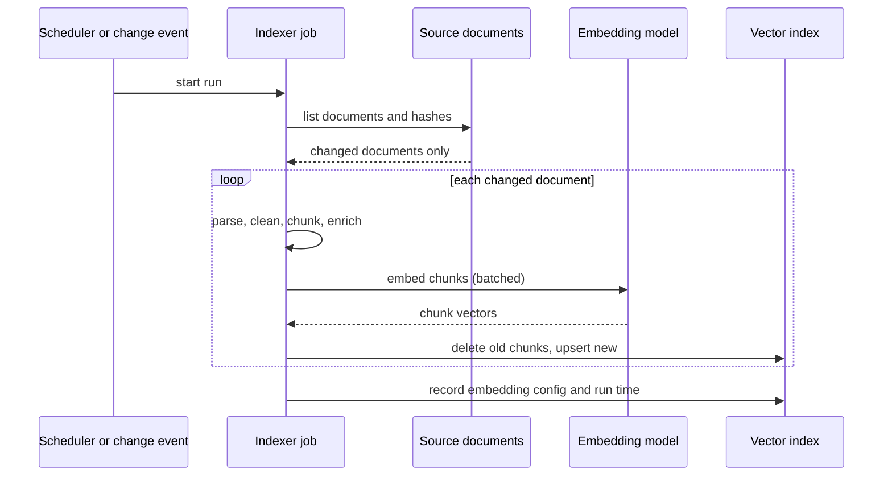
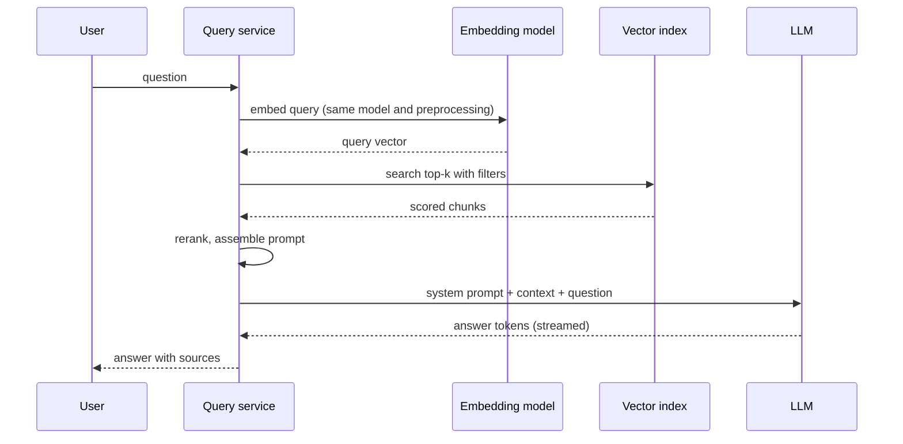

The last three lessons followed data through the [indexing](/learn/rag-architecture-fundamentals/indexing-pipeline), [retrieval](/learn/rag-architecture-fundamentals/retrieval-pipeline) and [generation](/learn/rag-architecture-fundamentals/generation-pipeline) pipelines. This lesson looks at the same system along a different axis: **time**. Some work is done ahead of any question, in the background, when documents change. That is **offline** processing. Other work is done while a user waits. That is **online** processing.

Where you draw that line determines how fast the system answers, how much it costs to run and how out of date its answers can be. It also creates the most notorious silent bug in RAG: the offline and online halves disagreeing about how text becomes a vector. This lesson covers the split, the arithmetic of latency and freshness, and a runnable demonstration of that bug and the guard against it.

## Learning objectives

- Classify each computation in a RAG system as offline or online, and justify the placement.
- Calculate a latency budget for the online path and identify which stage dominates it.
- Calculate the worst-case staleness of an index from its update schedule.
- Explain why the offline and online paths must share the embedding model and preprocessing, and what happens when they do not.
- Implement a configuration check that turns a silent offline/online mismatch into an immediate error.

## Prerequisites

- [Traditional RAG architecture](/learn/rag-architecture-fundamentals/traditional-rag-architecture)
- [Indexing pipeline](/learn/rag-architecture-fundamentals/indexing-pipeline)
- [Retrieval pipeline](/learn/rag-architecture-fundamentals/retrieval-pipeline)
- [Embeddings](/learn/understanding-large-language-models/embeddings)

## Why this matters

A user will wait a second or two for an answer. Embedding a hundred thousand chunks takes minutes at best. The only way to reconcile those facts is to do the expensive, query-independent work before the question arrives and leave as little as possible for the moment the user is waiting. Every RAG system makes this split; the engineering question is where exactly to put each piece of work.

The split has two prices. The first is **staleness**: anything computed in advance reflects the documents as they were when it was computed. If the handbook changes at 10:00 and the index is rebuilt at midnight, the assistant gives yesterday's answer for fourteen hours. The second is **consistency**: two separate programs, often deployed separately and sometimes owned by different people, must turn text into vectors in exactly the same way. When they drift apart, nothing crashes. Search simply gets worse, and it can take weeks for anyone to work out why.

## The intuition

A restaurant kitchen divides its day in two. In the morning, with no customers, the cooks do the *mise en place*: stocks are simmered, vegetables chopped, sauces made. It is slow work, and it is done once for the whole service. In the evening, when an order comes in, a dish is assembled and finished in minutes from what was prepared. Nobody starts a six-hour stock when table four orders soup.

The split works because the stock does not depend on who orders it. It can be made before the order exists. The seasoning and plating depend on the particular order, so they happen at the last moment.

Two things can go wrong. The preparation can go stale: this morning's sauce does not include the ingredient that was delivered at noon. And the two shifts can disagree: if the morning cook measured in grams and the evening cook's recipe assumes ounces, every dish comes out wrong, and each cook, checking their own work, finds nothing amiss. RAG has exact equivalents of both.

## How it works

### The rule for placing work

One question decides where a computation belongs: **does it depend on the user's query?**

- If it depends only on the documents, it can be computed offline, once per document version, and stored.
- If it depends on the query (or on who is asking), it must be computed online, per request.

| Computation | Depends on | Path | Why |
| --- | --- | --- | --- |
| Loading, parsing, cleaning | Documents | Offline | Slow, and identical for every question |
| Chunking | Documents | Offline | Same |
| Embedding chunks | Documents | Offline | By far the largest computation; reused by every query |
| Building the vector index | Documents | Offline | Makes online search fast |
| Processing and embedding the query | Query | Online | The query does not exist until it is asked |
| Vector search, filtering, top-k | Query, user | Online | The result differs for every query |
| Reranking | Query and candidates | Online | Scores a query-chunk pair, so cannot be precomputed |
| Prompt assembly and generation | Query and results | Online | Same |

Reranking is the instructive row. It is expensive and it runs online, because its input is a *pair*: this query with that chunk. Nothing about the pair exists until the query arrives. This is the underlying reason the retrieval pipeline is a funnel: first-stage search is designed so that almost all of its work (embedding every chunk) can be done offline, leaving only one query embedding and a lookup for the online path.

### Moving work across the line

The line is not fixed. Much of RAG optimisation consists of finding query-dependent-looking work that can in fact be done ahead of time:

- **Caching** stores the result of an online computation so that a repeated question skips it. It is offline processing done lazily: the first asker pays. See [Caching](/learn/performance-optimisation/caching).
- **Index-time enrichment** does extra work per chunk offline, such as generating a summary or adding surrounding context to each chunk before embedding, so that retrieval is better without any online cost. [Contextual retrieval](/learn/advanced-retrieval/contextual-retrieval) is an example.

Moving work offline buys latency and pays in storage, indexing cost and staleness. Moving it online does the reverse.

### The offline path



Nobody is waiting for this path. It is optimised for **throughput** (chunks per second) and **cost**, uses large batches, and can retry failures. Its trigger is either a schedule (every night, every fifteen minutes) or an event (a document was saved). [Understanding Document Ingestion](/learn/understanding-document-ingestion) compares the triggering styles.

### The online path



A person is waiting for every step. This path is optimised for **latency**, handles one small request at a time, and must degrade gracefully when a dependency is slow.

Compare the two diagrams. They have exactly two participants in common: the **embedding model** and the **vector index**. The index is where the paths exchange data. The embedding model is where they must agree.

### Freshness versus cost

Freshness is how quickly a change to a source document is reflected in answers. It is governed by how often the offline path runs and how long a run takes. Running more often gives fresher answers and, depending on how the pipeline is built, costs more:

- With **full rebuilds**, every run re-embeds the whole corpus, so cost is proportional to the number of runs. Hourly is twenty-four times the cost of nightly.
- With **incremental** runs that skip unchanged documents (the hash check from the [indexing pipeline](/learn/rag-architecture-fundamentals/indexing-pipeline)), embedding cost is proportional to the number of *changes*, not the number of runs. Running hourly embeds the same changed documents as running nightly, only sooner. What grows with frequency is the fixed overhead of each run: listing the source and comparing hashes.

So incremental indexing is what makes freshness affordable. The right freshness target comes from the content, not from what is technically possible: an annual leave policy that changes twice a year does not need a five-minute pipeline, while incident runbooks edited during an outage might.

### Consistency between the two paths

Similarity search compares a query vector with chunk vectors. The comparison is meaningful only if both were produced by the same function. Every one of the following must match between the offline and online paths:

1. **The embedding model**, including its exact version. Vectors from two different models are unrelated, even if both have the same number of dimensions.
2. **Text preprocessing** before embedding: case handling, Unicode normalisation, whitespace and punctuation treatment, truncation length.
3. **Model-specific input conventions.** Some embedding models expect a prefix or a mode that distinguishes queries from passages (the E5 family, for example, is trained with `query: ` and `passage: ` prefixes). Here the two paths deliberately differ, and each must use the form the model was trained with.
4. **Normalisation** of the output vectors, and the **similarity measure** the index was built for.

A mismatch in dimension is the lucky case: the index rejects the query with an error. A mismatch in anything else produces a vector of the right shape, a search that completes, a list of k results with plausible-looking scores, and answers built on the wrong chunks. Nothing is logged because nothing failed. This is the classic silent bug of RAG systems.

The defence is to treat the embedding configuration as part of the index. The offline path writes down exactly how the vectors were made; the online path refuses to search an index whose recorded configuration differs from its own. Changing the model then becomes a deliberate operation: build a complete new index offline with the new model, and switch the online path to the new model and the new index at the same moment. See [Reindexing](/learn/ci-cd-and-mlops/reindexing) and [Blue-green deployments](/learn/ci-cd-and-mlops/blue-green-deployments).

> [!WARNING]
> An index cannot be "partly upgraded" to a new embedding model. A store holding vectors from two models returns rankings in which the old-model chunks are scored at random against a new-model query. Re-embed everything into a new index, then switch.

## The mathematics

Two simple sums govern this lesson: one for latency, one for staleness.

### Latency budget

The online stages run one after another, so their times add. A **latency budget** is a target for the total, divided among the stages.

$$
T_{\text{first}} = \sum_{i=1}^{n} t_i
\qquad
T_{\text{total}} = T_{\text{first}} + \frac{N_{\text{out}}}{r}
$$

- $t_i$ is the time taken by online stage $i$ before the answer starts (query processing, embedding, search, reranking, prompt assembly, and the model's time to produce its first token).
- $T_{\text{first}}$ is the time to the first token: how long before the user sees anything, if the answer is streamed.
- $N_{\text{out}}$ is the number of tokens in the answer and $r$ is the model's output rate in tokens per second.
- $T_{\text{total}}$ is the time until the answer is complete.

**Worked by hand.** Assume, for illustration, stage times of 2, 15, 20, 120, 3 and 600 ms, a 150-token answer and an output rate of 60 tokens per second. Then $T_{\text{first}} = 2 + 15 + 20 + 120 + 3 + 600 = 760$ ms. Streaming the answer takes $150 / 60 = 2.5$ s, so $T_{\text{total}} = 0.76 + 2.5 = 3.26$ s. The model's share of time to first token is $600 / 760 \approx 79\%$.

The same in Python:

```python
stages_ms = {
    "query processing": 2,
    "embed query": 15,
    "vector search": 20,
    "rerank 20 candidates": 120,
    "assemble prompt": 3,
    "LLM time to first token": 600,
}
output_tokens, tokens_per_second = 150, 60

before_first_token = sum(stages_ms.values())
streaming = output_tokens / tokens_per_second * 1000
for name, ms in stages_ms.items():
    print(f"{name:<26}{ms:>6} ms  {ms / before_first_token:>5.0%} of time to first token")
print(f"{'time to first token':<26}{before_first_token:>6} ms")
print(f"{'streaming the answer':<26}{streaming:>6.0f} ms  ({output_tokens} tokens at {tokens_per_second}/s)")
print(f"{'total':<26}{before_first_token + streaming:>6.0f} ms")
```

```output
query processing               2 ms     0% of time to first token
embed query                   15 ms     2% of time to first token
vector search                 20 ms     3% of time to first token
rerank 20 candidates         120 ms    16% of time to first token
assemble prompt                3 ms     0% of time to first token
LLM time to first token      600 ms    79% of time to first token
time to first token          760 ms
streaming the answer        2500 ms  (150 tokens at 60/s)
total                       3260 ms
```

The stage times are assumptions chosen to be plausible, not measurements; substitute your own. The structure of the result is what generalises: retrieval is a small part of the wait, the model is most of it, and the length of the answer matters more than everything before the first token. A budget tells you where optimisation can possibly pay. Halving vector search here saves 10 ms out of 3,260.

### Staleness

For an offline path that runs every $P$ (the period) and takes $D$ to complete a run:

$$
S_{\max} = P + D
$$

$S_{\max}$ is the worst-case staleness: the longest time between a document changing and the change being searchable. The worst case is a document edited just after a run has read it. It waits a full period $P$ for the next run to begin, and that run takes $D$ to finish.

**Worked by hand.** A nightly job ($P = 24$ h) that takes 40 minutes gives $S_{\max} = 24\text{ h } 40\text{ min}$. Moving to every 15 minutes with an incremental run of 2 minutes gives $S_{\max} = 17$ minutes. For event-driven indexing, $P$ is effectively zero and staleness is just the processing time $D$ plus any queueing delay.

## In code

The problem: show, with code that runs, that an offline/online mismatch changes rankings without raising any error, and then build the guard that makes it impossible to miss.

The demonstration needs an "embedding model" whose version can be changed. `ToyEmbedder` hashes words into a 2,048-slot count vector and multiplies it by a fixed random matrix to get 256 dense numbers. The random matrix stands in for a model's weights: a different seed is a different model with the same output shape. It also takes a `preprocess` function, so the two kinds of mismatch can be shown separately.

```bash
pip install scikit-learn numpy
```

```python
import re
import unicodedata

import numpy as np
from sklearn.feature_extraction.text import HashingVectorizer

CHUNKS = [
    "Annual leave is 25 days per year.",
    "Up to 5 unused leave days carry over and must be used by 31 March.",
    "Staff may work remotely up to 3 days a week.",
    "The home-office equipment budget is £400.",
    "Expenses must be submitted within 30 days.",
    "Any expense over £75 needs a receipt.",
    "Passwords must be rotated every 90 days.",
    "The VPN is required on public Wi-Fi.",
    "The laptop refresh cycle is 3 years.",
    "The support desk is open 08:00 to 18:00 UK time.",
]


def preprocess_v1(text: str) -> str:
    """The ingestion team's cleaner: Unicode-normalise, lower-case, join hyphenated words."""
    text = unicodedata.normalize("NFKC", text).lower()
    return re.sub(r"(\w)-(\w)", r"\1\2", text)        # "wi-fi" -> "wifi"


def preprocess_none(text: str) -> str:
    return text


class ToyEmbedder:
    """A stand-in for an embedding model: text in, 256 unit-length floats out.

    `seed` plays the part of the model's weights: a different seed is a different model.
    """

    def __init__(self, seed: int, preprocess, dim: int = 256):
        self.preprocess = preprocess
        self.hasher = HashingVectorizer(n_features=2048, lowercase=False,
                                        stop_words="english", norm=None, alternate_sign=False)
        self.projection = np.random.default_rng(seed).normal(size=(2048, dim))

    def encode(self, texts: list[str]) -> np.ndarray:
        counts = self.hasher.transform([self.preprocess(t) for t in texts])
        vectors = counts @ self.projection
        norms = np.linalg.norm(vectors, axis=1, keepdims=True)
        return vectors / np.where(norms == 0, 1, norms)


def top3(index: np.ndarray, query_vector: np.ndarray) -> list[str]:
    scores = index @ query_vector
    return [f"{scores[i]:+.2f} {CHUNKS[i]}" for i in np.argsort(-scores)[:3]]


# OFFLINE: the nightly job embeds every chunk with model v1 and the v1 cleaner.
offline = ToyEmbedder(seed=1, preprocess=preprocess_v1)
index = offline.encode(CHUNKS)
print("index:", index.shape)

query = "Do I need the VPN when my laptop is on hotel Wi-Fi?"
online_variants = {
    "matched (model v1, cleaner v1)": ToyEmbedder(seed=1, preprocess=preprocess_v1),
    "preprocessing mismatch (model v1, no cleaner)": ToyEmbedder(seed=1, preprocess=preprocess_none),
    "model mismatch (model v2, cleaner v1)": ToyEmbedder(seed=2, preprocess=preprocess_v1),
}
for label, online in online_variants.items():
    q = online.encode([query])[0]
    print(f"\n{label}  | query vector shape {q.shape}")
    for line in top3(index, q):
        print("   ", line)
```

```output
index: (10, 256)

matched (model v1, cleaner v1)  | query vector shape (256,)
    +0.52 The VPN is required on public Wi-Fi.
    +0.21 The laptop refresh cycle is 3 years.
    +0.13 The home-office equipment budget is £400.

preprocessing mismatch (model v1, no cleaner)  | query vector shape (256,)
    +0.24 The laptop refresh cycle is 3 years.
    +0.15 The home-office equipment budget is £400.
    +0.12 The VPN is required on public Wi-Fi.

model mismatch (model v2, cleaner v1)  | query vector shape (256,)
    +0.08 Up to 5 unused leave days carry over and must be used by 31 March.
    +0.07 Annual leave is 25 days per year.
    +0.07 The home-office equipment budget is £400.
```

**The important lines.**

- `index = offline.encode(CHUNKS)` is the offline path: done once, with one particular model and cleaner.
- Each entry in `online_variants` is a different online service querying that same index. Only the first matches how the index was built.
- `np.random.default_rng(seed).normal(...)` creates the "weights". Seeds 1 and 2 produce matrices of the same shape with unrelated contents, just as two embedding models can share a dimension and nothing else.
- Every query vector has shape `(256,)`. The index accepts all three. No exception is raised anywhere.

**What the output means.**

- **Matched.** The VPN chunk is first with 0.52, well clear of the rest. Correct.
- **Preprocessing mismatch.** The online service forgot the cleaner. Offline, "VPN" was indexed as `vpn` and "Wi-Fi" as `wifi`; online, the query's `VPN`, `Wi` and `Fi` are different tokens and match nothing. The only word that still lines up is "laptop", so the laptop refresh chunk takes first place and the correct chunk drops to third. An assistant built on this would tell the user about the three-year refresh cycle.
- **Model mismatch.** The query vector comes from a different model. Every score is close to zero and the ranking is effectively random: the top result is about carrying over leave. Yet it is a well-formed top-3 with positive scores.

The second case is the more dangerous in practice, because it is partial. Queries without capitals or hyphens still work, so spot checks pass, and quality falls only for some questions. Exercise 2 measures this.

### The guard

The fix is to store the embedding configuration with the index and compare it on every search. This continues the same script.

```python
from dataclasses import dataclass


@dataclass(frozen=True)
class EmbeddingConfig:
    model: str
    preprocess: str
    dim: int
    normalised: bool = True


class ConfigMismatch(RuntimeError):
    pass


class GuardedIndex:
    """A vector index that remembers how its vectors were made."""

    def __init__(self, vectors: np.ndarray, config: EmbeddingConfig):
        self.vectors, self.config = vectors, config

    def search(self, query_vector: np.ndarray, query_config: EmbeddingConfig, k: int = 3):
        if query_config != self.config:
            raise ConfigMismatch(f"index built with {self.config}, query made with {query_config}")
        scores = self.vectors @ query_vector
        return [(float(scores[i]), CHUNKS[i]) for i in np.argsort(-scores)[:k]]


v1 = EmbeddingConfig(model="toy-embedder-1", preprocess="v1", dim=256)
index = GuardedIndex(ToyEmbedder(1, preprocess_v1).encode(CHUNKS), v1)

query = "Do I need the VPN when my laptop is on hotel Wi-Fi?"
ok = index.search(ToyEmbedder(1, preprocess_v1).encode([query])[0], v1, k=1)
print("matched:", [(round(score, 2), text) for score, text in ok])

v2 = EmbeddingConfig(model="toy-embedder-2", preprocess="v1", dim=256)
try:
    index.search(ToyEmbedder(2, preprocess_v1).encode([query])[0], v2)
except ConfigMismatch as error:
    print("refused:", error)
```

```output
matched: [(0.52, 'The VPN is required on public Wi-Fi.')]
refused: index built with EmbeddingConfig(model='toy-embedder-1', preprocess='v1', dim=256, normalised=True), query made with EmbeddingConfig(model='toy-embedder-2', preprocess='v1', dim=256, normalised=True)
```

`EmbeddingConfig` is a frozen dataclass, so two configurations are equal only if every field is. The mismatched query now fails immediately, with a message naming both sides, instead of returning wrong results. In a real system the configuration is stored as metadata on the collection in the vector database and checked once when the query service starts, as well as being attached to every search.

**Errors people commonly hit.**

- `ValueError: matmul: Input operand 1 has a mismatch in its core dimension`: the query and index dimensions differ. This is the fortunate version of the bug, because it is loud.
- A guard that always passes: the configuration records only the model name, and the preprocessing changed. Record everything that affects the vector.
- A guard that compares a name such as `"latest"`: an alias that can point to different models over time defeats the check. Record a pinned, explicit version.

**How to extend it.** Put the preprocessing function and the embedding call in one shared module (or one internal service) imported by both the indexer and the query service, so that there is a single implementation to keep consistent. Add a canary test: a small fixed set of queries with known best chunks, run against the live index on every deployment (exercise 2).

## A real-world example

AskMeridian has been running for six months with nightly indexing. Two unrelated things happen in one week.

First, IT rewrites the VPN runbook at 09:30 on a Monday during a network change. All day, staff asking how to connect are given the old instructions, because the index will not see the new page until midnight. The team had never written down a freshness requirement. Leilani, who owns the indexer, checks the run statistics: most nights only a handful of documents change, and an incremental run finishes in under two minutes. She moves the schedule to every 15 minutes and adds an event trigger for the runbooks folder. Worst-case staleness for runbooks falls from over a day to a few minutes, and the embedding bill does not change, because the same documents are embedded either way.

Second, a developer upgrades the embedding library in the query service to pick up a newer model that the model card says is more accurate. It has the same number of dimensions as the old one. The deployment passes its health check, which only confirms that a search returns results. Over the following days the "not helpful" rate creeps up. Nobody connects it to the deployment, because nothing is erroring and some questions still happen to come out right. Nine days later Leilani runs the same query through the indexer's embedding code and the query service's, compares the two vectors, and finds them nearly orthogonal. The index had been built with one model and queried with another.

The repair is a full rebuild with the new model into a new index, followed by a switch. The prevention is the guard from this lesson, plus a canary test in the deployment pipeline. The health check had asked "does search work?" The useful question was "does search still return the right chunk?"

## Common mistakes

- **Embedding documents at query time.** Any design that embeds chunks while a user waits has put offline work on the online path, and latency grows with the corpus.
- **Upgrading the embedding model on one path only.** Same dimension, no error, wrong rankings. This is the silent bug.
- **Duplicating preprocessing code.** Two copies of "the same" cleaning function, one in the indexer and one in the service, will diverge the first time one is edited.
- **Mixing vectors from two models in one index** during a gradual migration. Rankings across the two groups are meaningless.
- **No stated freshness requirement.** The schedule is then whatever was chosen on the first day, and nobody knows whether it is adequate until an incident shows it is not.
- **Optimising the wrong stage.** Shaving milliseconds off vector search while the model call takes seconds changes nothing the user can feel.
- **Health checks that only test for a response.** A mismatched system still responds.

## Best practices

- Decide each computation's place with one question: does it depend on the query?
- Write down a freshness target per document collection, derive the schedule from it, and monitor actual staleness.
- Make the offline path incremental so that running it more often costs little.
- Share one implementation of preprocessing and embedding between the two paths.
- Store the full embedding configuration with the index, and check it at service start and on search.
- Pin embedding models to explicit versions; change them only through a full rebuild and a switch.
- Keep a canary set of queries with known answers and run it against the live index after every deployment of either path.
- Write a latency budget before optimising, and measure each stage separately in production.

## Performance considerations

The two paths are measured differently.

**Offline: throughput and total cost.** The quantity that matters is chunks processed per unit of time and money. For 96,000 chunks of about 250 tokens each, a full build embeds $96{,}000 \times 250 = 24$ million tokens. At an assumed throughput of 2,000 chunks per second on a batch-friendly model, that is $96{,}000 / 2{,}000 = 48$ seconds of embedding; at 50 chunks per second it is 32 minutes. Nobody waits for either, which is why offline work can use large batches, cheaper hardware and off-peak hours. The cost is paid once per document version.

**Online: latency per request, at the tail.** The budget above used single typical values. Real stage times vary, and users notice the slow requests, so budgets should be set against a high percentile (commonly the 95th or 99th) and not the average. Stages in series compound the problem: a request is slow if *any* stage is slow.

**The trade.** Storage is what you pay to move work offline. Precomputing vectors for a million chunks at 384 dimensions and 4 bytes each costs about 1.5 GB of memory or disk, permanently, to save every query from doing that work. Precomputing more per chunk (summaries, extra vectors) raises storage and indexing cost further and lowers online work further. Each such move is worth making only if the online saving, multiplied by query volume, exceeds the offline cost, multiplied by how often documents change.

A system with few queries and fast-changing documents should keep the offline path light. A system with many queries over stable documents should precompute aggressively.

## Security considerations

- **Staleness applies to permissions and deletions too.** If a document is deleted or access to it is revoked at the source, it remains retrievable until the offline path catches up. For sensitive collections, worst-case staleness is a security property, and revocations may need an immediate, event-driven path. See [Secure deletion](/learn/enterprise-rag-governance/secure-deletion).
- **The offline path holds broad credentials.** An indexer typically needs read access to every source document; the query service needs only the index. Keep them as separate identities so that a compromise of the internet-facing service does not expose the sources.
- **The online path faces untrusted input.** Rate-limit it and cap query length; each request triggers paid embedding and model calls.
- **Caches cross user boundaries if you let them.** A cached answer computed for one user's permissions must not be served to another with different permissions. Include the permission scope in the cache key.

## Summary

- Work that depends only on documents is done offline, once per document version; work that depends on the query is done online, per request.
- The offline path is tuned for throughput and cost, the online path for latency. They share only the index and the embedding model.
- Online latency is the sum of the stage times plus answer length divided by output rate; the model call usually dominates.
- Worst-case staleness is the run period plus the run duration. Incremental indexing makes frequent runs cheap.
- The embedding model, preprocessing, input conventions and normalisation must match across the two paths. A mismatch with the same dimension raises no error and quietly corrupts rankings.
- Store the embedding configuration with the index, check it on the online path, and change models only by full rebuild and switch.

## Exercises

**1.** Classify each as offline, online, or "could be either" with a one-line reason: (a) generating a one-sentence summary of each chunk to embed alongside it; (b) translating the user's question into English before search; (c) computing which chunks a given user is permitted to see; (d) answering the ten most frequently asked questions.

<details><summary>Show solution</summary>

(a) Offline: it depends only on the chunk. (b) Online: it depends on the query. (c) Could be either: the permission *metadata* on each chunk is written offline, but the comparison with the user's identity happens online as a filter, because who is asking is known only at request time. (d) Could be either: the answers can be precomputed or cached, moving the whole online path offline for those questions, provided the cache is invalidated when the underlying documents change and is keyed by anything that alters the answer, such as the user's permissions.

</details>

**2.** Build a canary check. Using the script from this lesson, take five queries and measure, for each of the three online variants, the fraction of queries whose top-1 chunk agrees with the matched configuration. What does the result tell you about detecting each kind of mismatch?

<details><summary>Show solution</summary>

```python
QUERIES = [
    "Do I need the VPN when my laptop is on hotel Wi-Fi?",
    "What is the Home-Office equipment budget?",
    "How often must Passwords be rotated?",
    "When is the Support Desk open?",
    "How many unused leave days carry over?",
]


def agreement(online: ToyEmbedder) -> float:
    reference = ToyEmbedder(seed=1, preprocess=preprocess_v1)
    same = 0
    for q in QUERIES:
        expected = int(np.argmax(index @ reference.encode([q])[0]))
        got = int(np.argmax(index @ online.encode([q])[0]))
        same += expected == got
    return same / len(QUERIES)


for label, online in online_variants.items():
    print(f"{agreement(online):.0%} top-1 agreement  {label}")
```

```output
100% top-1 agreement  matched (model v1, cleaner v1)
80% top-1 agreement  preprocessing mismatch (model v1, no cleaner)
0% top-1 agreement  model mismatch (model v2, cleaner v1)
```

(Run this against the plain `index` array from the first script, before it is wrapped in `GuardedIndex`.) A model mismatch is catastrophic and would be caught by almost any canary. A preprocessing mismatch still gets four of five right: a single hand-typed test query would very probably pass. Detecting partial degradation needs a canary set that is large enough and deliberately includes the awkward cases: capitals, hyphens, accents, abbreviations. Five queries is far too few for production; the principle is what matters.

</details>

**3.** AskMeridian's online path has a 2.0-second budget for time to first token. Measured stage times are: query processing 5 ms, query embedding 25 ms, vector search 40 ms, reranking 50 candidates at 6 ms each, prompt assembly 5 ms, LLM time to first token 900 ms. Is the budget met? The team wants to add an LLM query-rewriting step that takes 700 ms. What would you change to fit it?

<details><summary>Show solution</summary>

Reranking costs $50 \times 6 = 300$ ms. Time to first token is $5 + 25 + 40 + 300 + 5 + 900 = 1{,}275$ ms, so the budget is met with 725 ms to spare. Adding a 700 ms rewrite gives 1,975 ms: technically inside the budget, with 25 ms of margin, which will be exceeded on any slow request. Options, in rough order of preference: run the rewrite only for queries that need it (follow-ups, or when the first search scores poorly), so most requests skip it; cut reranking to 25 candidates, saving 150 ms, after checking that recall holds; use a smaller, faster model for the rewrite; or run the rewrite in parallel with a search on the original query and merge the results, so the two do not add. Shaving the 40 ms vector search would not help materially.

</details>

**4.** Design decision: Meridian wants to change embedding models. The index holds 96,000 chunks and the service must stay available. Describe the sequence of steps, and say what must be true at the moment of switching.

<details><summary>Show solution</summary>

1. Leave the current index and query service untouched. 2. Run the offline path with the new model into a **new, separate index**, recording the new embedding configuration on it. 3. Keep the old index up to date as usual during the build, and make sure changes arriving during the build also reach the new index (run its incremental job until it has caught up). 4. Evaluate the new index offline against a test set and the canary queries, using the new model for queries. 5. Switch: deploy the query service configured with the new model and pointed at the new index, in one step, for instance by moving an alias. 6. Keep the old index for a period so that rolling back is another switch, then delete it.

At the moment of switching, the query-side model and the index being searched must change together, so that no request embeds with one model and searches vectors from the other. The configuration guard enforces this: a service on the new model pointed at the old index refuses to search. The cost is temporarily storing two indexes and embedding all 96,000 chunks once more.

</details>

## Check your understanding

```quiz
[
  {
    "q": "Which question decides whether a computation can be moved to the offline path?",
    "options": [
      "Is it expensive?",
      "Does it use a GPU?",
      "Does it depend on the user's query?",
      "Does it involve the LLM?"
    ],
    "answer": 2,
    "why": "Work that depends only on the documents can be done once in advance. Work that depends on the query cannot exist before the query does."
  },
  {
    "q": "Reranking is expensive. Why can it not simply be precomputed offline like chunk embeddings?",
    "options": [
      "It scores a query together with a chunk, and the query is not known until request time",
      "Rerankers are not deterministic",
      "Vector databases cannot store reranker scores",
      "It requires the system prompt"
    ],
    "answer": 0,
    "why": "A chunk embedding depends on the chunk alone. A reranker's input is the pair, so there is nothing to compute until a query arrives."
  },
  {
    "q": "An index was built with embedding model A. The query service is upgraded to model B, which has the same number of dimensions. What happens?",
    "options": [
      "The vector database raises a dimension error",
      "Search results improve because B is newer",
      "The service fails its start-up health check",
      "Searches succeed and return k results, but the rankings are essentially unrelated to the query"
    ],
    "answer": 3,
    "why": "The shapes match, so nothing fails. But vectors from different models are not comparable, so similarity scores are meaningless. This is the silent bug."
  },
  {
    "q": "An indexer runs every 6 hours and each run takes 30 minutes. What is the worst-case time between a document being edited and the edit being searchable?",
    "options": ["30 minutes", "6 hours 30 minutes", "6 hours", "3 hours 15 minutes"],
    "answer": 1,
    "why": "A document edited just after a run has read it waits a full period (6 h) for the next run to start, and that run takes 30 minutes to finish: period plus duration."
  },
  {
    "q": "Time to first token is 760 ms, of which 20 ms is vector search and 600 ms is the LLM. The answer then streams for 2.5 s. An engineer makes vector search twice as fast. How much sooner is the complete answer delivered?",
    "options": ["About 50% sooner", "380 ms sooner", "10 ms sooner, out of 3,260 ms", "1.25 s sooner"],
    "answer": 2,
    "why": "Halving a 20 ms stage saves 10 ms. A latency budget shows that the model call and the answer length dominate, so that is where optimisation pays."
  }
]
```

## Further reading

- Kleppmann, M. (2017). *Designing Data-Intensive Applications*, chapter 10, "Batch Processing", and chapter 11, "Stream Processing". O'Reilly. The general theory of derived data computed ahead of time.
- Dean, J. and Barroso, L. A. (2013). *The Tail at Scale*. Communications of the ACM, 56(2). Why latency must be budgeted at high percentiles.
- Wang, L. et al. (2022). *Text Embeddings by Weakly-Supervised Contrastive Pre-training*. The E5 paper, an example of a model with distinct query and passage input formats. [arxiv.org/abs/2212.03533](https://arxiv.org/abs/2212.03533)
- Sentence Transformers documentation. [sbert.net](https://www.sbert.net/)
- scikit-learn documentation, [`HashingVectorizer`](https://scikit-learn.org/stable/modules/generated/sklearn.feature_extraction.text.HashingVectorizer.html).
