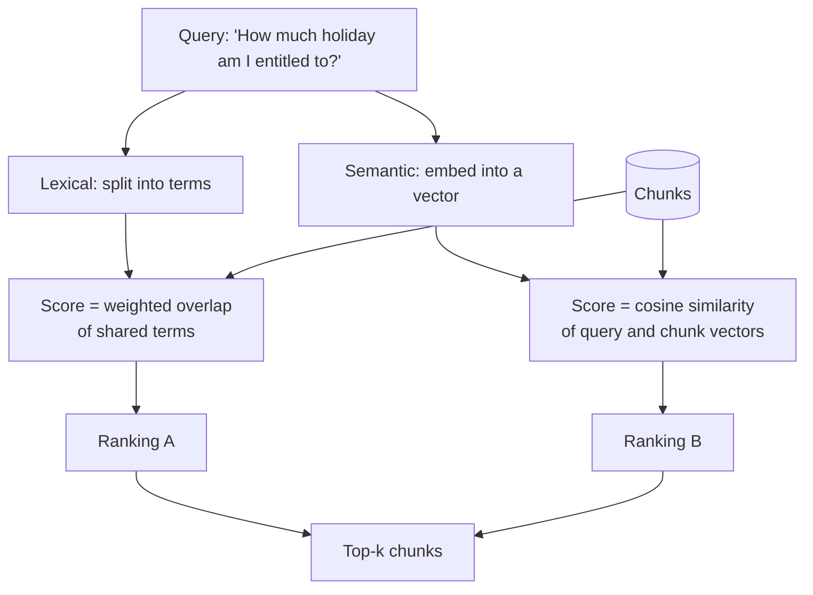

The [retrieval pipeline](/learn/rag-architecture-fundamentals/retrieval-pipeline) has many stages, but one question sits at its centre: given a query and a pile of chunks, **which chunks answer this query?** Every retriever answers it the same way, by giving each chunk a number and sorting. What differs is how the number is computed. This lesson examines the two families of answer: **lexical matching**, which counts shared words, and **semantic matching**, which compares meaning through vectors. You will run both on the same small corpus and watch each one fail on a query the other handles easily.

The aim here is the concept, not the production machinery. Later phases give whole modules to [sparse retrieval](/learn/sparse-retrieval), [dense retrieval](/learn/dense-retrieval) and [hybrid search](/learn/hybrid-search); this lesson gives you the mental model those modules build on.

## Learning objectives

- Define a scoring function and explain why retrieval depends only on the order it produces.
- Compute a TF-IDF weight and a cosine similarity by hand and in NumPy.
- Explain the vocabulary-mismatch problem and show a query on which lexical matching fails because of it.
- Describe the asymmetry between a short query and a long passage, and what each matching family does about it.
- Predict, for a given query, whether lexical or semantic matching is more likely to find the right chunk.

## Prerequisites

- [Retrieval pipeline](/learn/rag-architecture-fundamentals/retrieval-pipeline): where matching sits among the other retrieval stages.
- [Embeddings](/learn/understanding-large-language-models/embeddings): text as vectors whose directions encode meaning.
- [Tokens and tokenisation](/learn/understanding-large-language-models/tokens-and-tokenisation): how text is split into units before anything is counted.

## Why this matters

When a RAG system gives a wrong answer, the fault usually lies in one of two places: the right chunk never reached the model, or it did and the model misused it. The first is a matching failure, and no prompt can repair it. A model that is told to answer only from the context, and is handed a context about remote work when the question was about holiday, will either refuse or answer wrongly.

Matching failures are also quiet. The retriever always returns its top results; it has no notion of "nothing here is any good" unless you build one. So a bad match looks, from the outside, exactly like a good one: five chunks come back, each with a score. Understanding how those scores are produced is the only way to know when to distrust them, and it is what lets you look at a failed query and say "that is a vocabulary problem" or "that is an exact-identifier problem" instead of changing settings at random.

## The intuition

Imagine two assistants in Meridian's HR office, each asked to find the right page of the handbook.

The first is a **literal clerk**. He takes your question, underlines the words, and looks for pages containing those same words. Ask him about "error E-4021" and he is superb: he finds the one page with that exact code. Ask him "how much holiday am I entitled to?" and he is stuck, because the handbook never uses the word *holiday*. It says *annual leave*. He hands you a page that happens to share the word "to".

The second is a **well-read colleague**. She does not look at your words at all; she understands what you are asking about and goes to the pages on that subject. "Holiday" and "annual leave" are the same thing to her. But ask her about "error E-4021" and she goes to the general area of VPN errors and picks up E-4012 instead. To her, the two codes are about the same subject, and the digits are a detail she does not hold on to.

Neither is better. They fail on different queries, and that is why production systems so often employ both.

## How it works

### A scoring function

Both assistants are doing the same abstract thing. A **scoring function** takes a query $q$ and a document $d$ (in RAG, a chunk) and returns a single number:

$$
\text{score}(q, d) \in \mathbb{R}
$$

A higher number means "more likely to be relevant". Retrieval is then mechanical:

1. Compute $\text{score}(q, d)$ for every chunk $d$ in the index (or, at scale, for a cleverly chosen subset).
2. Sort the chunks by score, highest first.
3. Keep the first $k$. This is the **top-k** result.

Three properties of scores are worth fixing in your mind now, because each one causes real bugs when forgotten:

- **Only the order matters for retrieval.** Doubling every score, or adding 10 to each, returns the same chunks. A scoring function is judged by the ranking it produces.
- **Scores are not probabilities.** A cosine of 0.83 does not mean "83% likely to be relevant". It is a position on that model's own scale.
- **Scores from different functions are not comparable.** A TF-IDF score of 0.35 and an embedding cosine of 0.35 mean unrelated things. Combining them needs care, which is the subject of [Reciprocal Rank Fusion](/learn/hybrid-search/reciprocal-rank-fusion).



### Lexical matching: counting shared terms

**Lexical matching** scores a chunk by the words (more precisely, the **terms**: tokens after lower-casing and similar tidying) that it shares with the query. The crudest version counts the overlap. Two refinements make it useful:

1. **Term frequency (TF).** A chunk that mentions "VPN" three times is more likely to be about VPNs than one that mentions it once.
2. **Inverse document frequency (IDF).** A term that appears in almost every chunk ("the", "is") tells you nothing about which chunk to pick. A term that appears in only one ("4021") is nearly decisive. IDF gives rare terms a high weight and common terms a low one.

Multiplying the two gives the **TF-IDF** weight of a term in a chunk. Represent each chunk as a long vector with one position per vocabulary term, holding that term's TF-IDF weight, and do the same for the query. The score is then the similarity of those two vectors. These vectors are called **sparse** because almost every position is zero: a chunk contains a few dozen of the vocabulary's thousands of terms. The standard production refinement of this idea is [BM25](/learn/sparse-retrieval/bm25), covered in Phase 7.

The defining property of lexical matching: **a term that does not literally appear contributes nothing.** That is its strength (exact codes, names, part numbers and rare jargon match precisely) and its weakness.

### The vocabulary-mismatch problem

People describe the same thing with different words. The handbook's author wrote "annual leave"; the employee types "holiday", "vacation", "time off" or "PTO". This is the **vocabulary-mismatch problem**, and it is not a corner case. In a classic study, Furnas and colleagues (1987) asked people to name the same everyday objects and operations and found that two people chose the same word less than one time in five.

For a lexical matcher, mismatch means the relevant chunk scores zero on the terms that matter. It may still receive a small score from incidental words, which is worse than zero: the system confidently returns something irrelevant. Mismatch has several sources:

| Source | Query says | Document says |
| --- | --- | --- |
| Synonyms | holiday | annual leave |
| Abbreviations | WFH | work remotely |
| Word forms | rotating my password | passwords must be rotated |
| Level of description | my laptop is slow and old | refresh cycle |
| Language | vacances | annual leave |

Traditional search engines chip away at this with stemming (reducing "rotating" and "rotated" to "rotat"), synonym lists and query expansion. Each helps and each needs maintenance. Semantic matching attacks the problem at its root.

### Semantic matching: comparing meaning

**Semantic matching** uses an embedding model to turn the query and each chunk into a **dense** vector: a few hundred numbers, nearly all non-zero, positioned so that texts with similar meaning point in similar directions. (You met this in [Embeddings](/learn/understanding-large-language-models/embeddings).) The score is the similarity of the two vectors, most often the **cosine similarity**, which measures the angle between them.

Because "holiday" and "annual leave" land near each other in the vector space, the match no longer depends on shared words. The price is the mirror image of the lexical trade: an embedding compresses a whole passage into one fixed-size vector, and details that do not change the overall meaning much, such as one digit of an error code or the difference between two product versions, can be squeezed out. Text the model rarely saw in training, such as internal project names, is especially prone to this.

Drag the vectors in the visualiser below and watch how the cosine depends on the angle and ignores the lengths.

```playground
cosine-similarity
```

### The query-document asymmetry

A query and a chunk are not the same kind of text, and a matcher that treats them as interchangeable loses accuracy. Three differences matter:

- **Length.** A query is typically a handful of words; a chunk is one or more paragraphs. A long chunk contains more terms, so it shares more terms with *any* query by chance.
- **Form.** A query is usually a question ("how often must I change my password?"). The chunk that answers it is a statement ("passwords must be rotated every 90 days"). They are not paraphrases of each other.
- **Content.** By definition the query lacks the answer. The most informative part of the right chunk ("90 days") is exactly what the query cannot contain.

Each family has its own response. Lexical scoring **normalises for length**, so that long chunks are not rewarded merely for being long; the cosine does this by dividing by vector length, and BM25 has an explicit length parameter. Semantic matching relies on **how the embedding model was trained**: retrieval models learn from pairs of questions and the passages that answer them, so that a question lands near its answer rather than near other questions. Some go further and encode the two sides differently. The Dense Passage Retrieval system (Karpukhin and colleagues, 2020) trains separate question and passage encoders, and the E5 model family expects the prefixes `query: ` and `passage: ` on its inputs. If a model's documentation specifies such prefixes and you omit them, matching quality drops without any error message.

> [!KEY]
> Matching is between a question and the text that answers it, not between two similar texts. Use an embedding model trained for retrieval, follow its instructions for encoding queries and documents, and embed both sides with the same model, as [Offline and online processing](/learn/rag-architecture-fundamentals/offline-and-online-processing) explained.

### Which fails when

| Query type | Lexical | Semantic |
| --- | --- | --- |
| Paraphrase or synonym ("holiday" for "annual leave") | Fails | Works |
| Exact identifier (error code, SKU, ticket number) | Works | Often fails |
| Rare name or internal jargon | Works if spelt the same | Unreliable |
| Misspelling ("pasword") | Fails | Often works |
| Conceptual question ("can I work from a café?") | Fails | Works |

Because the failures are complementary, combining the two rankings is established practice; [Dense versus sparse retrieval](/learn/hybrid-search/dense-versus-sparse-retrieval) takes that up.

## The mathematics

### Cosine similarity

**Intuition.** Two vectors that point the same way describe the same mix of features, however long each one is. Cosine similarity measures the angle and ignores length, which is what you want when one text is five words and the other is five sentences.

$$
\cos\theta = \frac{\mathbf{q} \cdot \mathbf{d}}{\lVert \mathbf{q} \rVert \, \lVert \mathbf{d} \rVert}
= \frac{\sum_{i=1}^{n} q_i d_i}{\sqrt{\sum_{i=1}^{n} q_i^2}\,\sqrt{\sum_{i=1}^{n} d_i^2}}
$$

Here $\mathbf{q}$ and $\mathbf{d}$ are the query and document vectors, $n$ is the number of dimensions, $q_i$ and $d_i$ are their $i$-th components, $\mathbf{q} \cdot \mathbf{d}$ is the dot product, and $\lVert \cdot \rVert$ is a vector's length. The result is 1 for the same direction, 0 for perpendicular vectors and $-1$ for opposite ones. With TF-IDF vectors, whose components are never negative, it lies between 0 and 1.

**By hand.** Take $\mathbf{q} = (1, 2, 0)$ and $\mathbf{d} = (2, 1, 2)$.

- Dot product: $1 \times 2 + 2 \times 1 + 0 \times 2 = 4$.
- Length of $\mathbf{q}$: $\sqrt{1 + 4 + 0} = \sqrt{5} \approx 2.2361$.
- Length of $\mathbf{d}$: $\sqrt{4 + 1 + 4} = \sqrt{9} = 3$.
- Cosine: $4 / (2.2361 \times 3) = 4 / 6.7082 \approx 0.5963$.

### A TF-IDF weight

**Intuition.** A term matters in a document if it appears there often *and* appears in few other documents.

$$
w_{t,d} = \text{tf}_{t,d} \times \text{idf}_t, \qquad \text{idf}_t = \ln\frac{N}{\text{df}_t}
$$

$\text{tf}_{t,d}$ is the number of times term $t$ occurs in document $d$; $N$ is the number of documents in the collection; $\text{df}_t$ (the **document frequency**) is the number of documents containing $t$; $\ln$ is the natural logarithm, which stops very rare terms from dominating completely.

**By hand.** The corpus used in the code below has $N = 6$ documents. Three terms:

- "days" occurs in 4 documents, twice in the leave document: $\text{idf} = \ln(6/4) = 0.4055$, weight $= 2 \times 0.4055 = 0.8109$.
- "vpn" occurs in 3 documents, once in the password document: $\text{idf} = \ln(6/3) = 0.6931$, weight $= 0.6931$.
- "4021" occurs in 1 document, once: $\text{idf} = \ln(6/1) = 1.7918$, weight $= 1.7918$.

The single occurrence of "4021" outweighs two occurrences of "days" by more than a factor of two. That is IDF doing its job.

**In NumPy:**

```python
import numpy as np

# Cosine similarity, by the formula
q = np.array([1.0, 2.0, 0.0])
d = np.array([2.0, 1.0, 2.0])
dot = q @ d
print("dot product:", dot)
print("lengths:", round(float(np.linalg.norm(q)), 4), round(float(np.linalg.norm(d)), 4))
print("cosine:", round(float(dot / (np.linalg.norm(q) * np.linalg.norm(d))), 4))

# TF-IDF weight, by the formula
N = 6                       # documents in the collection
df = {"vpn": 3, "days": 4, "4021": 1}
tf = {"vpn": 1, "days": 2, "4021": 1}
for term in df:
    idf = np.log(N / df[term])
    print(f"{term:<5} tf={tf[term]}  idf=ln({N}/{df[term]})={idf:.4f}  weight={tf[term] * idf:.4f}")
```

```output
dot product: 4.0
lengths: 2.2361 3.0
cosine: 0.5963
vpn   tf=1  idf=ln(6/3)=0.6931  weight=0.6931
days  tf=2  idf=ln(6/4)=0.4055  weight=0.8109
4021  tf=1  idf=ln(6/1)=1.7918  weight=1.7918
```

> [!NOTE]
> Libraries use slightly different variants of the formula. scikit-learn's `TfidfVectorizer` computes $\text{idf}_t = \ln\frac{1 + N}{1 + \text{df}_t} + 1$ by default, which avoids division by zero and never gives a term zero weight, and then scales each document vector to length 1. The ranking behaviour is the same in spirit; the exact numbers differ. The [TF-IDF lesson](/learn/sparse-retrieval/tf-idf) covers the variants.

## In code

**The problem.** Score the same three queries against the same six chunks with a lexical matcher and a semantic one, side by side, and see where each goes wrong.

**Dependencies.** NumPy and scikit-learn. No API key and no model download.

```bash
pip install numpy scikit-learn
```

The lexical matcher is real: scikit-learn's `TfidfVectorizer` followed by a cosine. The semantic matcher is a deliberate toy. Instead of an embedding model, each chunk and query gets a five-number vector **assigned by hand**, one number per concept (time off, remote work, money, account security, VPN faults). This keeps the mechanism visible and reproducible, and it honestly reproduces the property that matters: a vector of concepts has nowhere to store the difference between two error codes.

```python
import numpy as np
from sklearn.feature_extraction.text import TfidfVectorizer

docs = {
    "leave":    "Annual leave is 25 days per year. Up to 5 unused days carry over and must be used by 31 March.",
    "remote":   "Staff may work remotely up to 3 days a week. The home-office equipment budget is £400.",
    "expenses": "Expenses must be submitted within 30 days. Anything over £75 needs a receipt.",
    "password": "Passwords must be rotated every 90 days. VPN is required on public Wi-Fi.",
    "E-4012":   "Error E-4012: the VPN certificate has expired. Reinstall it from the IT portal.",
    "E-4021":   "Error E-4021: the VPN client is out of date. Update it from the IT portal.",
}
ids = list(docs)

# --- Lexical matcher: TF-IDF vectors, cosine similarity -------------------
vectoriser = TfidfVectorizer()                 # lower-cases, splits on non-word characters
D_lex = vectoriser.fit_transform(docs.values())   # one unit-length row per document

def lexical_scores(query):
    q = vectoriser.transform([query])          # same vocabulary, same IDF weights
    return (D_lex @ q.T).toarray().ravel()     # unit vectors, so dot product = cosine

# --- "Semantic" matcher: hand-made concept vectors ------------------------
# Axes: [time off, remote work, money, account security, VPN fault]
# These numbers are assigned by hand to stand in for an embedding model.
D_sem = np.array([
    [1.0, 0.0, 0.0, 0.0, 0.0],   # leave
    [0.1, 1.0, 0.3, 0.0, 0.0],   # remote
    [0.0, 0.0, 1.0, 0.0, 0.0],   # expenses
    [0.0, 0.1, 0.0, 1.0, 0.2],   # password
    [0.0, 0.0, 0.0, 0.3, 1.0],   # E-4012
    [0.0, 0.0, 0.0, 0.2, 1.0],   # E-4021
])
query_vectors = {
    "How much holiday am I entitled to?":  [1.0, 0.0, 0.0, 0.0, 0.0],
    "What does error E-4021 mean?":        [0.0, 0.0, 0.0, 0.3, 1.0],
    "When must expenses be submitted?":    [0.0, 0.0, 1.0, 0.0, 0.0],
}

def cosine(q, D):
    q = np.asarray(q, dtype=float)
    return D @ q / (np.linalg.norm(D, axis=1) * np.linalg.norm(q))

for query, q_vec in query_vectors.items():
    lex, sem = lexical_scores(query), cosine(q_vec, D_sem)
    print(f"\nQuery: {query}")
    print(f"  {'document':<10}{'lexical':>9}{'semantic':>10}")
    for i, doc_id in enumerate(ids):
        print(f"  {doc_id:<10}{lex[i]:>9.3f}{sem[i]:>10.3f}")
    top_lex = ids[int(lex.argmax())] if lex.max() > 0 else "nothing (all scores are 0)"
    print(f"  lexical top-1:  {top_lex}")
    print(f"  semantic top-1: {ids[int(sem.argmax())]}")
```

```output

Query: How much holiday am I entitled to?
  document    lexical  semantic
  leave         0.200     1.000
  remote        0.232     0.095
  expenses      0.000     0.000
  password      0.000     0.000
  E-4012        0.000     0.000
  E-4021        0.000     0.000
  lexical top-1:  remote
  semantic top-1: leave

Query: What does error E-4021 mean?
  document    lexical  semantic
  leave         0.000     0.000
  remote        0.000     0.000
  expenses      0.000     0.000
  password      0.000     0.467
  E-4012        0.149     1.000
  E-4021        0.353     0.996
  lexical top-1:  E-4021
  semantic top-1: E-4012

Query: When must expenses be submitted?
  document    lexical  semantic
  leave         0.136     0.000
  remote        0.000     0.286
  expenses      0.544     1.000
  password      0.167     0.000
  E-4012        0.000     0.000
  E-4021        0.000     0.000
  lexical top-1:  expenses
  semantic top-1: expenses
```

**The important lines.**

- `vectoriser.fit_transform(docs.values())` learns the vocabulary and IDF weights from the chunks and returns one sparse, unit-length row per chunk. This is the offline step.
- `vectoriser.transform([query])` reuses that vocabulary and those weights for the query. Query terms the vocabulary has never seen ("holiday") are silently dropped; there is no column to put them in.
- `D_lex @ q.T` is a dot product between every chunk row and the query. Because both sides are unit length, it equals the cosine.
- `cosine(q, D)` does the same job for the dense vectors, dividing by the lengths explicitly because the hand-made vectors are not normalised.

**What the output means.**

- **Query 1 is a vocabulary mismatch.** None of *holiday*, *entitled* or *much* occurs in any chunk. The only shared term is "to", which appears in "up to" in two chunks. Lexical matching therefore ranks the remote-work chunk first, with a score built entirely from a function word. Note that it did not return "nothing": it returned a wrong answer with a non-zero score. The semantic matcher, whose query vector points along the time-off axis, picks the leave chunk.
- **Query 2 is an exact identifier.** The lexical matcher finds "4021" in exactly one chunk and ranks it clearly first (0.353 against 0.149 for its neighbour, which shares only "error"). The semantic matcher sees two chunks about VPN faults, gives them 1.000 and 0.996, and puts the wrong one first. The gap of 0.004 is noise; nothing in a concept vector encodes "4021 rather than 4012".
- **Query 3 is easy.** The query shares its key terms with the right chunk and is about the same subject, so both matchers agree.

**Errors people commonly hit.**

- Calling `fit_transform` on the query. That learns a new vocabulary from the query alone, and the resulting vector has a different number of columns from the chunk matrix, which raises a dimension-mismatch `ValueError` at the product. Fit once on the chunks; `transform` the queries.
- Expecting "E-4021" to be one term. The default tokeniser splits on the hyphen and discards single characters, so the term is "4021". For codes with internal punctuation you may need a custom `token_pattern`.
- Reading the two score columns against each other. 0.353 lexical and 0.996 semantic are on unrelated scales.

**Extending it.** Replace the hand-made vectors with a real model (`SentenceTransformer("sentence-transformers/all-MiniLM-L6-v2").encode(texts, normalize_embeddings=True)`) and re-run the three queries; then add `stop_words="english"` to the vectoriser and observe that query 1's lexical scores all fall to zero, which is a more honest failure than a wrong match.

## A real-world example

The platform team at Meridian launched AskMeridian with embedding search only. In the first week, feedback from the support desk fell into a clear pattern. Questions phrased in everyday language ("can I expense a co-working day pass?") were answered well. Questions that quoted something exactly were not: engineers pasting an error code from the VPN client, or asking about runbook "NET-114", were given the runbook for a neighbouring code.

Priya, the engineer on call, pulled a sample of failed queries from the logs and labelled each by hand. Most contained an identifier (an error code, a runbook number or a product SKU). In each of those cases the correct chunk existed in the index and contained the identifier verbatim, but it was ranked below chunks on the same general subject. This was not a chunking fault or a prompt fault. It was a matching fault of a specific, recognisable kind.

The team added a lexical index over the same chunks and merged the two rankings. The identifier queries were fixed, and the everyday-language queries, which the lexical index alone would have failed, kept working. The lesson they recorded was about diagnosis rather than technology: classify failed queries by *why matching failed* before changing anything.

## Common mistakes

- **Treating a similarity score as a probability or a quality grade.** A fixed threshold copied from a blog post will be wrong for your model; score ranges differ between models and even between corpora.
- **Assuming semantic search understands everything.** It is weakest on exact strings: codes, names, version numbers, internal jargon. Users notice these failures quickly because they know exactly what they asked for.
- **Dismissing lexical search as obsolete.** In the BEIR benchmark study (Thakur and colleagues, 2021), BM25 remained a strong baseline against dense models on domains those models were not trained on.
- **Ignoring the retriever's "always returns something" behaviour.** Top-k returns k chunks even when none is relevant, so an unanswerable question still fills the context with text.
- **Encoding queries and documents inconsistently.** Different models, different normalisation, or missing query/passage prefixes shift the two sides relative to each other and degrade ranking silently.
- **Tuning on easy queries.** If the test set contains only questions that reuse the document's wording, lexical matching looks perfect and the mismatch problem stays hidden until real users arrive.

## Best practices

- Start any retrieval investigation by printing the top results and their scores for a failing query. Look before theorising.
- Keep a small set of test queries that covers each row of the "which fails when" table: paraphrases, identifiers, rare names, misspellings.
- Read the embedding model's documentation for the intended similarity measure, normalisation and any query or document prefixes, and apply them identically at indexing and query time.
- Establish a lexical baseline first. It is cheap, needs no model, and tells you how much of your traffic is plain keyword lookup.
- Plan for both families. Even if you launch with one, structure the retriever so that a second scoring function can be added and the rankings merged.
- Decide what happens when the best score is poor. A relevance floor that leads to "I don't know" is better than an answer built on an irrelevant chunk.

## Performance considerations

The two families cost different things.

**Lexical matching** uses an [inverted index](/learn/sparse-retrieval/inverted-indexes): a map from each term to the chunks containing it. A query touches only the lists for its own few terms, so work grows with the number of chunks that share a term with the query, not with the size of the collection. No model runs at query time, and the index is roughly the size of the text.

**Semantic matching** pays twice. First, the query must be embedded, which is a model inference: a network call to a hosted model or a forward pass on your own hardware. Second, the query vector must be compared with the chunk vectors. Done exhaustively, one million chunks of 384 dimensions cost $1{,}000{,}000 \times 384 = 384$ million multiply-adds per query, and storing them as 32-bit floats takes $1{,}000{,}000 \times 384 \times 4$ bytes $\approx 1.5$ GB of memory. That is why large collections use approximate nearest-neighbour indexes, covered in [Vector indexing algorithms](/learn/vector-indexing-algorithms), which examine a small fraction of the vectors.

Indexing costs differ as well. A lexical index is built by counting. A dense index requires one embedding inference per chunk, and re-embedding everything if you change the model.

## Security considerations

Matching decides what the model reads, so anyone who can add documents to the corpus can try to influence it. A document stuffed with likely query terms will score well lexically; a document written to sit close to common questions will score well semantically. Neither matcher judges whether a chunk is trustworthy, only whether it resembles the query. Treat retrieved text as untrusted input, control who can write to the corpus, and note that a high score is not evidence of authority. [Retrieval manipulation](/learn/rag-security-fundamentals/retrieval-manipulation) covers the attacks and defences.

Matching is also not access control. A scoring function will happily rank a chunk the user is not allowed to see; permissions must be enforced as a filter, not left to relevance.

## Summary

- Retrieval reduces to a scoring function: one number per query-chunk pair, sorted, with the top k kept. Only the order matters, and scores from different functions are not comparable.
- Lexical matching scores shared terms, weighted by how often they occur in the chunk (TF) and how rare they are in the collection (IDF). It is exact, cheap and blind to synonyms.
- The vocabulary-mismatch problem (users and authors choosing different words) is the main failure of lexical matching, and it produces wrong matches, not empty results.
- Semantic matching compares embedding vectors, usually by cosine similarity. It handles paraphrase and blurs exact identifiers and rare names.
- Queries and chunks differ in length, form and content; length normalisation and retrieval-trained embedding models exist to bridge that asymmetry.
- The two families fail on different queries, which is why they are routinely combined.

## Exercises

**1.** Using $\text{idf}_t = \ln(N / \text{df}_t)$ and the six-document corpus above, compute the TF-IDF weight of "error" in the E-4012 document. Then explain in one sentence why it is lower than the weight of "4012" in the same document.

<details><summary>Show solution</summary>

"error" appears in 2 of the 6 documents (E-4012 and E-4021) and once in the E-4012 document. So $\text{idf} = \ln(6/2) = \ln 3 \approx 1.0986$ and the weight is $1 \times 1.0986 = 1.0986$.

"4012" appears in only 1 document, so its IDF is $\ln(6/1) \approx 1.7918$. Both terms occur once in the document, but "4012" is rarer in the collection, so it discriminates better and receives the higher weight.

</details>

**2.** For each query, predict which family (lexical, semantic or both) will find the right chunk in the corpus above, and say why: (a) "VPN on public Wi-Fi", (b) "do I have to keep the till slip for a £90 lunch?", (c) "E-4012".

<details><summary>Show solution</summary>

(a) **Both.** The query reuses the document's own terms ("vpn", "public", "wi", "fi") and is about the same subject, so term overlap and meaning point at the password chunk.

(b) **Semantic only.** "till slip" is a synonym for "receipt", and "£90" does not literally match "£75". The expenses chunk shares no term with the query and scores exactly 0.000 with the TF-IDF matcher above, while every other chunk picks up a little score from "to", "the" or, in the password chunk, the coincidental "90". That is vocabulary mismatch at its worst: the right chunk is ranked last. An embedding model would place the question near text about expenses and receipts. (Matching finds the chunk; working out that £90 is over £75 is the generator's job.)

(c) **Lexical only.** The query is a bare identifier. The term "4012" occurs in exactly one chunk and carries a high IDF. A semantic matcher has little meaning to work with and two near-identical VPN-error chunks to choose between.

</details>

**3.** Add a seventh document to the code example, `"pto": "PTO requests are made in the HR portal."`, give it a sensible hand-made concept vector, and re-run the query "How much holiday am I entitled to?". What happens to the lexical ranking, and what does that tell you about fixing vocabulary mismatch by adding documents?

<details><summary>Show solution</summary>

Add the entry to `docs` and a row to `D_sem`, for example `[0.8, 0.0, 0.0, 0.0, 0.0]` (it is about time off, but about the request process rather than the entitlement).

Lexically the new document shares no term with the query at all (no "to", no "holiday"), so it scores 0.000. The other scores move slightly (0.201 and 0.235), because a seventh document changes the IDF weights, but the ranking is unchanged: the remote-work chunk is still first. Semantically it scores 1.000, tying with the leave chunk, because its vector points along the same axis and the cosine ignores length.

Two lessons. First, adding documents does not fix mismatch unless they happen to contain the user's words; the fix has to bridge vocabularies (synonym expansion, query rewriting, or embeddings). Second, a one-axis concept vector cannot separate "how much leave" from "how to request leave", which is the toy version of a real limitation: embeddings group by subject more reliably than by the precise question being asked. That is one reason a [reranking](/learn/reranking-fundamentals/why-reranking-is-needed) stage is added after first-stage retrieval.

</details>

**4.** Design decision. AskMeridian's logs show three kinds of query in roughly equal numbers: natural-language policy questions, lookups of runbook numbers such as "NET-114", and questions that mention internal project code names. You may deploy one matcher now and a second next quarter. Which first, and what do you measure to justify the second?

<details><summary>Show solution</summary>

A defensible choice is **lexical first**. Two of the three query types (runbook numbers and project code names) are exact-string lookups, where lexical matching is strong and embeddings are weak: an off-the-shelf embedding model has never seen Meridian's code names. Lexical search also needs no model, so it is quick to deploy and cheap to run. The cost is that natural-language policy questions will suffer from vocabulary mismatch.

To justify the second matcher, build a labelled test set with queries of all three types and the chunk that answers each. Measure, per query type, how often the correct chunk appears in the top k (this metric is [Recall@K](/learn/retrieval-fundamentals/recall-k)). The expected finding is high recall on identifiers and code names and low recall on paraphrased policy questions. That per-type gap is the evidence for adding semantic matching, and the same test set will show whether merging the two rankings improves the weak type without harming the strong ones.

The opposite order is also defensible if policy questions are the most valuable traffic. What matters is that the decision rests on per-type measurements rather than an average that hides which kind of query is failing.

</details>

## Check your understanding

```quiz
[
  {
    "q": "A retriever multiplies every score by 10 before sorting. What happens to the top-k results?",
    "options": [
      "They change, because higher scores pass more thresholds",
      "Nothing: the order of the chunks is unchanged",
      "The top result stays the same but the rest are reshuffled",
      "The retriever returns ten times as many chunks"
    ],
    "answer": 1,
    "why": "Top-k retrieval depends only on the order of the scores. Multiplying by a positive constant preserves that order."
  },
  {
    "q": "A user asks \"how much holiday do I get?\" and the handbook says \"annual leave is 25 days\". A TF-IDF retriever ranks an unrelated chunk first. What is this failure called?",
    "options": [
      "The vocabulary-mismatch problem",
      "The lost-in-the-middle problem",
      "A hallucination",
      "Tokeniser drift"
    ],
    "answer": 0,
    "why": "The user and the author used different words for the same concept, so a matcher that needs shared terms cannot connect them."
  },
  {
    "q": "In a collection of 1,000 chunks, term A appears in 900 chunks and term B appears in 3. Which statement about their IDF is correct?",
    "options": [
      "A has the higher IDF because it is more popular",
      "They have equal IDF; only term frequency differs",
      "IDF cannot be computed without knowing the query",
      "B has the higher IDF because it appears in fewer chunks"
    ],
    "answer": 3,
    "why": "IDF grows as document frequency falls. A term found in 3 of 1,000 chunks discriminates far better than one found in 900."
  },
  {
    "q": "Which query is an embedding-only retriever most likely to get wrong?",
    "options": [
      "\"Can I work from a café?\"",
      "\"How do I claim back travel costs?\"",
      "\"What does error E-4021 mean?\" when a chunk for E-4012 also exists",
      "\"Am I allowed to carry over unused holiday?\""
    ],
    "answer": 2,
    "why": "Two chunks that differ only in an identifier have nearly the same meaning and so nearly the same vector. Exact strings are where dense matching is weakest."
  },
  {
    "q": "Why does cosine similarity suit the comparison of a five-word query with a 200-word chunk?",
    "options": [
      "It ignores vector length and compares direction only",
      "It gives longer texts a higher score",
      "It only counts words that appear in both texts",
      "It always returns a value between 0.5 and 1"
    ],
    "answer": 0,
    "why": "Dividing by both vector lengths removes the effect of magnitude, so a long chunk is not favoured merely for containing more."
  }
]
```

## Further reading

- Manning, Raghavan and Schütze (2008), *Introduction to Information Retrieval*, chapter 6, "Scoring, term weighting and the vector space model". Free online at [nlp.stanford.edu/IR-book](https://nlp.stanford.edu/IR-book/).
- Furnas, Landauer, Gomez and Dumais (1987), "The vocabulary problem in human-system communication", *Communications of the ACM* 30(11).
- Karpukhin et al. (2020), "Dense Passage Retrieval for Open-Domain Question Answering", [arXiv:2004.04906](https://arxiv.org/abs/2004.04906).
- Thakur et al. (2021), "BEIR: A Heterogeneous Benchmark for Zero-shot Evaluation of Information Retrieval Models", [arXiv:2104.08663](https://arxiv.org/abs/2104.08663).
- scikit-learn documentation, [`TfidfVectorizer`](https://scikit-learn.org/stable/modules/generated/sklearn.feature_extraction.text.TfidfVectorizer.html).
- Wang et al. (2022), "Text Embeddings by Weakly-Supervised Contrastive Pre-training" (the E5 models and their query and passage prefixes).
