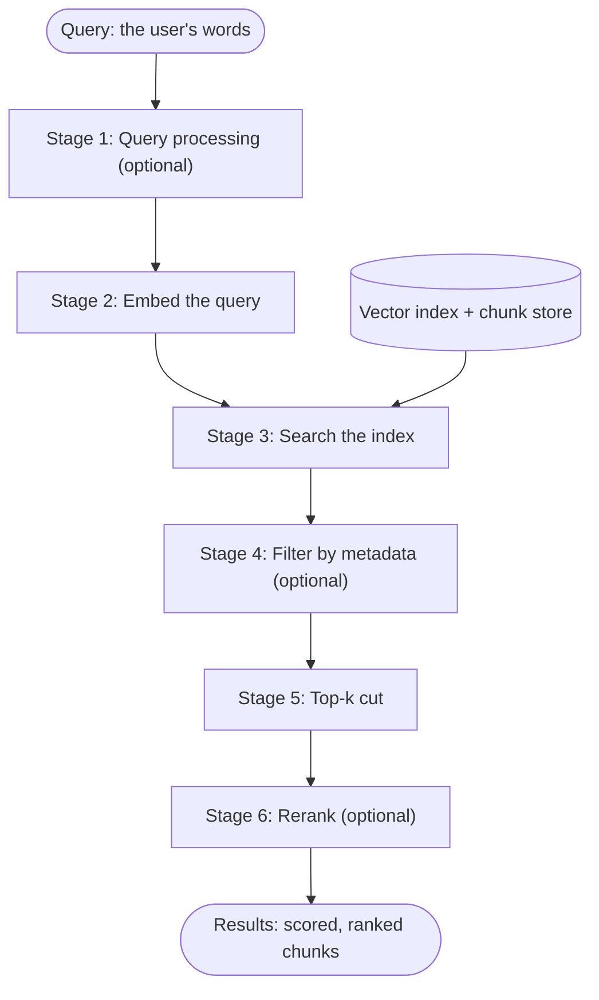
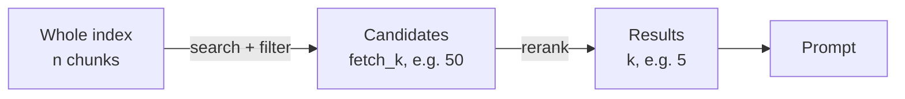

The [indexing pipeline](/learn/rag-architecture-fundamentals/indexing-pipeline) ends with chunks sitting in an index. The retrieval pipeline is the first half of the query path: it starts with a question, in whatever words the user typed, and ends with a short, ranked list of chunks. Everything the language model will know about your documents when it answers is decided here.

This lesson lays out the stages between "query in" and "results out", separates the ones every retriever has from the optional ones, and builds a retriever in which each optional stage can be switched on and off so that you can see precisely what it contributes.

## Learning objectives

- List the stages of a retrieval pipeline in order and identify which are core and which are optional.
- State the retriever's interface: what it accepts and the shape of what it returns.
- Explain what query processing, metadata filtering and reranking each add, and what each cannot fix.
- Implement a retriever that returns scored, ranked chunks and supports each optional stage.
- Distinguish filtering before the top-k cut from filtering after it, and predict the effect of each.

## Prerequisites

- [Traditional RAG architecture](/learn/rag-architecture-fundamentals/traditional-rag-architecture)
- [Indexing pipeline](/learn/rag-architecture-fundamentals/indexing-pipeline)
- [Embeddings](/learn/understanding-large-language-models/embeddings)

## Why this matters

A retrieve-then-read system cannot answer from a chunk it did not retrieve. If the passage containing the answer is not among the results, the generator has two options: say it does not know, or produce something plausible from its own memory. Neither is what you built the system for. Retrieval therefore sets a ceiling on answer quality that no prompt and no model can raise.

Retrieval also has to be fast, because it runs on every question, and selective, because the prompt has room for only a handful of chunks out of thousands or millions. Those two pressures, speed and selectivity, are why the pipeline is built as a funnel of stages, each cheaper per item than the next and each handling fewer items. Knowing which stage does what is how you decide where to spend effort: a missing answer, a wrong-department answer and a badly ordered answer are three different stages failing.

## The intuition

Suppose you ask a well-run records office for "the thing about WFH".

The clerk first works out what you mean: "WFH" is the remote working policy (query processing). They turn that into the form their catalogue understands (embedding). They look in the catalogue and pull the drawer of likely folders (search). They put back anything you are not cleared to see (filter). From what is left they take the best few, because you do not want forty folders (top-k). Then, because the catalogue is quick but coarse, they actually open those few folders and put the most useful one on top (rerank). You walk away with three folders in a sensible order.

The catalogue lookup is fast and approximate. Opening folders is slow and accurate. The clerk does the fast thing to everything and the slow thing to almost nothing. That is the whole design.

## How it works

### The interface

Seen from outside, a retriever is one function:

```text
retrieve(query: str, k: int, filters: optional) -> list of ScoredChunk
```

A `ScoredChunk` is a chunk (its id, text and metadata) together with a score and a rank. The list is ordered best first and has **at most** k items. Everything in this lesson is what happens inside that function. Keeping the interface this narrow is what allows the inside to change, from keyword search to embeddings to a hybrid of both, without the [generation pipeline](/learn/rag-architecture-fundamentals/generation-pipeline) noticing.

### The stages



1. **Query processing** (optional). Tidy or transform the query before searching: trim it, normalise case, expand abbreviations, correct spelling, or rewrite it entirely. Output: a query string (sometimes several).
2. **Embed.** Convert the query into a vector using the same model, and the same preprocessing, that the indexing pipeline used for chunks. Output: one query vector.
3. **Search.** Compare the query vector with the stored chunk vectors and score each. How that comparison works is the subject of [Query-document matching](/learn/rag-architecture-fundamentals/query-document-matching). Output: a score for each candidate chunk.
4. **Filter** (optional). Discard chunks whose metadata does not satisfy a condition: wrong department, wrong language, out of date, or not visible to this user. Output: the scores of the chunks that remain.
5. **Top-k.** Sort by score and keep the best k. Output: k scored chunks. This cut is what makes the result fit in a prompt.
6. **Rerank** (optional). Rescore the survivors with a slower, more accurate method that reads the query and each chunk together, and reorder them. Output: the same kind of list, better ordered, often cut again to a smaller k.

The core stages, 2, 3 and 5, are the naive retriever from [Traditional RAG architecture](/learn/rag-architecture-fundamentals/traditional-rag-architecture). The other three are what distinguishes a production retriever.

Try changing k in the visualiser and watch which chunks enter and leave the result set. Note that the scores do not change, only the cut-off.

```playground
top-k
```

### What each optional stage adds

| Stage | Fixes | Cannot fix | Typical cost |
| --- | --- | --- | --- |
| Query processing | A query whose wording does not match the documents: abbreviations, typos, vague follow-ups | A document that is missing or badly chunked | From microseconds (a lookup table) to an LLM call (a rewrite) |
| Filter | Results that are similar in wording but wrong for this user or context: other tenants, old versions, restricted documents | Poor ranking within the allowed set | Small when the index supports filtered search |
| Rerank | The right chunk being present but not at the top | The right chunk being absent from the candidates | Proportional to the number of candidates rescored |

The "cannot fix" column is as important as the first. In particular, **a reranker only reorders what the first stage found**. If search did not return the chunk, no amount of reranking will produce it. This is why the first stage is tuned for *recall* (do not miss the right chunk) and the reranker for *precision* (put it first), a division explored in [Why reranking is needed](/learn/reranking-fundamentals/why-reranking-is-needed).

### The funnel

When reranking is used, the top-k cut happens twice with two different numbers. The first stage retrieves a generous `fetch_k` candidates (say 50), and the reranker cuts them to the final `k` (say 5).



Each step is more expensive per chunk and sees far fewer chunks. Search must be cheap enough to consider all n; the reranker can afford to be careful because it sees only `fetch_k`.

### Filtering: before or after the cut

There are two places to apply a filter, and they behave differently.

- **Post-filtering** takes the top-k first and then removes disallowed chunks. It is simple, but it can return fewer than k results, or none, when the best matches happen to be disallowed.
- **Pre-filtering** restricts the search to allowed chunks and then takes the top-k of those. It always returns up to k allowed results, but needs an index that can search within a filtered subset efficiently.

For anything related to permissions, the filter must be applied inside the retriever by one of these two methods and never left to the prompt. Exercise 2 shows the difference in output. [Filtered retrieval](/learn/advanced-retrieval/filtered-retrieval) returns to the engineering of this.

> [!WARNING]
> Scores from different stages are not comparable. A first-stage similarity of 0.38 and a reranker score of 0.67 are on different scales and mean different things. Keep both on the result, label them, and never apply a threshold tuned for one to the other.

## In code

The problem: build a retriever with the full six-stage shape, small enough to read in one sitting, in which query processing, filtering and reranking can each be switched on independently, and run it on queries chosen so that each stage visibly changes the result.

The first-stage "embedding" is TF-IDF again, so that it runs anywhere. The reranker is a deliberately simple stand-in: it measures what fraction of the query's meaningful words appear in the chunk, ignoring word endings. A real reranker is a neural model (a cross-encoder), but this one has the two properties that matter architecturally: it looks at the query and a chunk **together**, and it is applied only to the candidates.

```bash
pip install scikit-learn
```

```python
import re
from dataclasses import dataclass

from sklearn.feature_extraction.text import ENGLISH_STOP_WORDS, TfidfVectorizer


@dataclass(frozen=True)
class Chunk:
    chunk_id: str
    text: str
    metadata: dict


@dataclass
class ScoredChunk:
    chunk: Chunk
    score: float              # the score that decided the final order
    retrieval_score: float    # first-stage similarity, kept for debugging
    rank: int = 0


def meta(dept: str, audience: str = "all") -> dict:
    return {"dept": dept, "audience": audience}


CORPUS = [
    Chunk("leave-0", "Annual leave is 25 days per year.", meta("hr")),
    Chunk("leave-1", "Up to 5 unused leave days carry over and must be used by 31 March.", meta("hr")),
    Chunk("remote-0", "Staff may work remotely up to 3 days a week.", meta("hr")),
    Chunk("remote-1", "The home-office equipment budget is £400.", meta("hr", "employees")),
    Chunk("remote-2", "Contractors are not eligible for the home-office equipment budget.", meta("hr", "contractors")),
    Chunk("expenses-0", "Expenses must be submitted within 30 days.", meta("finance")),
    Chunk("expenses-1", "Any expense over £75 needs a receipt.", meta("finance")),
    Chunk("security-0", "Passwords must be rotated every 90 days.", meta("it")),
    Chunk("security-1", "The VPN is required on public Wi-Fi.", meta("it")),
    Chunk("hardware-0", "The laptop refresh cycle is 3 years.", meta("it")),
    Chunk("hardware-1", "The support desk is open 08:00 to 18:00 UK time.", meta("it")),
]

GLOSSARY = {"wfh": "work remotely", "pto": "annual leave"}


def stem(word: str) -> str:
    """Crude suffix stripping: 'needs' becomes 'need', 'laptops' becomes 'laptop'."""
    for suffix in ("ing", "ed", "es", "s", "d"):
        if word.endswith(suffix) and len(word) - len(suffix) >= 4:
            return word[: -len(suffix)]
    return word


def content_terms(text: str) -> set[str]:
    return {stem(w) for w in re.findall(r"[a-z0-9£]+", text.lower()) if w not in ENGLISH_STOP_WORDS}


class Retriever:
    def __init__(self, corpus: list[Chunk]):
        self.corpus = corpus
        self.vectoriser = TfidfVectorizer(stop_words="english")
        self.matrix = self.vectoriser.fit_transform(c.text for c in corpus)  # unit-length rows

    # stage 1 (optional): query processing
    def process(self, query: str) -> str:
        words = re.sub(r"\s+", " ", query.strip().lower()).split(" ")
        return " ".join(GLOSSARY.get(w.strip("?.,!"), w) for w in words)

    # stage 2: embed the query with the same model that embedded the chunks
    def embed(self, query: str):
        return self.vectoriser.transform([query])

    # stages 3 to 5: search, (filter), top-k
    def search(self, query_vector, k: int, where: dict | None = None) -> list[ScoredChunk]:
        scores = (self.matrix @ query_vector.T).toarray().ravel()
        allowed = [
            i for i, c in enumerate(self.corpus)
            if not where or all(c.metadata.get(key) in values for key, values in where.items())
        ]
        allowed.sort(key=lambda i: -scores[i])
        return [
            ScoredChunk(self.corpus[i], float(scores[i]), float(scores[i]))
            for i in allowed[:k] if scores[i] > 0
        ]

    # stage 6 (optional): rerank the candidates with a slower, more careful scorer
    def rerank(self, query: str, candidates: list[ScoredChunk]) -> list[ScoredChunk]:
        wanted = content_terms(query)
        for cand in candidates:
            cand.score = len(wanted & content_terms(cand.chunk.text)) / max(len(wanted), 1)
        return sorted(candidates, key=lambda c: (-c.score, -c.retrieval_score))

    def retrieve(self, query: str, k: int = 3, *, process: bool = True,
                 where: dict | None = None, rerank: bool = False, fetch_k: int = 6) -> list[ScoredChunk]:
        text = self.process(query) if process else query
        candidates = self.search(self.embed(text), fetch_k if rerank else k, where)
        if rerank:
            candidates = self.rerank(text, candidates)[:k]
        for rank, cand in enumerate(candidates, 1):
            cand.rank = rank
        return candidates


def show(title: str, results: list[ScoredChunk]) -> None:
    print(title)
    for r in results:
        print(f"  {r.rank}. score {r.score:.3f} | first stage {r.retrieval_score:.3f} | "
              f"{r.chunk.chunk_id:<10} | {r.chunk.text}")
    if not results:
        print("  (no results)")
    print()


retriever = Retriever(CORPUS)

q1 = "Do I need a receipt for my expenses?"
show(f"A. core stages only: {q1!r}", retriever.retrieve(q1, k=2))
show("B. same query, with reranking of 6 candidates", retriever.retrieve(q1, k=2, rerank=True))

q2 = "Can I WFH on Fridays?"
show(f"C. no query processing: {q2!r}", retriever.retrieve(q2, k=2, process=False))
show(f"D. with query processing: {retriever.process(q2)!r}", retriever.retrieve(q2, k=2))

q3 = "What is the home-office equipment budget?"
show(f"E. no filter: {q3!r}", retriever.retrieve(q3, k=2))
show("F. filtered to what an employee may see",
     retriever.retrieve(q3, k=2, where={"audience": {"all", "employees"}}))

q4 = "How often are laptops refreshed?"
show(f"G. reranking cannot rescue a first-stage miss: {q4!r}", retriever.retrieve(q4, k=2, rerank=True))
```

```output
A. core stages only: 'Do I need a receipt for my expenses?'
  1. score 0.385 | first stage 0.385 | expenses-0 | Expenses must be submitted within 30 days.
  2. score 0.354 | first stage 0.354 | expenses-1 | Any expense over £75 needs a receipt.

B. same query, with reranking of 6 candidates
  1. score 0.667 | first stage 0.354 | expenses-1 | Any expense over £75 needs a receipt.
  2. score 0.333 | first stage 0.385 | expenses-0 | Expenses must be submitted within 30 days.

C. no query processing: 'Can I WFH on Fridays?'
  (no results)

D. with query processing: 'can i work remotely on fridays?'
  1. score 0.677 | first stage 0.677 | remote-0   | Staff may work remotely up to 3 days a week.

E. no filter: 'What is the home-office equipment budget?'
  1. score 0.863 | first stage 0.863 | remote-1   | The home-office equipment budget is £400.
  2. score 0.771 | first stage 0.771 | remote-2   | Contractors are not eligible for the home-office equipment budget.

F. filtered to what an employee may see
  1. score 0.863 | first stage 0.863 | remote-1   | The home-office equipment budget is £400.

G. reranking cannot rescue a first-stage miss: 'How often are laptops refreshed?'
  (no results)
```

**The important lines.**

- `ScoredChunk` keeps two scores. `retrieval_score` is what the first stage computed and never changes; `score` is whatever decided the final order. When a result looks wrong, having both tells you which stage to blame.
- `search` builds the `allowed` list *before* sorting and cutting. That is pre-filtering: the top-k is taken from permitted chunks only.
- `for i in allowed[:k] if scores[i] > 0` is why the list can be shorter than k. A chunk that shares nothing with the query is not a result.
- `retrieve` asks `search` for `fetch_k` candidates when reranking and for only `k` otherwise. That one expression is the funnel.
- `rerank` receives the query **text**, not the query vector. A reranker does not compare two precomputed vectors; it examines the pair.

**What the output means.**

- **A and B (reranking).** The question is about receipts. The first stage ranks the "submitted within 30 days" chunk first because it contains the exact word "expenses". The right chunk matches only on "receipt": it says "expense" and "needs", which TF-IDF treats as different words from "expenses" and "need". The reranker strips the ending from "needs", sees that the second chunk covers two of the query's three meaningful words ("receipt" and "need") against one for the other chunk, and promotes it. Same candidates, better order.
- **C and D (query processing).** "WFH" appears nowhere in the handbook, so without processing the query matches nothing. Expanding it from a glossary turns a zero-result query into a correct one. No change to the index was needed.
- **E and F (filtering).** Both budget chunks are highly similar to the question, and one of them is about contractors. Similarity alone cannot tell which applies to the person asking; metadata can. With the filter, an employee is shown only what applies to employees.
- **G (the limit of reranking).** "Laptops" and "refreshed" do not match "laptop" and "refresh" in the first stage, so there are no candidates, and the reranker, which would have matched them, never gets the chance. The fix belongs earlier: better query processing or a first stage that understands word forms, which is what neural embeddings provide.

**Errors people commonly hit.**

- Fewer results than k and an assumption that something is broken. It is correct behaviour: k is a maximum.
- `AttributeError` or a wrong answer from passing the query vector to `rerank`. It needs text.
- A filter that silently matches nothing because of a type or spelling difference (`"HR"` against `"hr"`). An empty result from a filtered search should be logged with the filter that caused it.

**How to extend it.** Replace `TfidfVectorizer` with a sentence-embedding model and `rerank` with a cross-encoder; the `retrieve` method and the `ScoredChunk` type stay as they are. Add a second searcher (keyword search beside vector search) and merge the two candidate lists before the cut, which is [hybrid retrieval](/learn/hybrid-search/hybrid-retrieval-architecture).

## A real-world example

AskMeridian's first retriever is the three core stages over the handbook and the IT runbooks, with k = 4. The support desk keeps a log of questions where staff clicked "not helpful", and Ama, who owns retrieval, sorts a week of them into piles by reading what was retrieved for each.

The first pile is questions written in office slang: "PTO", "WFH", "my kit allowance". Nothing relevant was retrieved because the handbook never uses those words. She adds a query-processing step backed by a glossary the HR team maintains.

The second pile is contractors being told about the equipment budget, and employees occasionally being shown contractor terms. The right chunks were retrieved; so were the wrong ones. She adds an audience field to chunk metadata in the indexing pipeline and a filter in the retriever, driven by the user's employment type from the login system.

The third pile is cases where the correct chunk was in the results but at position 3 or 4, behind chunks that shared more words with the question. She raises the first stage to 30 candidates and adds a reranker that returns the top 4.

Three piles, three different stages. The important part of her method is that she diagnosed before she built: each stage was added because a specific, observed failure belonged to it.

## Common mistakes

- **Adding a reranker to fix missing results.** If the right chunk is not among the candidates, reranking changes nothing. Check candidate recall first.
- **Setting `fetch_k` equal to `k` when reranking.** The reranker can then only reorder the chunks you would have returned anyway, and cannot bring in a better one from further down.
- **Post-filtering without noticing the shortfall.** The top-k is taken, most of it is filtered away, and the generator receives one chunk or none.
- **Enforcing permissions in the prompt.** Telling the model not to mention restricted text that you have placed in its context is not access control.
- **Processing queries differently from documents.** If chunks were lower-cased and cleaned one way and queries another, matching degrades silently. See [Offline and online processing](/learn/rag-architecture-fundamentals/offline-and-online-processing).
- **Returning bare text.** Without ids, scores and metadata the generation pipeline cannot cite sources and you cannot debug rankings.
- **Treating k as a constant of nature.** The right k depends on chunk size, the prompt budget and how often the answer spans several chunks; it should be measured.

## Best practices

- Keep the retriever's interface to "query in, scored chunks out" and hide every stage behind it.
- Carry both the first-stage score and the final score on every result, plus the chunk id and metadata.
- Tune the first stage for recall and the reranker for precision, and measure them separately.
- Apply security filters inside the retriever, derived from the authenticated user and never from the query text.
- Log, for every query, the processed query, the filter applied, the candidates and the final results.
- Add optional stages one at a time, each in response to a measured failure, and keep a switch to turn each off.
- Decide deliberately what the retriever returns when nothing matches well: an empty list is a legitimate and useful answer.

## Performance considerations

Retrieval latency is the sum of its stages, so budget them individually.

Take a first stage that returns `fetch_k` = 50 candidates and a reranker that takes 4 ms per query-chunk pair when pairs are scored one at a time. Reranking costs $50 \times 4 = 200$ ms per question. Halving `fetch_k` to 25 halves that to 100 ms, at the risk of losing the right chunk from the candidates. Scoring the pairs in batches reduces the wall-clock time further without changing the arithmetic of the work done. The reranker's cost is linear in `fetch_k`; that is the dial.

The first stage, by contrast, must consider the whole index. A brute-force scan as in the code above does one similarity computation per chunk: for one million chunks of 384 dimensions that is $10^6 \times 384 \approx 3.8 \times 10^8$ multiply-adds per query. Approximate indexes avoid the full scan by examining only a small part of the index, trading a little recall for a large gain in speed; see [Recall versus latency](/learn/vector-indexing-algorithms/recall-versus-latency).

Query processing ranges from negligible (a dictionary lookup) to the most expensive stage in the pipeline (an LLM call to rewrite the query, which may take longer than search and reranking together). Use the cheap forms by default and the expensive ones where measurements show they pay for themselves.

Finally, k has a cost outside retrieval: every returned chunk becomes input tokens for the generator. With 200-token chunks, moving from k = 4 to k = 10 adds $6 \times 200 = 1{,}200$ input tokens to every single request.

## Security considerations

- **Filters are the enforcement point for access control.** Build the filter from the authenticated identity on the server. A filter value taken from the request body can be changed by the caller.
- **Fail closed.** If a chunk has no permission metadata, treat it as not visible, not as visible to everyone.
- **Scores and results can leak.** Returning "no results you may see" versus "no results" can reveal that a restricted document exists. Decide what the caller is allowed to learn.
- **Queries are user input.** Log them with care (they may contain personal data), and if a processing step sends them to an LLM for rewriting, treat that as another place where injected instructions could act.

## Summary

- The retrieval pipeline is: query processing, embed, search, filter, top-k, rerank. Embed, search and top-k are the core; the rest are optional.
- Its interface is narrow: a query goes in, and a ranked list of at most k scored chunks, with ids and metadata, comes out.
- Query processing fixes wording mismatches, filtering fixes results that are similar but inappropriate, and reranking fixes order. None of them fixes what the stage before it did not deliver.
- The pipeline is a funnel: a cheap method scores everything, an expensive method rescores a few.
- Pre-filtering restricts before the cut and fills the result with allowed chunks; post-filtering cuts first and may return too few.
- Add stages in response to diagnosed failures, and keep each stage's score on the result so that failures can be diagnosed.

## Exercises

**1.** For each failure, name the stage most likely responsible and one change to try: (a) the answer chunk exists in the index but is never among 50 candidates for a query using an internal product code-name; (b) the answer chunk is consistently at rank 7 of 50 candidates and k is 5; (c) a user in the Paris office is shown the London office's fire procedure.

<details><summary>Show solution</summary>

(a) Query processing or the first-stage search: the code-name does not match the document's wording. Add the code-name to a glossary or expansion step, or add keyword search beside vector search. Reranking will not help because the chunk is not a candidate. (b) Ranking: the chunk is a candidate but below the cut. Add or improve a reranker over the 50 candidates; raising k to 7 would also include it, at the cost of more prompt tokens. (c) Filtering: both procedures are similar in wording, and only metadata (office location) distinguishes them. Add a location field at indexing time and filter on the user's office.

</details>

**2.** Using the `Retriever` from this lesson, write a `post_filter` function that takes the top-k first and filters afterwards. Compare it with the built-in pre-filter for the query `"How many days do I have to rotate passwords or submit expenses?"`, `k=2`, restricted to the HR department. Explain both results.

<details><summary>Show solution</summary>

```python
def post_filter(retriever, query, k, where):
    hits = retriever.retrieve(query, k=k)                       # top-k first ...
    kept = [h for h in hits if all(h.chunk.metadata.get(key) in vals for key, vals in where.items())]
    for rank, h in enumerate(kept, 1):
        h.rank = rank
    return kept                                                 # ... then filter


query = "How many days do I have to rotate passwords or submit expenses?"
only_hr = {"dept": {"hr"}}
show("unfiltered top-2", retriever.retrieve(query, k=2))
show("post-filter (top-2, then keep HR)", post_filter(retriever, query, 2, only_hr))
show("pre-filter (keep HR, then top-2)", retriever.retrieve(query, k=2, where=only_hr))
```

```output
unfiltered top-2
  1. score 0.484 | first stage 0.484 | expenses-0 | Expenses must be submitted within 30 days.
  2. score 0.484 | first stage 0.484 | security-0 | Passwords must be rotated every 90 days.

post-filter (top-2, then keep HR)
  (no results)

pre-filter (keep HR, then top-2)
  1. score 0.118 | first stage 0.118 | leave-0    | Annual leave is 25 days per year.
  2. score 0.114 | first stage 0.114 | remote-0   | Staff may work remotely up to 3 days a week.
```

The two best matches belong to finance and IT. Post-filtering takes them and then removes both, leaving nothing even though HR chunks exist. Pre-filtering searches only HR chunks and returns two, but look at the scores: 0.118 and 0.114, matched on the word "days" alone. Pre-filtering guarantees *allowed* results, not *relevant* ones. Here the honest outcome is "HR has nothing on this", which is a reason to combine a filter with a minimum score.

</details>

**3.** A team sets `fetch_k=5` and `k=5` and reports that adding their reranker "made no difference to recall". Explain why that was guaranteed, and what the reranker could still have changed.

<details><summary>Show solution</summary>

With `fetch_k` equal to `k`, the reranker receives exactly the five chunks that would have been returned anyway and returns the same five. The *set* of results is unchanged, so any measure that asks only "is the right chunk among the results" cannot move. What can change is the *order* within the five, which matters if the generator pays more attention to earlier chunks or if a later step truncates the context. To let a reranker improve the set, `fetch_k` must be larger than `k`, so that a chunk at first-stage rank 12 can be promoted into the top 5.

</details>

**4.** Design decision: AskMeridian's query-processing step could be (i) the glossary lookup shown here or (ii) an LLM call that rewrites every question into a clearer search query. Give the main cost of (ii) and describe a design that gets most of its benefit without paying that cost on every request.

<details><summary>Show solution</summary>

The main cost of (ii) is latency and money on every request: an extra LLM round trip before search even begins, typically much longer than embedding, search and reranking combined, plus a new way to fail (the rewrite can drop or distort a key term). A hybrid design applies the glossary to every query, which is effectively free, and calls the LLM rewrite only when a cheap signal says the query is hard: for example when it is a follow-up that depends on conversation history ("what about contractors?"), or when the first search returns nothing above a score threshold. Easy questions keep their fast path, and the expensive step is reserved for the cases where it changes the result. [Query rewriting](/learn/advanced-retrieval/query-rewriting) develops this.

</details>

## Check your understanding

```quiz
[
  {
    "q": "Which three stages form the core of every retrieval pipeline, with the others being optional?",
    "options": [
      "Query processing, filter, rerank",
      "Embed, filter, rerank",
      "Embed the query, search the index, take the top-k",
      "Search, rerank, generate"
    ],
    "answer": 2,
    "why": "Embedding the query, scoring chunks against it and cutting to k is the minimal retriever. Query processing, filtering and reranking are additions that fix specific failures."
  },
  {
    "q": "In run G, the query \"How often are laptops refreshed?\" returned no results even with reranking enabled. Why?",
    "options": [
      "The reranker had a bug",
      "The first stage found no candidates, and a reranker can only reorder candidates it is given",
      "k was too small",
      "The filter removed the laptop chunk"
    ],
    "answer": 1,
    "why": "The first stage did not match \"laptops\" to \"laptop\", so nothing reached the reranker. Reranking improves order, not recall."
  },
  {
    "q": "A retriever takes the top 5 chunks and then removes the ones the user is not permitted to see. What is the main drawback?",
    "options": [
      "It may return fewer than 5 results, or none, even when permitted relevant chunks exist further down the ranking",
      "It is slower than every alternative",
      "It changes the similarity scores",
      "It requires a second embedding model"
    ],
    "answer": 0,
    "why": "This is post-filtering. The cut happens before the filter, so permitted chunks ranked below position 5 are never considered."
  },
  {
    "q": "Why does `ScoredChunk` store both `score` and `retrieval_score`?",
    "options": [
      "The two are always equal, so one is a checksum for the other",
      "The vector index requires two floats per chunk",
      "So that when a ranking looks wrong you can see what the first stage thought and what the final stage decided, and tell which one to investigate",
      "To average them for the final ranking"
    ],
    "answer": 2,
    "why": "The scores come from different stages on different scales. Keeping both makes the pipeline debuggable."
  },
  {
    "q": "With reranking enabled, what is the relationship between `fetch_k` and `k`?",
    "options": [
      "`fetch_k` must equal `k`",
      "`fetch_k` is the number of chunks in the index",
      "`fetch_k` should be smaller than `k` to save time",
      "`fetch_k` is the larger number of candidates the first stage returns; the reranker cuts them down to the final `k`"
    ],
    "answer": 3,
    "why": "The first stage casts a wide net so that the right chunk is among the candidates; the reranker then selects the best `k` of them."
  }
]
```

## Further reading

- Manning, C., Raghavan, P. and Schütze, H. (2008). *Introduction to Information Retrieval*, chapter 6, "Scoring, term weighting and the vector space model", and chapter 7, "Computing scores in a complete search system". [nlp.stanford.edu/IR-book](https://nlp.stanford.edu/IR-book/)
- Karpukhin, V. et al. (2020). *Dense Passage Retrieval for Open-Domain Question Answering*. [arxiv.org/abs/2004.04906](https://arxiv.org/abs/2004.04906)
- Nogueira, R. and Cho, K. (2019). *Passage Re-ranking with BERT*. The paper that established neural reranking of first-stage candidates. [arxiv.org/abs/1901.04085](https://arxiv.org/abs/1901.04085)
- Robertson, S. and Zaragoza, H. (2009). *The Probabilistic Relevance Framework: BM25 and Beyond*. Foundations and Trends in Information Retrieval.
- scikit-learn documentation, [`TfidfVectorizer`](https://scikit-learn.org/stable/modules/generated/sklearn.feature_extraction.text.TfidfVectorizer.html).
