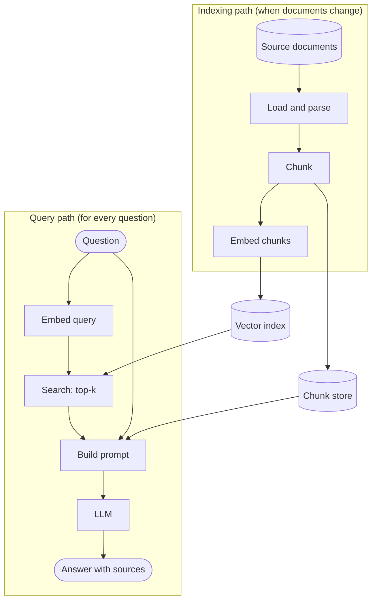

The first two modules explained what retrieval-augmented generation is and how the language model at its centre behaves. This module turns that idea into an engineering drawing. This lesson gives you the whole drawing at once: the components of the classic **retrieve-then-read** design, the data stores they share, and the two separate paths that data travels along. One path prepares documents; the other answers questions.

Every later lesson in the curriculum is a closer look at one box or one arrow in this picture, so it pays to know the picture well. By the end you will have built the entire architecture as one small Python class and seen exactly what crosses each boundary.

## Learning objectives

- Name the components of a traditional RAG system and state what each one takes in and gives out.
- Distinguish the indexing path from the query path and say which components each one uses.
- Identify the data stores in the architecture and what is kept in each.
- Implement a minimal retrieve-then-read system and trace a question through it.
- Explain which design decisions the traditional architecture fixes and which it leaves open.

## Prerequisites

- [What is RAG?](/learn/introduction-to-rag/what-is-rag)
- [How retrieval improves generation](/learn/introduction-to-rag/how-retrieval-improves-generation)
- [Embeddings](/learn/understanding-large-language-models/embeddings)
- [Context windows](/learn/understanding-large-language-models/context-windows)
- [System prompts and user prompts](/learn/understanding-large-language-models/system-prompts-and-user-prompts)

## Why this matters

"Look things up, then answer" sounds like one step. In a working system it is a dozen, spread over two programs that run at different times, sharing data through stores that must stay consistent with each other. When an answer is wrong, the cause lives in one specific place: the document was never loaded, it was split badly, the right chunk was not retrieved, the chunk was retrieved but cut from the prompt, or the model ignored it. Without a map of the architecture you cannot say which, and you end up changing the prompt to fix a problem that was really in the parser.

The architecture also gives a team its vocabulary and its seams. If everyone agrees what "the retriever" takes in and gives out, one person can swap the vector index while another rewrites the prompt, and nothing breaks. Frameworks, vendor products and research papers all assume this shape; you will read them faster once you can see it in your head.

## The intuition

Think of a reference library with a help desk.

Before the doors open, the staff do slow, careful work: new books arrive, each is catalogued, and an index card is filed for every section so that it can be found later. None of this involves any reader. It happens whenever the collection changes.

When the doors open, a reader walks up to the desk with a question. The librarian does not read the whole library. They consult the card index, pull the three or four most promising passages from the shelves, lay them on the desk, and write an answer **using those passages**, noting which book each fact came from. That takes moments, because the cataloguing was done in advance.

A traditional RAG system is that library. The cataloguing is the **indexing path**. The help desk is the **query path**. The card index is the **vector index**, the shelves are the **chunk store**, and the librarian's reading and writing is the **language model**. The model never sees the library; it sees only what has been laid on the desk.

## How it works

### The components

The classic design has seven components. The first three belong to the indexing path, the last three to the query path, and the embedding model is shared by both.

| Component | Takes in | Gives out | Path |
| --- | --- | --- | --- |
| Loader and parser | Files, pages, database rows | Plain text plus metadata | Indexing |
| Chunker | Document text | Chunks: passages small enough to retrieve and to fit in a prompt | Indexing |
| Embedding model | Text (a chunk or a query) | A vector | Both |
| Vector index and chunk store | Vectors and chunks to write; a query vector to search | The ids and scores of the nearest chunks | Both |
| Retriever | A question | The top-k scored chunks | Query |
| Prompt builder | A question and chunks | A prompt | Query |
| Generator (the LLM) | A prompt | An answer | Query |

"Retrieve-then-read" names the query path: one retrieval step, followed by one generation step in which the model "reads" the retrieved text and writes the answer. The phrase comes from open-domain question answering, where systems paired a retriever with a "reader" model; the 2020 paper that coined the name RAG (Lewis et al.) used the same two-part shape with a generator in place of the reader. This simplest form, with nothing added, is often called **naive RAG**, a label you will meet again in [Naive RAG](/learn/advanced-rag-patterns/naive-rag).

### The data stores

Three stores hold the system's state. Keeping them distinct in your mind prevents a great deal of confusion later.

1. **The source of truth.** The original documents, wherever they live: a wiki, a shared drive, a ticketing system. The RAG system reads from it and never writes to it.
2. **The chunk store.** The text of every chunk, with its metadata (which document it came from, its position, its title, who may read it). This is what ends up in the prompt.
3. **The vector index.** One vector per chunk, arranged so that the nearest vectors to a query can be found quickly. It holds numbers and chunk ids, not necessarily text.

Many products keep the chunk store and the vector index in one system and call the whole thing a [vector database](/learn/vector-database-fundamentals/what-is-a-vector-database). They are still logically separate: the vector answers "which chunks?", the text answers "what do they say?". Stores 2 and 3 are **derived data**. They can be deleted and rebuilt from store 1 at any time, which is exactly what you do when you change the chunker or the embedding model.

### The two paths



The two paths never call each other. They communicate only through the stores in the middle. That is the single most important structural fact about RAG: indexing can be slow, batch-oriented and run on a schedule, while querying must be fast and run on demand, and each can be changed, scaled and deployed on its own. [Offline and online processing](/learn/rag-architecture-fundamentals/offline-and-online-processing) is devoted to that split.

**The indexing path**, step by step:

1. **Load** each document from the source of truth.
2. **Parse** it into plain text, keeping useful metadata such as title and location.
3. **Chunk** the text into passages.
4. **Embed** each chunk with the embedding model.
5. **Store** the vector in the vector index and the text and metadata in the chunk store, under a shared chunk id.

[Indexing pipeline](/learn/rag-architecture-fundamentals/indexing-pipeline) expands these into seven typed stages.

**The query path**, step by step:

1. **Receive** the user's question.
2. **Embed** it with the *same* embedding model used for the chunks, so that question and chunks live in the same vector space.
3. **Search** the vector index for the k chunk vectors most similar to the query vector. This is **top-k retrieval**; k is typically a small number such as 3 to 10.
4. **Fetch** the text of those chunks from the chunk store.
5. **Build a prompt** containing instructions, the retrieved chunks, and the question.
6. **Generate**: send the prompt to the LLM, which writes an answer from the supplied text.
7. **Return** the answer, ideally with the sources it was drawn from.

Steps 2 to 4 are the [Retrieval pipeline](/learn/rag-architecture-fundamentals/retrieval-pipeline); steps 5 to 7 are the [Generation pipeline](/learn/rag-architecture-fundamentals/generation-pipeline).

Step through the whole flow in the visualiser below. Watch which boxes light up for an indexing run and which for a query, and notice that the stores are the only thing they share.

```playground
rag-pipeline
```

### What the architecture fixes, and what it leaves open

The traditional design makes three commitments:

- **Retrieval happens once per question, before generation.** The model does not get to ask for more.
- **The question, as typed, is the search query.** Nothing rewrites or expands it.
- **The top-k chunks go into the prompt as they are.** Nothing checks whether they are actually relevant.

Each commitment is a simplification, and each is the starting point for an improvement you will study later: reranking and query rewriting relax the second and third, and agentic designs relax the first. What the architecture deliberately leaves open is every component's internals. Which parser, which chunk size, which embedding model, which index, which k and which LLM are all choices you make, measure and revise. The boxes and arrows stay the same.

> [!KEY]
> The interfaces are stable; the implementations are replaceable. A retriever is anything that turns a question into scored chunks. Keep that contract and you can replace keyword search with embeddings, or one vector database with another, without touching the generator.

## In code

The problem: build the full architecture, both paths and both stores, in as little code as will honestly run, so that every arrow in the diagram is a line you can point to.

To keep it runnable with no model download and no API key, the "embedding model" here is scikit-learn's `TfidfVectorizer`, which turns text into a vector of weighted word counts (covered properly in [TF-IDF](/learn/sparse-retrieval/tf-idf)). It is a keyword method rather than a neural embedding, but it fills the same slot in the architecture: text in, vector out, and the same model for chunks and queries.

```bash
pip install scikit-learn numpy
```

```python
from dataclasses import dataclass

import numpy as np
from sklearn.feature_extraction.text import TfidfVectorizer


@dataclass
class Chunk:
    chunk_id: str
    source: str
    text: str


class MiniRAG:
    """Retrieve-then-read in one class: an indexing path and a query path."""

    SYSTEM = (
        "You are AskMeridian, Meridian's internal assistant. Answer only from the "
        "provided context and cite sources like [1]. If the answer is not there, "
        "say you don't know."
    )

    def __init__(self, generate=None):
        self.generate = generate            # any function (system, prompt) -> str
        self.chunks: list[Chunk] = []       # data store 1: the chunk store
        self.vectoriser = TfidfVectorizer(stop_words="english")  # the "embedding model"
        self.matrix = None                  # data store 2: the vector index

    # ---------- indexing path (runs when documents change) ----------
    def index(self, documents: dict[str, str]) -> int:
        self.chunks = []
        for source, text in documents.items():
            sentences = [s.strip() for s in text.split(". ") if s.strip()]
            for i, sentence in enumerate(sentences):
                self.chunks.append(Chunk(f"{source}#{i}", source, sentence.rstrip(".") + "."))
        self.matrix = self.vectoriser.fit_transform(c.text for c in self.chunks)
        return len(self.chunks)

    # ---------- query path (runs for every question) ----------
    def retrieve(self, question: str, k: int = 3) -> list[tuple[float, Chunk]]:
        query_vector = self.vectoriser.transform([question])
        scores = (self.matrix @ query_vector.T).toarray().ravel()
        top = np.argsort(-scores)[:k]
        return [(float(scores[i]), self.chunks[i]) for i in top if scores[i] > 0]

    def build_prompt(self, question: str, hits: list[tuple[float, Chunk]]) -> str:
        context = "\n".join(
            f"[{n}] ({chunk.source}) {chunk.text}" for n, (_, chunk) in enumerate(hits, 1)
        )
        return f"Context:\n{context}\n\nQuestion: {question}"

    def answer(self, question: str, k: int = 3) -> str:
        hits = self.retrieve(question, k)
        if not hits:
            return "I don't know: nothing in the knowledge base matches that question."
        return self.generate(self.SYSTEM, self.build_prompt(question, hits))


DOCUMENTS = {
    "handbook/leave.md": "Annual leave is 25 days per year. Up to 5 unused leave days carry over and must be used by 31 March.",
    "handbook/remote-work.md": "Staff may work remotely up to 3 days a week. The home-office equipment budget is £400.",
    "handbook/expenses.md": "Expenses must be submitted within 30 days. Any expense over £75 needs a receipt.",
    "it/security.md": "Passwords must be rotated every 90 days. The VPN is required on public Wi-Fi.",
    "it/hardware.md": "The laptop refresh cycle is 3 years. The support desk is open 08:00 to 18:00 UK time.",
}

rag = MiniRAG()
print("chunks indexed:", rag.index(DOCUMENTS))
print("index shape:", rag.matrix.shape)

question = "How many unused leave days can I carry over?"
hits = rag.retrieve(question)
print()
for score, chunk in hits:
    print(f"{score:.3f}  {chunk.chunk_id:<28} {chunk.text}")
print()
print(rag.build_prompt(question, hits))
print()
print(rag.answer("Where is the Lisbon canteen?"))
```

```output
chunks indexed: 10
index shape: (10, 46)

0.711  handbook/leave.md#1          Up to 5 unused leave days carry over and must be used by 31 March.
0.304  handbook/leave.md#0          Annual leave is 25 days per year.
0.110  handbook/expenses.md#0       Expenses must be submitted within 30 days.

Context:
[1] (handbook/leave.md) Up to 5 unused leave days carry over and must be used by 31 March.
[2] (handbook/leave.md) Annual leave is 25 days per year.
[3] (handbook/expenses.md) Expenses must be submitted within 30 days.

Question: How many unused leave days can I carry over?

I don't know: nothing in the knowledge base matches that question.
```

**The important lines.**

- `index()` is the entire indexing path. The crude `split(". ")` is the chunker, `fit_transform` is "embed and store", and the two attributes it fills, `self.chunks` and `self.matrix`, are the chunk store and the vector index. Row *i* of the matrix is the vector for `self.chunks[i]`; that shared position is the chunk id linking the two stores.
- `retrieve()` embeds the question with `transform`, not `fit_transform`. The model was fitted during indexing and is only *applied* at query time. `TfidfVectorizer` produces unit-length rows, so the matrix product is the [cosine similarity](/learn/embedding-mathematics/cosine-similarity) between the question and every chunk.
- `np.argsort(-scores)[:k]` is top-k: sort by descending score and keep the first k.
- `build_prompt()` numbers each chunk and names its source, which is what lets the model cite and lets you check the citation.
- `answer()` joins the two halves. `generate` is passed in rather than built in, so the class does not care which LLM is used, and can be tested with none.

**What the output means.** Five documents became ten chunks; the index is a 10 × 46 matrix (ten chunks, and 46 distinct terms once very common words such as "the" are removed). The correct chunk scores 0.711, far ahead. The third hit, about expenses, scores only 0.110: it matched on the single word "days". Top-k returns k results whether or not k good ones exist, so the prompt now contains an irrelevant sentence. A capable model will ignore it here, but this is the first glimpse of a real weakness of the naive design. The last line shows the one safeguard the class does have: for the canteen question no chunk scores above zero, so it answers "I don't know" without calling the model at all.

### Plugging in the generator

The generation call needs an API key, so it is shown separately. It supplies the `generate` function the class expects.

```bash
pip install anthropic
export ANTHROPIC_API_KEY="your-key-here"
```

```python
import anthropic

client = anthropic.Anthropic()  # reads ANTHROPIC_API_KEY from the environment


def generate(system: str, prompt: str) -> str:
    response = client.messages.create(
        model="claude-opus-5-5",
        max_tokens=1024,
        system=system,
        messages=[{"role": "user", "content": prompt}],
    )
    return "".join(block.text for block in response.content if block.type == "text")


rag = MiniRAG(generate=generate)
rag.index(DOCUMENTS)
print(rag.answer("How many unused leave days can I carry over?"))
```

This block was not run for this lesson. Your exact wording will differ; the output looks like this:

```output
You can carry over up to 5 unused leave days, and they must be used by 31 March [1].
```

**Errors people commonly hit.**

- `NotFittedError` from scikit-learn: `retrieve()` was called before `index()`. The query path depends on the indexing path having run.
- `TypeError: 'NoneType' object is not callable`: `answer()` was called on a `MiniRAG` built without a `generate` function.
- `anthropic.AuthenticationError`: the `ANTHROPIC_API_KEY` environment variable is missing or wrong.
- An empty result for a sensible question: TF-IDF matches exact words only, so "holiday allowance" finds nothing about "annual leave". Neural embeddings exist to fix this.

**How to extend it.** Replace `TfidfVectorizer` with a sentence-embedding model and `self.matrix` with a vector database, and you have the architecture most production systems start from. The method signatures do not need to change.

## A real-world example

Meridian's IT team builds the first version of AskMeridian in an afternoon as a single script: it reads the handbook from a folder, embeds it, and answers questions in a loop. It demonstrates well. Then the handbook grows, and every start-up of the script re-embeds every document before it can answer anything. Start-up takes minutes, the support desk restarts it whenever a policy changes, and for those minutes nobody can ask anything.

Priyanka, the engineer who inherits it, does not make the embedding faster. She splits the script along the line in the architecture diagram: an `indexer` job that runs when documents change and writes to a vector database, and a `query` service that only reads from it. The service now starts in seconds because it loads nothing but a connection. A policy change triggers the indexer; the service keeps answering throughout, and sees the new chunks as soon as they are written. Nothing about retrieval quality changed. The fix was purely architectural: two paths, joined by a store.

## Common mistakes

- **Treating RAG as one function.** Indexing inside the request handler means every question pays the cost of preparing the whole corpus, and a restart loses the index.
- **Embedding queries and chunks with different models.** The two sets of vectors are not comparable, and search returns confident nonsense with no error. This is examined in [Offline and online processing](/learn/rag-architecture-fundamentals/offline-and-online-processing).
- **Storing vectors without the text or the source.** You can find the nearest chunk but cannot put it in a prompt or cite it. Always keep text and metadata under the same id as the vector.
- **Treating the derived stores as precious.** If the index cannot be rebuilt from the source documents by rerunning a job, changing the chunker or the embedding model becomes a risky migration instead of a routine rebuild.
- **Blaming the LLM first.** Most wrong answers in a retrieve-then-read system are retrieval failures: the right chunk was never in the prompt. Inspect what was retrieved before touching the prompt.
- **Assuming top-k means "k relevant chunks".** It means "the k least-bad matches". With a poor match, all k can be irrelevant.

## Best practices

- Build the two paths as separate programs from the start, even if both are tiny.
- Give every component a narrow, typed interface (question in, scored chunks out) so that implementations can be swapped and tested alone.
- Log what was retrieved, with scores, for every question. It is the single most useful debugging record a RAG system has.
- Keep the source of truth authoritative and make everything else rebuildable from it.
- Start with the naive architecture and measure it before adding stages. Each added stage should fix a failure you have actually observed.
- Return sources with every answer so that users can verify it and you can audit it.

## Performance considerations

The two paths have very different cost profiles, and it is worth doing the arithmetic separately.

**Indexing** cost grows with the size of the corpus. If a corpus has $D$ documents averaging $c$ chunks each, the indexing path makes $D \times c$ embedding calls and stores $D \times c$ vectors. With 384-dimensional vectors of 4-byte floats, each vector occupies $384 \times 4 = 1{,}536$ bytes, so one million chunks need about 1.5 GB for the raw vectors alone, before any index structure. This cost is paid once per document version, not per question.

**Query** cost is paid on every question and has three parts: one embedding call for the question, one search, and one LLM call. The embedding and the search are each typically tens of milliseconds; the LLM call is usually the largest part, because the model produces its answer one token at a time. So the retriever sets the *quality* ceiling of the system, while the generator dominates its *latency* and, usually, its per-question cost. LLM cost is proportional to tokens in plus tokens out, and the retrieved chunks are most of the tokens in: doubling k roughly doubles the context tokens you pay for on every question.

The brute-force search in `MiniRAG` compares the query with every chunk, which is $O(n)$ per question. That is fine for thousands of chunks and too slow for many millions, which is why vector indexes use approximate methods such as [HNSW](/learn/vector-indexing-algorithms/hnsw).

## Security considerations

- **Retrieved text is untrusted input to the model.** Anything in a document, including a sentence such as "ignore previous instructions", lands in the prompt. Whoever can write to the source of truth can attempt to steer the assistant. See [Indirect prompt injection](/learn/rag-security-fundamentals/indirect-prompt-injection).
- **The index is a copy of your documents.** Chunk stores and vector indexes need the same access protection as the originals. A handbook chunk about salaries does not become less confidential because it has been embedded.
- **Access control belongs in retrieval.** If some users may not read some documents, the filter must be applied when searching, before text reaches the prompt. Asking the model not to reveal what it has been shown is not a control.
- **API keys stay in the environment**, as in the example, never in source code.

## Summary

- Traditional RAG is retrieve-then-read: one retrieval step, then one generation step that answers from the retrieved text.
- It has two paths. The indexing path (load, parse, chunk, embed, store) runs when documents change; the query path (embed, search, build prompt, generate) runs for every question.
- The paths share only data stores: a chunk store holding text and metadata, and a vector index holding one vector per chunk, both derived from the source of truth and rebuildable from it.
- The same embedding model must be used on both paths.
- The component interfaces are stable while their implementations are replaceable, which is what lets you improve one stage at a time.
- The naive design retrieves once, uses the question as typed, and trusts the top-k; later techniques relax each of those commitments.

## Exercises

**1.** For each of the following, say whether it belongs to the indexing path, the query path, or both: (a) splitting a PDF into passages, (b) the embedding model, (c) choosing k, (d) writing a chunk's source file name to the chunk store, (e) reading a chunk's source file name.

<details><summary>Show solution</summary>

(a) Indexing. (b) Both: it embeds chunks during indexing and the question at query time, and it must be the same model. (c) Query: k is a parameter of the search. (d) Indexing. (e) Query: the prompt builder reads it to label the chunk so that the answer can cite it.

</details>

**2.** A colleague says: "The answer was wrong, so we need a better LLM." Using `MiniRAG`, describe the two checks you would make first, and what each result would tell you.

<details><summary>Show solution</summary>

First call `rag.retrieve(question)` and read the hits. If the chunk containing the answer is absent, the fault is in retrieval or indexing (wrong words, bad chunking, document never loaded), and no LLM can fix it. If the chunk is present, call `rag.build_prompt(question, hits)` and read the exact prompt: check that the chunk survived into it intact and is clearly labelled. Only if the right text is in the prompt and the answer is still wrong is the generator (its instructions or the model itself) the likely cause.

</details>

**3.** Extend `MiniRAG` with a `min_score` parameter on `retrieve` so that weak matches such as the 0.110 expenses chunk are dropped. Run it with `min_score=0.2` on the leave question. What design risk does a threshold introduce?

<details><summary>Show solution</summary>

```python
def retrieve(self, question: str, k: int = 3, min_score: float = 0.0):
    query_vector = self.vectoriser.transform([question])
    scores = (self.matrix @ query_vector.T).toarray().ravel()
    top = np.argsort(-scores)[:k]
    return [(float(scores[i]), self.chunks[i]) for i in top if scores[i] > min_score]
```

With `min_score=0.2` the leave question returns the two leave chunks (0.711 and 0.304) and drops the expenses chunk (0.110). The risk is that scores are not calibrated: a threshold tuned on one kind of question, one embedding model or one corpus can silently discard the only relevant chunk for another. A threshold must be chosen by measuring on real questions and revisited whenever the embedding model changes. [Retrieval thresholding](/learn/advanced-retrieval-optimisation/retrieval-thresholding) covers how.

</details>

**4.** Meridian wants AskMeridian to answer from 40,000 support tickets as well as the handbook. Tickets are created all day. Which components and stores of the architecture must change, and which can stay exactly as they are?

<details><summary>Show solution</summary>

A new loader and parser are needed for the ticketing system, and probably a chunking rule suited to tickets (one chunk per message or per ticket). The indexing path must run continuously or on a short schedule instead of on rare handbook edits, so it needs a way to detect new and changed tickets. The chunk store gains metadata (ticket id, status, date, who may see it), and the retriever may need a filter on that metadata. The embedding model, the vector index, the prompt builder's interface and the generator can stay as they are, because the contract between the paths (chunks with vectors and metadata, under stable ids) has not changed. That stability is the point of the architecture.

</details>

## Check your understanding

```quiz
[
  {
    "q": "In the traditional RAG architecture, how do the indexing path and the query path communicate?",
    "options": [
      "The query path calls the indexing path for each question",
      "The indexing path sends chunks directly to the LLM",
      "Only through shared data stores: the chunk store and the vector index",
      "Through the system prompt"
    ],
    "answer": 2,
    "why": "Indexing writes to the stores and querying reads from them. Neither calls the other, which is what lets them run at different times and scale separately."
  },
  {
    "q": "What does the vector index return when the retriever searches it?",
    "options": [
      "The ids and similarity scores of the nearest chunk vectors",
      "A finished answer to the question",
      "The original source documents in full",
      "A new embedding of the question"
    ],
    "answer": 0,
    "why": "The index answers \"which chunks are nearest?\". The text of those chunks is then fetched from the chunk store by id."
  },
  {
    "q": "In `MiniRAG.retrieve`, why is `self.vectoriser.transform` used instead of `fit_transform`?",
    "options": [
      "`transform` is faster but gives the same result",
      "`fit_transform` only works on lists longer than one item",
      "`transform` normalises the vector and `fit_transform` does not",
      "The model was fitted on the chunks during indexing; the question must be mapped into that same vector space, not a new one"
    ],
    "answer": 3,
    "why": "Refitting on the question would build a different vocabulary and weights, so the query vector would not be comparable with the stored chunk vectors."
  },
  {
    "q": "The leave question returned a third chunk about expenses with a score of 0.110. What does this show about top-k retrieval?",
    "options": [
      "The index is corrupted",
      "Top-k returns the k best-scoring chunks even when some of them are not relevant",
      "k was set too low",
      "TF-IDF cannot rank chunks"
    ],
    "answer": 1,
    "why": "Top-k is a ranking cut-off, not a relevance test. If fewer than k chunks are relevant, the remainder are simply the least-bad matches."
  },
  {
    "q": "Which statement about the chunk store and the vector index is correct?",
    "options": [
      "They are the source of truth and must be backed up before any change",
      "They are derived data that can be rebuilt from the source documents by rerunning the indexing path",
      "They are only needed while the LLM is being trained",
      "They are written by the query path"
    ],
    "answer": 1,
    "why": "Both are computed from the source documents. Rebuilding them is the normal way to adopt a new chunker or embedding model."
  }
]
```

## Further reading

- Lewis, P. et al. (2020). *Retrieval-Augmented Generation for Knowledge-Intensive NLP Tasks*. The paper that named RAG. [arxiv.org/abs/2005.11401](https://arxiv.org/abs/2005.11401)
- Chen, D., Fisch, A., Weston, J. and Bordes, A. (2017). *Reading Wikipedia to Answer Open-Domain Questions*. The retriever-reader design that retrieve-then-read descends from. [arxiv.org/abs/1704.00051](https://arxiv.org/abs/1704.00051)
- Karpukhin, V. et al. (2020). *Dense Passage Retrieval for Open-Domain Question Answering*. [arxiv.org/abs/2004.04906](https://arxiv.org/abs/2004.04906)
- Gao, Y. et al. (2023). *Retrieval-Augmented Generation for Large Language Models: A Survey*. Introduces the naive, advanced and modular RAG classification. [arxiv.org/abs/2312.10997](https://arxiv.org/abs/2312.10997)
- Manning, C., Raghavan, P. and Schütze, H. (2008). *Introduction to Information Retrieval*, chapter 1. [nlp.stanford.edu/IR-book](https://nlp.stanford.edu/IR-book/)
- scikit-learn documentation, [`TfidfVectorizer`](https://scikit-learn.org/stable/modules/generated/sklearn.feature_extraction.text.TfidfVectorizer.html).
