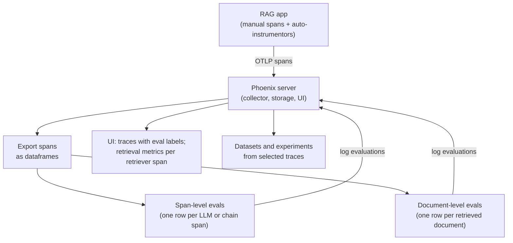

The frameworks so far evaluate records you hand them ([RAGAS](/learn/rag-evaluation-frameworks/ragas), [DeepEval](/learn/rag-evaluation-frameworks/deepeval)) or records captured by their own recorder ([TruLens](/learn/rag-evaluation-frameworks/trulens)). **Arize Phoenix** comes at evaluation from the other direction: it is first an **observability** tool, built on the OpenTelemetry tracing standard, and evaluation is something you run over the traces it collects. The same traces that let you debug one slow request become the dataset for scoring retrieval relevance across a thousand.

This lesson explains the tracing model Phoenix builds on (spans, traces and the OpenInference conventions for LLM applications), how to instrument a RAG pipeline so that its retrieval and generation steps are visible, how evaluations attach to individual spans and individual retrieved documents, and how Phoenix derives retrieval metrics from those document-level judgements. You will build the whole loop locally with the OpenTelemetry SDK and then see the Phoenix code that does the same against a running Phoenix server.

## Learning objectives

- Describe a trace as a tree of spans and name the OpenInference span kinds and attributes a RAG pipeline should emit.
- Instrument a retrieval step manually with OpenTelemetry so that each retrieved document's ID, content and score is recorded.
- Distinguish span-level from document-level evaluations and produce each as a dataframe keyed the way Phoenix expects.
- Derive precision and hit rate per query from document-level relevance labels, and explain what they reveal that answer-level scores hide.
- Decide when a self-hosted, OpenTelemetry-based tool like Phoenix is a better fit than a hosted evaluation platform.

## Prerequisites

- [TruLens](/learn/rag-evaluation-frameworks/trulens): recording intermediate steps and attaching feedback to them.
- [Precision@K](/learn/retrieval-fundamentals/precision-k) and [Hit rate](/learn/retrieval-evaluation/hit-rate): the retrieval metrics derived in this lesson.
- [Cross-encoders](/learn/reranking-fundamentals/cross-encoders): the local relevance judge used in the code.

Tracing in general (what to log, sampling, distributed tracing across services) is the subject of [Tracing](/learn/rag-observability/tracing) in a later module; this lesson covers only what evaluation needs from it.

## Why this matters

Offline evaluation sets are built from the questions you thought of. Production traffic contains the questions you did not: misspelt error codes, questions about products the index does not cover, follow-ups that only make sense with the previous turn. If your evaluation lives in a separate tool from your production telemetry, those questions never reach it, and the team keeps polishing a test set that drifts further from reality.

There is also a debugging gap. A low groundedness score tells you that something went wrong on a request; to fix it you need the request's retrieved chunks, their scores, the exact prompt, the model's output, the token counts and the timing of each step. If that information lives in application logs in one format and evaluation results in another tool keyed by a different ID, every investigation starts with an hour of joining data by hand.

Phoenix closes both gaps by putting traces and evaluations in one place, keyed by the same span IDs. And because the traces use the vendor-neutral OpenTelemetry format, instrumenting for Phoenix does not lock your application to Phoenix: the same spans can go to any OpenTelemetry-compatible backend.

## The intuition

Think of a parcel-tracking system. Each parcel has a tracking number, and every time it passes through a depot, the depot scans it and records the time, the place and what happened. Looking up the tracking number shows the whole journey as a sequence of scans; if the parcel arrived late, you can see which leg was slow.

A **trace** is the tracking history of one request through your RAG system, and each **span** is one scan: "retrieval started at 10:02:01.130, ended at 10:02:01.180, returned these five documents". Now imagine the parcel company also inspects a sample of parcels at delivery and writes the result against the tracking number: "box crushed", "contents intact". Those inspections are **evaluations**, and because they are attached to tracking numbers, you can go from "crushed parcels are up this week" straight to the journeys of the crushed parcels and see that they all went through the same depot.

## How it works

### Spans and traces

**OpenTelemetry** (often shortened to OTel) is an open standard and set of libraries for recording telemetry from software. Its tracing model has a small vocabulary:

- A **span** is one unit of work with a name, a start and end time, a status, and a set of **attributes** (key-value pairs). Each span has a span ID.
- A span can have a **parent**. A request produces a tree of spans that share one **trace ID**; that tree is the **trace**.
- A **tracer provider** creates tracers and sends finished spans through **span processors** to **exporters**, which deliver them somewhere: a collector, a file, or memory.

For a RAG request, the natural trace is a root span for the whole query with child spans for retrieval and generation, and perhaps reranking, embedding and tool calls beneath them.

### OpenInference: what an LLM span should say

OpenTelemetry says nothing about what attributes an LLM call or a retrieval should carry. **OpenInference**, an open specification maintained by Arize, fills that gap with semantic conventions for AI applications. The parts that matter for RAG evaluation:

| Attribute | Meaning |
| --- | --- |
| `openinference.span.kind` | The kind of step: `CHAIN`, `RETRIEVER`, `RERANKER`, `LLM`, `EMBEDDING`, `TOOL`, `AGENT`, among others |
| `input.value`, `output.value` | The step's input and output as text |
| `retrieval.documents.{i}.document.id` | The ID of the $i$-th retrieved document |
| `retrieval.documents.{i}.document.content` | Its text |
| `retrieval.documents.{i}.document.score` | The retriever's score for it |
| `llm.model_name` | The model that was called |
| `llm.token_count.prompt`, `llm.token_count.completion` | Token usage |

Phoenix reads these conventions to render traces sensibly (a retriever span shows its documents as a ranked list) and, crucially, to know which spans are retrievals and which documents they returned, so that document-level evaluation is possible.

You can emit these attributes by hand, as the code below does, or let an **auto-instrumentor** do it. OpenInference publishes instrumentors for common SDKs and frameworks, including the Anthropic SDK, LangChain and LlamaIndex; once installed and activated, every Claude call becomes an `LLM` span with model name, messages and token counts filled in, without changing your application code. Retrieval code you wrote yourself still needs a manual span, because no instrumentor knows your function is a retriever.

### The Phoenix loop



Step by step:

1. **Run Phoenix.** It is a single server process with a web UI and a span collector; it can run on your laptop, in a container, in a notebook session, or as a hosted service run by Arize.
2. **Instrument the app.** Phoenix's helper `phoenix.otel.register` creates a tracer provider that exports spans over **OTLP** (the OpenTelemetry protocol) to the Phoenix server, grouped under a project name. Add auto-instrumentors and manual spans.
3. **Collect traces.** Run test questions through the app, or let production traffic flow.
4. **Export spans for evaluation.** Phoenix's client returns spans as a pandas dataframe, one row per span, with attributes as columns; helper functions reshape retriever spans into one row per retrieved document.
5. **Evaluate.** Run judges over those rows. Phoenix's `phoenix.evals` package provides prompt templates for common judgements (document relevance, hallucination, question-answering correctness and others) with **rails**, a fixed set of allowed output labels such as `relevant` and `unrelated`, so the judge's output can be mapped to a label and score reliably. You can equally use your own judge or a deterministic check.
6. **Log the results back.** Span evaluations are keyed by span ID; document evaluations by span ID and document position. Phoenix shows each label next to the span it judges.
7. **Read derived metrics.** From document-level relevance labels, Phoenix computes ranking metrics for each retriever span (such as NDCG, precision and hit), so you can see retrieval quality per request and in aggregate.
8. **Promote traces to datasets.** Interesting or failing traces can be saved as a dataset, and Phoenix's experiments feature runs a new version of your pipeline over that dataset with evaluators, closing the loop from production failure to regression test.

### Span-level versus document-level evaluation

This distinction is the most useful idea Phoenix adds to RAG evaluation.

A **span-level** evaluation produces one judgement per span: "this answer is grounded", "this answer is correct". It is keyed by the span ID of the LLM or chain span it judges.

A **document-level** evaluation produces one judgement per retrieved document per retriever span: "document at position 0 is relevant, position 1 is unrelated". It is keyed by the pair (span ID, document position). With these labels, standard ranking metrics become computable for every single production request, not only for the questions in your labelled test set, because the labels come from a judge rather than from humans. The cost is that the metrics are only as good as the relevance judge, so validate it as described in [LLM-as-a-judge](/learn/testing-and-benchmarking/llm-as-a-judge).

## In code

The problem: instrument a small AskMeridian pipeline so every request produces a trace with retriever and LLM spans in OpenInference format, then evaluate those traces at both levels and derive per-query retrieval metrics. First the whole loop locally, then the Phoenix version.

### The loop with the OpenTelemetry SDK (runs locally)

Dependencies: the OpenTelemetry SDK, pandas, NumPy and sentence-transformers. The generator is a deterministic fake so the example needs no API key; the relevance judge is the local MS MARCO cross-encoder.

```bash
pip install opentelemetry-sdk pandas numpy sentence-transformers
```

```python
import re

import numpy as np
import pandas as pd
from opentelemetry.sdk.trace import TracerProvider
from opentelemetry.sdk.trace.id_generator import IdGenerator
from opentelemetry.sdk.trace.export import SimpleSpanProcessor
from opentelemetry.sdk.trace.export.in_memory_span_exporter import InMemorySpanExporter
from sentence_transformers import CrossEncoder, SentenceTransformer

# --- Tracing setup: Phoenix's register() would add an OTLP exporter instead ---
class CountingIds(IdGenerator):       # deterministic IDs so the output is reproducible
    def __init__(self):
        self.n = 0
    def generate_span_id(self):
        self.n += 1
        return self.n
    def generate_trace_id(self):
        self.n += 1
        return self.n

exporter = InMemorySpanExporter()
provider = TracerProvider(id_generator=CountingIds())
provider.add_span_processor(SimpleSpanProcessor(exporter))
tracer = provider.get_tracer("askmeridian")

embedder = SentenceTransformer("sentence-transformers/all-MiniLM-L6-v2")
reranker = CrossEncoder("cross-encoder/ms-marco-MiniLM-L-6-v2")

DOCS = {
    "hb-leave": "Annual leave is 25 days; up to 5 unused days carry over and must be used by 31 March.",
    "hb-remote": "Remote work: up to 3 days a week; the home-office equipment budget is £400.",
    "hb-2023-remote": "Superseded 2023 handbook: the home-office equipment budget is £250.",
    "hb-expenses": "Expenses must be submitted within 30 days; anything over £75 needs a receipt.",
    "it-vpn": "Error E-4012 means the VPN certificate expired; E-4021 means the VPN client is out of date.",
}
IDS = list(DOCS)
VECS = embedder.encode(list(DOCS.values()), normalize_embeddings=True)

def fake_llm(question, chunks):
    # Stands in for Claude; deliberately answers from the first chunk only.
    first = chunks[0]
    return f"According to the handbook: {first}", 180, 25

K = 2  # chunks retrieved per question

def answer(question, k=K):
    with tracer.start_as_current_span("askmeridian.query") as root:
        root.set_attribute("openinference.span.kind", "CHAIN")
        root.set_attribute("input.value", question)
        with tracer.start_as_current_span("retrieve") as span:
            span.set_attribute("openinference.span.kind", "RETRIEVER")
            span.set_attribute("input.value", question)
            q = embedder.encode([question], normalize_embeddings=True)[0]
            scores = VECS @ q
            top = np.argsort(-scores)[:k]
            for pos, i in enumerate(top):
                prefix = f"retrieval.documents.{pos}.document"
                span.set_attribute(f"{prefix}.id", IDS[i])
                span.set_attribute(f"{prefix}.content", DOCS[IDS[i]])
                span.set_attribute(f"{prefix}.score", float(scores[i]))
            chunks = [DOCS[IDS[i]] for i in top]
        with tracer.start_as_current_span("generate") as span:
            span.set_attribute("openinference.span.kind", "LLM")
            span.set_attribute("llm.model_name", "fake-llm")
            text, n_in, n_out = fake_llm(question, chunks)
            span.set_attribute("llm.token_count.prompt", n_in)
            span.set_attribute("llm.token_count.completion", n_out)
            span.set_attribute("output.value", text)
        root.set_attribute("output.value", text)
    return text

for q in ["How much is the home-office equipment budget?",
          "What does error E-4021 mean?",
          "Do I need a receipt for a £60 taxi?"]:
    answer(q)

# --- Spans to a dataframe, as Phoenix's span export does ----------------------
rows = []
for s in exporter.get_finished_spans():
    rows.append({
        "span_id": s.context.span_id,
        "trace_id": s.context.trace_id,
        "name": s.name,
        "span_kind": s.attributes["openinference.span.kind"],
        "latency_ms": (s.end_time - s.start_time) / 1e6,
        **{f"attributes.{k}": v for k, v in s.attributes.items()},
    })
spans = pd.DataFrame(rows).set_index("span_id")
print(spans[["trace_id", "name", "span_kind"]].to_string(), "\n")

# --- Document-level relevance eval: one row per (retriever span, position) ----
retrievers = spans[spans.span_kind == "RETRIEVER"]
doc_rows = []
for span_id, r in retrievers.iterrows():
    for pos in range(K):
        content = r[f"attributes.retrieval.documents.{pos}.document.content"]
        logit = reranker.predict([(r["attributes.input.value"], content)])[0]
        score = float(1 / (1 + np.exp(-logit)))
        doc_rows.append({"span_id": span_id, "document_position": pos,
                         "doc_id": r[f"attributes.retrieval.documents.{pos}.document.id"],
                         "score": round(score, 3),
                         "label": "relevant" if score >= 0.5 else "unrelated"})
doc_evals = pd.DataFrame(doc_rows).set_index(["span_id", "document_position"])
print(doc_evals.to_string(), "\n")

# --- Span-level check on LLM spans: are the answer's numbers in the context? ---
llm_spans = spans[spans.span_kind == "LLM"]
span_evals = []
for span_id, r in llm_spans.iterrows():
    retr = retrievers[retrievers.trace_id == r["trace_id"]].iloc[0]
    context = " ".join(retr[f"attributes.retrieval.documents.{p}.document.content"]
                       for p in range(K))
    nums = set(re.findall(r"£?\d+", r["attributes.output.value"]))
    missing = sorted(n for n in nums if n not in context)
    span_evals.append({"span_id": span_id, "label": "grounded" if not missing else "ungrounded",
                       "score": 1.0 if not missing else 0.0,
                       "explanation": f"missing: {missing}" if missing else "all numbers in context"})
print(pd.DataFrame(span_evals).set_index("span_id").to_string())

# --- Retrieval metrics derived from the document evals, per retriever span ----
rel = (doc_evals["label"] == "relevant").astype(int)
summary = rel.groupby(level="span_id").agg(precision_at_2="mean", hit="max")
print("\n" + summary.to_string())
```

```output
         trace_id               name  span_kind
span_id                                        
3               1           retrieve  RETRIEVER
4               1           generate        LLM
2               1  askmeridian.query      CHAIN
7               5           retrieve  RETRIEVER
8               5           generate        LLM
6               5  askmeridian.query      CHAIN
11              9           retrieve  RETRIEVER
12              9           generate        LLM
10              9  askmeridian.query      CHAIN 

                                   doc_id  score      label
span_id document_position                                  
3       0                  hb-2023-remote  1.000   relevant
        1                       hb-remote  1.000   relevant
7       0                          it-vpn  1.000   relevant
        1                     hb-expenses  0.000  unrelated
11      0                     hb-expenses  0.768   relevant
        1                  hb-2023-remote  0.000  unrelated 

            label  score             explanation
span_id                                         
4        grounded    1.0  all numbers in context
8        grounded    1.0  all numbers in context
12       grounded    1.0  all numbers in context

         precision_at_2  hit
span_id                     
3                   1.0    1
7                   0.5    1
11                  0.5    1
```

How the important parts work:

- **The tracer provider** is configured with an in-memory exporter, so finished spans stay in the process where we can read them. In Phoenix, `register()` builds the same provider with an OTLP exporter pointing at the Phoenix server. The `CountingIds` generator only makes span IDs reproducible for this lesson; real IDs are random.
- **`answer`** opens a root `CHAIN` span and two children. The `RETRIEVER` span records each document's ID, content and score under the indexed OpenInference keys; the `LLM` span records the model name, token counts and output. Nesting the `with` blocks is what makes them children of the root span and members of the same trace.
- **Spans to a dataframe** flattens each span into one row with `attributes.`-prefixed columns, the same shape Phoenix's span export uses.
- **Document-level relevance** produces one row per (retriever span, document position), with a score from the cross-encoder (passed through a sigmoid), and a label from a threshold. That two-level index is exactly the key a Phoenix document evaluation needs.
- **The span-level check** joins each LLM span to its trace's retriever span and tests whether every number in the answer occurs in the retrieved text. One row per LLM span, keyed by span ID: the shape of a Phoenix span evaluation.
- **The retrieval summary** groups the document labels by retriever span to give precision@2 and hit per query.

**What the output means.** All three answers pass the span-level check: every number they state is in their context. Taken alone, that would suggest a healthy system. The document-level table tells a different story for the first question: the superseded 2023 chunk (`hb-2023-remote`, with the £250 budget) was ranked first, ahead of the current chunk, and the generator, which answers from the top chunk, reported £250. The answer was grounded and wrong. Precision@2 of 1.0 for that query does not catch it either, because the stale chunk *is* relevant to the question. What the trace gives you, and a score table does not, is the ability to see this in one view: the ranked documents with their IDs, next to the answer, next to the evaluations. A filter on `doc_id` beginning `hb-2023` across all retriever spans would then measure how often superseded content reaches position 0.

The second and third queries show a different pattern: precision 0.5 with a hit, meaning the right document was found and one slot was wasted on noise. That pattern suggests trying a smaller top-k or a reranker, and the per-span metrics let you count how often it happens.

**Errors people commonly hit.** Spans that appear as separate traces instead of a tree, because a child span was started outside its parent's `with` block (or in another thread without propagating the context). Documents missing from the UI's retrieval view, because the attribute keys do not follow the `retrieval.documents.{i}.document.*` pattern exactly. And evaluation rows that do not attach to anything, because the index is not the span ID Phoenix stored.

### The same with Phoenix (not executed)

This part was **not executed**: Phoenix is not installed in the course sandbox, and the generator calls Claude. It is written against the Phoenix and OpenInference Python packages as documented at the time of writing; Phoenix's client API has been evolving, with a newer `phoenix.client` package alongside the original `px.Client`, so check the Phoenix documentation for your version.

```bash
pip install arize-phoenix arize-phoenix-otel openinference-instrumentation-anthropic anthropic
phoenix serve        # starts the server; the UI is at http://localhost:6006
```

```python
import anthropic
import phoenix as px
from openinference.instrumentation.anthropic import AnthropicInstrumentor
from phoenix.otel import register
from phoenix.trace import DocumentEvaluations, SpanEvaluations

tracer_provider = register(project_name="askmeridian")        # OTLP to the local server
AnthropicInstrumentor().instrument(tracer_provider=tracer_provider)
tracer = tracer_provider.get_tracer("askmeridian")
client = anthropic.Anthropic()

def answer(question: str, k: int = 2) -> str:
    with tracer.start_as_current_span("askmeridian.query") as root:
        root.set_attribute("openinference.span.kind", "CHAIN")
        root.set_attribute("input.value", question)
        with tracer.start_as_current_span("retrieve") as span:
            span.set_attribute("openinference.span.kind", "RETRIEVER")
            span.set_attribute("input.value", question)
            hits = search(question, k)                         # your retriever
            for pos, hit in enumerate(hits):
                prefix = f"retrieval.documents.{pos}.document"
                span.set_attribute(f"{prefix}.id", hit.id)
                span.set_attribute(f"{prefix}.content", hit.text)
                span.set_attribute(f"{prefix}.score", hit.score)
        context = "\n\n".join(h.text for h in hits)
        response = client.messages.create(                   # auto-instrumented LLM span
            model="claude-opus-5-5",
            max_tokens=1024,
            system="Answer only from the provided context. If the answer is not there, say you don't know.",
            messages=[{"role": "user", "content": f"Context:\n{context}\n\nQuestion: {question}"}],
        )
        text = "".join(b.text for b in response.content if b.type == "text")
        root.set_attribute("output.value", text)
        return text

# ... run the test questions through answer() ...

px_client = px.Client()
spans = px_client.get_spans_dataframe(project_name="askmeridian")
# Build doc_evals (index: span ID and document_position) and span_evals (index: span ID)
# with columns label, score and explanation, as in the local version above, then:
px_client.log_evaluations(
    DocumentEvaluations(eval_name="Relevance", dataframe=doc_evals),
    SpanEvaluations(eval_name="Grounded numbers", dataframe=span_evals),
)
```

The differences from the local version are small and deliberate: `register` replaces the hand-built tracer provider, the Anthropic instrumentor replaces the hand-written `LLM` span, and logging evaluations replaces printing them. In the Phoenix UI, each trace then shows the ranked documents of its retriever span with their relevance labels, the LLM span's messages and token counts, and the evaluation labels, and the retriever spans show ranking metrics derived from the document labels.

**How to extend it.** Replace the cross-encoder with an LLM relevance judge from `phoenix.evals` (or your own Claude judge) once you have checked its agreement with human labels; add a hallucination evaluation on the LLM spans; and save the traces of failing requests as a Phoenix dataset to rerun after each fix.

## A real-world example

Meridian's IT team added AskMeridian answers to its support portal, and tickets started arriving that said "the assistant didn't know my error code". The Platform team already sent AskMeridian's traces to a self-hosted Phoenix instance, so the investigation began there rather than with a new test set.

They exported the week's retriever spans for queries containing an error-code pattern and ran the document relevance judge over them. Precision was poor and, more tellingly, the per-span hit rate was low for codes with four digits after the dash. Opening a few traces showed the mechanism directly: for "E-4021", the dense retriever returned chunks about E-4012 and general VPN troubleshooting, because the embedding model treats the two codes as near neighbours. The LLM span showed the model responsibly saying it did not know, which is why no hallucination evaluation had fired.

The fix was a [hybrid retriever](/learn/hybrid-search) adding BM25 for exact identifiers. Before shipping, the team saved 60 of the failing traces as a Phoenix dataset and ran the old and new pipelines over it as an experiment; the new one retrieved the right runbook entry for nearly all of them. The dataset became part of the nightly regression suite, so the next embedding-model change would be tested against error codes automatically.

What made this fast was not a better metric; it was that the evaluation, the retrieved documents and the user's original question were in the same place, joined by span ID.

## Common mistakes

- **Not instrumenting retrieval.** Auto-instrumentors capture LLM calls; without a manual `RETRIEVER` span with document attributes, document-level evaluation is impossible.
- **Breaking the trace tree.** Starting spans outside their parent's context, or across threads and async tasks without context propagation, scatters one request into several traces.
- **Logging document text but not IDs.** Without stable document IDs you cannot ask "how often does this superseded chunk get retrieved?" across traces.
- **Treating judge-derived ranking metrics as ground truth.** NDCG computed from an LLM's relevance labels is only as good as the judge; validate on a human-labelled sample.
- **Evaluating every span in production.** Judging every retriever span of every request multiplies judge cost by traffic; sample.
- **Ignoring the evaluation key.** Span evaluations must be indexed by the span ID Phoenix stored, document evaluations by span ID and position; otherwise nothing attaches.

## Best practices

- Follow OpenInference attribute names exactly, including the zero-based document index, so any compatible tool can read your spans.
- Record document IDs, retriever scores and the index or corpus version on retriever spans.
- Use auto-instrumentors for SDK and framework calls, and manual spans for your own retrieval, reranking and post-processing.
- Use a batch span processor in production (`register` offers a batch option) so exporting spans does not slow requests.
- Promote failing production traces to datasets and rerun them as experiments after each fix.
- Keep span names stable across versions so dashboards and filters keep working.

## Performance considerations

Tracing overhead is small if you export in batches: creating a span and setting attributes is in-memory work, and a batch processor sends spans in the background. The larger cost is payload size. A retriever span carrying five 300-token chunks holds roughly 6 to 8 kilobytes of text (at an assumed 4 to 5 bytes per token); at 20,000 requests a day that is on the order of 150 megabytes of retrieval text daily, before LLM prompts, which usually repeat the same chunks. Plan storage retention accordingly, or record document IDs and truncated content for high-volume traffic.

Evaluation cost scales with the level. Document-level relevance makes one judge call per document: $k = 5$ chunks on a 5% sample of 20,000 daily requests is $1{,}000 \times 5 = 5{,}000$ calls a day with an LLM judge, against effectively zero API cost for a local cross-encoder (a few milliseconds per pair on a CPU, as in the example). A practical pattern is a cheap local judge on a larger sample for trend lines, and an LLM judge on a smaller sample for accuracy.

## Security considerations

- **Traces contain user questions and document text.** Apply the same access control to Phoenix as to the underlying documents, set retention limits, and consider masking or omitting sensitive attributes before export. OpenInference instrumentors offer configuration to hide inputs and outputs; check the options for your version.
- **Self-hosting keeps data in your network**, which is often the reason teams choose Phoenix over hosted platforms; a hosted Phoenix or any external collector sends the same data out.
- **Protect the UI and collector.** Do not expose the Phoenix port publicly without authentication; anyone who can reach the collector can also write spurious spans.
- **Judge prompts receive untrusted text.** Relevance and hallucination judges read retrieved documents, which may contain injected instructions.
- **Licensing.** Phoenix's source is available under the Elastic License 2.0 rather than an OSI-approved open-source licence; read its terms if you plan to offer Phoenix as part of a hosted service.

## Summary

- Phoenix is an observability tool built on OpenTelemetry, with evaluation run over the traces it collects.
- OpenInference conventions tell Phoenix which spans are retrievers and LLM calls and which documents were retrieved, so instrument retrieval explicitly with `retrieval.documents.{i}.document.*` attributes.
- Span-level evaluations judge one span; document-level evaluations judge each retrieved document and make per-request ranking metrics possible on production traffic.
- Evaluations attach to traces by span ID, so diagnosis moves straight from a bad score to the request's documents, prompt and output.
- Failing traces become datasets, and datasets become experiments: the bridge from production failures to regression tests.

## Exercises

1. A trace for one AskMeridian query contains spans named `query`, `embed_query`, `vector_search`, `rerank` and `claude_call`. Assign each an OpenInference span kind and draw the parent-child tree.

<details><summary>Show solution</summary>

`query` is `CHAIN` (the root). `embed_query` is `EMBEDDING`, `vector_search` is `RETRIEVER`, `rerank` is `RERANKER` and `claude_call` is `LLM`. A sensible tree: `query` is the parent of `vector_search`, `rerank` and `claude_call`, with `embed_query` either a child of `vector_search` (if the retriever embeds internally) or a direct child of `query`. What matters is that all share one trace ID and that the `RETRIEVER` and `RERANKER` spans carry their document lists.

</details>

2. Document-level relevance labels for three retriever spans with $k = 3$ are: span A `[1, 0, 0]`, span B `[0, 0, 1]`, span C `[0, 0, 0]`. Compute precision@3 and hit per span, and the mean of each.

<details><summary>Show solution</summary>

A: precision 1/3, hit 1. B: precision 1/3, hit 1. C: precision 0, hit 0. Means: precision 2/9, about 0.222; hit rate 2/3, about 0.667. Precision cannot distinguish A from B, although A put the relevant document first; a rank-aware metric such as MRR (1 against 1/3) or NDCG would.

</details>

3. Extend the local script so that the summary also reports reciprocal rank per retriever span (1 divided by the position, counted from 1, of the first relevant document, or 0 if none), and the mean reciprocal rank.

<details><summary>Show solution</summary>

```python
def reciprocal_rank(labels):
    for i, relevant in enumerate(labels, start=1):
        if relevant:
            return 1 / i
    return 0.0

rr = rel.groupby(level="span_id").apply(lambda s: reciprocal_rank(s.tolist()))
summary["reciprocal_rank"] = rr
print(summary.to_string())
print("MRR:", round(rr.mean(), 3))
```

With the labels in the output, every span has a relevant document at position 0, so each reciprocal rank is 1.0 and MRR is 1.0. Note that this again hides the stale-chunk problem in the first query; ranking metrics measure relevance, not currency.

</details>

4. Design: Meridian's security team will not allow full document text in traces stored for more than 7 days. Propose a tracing and evaluation design that still supports document-level evaluation and month-long trend analysis.

<details><summary>Show solution</summary>

Record document IDs, scores and a content hash on every retriever span, and full content only on a sampled subset (for example 5%) whose traces are evaluated within the 7-day window. Run document-level evaluation on that sample daily, and store the resulting labels with the span IDs and document IDs; the labels and metrics can be kept for months because they contain no document text. Purge or truncate content attributes after 7 days. If a document is needed for later investigation, fetch it from the access-controlled corpus by ID rather than from the trace store. Trend lines come from the stored daily metrics, and the document IDs still allow questions like "how often was the superseded handbook retrieved?".

</details>

## Check your understanding

```quiz
[
  {"q": "What does OpenInference add on top of OpenTelemetry?", "options": ["A new wire protocol for spans", "Semantic conventions for AI applications, such as span kinds and retrieval document attributes", "A database for traces", "A replacement for the tracer provider"], "answer": 1, "why": "OpenTelemetry provides the tracing model and protocol; OpenInference defines which attributes LLM, retriever and other AI spans should carry."},
  {"q": "How is a Phoenix document-level evaluation keyed?", "options": ["By trace ID only", "By document ID only", "By question text", "By span ID and document position"], "answer": 3, "why": "Each row judges one document at one position within one retriever span, so the key is the pair of span ID and document position."},
  {"q": "An answer is grounded in its retrieved context, and precision@2 for its retriever span is 1.0, but the answer is wrong. Which explanation fits?", "options": ["A relevant but outdated document was ranked first and the generator used it", "The trace is broken", "The judge must be miscalibrated", "Precision cannot be 1.0 if the answer is wrong"], "answer": 0, "why": "Relevance and groundedness do not measure currency; a superseded chunk is relevant and can ground a wrong answer."},
  {"q": "Why does a hand-written retrieval function need a manual span even when an auto-instrumentor is installed?", "options": ["Auto-instrumentors only work in notebooks", "Manual spans are faster", "Instrumentors wrap known SDKs and frameworks and cannot know that your own function is a retriever", "Phoenix rejects automatic spans"], "answer": 2, "why": "Auto-instrumentors patch specific libraries such as the Anthropic SDK; custom code must be instrumented explicitly."},
  {"q": "Which is the main reason to promote failing production traces to a dataset?", "options": ["To delete them from the trace store", "To rerun them against new pipeline versions as a regression test", "To reduce storage cost", "To train the embedding model"], "answer": 1, "why": "Datasets built from real failures let experiments check that fixes work and keep working."}
]
```

## Further reading

- [Arize Phoenix on GitHub](https://github.com/Arize-ai/phoenix), which links to the current documentation: tracing setup, auto-instrumentation, evaluations, datasets and experiments.
- [OpenInference specification and instrumentors](https://github.com/Arize-ai/openinference): the semantic conventions used in this lesson and the list of supported SDKs and frameworks.
- [OpenTelemetry documentation](https://opentelemetry.io/docs/): traces, spans, context propagation and the Python SDK.
- Benjamin Sigelman and colleagues (2010), *Dapper, a Large-Scale Distributed Systems Tracing Infrastructure*, Google Technical Report. The design that spans and traces descend from.
