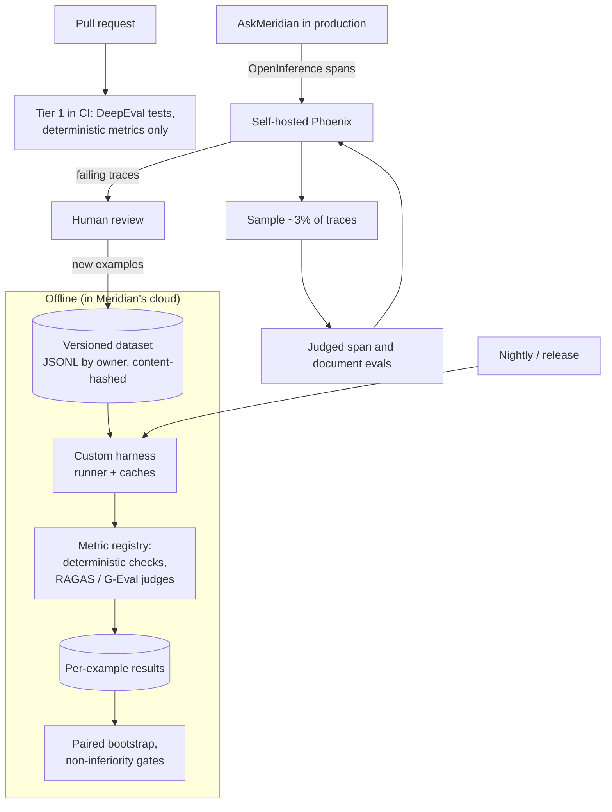

This assessment covers the whole RAG Evaluation Frameworks module: RAGAS, DeepEval, TruLens, Arize Phoenix, LangSmith and custom evaluation pipelines. The quiz mixes beginner, intermediate and advanced questions, including code-reading and scenario questions; aim for at least 80 per cent (15 of 18) before moving on. The open sections have hidden model answers: write your own answer first, then compare.

```quiz
[
  {
    "q": "Which RAGAS metric needs a human-written reference answer?",
    "options": [
      "Faithfulness",
      "Response relevancy",
      "Context recall",
      "None of them"
    ],
    "answer": 2,
    "why": "Context recall checks whether each sentence of the reference answer can be attributed to the retrieved context, so it needs the reference. Faithfulness and response relevancy are reference-free."
  },
  {
    "q": "RAGAS faithfulness extracts four statements from an answer and the judge verifies three. What is the score?",
    "options": [
      "0.25",
      "0.75",
      "1.0",
      "It depends on the embedding model"
    ],
    "answer": 1,
    "why": "Faithfulness is supported statements divided by statements: 3/4."
  },
  {
    "q": "How does RAGAS response relevancy decide whether an answer is on topic?",
    "options": [
      "It asks the judge for a 1 to 10 relevance score",
      "It counts words shared by the question and answer",
      "It compares the answer with the reference answer",
      "It generates questions from the answer and averages their cosine similarity with the original question"
    ],
    "answer": 3,
    "why": "The judge writes questions the answer would answer; the score is their mean cosine with the real question, zeroed if the answer is non-committal."
  },
  {
    "q": "What does this code print?\n```python\nimport numpy as np\nscores = np.array([1.0, 0.5, np.nan, 0.0])\nprint(round(np.nanmean(scores), 3))\n```",
    "options": [
      "0.5",
      "0.375",
      "nan",
      "0.667"
    ],
    "answer": 0,
    "why": "nanmean ignores the NaN and averages the other three: 1.5/3 = 0.5. RAGAS aggregates the same way, so failed samples silently drop out."
  },
  {
    "q": "An AskMeridian answer faithfully repeats a superseded 2023 handbook chunk that the retriever ranked first. Which score is most likely to reveal the problem?",
    "options": [
      "RAGAS faithfulness",
      "TruLens groundedness",
      "A reference-based correctness metric against the current policy",
      "Response relevancy"
    ],
    "answer": 2,
    "why": "Faithfulness, groundedness and relevance all measure consistency with the retrieved context or the question; only a comparison with the correct answer detects a stale source."
  },
  {
    "q": "With default settings, DeepEval's FaithfulnessMetric gives verdicts yes, yes, no, borderline for four claims. What is the score?",
    "options": [
      "0.5",
      "0.75",
      "0.25",
      "1.0"
    ],
    "answer": 1,
    "why": "By default every verdict other than no passes: 3/4. With penalize_ambiguous_claims=True it would be 2/4."
  },
  {
    "q": "A DeepEval metric is created with strict_mode=True and scores 0.9 on a test case. What score is reported?",
    "options": [
      "0.9",
      "1.0",
      "0",
      "It raises an error"
    ],
    "answer": 2,
    "why": "Strict mode sets the threshold to 1 and reports any score below it as 0."
  },
  {
    "q": "Why do G-Eval scores from a Claude judge in DeepEval tend to be multiples of 0.1?",
    "options": [
      "DeepEval only applies log-probability weighting for OpenAI models that expose log-probabilities; otherwise the raw integer score out of 10 is normalised",
      "Claude rounds its outputs",
      "G-Eval always rounds",
      "The threshold forces it"
    ],
    "answer": 0,
    "why": "Without token log-probabilities, the score is the judge's integer divided by the range."
  },
  {
    "q": "A team's DeepEval suite runs 300 judged checks on every pull request, and engineers have started re-running failed builds until they pass. What is the best change?",
    "options": [
      "Lower all thresholds to 0.3",
      "Remove the judged metrics entirely",
      "Run the judge twice and take the maximum",
      "Move judged metrics to scheduled runs with trend comparison and gate pull requests on deterministic metrics"
    ],
    "answer": 3,
    "why": "Judge verdicts vary between runs, so many borderline judged checks flake; deterministic gates are stable, and judged metrics are better compared as trends."
  },
  {
    "q": "Which three comparisons make up the TruLens RAG triad?",
    "options": [
      "Question and answer; answer and reference; context and reference",
      "Question and context; context and answer; answer and question",
      "Context and reference; answer and reference; question and reference",
      "Retriever and reranker; reranker and generator; generator and user"
    ],
    "answer": 1,
    "why": "Context relevance (question and context), groundedness (context and answer) and answer relevance (answer and question)."
  },
  {
    "q": "In TruLens, groundedness is attached with `Select.RecordCalls.retrieve.rets[:]` and `.aggregate(np.mean)`. An answer combines one fact from each of two chunks. What happens?",
    "options": [
      "The answer scores about 1.0",
      "TruLens raises an error",
      "Each chunk supports only half of the answer, so the mean is about 0.5 although the answer is fully supported",
      "The score becomes NaN"
    ],
    "answer": 2,
    "why": "Fanning out judges the answer against each chunk alone; groundedness should collect all chunks into one argument."
  },
  {
    "q": "Why is embedding cosine similarity a poor groundedness measure?",
    "options": [
      "It is too slow",
      "It needs reference answers",
      "It only works with cross-encoders",
      "It measures topical similarity, so 'every 4 years' against 'every 3 years' still scores high"
    ],
    "answer": 3,
    "why": "Sentences differing only in a number are nearly identical to an embedding model."
  },
  {
    "q": "What do OpenInference conventions let Phoenix do that plain OpenTelemetry spans would not?",
    "options": [
      "Recognise which spans are retrievals and which documents they returned, so document-level evaluation is possible",
      "Send spans over the network",
      "Store spans in a database",
      "Measure latency"
    ],
    "answer": 0,
    "why": "OpenTelemetry provides spans and transport; OpenInference defines span kinds and attributes such as retrieval.documents.{i}.document.content."
  },
  {
    "q": "How is a Phoenix document-level evaluation row keyed?",
    "options": [
      "By trace ID",
      "By span ID and document position",
      "By document ID alone",
      "By the question text"
    ],
    "answer": 1,
    "why": "Each row judges one document at one position in one retriever span."
  },
  {
    "q": "A LangSmith evaluator is defined as `def check(outputs, reference_output): ...`. What goes wrong?",
    "options": [
      "Nothing; LangSmith accepts any names",
      "The evaluator runs but always scores 0",
      "LangSmith passes the run object instead",
      "The SDK maps arguments by name, and `reference_output` is not a recognised name, so the call fails"
    ],
    "answer": 3,
    "why": "Evaluators receive inputs, outputs and reference_outputs (or run and example) by parameter name; a misspelt name is not supplied."
  },
  {
    "q": "Which LangSmith evaluator type should compute recall of refusals over an unanswerable split?",
    "options": [
      "Per-example",
      "Summary",
      "Pairwise",
      "Online"
    ],
    "answer": 1,
    "why": "Recall over a set needs counts across all examples, which a summary evaluator receives."
  },
  {
    "q": "What does this code print?\n```python\nimport numpy as np\nd = np.array([0.0] * 9 + [1.0])\nrng = np.random.default_rng(0)\nboot = rng.choice(d, size=(2000, d.size)).mean(axis=1)\nprint(np.percentile(boot, 2.5) >= 0)\n```",
    "options": [
      "True",
      "False",
      "It raises an error",
      "nan"
    ],
    "answer": 0,
    "why": "Every resampled value is 0 or 1, so every bootstrap mean is at least 0 and so is any percentile of them."
  },
  {
    "q": "A non-inferiority gate with margin 0.05 fails on 15 examples with a difference interval of [-0.20, +0.07]. What is the right conclusion?",
    "options": [
      "The candidate is worse and must be rejected permanently",
      "The candidate is better",
      "The data cannot rule out a loss larger than 0.05; more examples are needed before deciding",
      "The margin should be raised to 0.20"
    ],
    "answer": 2,
    "why": "The interval includes both a gain and a large loss; the gate fails for lack of evidence. Widening the margin after the fact defeats its purpose."
  }
]
```

## Conceptual questions

**1.** RAGAS and DeepEval both have metrics called "faithfulness" and "answer relevancy". Explain how each pair differs in mechanism and what that means for comparing numbers between the libraries.

<details><summary>Show solution</summary>

RAGAS faithfulness asks the judge to extract statements from the answer and decide whether each can be inferred from the retrieved context; the score is the inferable fraction, and NaN when no statements are extracted. DeepEval faithfulness extracts truths from the context and claims from the answer, and gives each claim a yes, no or borderline verdict; by default only "no" (a contradiction) counts against the answer, and an answer with no claims scores 1. DeepEval's default therefore tolerates unverifiable additions that RAGAS penalises; `penalize_ambiguous_claims=True` brings it closer.

RAGAS response relevancy generates questions from the answer and averages their embedding cosine with the real question, zeroing non-committal answers; the scale belongs to the embedding model. DeepEval answer relevancy has the judge classify each statement of the answer as relevant or not and reports the relevant fraction.

The numbers are on different scales produced by different procedures. A score from one library must never be compared with a score from the other, and any report should state the library, version, judge model and (for RAGAS relevancy) embedding model.

</details>

**2.** The RAG triad needs no reference answers. Explain what it can and cannot establish about an answer, with an AskMeridian example of a failure it cannot see.

<details><summary>Show solution</summary>

The triad checks internal consistency along three edges: the context is relevant to the question, the answer is supported by the context, and the answer addresses the question. If all three are high, the answer is unlikely to be a hallucination and the failure, if any, is not obviously in retrieval or generation. It cannot establish truth, because none of the edges compares the answer with the world. If the retriever returns the superseded 2023 handbook section saying the equipment budget is £250, the chunk is relevant, the answer "The budget is £250" is grounded in it, and the answer addresses the question: all three scores are high and the answer is wrong. Detecting it needs reference-based checks on known questions, or index-time controls that exclude superseded documents.

</details>

**3.** Compare document-level evaluation in Phoenix with reference-based retrieval metrics computed from a labelled test set. What does each offer, and how would you use both?

<details><summary>Show solution</summary>

Reference-based metrics (recall@k, MRR, NDCG against human relevance labels) are trustworthy but limited to the questions someone labelled, and labels tie to a particular chunking. Phoenix's document-level evaluation uses a judge to label each retrieved document of each retriever span, so ranking metrics become computable for any traced request, including production traffic and questions nobody anticipated; the cost is that the metrics are only as good as the judge, and judging every document of every request is expensive.

Use labelled metrics for decisions (comparing retrievers offline on a fixed set) and to validate the judge (measure agreement between judge labels and human labels on the labelled set). Use judged document-level evaluation on sampled production traffic to monitor drift and to find new failure categories, which then get human labels and join the test set.

</details>

**4.** A colleague argues that LangSmith's experiment comparison makes statistics unnecessary, because "you can see which examples got better and worse". Respond.

<details><summary>Show solution</summary>

Per-example comparison is essential for understanding why scores changed, but it does not tell you whether the overall change is larger than chance. With judged metrics, some examples flip between runs with no change to the system at all; seeing 41 improvements and 38 regressions does not distinguish a real small gain from noise. A paired interval on the per-example differences (or repeated runs to measure flip rates) answers that question, and a sample-size estimate tells you whether the dataset can answer it at all. The two are complementary: statistics for the decision, the per-example view for the diagnosis and for catching opposite effects on different subsets.

</details>

**5.** Under what circumstances would you build a custom evaluation pipeline rather than adopt one of the frameworks, and which parts would you still borrow?

<details><summary>Show solution</summary>

Build your own when the frameworks' decisions do not fit: data that cannot leave your infrastructure (and self-hosting the tool is not an option), domain-specific metrics that dominate your evaluation, a need for statistical gates with explicit margins in an existing CI system, or integration with an internal data platform. Even then, borrow freely: framework metric implementations (RAGAS faithfulness, DeepEval G-Eval) can be called as functions inside your metric registry, and a tracing tool (Phoenix self-hosted, or LangSmith if allowed) remains the best way to read individual runs. What you own is dataset versioning, caching, the per-example results store, the statistics and the gate, because those encode your organisation's decision rules.

</details>

## Coding exercises

**1.** Implement RAGAS-style faithfulness (from a list of 0/1 statement verdicts, NaN if empty) and rank-weighted context precision (from a list of 0/1 usefulness verdicts by rank, 0 if none are useful), and a report function that prints the mean over valid samples, the count, the NaN rate, and a warning when the NaN rate exceeds 2%.

<details><summary>Show solution</summary>

```python
import math


def faithfulness(verdicts):
    """RAGAS-style: supported statements / statements; NaN if none were extracted."""
    return sum(verdicts) / len(verdicts) if verdicts else math.nan


def context_precision(useful):
    """Rank-weighted: mean of precision@k over the ranks k that hold a useful chunk."""
    hits, total = 0, 0.0
    for k, v in enumerate(useful, start=1):
        if v:
            hits += 1
            total += hits / k
    return total / hits if hits else 0.0


def report(name, scores):
    valid = [s for s in scores if not math.isnan(s)]
    nan_rate = 1 - len(valid) / len(scores)
    mean = sum(valid) / len(valid) if valid else math.nan
    flag = "  <-- too many NaN" if nan_rate > 0.02 else ""
    print(f"{name:18} mean={mean:.3f} over {len(valid)}/{len(scores)} (NaN {nan_rate:.0%}){flag}")


samples = [
    {"verdicts": [1, 1, 0], "useful": [1, 0, 1]},
    {"verdicts": [1, 1, 1, 1], "useful": [0, 1, 0]},
    {"verdicts": [], "useful": [0, 0, 0]},          # judge extracted nothing
    {"verdicts": [1, 0], "useful": [1, 1, 0]},
]
report("faithfulness", [faithfulness(s["verdicts"]) for s in samples])
report("context_precision", [context_precision(s["useful"]) for s in samples])
```

```output
faithfulness       mean=0.722 over 3/4 (NaN 25%)  <-- too many NaN
context_precision  mean=0.583 over 4/4 (NaN 0%)
```

The faithfulness mean of 0.722 is computed over three samples; the fourth, where the judge extracted no statements, is NaN and would vanish silently from a plain NaN-safe mean. The 25% NaN rate triggers the warning. Context precision of the first sample is $(1/1 + 2/3)/2 \approx 0.833$, of the second $(1/2)/1 = 0.5$, of the third 0 and of the fourth 1.0, giving 0.583.

</details>

**2.** Write a DeepEval custom metric that scores 1 only if the answer contains at least one citation of the form `[doc-id]` and every cited ID is among the retrieved IDs (passed in the test case's `metadata`). Test it on a correctly cited answer, an uncited answer, and one citing a document that was not retrieved.

<details><summary>Show solution</summary>

```python
import re

from deepeval.metrics import BaseMetric
from deepeval.test_case import LLMTestCase

CITATION = re.compile(r"\[([a-z0-9-]+)\]")


class CitesRetrievedMetric(BaseMetric):
    """1.0 if the answer cites at least one chunk and every cited ID was retrieved."""

    def __init__(self):
        self.threshold = 1.0
        self.include_reason = True
        self.strict_mode = True
        self.async_mode = False
        self.evaluation_model = None

    def measure(self, test_case: LLMTestCase, *args, **kwargs) -> float:
        retrieved = set(test_case.metadata["retrieved_ids"])
        cited = set(CITATION.findall(test_case.actual_output))
        if not cited:
            self.score, self.reason = 0.0, "No citation."
        elif cited - retrieved:
            self.score, self.reason = 0.0, f"Cited but not retrieved: {sorted(cited - retrieved)}"
        else:
            self.score, self.reason = 1.0, "All citations were retrieved."
        self.success = self.score >= self.threshold
        return self.score

    async def a_measure(self, test_case, *args, **kwargs):
        return self.measure(test_case)

    def is_successful(self) -> bool:
        return bool(self.success)

    @property
    def __name__(self):
        return "Cites Retrieved"


cases = [
    ("Annual leave is 25 days [hb-leave].", ["hb-leave", "hb-remote"]),
    ("Annual leave is 25 days.", ["hb-leave"]),
    ("The budget is £400 [hb-remote] [hb-2023-remote].", ["hb-remote"]),
]
metric = CitesRetrievedMetric()
for answer, ids in cases:
    case = LLMTestCase(input="q", actual_output=answer,
                       metadata={"retrieved_ids": ids})
    print(metric.measure(case), metric.success, "|", metric.reason)
```

```output
1.0 True | All citations were retrieved.
0.0 False | No citation.
0.0 False | Cited but not retrieved: ['hb-2023-remote']
```

The metric needs no model, so it is free, instant and repeatable: a good per-commit gate. The third case is the interesting one: the answer cites a superseded document that the retriever did not return, which means the model invented or remembered a citation. Older DeepEval releases call the `metadata` field `additional_metadata`; recent releases accept the old name with a deprecation warning.

</details>

**3.** Write `paired_gate(base, cand, margin)` that returns the mean per-example difference, a 95% paired bootstrap interval, and a non-inferiority verdict. Simulate a baseline correct on about 80% of 400 examples and a candidate that loses about 3% of the baseline's correct answers and fixes about 20% of its wrong ones; run the gate on the first 20 and on all 400 examples.

<details><summary>Show solution</summary>

```python
import numpy as np


def paired_gate(base, cand, margin, n_boot=5000, seed=0):
    base, cand = np.asarray(base, float), np.asarray(cand, float)
    d = cand - base
    rng = np.random.default_rng(seed)
    boot = rng.choice(d, size=(n_boot, d.size), replace=True).mean(axis=1)
    lo, hi = np.percentile(boot, [2.5, 97.5])
    verdict = "pass" if lo > -margin else "fail"
    return d.mean(), lo, hi, verdict


rng = np.random.default_rng(42)
n = 400
base = rng.binomial(1, 0.80, n)                       # baseline correct on ~80%
flip = rng.random(n)
cand = base.copy()
cand[(base == 1) & (flip < 0.03)] = 0                 # candidate loses a few
cand[(base == 0) & (flip < 0.20)] = 1                 # and wins a few

for size in (20, 400):
    mean, lo, hi, verdict = paired_gate(base[:size], cand[:size], margin=0.03)
    print(f"n={size:3}  diff={mean:+.3f}  95% CI [{lo:+.3f}, {hi:+.3f}]  non-inferiority (0.03): {verdict}")
```

```output
n= 20  diff=+0.000  95% CI [-0.150, +0.150]  non-inferiority (0.03): fail
n=400  diff=+0.010  95% CI [-0.018, +0.037]  non-inferiority (0.03): pass
```

On 20 examples the interval is $[-0.15, +0.15]$: the data cannot exclude a large loss, so the gate fails although the candidate is, by construction, slightly better. On 400 examples the interval narrows to about $[-0.02, +0.04]$, its lower bound clears $-0.03$, and the gate passes. The candidate did not change; only the evidence did.

</details>

## Architecture design challenge

Meridian wants a complete evaluation system for AskMeridian. Constraints: handbook and runbook content must stay in Meridian's cloud account; every pull request must get a pass or fail within ten minutes without spending API credits on untrusted branches; the team wants nightly quality trends and evidence-based release decisions; and production quality must be monitored on live traffic at a judge budget of about 2,000 calls a day. AskMeridian serves about 20,000 questions a day and retrieves 5 chunks per question. Design the system: which tools or components you would use for each need, how data flows between them, and the trade-offs.

<details><summary>Show solution</summary>

A reference design uses self-hosted components throughout, with framework metrics borrowed where they fit.



**Pull requests (Tier 1).** DeepEval tests with deterministic custom metrics only: every number in the answer appears in the context, every citation was retrieved, refusal on a fixed set of unanswerable questions, and gold-document hit@5 on a few dozen examples using a deterministic stand-in or cached generations. No API key is needed, so untrusted branches spend nothing, and the suite finishes in seconds to minutes. Trade-off: it cannot catch subtle quality changes.

**Nightly and releases (Tier 2).** The custom harness runs the full versioned dataset (stratified by category, a few hundred examples) with judged metrics, RAGAS faithfulness and a G-Eval correctness criterion with a Claude judge, both validated against human labels, behind caches keyed by config, example, judge model and prompt version. Release candidates must pass non-inferiority gates per category with margins agreed in advance; changes intended to improve quality need superiority. Trade-off: owning the harness costs engineering time, but it keeps data in-house and makes decisions statistical.

**Production (Tier 3).** OpenInference instrumentation sends spans, including retriever document IDs and content, to self-hosted Phoenix. A daily job samples traces: with 2,000 calls a day and about 7 calls per trace for document relevance on 5 chunks plus two span-level judgements, that is roughly 285 traces, about 1.4% of traffic; using a local cross-encoder for document relevance reduces judge calls to 2 per trace and allows about 1,000 traces (5%). Low-scoring traces and those with negative user feedback go to human review; reviewed failures become dataset examples with reference answers.

**Trade-offs and alternatives.** Self-hosted LangSmith would replace the harness's storage and comparison UI at licence cost; TruLens could replace Phoenix for recording if the team prefers its feedback model. Retention limits on trace content are needed for the security team, with labels and metrics (which hold no document text) kept long-term.

</details>

## Troubleshooting scenarios

**1.** After a RAGAS upgrade and a small edit to the evaluation script, AskMeridian's nightly faithfulness rises from 0.86 to 0.93 with no change to the pipeline. The team is pleased.

<details><summary>Show solution</summary>

Diagnosis: a rise with no pipeline change is a measurement change. Two candidates: the upgrade changed the metric's prompts (statement extraction granularity alters the score), and failed samples are being dropped. Check the per-sample table for NaN counts before and after; a judge output-parsing failure on hard samples raises a NaN-safe mean by removing them. Rerun one failing sample with `raise_exceptions=True` to see the error.

Fix: pin the RAGAS version and judge model, and re-baseline on the new version before comparing pipelines; add a check that fails the job if any metric's NaN rate exceeds a small threshold; and store version information with every result so a metric change is never mistaken for a pipeline change.

</details>

**2.** In Phoenix, AskMeridian's retriever spans show no documents, and the document-level evaluation job produces rows that do not appear in the UI. LLM spans from the Anthropic instrumentor look fine.

<details><summary>Show solution</summary>

Diagnosis: the auto-instrumentor handles Claude calls, but retrieval is custom code. Either the retrieval function has no manual span, or its attributes do not follow the OpenInference pattern (`openinference.span.kind` set to `RETRIEVER` and `retrieval.documents.{i}.document.content`, `.id`, `.score` with a zero-based index). Separately, evaluation rows that do not attach are usually keyed wrongly: document evaluations need the span ID Phoenix stored plus `document_position`, not trace IDs or document IDs. Check also that the retrieval span is created inside the root span's context; otherwise it appears as a separate trace.

Fix: add a manual retriever span with the exact attribute names, verify one trace in the UI, and build evaluation dataframes from the exported spans so the span IDs match.

</details>

**3.** A LangSmith experiment comparison shows the new prompt with the same mean judged correctness as the old one (0.84 against 0.84), so the team considers it harmless. A week after release, IT reports that AskMeridian's VPN troubleshooting answers have become incomplete.

<details><summary>Show solution</summary>

Diagnosis: equal means hid opposite effects on different subsets. The new prompt probably made answers shorter, improving policy answers (fewer embellishments) while dropping steps from multi-step runbook procedures such as renewing a certificate after error E-4012. The per-example comparison would have shown improvements clustered in one split and regressions in another.

Fix: compute and gate on metrics per split (policy, runbooks, error codes, unanswerable), with a summary evaluator or harness report per category; read the per-example changes before release; add runbook examples with multi-step reference answers and a completeness criterion (for example a G-Eval check that every step in the reference appears); and consider routing so that procedural questions keep the fuller answer style.

</details>
