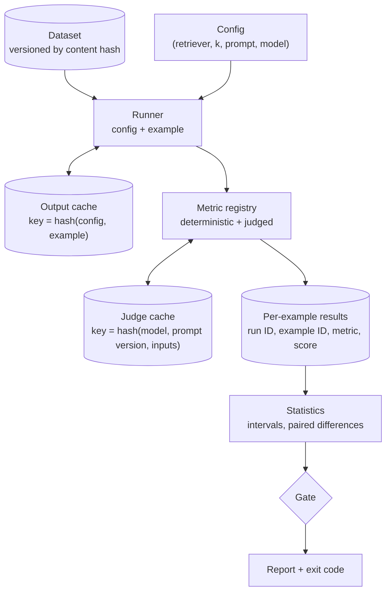

The five frameworks in this module each package a set of decisions: which metrics exist, how judges are called, where results are stored, how versions are compared. Sooner or later most teams running RAG in production find that some of those decisions do not fit: the metric they need is specific to their domain, the data cannot leave their network, the comparison they need is statistical rather than visual, or the evaluation must run inside an existing CI system with a clear pass or fail. At that point they build their own **evaluation pipeline**, often borrowing metrics from the frameworks while owning the parts that matter.

This lesson is about designing that pipeline well. It covers the components every harness needs (a versioned dataset, a cached runner, a metric registry, a judge layer, statistics and a gate), the statistics that turn "the candidate scored 0.83 and the baseline 0.92" into a defensible decision, and the engineering that keeps a harness cheap and reproducible. You will build a complete small harness that compares two retrieval configurations with paired bootstrap confidence intervals and a non-inferiority gate, and see why, on a small dataset, the honest answer is often "we cannot tell yet".

## Learning objectives

- Design an evaluation harness with separate, replaceable components for data, execution, metrics, statistics and reporting.
- Make evaluation runs reproducible and cheap with content hashing and output caching.
- Compute a paired bootstrap confidence interval for the difference between two configurations, by hand and in code, and interpret it.
- Set up a non-inferiority gate with a margin, and estimate how many examples a dataset needs for that gate to be decisive.
- Decide, for a given team and constraint, whether to adopt a framework, build a custom harness, or combine the two.

## Prerequisites

- [RAGAS](/learn/rag-evaluation-frameworks/ragas), [DeepEval](/learn/rag-evaluation-frameworks/deepeval), [TruLens](/learn/rag-evaluation-frameworks/trulens), [Arize Phoenix](/learn/rag-evaluation-frameworks/arize-phoenix) and [LangSmith](/learn/rag-evaluation-frameworks/langsmith): what the frameworks provide.
- [MRR](/learn/retrieval-evaluation/mrr) and [Hit rate](/learn/retrieval-evaluation/hit-rate): the retrieval metrics used in the harness.
- [Reciprocal Rank Fusion](/learn/hybrid-search/reciprocal-rank-fusion): the hybrid retriever being evaluated.

How to build the dataset itself (sampling questions, writing references, synthetic generation) is the subject of the [Testing and benchmarking](/learn/testing-and-benchmarking) module; this lesson takes a dataset as given and builds the machinery around it.

## Why this matters

An evaluation pipeline exists to support decisions. Three things go wrong when it is improvised.

**Irreproducible numbers.** The baseline was measured three weeks ago on a dataset that has since gained twenty questions, with a judge prompt someone has since edited. The comparison is meaningless, and nobody can tell.

**Decisions on noise.** A candidate scores 0.83 against the baseline's 0.92 on twelve questions, and the change is rejected; or it scores 0.95 against 0.92, and it ships. With twelve questions, both differences are within the range that chance alone produces. Teams that never compute an interval cannot tell a regression from a coin flip, and over time they ship random changes with great confidence.

**Cost that discourages use.** If every run recomputes every pipeline output and every judge verdict, a full evaluation costs real money and an hour, so people stop running it. An evaluation nobody runs protects nothing.

A good harness hashes what it ran on, gates on intervals, and caches everything that has not changed.

## The intuition

Think of a clinical trial comparing a new treatment with the current one. Where it can, it compares the two treatments on the **same patients** (a crossover design), so that each patient's own baseline cancels out and only the treatment difference remains. The trial's protocol is fixed before it starts: which patients, which measurements, what counts as success. And the result is reported with a confidence interval, because a trial on twelve patients cannot establish what a trial on twelve hundred can.

An evaluation harness is a small clinical trial for software. The dataset is the patient group, fixed and versioned. The baseline and candidate configurations are the two treatments, both applied to every example, so per-example differences cancel out how hard each question is. The metrics and the gate are the protocol, decided before the run. And the result comes with an interval that says honestly how much twelve examples can tell you.

## How it works

### The components



Each component has one job, and the boundaries are what make the harness maintainable:

1. **Dataset.** A list of examples with stable IDs, inputs, and reference information (gold document IDs, required facts, reference answers). Its **version** is a hash of its content, so any edit changes the version and results computed on different versions are never compared by accident. Include the corpus (or a hash of the index) in the version if references depend on it.
2. **Config.** Everything that defines the system under test, as data: retriever type, top-k, embedding model, prompt version, generator model. A config is hashable; two runs with the same config hash are the same system.
3. **Runner.** Executes the pipeline for one (config, example) pair and returns a structured output: retrieved IDs, retrieved text, answer, token usage, latency. It consults the **output cache** first, keyed by the hash of config and example, so re-running an unchanged pair costs nothing. Generation with a model is not perfectly repeatable, so the cache also pins the output that was evaluated.
4. **Metric registry.** A mapping from metric name to a function of (example, output) returning a number. Deterministic metrics (hit rate, reciprocal rank, required-fact containment, citation validity) are cheap and stable. Judged metrics call a model through a **judge layer** with its own cache keyed by judge model, judge prompt version and inputs.
5. **Results store.** One row per (run, example, metric), never only aggregates. Per-example rows are what make paired comparison, error analysis and later re-aggregation possible. A CSV or Parquet file per run is enough for most teams; a database table once several people share it.
6. **Statistics.** Means with confidence intervals, and **paired** intervals for differences between configurations.
7. **Gate and report.** A rule decided in advance (for example, "the candidate must not be worse than the baseline by more than 0.05 on any metric, at 95% confidence"), a printed or rendered report listing the examples that changed, and a process exit code so CI can act on it.

### Paired comparison

When two configurations are evaluated on the same examples, compare them **per example**. Question difficulty varies enormously: some questions every configuration gets right, some none does. If you compare the two means as if they came from independent samples, that variation swamps the difference you care about. Taking the difference on each example first removes it: an example both get right contributes 0, an example only the candidate gets right contributes +1, and so on. The interval is then computed on those differences.

### Bootstrap confidence intervals

A **confidence interval** is a range that, under the procedure used to compute it, would contain the true value in 95% of repeated experiments. The **bootstrap** estimates one without formulas:

1. Take the $n$ per-example differences.
2. Draw $n$ values from them **with replacement** (some appear twice, some not at all) and compute the mean. This is one bootstrap replicate.
3. Repeat several thousand times.
4. The 2.5th and 97.5th percentiles of the replicate means form the 95% interval.

The sample stands in for the population: resampling shows how much the mean would wobble with a different set of $n$ questions of the same kind. The bootstrap works for any metric, including bounded and skewed ones such as reciprocal rank, and never produces values the data cannot reach. With very small $n$ or very few non-zero differences it becomes unreliable, which is itself a sign that more examples are needed.

### Gates: superiority and non-inferiority

Two gate types cover most decisions:

- **Superiority**: ship only if the candidate is better. Require the lower bound of the difference interval to be above 0. Use this for changes whose only purpose is quality.
- **Non-inferiority**: ship if the candidate is not meaningfully worse. Choose a margin $\delta$ (the largest loss you would accept) and require the lower bound to be above $-\delta$. Use this for changes made for another reason (lower cost, lower latency, simpler code) where quality only needs to hold.

Note what a failing non-inferiority gate means on a small dataset: not "the candidate is worse" but "we cannot rule out that it is worse by more than $\delta$". The remedy may be more examples, not a different candidate.

### Building on frameworks

A custom harness does not mean writing every metric yourself. A common and sensible architecture uses a framework's metric implementations (RAGAS's faithfulness, DeepEval's G-Eval) as functions inside your metric registry, a tracing tool (Phoenix or LangSmith) for drilling into individual runs, and your own code for the dataset versioning, caching, statistics and gate. The frameworks compared:

| Need | Strongest fit |
| --- | --- |
| Published reference-free metrics with inspectable definitions | RAGAS |
| Pass/fail tests in pytest and CI | DeepEval |
| Diagnosing retrieval against generation on recorded app runs | TruLens |
| Self-hosted tracing with evaluations attached to production spans | Phoenix |
| Managed datasets, experiment comparison, annotation queues | LangSmith |
| Domain-specific metrics, statistical gates, data that cannot leave, existing CI | Custom harness, often calling the above |

## The mathematics

### The paired difference and its interval

**Intuition.** Measure the candidate's gain on each example, then ask how precisely the average gain is known.

$$
d_i = m_i^{\text{cand}} - m_i^{\text{base}}, \qquad
\bar{d} = \frac{1}{n}\sum_{i=1}^{n} d_i, \qquad
\text{SE} = \frac{s_d}{\sqrt{n}}, \qquad
\text{CI}_{95\%} \approx \bar{d} \pm 1.96\,\text{SE}
$$

$m_i^{\text{cand}}$ and $m_i^{\text{base}}$ are the metric values of the candidate and baseline on example $i$, $n$ is the number of examples, $\bar{d}$ is the mean difference, $s_d$ is the sample standard deviation of the $d_i$, and SE is the standard error of $\bar{d}$. The normal approximation on the right is the textbook formula; the bootstrap replaces it with resampling.

**By hand.** Twelve examples; the candidate loses one fact the baseline found and changes nothing else, so eleven $d_i$ are 0 and one is $-1$. Then $\bar{d} = -1/12 \approx -0.083$. The deviations are $0.083$ (eleven times) and $-0.917$ (once), so $s_d^2 = (11 \times 0.083^2 + 0.917^2)/11 = (0.0764 + 0.8403)/11 = 0.0833$ and $s_d \approx 0.289$. $\text{SE} = 0.289/\sqrt{12} \approx 0.083$, and the normal interval is $-0.083 \pm 0.163$, that is $[-0.247, +0.080]$.

The upper end, $+0.080$, is impossible: with no example improving, the true gain cannot be positive on this data. The normal approximation fails with so few non-zero differences; the bootstrap, which can only recombine observed values, gives $[-0.25, 0]$ instead.

### How many examples a decisive gate needs

**Intuition.** The interval narrows with the square root of $n$; to halve its width you need four times as many examples.

$$
n \approx \left(\frac{z\, s_d}{h}\right)^2
$$

$h$ is the half-width you want, $z = 1.96$ for 95%, and $s_d$ is the standard deviation of the differences (estimate it from a pilot run). With $s_d = 0.289$ and $h = 0.05$: $n \approx (1.96 \times 0.289/0.05)^2 = 11.33^2 \approx 129$ examples. A non-inferiority margin of 0.05 is unachievable with a dozen examples whatever the candidate does.

```python
import numpy as np

d = np.array([0.0] * 11 + [-1.0])          # per-example differences, candidate - baseline
mean, s = d.mean(), d.std(ddof=1)
se = s / np.sqrt(len(d))
print(f"mean={mean:.3f}  s={s:.3f}  SE={se:.3f}")
print(f"normal 95% CI: [{mean - 1.96 * se:+.3f}, {mean + 1.96 * se:+.3f}]")

rng = np.random.default_rng(0)
boot = rng.choice(d, size=(5000, len(d)), replace=True).mean(axis=1)
print("bootstrap 95% CI:", np.round(np.percentile(boot, [2.5, 97.5]), 3))

h = 0.05                                   # desired half-width of the interval
print("examples needed for half-width 0.05:", int(np.ceil((1.96 * s / h) ** 2)))
```

```output
mean=-0.083  s=0.289  SE=0.083
normal 95% CI: [-0.247, +0.080]
bootstrap 95% CI: [-0.25  0.  ]
examples needed for half-width 0.05: 129
```

## In code

The problem: the Platform team proposes replacing AskMeridian's dense retriever with a hybrid of dense and BM25 combined by Reciprocal Rank Fusion, mainly because hybrid search handles exact error codes better in general. The change should ship only if it is not worse than the current retriever by more than 0.05 on any metric. Build a harness that answers that question reproducibly.

Dependencies: NumPy, pandas, rank-bm25 and sentence-transformers with the local MiniLM model. The generation step is a deterministic stand-in (it answers with the top-ranked chunk), which isolates the retrieval change and makes the run free.

```bash
pip install numpy pandas rank-bm25 sentence-transformers
```

```python
import hashlib
import json
import re
from dataclasses import dataclass

import numpy as np
import pandas as pd
from rank_bm25 import BM25Okapi
from sentence_transformers import SentenceTransformer

# ---------------- 1. Dataset: versioned by content hash ----------------------------
DOCS = {
    "hb-leave": "Annual leave is 25 days; up to 5 unused days carry over and must be used by 31 March.",
    "hb-remote": "Remote work: up to 3 days a week; the home-office equipment budget is £400.",
    "hb-expenses": "Expenses must be submitted within 30 days; anything over £75 needs a receipt.",
    "it-password": "Password rotation is every 90 days; VPN is required on public Wi-Fi.",
    "it-e4012": "Atlas error E-4012 means the VPN certificate expired.",
    "it-e4021": "Atlas error E-4021 means the VPN client is out of date; update it from the IT portal.",
    "it-e4030": "Atlas error E-4030 means your user lacks permission for this operation.",
    "it-e4040": "Atlas error E-4040 means the requested Atlas resource does not exist or was deleted.",
    "it-support": "The support desk is open 08:00 to 18:00 UK time.",
    "it-laptop": "The laptop refresh cycle is 3 years; report a lost laptop to the support desk at once.",
}

@dataclass(frozen=True)
class Example:
    id: str
    question: str
    gold_doc: str
    must_contain: str

DATASET = [
    Example("q01", "What does error E-4021 mean?", "it-e4021", "out of date"),
    Example("q02", "What is E-4040?", "it-e4040", "does not exist"),
    Example("q03", "Atlas says E-4030 when I deploy", "it-e4030", "lacks permission"),
    Example("q04", "How much time off do I get?", "hb-leave", "25 days"),
    Example("q05", "Is a receipt needed for a taxi costing 90 pounds?", "hb-expenses", "£75"),
    Example("q06", "How much can I spend on a desk for working from home?", "hb-remote", "£400"),
    Example("q07", "I left my laptop on the train", "it-laptop", "support desk"),
    Example("q08", "How long do I have to claim back a train ticket?", "hb-expenses", "30 days"),
    Example("q09", "How many days a week can I work remotely?", "hb-remote", "3 days"),
    Example("q10", "When is the helpdesk open?", "it-support", "08:00"),
    Example("q11", "How often do I rotate my password?", "it-password", "90 days"),
    Example("q12", "My VPN certificate expired, which error is that?", "it-e4012", "E-4012"),
]
DATASET_VERSION = hashlib.sha256(
    json.dumps([e.__dict__ for e in DATASET] + [DOCS], sort_keys=True).encode()).hexdigest()[:10]

# ---------------- 2. The pipeline under test, driven by a config ------------------
IDS = list(DOCS)
embedder = SentenceTransformer("sentence-transformers/all-MiniLM-L6-v2")
DOC_VECS = embedder.encode(list(DOCS.values()), normalize_embeddings=True)
tokenise = lambda text: re.findall(r"[a-z0-9£:-]+", text.lower())
BM25 = BM25Okapi([tokenise(t) for t in DOCS.values()])

def ranking(question, method):
    dense = list(np.argsort(-(DOC_VECS @ embedder.encode([question], normalize_embeddings=True)[0])))
    sparse = list(np.argsort(-BM25.get_scores(tokenise(question))))
    if method == "dense":
        return dense
    rrf = {i: 1 / (60 + dense.index(i) + 1) + 1 / (60 + sparse.index(i) + 1) for i in range(len(IDS))}
    return sorted(rrf, key=rrf.get, reverse=True)

def run_pipeline(config, ex):
    doc_ids = [IDS[i] for i in ranking(ex.question, config["retriever"])[: config["k"]]]
    return {"doc_ids": doc_ids, "answer": DOCS[doc_ids[0]]}   # stand-in generator

# ---------------- 3. Cache: never recompute an unchanged (config, example) -------
CACHE, STATS = {}, {"hits": 0, "misses": 0}

def cached_run(config, ex):
    key = hashlib.sha256(json.dumps([config, ex.__dict__], sort_keys=True).encode()).hexdigest()
    if key in CACHE:
        STATS["hits"] += 1
    else:
        STATS["misses"] += 1
        CACHE[key] = run_pipeline(config, ex)
    return CACHE[key]

# ---------------- 4. Metrics: each maps (example, output) -> float ----------------
def reciprocal_rank(ex, out):
    return 1 / (out["doc_ids"].index(ex.gold_doc) + 1) if ex.gold_doc in out["doc_ids"] else 0.0

METRICS = {
    "hit@3": lambda ex, out: float(ex.gold_doc in out["doc_ids"]),
    "rr": reciprocal_rank,
    "fact": lambda ex, out: float(ex.must_contain in out["answer"]),
}

def evaluate(config):
    rows = []
    for ex in DATASET:
        out = cached_run(config, ex)
        rows.append({"id": ex.id, **{m: fn(ex, out) for m, fn in METRICS.items()}})
    return pd.DataFrame(rows).set_index("id")

# ---------------- 5. Statistics: bootstrap intervals, paired comparison ----------
def bootstrap_ci(values, n_boot=5000, seed=0):
    rng = np.random.default_rng(seed)
    values = np.asarray(values)
    means = rng.choice(values, size=(n_boot, len(values)), replace=True).mean(axis=1)
    return np.percentile(means, [2.5, 97.5])

def report(baseline, candidate, margin=0.05):
    base, cand = evaluate(baseline), evaluate(candidate)
    print(f"dataset {DATASET_VERSION}, n={len(DATASET)}")
    print(f"{'metric':7}{'baseline':>10}{'candidate':>11}{'diff':>8}   95% CI of diff   gate")
    gate_ok = True
    for m in METRICS:
        diff = cand[m] - base[m]                     # paired: same examples, same order
        lo, hi = bootstrap_ci(diff)
        ok = lo > -margin                            # non-inferiority with a margin
        gate_ok &= ok
        print(f"{m:7}{base[m].mean():10.3f}{cand[m].mean():11.3f}{diff.mean():8.3f}"
              f"   [{lo:+.3f}, {hi:+.3f}]   {'pass' if ok else 'FAIL'}")
    changed = (cand["fact"] - base["fact"])
    print("fact improved on:", list(changed[changed > 0].index),
          "| regressed on:", list(changed[changed < 0].index))
    return gate_ok

baseline = {"retriever": "dense", "k": 3}
candidate = {"retriever": "hybrid", "k": 3}
print("GATE:", "pass" if report(baseline, candidate) else "fail")
evaluate(candidate)                                  # a rerun is served from the cache
print("cache:", STATS)
```

```output
dataset 791f16d4b8, n=12
metric   baseline  candidate    diff   95% CI of diff   gate
hit@3       1.000      1.000   0.000   [+0.000, +0.000]   pass
rr          0.958      0.903  -0.056   [-0.167, +0.000]   FAIL
fact        0.917      0.833  -0.083   [-0.250, +0.000]   FAIL
fact improved on: [] | regressed on: ['q06']
GATE: fail
cache: {'hits': 12, 'misses': 24}
```

How the important parts work:

- **`DATASET_VERSION`** hashes the examples and the corpus together. Any edit to either changes the version printed at the top of every report, so results from different versions are never mixed by accident.
- **`run_pipeline`** takes a config dictionary, not hard-coded settings, so baseline and candidate are data. RRF uses the conventional constant 60.
- **`cached_run`** keys the cache by the hash of config and example. The second `evaluate(candidate)` call made 12 cache hits and no new pipeline runs, as the final line shows. With a real generator and judge, this is what makes rerunning a report after editing one example cost one example's worth of calls; persist `CACHE` to disk (a JSON file or SQLite table) to keep it across processes.
- **`METRICS`** is a registry of plain functions. Adding a metric is one line, and judged metrics plug in the same way (see below).
- **`report`** computes per-example differences (`cand[m] - base[m]` aligns on example ID, which is what makes the comparison paired), a bootstrap interval for each, and a non-inferiority gate with margin 0.05. It also lists the examples whose fact metric changed, because the decision should never rest on numbers alone.

**What the output means.** Both configurations retrieve the gold document somewhere in the top 3 for every question (hit@3 is 1.0). The candidate ranks it lower on average and loses the required fact on one question, q06 ("How much can I spend on a desk for working from home?"), where BM25's word matches pull the password policy above the remote-work policy. The gate fails on reciprocal rank and on the fact metric.

Read the intervals before reading the verdict. The fact interval is $[-0.25, 0]$: on twelve examples, the data are consistent with the candidate being no worse at all, or a quarter worse. The gate fails because the harness cannot rule out a loss bigger than 0.05, not because it has shown one. The correct decision is "do not ship on this evidence", and the correct next step is not to tune until twelve examples look good but to add examples, particularly error-code questions where hybrid search is expected to help, until the interval is narrow enough to decide. By the calculation above, that means on the order of a hundred or more.

**Errors people commonly hit.** Comparing unpaired means (`cand.mean() - base.mean()` gives the same point estimate, but computing intervals on each mean separately and checking for overlap is far too conservative); forgetting to include the corpus in the dataset hash, so a re-indexed corpus silently changes results; and caching outputs without the config in the key, so a changed prompt is served last week's answers.

### Adding a judged metric (not executed)

This needs an API key and was **not executed**. A judge belongs behind a cache keyed by everything that affects its verdict, so that reruns are free and a judge prompt change automatically invalidates old verdicts:

```python
import hashlib
import json
import pathlib

import anthropic
from pydantic import BaseModel

JUDGE_MODEL = "claude-opus-5-5"
JUDGE_PROMPT_VERSION = "grounded-v1"
CACHE_DIR = pathlib.Path(".judge_cache")
CACHE_DIR.mkdir(exist_ok=True)
client = anthropic.Anthropic()   # reads ANTHROPIC_API_KEY


class Verdict(BaseModel):
    reasoning: str
    grounded: bool


def judge_grounded(question: str, chunks: list[str], answer: str) -> Verdict:
    payload = {"model": JUDGE_MODEL, "prompt": JUDGE_PROMPT_VERSION,
               "question": question, "chunks": chunks, "answer": answer}
    key = hashlib.sha256(json.dumps(payload, sort_keys=True).encode()).hexdigest()
    path = CACHE_DIR / f"{key}.json"
    if path.exists():
        return Verdict.model_validate_json(path.read_text())

    prompt = ("Context:\n" + "\n".join(f"- {c}" for c in chunks) +
              f"\n\nQuestion: {question}\nAnswer: {answer}\n\n"
              "Is every factual claim in the answer stated in the context? "
              "Explain briefly, then give your verdict.")
    response = client.messages.parse(
        model=JUDGE_MODEL,
        max_tokens=1024,
        messages=[{"role": "user", "content": prompt}],
        output_format=Verdict,
    )
    verdict = response.parsed_output
    path.write_text(verdict.model_dump_json())
    return verdict


METRICS["grounded"] = lambda ex, out: float(
    judge_grounded(ex.question, [DOCS[i] for i in out["doc_ids"]], out["answer"]).grounded)
```

Asking for `reasoning` before `grounded` in the schema makes the model explain before it decides, and stores the explanation for anyone auditing a surprising verdict. Bump `JUDGE_PROMPT_VERSION` whenever you edit the prompt. Before gating on this metric, measure its agreement with human labels, as [LLM-as-a-judge](/learn/testing-and-benchmarking/llm-as-a-judge) describes.

**How to extend it.** Write per-example results to a Parquet file named by dataset version and config hash; make `report` exit with a non-zero status when the gate fails, so CI can block a merge; add latency and token cost to the runner's output and report them beside quality; and stratify the report by example category (error codes, policy, unanswerable), since a change can help one category and hurt another.

## A real-world example

Meridian's Platform team began with LangSmith for AskMeridian evaluation, then moved the decision-making part in-house after two problems. First, the security team ruled that handbook content could not be stored in an external service. Second, the team realised it had been shipping changes on mean differences of 0.01 to 0.03 on 150 examples without knowing whether those differences meant anything.

The harness they built was a few hundred lines: a JSONL dataset whose content hash appears on every report, YAML configs, a SQLite cache of outputs keyed by config and example hashes, a metric registry mixing deterministic checks with two Claude-judged metrics, and a report with paired bootstrap intervals, the list of changed examples, and a non-zero exit code when a gate fails. Self-hosted Phoenix remained the tool for reading individual traces.

The first real use was sobering: re-analysed with paired intervals, many of the past quarter's "improvements" had intervals spanning zero. The team changed its process: every proposed change states up front whether it needs superiority or non-inferiority and with what margin, a pilot run estimates $s_d$, and if the required sample size exceeds the dataset, the dataset grows before the decision is made. Once the error-code category grew from five examples to enough for a decisive interval, it showed hybrid retrieval improving it by a margin that excluded zero.

## Common mistakes

- **Storing only aggregates.** Without per-example rows, you cannot pair, cannot investigate, and cannot recompute with a better metric.
- **Comparing independent means.** Ignoring the pairing discards the most useful structure in the data and produces needlessly wide intervals.
- **No dataset version.** Comparing runs across silent dataset edits produces differences that reflect the edit, not the system.
- **Caching without the full key.** A cache keyed only on the example serves stale outputs after a config or prompt change.
- **Reading a failed non-inferiority gate as proof of harm.** On small datasets it usually means "not enough evidence".
- **Gating on an unvalidated judge.** A gate is only as trustworthy as its least reliable metric.

## Best practices

- Hash the dataset and corpus, hash the config, and print both on every report.
- Keep deterministic metrics in the gate wherever possible; use judged metrics with validated agreement and their own cache.
- Decide the gate type and margin before running, and record them with the results.
- Estimate the required number of examples from a pilot run's $s_d$ before trusting any gate.
- Report the list of changed examples next to every aggregate, and read it.
- Stratify the dataset and the report by category, and keep a held-out split that is used only for final decisions.
- Borrow framework metrics freely; own versioning, caching, statistics and the gate.

## Performance considerations

The harness's own overhead is negligible; costs come from pipeline runs and judge calls, and caching changes them from "per run" to "per change". Suppose 400 examples, a generator call per example and two judged metrics. A full uncached run makes $400 \times (1 + 2) = 1{,}200$ model calls. A change to the generation prompt invalidates all generator outputs and therefore all judge verdicts (their inputs changed): 1,200 calls. A change to one judge's prompt invalidates only that judge's 400 verdicts. Adding 20 new examples costs $20 \times 3 = 60$ calls. A bug fix to the report code costs nothing. Without caching, all four would cost 1,200 calls.

The bootstrap is cheap: 5,000 replicates of 400 values is two million random draws, milliseconds in NumPy. Wall-clock time is dominated by model latency; run calls concurrently up to your rate limit, keeping results keyed by example ID.

## Security considerations

- **Evaluation data is production data.** Datasets drawn from real questions may contain personal information; review and redact before committing them to a repository, and control access to cached outputs, which contain document text.
- **Keep secrets out of configs.** Configs are hashed and logged; they must reference keys by environment variable name, never contain them.
- **CI exposure.** Judged runs need an API key; run them in jobs that untrusted pull requests cannot trigger, and keep the per-commit gate deterministic so it needs no key.
- **Judges read untrusted text.** Documents and answers can contain instructions aimed at the judge; deterministic metrics are immune, which is one more reason to gate on them.

## Summary

- A custom harness separates dataset, config, runner, metrics, judge layer, results store, statistics and gate, and versions what it runs on by content hash.
- Caching keyed by everything that affects a result makes reruns cheap and turns evaluation cost into a function of what changed.
- Compare configurations per example: paired differences remove question difficulty and give much tighter intervals.
- The bootstrap gives confidence intervals for any metric; gate on the interval with a superiority or non-inferiority rule decided in advance.
- On small datasets, the honest result is often "not enough evidence"; estimate the required sample size from $s_d$ and grow the dataset before deciding.

## Exercises

1. The per-example differences in fact containment between two configurations on 10 examples are `[1, 0, 0, 1, 0, -1, 0, 1, 0, 0]`. Compute the mean difference, $s_d$, the standard error and the normal-approximation 95% interval by hand. Would a superiority gate pass?

<details><summary>Show solution</summary>

Mean $= 2/10 = 0.2$. Deviations: $0.8$ three times, $-1.2$ once, $-0.2$ six times. Sum of squares $= 3(0.64) + 1.44 + 6(0.04) = 1.92 + 1.44 + 0.24 = 3.6$; $s_d^2 = 3.6/9 = 0.4$, $s_d \approx 0.632$. SE $= 0.632/\sqrt{10} \approx 0.2$. Interval $0.2 \pm 1.96 \times 0.2 = [-0.192, 0.592]$. The lower bound is below 0, so a superiority gate fails: three wins and one loss on ten examples is not enough evidence.

</details>

2. Add a `latency_ms` field to the runner's output (measure it with `time.perf_counter`) and extend `report` to print the median latency for each configuration. Why should latency not go through the cache-hit path unchanged?

<details><summary>Show solution</summary>

```python
import time

def run_pipeline(config, ex):
    start = time.perf_counter()
    doc_ids = [IDS[i] for i in ranking(ex.question, config["retriever"])[: config["k"]]]
    out = {"doc_ids": doc_ids, "answer": DOCS[doc_ids[0]]}
    out["latency_ms"] = (time.perf_counter() - start) * 1000
    return out
```

In `report`, collect `cached_run(config, ex)["latency_ms"]` for each example and print `np.median`. A cached output carries the latency measured when it was first computed, which may be on a different machine or under different load; for latency comparisons, run both configurations fresh in the same session (or interleaved) and do not mix cached and fresh measurements.

</details>

3. A pilot run comparing two prompts on 50 examples gives $s_d = 0.4$ for judged correctness. You want a non-inferiority margin of 0.03. How many examples do you need for a 95% interval half-width of 0.03? What would you do if that exceeds your dataset?

<details><summary>Show solution</summary>

$n \approx (1.96 \times 0.4/0.03)^2 = 26.1^2 \approx 683$. If the dataset is smaller, either accept a wider margin (with $n = 300$, the half-width is about $1.96 \times 0.4/\sqrt{300} \approx 0.045$), reduce $s_d$ (repeated judging per example averages away judge noise; deterministic metrics are less noisy), or grow the dataset, prioritising the categories the change affects.

</details>

4. Design: Meridian's three teams (Platform, HR, IT) want one evaluation harness for AskMeridian, with HR and IT each owning their parts of the dataset and their own metrics. Sketch how you would structure the dataset, metric registry and report so that each team can change its parts without breaking the others' gates.

<details><summary>Show solution</summary>

Store the dataset as one file per owner (`policy.jsonl` owned by HR, `runbooks.jsonl` and `error-codes.jsonl` owned by IT), each with its own content hash, plus an overall hash. Give every example a `category` and `owner` field. Register metrics with metadata stating which categories they apply to and who owns them (a citation-format metric owned by HR applies to policy examples only). The report computes intervals and gates per category and per metric, so an HR dataset edit changes only the policy hash and the policy gate, and the CI configuration lists required gates per owner. Changes to shared components (runner, statistics) require Platform review. This keeps ownership clear and prevents one team's dataset growth from silently moving another team's numbers.

</details>

## Check your understanding

```quiz
[
  {"q": "Why should a harness compare two configurations per example rather than comparing their means as independent samples?", "options": ["Per-example comparison is faster to compute", "Pairing cancels out how hard each question is, giving a much tighter interval for the difference", "Independent comparison is not possible with bootstrap", "Means cannot be computed for binary metrics"], "answer": 1, "why": "Both configurations see the same questions, so per-example differences remove variation in question difficulty."},
  {"q": "A non-inferiority gate with margin 0.05 fails on 12 examples; the interval of the difference is [-0.25, 0]. What is the correct reading?", "options": ["The candidate is proven 25% worse", "The candidate is proven no worse", "The bootstrap was computed incorrectly", "The data cannot rule out a loss larger than 0.05; more examples are needed to decide"], "answer": 3, "why": "The interval includes both no loss and a large loss; the gate fails for lack of evidence, not proof of harm."},
  {"q": "What must the key of the pipeline output cache include?", "options": ["The config and the example (for example, a hash of both)", "Only the example ID", "Only the config", "The current date"], "answer": 0, "why": "An output depends on both what was asked and how the system was configured; omitting either serves stale outputs."},
  {"q": "The interval half-width shrinks with the square root of n. To halve it, you need roughly:", "options": ["Twice as many examples", "Half as many examples", "Four times as many examples", "The same number with more bootstrap replicates"], "answer": 2, "why": "Half-width is proportional to 1 over the square root of n, so halving it requires four times n; more bootstrap replicates do not reduce it."},
  {"q": "```\nd = [0.0] * 11 + [-1.0]\n```\nWhy does the normal-approximation interval for the mean of d include positive values while the bootstrap interval does not?", "options": ["The bootstrap uses a different confidence level", "The normal approximation assumes a symmetric distribution, which fails with so few non-zero differences; the bootstrap can only recombine observed values", "The bootstrap is biased downwards", "The normal interval uses the median"], "answer": 1, "why": "No example improved, so resampled means can never be positive; the symmetric normal formula ignores that."}
]
```

## Further reading

- Bradley Efron and Robert J. Tibshirani (1993), *An Introduction to the Bootstrap*, Chapman and Hall. The standard reference for bootstrap intervals.
- Mark D. Smucker, James Allan and Ben Carterette (2007), *A Comparison of Statistical Significance Tests for Information Retrieval Evaluation*, Proceedings of CIKM 2007. Paired tests, including the bootstrap, applied to retrieval metrics.
- Tetsuya Sakai (2014), *Statistical Reform in Information Retrieval?*, SIGIR Forum 48(1). Why effect sizes and intervals matter more than single numbers in IR evaluation.
- Evan Miller (2024), *Adding Error Bars to Evals: A Statistical Approach to Language Model Evaluations*, [arXiv:2411.00640](https://arxiv.org/abs/2411.00640). Confidence intervals, paired differences and sample-size planning for LLM evaluations.
