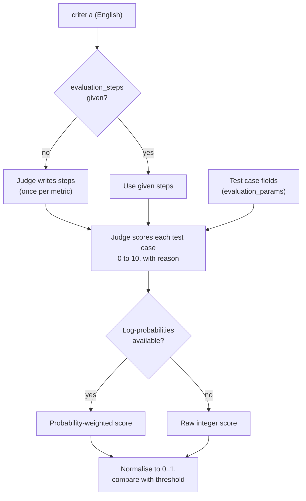

[RAGAS](/learn/rag-evaluation-frameworks/ragas) treats evaluation as measurement: run a dataset through some metrics and read a table of scores. **DeepEval**, an open-source Python framework maintained by Confident AI, treats it as **testing**: each question is a test case, each metric has a threshold, and the result is pass or fail, run by pytest and able to block a merge. The metrics overlap heavily with RAGAS; the workflow around them is different, and that workflow is what this lesson is about.

You will learn DeepEval's data model, how its RAG metrics and its general-purpose G-Eval metric turn judge outputs into scores, how thresholds and strict mode turn scores into verdicts, how to write a metric of your own that needs no model at all, and how to wire the whole thing into continuous integration without making your build flaky.

## Learning objectives

- Write a DeepEval test file that runs RAG test cases through metrics with thresholds, and run it with pytest.
- Explain how DeepEval computes faithfulness (including its three-valued verdicts) and how it differs from the RAGAS definition.
- Describe how G-Eval turns a natural-language criterion into evaluation steps and a normalised score, and when probability weighting applies.
- Implement a custom deterministic `BaseMetric` and use it alongside LLM metrics.
- Design a CI gate that uses DeepEval without failing builds on judge noise.

## Prerequisites

- [RAGAS](/learn/rag-evaluation-frameworks/ragas): the shared idea of decomposing an answer into claims and verifying them.
- [Faithfulness](/learn/generation-evaluation/faithfulness) and [Context relevance](/learn/generation-evaluation/context-relevance): the qualities the metrics measure.
- [LLM-as-a-judge](/learn/testing-and-benchmarking/llm-as-a-judge): why a model's verdict needs validating.
- Basic familiarity with pytest: test functions, `assert`, and `@pytest.mark.parametrize`.

## Why this matters

A score table answers "how good is this version?". Engineering teams more often need to answer "may I merge this change?". Those are different questions. The second needs a rule decided in advance (what counts as good enough), a run that happens automatically on every change, and a result that a reviewer can act on without interpreting a spreadsheet.

Without that, RAG quality regresses through small, individually reasonable changes. Someone shortens the system prompt to save tokens; someone else raises the chunk size; a third person switches the embedding model. Each change passes code review because nobody ran an evaluation, and six weeks later the support desk notices AskMeridian quoting the wrong expense limit. DeepEval's contribution is to make "run the evaluation" as ordinary as "run the unit tests", using the tool engineers already run before every merge. The general theory of regression suites (what goes in them, how big they should be) belongs to [Regression testing](/learn/testing-and-benchmarking/regression-testing); this lesson is about the tool.

## The intuition

Think of a driving test. The examiner does not give you a continuous score and leave the decision to someone else. There is a checklist (observation, signalling, speed), each item has a standard, and the outcome is pass or fail. Some faults are minor and you can accumulate a few; some are serious and fail you outright.

DeepEval maps onto this directly. A **test case** is one drive: the question, what the system retrieved and what it said. A **metric** is one checklist item, with a **threshold** that sets the standard. **Strict mode** is the "serious fault" rule: anything short of perfect fails. And just as a sensible driving school runs mock tests before the real one, you run DeepEval on every change so failures appear before users see them.

The analogy has a limit worth noticing. A driving examiner is consistent from one test to the next; an LLM judge is not quite, which is why CI design gets its own section below.

## How it works

### Test cases, goldens and datasets

The core object is `LLMTestCase`. Its fields for RAG:

| Field | Meaning |
| --- | --- |
| `input` | The user's question |
| `actual_output` | What your pipeline answered |
| `expected_output` | A reference answer (optional) |
| `retrieval_context` | The chunks your retriever returned, in order |
| `context` | The ideal chunks a person marked as correct (optional) |

The pairing of `retrieval_context` (what you got) and `context` (what you should have got) is worth remembering: DeepEval's retrieval metrics use the first; the second is for metrics that compare against ground truth.

A **golden** (`Golden`) is a test case before your pipeline has run: it holds the `input` and, optionally, `expected_output` and `context`, but no `actual_output`. An `EvaluationDataset` is a collection of goldens. The intended flow is: store goldens, and at test time run your pipeline on each golden's input to produce an `LLMTestCase`. This keeps the dataset independent of any one version of your system.

### Metrics, thresholds and reasons

Every DeepEval metric follows the same contract:

1. You construct it with a `threshold` (default 0.5 for most metrics), an optional judge `model`, and flags such as `include_reason` and `strict_mode`.
2. Calling `metric.measure(test_case)` computes `metric.score` in the range 0 to 1, sets `metric.reason` (a judge-written explanation when `include_reason=True`), and sets `metric.success` to whether the score met the threshold.
3. `assert_test(test_case, metrics)` measures every metric and raises an `AssertionError` listing the failures, which is what makes it work inside pytest.
4. `evaluate(test_cases, metrics)` runs many test cases concurrently and returns a result object instead of raising, for bulk runs outside pytest.

**Strict mode** sets the threshold to 1 and reports any score below it as 0. Use it for properties that must hold exactly, such as "every number in the answer is in the context".

### The RAG metrics

DeepEval provides five metrics aimed at RAG. Three look at retrieval, two at generation:

| Metric | Measures | Needs |
| --- | --- | --- |
| `ContextualPrecisionMetric` | Are the relevant chunks ranked above the irrelevant ones? | `input`, `retrieval_context`, `expected_output` |
| `ContextualRecallMetric` | Can every sentence of the expected output be attributed to the retrieved chunks? | `input`, `retrieval_context`, `expected_output` |
| `ContextualRelevancyMetric` | What share of the retrieved material is relevant to the input? | `input`, `retrieval_context` |
| `FaithfulnessMetric` | Do the answer's claims contradict the retrieved chunks? | `input`, `actual_output`, `retrieval_context` |
| `AnswerRelevancyMetric` | What share of the answer's statements are relevant to the input? | `input`, `actual_output` |

Contextual precision and recall follow the same definitions as their RAGAS counterparts, already derived in [Context precision](/learn/advanced-retrieval-optimisation/context-precision) and [Context recall](/learn/advanced-retrieval-optimisation/context-recall). Two of the others differ from RAGAS in ways that change their numbers, so they need a closer look.

**Faithfulness in DeepEval** works in three steps:

1. The judge extracts **truths** from the retrieval context (facts the context states).
2. The judge extracts **claims** from the actual output.
3. For each claim, the judge returns a verdict: `yes` (supported or at least consistent), `no` (contradicts the truths), or a middle verdict for claims that cannot be checked either way (`idk` in older releases, `borderline` in recent ones).

The score is the fraction of claims whose verdict is not `no`, unless you set `penalize_ambiguous_claims=True`, in which case only `yes` counts. So DeepEval's default faithfulness asks "does the answer contradict its context?", which is more lenient than RAGAS's "can each claim be inferred from the context?". An answer that adds a plausible detail the context never mentions can pass DeepEval's default and fail RAGAS's. Another difference: with no claims at all, DeepEval returns 1, where RAGAS returns NaN.

**Answer relevancy in DeepEval** does not generate questions. The judge breaks the answer into statements and decides, for each, whether it is relevant to the input; the score is the relevant fraction. Same name as the RAGAS metric, different mechanism, different scale.

> [!KEY]
> Metric names are not standards. "Faithfulness" and "answer relevancy" mean different procedures in RAGAS and DeepEval. Never compare a number from one library with a number from the other, and record which library and version produced every score you report.

### G-Eval: metrics written in English

Many qualities you care about have no ready-made metric: "the answer cites the policy section it relies on", "the answer does not give legal advice", "the tone suits an internal helpdesk". **G-Eval**, from a 2023 paper by Liu and colleagues, is a recipe for turning a description like that into a score, and DeepEval implements it as the `GEval` metric:

1. You give a `name`, a `criteria` sentence, and the list of test case fields the judge may see (`evaluation_params`).
2. If you did not supply explicit `evaluation_steps`, the judge first expands the criteria into a short numbered list of steps (a chain of thought written once, then reused).
3. For each test case, the judge reads the steps and the selected fields and returns an integer score on a fixed range (0 to 10 by default) plus a reason.
4. Where the judge API exposes token **log-probabilities** (the model's probability for each candidate next token), DeepEval replaces the integer with a probability-weighted average over the score tokens the model considered. The DeepEval source restricts this to OpenAI models that report log-probabilities; with other judges, including Claude, the raw integer is used.
5. The score is normalised to 0 to 1 by the range.



Two practical points. Supplying `evaluation_steps` yourself makes the metric more stable, because otherwise the steps are regenerated whenever the metric object is created and may differ between runs. And G-Eval is only as good as its criteria: "the answer is helpful" produces noisy scores; "the answer states a number of days and that number appears in the retrieved context" produces consistent ones.

### Choosing the judge

By default DeepEval uses an OpenAI model as judge. To use Claude, pass `model=AnthropicModel(model="claude-opus-5-5")` (from `deepeval.models`) to each metric, or configure it once through DeepEval's CLI and environment settings. For any other provider, subclass `DeepEvalBaseLLM` and implement `load_model`, `generate`, `a_generate` and `get_model_name`; DeepEval asks for JSON and parses it. Recent DeepEval releases leave the sampling temperature unset unless you pass one, which suits current Claude models, since they reject sampling parameters; if you pin an older release, check that it does not send one.

### Custom metrics

Not every check needs a judge. A subclass of `BaseMetric` implements `measure`, `a_measure`, `is_successful` and a `__name__` property, and sets `score`, `reason` and `success`. Deterministic metrics are free, instant and perfectly repeatable, which makes them the best gate for CI. The code section builds one.

## The mathematics

### Faithfulness with three-valued verdicts

**Intuition.** Count the claims that do not contradict the context; optionally count only those positively supported.

$$
F_{\text{default}} = \frac{|\{c : v_c \ne \text{no}\}|}{|C|}, \qquad
F_{\text{penalise}} = \frac{|\{c : v_c = \text{yes}\}|}{|C|}
$$

$C$ is the set of claims extracted from the answer, $v_c$ is the judge's verdict for claim $c$, and $F = 1$ by convention when $|C| = 0$.

**By hand.** Four claims with verdicts yes, yes, borderline, no. Default: 3 of 4 are not `no`, so $F = 0.75$. With `penalize_ambiguous_claims`: 2 of 4 are `yes`, so $F = 0.50$. The same answer passes a 0.7 threshold in one configuration and fails it in the other.

### G-Eval's normalised, probability-weighted score

**Intuition.** If the model wrote "7" but was 30% inclined towards "8", the honest score is a bit above 7.

$$
\hat{s} = \frac{\sum_{s} p(s)\, s}{\sum_{s} p(s)}, \qquad
\text{score} = \frac{\hat{s} - s_{\min}}{s_{\max} - s_{\min}}
$$

$s$ ranges over the integer score tokens the model considered, $p(s)$ is the probability of each (from the log-probabilities), and $s_{\min}, s_{\max}$ are the ends of the score range (0 and 10 by default). Without log-probabilities, $\hat{s}$ is just the integer the judge wrote.

**By hand.** The judge wrote 7, with probabilities 0.6 for "7", 0.3 for "8" and 0.1 for "6". Then $\hat{s} = (0.6 \times 7 + 0.3 \times 8 + 0.1 \times 6)/1.0 = 4.2 + 2.4 + 0.6 = 7.2$, normalised to $0.72$. Without weighting, the score is $7/10 = 0.70$. Weighting makes the score continuous, so small quality differences are not rounded away; it also explains why G-Eval scores from a Claude judge cluster on multiples of 0.1.

### In Python

```python
import math

# Faithfulness with three-valued verdicts.
verdicts = ["yes", "yes", "borderline", "no"]
lenient = sum(v in ("yes", "borderline") for v in verdicts) / len(verdicts)
strict_ambiguity = sum(v == "yes" for v in verdicts) / len(verdicts)
print(f"faithfulness (default)                   = {lenient:.2f}")
print(f"faithfulness (penalize_ambiguous_claims) = {strict_ambiguity:.2f}")

# G-Eval: the judge wrote "7"; the top candidate tokens had these log-probabilities.
top_logprobs = {"7": math.log(0.6), "8": math.log(0.3), "6": math.log(0.1)}
probs = {int(t): math.exp(lp) for t, lp in top_logprobs.items()}
weighted = sum(s * p for s, p in probs.items()) / sum(probs.values())
lo, hi = 0, 10
print(f"raw score 7      -> normalised {(7 - lo) / (hi - lo):.2f}")
print(f"weighted {weighted:.2f}    -> normalised {(weighted - lo) / (hi - lo):.2f}")

# strict_mode: threshold becomes 1 and anything below it is reported as 0.
score, threshold = 0.75, 1.0
print("strict_mode score =", 0 if score < threshold else score)
```

```output
faithfulness (default)                   = 0.75
faithfulness (penalize_ambiguous_claims) = 0.50
raw score 7      -> normalised 0.70
weighted 7.20    -> normalised 0.72
strict_mode score = 0
```

## In code

The problem: AskMeridian sometimes states numbers (days, pounds, years) that are not in the chunks it retrieved, and those are the most damaging hallucinations in a policy assistant. We want a CI test that fails whenever an answer contains a number its retrieved context does not, at no cost per run, and alongside it the LLM metrics for the qualities a regular expression cannot check.

Install DeepEval and pytest:

```bash
pip install deepeval pytest
```

The custom metric, in `grounded_numbers.py`:

```python
import re

from deepeval.metrics import BaseMetric
from deepeval.test_case import LLMTestCase

NUMBER = re.compile(r"£?\d+(?:[.:]\d+)?")


class GroundedNumbersMetric(BaseMetric):
    """Fraction of the numbers in the answer that also appear in the retrieved context.

    No LLM call: cheap, deterministic, and blind to everything except numbers.
    """

    def __init__(self, threshold: float = 1.0):
        self.threshold = threshold
        self.include_reason = True
        self.strict_mode = False
        self.async_mode = False
        self.evaluation_model = None

    def measure(self, test_case: LLMTestCase, *args, **kwargs) -> float:
        answer_numbers = set(NUMBER.findall(test_case.actual_output))
        context = " ".join(test_case.retrieval_context or [])
        context_numbers = set(NUMBER.findall(context))
        if not answer_numbers:
            self.score, self.reason = 1.0, "The answer states no numbers."
        else:
            missing = sorted(answer_numbers - context_numbers)
            self.score = 1 - len(missing) / len(answer_numbers)
            self.reason = (f"Not in context: {', '.join(missing)}" if missing
                           else "Every number appears in the context.")
        self.success = self.score >= self.threshold
        return self.score

    async def a_measure(self, test_case: LLMTestCase, *args, **kwargs) -> float:
        return self.measure(test_case)

    def is_successful(self) -> bool:
        return bool(self.success)

    @property
    def __name__(self):
        return "Grounded Numbers"
```

The tests, in `test_askmeridian.py`. To keep the example self-contained, the answers are written in; in a real suite each `actual_output` and `retrieval_context` comes from calling your pipeline on a golden's input.

```python
import pytest
from deepeval import assert_test
from deepeval.test_case import LLMTestCase

from grounded_numbers import GroundedNumbersMetric

CASES = [
    LLMTestCase(
        input="How many days of annual leave do I get?",
        actual_output="You get 25 days of annual leave a year.",
        retrieval_context=["Annual leave is 25 days; up to 5 unused days carry over "
                           "and must be used by 31 March."],
    ),
    LLMTestCase(
        input="What is the home-office equipment budget?",
        actual_output="The home-office equipment budget is £400.",
        retrieval_context=["Remote work: up to 3 days a week; the home-office "
                           "equipment budget is £400."],
    ),
    LLMTestCase(
        input="How often is my laptop replaced?",
        actual_output="Laptops are refreshed every 4 years.",
        retrieval_context=["The laptop refresh cycle is 3 years."],
    ),
]


@pytest.mark.parametrize("case", CASES, ids=["leave", "budget", "laptop"])
def test_numbers_are_grounded(case):
    assert_test(case, [GroundedNumbersMetric()])
```

Run it (the environment variable switches off DeepEval's anonymous telemetry):

```bash
DEEPEVAL_TELEMETRY_OPT_OUT=YES pytest -q -p no:warnings -p no:logging --tb=no -rf test_askmeridian.py
```

```output
..F                                                                      [100%]Running teardown with pytest sessionfinish...

=========================== short test summary info ============================
FAILED test_askmeridian.py::test_numbers_are_grounded[laptop] - AssertionErro...
1 failed, 2 passed in 0.01s
```

With `--tb=line` instead of `--tb=no`, pytest prints the assertion DeepEval raised, which carries the metric's reason:

```output
E   AssertionError: Metrics: Grounded Numbers (score: 0.0, threshold: 1.0, strict: False, error: None, reason: Not in context: 4) failed.
```

The important lines:

- **`NUMBER`** matches integers, decimals, times such as 08:00, and amounts with a pound sign. It is deliberately simple; "four years" written in words escapes it, and "£400" in the answer will not match "400 pounds" in the context. A deterministic metric is precise about what it checks and blind to everything else.
- **The constructor** sets the attributes DeepEval reads when it reports results. `async_mode = False` tells DeepEval there is nothing to await.
- **`measure`** sets `score`, `reason` and `success`; `assert_test` reads `success` and raises with the reason in the message, which is why the failure names the offending number.
- **`threshold=1.0`** makes any ungrounded number a failure. That is the right policy for a policy assistant.

The metric also works outside pytest, which helps when debugging a single case. Here a partly grounded answer scores 2 of 3:

```python
from deepeval.test_case import LLMTestCase
from grounded_numbers import GroundedNumbersMetric

case = LLMTestCase(
    input="When must carried-over leave be used, and how many days carry over?",
    actual_output="Up to 5 days carry over and must be used by 31 March, or 30 April for managers.",
    retrieval_context=["Annual leave is 25 days; up to 5 unused days carry over "
                       "and must be used by 31 March."],
)
metric = GroundedNumbersMetric()
print(round(metric.measure(case), 3), metric.success, "|", metric.reason)
```

```output
0.667 False | Not in context: 30
```

**Adding the LLM metrics.** This part needs an API key and was **not executed** for this lesson. It adds a judge-based faithfulness check and a G-Eval criterion to the same test:

```python
from deepeval import assert_test
from deepeval.metrics import FaithfulnessMetric, GEval
from deepeval.models import AnthropicModel
from deepeval.test_case import SingleTurnParams

judge = AnthropicModel(model="claude-opus-5-5")   # reads ANTHROPIC_API_KEY

faithfulness = FaithfulnessMetric(threshold=0.9, model=judge, penalize_ambiguous_claims=True)
cites_source = GEval(
    name="Cites handbook section",
    evaluation_steps=[
        "Identify the policy facts stated in the actual output.",
        "Check whether the actual output names the handbook section or document each fact comes from.",
        "Penalise any fact without a named source; do not judge whether the facts are correct.",
    ],
    evaluation_params=[SingleTurnParams.ACTUAL_OUTPUT, SingleTurnParams.RETRIEVAL_CONTEXT],
    model=judge,
    threshold=0.7,
)

def test_answer_quality(case):
    assert_test(case, [GroundedNumbersMetric(), faithfulness, cites_source])
```

`SingleTurnParams` is the current name for the enum of test case fields; older DeepEval releases call it `LLMTestCaseParams`, and recent releases still accept that name with a deprecation warning. Run LLM-judged tests with `deepeval test run test_askmeridian.py`, DeepEval's wrapper around pytest, which adds a results table and options such as running test cases in parallel.

**Errors people commonly hit.** A metric raising an error about missing parameters means a required field is `None` (for example `expected_output` for contextual recall). Judge JSON that fails to parse surfaces as an error on that metric; DeepEval retries, and persistent failures usually mean `max_tokens` is too low for long contexts. Without telemetry opted out, DeepEval may try to reach its servers; set `DEEPEVAL_TELEMETRY_OPT_OUT=YES` in CI.

**How to extend it.** Load goldens from a JSON file into an `EvaluationDataset` and parametrise over them; add a deterministic "cites a retrieved chunk ID" metric; and keep LLM metrics in a separate test module so you can run the cheap deterministic tests on every push and the judged ones on a schedule.

## A real-world example

Meridian's Platform team added DeepEval to AskMeridian's repository with 120 goldens and three metrics on every pull request: `FaithfulnessMetric`, `AnswerRelevancyMetric` and a G-Eval criterion for citing sources, each at threshold 0.7.

Within a fortnight engineers were rerunning failed builds until they passed. The cause was arithmetic, not malice: with 120 cases and three judged metrics, there were 360 judge decisions per build, and even if a borderline case is judged differently only occasionally, a build with dozens of borderline cases will see some flip between runs. A pull request that changed only a README failed on two test cases that had passed the day before.

The team restructured the suite into tiers. **Tier 1**, on every pull request, contained only deterministic metrics: the grounded-numbers check, a check that every cited chunk ID was among those retrieved, and a refusal check on 15 questions the corpus cannot answer. It was free, took seconds and never flaked. **Tier 2**, nightly, ran the LLM metrics on all goldens with explicit `evaluation_steps`, compared the pass rate per metric with the previous seven nights, and opened an issue only if the pass rate fell by more than a margin chosen from the observed night-to-night variation. **Tier 3**, before each release, added a human review of 40 sampled answers.

Rebuild requests stopped, and the first real regression Tier 1 caught was a prompt change that made the model convert "25 days" into "five weeks", a number not in the context.

## Common mistakes

- **Treating a judged metric as a deterministic unit test.** Judge verdicts vary between runs; a hard gate on many borderline cases produces flaky builds and teaches the team to ignore failures.
- **Assuming metric names mean the same thing everywhere.** DeepEval's default faithfulness penalises contradictions, not unsupported additions; reading it as the RAGAS definition overstates groundedness.
- **Leaving thresholds at the default 0.5.** The default is a placeholder. Choose thresholds from the score distribution of answers you have judged good and bad by hand.
- **Vague G-Eval criteria.** "Is the answer good?" gives scores that move with the judge's mood; write concrete, checkable steps.
- **Letting G-Eval regenerate steps each run.** Without `evaluation_steps`, the steps can change between runs; pin them once they work.
- **Storing `actual_output` in the dataset.** Goldens hold inputs and references; outputs must be regenerated by the version under test, or you are testing last month's system.

## Best practices

- Put deterministic metrics in the per-commit gate and judged metrics in scheduled runs with trend comparison.
- Use `strict_mode` (or threshold 1.0) for properties that must always hold, and graded thresholds for qualities.
- Set `penalize_ambiguous_claims=True` on faithfulness for policy or compliance content, where unverifiable additions are as bad as contradictions.
- Pin the DeepEval version and the judge model; record both with every run's results.
- Calibrate each judged metric against 30 to 50 hand-labelled cases before trusting its threshold.
- Read the `reason` for every failure before changing the pipeline; often the judge, not the system, is wrong.

## Performance considerations

Deterministic metrics cost microseconds per case; the run above finished in hundredths of a second. Judged metrics dominate everything else. A rough count per test case: faithfulness makes about three judge calls (truths, claims, verdicts), answer relevancy about two, contextual precision, recall and relevancy one to two each, and G-Eval one per case plus one to generate steps if you did not supply them. Five RAG metrics plus one G-Eval on 120 goldens is therefore on the order of 1,000 to 1,500 judge calls.

DeepEval runs metrics concurrently (`async_mode=True` by default, with a concurrency limit in `AsyncConfig`), so wall-clock time is roughly total calls divided by concurrency times average latency. At an assumed 2 seconds per call and 20 concurrent calls, 1,200 calls take about 2 minutes, if your rate limit allows 20 concurrent requests. Cost is calls times tokens times price; faithfulness sends the full retrieval context at least once per case, so long contexts make it the most expensive metric. DeepEval can cache results of unchanged test cases (`CacheConfig(use_cache=True)` in `evaluate`, or the `-c` flag of `deepeval test run`), which helps when you rerun a suite after changing one case.

## Security considerations

- **Telemetry and cloud upload.** DeepEval collects anonymous telemetry unless `DEEPEVAL_TELEMETRY_OPT_OUT=YES` is set, and logging in to Confident AI uploads test runs, including inputs, outputs and contexts. For an internal handbook that may be acceptable; for documents with personal data it needs a decision.
- **Judge traffic carries your data.** Every judged metric sends retrieved chunks to the judge's provider.
- **Secrets in CI.** Provide `ANTHROPIC_API_KEY` as a CI secret, scoped to the scheduled evaluation job, not to every pull-request build; deterministic tiers need no key at all, which also stops untrusted pull requests from spending it.
- **Injected instructions in documents** can steer the judge as they can steer the generator; deterministic checks are immune to this, which is one more reason to gate on them.

## Summary

- DeepEval frames evaluation as testing: `LLMTestCase` plus metrics with thresholds, run by pytest through `assert_test`, or in bulk through `evaluate`.
- Its RAG metrics resemble RAGAS's but differ in mechanism: default faithfulness counts claims that do not contradict the context, and answer relevancy classifies statements instead of generating questions.
- G-Eval turns an English criterion into evaluation steps and a 0 to 10 score, normalised to 0 to 1, weighted by token probabilities only where the judge API provides them.
- Custom `BaseMetric` subclasses give free, deterministic checks that make the best per-commit gates.
- Put judged metrics in scheduled runs with trend comparison; hard gates on noisy judges produce flaky builds.

## Exercises

1. A faithfulness evaluation returns verdicts `yes, no, yes, borderline, yes, borderline` for six claims. Compute the default score and the score with `penalize_ambiguous_claims=True`, and say which passes a threshold of 0.7.

<details><summary>Show solution</summary>

Default: 5 of 6 are not `no`, so 0.833, which passes. Penalised: 3 of 6 are `yes`, so 0.5, which fails. The setting decides whether two unverifiable claims count against the answer.

</details>

2. Write a G-Eval `evaluation_steps` list for the criterion "AskMeridian must decline questions the handbook does not answer, rather than guessing". Say which `evaluation_params` it needs.

<details><summary>Show solution</summary>

Steps: (1) Decide from the retrieval context whether it contains the information needed to answer the input. (2) If it does not, check whether the actual output declines to answer or states that the information is unavailable. (3) Penalise heavily any specific answer given when the context lacks the information. (4) If the context does contain the answer, do not penalise answering. It needs `INPUT`, `ACTUAL_OUTPUT` and `RETRIEVAL_CONTEXT`. Testing it requires goldens that are deliberately unanswerable.

</details>

3. Extend `GroundedNumbersMetric` so that it also treats spelled-out numbers from "one" to "ten" in the answer as numbers. Test it on "Laptops are replaced every three years." with the context "The laptop refresh cycle is 3 years."

<details><summary>Show solution</summary>

```python
WORDS = {"one": "1", "two": "2", "three": "3", "four": "4", "five": "5",
         "six": "6", "seven": "7", "eight": "8", "nine": "9", "ten": "10"}

def numbers_in(text):
    found = set(NUMBER.findall(text))
    for word in re.findall(r"[a-z]+", text.lower()):
        if word in WORDS:
            found.add(WORDS[word])
    return found
```

Use `numbers_in` for both the answer and the context inside `measure`. The answer's numbers become `{"3"}`, which is in the context, so the score is 1.0. "Every four years" would now be caught as ungrounded.

</details>

4. Design: AskMeridian's goldens grow to 600 cases. The team wants judged metrics to block releases but not to flake. Propose a gating rule using pass rates rather than individual test results, and explain how you would set its margin.

<details><summary>Show solution</summary>

Run the judged suite several times on the current release to measure the run-to-run spread of each metric's pass rate (for example, five runs). Gate a release candidate on its pass rate per metric being no lower than the current release's by more than a margin larger than that spread, for example two standard deviations of the observed run-to-run differences. Also require that no case that passed in all baseline runs fails in all candidate runs, which catches consistent regressions on specific questions. Report cases that flipped for human review rather than failing on them. The statistics of this comparison are covered in [Custom evaluation pipelines](/learn/rag-evaluation-frameworks/custom-evaluation-pipelines) and [A/B testing](/learn/testing-and-benchmarking/a-b-testing).

</details>

## Check your understanding

```quiz
[
  {"q": "In DeepEval, what does `assert_test(test_case, metrics)` do when one metric's score is below its threshold?", "options": ["Returns False", "Logs a warning and continues", "Raises an AssertionError naming the failed metric", "Lowers the threshold and retries"], "answer": 2, "why": "assert_test measures every metric and raises an AssertionError listing failures, which is what lets pytest report a failed test."},
  {"q": "With default settings, DeepEval's FaithfulnessMetric scores an answer containing one claim the context neither supports nor contradicts. How is that claim counted?", "options": ["As a failure", "As passing, because only contradictions count against the answer", "It makes the whole score NaN", "It is removed and the score recomputed"], "answer": 1, "why": "By default, verdicts other than 'no' pass; only penalize_ambiguous_claims=True makes unverifiable claims count against the answer."},
  {"q": "A G-Eval metric with a Claude judge returns scores like 0.6, 0.7 and 0.8 but never 0.73. Why?", "options": ["Claude rounds its answers", "G-Eval always rounds to one decimal place", "The threshold forces rounding", "Probability weighting needs token log-probabilities, which DeepEval only uses for OpenAI models that provide them, so the raw integer out of 10 is used"], "answer": 3, "why": "Without log-probabilities the raw integer score is normalised by the 0 to 10 range, giving multiples of 0.1."},
  {"q": "What does strict_mode=True do to a metric?", "options": ["Sets the threshold to 1 and reports any score below it as 0", "Makes the judge use a stricter prompt", "Disables reasons", "Runs the metric three times"], "answer": 0, "why": "Strict mode turns the metric binary: perfect or zero."},
  {"q": "Which tests are best suited to run on every pull request?", "options": ["All judged RAG metrics on the full dataset", "G-Eval criteria only", "Deterministic custom metrics, such as grounded-number checks", "Human review"], "answer": 2, "why": "Deterministic metrics are free, fast and repeatable, so they do not flake; judged metrics suit scheduled runs with trend comparison."}
]
```

## Further reading

- [DeepEval documentation](https://deepeval.com/): test cases, metrics, datasets, custom models and CI usage.
- Yang Liu, Dan Iter, Yichong Xu, Shuohang Wang, Ruochen Xu and Chenguang Zhu (2023), *G-Eval: NLG Evaluation using GPT-4 with Better Human Alignment*, [arXiv:2303.16634](https://arxiv.org/abs/2303.16634). The method behind the `GEval` metric, including probability-weighted scoring.
- The DeepEval source code on [GitHub](https://github.com/confident-ai/deepeval), in `deepeval/metrics/`: each metric's templates and scoring functions.
- [pytest documentation](https://docs.pytest.org/): parametrisation, markers and reporting options used to structure evaluation suites.
