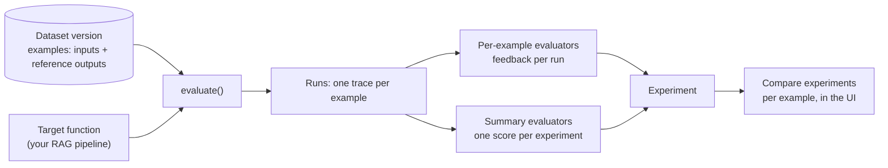

**LangSmith** is LangChain's hosted platform for tracing, evaluating and monitoring LLM applications. Where [Phoenix](/learn/rag-evaluation-frameworks/arize-phoenix) is a self-hostable observability server and [DeepEval](/learn/rag-evaluation-frameworks/deepeval) a testing library, LangSmith organises evaluation around three managed objects: **datasets** of examples, **experiments** that run one version of your application over a dataset, and **evaluators** that score each run. The platform stores every experiment, so comparing this week's pipeline with last month's is a matter of selecting two experiments in the UI rather than finding an old spreadsheet.

This lesson covers the model behind that workflow: how traces are built from decorated functions, what a dataset and an experiment are, how evaluators are written (they are plain Python functions with a particular signature), how summary and pairwise evaluators differ from per-example ones, and how online evaluation and annotation queues extend the same ideas to production traffic. You will run a real LangSmith experiment comparison locally, without an account, and then see what changes when results are uploaded.

## Learning objectives

- Instrument a RAG pipeline with `@traceable` so each request produces a run tree with retriever and generation steps.
- Write per-example evaluators with the `(inputs, outputs, reference_outputs)` signature and explain how LangSmith maps return values to feedback.
- Run two experiments over the same examples and compare them per example, not only on averages.
- Distinguish per-example, summary and pairwise evaluators, and choose the right one for a given question.
- Explain how online evaluators and annotation queues apply evaluation to production traces, and the data-governance questions a hosted platform raises.

## Prerequisites

- [Golden datasets](/learn/testing-and-benchmarking/golden-datasets): what belongs in a set of evaluation examples.
- [MRR](/learn/retrieval-evaluation/mrr): reciprocal rank, used as an evaluator below.
- [LangChain architecture](/learn/langchain-for-rag/langchain-architecture): callbacks and run trees, which LangSmith tracing builds on.
- [Arize Phoenix](/learn/rag-evaluation-frameworks/arize-phoenix): traces and spans as the raw material of evaluation.

## Why this matters

Evaluation results lose their value when they cannot be compared. A team that measured faithfulness at 0.84 in March and 0.88 in May knows almost nothing unless it can answer: was it the same set of questions? The same judge? Which version of the prompt produced each number, and on which questions did they differ? Notebooks and CSV files can store this, but in practice the bookkeeping erodes within weeks: files are overwritten, dataset copies drift, and nobody can reproduce the March number.

A managed experiment store fixes the bookkeeping by construction. Each experiment records which dataset version it ran on, which code produced its outputs (through metadata you attach), every output, every evaluator score, latency and token cost, and links each row to the full trace of that run. Comparison is then a query, not an archaeology project. The cost is that your questions, documents and answers live on someone else's servers (or in a self-hosted deployment you must operate), which is a real consideration for internal corpora like Meridian's handbook.

## The intuition

Think of a school's exam board. It keeps a bank of exam papers (datasets). Each year's cohort sits a paper (an experiment: one version of the system run over one dataset). Markers apply a mark scheme to each answer (evaluators), and the board also computes cohort statistics such as the pass rate (summary evaluators). Because papers and mark schemes are kept, the board can say "this year's cohort did better than last year's on question 7 but worse on question 12", which is far more useful than "the average went up two points".

Two more practices complete the analogy. Sometimes the board asks an examiner to read two scripts side by side and say which is better, which is easier than giving each an absolute mark (pairwise evaluation). And the board samples real coursework during the year, not only exam scripts, to see how students do outside the exam hall (online evaluation of production traffic).

## How it works

### Traces and run trees

LangSmith's unit of tracing is a **run**: one call of one function, with inputs, outputs, start and end times, errors, and a **run type** such as `chain`, `llm`, `retriever`, `tool`, `embedding`, `prompt` or `parser`. Runs nest into a **run tree**, the LangSmith equivalent of a trace with spans.

Runs are created in three ways:

1. **LangChain and LangGraph** code is traced automatically when the environment variable `LANGSMITH_TRACING=true` is set with an API key, through the callback mechanism described in [LangChain architecture](/learn/langchain-for-rag/langchain-architecture).
2. **Your own functions** are traced by decorating them with `@traceable`, optionally with a `run_type` and `name`. A decorated function called inside another decorated function becomes its child.
3. **SDK clients** can be wrapped: `langsmith.wrappers.wrap_anthropic(anthropic.Anthropic())` returns a client whose calls are recorded as `llm` runs with token usage.

LangSmith also accepts OpenTelemetry traces, so applications already instrumented with OpenTelemetry can send spans to it.

### Datasets and examples

A **dataset** is a named, versioned collection of **examples**. Each example has `inputs` (a dictionary, such as `{"question": ...}`) and optional reference `outputs` (such as `{"answer": ..., "doc_id": ...}`), plus metadata and optional **splits** (named subsets such as `error-codes` or `regression`). Every modification creates a new dataset version, and an experiment records which version it used, so a result can always be traced to the exact examples it was computed on.

Examples can be created through the SDK (`client.create_dataset`, `client.create_examples`), uploaded from CSV, or added from traces in the UI: when a production trace shows an interesting failure, you can add it to a dataset with its inputs, then write the correct reference output. This is the same "production failure to regression test" path that Phoenix offers, and it is one of the most valuable habits in RAG evaluation.

### Experiments

An **experiment** is one run of a **target** over a dataset, scored by evaluators. The target is any function that takes an example's `inputs` dictionary and returns an outputs dictionary; it is usually your pipeline, wrapped so that it returns whatever the evaluators need (the answer, and for retrieval evaluation the retrieved document IDs).

`evaluate(target, data=..., evaluators=[...], experiment_prefix=...)` does the following:

1. Resolves `data` to examples: a dataset name, or an iterable of `Example` objects.
2. Creates an experiment named from the prefix plus a unique suffix, with any `metadata` you pass (record the model, prompt version and retriever settings here).
3. Calls the target on each example's inputs, concurrently up to `max_concurrency`, tracing each call as a run tree linked to its example. With `num_repetitions` greater than 1, each example is run several times, which exposes run-to-run variation.
4. Calls each evaluator with that run's outputs and the example's reference outputs, recording each returned score as **feedback** on the run.
5. Calls each summary evaluator once with all outputs and references.
6. Returns a results object that can be iterated or converted to a DataFrame, and (unless uploading is turned off) stores everything in LangSmith.



### Evaluators

A LangSmith evaluator is an ordinary Python function. The SDK inspects its parameter names and passes what it asks for: `inputs`, `outputs` and `reference_outputs` (dictionaries), or the full `run` and `example` objects when you need trace details such as latency or a child run's output. It returns a dictionary with a `key` (the feedback name) and a `score` (a number or boolean), optionally with a `comment` for the explanation; recent SDK versions also accept a bare number or boolean, using the function name as the key.

That design has a useful consequence: deterministic checks, retrieval metrics and LLM judges are written the same way. A reciprocal-rank evaluator is four lines of Python; an LLM-as-a-judge evaluator is a function that calls a model and returns its verdict. LangChain also publishes a companion package, `openevals`, with ready-made judge evaluators, but nothing requires it.

Three kinds of evaluator answer three different questions:

| Kind | Called with | Answers | RAG example |
| --- | --- | --- | --- |
| Per-example | One run and its example | How good is this answer? | Contains the key fact; reciprocal rank of the gold document |
| Summary | All runs and examples in the experiment | What is true of the whole set? | Precision and recall of refusals across the set; F1 over a classification |
| Pairwise | The same example's runs from two experiments | Which of the two is better here? | A judge preferring the more complete of two answers |

Summary evaluators exist because some metrics are not averages of per-example scores: precision of refusals, for example, needs the counts across the whole set. Pairwise evaluators exist because judges are often more reliable at comparing two answers than at giving one an absolute score, a point developed in [LLM-as-a-judge](/learn/testing-and-benchmarking/llm-as-a-judge).

### Comparing experiments

The comparison view lines up two or more experiments on the same dataset version, example by example, with each evaluator's score, highlighting regressions and improvements, and links to both traces. The habit to build is reading that per-example view rather than only the averages: two pipelines with the same mean can fail on completely different questions, and a new version that is better on average may break the three questions your users ask most.

### From experiments to production

Two features apply the same evaluators to live traffic:

- **Online evaluators** are rules attached to a tracing project: for a sampled fraction of incoming traces, matching a filter, run an evaluator (typically an LLM judge, or code) and attach the feedback to the trace. They have no reference outputs, so they suit reference-free checks such as groundedness or answer relevance.
- **Annotation queues** route selected traces (for example, those with low online scores or negative user feedback) to people, who label them against a rubric. Their labels become feedback, and the traces can be added to a dataset with corrected reference outputs.

Together they form a loop: production traces are scored automatically, the worst are reviewed by people, and reviewed failures become dataset examples that every future experiment must pass.

## In code

The problem: Meridian's Platform team wants to know whether AskMeridian should use dense retrieval (MiniLM) or BM25, judged on the same examples by a fact-containment check and the reciprocal rank of the gold document, with a per-example comparison.

LangSmith's `evaluate` can run entirely locally: given a list of `Example` objects and `upload_results=False`, it runs the target and evaluators in your process and needs no LangSmith account (the SDK marks `upload_results` as a beta parameter). That makes the whole workflow runnable here, with the generation step replaced by a deterministic stand-in that answers from the top-ranked chunk.

```bash
pip install langsmith rank-bm25 sentence-transformers pandas
```

```python
import re
import uuid

import numpy as np
import pandas as pd
from langsmith import evaluate, traceable
from langsmith.schemas import Example
from rank_bm25 import BM25Okapi
from sentence_transformers import SentenceTransformer

DOCS = {
    "hb-leave": "Annual leave is 25 days; up to 5 unused days carry over and must be used by 31 March.",
    "hb-remote": "Remote work: up to 3 days a week; the home-office equipment budget is £400.",
    "hb-expenses": "Expenses must be submitted within 30 days; anything over £75 needs a receipt.",
    "it-password": "Password rotation is every 90 days; VPN is required on public Wi-Fi.",
    "it-e4012": "Atlas error E-4012 means the VPN certificate expired.",
    "it-e4021": "Atlas error E-4021 means the VPN client is out of date; update it from the IT portal.",
    "it-e4030": "Atlas error E-4030 means your user lacks permission for this operation.",
    "it-e4040": "Atlas error E-4040 means the requested Atlas resource does not exist or was deleted.",
    "it-support": "The support desk is open 08:00 to 18:00 UK time.",
    "it-laptop": "The laptop refresh cycle is 3 years; report a lost laptop to the support desk at once.",
}
IDS = list(DOCS)

# --- The dataset: in LangSmith these examples would live in a hosted dataset ----
def example(question, must_contain, doc_id):
    return Example(id=uuid.uuid5(uuid.NAMESPACE_URL, question), dataset_id=uuid.UUID(int=1),
                   inputs={"question": question},
                   outputs={"must_contain": must_contain, "doc_id": doc_id})

EXAMPLES = [
    example("What does error E-4021 mean?", "out of date", "it-e4021"),
    example("What is E-4040?", "does not exist", "it-e4040"),
    example("How much time off do I get?", "25 days", "hb-leave"),
    example("Is a receipt needed for a taxi costing 90 pounds?", "£75", "hb-expenses"),
    example("How much can I spend on a desk for working from home?", "£400", "hb-remote"),
    example("I left my laptop on the train", "support desk", "it-laptop"),
    example("How long do I have to claim back a train ticket?", "30 days", "hb-expenses"),
]

# --- Two retrievers to compare ----------------------------------------------------
embedder = SentenceTransformer("sentence-transformers/all-MiniLM-L6-v2")
DOC_VECS = embedder.encode(list(DOCS.values()), normalize_embeddings=True)
tokenise = lambda text: re.findall(r"[a-z0-9£:-]+", text.lower())
BM25 = BM25Okapi([tokenise(t) for t in DOCS.values()])

def dense(question, k):
    scores = DOC_VECS @ embedder.encode([question], normalize_embeddings=True)[0]
    return [IDS[i] for i in np.argsort(-scores)[:k]]

def bm25(question, k):
    return [IDS[i] for i in np.argsort(-BM25.get_scores(tokenise(question)))[:k]]

def make_target(search, k=3):
    @traceable(run_type="retriever", name="retrieve")
    def retrieve(question):
        return search(question, k)

    @traceable(name="askmeridian")
    def target(inputs: dict) -> dict:
        doc_ids = retrieve(inputs["question"])
        answer = DOCS[doc_ids[0]]          # stand-in generator: answers from the top chunk
        return {"answer": answer, "doc_ids": doc_ids}
    return target

# --- Evaluators: plain functions of (outputs, reference_outputs) -------------------
def contains_fact(outputs: dict, reference_outputs: dict) -> dict:
    return {"key": "contains_fact",
            "score": int(reference_outputs["must_contain"] in outputs["answer"])}

def reciprocal_rank(outputs: dict, reference_outputs: dict) -> dict:
    ids = outputs["doc_ids"]
    gold = reference_outputs["doc_id"]
    return {"key": "reciprocal_rank", "score": 1 / (ids.index(gold) + 1) if gold in ids else 0.0}

# --- Run both experiments locally and compare example by example -------------------
frames = {}
for name, search in [("dense", dense), ("bm25", bm25)]:
    results = evaluate(make_target(search), data=EXAMPLES,
                       evaluators=[contains_fact, reciprocal_rank],
                       experiment_prefix=name, upload_results=False)
    frames[name] = results.to_pandas().set_index("inputs.question")

cols = ["feedback.contains_fact", "feedback.reciprocal_rank"]
print(pd.DataFrame({name: df[cols].mean() for name, df in frames.items()}).round(3))
side_by_side = pd.concat({n: df[cols] for n, df in frames.items()}, axis=1)
side_by_side.columns = [f"{n}:{c.split('.')[1]}" for n, c in side_by_side.columns]
print(side_by_side.round(2).to_string())
```

Run with tracing off, since there is no account to send traces to:

```bash
LANGSMITH_TRACING=false python compare_retrievers.py
```

The progress lines LangSmith prints for each experiment are omitted; the tables are:

```output
                          dense   bm25
feedback.contains_fact    0.857  0.429
feedback.reciprocal_rank  0.929  0.619
                                                       dense:contains_fact  dense:reciprocal_rank  bm25:contains_fact  bm25:reciprocal_rank
inputs.question                                                                                                                            
What does error E-4021 mean?                                             1                    1.0                   0                  0.50
What is E-4040?                                                          1                    1.0                   1                  1.00
How much time off do I get?                                              0                    0.5                   0                  0.50
Is a receipt needed for a taxi costing 90 pounds?                        1                    1.0                   1                  1.00
How much can I spend on a desk for working from home?                    1                    1.0                   0                  0.00
I left my laptop on the train                                            1                    1.0                   1                  1.00
How long do I have to claim back a train ticket?                         1                    1.0                   0                  0.33
```

How the important parts work:

- **`example`** builds `Example` objects directly. In a hosted workflow the same inputs and reference outputs would be stored in a LangSmith dataset and `data="askmeridian-golden"` would replace `data=EXAMPLES`. Each reference holds a fact the answer must contain and the ID of the document that holds it.
- **`make_target`** returns a traced target for a given retriever. The inner `retrieve` is decorated with `run_type="retriever"`, so in the LangSmith UI it appears as a child run of `askmeridian` with its returned IDs. The target returns both the answer and the retrieved IDs, because the retrieval evaluator needs the latter.
- **`contains_fact` and `reciprocal_rank`** are evaluators: plain functions that ask for `outputs` and `reference_outputs` by parameter name and return a key and a score. Reciprocal rank is $1/r$ for the gold document at rank $r$ (counting from 1), or 0 if it was not retrieved; its mean over the examples is the MRR.
- **`evaluate(..., upload_results=False)`** runs each experiment; `to_pandas()` returns one row per example with `inputs.*`, `outputs.*`, `reference.*` and `feedback.*` columns.
- **The two tables** are the averages and the per-example comparison.

**What the output means.** On average dense retrieval wins clearly: the answer contains the fact for 6 of 7 questions against 3 of 7, and MRR is 0.93 against 0.62. The per-example table says why. BM25 fails where the question shares no words with the answer ("spend on a desk for working from home" against "home-office equipment budget", and "claim back a train ticket" against "expenses must be submitted") and, less obviously, ranks the E-4040 chunk above E-4021 for the E-4021 question, because in such a tiny corpus the shared words "error", "Atlas" and "means" outweigh the code. Both retrievers fail "How much time off do I get?": the support desk chunk, about hours, outranks the leave policy for both, so this question is a retrieval problem that switching retriever does not solve. That row would be invisible in the averages, and it is the first thing to investigate. Seven examples are far too few to choose a retriever on; with a real dataset you would also want the statistical comparison in [Custom evaluation pipelines](/learn/rag-evaluation-frameworks/custom-evaluation-pipelines).

**Errors people commonly hit.** An evaluator parameter misspelt (`reference_output` instead of `reference_outputs`) produces an error about unexpected arguments, because the SDK maps arguments by name. A target that returns a string instead of a dictionary breaks the `outputs.*` columns. And with `LANGSMITH_TRACING=true` but no API key, tracing calls fail; turn tracing off for local runs.

### An LLM judge and an uploaded experiment (not executed)

This version needs a LangSmith API key and an Anthropic key and was **not executed**. It creates a hosted dataset once, then runs an experiment whose results are uploaded for comparison in the UI, with a Claude judge evaluating correctness against the reference.

```python
import anthropic
from langsmith import Client, evaluate
from pydantic import BaseModel

ls = Client()                       # reads LANGSMITH_API_KEY
claude = anthropic.Anthropic()      # reads ANTHROPIC_API_KEY

if not ls.has_dataset(dataset_name="askmeridian-golden"):
    dataset = ls.create_dataset("askmeridian-golden", description="AskMeridian reference questions")
    ls.create_examples(dataset_id=dataset.id, examples=[
        {"inputs": {"question": "How much time off do I get?"},
         "outputs": {"answer": "25 days of annual leave a year.", "doc_id": "hb-leave"}},
        # ... more examples ...
    ])

class Verdict(BaseModel):
    reasoning: str
    correct: bool

def judged_correct(inputs: dict, outputs: dict, reference_outputs: dict) -> dict:
    prompt = (f"Question: {inputs['question']}\n"
              f"Reference answer: {reference_outputs['answer']}\n"
              f"Candidate answer: {outputs['answer']}\n\n"
              "Is the candidate answer consistent with the reference on every fact the reference states? "
              "Extra correct detail is acceptable; a contradiction or a missing key fact is not.")
    response = claude.messages.parse(
        model="claude-opus-5-5",
        max_tokens=1024,
        messages=[{"role": "user", "content": prompt}],
        output_format=Verdict,
    )
    verdict = response.parsed_output
    return {"key": "judged_correct", "score": verdict.correct, "comment": verdict.reasoning}

results = evaluate(
    make_target(dense),                       # from the local example, or your real pipeline
    data="askmeridian-golden",
    evaluators=[judged_correct, reciprocal_rank],
    experiment_prefix="dense-k3",
    metadata={"retriever": "all-MiniLM-L6-v2", "k": 3, "generator": "claude-opus-5-5"},
    max_concurrency=4,
)
print(results.experiment_name)
```

The judge returns its reasoning as the feedback `comment`, so a reviewer looking at a failed row in the UI sees why it failed. The `metadata` dictionary is what lets you filter and group experiments later; record everything that defines the version under test. Before trusting `judged_correct`, compare its verdicts with your own on 30 or so examples.

**How to extend it.** Add `num_repetitions=3` to see judge and generator variation per example; add a summary evaluator for refusal precision and recall over a split of unanswerable questions; and move the cheap deterministic evaluators into a pytest suite using LangSmith's pytest integration (`@pytest.mark.langsmith`), so they run in CI while the judged experiment runs nightly.

## A real-world example

Meridian's Platform team used LangSmith for six months on AskMeridian, with a 300-example dataset split into `policy`, `it-runbooks`, `error-codes` and `unanswerable`. Every pull request that changed retrieval or prompts ran an experiment, named by branch, with the commit hash in metadata.

A prompt change intended to make answers shorter came back with judged correctness unchanged on average and an approving reviewer comment. The per-example comparison told a different story by split: correctness rose slightly on `policy` (shorter answers had fewer embellishments) and fell on `it-runbooks`, where the shorter answers dropped steps from multi-step procedures such as renewing a VPN certificate after E-4012. The average hid two opposite effects. The team kept the shorter style for policy questions only, through a router, and added a summary evaluator computing correctness per split so that the dashboard would show such divergence directly.

Separately, an online evaluator judging groundedness on 5% of production traffic flagged a rising share of ungrounded answers in one week. The annotation queue showed the cause: questions about a newly launched "Meridian Reports" CSV export feature that the product documentation index did not yet cover, so the model answered from general knowledge. The reviewed traces went into the dataset with correct references once the documentation was indexed. The key organisational point was that the engineers, the HR reviewers and the product documentation owners were all looking at the same traces.

## Common mistakes

- **Comparing experiments run on different dataset versions.** Adding examples changes the averages; compare only experiments on the same version, or restrict to the examples they share.
- **Returning only the answer from the target.** Retrieval evaluators then have nothing to score; return the retrieved IDs too.
- **Leaving experiment metadata empty.** Six weeks later nobody knows which prompt `main-7f3a` used.
- **Reading only the averages.** Opposite effects on different splits cancel out; read the per-example comparison and per-split summaries.
- **Treating online evaluator scores as accuracy.** Without references, online evaluators measure reference-free qualities; they cannot tell you the answer is correct.
- **Sending sensitive data to a hosted tracer by default.** Turning on tracing in production sends every question and retrieved document to the service.

## Best practices

- Give every example a stable ID and every dataset split a purpose; keep an `unanswerable` split so refusal behaviour is always measured.
- Record model, prompt version, retriever settings and commit hash in experiment metadata.
- Keep deterministic evaluators (fact containment, gold-document rank, citation validity) alongside judges; they are free and stable.
- Use repetitions for judged experiments that will drive decisions, and look at examples whose scores vary between repetitions.
- Route low-scoring production traces to an annotation queue, and promote reviewed failures into the dataset.
- Write the dataset's reference outputs with the people who own the content (HR for the handbook, IT for runbooks).

## Performance considerations

Tracing is asynchronous: the SDK batches runs and sends them in a background thread, so the main cost on the request path is building the run objects. The volume is the bigger question. If an AskMeridian trace with retrieved chunks and the prompt is about 15 kilobytes and the system serves 20,000 requests a day, full tracing sends about 300 megabytes a day; hosted plans meter traces and retention, so check current limits and prices on LangSmith's pricing page and sample production tracing if necessary.

Experiments cost target calls plus evaluator calls. For 300 examples with one judged evaluator and three repetitions, that is $300 \times 3 = 900$ pipeline runs (each including your own generation call) and 900 judge calls. Concurrency (`max_concurrency`) shortens wall-clock time up to your provider's rate limits without changing cost. Deterministic evaluators add negligible time. A sensible split is: deterministic evaluators on every pull request, judged experiments nightly or on demand, and online evaluators on a small sample of production traffic.

## Security considerations

- **Data residency and retention.** Traces and datasets contain questions, retrieved documents and answers. Check where the hosted service stores data and for how long; LangSmith offers self-hosted deployment for organisations that need data to stay in their own infrastructure, on its enterprise plan.
- **Masking.** Configure the SDK to hide inputs or outputs for sensitive runs (the client supports options for hiding or transforming inputs and outputs before they are sent) rather than relying on people not to look.
- **API keys.** Keep `LANGSMITH_API_KEY` and `ANTHROPIC_API_KEY` in a secrets manager; scope LangSmith keys to the workspace and role that needs them.
- **Access control by content.** If AskMeridian enforces per-user document permissions, a shared tracing project lets anyone with project access read documents they could not query. Restrict project membership accordingly.
- **Judge prompts read untrusted text.** An LLM evaluator receives retrieved documents and model outputs, which can carry injected instructions.

## Summary

- LangSmith organises evaluation into datasets (versioned examples), experiments (one version run over one dataset) and evaluators (functions that score runs).
- Tracing builds run trees from `@traceable` functions, wrapped SDK clients and LangChain callbacks; experiments link every score to the trace that produced it.
- Evaluators are plain Python functions that request `inputs`, `outputs` and `reference_outputs` by name and return a key and a score; summary evaluators see the whole experiment, pairwise evaluators compare two.
- The per-example comparison of experiments on the same dataset version is where decisions should come from, not the averages.
- Online evaluators and annotation queues extend evaluation to production and feed reviewed failures back into datasets; a hosted platform makes this easy and raises data-governance questions.

## Exercises

1. Write a LangSmith evaluator `cites_retrieved(outputs, reference_outputs)` for a pipeline whose outputs include `answer` (with citations like `[hb-leave]`) and `doc_ids`. It should score 1 if every cited ID is among the retrieved IDs and at least one citation is present, otherwise 0.

<details><summary>Show solution</summary>

```python
import re

def cites_retrieved(outputs: dict, reference_outputs: dict) -> dict:
    cited = set(re.findall(r"\[([a-z0-9-]+)\]", outputs["answer"]))
    ok = bool(cited) and cited <= set(outputs["doc_ids"])
    return {"key": "cites_retrieved", "score": int(ok),
            "comment": f"cited={sorted(cited)} retrieved={outputs['doc_ids']}"}
```

It does not use `reference_outputs`, which is fine; LangSmith only passes what the function asks for, so you could also drop that parameter.

</details>

2. Experiment A has mean judged correctness 0.82 and experiment B 0.83 on the same 300 examples. B is better on 41 examples and worse on 38. What would you conclude, and what would you look at next?

<details><summary>Show solution</summary>

The averages are essentially equal and the per-example changes nearly cancel: 79 examples changed, in both directions. That is consistent with noise (judge and generator variation) or with two real effects on different subsets. Next: rerun both with repetitions to see how many of the 79 flips are stable; group the changes by split to look for a pattern (as in the real-world example); and read a sample of the stable regressions. Do not ship B on the strength of 0.01.

</details>

3. Why can't an online evaluator compute correctness for production traffic, and what can it compute instead? Name two reference-free evaluators suitable for AskMeridian.

<details><summary>Show solution</summary>

Production traces have no reference outputs: nobody has written the correct answer to each live question. Online evaluators can compute reference-free qualities, for example groundedness (are the answer's claims supported by the retrieved chunks?) and answer relevance (does the answer address the question?), plus deterministic checks such as "every cited ID was retrieved" or "the answer contains no number absent from the context". Correctness is measured offline on the dataset, and production failures reach the dataset through annotation.

</details>

4. Design: Meridian's security team requires that handbook content never leaves the company's cloud account, but the Platform team wants LangSmith-style experiment comparison. Outline two options and their trade-offs.

<details><summary>Show solution</summary>

Option 1: self-host LangSmith (an enterprise offering) inside the company's cloud account. Same workflow and UI; cost of a licence and of operating the deployment. Option 2: use a self-hostable tool such as Phoenix for traces and experiments, or build a small in-house harness ([Custom evaluation pipelines](/learn/rag-evaluation-frameworks/custom-evaluation-pipelines)) storing experiments in the company's database. Lower licence cost and full control; more engineering effort and fewer features such as annotation queues. A third, partial option is to keep hosted LangSmith but upload only IDs, scores and metadata, with content masked, which keeps comparison but loses the ability to read traces in the UI. The choice depends on budget, the team's capacity to operate infrastructure, and how much of the value comes from reading traces.

</details>

## Check your understanding

```quiz
[
  {"q": "How does LangSmith decide what to pass to an evaluator function?", "options": ["It inspects the function's parameter names, such as inputs, outputs and reference_outputs", "It always passes run and example objects", "It passes a single dictionary", "Evaluators must subclass a base class"], "answer": 0, "why": "The SDK maps arguments by parameter name, so an evaluator asks for exactly what it needs."},
  {"q": "Which kind of evaluator should compute precision of refusals across a dataset?", "options": ["Per-example", "Summary", "Pairwise", "Online"], "answer": 1, "why": "Precision needs counts across all examples, so it is computed once per experiment by a summary evaluator."},
  {"q": "Two experiments have the same mean score. What is the most useful next step?", "options": ["Declare them equivalent", "Increase max_concurrency", "Delete the older one", "Compare them example by example and by split"], "answer": 3, "why": "Equal means can hide opposite effects on different examples or splits."},
  {"q": "In the local example, both retrievers fail 'How much time off do I get?'. What does that suggest?", "options": ["BM25 is broken", "The evaluator is wrong", "A retrieval problem that switching between these retrievers does not solve, worth investigating separately", "The dataset version changed"], "answer": 2, "why": "A failure shared by both versions is not explained by the difference between them; it points at query wording, chunking or the corpus."},
  {"q": "Why does the target function in the example return doc_ids as well as the answer?", "options": ["LangSmith requires two outputs", "So retrieval evaluators such as reciprocal rank can score the run", "To make tracing faster", "So the judge sees the documents"], "answer": 1, "why": "Evaluators see only what the target returns (or the trace); retrieval metrics need the retrieved IDs."}
]
```

## Further reading

- [LangSmith documentation](https://docs.smith.langchain.com/): tracing, datasets, evaluation, online evaluators and annotation queues.
- The LangSmith Python SDK on [GitHub](https://github.com/langchain-ai/langsmith-sdk): the `evaluate` implementation and evaluator argument handling.
- Lianmin Zheng and colleagues (2023), *Judging LLM-as-a-Judge with MT-Bench and Chatbot Arena*, [arXiv:2306.05685](https://arxiv.org/abs/2306.05685). Pairwise versus single-answer grading and the biases of judges.
- Christopher D. Manning, Prabhakar Raghavan and Hinrich Schütze (2008), *Introduction to Information Retrieval*, Cambridge University Press, chapter 8 ("Evaluation in information retrieval"). The ranking metrics used as evaluators here.
