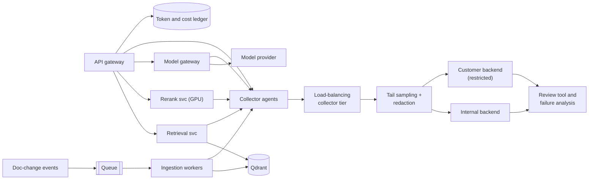

This assessment covers the whole RAG Observability module: structured logging, in-process and distributed tracing, retrieval and generation monitoring, token and cost tracking, and failure analysis. It has a scored quiz, open conceptual questions, two coding exercises, a design challenge and three troubleshooting scenarios. The pass mark for the quiz is 70% (13 of 18). For the other sections, compare your answers with the hidden model answers; a good answer reaches the same conclusion with sound reasoning, even if it is worded differently.

```quiz
[
  {
    "q": "Why are per-stage INFO events needed for successful RAG requests, and not only error logs?",
    "options": [
      "Successful requests are slower and need timing data",
      "Typical RAG failures (wrong chunk retrieved, context ignored) happen inside requests that succeed at the HTTP level",
      "Log platforms index INFO events faster",
      "Error logs cannot contain request ids"
    ],
    "answer": 1,
    "why": "Quiet failures raise no exception; only detailed events on every request make them diagnosable."
  },
  {
    "q": "What is the best thing to log about each retrieved chunk in the general application log?",
    "options": [
      "Its full text",
      "Its title",
      "Its stable id, document version and score",
      "Nothing, because retrieval can be re-run later"
    ],
    "answer": 2,
    "why": "Ids and versions let you fetch the exact text later under the document store's access control; re-running is unreliable because the index changes."
  },
  {
    "q": "A `retrieve` span lasts 120 ms. Its children are `embed` [0, 25], `dense` [25, 105] and `sparse` [25, 70]. What is its self time?",
    "options": ["0 ms", "15 ms", "-30 ms", "40 ms"],
    "answer": 1,
    "why": "The union of child intervals is [0, 105], 105 ms long; 120 - 105 = 15 ms. Summing the children double-counts the overlap."
  },
  {
    "q": "Spans created inside `ThreadPoolExecutor` workers appear as separate one-span traces. What is the fix?",
    "options": [
      "Use SimpleSpanProcessor",
      "Create a new TracerProvider per thread",
      "Run the work with `contextvars.copy_context().run(...)` so the worker sees the caller's current span",
      "Increase the batch size"
    ],
    "answer": 2,
    "why": "OpenTelemetry keeps the current span in a ContextVar, which worker threads do not inherit automatically."
  },
  {
    "q": "What does this print?\n```python\nflags = \"00-4bf92f3577b34da6a3ce929d0e0e4736-00f067aa0ba902b7-03\".split(\"-\")[3]\nprint(int(flags, 16) & 0x01, flags == \"01\")\n```",
    "options": ["1 False", "1 True", "0 False", "3 False"],
    "answer": 0,
    "why": "0x03 has bit 0 set (sampled) plus the random-trace-id bit, so the bit test gives 1 while the string comparison with \"01\" is False."
  },
  {
    "q": "Why do downstream services normally use `ParentBased` samplers?",
    "options": [
      "They sample more traces",
      "They follow the root's sampling decision carried in the trace flags, so services keep or drop the same traces",
      "They are required for span links",
      "They reduce header size"
    ],
    "answer": 1,
    "why": "Consistency across services avoids storing trace fragments."
  },
  {
    "q": "A failure occurs 10 times a day and traces are head-sampled at 5%. What is the probability of keeping at least one of its traces on a given day?",
    "options": ["About 0.05", "About 0.50", "About 0.40", "About 0.95"],
    "answer": 2,
    "why": "1 - 0.95^10 = 0.401. Tail sampling that keeps all errors avoids relying on this luck."
  },
  {
    "q": "An ingestion worker embeds batches of 64 chunks from many document-change events. How should its span relate to the producers' spans?",
    "options": [
      "A new root span with a link to each producer span context",
      "A child of the first producer span",
      "A child of the last producer span",
      "No relationship can be recorded"
    ],
    "answer": 0,
    "why": "A span has one parent but many links; links connect batch work to all of its inputs."
  },
  {
    "q": "With thousands of requests a day, why is a KS-test p-value a poor trigger for retrieval-score alerts?",
    "options": [
      "It only detects mean shifts",
      "It needs labelled data",
      "It cannot handle bounded scores",
      "Large samples make even harmless shifts statistically significant"
    ],
    "answer": 3,
    "why": "The p-value measures whether any difference exists, not whether it matters; use an effect size such as PSI or a tail rate."
  },
  {
    "q": "Baseline bin shares are (0.5, 0.5) and today's are (0.4, 0.6). What is the PSI, to two decimal places?",
    "options": ["0.00", "0.04", "0.20", "0.10"],
    "answer": 1,
    "why": "(0.4-0.5) ln(0.8) + (0.6-0.5) ln(1.2) = 0.0223 + 0.0182 = 0.0405."
  },
  {
    "q": "Which metric label is safe on a retrieval-score histogram?",
    "options": ["query_fingerprint", "user_id", "collection", "chunk_id"],
    "answer": 2,
    "why": "Collection has a small, bounded set of values; the others explode the number of time series."
  },
  {
    "q": "Which per-request generation check is the strongest cheap signal of an unfaithful answer?",
    "options": [
      "Answer length",
      "A citation to a chunk id that was not in the context",
      "Time to first token",
      "The presence of numbers in the answer"
    ],
    "answer": 1,
    "why": "The model can only ground on what it was given; citing an id outside the context means it invented or recalled the source."
  },
  {
    "q": "A prompt change moves the refusal rate from 7.9% (95% CI 6.7% to 9.4%) to 9.2% (7.8% to 10.8%). What should you conclude?",
    "options": [
      "The new prompt refuses significantly more",
      "The new prompt refuses significantly less",
      "The refusal detector is broken",
      "The intervals overlap substantially; this data does not establish a difference"
    ],
    "answer": 3,
    "why": "Overlapping intervals mean the difference may be noise; gather more data and inspect which questions changed."
  },
  {
    "q": "A response reports `input_tokens=700`, `cache_creation_input_tokens=0`, `cache_read_input_tokens=2300`, `output_tokens=180`. What was the prompt size?",
    "options": ["700", "3,180", "2,300", "3,000"],
    "answer": 3,
    "why": "Prompt size is input + cache write + cache read = 700 + 0 + 2,300."
  },
  {
    "q": "Each turn's prompt is 1,500 tokens without history and each exchange adds 200 tokens of history. What is the total input over 6 turns?",
    "options": ["12,000", "9,000", "10,200", "13,200"],
    "answer": 0,
    "why": "TB + h T(T-1)/2 = 6 x 1,500 + 200 x 6 x 5 / 2 = 9,000 + 3,000 = 12,000."
  },
  {
    "q": "Configuration A costs 1.0 cent per request with a 95% answer rate; B costs 0.85 cents with an 80% answer rate. Which has the lower cost per successful answer?",
    "options": [
      "B, about 1.06 cents",
      "A, about 1.05 cents, against about 1.06 cents for B",
      "They are equal",
      "It depends only on fixed costs"
    ],
    "answer": 1,
    "why": "1.0 / 0.95 = 1.053 and 0.85 / 0.80 = 1.0625; B is cheaper per request but dearer per useful answer."
  },
  {
    "q": "Tracked model cost is 20% below the invoice. What should you investigate first?",
    "options": [
      "Usage outside the instrumented path, such as scripts, notebooks or another environment using the same key",
      "Floating-point rounding",
      "Clock skew between hosts",
      "The provider's tokeniser"
    ],
    "answer": 0,
    "why": "Small differences come from rounding or day boundaries; a gap this large usually means untracked consumers."
  },
  {
    "q": "A failed request's trace shows the gold chunk was indexed and in the top-20 candidates but not in the prompt. Under the first-failing-stage procedure, which stage is blamed?",
    "options": [
      "Ingestion",
      "Retrieval",
      "Context assembly (reranking, thresholds, deduplication or budget)",
      "Generation"
    ],
    "answer": 2,
    "why": "The evidence was lost between candidates and prompt; the wrong answer is a downstream symptom."
  }
]
```

## Conceptual questions

**1.** Explain the difference between logs, metrics and traces in a RAG system, and give one question about AskMeridian that each answers best.

<details><summary>Show model answer</summary>

**Logs** are discrete, structured events with details, emitted for each thing that happens. They answer questions about specific requests: "which chunks and document versions did request 1c80a3b1799d retrieve?". **Metrics** are numeric time series aggregated in the process, with low-cardinality labels. They answer questions about the population over time, cheaply and in real time: "what share of requests in the IT runbooks collection had a top-1 score below the baseline 5th percentile in the last hour?". **Traces** are trees of timed spans for one request, across services. They answer questions about structure and time: "why did this request take 3.4 seconds, and which step was on the critical path?".

They complement each other. Metrics tell you something changed; traces and logs tell you why for specific requests. Linking them (trace id in log lines, pipeline version as a metric label) is what lets you move from a dashboard spike to an example to a cause.

</details>

**2.** Why must thresholds for "low-confidence retrieval" be defined relative to a baseline rather than as a fixed raw score, and what must happen to the baseline when the embedding model changes?

<details><summary>Show model answer</summary>

Similarity scores live on a scale specific to the embedding model, the index configuration and the corpus. A cosine of 0.45 can be a strong match for one model and a weak one for another. Defining "low" as, say, the baseline's 5th percentile makes the threshold mean the same thing ("the weakest 5% of normal traffic") under any model, and gives an expected rate (5%) to compare with.

When the embedding model changes, the whole score distribution moves, so every drift measure against the old baseline fires at once and real problems hide in the noise. The team should treat the change as a deliberate event: verify quality with offline evaluation and canaries, then build a new baseline from traffic under the new pipeline version, and label metrics by pipeline version so old and new are never mixed.

</details>

**3.** Compare head-based and tail-based sampling for a RAG system that handles 200 requests a second, where the failures you care about are rare. Which would you choose, and what does your choice require?

<details><summary>Show model answer</summary>

Head sampling decides at the root, before anything has happened, with probability $p$. It is cheap and simple and reduces data at the source, but it discards the same fraction of rare failures as of everything else: at 5%, a failure that happens ten times a day is captured on fewer than half of days. Tail sampling decides after the trace is complete and can keep every trace with an error, a refusal, a bad citation or high latency, plus a small share of the rest.

For rare, important failures, tail sampling is the better choice. It requires a collector tier that receives all spans (so services still export everything to it), routes all spans of a trace to the same instance (a load-balancing exporter keyed by trace id), and buffers them for longer than the slowest normal request: roughly rate × spans per trace × wait × span size in memory, about 90 MB for 200 requests a second, 15 spans, 30 seconds and 1 KB per span. A combination is common: generous head sampling to cap volume, then tail rules. Rates must still come from unsampled metrics.

</details>

**4.** A colleague proposes running an LLM faithfulness judge on every AskMeridian answer, inline, and blocking answers the judge marks unsupported. Give the arguments against, and propose an alternative monitoring design.

<details><summary>Show model answer</summary>

Against: it roughly doubles model cost and adds the judge's latency to every request; the judge has its own error rate, so it would block some correct answers and pass some wrong ones; the judge is exposed to prompt injection in documents; and a judge used as a gate is no longer an independent measurement, so you lose your monitor.

Alternative: run cheap deterministic checks on every answer (stop reason, citation presence and validity, refusal field, format), which catch many faults for almost nothing. Run the judge on a random sample (for example 2%) off the request path, with a versioned prompt, and report rates by pipeline version with Wilson intervals. Periodically measure judge agreement with human labels. Route flagged answers (bad citation, negative feedback) to a separate judged set for failure analysis, not for the headline rate. If some answers must be gated (for example high-risk topics), gate on the cheap checks or on a narrowly scoped classifier validated for that purpose.

</details>

**5.** Explain the difference between the Pareto table and the funnel in failure analysis, and describe a situation where they point to different priorities.

<details><summary>Show model answer</summary>

The Pareto table counts failures by category over all reviewed requests and sorts them, so it shows which *category* is most common. The funnel follows answerable questions stage by stage and records each stage's conditional pass rate; their product is the end-to-end success rate, and replacing one factor with 1 gives that stage's improvement ceiling.

They diverge when one stage has many distinct small categories or when a large category is concentrated upstream. In the module's example, "ingestion: missing content" was the largest single category (27% of failures, all from one missing runbook), so the Pareto table points at ingestion; but generation had the lowest pass rate (4 of 8), so the funnel shows the highest ceiling there (0.571 against 0.364 for perfect indexing). A sensible plan uses both: fix the cheap, certain ingestion cause first, then invest in the weakest stage.

</details>

## Coding exercises

**1.** Self time from exported spans. Write a function that takes a list of finished spans as tuples `(name, span_id, parent_id, start_ms, end_ms)` and returns each span's self time (its duration minus the union of its children's intervals). Use it on the trace below and say what the result suggests.

```python
SPANS = [  # name, span_id, parent_id, start_ms, end_ms
    ("rag.request",    "a", None, 0,    2400),
    ("auth.groups",    "b", "a",  0,    40),
    ("retrieve",       "c", "a",  45,   1010),
    ("embed_query",    "d", "c",  45,   75),
    ("dense_search",   "e", "c",  80,   210),
    ("sparse_search",  "f", "c",  80,   160),
    ("rerank",         "g", "a",  1015, 1190),
    ("chat model",     "h", "a",  1200, 2380),
]
```

<details><summary>Show solution</summary>

```python
from collections import defaultdict

SPANS = [  # name, span_id, parent_id, start_ms, end_ms
    ("rag.request",    "a", None, 0,    2400),
    ("auth.groups",    "b", "a",  0,    40),
    ("retrieve",       "c", "a",  45,   1010),
    ("embed_query",    "d", "c",  45,   75),
    ("dense_search",   "e", "c",  80,   210),
    ("sparse_search",  "f", "c",  80,   160),
    ("rerank",         "g", "a",  1015, 1190),
    ("chat model",     "h", "a",  1200, 2380),
]


def union_length(intervals):
    total, cur_s, cur_e = 0, None, None
    for s, e in sorted(intervals):
        if cur_e is None or s > cur_e:
            if cur_e is not None:
                total += cur_e - cur_s
            cur_s, cur_e = s, e
        else:
            cur_e = max(cur_e, e)
    return total + (cur_e - cur_s if cur_e is not None else 0)


def self_times(spans):
    kids = defaultdict(list)
    for name, sid, parent, s, e in spans:
        kids[parent].append((s, e))
    return {name: (e - s) - union_length(kids[sid]) for name, sid, parent, s, e in spans}


times = self_times(SPANS)
for name, t in sorted(times.items(), key=lambda kv: -kv[1]):
    print(f"{name:<14} {t:>5} ms")
```

```output
chat model      1180 ms
retrieve         805 ms
rerank           175 ms
dense_search     130 ms
sparse_search     80 ms
rag.request       40 ms
auth.groups       40 ms
embed_query       30 ms
```

The model call is expected to dominate, as it has no children. The surprise is `retrieve`: 965 ms long, but its children cover only 45 to 210 ms, leaving 805 ms of self time in a span whose own code should do almost nothing. There is uninstrumented work inside `retrieve` after the searches finish (perhaps a permission lookup, a slow fusion step or a synchronous call to another service). Add spans inside it to find out; the request could lose most of a second.

</details>

**2.** Cost per successful answer by version. Version `v2` of AskMeridian moved the stable prompt prefix into the prompt cache and shortened the instructions. Using the hypothetical prices below (USD per million tokens), compute for each version the total prompt tokens, total cost, cost per request and cost per successful answer, using exact decimal arithmetic. Is `v2` cheaper?

```python
PRICE = {"input": "3.00", "output": "15.00", "cache_write": "3.75", "cache_read": "0.30"}
LOG = [  # version, input, cache_write, cache_read, output, answered
    ("v1", 2600, 0, 0, 240, True),  ("v1", 2450, 0, 0, 210, True),
    ("v1", 2700, 0, 0, 260, True),  ("v1", 2550, 0, 0, 15, False),
    ("v2", 1150, 1450, 0, 230, True), ("v2", 1000, 0, 1450, 220, True),
    ("v2", 1250, 0, 1450, 15, False), ("v2", 1100, 0, 1450, 15, False),
]
```

<details><summary>Show solution</summary>

```python
from decimal import Decimal as D

PRICE = {"input": D("3.00"), "output": D("15.00"),          # hypothetical USD per
         "cache_write": D("3.75"), "cache_read": D("0.30")}  # million tokens

LOG = [  # version, input, cache_write, cache_read, output, answered
    ("v1", 2600,    0,    0, 240, True),
    ("v1", 2450,    0,    0, 210, True),
    ("v1", 2700,    0,    0, 260, True),
    ("v1", 2550,    0,    0,  15, False),
    ("v2", 1150, 1450,    0, 230, True),
    ("v2", 1000,    0, 1450, 220, True),
    ("v2", 1250,    0, 1450,  15, False),
    ("v2", 1100,    0, 1450,  15, False),
]


def call_cost(inp, cw, cr, out):
    return (inp * PRICE["input"] + cw * PRICE["cache_write"]
            + cr * PRICE["cache_read"] + out * PRICE["output"]) / D(1_000_000)


for version in ("v1", "v2"):
    rows = [r for r in LOG if r[0] == version]
    total = sum((call_cost(*r[1:5]) for r in rows), D(0))
    prompt = sum(r[1] + r[2] + r[3] for r in rows)
    answered = sum(r[5] for r in rows)
    print(f"{version}: prompt tokens {prompt:>6}, cost USD {total:.6f}, "
          f"per request {total / len(rows):.6f}, per answer {total / answered:.6f}")
```

```output
v1: prompt tokens  10300, cost USD 0.041775, per request 0.010444, per answer 0.013925
v2: prompt tokens  10300, cost USD 0.027442, per request 0.006861, per answer 0.013721
```

Both versions send the same number of prompt tokens; `v2` pays cache prices for 1,450 of them on most calls, so its cost per request is about 34% lower. But `v2` answered only 2 of 4 requests against 3 of 4 for `v1`, so its cost per *successful* answer is almost the same. On this (tiny) sample, the caching saving is real, but something in `v2`'s shortened instructions may be causing refusals: check its refusal rate on a proper sample, with intervals, before declaring it cheaper. The prompt size computed from `input_tokens` alone would have suggested `v2` sends far fewer tokens, which is the classic caching accounting error.

</details>

## Architecture design challenge

Meridian is rolling AskMeridian out to all 400 staff and to a second product, a customer-facing documentation assistant for Meridian Sync and Meridian Reports. The system will have an API gateway, a retrieval service (Qdrant, hybrid search), a reranking service on a GPU, a model gateway that calls a hosted model provider, and an ingestion pipeline fed by document-change events through a queue. Customer questions may contain personal data, and customers' documents must never be visible to other customers.

Design the observability for this system: what each service emits, how traces cross services and the queue, sampling, where data is processed and stored, which monitors and alerts exist for retrieval, generation, tokens and cost, and how failures are analysed. State the main trade-offs.

<details><summary>Show reference design</summary>

**Instrumentation.** Every service uses the OpenTelemetry SDK with `service.name`, version and environment in the resource, plus HTTP client and server auto-instrumentation. Manual spans for RAG stages: `embed_query`, `dense_search`, `sparse_search`, `fuse`, `rerank`, `context.build` and `chat {model}` with `gen_ai.*` attributes (token usage including cache fields, finish reasons, model). RAG attributes: candidate ids and versions, ids kept after reranking, context tokens per component, chunks dropped. Logs are JSON lines with request id, trace id, tenant id (pseudonymous), product and pipeline version; no query or answer text in general logs.

**Propagation.** W3C Trace Context everywhere; every proxy forwards `traceparent`, `tracestate` and `baggage`. Public customer endpoints never trust inbound trace headers: the gateway starts a new trace and records any external context as a link. Baggage carries only tenant id and product, stripped at the model-provider boundary. Ingestion: producers inject context into message headers; embedding workers start a root span per batch with links to each message's producer span.

**Sampling and pipeline.** Services send all spans to a local collector agent; a gateway collector tier with a load-balancing exporter (by trace id) applies tail sampling: keep every trace with an error, a refusal, a bad citation, `max_tokens` stop or latency above the 99th percentile, plus 5% of the rest. The collector deletes any attribute matching content keys and enforces per-product routing: customer-product telemetry goes to a separate backend project with stricter access.

**Metrics.** Histograms for top-1 score, score gap, results returned, per-stage latency, TTFT, output rate, input tokens by component and output tokens, labelled by product, collection and pipeline version (never by tenant id for customers, which is high-cardinality; per-tenant usage goes to the cost ledger instead). Counters for truncations, refusals, bad citations, empty results, API errors and fallbacks.

**Monitors and alerts.** Retrieval: low-confidence rate and PSI against per-collection baselines (ticket), canary queries per product every hour (page on recall below floor), freshness and document-count checks per source after each ingestion run (page). Generation: truncation rate, bad-citation rate, refusal rate by version with Wilson intervals; sampled faithfulness judge (2% internal, 1% customer, with redaction and a judge running in Meridian's own account). Tokens: tokens per minute against provider limits, cache read share by version. Cost: daily ledger priced from a versioned table, attributed by product and team (internal) or tenant (customer, in the billing system), fixed costs allocated by searches; run-rate forecast and same-weekday anomaly alerts; monthly reconciliation with separate API keys per product and environment.

**Failure analysis.** Fortnightly review of 50 random plus 50 flagged requests per product, using a review tool that shows question, candidates, prompt and answer from the trace; first-failing-stage labels; Pareto table and funnel; every labelled failure becomes a regression test. Customer-product reviews are done only by staff entitled to see that tenant's data. Blameless postmortems for incidents.



**Trade-offs.** Tail sampling keeps every interesting trace but makes services export everything to the collector and costs memory there; head sampling would be cheaper but would miss rare failures. Removing content from telemetry protects privacy but makes debugging slower; a restricted, short-retention debug store for internal traffic is a compromise, while customer content is excluded entirely unless a customer consents to support access. Per-tenant metrics would be convenient but explode cardinality; keeping tenant detail in the ledger and traces is cheaper. Separate backends per product double some operational work but make access control and data-protection obligations clear.

</details>

## Troubleshooting scenarios

**1.** After a release on Tuesday, AskMeridian's median latency rose from 1.7 to 2.4 seconds. Per-stage latency logs for retrieval, reranking and generation show no change. Traces exist for 5% of requests. What do you look at, and what are the likely causes?

<details><summary>Show diagnosis and fix</summary>

Open slow traces from after the release and compute self time for each span. If the stage latencies did not change, the extra 0.7 seconds is either in a span that has no per-stage log (a new step), in self time of a parent span (uninstrumented work), or between services (a client span much longer than its server span). Likely causes: a new uninstrumented call added in the release (a permission or profile lookup inside `retrieve` or the gateway handler); context being lost into a thread pool so part of the work appears as separate traces; or network or proxy queueing between the gateway and a service, visible as a client-server gap. Fix by adding spans to the new code path (any new network call gets a span), then address the cause (cache the lookup, run it in parallel with retrieval, or enlarge the connection pool). Add a review-checklist rule that every new I/O call gets a span.

</details>

**2.** On Thursday morning, the low-confidence retrieval rate for the IT runbooks collection is three times its baseline, while the handbook collection is normal. Canary queries pass. Generation metrics show the refusal rate up for runbook questions. What happened, and how do you confirm it?

<details><summary>Show diagnosis and fix</summary>

The pattern (one collection, low scores, more refusals, canaries passing) points at missing or damaged content in that collection, combined with canaries that do not cover the affected documents. Check the ingestion logs and freshness gauges for the runbooks source: when it last succeeded, and how the document count compares with the source system and the previous index. Compare the source mix and the document versions retrieved before and after the change. Plausible causes: a re-index from a stale export or a failed connector, so recent runbooks are missing; or a parser change damaging a document type common in runbooks (tables, code blocks). Confirm by taking low-score runbook queries from the logs and checking with the first-failing-stage procedure whether their gold chunks are in the index. Fix the ingestion, re-index, and add a document-count check after each run and canary questions drawn from recent runbooks.

</details>

**3.** Finance reports that this month's model invoice is 35% higher than last month's, while the number of AskMeridian requests rose by 8%. Your tracked cost per request rose by only 5%. Explain the discrepancy and how you would find the missing spend.

<details><summary>Show diagnosis and fix</summary>

Tracked cost (8% more requests × 5% more per request ≈ 13% more spend) explains well under half of the 35% increase, so most of the new spend is not in the ledger. Reconcile: compare tracked totals with the provider's usage reports broken down by API key, workspace, model and day. Common sources: a batch job (re-index with a model-generated summary step, an evaluation run, a backfill of judge scores) calling the model outside the instrumented path; a retry loop billing failed calls that are not logged; a developer notebook or another environment using the production key; or a new stage (such as a query rewriter) whose calls were not tagged. Look for days with spikes in the provider report and match them against deployments and scheduled jobs. Fix by routing all model calls through the instrumented model gateway, issuing separate keys per environment and job, logging every attempt including retries, and adding a daily reconciliation against the provider's usage data with an alert on gaps.

</details>
