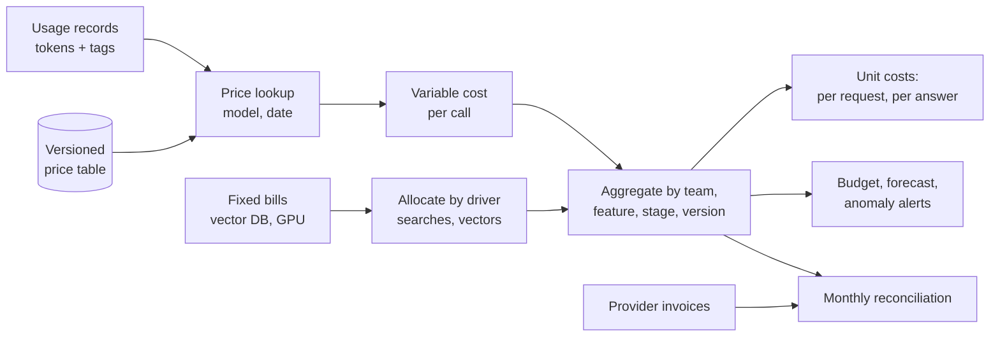

A RAG system's cost is spread across many bills: a model provider charging per token, an embedding API or a GPU for embeddings and reranking, a vector database cluster charged by the hour, storage, the observability stack itself, and the occasional full re-index. The finance department sees the invoices at the end of the month. Engineering needs something different: the cost of each request, broken down by stage, attributed to the team or feature that caused it, available daily, and good enough to answer "why did it go up?" and "is this feature worth what it costs?".

**Cost tracking** turns the token and usage data from the [previous lesson](/learn/rag-observability/token-tracking) into money. This lesson covers the cost model of a RAG system (variable and fixed costs), pricing tables that change over time, per-request costing, attribution to teams and features including shared fixed costs, unit economics such as cost per successful answer, budgets and forecasts, and reconciliation with the invoice. *Reducing* cost is a separate subject with its own module, [Cost Engineering](/learn/cost-engineering); you cannot reduce what you have not measured, and this lesson is the measurement.

## Learning objectives

- Build a cost model for a RAG system that separates variable per-request costs from fixed and periodic costs.
- Compute the cost of a model call from reported usage and a versioned price table, including prompt-cache pricing.
- Attribute variable costs to teams and features with tags, and allocate shared fixed costs with a stated driver.
- Calculate and interpret unit costs, in particular cost per successful answer, and a month-end forecast.
- Reconcile tracked costs with provider invoices and explain the usual sources of discrepancy.

## Prerequisites

- [Token tracking](/learn/rag-observability/token-tracking): the usage records this lesson prices.
- [Logging](/learn/rag-observability/logging): request ids and the tags that attribution depends on.
- [Generation monitoring](/learn/rag-observability/generation-monitoring): refusal and failure signals used in unit costs.

## Why this matters

Model costs in RAG are proportional to tokens, and token counts depend on decisions spread across the codebase: retrieval `k`, chunk size, history handling, which model each stage uses, how often the judge runs. Any of them can change cost by a large factor without changing anything a user notices. Without per-request cost tracking:

- **Cost rises cannot be explained.** The invoice is up 40%; was it more users, longer prompts, a pricier model, a re-index, or a runaway batch job? The invoice does not say.
- **Teams cannot be charged or budgeted.** If HR and IT share AskMeridian, a single bill gives neither of them a reason to care about their own usage, and gives you no basis for saying who should pay for what.
- **Features cannot be judged.** A query-rewriting step that improves retrieval slightly but doubles model calls may or may not be worth it. You need its cost per request to decide.
- **Runaway spend is found late.** A retry loop calling the model repeatedly, or a script re-embedding the corpus every hour, can spend a month's budget in a weekend. Daily tracking with alerts catches it in hours.

Cost tracking also keeps cost-reduction work honest. When the [Cost Engineering](/learn/cost-engineering) techniques are applied (caching, smaller models, tighter budgets), the tracked cost per successful answer is how you prove they saved money without reducing the number of questions actually answered.

## The intuition

Think of how a restaurant knows what each dish costs. The ingredients are easy: so many grams of this, at that price per kilogram, gives the ingredient cost of one plate. That is the **variable cost**, and it scales with every plate sold. But there is also rent, the oven and the chef's salary, paid whether the restaurant serves ten plates or a thousand. That is the **fixed cost**, and to know what a dish *really* costs the owner must spread it over the plates by some rule, for example in proportion to kitchen time.

Two more things matter. Ingredient prices change, so last month's plates must be costed at last month's prices. And plates that are sent back still used ingredients: the true cost of a *satisfied* customer is higher than the cost of a plate.

RAG cost tracking is the same: price the tokens of each request at the price in force that day, spread the fixed costs over requests by a stated rule, and divide by the answers that actually helped someone.

## How it works

### The cost model

Start by listing every cost and classifying it.

| Cost | Type | Driver | Tracked from |
| --- | --- | --- | --- |
| Generation model calls | Variable | Input, output and cached tokens | Usage on every call |
| Auxiliary model calls (rewrite, routing, judge) | Variable | Tokens | Usage on every call |
| Query embedding (hosted API) | Variable | Query tokens | Usage per call |
| Reranking on a GPU you run | Fixed (capacity) | Instance hours | Cloud bill; allocate by rerank calls |
| Vector database cluster | Fixed (capacity) | Node hours, storage | Cloud bill; allocate by searches or by stored vectors |
| Document embedding at ingestion | Periodic | Tokens embedded per run | Ingestion run records |
| Full re-index | One-off | Corpus size | Ingestion run records |
| Observability and evaluation | Fixed or variable | Data volume, judge tokens | Vendor bill; token ledger |

The first three scale with traffic and are naturally per request. The others are paid for capacity or by batch jobs and must be **allocated**, that is, divided among requests or teams by a chosen rule. Query embeddings are usually negligible next to generation (a query of 20 tokens costs a tiny fraction of a prompt of 2,000), but document embedding at ingestion and re-indexing can be large one-off items; track them per run so they do not appear as an unexplained spike.

### Pricing a model call

The cost of one call is its usage multiplied by the prices in force:

1. Read the usage from the response: input, output, cache-write and cache-read tokens (see [Token tracking](/learn/rag-observability/token-tracking)).
2. Look up the model's prices **for the date of the call** in a versioned price table: each row has a model, an effective date and a price per million tokens for each token category.
3. Multiply each token count by its price, sum and divide by one million.

Three rules prevent the usual errors. Keep prices in configuration with effective dates, never as constants in code, because prices change and you will need to re-cost historical data correctly. Fail loudly when a model has no price (a new model id appears, a typo), rather than costing it at zero. And use exact decimal arithmetic for money; binary floating point is fine for analysis but should not produce figures that are compared with an invoice to the cent.

Discounts complicate this. Batch processing interfaces, committed-use agreements and enterprise contracts may all change effective prices. Model the price you actually pay, and if the discount is only known at invoice time, track at list price and apply a correction factor at reconciliation.

### Attribution with tags

Attribution needs a tag on every usage record saying who or what caused it. Typical tags are:

- **Tenant or team**: which customer or department the request served.
- **Feature or endpoint**: chat, search-only, document summary.
- **Stage**: rewrite, generate, judge.
- **Pipeline version**: to compare the cost of versions.

The tags come from the request context: the same `ContextVar` that carries the request id in [Logging](/learn/rag-observability/logging) can carry the tenant and feature, so every usage record inherits them without being passed explicitly. Background work needs an explicit owner: a judge running on a sample of HR's traffic can be charged to HR (it exists because of their traffic) or to the platform (it serves the platform's quality goals). Both are defensible; choose one and write it down.

### Allocating fixed costs

A fixed cost has no natural per-request amount, so you choose a **driver**: a measurable quantity that roughly reflects how much each consumer uses the shared resource. For a vector database, plausible drivers are the number of searches (if query load determines cluster size) or the number of stored vectors (if memory does). The allocation for consumer $j$ is the fixed cost multiplied by $j$'s share of the driver. The choice matters: a team with few documents but many questions pays little under a storage driver and a lot under a search driver. Pick the driver that reflects what actually forces the cluster to be its size.

Allocation is a management convention, not a physical fact. Its purpose is to make costs visible and decisions fair; publish the rule and keep it stable.

### Unit economics

Total cost is a poor measure of efficiency because it grows with usage, which is usually good news. Divide it by a unit of value:

- **Cost per request**: total cost divided by requests. Simple, and the first number anyone asks for.
- **Cost per successful answer**: total cost divided by requests that ended in a usable answer (not refused, not failed, not truncated). Refused and failed requests still cost money, so this number is always higher, and it rises when quality falls, even if spend per request stays flat.
- **Cost per active user** per month: useful for budgeting a rollout.

Cost per successful answer is the best single number for RAG because it couples cost with quality: a cheaper model that refuses more may lower cost per request while raising cost per successful answer.

### Budgets, forecasts and anomalies

Track daily cost per team and in total, and compare with budgets. Two simple tools go a long way:

1. **A run-rate forecast**: month-to-date spend plus the recent daily average times the days remaining. Alert when the forecast exceeds the budget, which gives days of warning instead of a surprise at month end.
2. **An anomaly check**: compare today's cost per team and per stage with the same weekday in previous weeks; alert on large ratios. A doubling in the judge stage or a new spike in the rewrite stage points directly at a change.

Hard limits are a separate layer: providers let you set spending limits on accounts or workspaces, and your own gateway can refuse requests from a tenant that exceeds its quota. Tracking tells you what is happening; limits stop it.

### Reconciliation

At the end of each billing period, compare your tracked total for each provider with the invoice. They will differ. Common causes: discounts or credits not in your price table; calls made outside the instrumented path (a developer's notebook, a batch job using a different key); retries of failed calls that were billed but not logged; tokens you did not count, such as tool definitions; and timezone boundaries between your days and the provider's. A discrepancy of a few per cent is normal; a larger one means some usage is untracked, and finding it usually reveals an instrumentation gap. Separate API keys or workspaces per environment and per major consumer make reconciliation much easier.



## The mathematics

### Cost of a call

$$
C = \frac{n_{\text{in}}\,p_{\text{in}} + n_{\text{out}}\,p_{\text{out}} + n_{\text{cw}}\,p_{\text{cw}} + n_{\text{cr}}\,p_{\text{cr}}}{10^6}
$$

Here $n_{\text{in}}$, $n_{\text{out}}$, $n_{\text{cw}}$ and $n_{\text{cr}}$ are the reported uncached input, output, cache-write and cache-read tokens, and each $p$ is the matching price per million tokens on the call's date.

**By hand.** With hypothetical prices of 3.00, 15.00, 3.75 and 0.30 dollars per million tokens, a call with $n_{\text{in}} = 900$, $n_{\text{out}} = 150$, $n_{\text{cw}} = 0$ and $n_{\text{cr}} = 1{,}450$ costs

$$
C = \frac{900 \times 3 + 150 \times 15 + 1{,}450 \times 0.30}{10^6} = \frac{2{,}700 + 2{,}250 + 435}{10^6} = 0.005385
$$

dollars, about half a US cent. Output tokens are 6% of the tokens but 42% of the cost, because output is priced several times higher than input. Note also that the 1,450 cached tokens cost less than a tenth of what they would uncached ($1{,}450 \times 3 = 4{,}350$ against 435 in the numerator).

### Cost per successful answer

$$
\text{CPSA} = \frac{C_{\text{variable}} + C_{\text{fixed, allocated}}}{N_{\text{answered}}} = \frac{\text{cost per request}}{a}
$$

where $N_{\text{answered}}$ is the number of requests ending in a usable answer and $a$ is the answer rate ($N_{\text{answered}}$ divided by all requests). If cost per request is 1.2 US cents and 92% of requests are answered, CPSA is $1.2 / 0.92 \approx 1.30$ cents. If a cheaper configuration cuts cost per request by 10% to 1.08 cents but the answer rate falls to 80%, CPSA becomes $1.08 / 0.80 = 1.35$ cents: the "saving" makes each useful answer more expensive.

### Fixed-cost allocation and the forecast

Allocation to consumer $j$ with driver quantity $d_j$: $A_j = F \cdot d_j / \sum_k d_k$, where $F$ is the fixed cost for the period. Run-rate forecast at day $t$ of a month of $M$ days: $\hat C_{\text{month}} = S_t + \bar c \,(M - t)$, where $S_t$ is spend to date and $\bar c$ the average daily spend over the last week. With $S_{10} = 1{,}150$ dollars, $\bar c = 130$ dollars and $M = 30$: $\hat C = 1{,}150 + 130 \times 20 = 3{,}750$ dollars, which would breach a budget of 3,500 dollars and should alert on day 10, not day 30. The code below computes the call cost, the allocation and the unit costs.

## In code

**The problem.** Price usage records with a versioned price table, attribute one day's cost to teams and stages, allocate a shared vector-database cost by search count, and compute cost per request and per successful answer for each team. A day's records are simulated with a fixed seed; every price is hypothetical.

**Dependencies.** pandas and the standard library's `decimal` module.

```bash
pip install pandas
```

```python
import random
from dataclasses import dataclass
from datetime import date
from decimal import Decimal as D

import pandas as pd

MTOK = D(1_000_000)

# --- 1. A versioned price table (HYPOTHETICAL prices, USD per million tokens) ------
# Real prices change; load them from configuration with an effective date, never inline.
PRICES = [
    # model,         effective,         input,      output,     cache_write, cache_read
    ("model-large", date(2025, 1, 1), D("3.00"),  D("15.00"), D("3.75"),  D("0.30")),
    ("model-large", date(2025, 6, 1), D("2.50"),  D("12.50"), D("3.125"), D("0.25")),
    ("model-small", date(2025, 1, 1), D("0.80"),  D("4.00"),  D("1.00"),  D("0.08")),
    ("embed-api",   date(2025, 1, 1), D("0.02"),  D("0"),     D("0"),     D("0")),
]


def price_for(model: str, day: date):
    rows = [p for p in PRICES if p[0] == model and p[1] <= day]
    if not rows:
        raise KeyError(f"no price for {model} on {day}")      # fail loudly, never guess
    return max(rows, key=lambda p: p[1])[2:]


@dataclass
class Call:
    day: date
    request_id: int
    team: str
    stage: str
    model: str
    input_tokens: int
    output_tokens: int = 0
    cache_write: int = 0
    cache_read: int = 0
    answered: bool = True        # did the request end in a usable answer?

    def cost(self) -> D:
        p_in, p_out, p_cw, p_cr = price_for(self.model, self.day)
        return (self.input_tokens * p_in + self.output_tokens * p_out
                + self.cache_write * p_cw + self.cache_read * p_cr) / MTOK


same = dict(request_id=0, team="hr", stage="generate", model="model-large",
            input_tokens=900, output_tokens=150, cache_read=1450)
print("identical call before and after the 1 June price change:")
for day in (date(2025, 5, 30), date(2025, 6, 2)):
    print(f"  {day}  USD {Call(day=day, **same).cost():.6f}")

# --- 2. One day of usage records, as the token ledger would supply them ---------
rng = random.Random(1)
DAY = date(2025, 6, 2)
calls, rid = [], 0
for team, n_requests in [("hr", 1500), ("it", 2500)]:
    for _ in range(n_requests):
        rid += 1
        answered = rng.random() > 0.08                       # about 8% refusals
        if team == "it":                                     # IT questions are rewritten first
            calls.append(Call(DAY, rid, team, "rewrite", "model-small", rng.randint(250, 350),
                              rng.randint(15, 30)))
        calls.append(Call(DAY, rid, team, "embed_query", "embed-api", rng.randint(10, 25)))
        calls.append(Call(DAY, rid, team, "generate", "model-large",
                          rng.randint(800, 2400), rng.randint(120, 400) if answered else 15,
                          cache_read=1450, answered=answered))
        if rng.random() < 0.02:                              # sampled faithfulness judge
            calls.append(Call(DAY, rid, "platform", "judge", "model-small",
                              rng.randint(1800, 2400), rng.randint(100, 160)))
df = pd.DataFrame([{**c.__dict__, "cost": float(c.cost())} for c in calls])

# --- 3. Attribution: variable cost by team and stage, plus a shared fixed cost ----
VECTOR_DB_MONTHLY = 600.00                                   # hypothetical cluster cost
fixed_today = VECTOR_DB_MONTHLY / 30
searches = df[df.stage == "embed_query"].groupby("team").size()
variable = df.pivot_table(index="team", columns="stage", values="cost", aggfunc="sum", fill_value=0)
variable["fixed_alloc"] = (fixed_today * searches / searches.sum()).reindex(variable.index).fillna(0)
variable["total"] = variable.sum(axis=1)
print(f"\n{DAY}: cost by team and stage (USD)")
print(variable.round(2).to_string())

# --- 4. Unit economics per team ---------------------------------------------------
req = df[df.team != "platform"].groupby(["team", "request_id"]).agg(
    cost=("cost", "sum"), answered=("answered", "all")).reset_index()
units = req.groupby("team").agg(requests=("request_id", "count"), answered=("answered", "sum"),
                                variable=("cost", "sum"))
units["fixed"] = variable["fixed_alloc"]
units["per_request"] = (units.variable + units.fixed) / units.requests
units["per_answer"] = (units.variable + units.fixed) / units.answered
print("\nunit cost (USD), fixed cost included")
print(units[["requests", "answered", "per_request", "per_answer"]].round(4).to_string())
```

```output
identical call before and after the 1 June price change:
  2025-05-30  USD 0.005385
  2025-06-02  USD 0.004488

2025-06-02: cost by team and stage (USD)
stage     embed_query  generate  judge  rewrite  fixed_alloc  total
team                                                               
hr                0.0     11.01   0.00     0.00          7.5  18.51
it                0.0     18.31   0.00     0.82         12.5  31.64
platform          0.0      0.00   0.18     0.00          0.0   0.18

unit cost (USD), fixed cost included
      requests  answered  per_request  per_answer
team                                             
hr        1500      1393       0.0123      0.0133
it        2500      2288       0.0127      0.0138
```

**The important lines.**

- `PRICES` holds one row per model and effective date. `price_for` picks the latest row on or before the call's date, so historical calls are always costed at the price in force when they were made, and a model with no row raises an error instead of costing nothing.
- `Call.cost` applies the formula with `Decimal`, so a single call's cost is exact. The DataFrame converts to `float` for aggregation and display, which is acceptable for analysis; for invoice-grade totals, sum the `Decimal` values.
- The `answered` flag is carried on the generation record from the generation checks of the previous lesson. Refused requests still produce a generation record with its cost.
- `fixed_alloc` divides one day's share of the vector-database cost between teams in proportion to their searches (one per request here), the driver chosen for this cluster.
- The judge is tagged `platform`, a deliberate attribution decision: here quality monitoring is a platform cost, not a team cost.

**What the output means.** The identical call costs 0.5385 US cents before the price change and 0.4488 cents after, which is why re-costing history with today's prices would misstate May. In the daily table, generation dominates variable cost; query embedding rounds to zero (about 4,000 queries of 10 to 25 tokens at a hypothetical 0.02 dollars per million tokens is a fraction of a cent); and IT's query-rewriting step costs 0.82 dollars, about 4% of IT's variable spend, a figure you can now weigh against the retrieval improvement it buys. The fixed allocation is large relative to variable cost at this traffic level: 20 dollars a day of cluster cost against about 30 dollars of model cost. At low volume, fixed costs dominate unit economics, which is why cost per request falls as usage grows. Finally, cost per successful answer is about 8% above cost per request for both teams, exactly the effect of the 8% refusal rate.

**Common errors.** Pricing every historical call with the current price table. Silently defaulting unknown models to zero cost. Allocating fixed costs by a driver that does not reflect what sizes the resource. Counting refused requests as "answered" when computing unit costs.

**Extending it.** Load `PRICES` from a configuration file with an owner and a review date. Add the [run-rate forecast](#the-mathematics) and a same-weekday anomaly check per team and stage. Emit daily cost per team as a metric and alert on forecast breaches.

## A real-world example

AskMeridian launched for HR and IT staff, and the Platform team paid the whole bill. When the product documentation team asked to join, finance asked a reasonable question: what would it cost, and who should pay?

The Platform team had usage records but no cost tracking. They built it along the lines of this lesson: a versioned price table maintained by one engineer and reviewed monthly, team tags carried in request context, and the Qdrant cluster allocated by stored vectors, since memory was what determined the cluster's size. Product documentation's corpus was about five times the size of the handbook and runbooks combined.

The allocation made the trade-off visible at once. Product documentation would generate fewer questions than IT but would be allocated most of the vector database cost, so its cost per successful answer would be several times that of the other teams. That led to a better design conversation than a single number would have: the team agreed to exclude archived product versions from the index, which cut the corpus by more than half, before onboarding.

A month later, the daily anomaly check fired: the judge stage's cost had tripled overnight. A configuration change intended to raise the judging sample rate from 2% to 3% had been entered as 0.3 instead of 0.03. Cost tracking caught it in a day; without it, it would have appeared on the invoice four weeks later.

## Common mistakes

- **Hard-coding prices.** When prices change, history is re-costed wrongly and nobody notices.
- **Costing `input_tokens` only and ignoring cache categories.** Cached-read discounts and cache-write premiums both disappear from the figures.
- **Tracking model costs only.** Vector database, GPU, re-indexing and observability costs are left out, and unit costs look misleadingly low.
- **Untagged usage.** Calls without team or feature tags land in an "unknown" bucket that grows until attribution is meaningless.
- **Cost per request as the efficiency metric.** It ignores failed and refused requests, and rewards configurations that answer less.
- **Never reconciling with the invoice.** Untracked consumers (scripts, notebooks, other environments) go unnoticed.
- **Treating allocation as truth.** Different drivers give different answers; an unstated rule causes disputes.

## Best practices

- List every cost in a cost model, classify it as variable, fixed, periodic or one-off, and track each.
- Keep prices in a versioned table with effective dates, and fail on unknown models.
- Tag every usage record with tenant, feature, stage and pipeline version through request context.
- Allocate fixed costs with a published driver that reflects what sizes the resource.
- Report cost per successful answer alongside cost per request, per team and per version.
- Forecast month-end spend daily and alert on forecast breaches and same-weekday anomalies.
- Reconcile with invoices monthly, and use separate keys or workspaces per environment and major consumer.

## Performance considerations

Cost computation is cheap: a price lookup and a few multiplications per call. Do it in the log pipeline or a scheduled job rather than on the request path, and store the result with the usage record so dashboards do not recompute it.

The useful arithmetic is about where money goes. Using the hypothetical prices above, a request with 2,000 uncached input tokens and 300 output tokens costs $(2{,}000 \times 3 + 300 \times 15)/10^6 = 0.0105$ dollars; at 50,000 requests a day that is 525 dollars a day, roughly 16,000 a month. Moving 1,450 tokens of stable prefix into the cache changes the input part to $550 \times 3 + 1{,}450 \times 0.30 = 2{,}085$ per million, and the request cost to $(2{,}085 + 4{,}500)/10^6 \approx 0.0066$ dollars, a reduction of about 37%, ignoring cache writes. Calculations like this, from tracked data rather than guesses, are how the [Cost Engineering](/learn/cost-engineering) module chooses where to act.

Remember the observability stack's own cost: log, trace and metric storage and any hosted LLM-observability product. The volume estimates in the earlier lessons of this module give its size; include it in the cost model.

## Security considerations

- Price tables and cost reports reveal contract terms and usage patterns; restrict access as you would other commercial data.
- Per-tenant cost tracking is also abuse detection: a tenant whose cost per request jumps may be sending enormous prompts, scripting the assistant, or under attack. Pair tracking with per-tenant quotas enforced at the gateway.
- Provider spending limits and per-key budgets are a safety net against leaked API keys; a key used outside your instrumented path shows up first as a reconciliation gap.

## Summary

- A RAG system's cost model has variable per-request costs (mostly model tokens), fixed capacity costs (vector database, GPUs), periodic ingestion costs and one-off re-indexing costs; track all of them.
- Price each call from its reported usage with a versioned price table, including cache-write and cache-read categories, and fail on unknown models.
- Attribute variable costs with tags carried in request context; allocate fixed costs by a published driver.
- Cost per successful answer couples cost with quality and is the best single unit cost for RAG.
- Forecast and alert daily, and reconcile with invoices monthly to find untracked usage.

## Exercises

**1.** Using the hypothetical June prices for `model-large` (2.50 input, 12.50 output, 3.125 cache write, 0.25 cache read, per million tokens), cost a call with 1,200 input, 1,450 cache-write, 0 cache-read and 220 output tokens. Then cost the next call, identical except that the 1,450 tokens are a cache read.

<details><summary>Show solution</summary>

First call: $1{,}200 \times 2.50 + 220 \times 12.50 + 1{,}450 \times 3.125 = 3{,}000 + 2{,}750 + 4{,}531.25 = 10{,}281.25$, divided by $10^6$: 0.01028 dollars. Second call: $3{,}000 + 2{,}750 + 1{,}450 \times 0.25 = 3{,}000 + 2{,}750 + 362.5 = 6{,}112.5$, so 0.00611 dollars. The cache write costs a premium once; each later read saves $1{,}450 \times (2.50 - 0.25) = 3{,}262.5$ per million against uncached input, so the premium of $1{,}450 \times 0.625 = 906.25$ is recovered on the first read.

</details>

**2.** In the code, change the fixed-cost driver from searches to stored vectors, assuming HR's collection holds 600 chunks and IT's 4,000. Recompute each team's `fixed_alloc` and explain which driver you would choose for AskMeridian and why.

<details><summary>Show solution</summary>

Replace the `searches` series with `stored = pd.Series({"hr": 600, "it": 4000})` and use it in the allocation. HR's share becomes $600 / 4{,}600 \approx 13\%$, so 2.61 dollars a day, and IT's 87%, so 17.39 dollars, instead of 7.50 and 12.50. Choose by asking what determines the cluster's size. If the cluster is sized for memory (vectors plus index), storage is the right driver; if it is sized for query throughput with plenty of spare memory, searches are. For a small corpus like AskMeridian's, memory is rarely the constraint, so searches is the more defensible driver; with product documentation's much larger corpus, storage would become the driver that reflects reality.

</details>

**3.** On day 12 of a 31-day month, spend to date is 2,040 dollars and the last seven days averaged 190 dollars. The budget is 5,500. Compute the run-rate forecast. What would you check before raising an alarm?

<details><summary>Show solution</summary>

$\hat C = 2{,}040 + 190 \times (31 - 12) = 2{,}040 + 3{,}610 = 5{,}650$ dollars, 150 above budget. Before alarming, check whether the last seven days were typical: a one-off re-index or an evaluation run inside the window inflates the average, so recompute the average excluding tagged one-off jobs; check for known calendar effects (a holiday reduces later traffic; a month-end deadline increases it); and look at the per-team and per-stage breakdown to see whether the rise is broad growth (plan for it) or one stage jumping (investigate). If the excess comes from steady growth in answered requests, the right response may be a budget conversation, not an engineering fix.

</details>

**4.** Design decision. A proposal adds a query-rewriting call with a small model before every retrieval. Offline, it raises the answer rate from 90% to 93%. Tracked data says cost per request is 1.10 US cents without rewriting and the rewrite call would add 0.08 cents. Should you adopt it on cost grounds?

<details><summary>Show solution</summary>

Compare cost per successful answer. Without rewriting: $1.10 / 0.90 \approx 1.222$ cents. With rewriting: $(1.10 + 0.08) / 0.93 = 1.18 / 0.93 \approx 1.269$ cents. On cost grounds alone the rewrite makes each useful answer about 4% more expensive. But cost is not the only consideration: 3 percentage points more users get an answer. The tracked numbers turn an argument about "expensive" into a concrete price per extra answer: $(1.18 - 1.10) / (0.93 - 0.90) \approx 2.7$ cents per additional successful answer. Whether that is worth paying is a product decision; check the offline gain holds in production with an A/B test before committing.

</details>

## Check your understanding

```quiz
[
  {
    "q": "Why should a price table have effective dates rather than a single current price per model?",
    "options": [
      "To make lookups faster",
      "So historical usage is costed at the price in force when the call was made",
      "Because providers require it",
      "To support multiple currencies"
    ],
    "answer": 1,
    "why": "Prices change; re-costing past calls at today's price misstates historical spend and trends."
  },
  {
    "q": "Cost per request is 1.0 cents with a 95% answer rate. A cheaper configuration costs 0.9 cents per request with an 85% answer rate. Which has the lower cost per successful answer?",
    "options": [
      "The cheaper configuration, about 1.06 cents",
      "Both are the same",
      "The original, about 1.05 cents, against about 1.06 cents",
      "It cannot be computed without fixed costs"
    ],
    "answer": 2,
    "why": "1.0 / 0.95 = 1.053 and 0.9 / 0.85 = 1.059; the cheaper configuration makes each useful answer slightly more expensive."
  },
  {
    "q": "What is the most appropriate way to assign a vector database cluster's monthly cost to teams?",
    "options": [
      "Divide it equally between teams",
      "Charge it all to the team that set it up",
      "Ignore it, because it does not vary with usage",
      "Allocate it in proportion to a driver that reflects what sizes the cluster, such as searches or stored vectors"
    ],
    "answer": 3,
    "why": "Fixed costs need a stated allocation driver; the right one reflects what determines the resource's size."
  },
  {
    "q": "Tracked model costs for a month are 18% below the provider invoice. Which is the most likely explanation worth investigating first?",
    "options": [
      "Usage outside the instrumented path, such as scripts, notebooks or another environment sharing the key",
      "Rounding errors in floating-point arithmetic",
      "Time-zone differences between days",
      "The provider overcharging"
    ],
    "answer": 0,
    "why": "Rounding and time zones cause small differences; a gap of 18% usually means untracked consumers."
  },
  {
    "q": "A refused request incurred model cost but produced no answer. How should it appear in unit economics?",
    "options": [
      "Excluded from both cost and request counts",
      "Its cost counts, but it is not a successful answer, so it raises cost per successful answer",
      "Counted as a successful answer",
      "Its cost is moved to the platform team"
    ],
    "answer": 1,
    "why": "The money was spent; dividing total cost by answered requests correctly reflects that refusals make useful answers more expensive."
  }
]
```

## Further reading

- Anthropic, [Pricing](https://www.anthropic.com/pricing) and the documentation on [Prompt caching](https://docs.anthropic.com/en/docs/build-with-claude/prompt-caching): current prices and cache pricing rules.
- FinOps Foundation, [FinOps Framework](https://www.finops.org/framework/): cost allocation, unit economics and forecasting practices for cloud spend.
- Storment and Fuller, *Cloud FinOps*, 2nd edition (O'Reilly, 2023): allocation, showback and chargeback in practice.
- Python documentation, [decimal](https://docs.python.org/3/library/decimal.html): exact decimal arithmetic for money.
