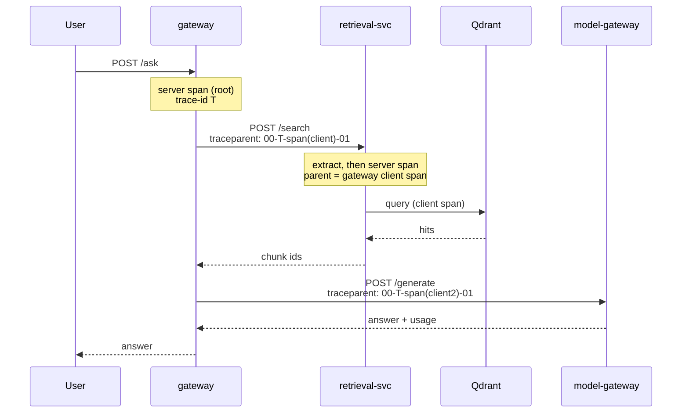

A small RAG system runs in one process, and the in-process tracing of the [previous lesson](/learn/rag-observability/tracing) shows everything. Production systems rarely stay that way. AskMeridian today is an API gateway that authenticates the user, a retrieval service in front of the Qdrant cluster, a reranking service on a GPU machine, a model gateway that holds the provider keys, and an ingestion pipeline whose workers read document-change events from a queue. One question touches four processes on different machines, and each would produce its own disconnected trace if nothing joined them.

**Distributed tracing** is the set of techniques that make one trace span many processes. This lesson covers **context propagation** (how the trace identity travels with a request, using the W3C Trace Context standard), how traces cross queues and batch jobs, **sampling** (deciding which traces to keep when you cannot keep them all), and the **collector** that sits between services and the tracing backend. The code runs two real FastAPI services and shows the trace identity crossing between them.

## Learning objectives

- Read and construct a W3C `traceparent` header, and explain each of its four fields.
- Propagate trace context across an HTTP call with `inject` and `extract`, and across a message queue, choosing between parent-child and links.
- Compare head-based and tail-based sampling, and compute the probability that a rare failure is captured at a given sampling ratio.
- Design a collector deployment for a multi-service RAG system, including the constraint that tail sampling places on it.
- Diagnose the common breakages: missing propagation, inconsistent sampling and clock skew.

## Prerequisites

- [Tracing](/learn/rag-observability/tracing): spans, context, processors and exporters within one process.
- [Logging](/learn/rag-observability/logging): correlation identifiers.
- [REST APIs](/learn/backend-engineering/rest-apis) and [Event-driven ingestion](/learn/understanding-document-ingestion/event-driven-ingestion): the HTTP and queue boundaries that context must cross.

## Why this matters

Split a pipeline into services and the in-process context disappears at every boundary. The gateway's trace shows a 1.9-second span called `call retrieval-svc` and nothing inside it. The retrieval service has its own trace, rooted in an unrelated identifier, showing a 1.8-second search. To connect the two you would have to match timestamps by eye across thousands of concurrent requests.

The questions that matter in production are cross-service questions. *Why was this user's answer slow?* needs the gateway, retrieval, reranker and model gateway on one timeline. *Is the reranker's latency rise caused by more candidates from retrieval?* needs the retrieval span's candidate count next to the reranker span's duration, in the same trace. *Which ingestion run put the stale chunk in the index?* needs a trail from the document-change event through the queue to the indexing worker.

Distributed tracing also forces a decision you can avoid in a single process: you cannot afford to keep every trace of a busy system, so you must sample, and sampling done badly keeps half a trace or discards precisely the failures you needed.

## The intuition

Think of a parcel moving through a courier network. At the first depot it gets a tracking number. Every depot that handles it scans the label and records "parcel X arrived here, came from depot Y". Nobody needs a central controller: as long as the label stays on the parcel, each depot can write its own record, and later anyone can pull up every record for parcel X and reconstruct the journey.

Two things can go wrong. A depot can repack the parcel and forget to copy the label; from then on, the records are for a "new" parcel and the trail breaks. And if the head office decides to keep records for only one parcel in twenty, every depot must agree on *which* parcels, or you end up with the first half of one journey and the second half of another. The label is the trace context; the copying is propagation; the agreement is consistent sampling.

## How it works

### The W3C Trace Context header

For the label to survive between services written in different languages by different teams, its format must be standard. The W3C **Trace Context** recommendation defines two HTTP headers. The essential one is `traceparent`:

```text
traceparent: 00-6513270e269e0d37f2a74de452e6b438-d23f0824128b2f33-01
             ^^ ^^^^^^^^^^^^^^^^^^^^^^^^^^^^^^^^ ^^^^^^^^^^^^^^^^ ^^
          version          trace-id               parent-id      flags
```

1. **version**: `00` for the current format.
2. **trace-id**: 16 bytes as 32 hex characters, shared by every span of the trace.
3. **parent-id**: 8 bytes as 16 hex characters, the span id of the *caller's* span, which becomes the parent of the receiver's first span.
4. **trace-flags**: 8 bits as 2 hex characters. Bit 0 (`01`) is **sampled**: the caller is recording this trace. Level 2 of the specification, a newer draft, adds bit 1 (`02`), signalling that the trace id was generated randomly, which samplers can rely on; newer SDKs set it, so you will see `03` in the code below. Always test bits rather than compare the whole value with `"01"`.

The second header, `tracestate`, carries vendor-specific key-value data alongside and can usually be ignored. A separate W3C specification, **Baggage**, defines a `baggage` header for application key-value pairs (for example a tenant id) that every downstream service can read. Baggage is convenient and dangerous: it is sent with every outgoing call, including calls to third parties, so never put personal data or secrets in it.

### Propagation, step by step

OpenTelemetry implements this with **propagators**, configured globally (W3C Trace Context and Baggage by default). The flow for one HTTP call:

1. The gateway handles `/ask` inside a server span; the current context holds that span.
2. It starts a **client** span for the outgoing call, making it current.
3. `inject(headers)` writes `traceparent` (from the current client span) into the outgoing headers.
4. The retrieval service receives the request. `extract(request.headers)` builds a context containing a *remote* span context with the caller's trace id and span id.
5. It starts its **server** span with that context as parent. The new span has the same trace id, and its parent is the gateway's client span.
6. Everything the retrieval service does inside that span, including further outgoing calls, belongs to the same trace.



In practice you rarely call `inject` and `extract` yourself: instrumentation packages for HTTP clients (such as `httpx` and `requests`) and servers (FastAPI, Flask, gRPC) do it automatically. You still need to understand the mechanism, because the failures are silent. A service with no server instrumentation, a proxy that strips unknown headers, or a hand-rolled HTTP call that bypasses the instrumented client each break the trace into pieces, and the only symptom is that a trace "stops" at a client span.

**Span kinds** matter across boundaries. A call out is a `CLIENT` span; the handling of a call in is a `SERVER` span. Backends use the pair to draw service maps (gateway → retrieval-svc) and to compute network time: the difference between the client span's duration and the server span's duration is time spent on the network, in queues and in proxies.

### The edge of your system: model providers

The trace ends at your client span for the model API: a hosted model provider does not join your trace or return its internal spans. Record on that client span everything the response gives you: model name, token usage, stop reason, and the provider's response identifier, so that a support case with the provider can be matched to your trace. If you run a central **model gateway** (a service that holds keys, enforces quotas and routes to providers), instrument it as a normal service, so its retries and fallbacks appear inside the caller's trace.

### Across queues and batches

Asynchronous boundaries need the same label copied into the message. A producer injects the context into the message's headers or attributes (Kafka record headers, SQS message attributes, or a field in the payload), and the consumer extracts it. Span kinds `PRODUCER` and `CONSUMER` mark the two sides.

Then a design decision arises. Should the consumer's span be a *child* of the producer's span? For a one-message, one-job flow that finishes quickly, yes. For AskMeridian's ingestion pipeline it is usually wrong:

- The embedding worker processes messages in **batches** of, say, 64 chunks drawn from many different document changes. A span can have only one parent, so it cannot be the child of 64 producers.
- The work may happen minutes or hours after the event, and a trace that spans hours is awkward to display and to sample.

OpenTelemetry's answer is **span links**. The worker starts a new trace for the batch and adds a link to each message's producer span context. You can navigate from a document-change event to the batch that indexed it and back, without pretending they are one request. Links are also the right tool when a user request triggers background work (such as asynchronous feedback scoring) that outlives the request.

### Sampling

A busy system produces far more spans than anyone wants to store. **Sampling** keeps a subset. The key requirement in a distributed system is **consistency**: all services must keep or drop the *same* traces, or you store fragments.

**Head-based sampling** decides at the root, when the trace starts. OpenTelemetry's `TraceIdRatioBased(p)` keeps a trace if its trace id falls below a threshold corresponding to probability $p$; because the decision is a function of the trace id, any service could recompute it identically. The decision is recorded in the sampled flag and propagated in `traceparent`; downstream services use `ParentBased(...)`, which simply follows the parent's flag. Head sampling is cheap and simple. Its weakness is that the decision is made before anything interesting has happened: at a 5% ratio, 95% of failed and slow requests are discarded along with the boring ones.

**Tail-based sampling** decides after the trace is complete, so it can apply rules such as "keep every trace with an error, every trace slower than 3 seconds, every trace where the model refused, and 2% of the rest". It must buffer all spans of every trace until the decision, which means spans for one trace must arrive at the *same* place, and that place needs memory proportional to traffic multiplied by the waiting time. It is normally done in a collector, not in the application.

Many systems combine them: head sampling at a generous ratio to cap total volume, with tail sampling in the collector to keep the interesting traces from what remains. Whatever you choose, remember that sampled traces are a biased record: compute rates (error rate, refusal rate, token totals) from metrics or logs that see every request, not from a sampled trace store.

### The collector

The **OpenTelemetry Collector** is a separate process that receives telemetry (usually over OTLP), processes it and exports it to one or more backends. A common deployment has two tiers:

1. **Agents**: a collector on each host or as a sidecar, receiving spans from local services over a fast local connection, batching them and forwarding them. Applications then need to know only "send to localhost".
2. **Gateway collectors**: a central pool that applies tail sampling, redacts attributes, adds metadata and exports to the backend(s).

Tail sampling forces a constraint on the gateway tier: all spans of one trace must reach the same gateway instance. The collector-contrib distribution provides a load-balancing exporter that routes spans by trace id for exactly this reason. The collector is also the natural place to enforce privacy policy centrally, for example deleting any attribute that carries prompt text before data leaves your network.

### Clock skew

Each span's timestamps come from its own host's clock. If the retrieval host's clock runs 40 ms ahead of the gateway's, the retrieval server span can appear to start before the gateway's client span that caused it. Hosts should run clock synchronisation (NTP or a cloud provider's time service), and you should treat cross-host timestamp differences of a few milliseconds with suspicion. Durations measured within one host are reliable; the gap between a client span and its server span is only as accurate as the two clocks.

## The mathematics

### Will sampling keep the failure you need?

**Intuition.** Head sampling keeps each trace independently with probability $p$. A failure that happens $n$ times is missed entirely only if every one of its traces is dropped.

$$
P(\text{at least one kept}) = 1 - (1 - p)^{n}, \qquad E[\text{kept}] = n\,p
$$

Here $p$ is the sampling ratio (between 0 and 1), $n$ is the number of occurrences of the failure in the period, and $E[\text{kept}]$ is the expected number of its traces retained.

**By hand.** AskMeridian samples at $p = 0.05$, and a rare failure (a malformed chunk crashing the context builder) occurs $n = 10$ times a day. Expected traces kept: $10 \times 0.05 = 0.5$ a day. Probability of at least one in a day: $1 - 0.95^{10} = 1 - 0.599 = 0.401$. Over a week ($n = 70$): $1 - 0.95^{70} \approx 0.972$. So the engineer investigating the failure probably waits days for a trace, which is the practical argument for tail sampling rules that keep every error.

### Tail-sampling memory

A tail sampler holds every span until its trace's decision. Memory is roughly the span arrival rate times the decision wait times the span size: $M = r \cdot s \cdot w \cdot b$, with $r$ requests per second, $s$ spans per trace, $w$ the wait in seconds and $b$ bytes per span. With assumed values $r = 200$, $s = 15$, $w = 30$ and $b = 1{,}000$: $M = 200 \times 15 \times 30 \times 1{,}000 = 90$ MB, before overheads.

```python
p, n = 0.05, 10                          # sampling ratio; failures per day
print(f"expected failing traces kept per day: {n * p:.1f}")
print(f"P(at least one kept in a day):        {1 - (1 - p) ** n:.3f}")
days = 7
print(f"P(at least one kept in a week):       {1 - (1 - p) ** (n * days):.3f}")

rps, spans_per_trace, wait_s, bytes_per_span = 200, 15, 30, 1_000
buffer_mb = rps * spans_per_trace * wait_s * bytes_per_span / 1e6
print(f"tail-sampling buffer: {buffer_mb:.0f} MB")
```

```output
expected failing traces kept per day: 0.5
P(at least one kept in a day):        0.401
P(at least one kept in a week):       0.972
tail-sampling buffer: 90 MB
```

The wait $w$ must exceed your slowest normal request; a RAG request with a long streamed answer can take tens of seconds, which is why the buffer is larger than for a typical web API.

## In code

**The problem.** Run two independent services, a gateway and a retrieval service, each with its own tracer provider and `service.name`, and show that one request produces one trace across both. Then show that with head sampling at 25% on the gateway, the retrieval service follows the gateway's decision.

**Dependencies.** FastAPI (its `TestClient` uses `httpx` and lets one service call another without opening network ports) and the OpenTelemetry SDK.

```bash
pip install fastapi httpx opentelemetry-api opentelemetry-sdk
```

```python
import random

from fastapi import FastAPI, Request
from fastapi.testclient import TestClient
from opentelemetry.propagate import extract, inject
from opentelemetry.sdk.resources import Resource
from opentelemetry.sdk.trace import TracerProvider
from opentelemetry.sdk.trace.export import SimpleSpanProcessor
from opentelemetry.sdk.trace.export.in_memory_span_exporter import InMemorySpanExporter
from opentelemetry.sdk.trace.sampling import ParentBased, TraceIdRatioBased
from opentelemetry.trace import SpanKind

# Two "services", each with its own TracerProvider and service.name, as if they ran
# in separate processes. Both export to one in-memory store standing in for a backend.
backend = InMemorySpanExporter()
random.seed(7)   # the SDK draws trace and span ids from `random`; seeded for a repeatable demo


def make_tracer(service: str, sampler=None):
    provider = TracerProvider(resource=Resource.create({"service.name": service}),
                              sampler=sampler or ParentBased(TraceIdRatioBased(1.0)))
    provider.add_span_processor(SimpleSpanProcessor(backend))
    return provider.get_tracer(service)


# --- Retrieval service ------------------------------------------------------------
retrieval_tracer = make_tracer("retrieval-svc")
retrieval_app = FastAPI()


@retrieval_app.post("/search")
def search(body: dict, request: Request):
    ctx = extract(request.headers)                     # rebuild the caller's context
    with retrieval_tracer.start_as_current_span("POST /search", context=ctx,
                                                 kind=SpanKind.SERVER) as span:
        span.set_attribute("rag.k", body["k"])
        with retrieval_tracer.start_as_current_span("qdrant.query"):
            hits = ["hb-leave-01", "hb-leave-02"]
        return {"chunk_ids": hits, "traceparent_seen": request.headers.get("traceparent")}


retrieval_client = TestClient(retrieval_app)          # stands in for the network


# --- Gateway service ----------------------------------------------------------------
def build_gateway(sample_ratio: float):
    tracer = make_tracer("gateway", ParentBased(TraceIdRatioBased(sample_ratio)))
    app = FastAPI()

    @app.post("/ask")
    def ask(body: dict):
        with tracer.start_as_current_span("POST /ask", kind=SpanKind.SERVER):
            with tracer.start_as_current_span("call retrieval-svc", kind=SpanKind.CLIENT):
                headers = {}
                inject(headers)                        # writes traceparent into the dict
                result = retrieval_client.post("/search", json={"k": 5}, headers=headers).json()
            return result

    return TestClient(app)


# --- 1. One request, fully sampled ---------------------------------------------------
gateway = build_gateway(sample_ratio=1.0)
seen = gateway.post("/ask", json={"q": "How much annual leave do I get?"}).json()["traceparent_seen"]
version, trace_id, parent_id, flags = seen.split("-")
print("traceparent received by retrieval-svc:", seen)
print(f"  version={version} trace_id={trace_id[:8]}… parent_span_id={parent_id} flags={flags}")

spans = backend.get_finished_spans()
by_id = {s.context.span_id: s for s in spans}
for s in sorted(spans, key=lambda s: s.start_time):
    parent = by_id.get(s.parent.span_id).name if s.parent and s.parent.span_id in by_id else "-"
    print(f"  {s.resource.attributes['service.name']:<14} {s.name:<20} "
          f"kind={s.kind.name:<8} parent={parent:<18} trace={s.context.trace_id:032x}"[:110])
client_span = next(s for s in spans if s.name == "call retrieval-svc")
print("parent_span_id in header == gateway client span id:", parent_id == f"{client_span.context.span_id:016x}")

# --- 2. Head sampling at 25 %: the downstream service follows the gateway's decision -
backend.clear()
gateway = build_gateway(sample_ratio=0.25)
flags_seen = [gateway.post("/ask", json={"q": "q"}).json()["traceparent_seen"][-2:] for _ in range(400)]
spans = backend.get_finished_spans()
sampled = sum(int(f, 16) & 0x01 for f in flags_seen)   # bit 0 of the flags = sampled
print(f"\n400 requests at ratio 0.25 -> sampled flag set on {sampled}")
print("traces stored:", len({s.context.trace_id for s in spans}),
      "| spans stored:", len(spans), "(4 per sampled trace)")
```

```output
traceparent received by retrieval-svc: 00-6513270e269e0d37f2a74de452e6b438-d23f0824128b2f33-03
  version=00 trace_id=6513270e… parent_span_id=d23f0824128b2f33 flags=03
  gateway        POST /ask            kind=SERVER   parent=-                  trace=6513270e269e0d37f2a74de452
  gateway        call retrieval-svc   kind=CLIENT   parent=POST /ask          trace=6513270e269e0d37f2a74de452
  retrieval-svc  POST /search         kind=SERVER   parent=call retrieval-svc trace=6513270e269e0d37f2a74de452
  retrieval-svc  qdrant.query         kind=INTERNAL parent=POST /search       trace=6513270e269e0d37f2a74de452
parent_span_id in header == gateway client span id: True

400 requests at ratio 0.25 -> sampled flag set on 101
traces stored: 101 | spans stored: 404 (4 per sampled trace)
```

**The important lines.**

- `make_tracer` builds a separate `TracerProvider` per service, each with its own `service.name` and sampler, which is what two processes would have. They share an exporter only so the example can inspect all spans in one place; in production each would export to a collector.
- `inject(headers)` in the gateway writes the current span context (the client span) into a plain dictionary using the globally configured propagator, W3C Trace Context by default.
- `extract(request.headers)` in the retrieval service turns the incoming headers back into a context, and `start_as_current_span(..., context=ctx)` uses it as the parent. Remove the `context=ctx` argument and the retrieval spans become a separate trace.
- `ParentBased(TraceIdRatioBased(0.25))` on the gateway makes a fresh 25% decision for root spans; on the retrieval service `ParentBased(...)` follows the `sampled` flag in the incoming header whatever its own ratio.

**What the output means.** The header the retrieval service received has version `00`, the trace id shared by all four spans, the gateway client span's id as `parent-id` (the last check prints `True`), and flags `03`: sampled plus the random-trace-id bit. The four spans form one tree across two services, with the client-server pair joining them. In the second part, 101 of 400 requests (close to the expected 100) carried the sampled flag, and exactly 101 complete traces of 4 spans were stored. No fragment was stored for the other 299 requests, because the retrieval service honoured the gateway's decision instead of rolling its own dice.

**Common errors.** Creating the server span without `context=ctx` (or without server instrumentation) is the commonest break. Comparing flags with `== "01"` misses traces when the random bit is set. A plain `TraceIdRatioBased` sampler (not wrapped in `ParentBased`) downstream ignores the caller's decision; Exercise 3 shows the fragments that result.

**Extending it.** Install `opentelemetry-instrumentation-fastapi` and `opentelemetry-instrumentation-httpx` and delete the manual `inject` and `extract` calls; the instrumentation does both. Add a queue between the services: put the injected headers into the message, and on the consumer use `extract` for a single message or `trace.Link(span_context)` for each message in a batch.

## A real-world example

Meridian's Platform team split AskMeridian into a gateway, a retrieval service and a model gateway, with OpenTelemetry auto-instrumentation in each. Within a week the on-call engineer reported that traces for slow requests "stopped" at the gateway's `call retrieval-svc` span: a 2.5-second client span with nothing underneath.

The retrieval service's traces existed, but as separate roots. The cause was an internal reverse proxy, added for mutual TLS between services, configured to forward only an allow-list of headers; `traceparent` was not on it. Adding `traceparent`, `tracestate` and `baggage` to the allow-list joined the traces.

The joined traces then showed something the separate ones could not: the gateway's client span lasted 2.5 seconds, but the retrieval service's server span only 0.4 seconds. More than two seconds were spent between the two, which turned out to be the proxy's connection pool exhausting under load and queueing requests. Neither service's own telemetry could have shown that gap; only the client-server pair in one trace did. The team added the proxy to the trace (it supports OpenTelemetry) and enlarged its pool.

The second change was sampling. The team had used head sampling at 5% to control cost, and the error investigation above relied on luck. They moved to a two-tier collector with tail sampling: keep all traces with errors, all slower than 3 seconds, all where the model refused, and 5% of the rest, with a load-balancing tier routing spans by trace id.

## Common mistakes

- **A proxy, gateway or service mesh that drops trace headers.** Traces break at that hop with no error anywhere.
- **Bypassing the instrumented client.** A hand-made HTTP call or a different client library sends no `traceparent`.
- **Independent sampling decisions per service.** Different ratios without `ParentBased` store partial traces that mislead more than they help.
- **Making a batch consumer's span a child of one message's producer.** The other messages lose their trail; use links.
- **Computing error or refusal rates from sampled traces.** Tail-sampled traces over-represent errors by design; head-sampled ones are noisy for rare events. Use unsampled metrics for rates.
- **Putting user data in baggage.** It travels to every downstream service, including third parties.
- **Trusting cross-host timestamps to the millisecond.** Clock skew can make a child appear to start before its parent.

## Best practices

- Use W3C Trace Context everywhere, and make sure every proxy and gateway forwards `traceparent`, `tracestate` and `baggage`.
- Prefer instrumentation libraries for HTTP, gRPC and queue clients and servers; add manual spans for RAG stages.
- Use `ParentBased` samplers in every service so the root's decision is honoured.
- Keep all errors and slow requests with tail sampling in a collector; route by trace id to make it possible.
- Use links, not parent-child, for batch processing and work that outlives the request.
- Record the model provider's response identifier on the model client span.
- Run clock synchronisation on all hosts.
- Enforce redaction and content policy in the collector so one misconfigured service cannot leak text.

## Performance considerations

Propagation itself costs almost nothing: one header of 55 characters per call. The costs are in volume and in the collector.

With the assumed traffic of the mathematics section (200 requests a second, 15 spans each, 1 KB per span), the system emits $200 \times 15 \times 1{,}000 = 3$ MB of span data per second, about 260 GB a day before compression. Head sampling at 10% cuts what leaves the services to about 26 GB a day. Tail sampling does not reduce what the services send to the collector, only what the collector forwards, so the network and collector must handle the full stream; that is the price of keeping every error.

Collector sizing follows from the buffer arithmetic: 90 MB of buffered spans for a 30-second decision wait, plus processing overhead, per gateway instance carrying that load. Add instances and spread traces among them by trace id. Batching in the SDK (`BatchSpanProcessor`) and in the collector keeps export cheap; tune batch sizes rather than lowering sampling ratios first.

## Security considerations

- **Inbound trace headers are untrusted input.** A public endpoint that accepts `traceparent` from the internet lets callers choose trace ids and force sampling on. At the edge, either start a new trace or record the external context as a link, and never let an external sampled flag override your sampling policy for public traffic.
- **Baggage leaks.** Anything in `baggage` is sent onwards, including to external APIs. Strip it at your boundary with third parties.
- **Collector as a control point.** The collector sees all telemetry; protect its endpoints with authentication and TLS, and use it to delete sensitive attributes before export.

## Summary

- Distributed tracing joins spans from many processes into one trace by propagating the trace context with each call.
- The W3C `traceparent` header carries version, trace id, the caller's span id and flags; bit 0 of the flags is the sampled decision.
- `inject` and `extract` (usually done by instrumentation) move context across HTTP; queues carry it in message headers, and batches use span links instead of parents.
- Head sampling is cheap but blind to outcomes; tail sampling keeps errors and slow traces but must buffer complete traces in one collector instance.
- Most breakages are silent: stripped headers, uninstrumented hops, inconsistent sampling and clock skew.

## Exercises

**1.** Decode `00-4bf92f3577b34da6a3ce929d0e0e4736-00f067aa0ba902b7-00`. What do you know about the caller, and will a `ParentBased` sampler in the receiving service record its span?

<details><summary>Show solution</summary>

Version `00`; trace id `4bf92f3577b34da6a3ce929d0e0e4736`; the caller's current span id is `00f067aa0ba902b7`, which becomes the parent of the receiver's span; flags `00`, so the sampled bit is 0 (and the random bit is not set). A `ParentBased` sampler follows the parent's decision, so the receiver creates a non-recording span: context still propagates onwards with the same trace id, but nothing is exported.

</details>

**2.** A failure occurs 4 times a day. What head-sampling ratio gives at least a 90% chance of capturing at least one of its traces per day? What does the answer suggest?

<details><summary>Show solution</summary>

Solve $1 - (1-p)^4 \ge 0.9$, so $(1-p)^4 \le 0.1$, so $1 - p \le 0.1^{1/4} \approx 0.562$, so $p \ge 0.438$. You would need to keep about 44% of all traffic to catch a failure that happens four times a day with 90% confidence. Head sampling is the wrong tool for rare failures; a tail-sampling rule that keeps every errored trace captures all four at a tiny fraction of that cost.

</details>

**3.** Modify the code's retrieval service so that it uses `TraceIdRatioBased(0.5)` directly (no `ParentBased`) while the gateway samples at 0.25. Predict what is stored, then run it.

<details><summary>Show solution</summary>

Change `retrieval_tracer = make_tracer("retrieval-svc")` to `make_tracer("retrieval-svc", TraceIdRatioBased(0.5))`. The ratio sampler ignores the parent's flag and keeps a trace if its trace id falls under the 0.5 threshold. Because the decision is a deterministic function of the trace id, every trace kept by the gateway at 0.25 is also below the 0.5 threshold and kept by retrieval, so those 101 traces are still complete. But the retrieval service additionally keeps its two spans for roughly another quarter of requests, whose gateway spans were dropped: orphaned two-span fragments whose parent does not exist in the backend. The seeded run stores 101 complete four-span traces and 95 two-span fragments. Fragments like these confuse the trace view and inflate storage; `ParentBased` everywhere avoids them.

</details>

**4.** Design decision. AskMeridian's ingestion workers embed chunks in batches of 64 drawn from a queue of document-change events. HR wants to answer "when was the leave policy change I made on Monday actually searchable?" Design the tracing for this flow.

<details><summary>Show solution</summary>

When the document-change event is published (from the HR system's webhook handler), create a `PRODUCER` span `publish doc.changed` with attributes for document id and version, and inject its context into the message headers. Each worker batch starts a new root span `embed_batch` (kind `CONSUMER`) with one link per message, built from the extracted contexts, plus child spans for embedding and the Qdrant upsert, and an attribute listing the document versions written. A final `index.visible` event or span records when the upsert was acknowledged.

To answer HR's question, find the producer span for that document version (search by attribute), follow its link to the batch, and read the upsert completion time: the difference is the time to searchability. Do not try to make one trace from webhook to index: batches mix many producers and can run long after the event. Also emit a metric for "event-to-index" latency for every document, because traces may be sampled and HR's question deserves an answer for every change.

</details>

## Check your understanding

```quiz
[
  {
    "q": "In `traceparent: 00-<trace-id>-<parent-id>-01`, what is `parent-id`?",
    "options": [
      "The id of the root span of the trace",
      "The span id of the caller's current span, which becomes the parent of the receiver's span",
      "The id of the parent service",
      "A random nonce to prevent replay"
    ],
    "answer": 1,
    "why": "parent-id is the caller's span id (typically its client span); the receiver's server span uses it as its parent."
  },
  {
    "q": "Why do downstream services normally use a `ParentBased` sampler?",
    "options": [
      "It samples more traces than a ratio sampler",
      "It reduces propagation header size",
      "It follows the sampled flag from the incoming context, so all services keep or drop the same traces",
      "It is required for span links to work"
    ],
    "answer": 2,
    "why": "Consistency: the root decides once and every service honours that decision, avoiding fragments."
  },
  {
    "q": "An embedding worker processes a batch of 64 messages from different document-change events. How should its span relate to the producers?",
    "options": [
      "Child of the first message's producer span",
      "Child of the last message's producer span",
      "No relationship; queues cannot carry context",
      "A new root span with a link to each message's producer span context"
    ],
    "answer": 3,
    "why": "A span has one parent but can have many links; links connect batch work to all its inputs."
  },
  {
    "q": "What does tail-based sampling require of the collector deployment?",
    "options": [
      "All spans of a trace must reach the same collector instance, so spans are routed by trace id",
      "Each service must run its own tail sampler",
      "Spans must be sorted by timestamp before export",
      "The collector must be in the same process as the gateway"
    ],
    "answer": 0,
    "why": "The decision needs the complete trace, so a load-balancing tier routes all spans of a trace to one instance."
  },
  {
    "q": "A gateway client span lasts 2.5 s; the retrieval server span it caused lasts 0.4 s. Where did the rest go?",
    "options": [
      "Inside the retrieval service's uninstrumented code",
      "Between the services: network, proxies or connection queueing",
      "In the model call",
      "Nowhere; this is always clock skew"
    ],
    "answer": 1,
    "why": "The server span covers the time the retrieval service spent handling the request; the difference is time on the path between them (skew affects timestamps, not a 2-second duration gap)."
  }
]
```

## Further reading

- W3C Recommendation, [Trace Context](https://www.w3.org/TR/trace-context/), and the W3C [Baggage](https://www.w3.org/TR/baggage/) specification.
- OpenTelemetry documentation, [Context propagation](https://opentelemetry.io/docs/concepts/context-propagation/) and [Sampling](https://opentelemetry.io/docs/concepts/sampling/).
- OpenTelemetry documentation, [Collector](https://opentelemetry.io/docs/collector/).
- Sigelman and colleagues (2010), *Dapper, a Large-Scale Distributed Systems Tracing Infrastructure*, Google Technical Report: the origin of trace-id propagation and sampling at scale.
