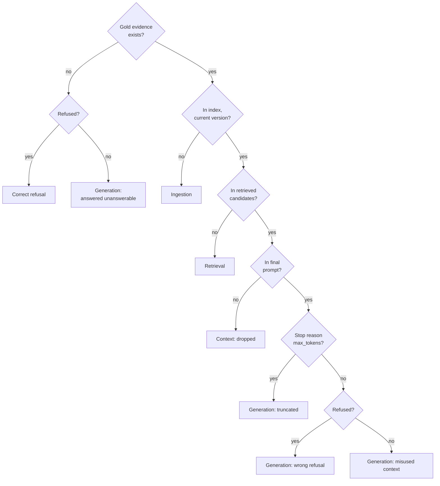

The earlier lessons of this module produce signals: logs, traces, retrieval and generation monitors, token and cost figures. Signals tell you *that* something is wrong. **Failure analysis** is the disciplined process of finding out *why*, for one bad answer and for the whole population of bad answers, and deciding what to fix first. It is where observability pays for itself.

This lesson gives a taxonomy of RAG failures organised by pipeline stage, a decision procedure that attributes a failed request to the first stage that lost the answer, the error-analysis loop for turning a pile of failures into a ranked list of fixes, a funnel model that shows where answerable questions are lost and which fix would gain most, and the blameless postmortem for incidents. The code classifies a set of reviewed AskMeridian requests and builds both the Pareto table and the funnel.

## Learning objectives

- Classify a failed RAG answer into a stage-based taxonomy (ingestion, retrieval, context, generation) using trace data.
- Apply a first-failing-stage decision procedure to a reviewed request and justify each check.
- Run an error-analysis loop: sample, read, label, count and prioritise failures with a Pareto table.
- Compute a stage funnel and estimate the end-to-end gain from improving each stage.
- Write a blameless postmortem that leads to regression tests and monitors, not only a fix.

## Prerequisites

- [Tracing](/learn/rag-observability/tracing) and [Logging](/learn/rag-observability/logging): the per-request evidence analysed here.
- [Retrieval monitoring](/learn/rag-observability/retrieval-monitoring) and [Generation monitoring](/learn/rag-observability/generation-monitoring): the signals that surface failures.
- [Golden datasets](/learn/testing-and-benchmarking/golden-datasets) and [Regression testing](/learn/testing-and-benchmarking/regression-testing): where analysed failures end up.

## Why this matters

A RAG answer is the product of a chain: the document must have been ingested correctly, chunked sensibly, embedded and indexed; the query must retrieve it among the candidates; reranking, deduplication and the token budget must keep it in the prompt; and the model must use it faithfully and completely. A failure at any link produces the same symptom: a wrong or missing answer. Users report symptoms; they cannot tell you the link.

Teams without a failure-analysis practice fix symptoms. A wrong answer about VPN error E-4021 leads to an edit of the system prompt, because the prompt is the easiest thing to change, when the real cause was that the runbook was never re-ingested after an update. The prompt change does nothing, or worse, it changes behaviour elsewhere. Meanwhile the biggest category of failures, which might be retrieval misses on questions phrased in staff jargon, goes unexamined because nobody has counted.

Failure analysis replaces anecdote with evidence in two ways. Per request, it attributes the failure to the stage that caused it, using the trace. Across requests, it counts failures by category, so that engineering effort goes where it removes the most failures.

## The intuition

Think of a water pipe from a reservoir to a tap. The tap runs dry. You could start replacing the tap, but a plumber works along the pipe from the source: is there water in the reservoir? At the first valve? After the filter? At the meter? The first point where the water is missing is where the fault is; everything downstream of it is merely starved.

For a RAG answer, the "water" is the piece of text that contains the answer. Walk the pipeline in order: was it in the corpus, in the index, among the retrieved candidates, in the final prompt, used in the answer? The first place it is missing names the faulty stage. And if you check a hundred dry taps and find that sixty were starved at the same valve, you know which valve to replace first.

## How it works

### A stage-based taxonomy

Organise failure categories by the pipeline stage where the answer was lost, because the stage determines who fixes it and how.

| Stage | Category | Typical evidence | Typical fix |
| --- | --- | --- | --- |
| Scope | Unanswerable question answered | No relevant document exists; model answered anyway | Stronger refusal instructions, answerability check |
| Ingestion | Missing content | Gold document not in the index | Fix connector, add source |
| Ingestion | Stale or wrong version | Index holds an old version | Re-ingest, fix versioning |
| Ingestion | Damaged content | Chunk text garbled, table lost | Parser or chunking fix |
| Retrieval | Not in candidates | Indexed, but not in the top-k candidates | Hybrid search, query rewriting, embedding model |
| Context | Dropped before the prompt | Retrieved, but cut by reranking, thresholds, deduplication or the token budget | Reranker, budget, diversity |
| Generation | Wrongly refused | Answer was in the prompt; model said it did not know | Prompt, model |
| Generation | Misused context | Answer in the prompt; model stated something else or mixed sources | Prompt, citation constraints, model |
| Generation | Incomplete or truncated | Partial answer; `max_tokens` stop | Output limit, answer format |
| Presentation | Format or citation fault | Broken JSON, wrong citation markers | Structured output, parsing |

This taxonomy is close to the "seven failure points" identified by Barnett and colleagues (2024) from case studies of RAG systems: missing content, missed top-ranked documents, documents not making it into the context, the answer not being extracted from the context, wrong format, incorrect specificity and incomplete answers. Use a published taxonomy as a starting point, then adapt it to the categories you actually observe, which is what the error-analysis loop below does.

### Attributing one failure: the first failing stage

Given a reviewed request (one where someone has said the answer was wrong) and its trace, attribution is a walk along the pipeline. Before you start, establish the **gold evidence**: the chunk or chunks that contain the correct answer, found by a reviewer searching the corpus, or "none" if the corpus cannot answer the question.

1. **Is the question answerable from the corpus?** If no gold evidence exists, the correct behaviour was to refuse. A refusal is a success; an answer is a generation failure (answering the unanswerable).
2. **Is the gold chunk in the index, in its current version?** If not, the failure is in ingestion. Check the document version logged with each chunk; a match on an old version is a staleness failure.
3. **Was it among the retrieved candidates?** The trace's retrieval span lists candidate ids. If the gold chunk is absent, it is a retrieval failure.
4. **Did it reach the prompt?** The context span lists the chunk ids placed in the prompt. Present in candidates but absent here means reranking, a score threshold, deduplication or the token budget removed it.
5. **Did the model finish?** A `max_tokens` stop reason makes it a truncation failure.
6. **Did the model refuse?** With the evidence in the prompt, a refusal is a wrong refusal.
7. **Otherwise** the model had the evidence and produced a wrong answer: misused context.

The procedure depends entirely on the observability built in this module: chunk ids with versions in the retrieval event, the candidate and context lists on spans, the stop reason and refusal flag on the generation span. Without them, steps 2 to 6 are guesswork. That dependency is the strongest argument for logging ids at every stage.

Two cautions. First, the first failing stage is the *proximate* cause, not always the best place to fix. A retrieval miss on a query full of internal jargon might be fixed by query rewriting (a retrieval fix) or by adding a glossary to the documents (an ingestion fix). Second, failures can compound: a chunk retrieved at rank 18 and then dropped is labelled "context", though a better retriever would have ranked it higher. The label tells you where to look first.



### The error-analysis loop

One request tells you about one failure. Prioritising work needs a population. The error-analysis loop, a standard practice in machine-learning engineering, runs as follows:

1. **Collect** candidate failures from several sources: negative user feedback, generation-monitor flags (bad citations, truncation), sampled judge verdicts, and a plain random sample of traffic, which catches failures no monitor knows to look for.
2. **Sample** a manageable number, for example 50 to 100, rather than trying to review everything. Keep the random-sample failures separate so you can estimate rates.
3. **Read** each one with its trace: question, retrieved chunks, prompt, answer. Write a short free-text note about what went wrong, before using any fixed categories. This open reading is where new failure types are discovered.
4. **Label** each failure with a stage category, using the decision procedure, and refine the categories when the notes reveal something the taxonomy lacks (for example "acronym in query not in documents" as a sub-category of retrieval misses).
5. **Count** failures per category and sort them into a Pareto table: categories in descending order with cumulative share. In most systems a few categories account for most failures.
6. **Fix** the top category, or the one with the best ratio of failures removed to effort.
7. **Lock in** the fix: add the analysed examples to the golden dataset as regression tests, and add or adjust a monitor so the category is visible in production.
8. **Repeat** on fresh data. The distribution shifts as you fix things and as usage changes.

Reading real failures is the step teams most often skip, and it is the one that produces the insight. Automated judges and dashboards are good at counting known failure types; they rarely discover new ones.

### The funnel view

The decision procedure also yields a **funnel**: of the answerable questions, how many had their evidence indexed, how many of those retrieved it, how many put it in the prompt, how many answered correctly. Each step's pass rate is a conditional probability, and the end-to-end success rate is their product. The funnel shows where the biggest losses are, and lets you estimate the gain from improving one stage while holding the others fixed, as the mathematics section shows.

### Postmortems for incidents

Some failures are incidents: a burst of wrong answers after a re-index, a day of timeouts, an answer that exposed restricted information. For these, write a **postmortem**: a short document recording the timeline (from traces and logs), the impact (how many requests, which users, for how long), the root cause, the contributing factors, and the actions. Make it **blameless**: the question is which conditions allowed the failure, not who made a mistake, because people hide information when they expect blame, and the next incident then takes longer to understand. Every action should be either a fix, a regression test, or a monitor; a postmortem whose only action is "be more careful" has not finished.

## The mathematics

### The success funnel

**Intuition.** An answerable question is answered correctly only if every stage passes. Each stage passes with some probability given that the earlier stages passed, so the overall success rate is the product of those conditional pass rates. A product is dominated by its smallest factors, so the weakest stage is where improvement pays most.

$$
P(\text{correct}) = P(\text{indexed}) \cdot P(\text{retrieved} \mid \text{indexed}) \cdot P(\text{in prompt} \mid \text{retrieved}) \cdot P(\text{correct} \mid \text{in prompt})
$$

Each factor is estimated from reviewed answerable questions as the number passing that stage divided by the number reaching it.

**By hand.** The code below reviews 14 answerable questions. 11 had their evidence indexed (pass rate $11/14 = 0.786$), 9 of those retrieved it ($9/11 = 0.818$), 8 of those put it in the prompt ($8/9 = 0.889$) and 4 of those answered correctly ($4/8 = 0.5$). The product is $0.786 \times 0.818 \times 0.889 \times 0.5 = 0.286$, which equals $4/14$, as it must.

Now ask: if one stage were perfect, what would the end-to-end rate be? Replace its factor with 1. A perfect index gives $1 \times 0.818 \times 0.889 \times 0.5 = 0.364$. Perfect generation gives $0.786 \times 0.818 \times 0.889 \times 1 = 0.571$. In this sample, generation is where the most answerable questions are lost, even though ingestion produced the single largest failure category in the Pareto table. The two views answer different questions: the Pareto table counts failures by category over all reviewed requests; the funnel shows each stage's conditional loss and the ceiling on improving it.

```python
rates = {"in index": 11 / 14, "in candidates": 9 / 11, "in context": 8 / 9, "correct": 4 / 8}

def end_to_end(r):
    out = 1.0
    for v in r.values():
        out *= v
    return out

print(f"end-to-end: {end_to_end(rates):.3f}")
for stage in rates:
    fixed = dict(rates, **{stage: 1.0})          # what if this stage never failed?
    print(f"  perfect {stage:<14} -> {end_to_end(fixed):.3f}")
```

```output
end-to-end: 0.286
  perfect in index       -> 0.364
  perfect in candidates  -> 0.349
  perfect in context     -> 0.321
  perfect correct        -> 0.571
```

A real review would use far more than 14 questions; with samples this small each pass rate has a wide confidence interval (see the Wilson interval in [Generation monitoring](/learn/rag-observability/generation-monitoring)). Treat the funnel as a guide to where to look, and confirm with more data before committing a quarter's work.

## In code

**The problem.** Sixteen AskMeridian requests have been reviewed. For each, a reviewer recorded the gold chunk (or `None` if the corpus cannot answer it), whether the answer was correct, and whether the model refused; the trace supplied the candidate ids, the ids placed in the prompt and the stop reason. Classify every request with the first-failing-stage procedure, build a Pareto table of failures, and compute the funnel.

**Dependencies.** The standard library only.

```bash
python --version   # 3.9 or later; no packages needed
```

```python
from collections import Counter

INDEX = {"hb-leave-01", "hb-leave-02", "hb-remote-01", "hb-equip-01", "hb-exp-01",
         "it-vpn-4021", "it-vpn-4012", "it-pass-01", "it-laptop-01"}   # ids in the live index

# Reviewed requests: (id, gold chunk or None if unanswerable, top-20 candidates,
#                     chunks placed in the prompt, answer correct?, refused?, stop_reason)
REVIEWED = [
    ("q01", "hb-leave-01",  ["hb-leave-01", "hb-leave-02"], ["hb-leave-01", "hb-leave-02"], True,  False, "end_turn"),
    ("q02", "it-vpn-4021",  ["it-vpn-4012", "it-vpn-4021"], ["it-vpn-4012", "it-vpn-4021"], False, False, "end_turn"),
    ("q03", "hb-exp-01",    ["hb-exp-01", "hb-equip-01"],   ["hb-exp-01", "hb-equip-01"],   True,  False, "end_turn"),
    ("q04", "it-sso-01",    ["it-pass-01", "it-vpn-4012"],  ["it-pass-01", "it-vpn-4012"],  False, False, "end_turn"),
    ("q05", "hb-equip-01",  ["hb-remote-01", "hb-leave-01"], ["hb-remote-01", "hb-leave-01"], False, True, "end_turn"),
    ("q06", None,           ["hb-remote-01", "hb-equip-01"], ["hb-remote-01", "hb-equip-01"], False, False, "end_turn"),
    ("q07", "it-laptop-01", ["it-laptop-01", "hb-equip-01"], ["it-laptop-01", "hb-equip-01"], False, True, "end_turn"),
    ("q08", "hb-leave-02",  ["hb-leave-01"] * 5 + ["hb-leave-02"], ["hb-leave-01"],         False, False, "end_turn"),
    ("q09", "it-pass-01",   ["it-pass-01"],                 ["it-pass-01"],                 True,  False, "end_turn"),
    ("q10", "it-sso-01",    ["it-pass-01"],                 ["it-pass-01"],                 False, True,  "end_turn"),
    ("q11", "hb-remote-01", ["hb-remote-01"],               ["hb-remote-01"],               False, False, "max_tokens"),
    ("q12", None,           ["hb-leave-01"],                ["hb-leave-01"],                True,  True,  "end_turn"),
    ("q13", "hb-exp-01",    ["hb-equip-01", "hb-remote-01"], ["hb-equip-01", "hb-remote-01"], False, False, "end_turn"),
    ("q14", "it-vpn-4021",  ["it-vpn-4012", "it-vpn-4021"], ["it-vpn-4012", "it-vpn-4021"], False, False, "end_turn"),
    ("q15", "hb-leave-01",  ["hb-leave-01"],                ["hb-leave-01"],                True,  False, "end_turn"),
    ("q16", "it-sso-01",    ["it-vpn-4012"],                ["it-vpn-4012"],                False, False, "end_turn"),
]


def classify(gold, candidates, context, correct, refused, stop_reason):
    """Walk the pipeline in order; the first check that fails names the stage."""
    if gold is None:                                   # nothing in the corpus answers it
        return "ok: correct refusal" if refused else "generation: answered unanswerable"
    if correct:
        return "ok: answered"
    if gold not in INDEX:
        return "ingestion: missing content"
    if gold not in candidates:
        return "retrieval: not in candidates"
    if gold not in context:
        return "context: dropped before prompt"
    if stop_reason == "max_tokens":
        return "generation: truncated"
    if refused:
        return "generation: wrongly refused"
    return "generation: misused context"


labels = {qid: classify(*rest) for qid, *rest in REVIEWED}
failures = Counter(v for v in labels.values() if not v.startswith("ok"))
total_fail = sum(failures.values())
print(f"{len(REVIEWED)} reviewed, {total_fail} failed\n")
print(f"{'failure stage':<36}{'n':>3}{'share':>8}{'cumul.':>8}")
cumulative = 0
for stage, n in failures.most_common():
    cumulative += n
    print(f"{stage:<36}{n:>3}{n / total_fail:>8.0%}{cumulative / total_fail:>8.0%}")

# --- Funnel: where answerable questions are lost, stage by stage --------------------
answerable = [r for r in REVIEWED if r[1] is not None]
indexed = [r for r in answerable if r[1] in INDEX]
retrieved = [r for r in indexed if r[1] in r[2]]
in_context = [r for r in retrieved if r[1] in r[3]]
correct = [r for r in in_context if r[4]]
print("\nfunnel for answerable questions")
prev = len(answerable)
for name, group in [("answerable", answerable), ("in index", indexed), ("in candidates", retrieved),
                    ("in context", in_context), ("answered correctly", correct)]:
    print(f"  {name:<20}{len(group):>3}   pass rate {len(group) / prev:.2f}")
    prev = len(group)
```

```output
16 reviewed, 11 failed

failure stage                         n   share  cumul.
ingestion: missing content            3     27%     27%
generation: misused context           2     18%     45%
retrieval: not in candidates          2     18%     64%
generation: answered unanswerable     1      9%     73%
generation: wrongly refused           1      9%     82%
context: dropped before prompt        1      9%     91%
generation: truncated                 1      9%    100%

funnel for answerable questions
  answerable           14   pass rate 1.00
  in index             11   pass rate 0.79
  in candidates         9   pass rate 0.82
  in context            8   pass rate 0.89
  answered correctly    4   pass rate 0.50
```

**The important lines.**

- `INDEX` stands for a query against the live index (in practice, look up the gold chunk id and check its stored document version). `REVIEWED` rows combine a reviewer's judgement (gold chunk, correctness, refusal) with trace data (candidates, prompt contents, stop reason).
- `classify` checks the stages in pipeline order and returns at the first failure. The order matters: a question whose evidence was never indexed would also "fail retrieval", but labelling it a retrieval failure would send the wrong team to fix it.
- Unanswerable questions (`gold is None`) are handled first, because for them a refusal is the correct outcome.
- `Counter.most_common()` sorts categories by frequency, and the cumulative column turns the list into a Pareto table.
- The funnel filters answerable questions stage by stage, so each pass rate is conditional on reaching that stage.

**What the output means.** Eleven of sixteen reviewed requests failed. The largest single category is missing content: three questions about single sign-on whose runbook (`it-sso-01`) was never ingested. One connector fix removes 27% of these failures, which is why ingestion problems are so often the cheapest wins. Two VPN questions (`q02`, `q14`) retrieved both the E-4021 and E-4012 chunks and answered with the wrong one: misused context, a generation fault, and a hint that near-identical chunks need clearer titles or a prompt instruction to match error codes exactly. Two retrieval misses (`q05`, `q13`) and one chunk crowded out of the prompt by duplicates (`q08`) complete the retrieval-side picture. The funnel adds the other perspective: of the eight answerable questions whose evidence reached the prompt, only four were answered correctly, so generation is the weakest stage, and the mathematics section showed it has the highest ceiling. A sensible plan: fix the SSO connector this week (cheap, certain), then work on generation with the misused-context and wrong-refusal examples as regression tests.

**Common errors.** Recording correctness without the gold chunk, which makes stages 2 to 4 impossible to check. Classifying from the answer text alone ("it sounds hallucinated") instead of from the trace. Mixing targeted failures (from feedback) with random samples when estimating rates.

**Extending it.** Read `REVIEWED` from your trace store and review tool rather than a literal list. Add document-version checks to the ingestion step to separate missing from stale content. Store each label with the request id so the examples flow into the golden dataset.

## A real-world example

After three months in production, AskMeridian's satisfaction score had plateaued. The Platform team's backlog was full of individual complaints, each fixed as it arrived, usually with a prompt tweak. Nobody could say whether the system was getting better.

The team lead proposed a two-week error-analysis exercise. They took 80 requests: 40 with negative feedback and 40 at random. Two engineers read each one with its trace and wrote free-text notes before applying any categories. Several notes kept recurring: "user wrote 'SSO', docs say 'single sign-on'", "user wrote 'WFH', docs say 'remote work'". A new sub-category appeared, *acronym mismatch*, which the original taxonomy had lumped into retrieval misses.

The counts reshaped the roadmap. Among the random-sample failures, acronym mismatch was the largest category, ahead of the hallucination problems that had dominated discussion. Prompt edits could never fix it, because the right chunk never reached the prompt. The fix was a small acronym-expansion step in query rewriting, maintained with the HR and IT teams, plus hybrid search so exact terms such as product names also matched.

Each analysed failure went into the golden dataset as a regression test. A month later the team repeated the exercise on fresh data: acronym mismatch had nearly vanished from the sample, and the top category was now wrong refusals on questions whose answer spanned two chunks. The loop had done its job: the next problem was a different one.

## Common mistakes

- **Fixing every failure in the prompt.** Ingestion and retrieval failures cannot be fixed there, and prompt edits change behaviour everywhere.
- **Analysing only complaints.** Users complain about some failure types more than others; a random sample is needed to see the real distribution.
- **Starting with fixed categories.** Pre-made labels hide new failure types; read and take free-text notes first.
- **Attributing to the last stage that looks wrong.** The model's answer always looks wrong; the first stage that lost the evidence is the one to examine.
- **Failure analysis without gold evidence.** Without knowing which chunk should have been used, you cannot tell retrieval from generation faults.
- **Fixing without locking in.** A fix with no regression test and no monitor tends to regress silently in a later release.
- **Blame in postmortems.** People stop sharing details, and causes stay hidden.

## Best practices

- Log the evidence that attribution needs: chunk ids and versions for candidates and prompt contents, stop reason, refusal flag.
- Review a mix of random and flagged requests regularly, reading traces and writing free-text notes before labelling.
- Attribute each failure to the first stage that lost the gold evidence, and refine the taxonomy with what you observe.
- Prioritise with a Pareto table and a funnel; weigh failures removed against effort.
- Turn every analysed failure into a regression test, and every new category into a monitor.
- Write blameless postmortems for incidents, with actions that are fixes, tests or monitors.
- Repeat the loop on fresh data after each round of fixes.

## Performance considerations

Failure analysis is limited by reviewer time, not compute. If a careful review with the trace open takes about 4 minutes, 80 requests take a little over 5 hours of an engineer's time: affordable every few weeks, not every day. Make reviews fast with a tool that shows question, chunks, prompt and answer side by side; that is often the best investment.

Sample size limits precision. With 50 random failures, a category seen 15 times has a 95% Wilson interval of roughly 19% to 44%; that is enough to rank the top categories but not to measure small improvements. Use the review to discover and rank categories, then measure them at scale with automated checks or judges where possible.

An LLM can pre-label failures with the decision procedure when the trace data is structured, since most checks are set-membership tests; reserve human time for the final step (was the answer right? which chunk was gold?) and for discovering new categories.

## Security considerations

- Reviewers see real queries, chunks and answers. Restrict review data to authorised people, redact personal data where possible, and do not show reviewers chunks from collections they cannot otherwise access.
- Include security failures in the taxonomy: answers that leaked restricted content, answers influenced by [indirect prompt injection](/learn/rag-security-fundamentals/indirect-prompt-injection) in a document. Their attribution often points to ingestion (a malicious or misclassified document) or to access control rather than to the model.
- Postmortems for security incidents may need a restricted distribution; keep a public, redacted version so the lessons still spread.

## Summary

- Failure analysis turns observability signals into causes and priorities.
- Use a stage-based taxonomy (scope, ingestion, retrieval, context, generation, presentation) and attribute each failure to the first stage that lost the gold evidence, using trace data.
- Run an error-analysis loop: collect, sample, read, label, count, fix, lock in with tests and monitors, repeat.
- A Pareto table ranks failure categories; a funnel of conditional pass rates shows the weakest stage and the ceiling on improving each.
- Write blameless postmortems for incidents, with actions that are fixes, regression tests or monitors.

## Exercises

**1.** Classify by hand: a question about the £75 receipt threshold for expenses; gold chunk `hb-exp-01`; the index holds `hb-exp-01`; candidates are `hb-equip-01`, `hb-exp-01`, `hb-remote-01`; the reranker kept only `hb-equip-01` and `hb-remote-01`; the model answered "receipts are needed above £400".

<details><summary>Show solution</summary>

Answerable (gold exists), indexed, in the candidates, but not in the prompt: **context: dropped before prompt**. The reranker removed the right chunk. The wrong figure (£400, the equipment budget) is the model using the only money figure it was given, a downstream symptom. Investigate the reranker's score for `hb-exp-01` against this query; if it was close to the cut-off, consider keeping more chunks or adding a diversity step.

</details>

**2.** Extend `classify` so that a gold chunk present in the index only in an outdated version is labelled "ingestion: stale content". Assume a dictionary `INDEX_VERSIONS` mapping chunk id to indexed version, and that each reviewed row also carries the gold chunk's current version.

<details><summary>Show solution</summary>

```python
def classify(gold, gold_version, candidates, context, correct, refused, stop_reason):
    if gold is None:
        return "ok: correct refusal" if refused else "generation: answered unanswerable"
    if correct:
        return "ok: answered"
    if gold not in INDEX_VERSIONS:
        return "ingestion: missing content"
    if INDEX_VERSIONS[gold] != gold_version:
        return "ingestion: stale content"
    if gold not in candidates:
        return "retrieval: not in candidates"
    ...  # remaining checks unchanged
```

The version check comes immediately after the presence check and before retrieval, because a stale chunk may be retrieved and used perfectly, producing a confidently outdated answer that is not a retrieval or generation fault at all.

</details>

**3.** A funnel over 200 reviewed answerable questions has pass rates 0.95 (indexed), 0.80 (retrieved), 0.90 (in prompt) and 0.85 (correct). Compute the end-to-end rate and the rate if each stage in turn were made perfect. Where would you invest?

<details><summary>Show solution</summary>

End to end: $0.95 \times 0.80 \times 0.90 \times 0.85 = 0.5814$. Perfect indexing: $0.80 \times 0.90 \times 0.85 = 0.612$. Perfect retrieval: $0.95 \times 0.90 \times 0.85 = 0.727$. Perfect context: $0.95 \times 0.80 \times 0.85 = 0.646$. Perfect generation: $0.95 \times 0.80 \times 0.90 = 0.684$. Retrieval has the highest ceiling (+0.145), then generation (+0.10). Invest in retrieval first, unless a generation improvement is much cheaper: the ceilings are upper bounds, and what matters is the realistic gain per unit of effort. Read the retrieval-miss examples to see whether one cause (for example acronyms) dominates.

</details>

**4.** Design decision. Write the outline of a blameless postmortem for this incident: after a Friday re-index, AskMeridian answered handbook questions from the superseded 2023 handbook until Monday afternoon. Include the sections and at least one action of each kind (fix, regression test, monitor).

<details><summary>Show solution</summary>

**Summary**: from Friday 18:00 to Monday 15:00, handbook answers quoted the 2023 handbook (for example a 4-year laptop cycle and 09:00 to 17:00 support hours) instead of the current one. **Impact**: requests touching handbook topics in that window, counted from logs by retrieved document version; users who acted on wrong information contacted via HR. **Timeline**: re-index started and finished (ingestion logs); first wrong answer (traces); first complaint; detection; mitigation (rollback to previous index snapshot); fix. **Root cause**: the re-index job read from an archive folder containing both handbooks and had no rule to exclude superseded versions. **Contributing factors**: no monitor on document versions retrieved; canary queries did not check facts that differ between versions; weekend with no review. **What went well**: traces with document versions made impact measurable precisely. **Actions**: *fix*: ingestion excludes documents marked superseded and refuses to index two versions of the same document id; *regression test*: golden questions whose answers differ between 2023 and 2025 handbooks (laptop cycle, support hours, equipment budget), run after every re-index; *monitor*: alert if any retrieved chunk's document version is not the current one, and a post-rebuild check comparing per-source document counts and versions with the previous index. No individual is named as the cause.

</details>

## Check your understanding

```quiz
[
  {
    "q": "The gold chunk is in the index and among the retrieved candidates, but not in the prompt, and the answer is wrong. Which stage does the first-failing-stage procedure blame?",
    "options": [
      "Generation, because the answer is wrong",
      "Context assembly: reranking, thresholds, deduplication or the token budget dropped it",
      "Ingestion",
      "Retrieval"
    ],
    "answer": 1,
    "why": "The evidence was lost between candidates and prompt; the wrong answer is a downstream symptom."
  },
  {
    "q": "Why should failure review include a random sample of traffic and not only requests with negative feedback?",
    "options": [
      "Random samples are cheaper to review",
      "Negative feedback is always wrong",
      "Feedback over-represents some failure types, so only a random sample reveals the true distribution and rates",
      "Regulations require random sampling"
    ],
    "answer": 2,
    "why": "Users report some failures far more than others; rates and priorities need an unbiased sample."
  },
  {
    "q": "Stage pass rates are 0.9, 0.7, 0.9 and 0.8. Which stage's improvement has the highest ceiling on end-to-end success?",
    "options": ["The first (0.9)", "The third (0.9)", "The fourth (0.8)", "The second (0.7)"],
    "answer": 3,
    "why": "Replacing the smallest factor with 1 raises the product most: 0.9 x 0.9 x 0.8 = 0.648 against 0.454 now."
  },
  {
    "q": "What is the main purpose of writing free-text notes before applying fixed categories in error analysis?",
    "options": [
      "To discover failure types that the existing taxonomy does not have",
      "To make the review faster",
      "To avoid storing traces",
      "To train a classifier"
    ],
    "answer": 0,
    "why": "Fixed labels only count known problems; open reading is where new categories, such as acronym mismatch, are found."
  },
  {
    "q": "Which postmortem action list is complete?",
    "options": [
      "Remind the team to be careful with re-indexing",
      "Identify the engineer who ran the job",
      "A fix to the ingestion job, a regression test with version-sensitive questions, and a monitor on retrieved document versions",
      "Roll back the index"
    ],
    "answer": 2,
    "why": "Good actions change the system: a fix, a test that would catch recurrence, and a monitor that would detect it in production."
  }
]
```

## Further reading

- Barnett, Kurniawan, Thudumu, Brannelly and Abdelrazek (2024), [Seven Failure Points When Engineering a Retrieval Augmented Generation System](https://arxiv.org/abs/2401.05856).
- Beyer, Jones, Petoff and Murphy (eds.), *Site Reliability Engineering* (O'Reilly, 2016), chapter 15, "Postmortem Culture: Learning from Failure"; available free at [sre.google](https://sre.google/sre-book/postmortem-culture/).
- Ng, *Machine Learning Yearning* (2018), chapters on error analysis: reading misclassified examples and prioritising by category.
- Shankar, Zamfirescu-Pereira, Hartmann, Parameswaran and Arawjo (2024), [Who Validates the Validators? Aligning LLM-Assisted Evaluation of LLM Outputs with Human Preferences](https://arxiv.org/abs/2404.12272): how evaluation criteria emerge from reading outputs.
