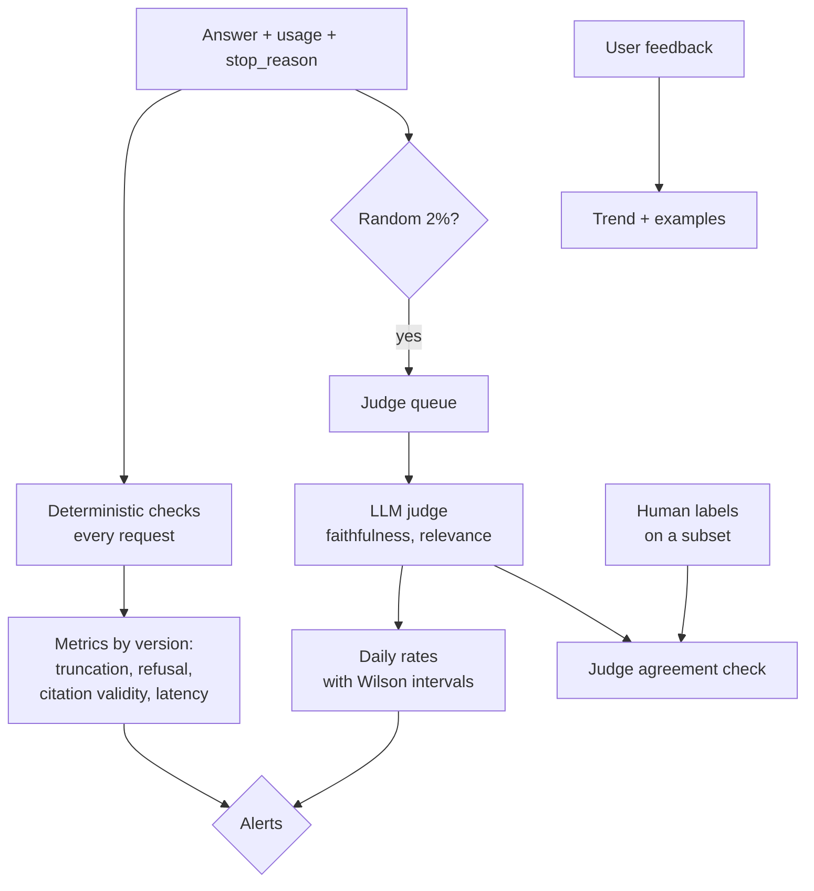

The model call is the most expensive, slowest and least predictable stage of a RAG request. It is also the stage whose output the user actually reads. A retriever that hands over the right chunks has done its job; whether the user gets a correct, grounded, complete, well-cited answer depends on what the model does with them, and that can change when a prompt is edited, a model version is replaced, the context grows, or the provider has a bad afternoon.

**Generation monitoring** measures the model's behaviour on live traffic. This lesson separates the checks you can afford on every answer (stop reasons, refusals, citation validity, format, latency, provider errors) from those you can afford only on a sample (judged faithfulness and relevance), shows how to put honest confidence intervals on sampled rates, and explains how to compare prompt or model versions in production without fooling yourself. [Retrieval monitoring](/learn/rag-observability/retrieval-monitoring) watched the evidence; this lesson watches what is done with it.

## Learning objectives

- List the per-request generation signals worth recording and the failure each one reveals.
- Implement deterministic checks for truncation, refusal, missing citations and citations to chunks that were never provided.
- Compute a Wilson score interval for a sampled rate and use it to decide whether two versions really differ.
- Design a sampled LLM-judge pipeline for faithfulness that runs off the request path, and state its limitations.
- Interpret latency signals specific to generation: time to first token, output rate and total time.

## Prerequisites

- [Retrieval monitoring](/learn/rag-observability/retrieval-monitoring): baselines, proxies and probes.
- [Faithfulness](/learn/generation-evaluation/faithfulness) and [Citation accuracy](/learn/generation-evaluation/citation-accuracy): what the offline metrics measure.
- [LLM-as-a-judge](/learn/testing-and-benchmarking/llm-as-a-judge): using a model to grade outputs, and its biases.
- [Refusal behaviour](/learn/prompt-engineering-for-rag/refusal-behaviour) and [Streaming responses](/learn/generation-strategies/streaming-responses).

## Why this matters

Generation failures come in two kinds. **Loud failures** are API errors: rate limits, overload responses, timeouts, malformed requests. They are easy to count and every service already does. **Quiet failures** return a normal-looking answer that is wrong in some way:

- **Truncation.** The model hit the `max_tokens` limit and stopped mid-sentence. The API call succeeded.
- **Over-refusal.** A prompt change makes the model say "I don't know" to questions the context answers.
- **Under-refusal.** The model answers from its own knowledge when the context lacks the answer, the classic hallucination in a RAG system.
- **Citation faults.** The answer cites nothing, or cites a chunk id that was never in the context.
- **Unfaithful content.** The answer states something the cited chunk does not say ("carry over until 30 June" when the chunk says 31 March).
- **Format drift.** The JSON your front end expects fails to parse, or the answer arrives in the wrong language.

Each of these has been caused in real systems by changes that looked harmless: a shorter output limit to save cost, a reworded system prompt, a model upgrade, a larger `k` that pushes the context past the point where the model attends well. Offline evaluation catches some before release, but production traffic is broader than any test set, and provider-side changes can happen without any change on your side if you call a model alias rather than a pinned version. Without monitoring, you learn about quiet failures from users, slowly and incompletely.

## The intuition

Think of the editor of a newspaper who cannot check every fact in every article before it goes out, but still has to keep quality up. She does three things.

First, she runs mechanical checks on *every* article: is it complete, or does it stop mid-sentence? Does every quotation name a source? Is every named source actually one of the reporter's interviews? These checks are cheap and catch a surprising amount.

Second, she has a fact-checker examine a *random handful* of articles each day in depth. She cannot check everything, but from the handful she can estimate how often errors slip through, and if that estimate rises she knows standards have slipped.

Third, she reads the readers' letters, knowing they are written mainly by the annoyed and are a skewed sample, but treating a sudden rise as a warning.

Generation monitoring is these three layers: deterministic checks on every answer, sampled deep checks with honest uncertainty, and user feedback as a noisy corroborating signal.

## How it works

### Layer 1: signals on every request

These come from the API response and from simple inspection of the answer, so they cost almost nothing.

| Signal | Source | Failure it reveals |
| --- | --- | --- |
| Stop reason | `response.stop_reason` | `max_tokens` means truncation; other values reveal tool or safety behaviour |
| Output tokens | `response.usage.output_tokens` | Answers getting longer (cost) or shorter (lost detail) |
| Refusal or abstention | Pattern match, or a field in structured output | Over- or under-refusal after a change |
| Citation presence | Parse citation markers | Answers with no grounding |
| Citation validity | Cited ids ⊆ ids in the context | Fabricated or stale citations |
| Format validity | JSON parse or schema validation | Broken front-end contract |
| Language match | Detect answer language vs query language | Wrong-language answers |
| Time to first token, total time, output rate | Timestamps around the stream | Provider slowness, prompt bloat |
| API errors and retries | Exception types, status codes | Rate limits, overload, timeouts |
| Fallback use | Your own code | How often a backup model answered |

The Anthropic API's `stop_reason` is `end_turn` for a natural finish, `max_tokens` when the output limit was reached, `stop_sequence` when a custom stop sequence matched and `tool_use` when the model requested a tool; newer API versions have added others, including one for refusals, so check the API reference for the current list and alert on any value you did not expect.

**Refusal detection** deserves care. Pattern-matching "I don't know" works only if the prompt dictates the exact wording, which is a good reason to dictate it (as [Handling missing information](/learn/prompt-engineering-for-rag/handling-missing-information) recommends) or, better, to have the model return a structured `answerable: bool` field alongside its answer ([Structured outputs](/learn/generation-strategies/structured-outputs)). Then refusal rate is a count of a field, not a guess.

**Citation validity** is the strongest cheap check in RAG. If the context contained chunks `hb-leave-01`, `hb-leave-02` and `hb-remote-01`, and the answer cites `hb-leave-2023`, the model has invented or misremembered a source, which is close to proof of an unfaithful answer, and it costs one set comparison to detect. Citation *presence* is weaker: an uncited answer may still be correct, but in a system whose prompt requires citations, a rising uncited rate means the model has stopped following the instruction.

### Layer 2: sampled judgement

Whether an answer is actually supported by its context, and whether it answers the question, cannot be checked by a regular expression. These are the [faithfulness](/learn/generation-evaluation/faithfulness) and [answer relevance](/learn/generation-evaluation/answer-relevance) metrics, normally measured with an LLM judge. Running a judge on every request would roughly double model cost and latency, so production systems judge a random sample, off the request path:

1. At the end of a request, with probability $p$ (say 2%), put the request id, query, context chunk ids and answer on a judging queue. Decide by request, not by user, so the sample is unbiased.
2. A background worker fetches the chunk texts by id, calls the judge model with a fixed, versioned judging prompt, and stores a verdict and reasons keyed by request id.
3. A daily job aggregates verdicts by pipeline version, with confidence intervals.
4. Every few weeks, humans label a subset of the judged items, to measure how often the judge agrees with people. A judge that drifts (because its own model changed) silently changes your metric.

Some requests deserve more than their random share: those with a bad citation, a low retrieval score, or negative user feedback. Judge these too, but keep them out of the rate estimate, because they are not a random sample. They feed failure analysis, not the headline number.

### Layer 3: user feedback

Thumbs up or down, "report a problem" buttons and follow-up behaviour (asking the same question again within a minute) are free signals. They are biased: most users never rate, and those who do skew towards strong reactions. Use them as a trend and as a source of examples, never as an accuracy estimate.

### Latency signals specific to generation

A streamed model call has three timings worth recording on its span (see [Tracing](/learn/rag-observability/tracing)):

- **Time to first token (TTFT):** from sending the request to receiving the first text. It grows with prompt length, because the model must process the whole prompt first, and with provider queueing.
- **Output rate:** output tokens divided by the time from first to last token. It depends mostly on the model and the provider's load.
- **Total time:** TTFT plus output tokens divided by output rate.

These decompose a slowdown. A TTFT rise with unchanged output rate points at longer prompts (check context token counts) or provider queueing; a fall in output rate points at the provider; a rise in total time with both unchanged means answers got longer. The [Streaming responses](/learn/generation-strategies/streaming-responses) lesson gives the arithmetic.

### Comparing versions in production

Every generation metric should be broken down by **pipeline version**: prompt template version, model id and generation settings. When a new version rolls out to a share of traffic (a canary release or an [A/B test](/learn/testing-and-benchmarking/a-b-testing)), compare its rates with the old version's over the same period. Two rules:

1. **Pin model versions** where your provider offers dated or versioned identifiers, so the model cannot change under you between comparisons, and record the model id from the response in every log line.
2. **Compare intervals, not point estimates.** A refusal rate of 7.9% against 9.2% may be noise. The mathematics below shows how to tell.



## The mathematics

### The Wilson score interval

**Intuition.** If the judge finds 12 unfaithful answers in a sample of 300, the observed rate is 4%, but a different sample of 300 would give a somewhat different count. A confidence interval states the range of true rates consistent with what you saw. The familiar "plus or minus 1.96 standard errors" formula behaves badly when the rate is near 0 or 1 or the sample is small (it can even go below zero). The Wilson interval fixes this and is the standard choice for monitoring rates.

$$
\frac{\hat p + \dfrac{z^2}{2n}}{1 + \dfrac{z^2}{n}} \;\pm\; \frac{z}{1 + \dfrac{z^2}{n}}\sqrt{\frac{\hat p(1-\hat p)}{n} + \frac{z^2}{4n^2}}
$$

Here $n$ is the sample size, $k$ the number of "events" (unfaithful answers) in it, $\hat p = k/n$ the observed rate, and $z$ the normal quantile for the chosen confidence (1.96 for 95%). The first fraction is the interval's centre, pulled slightly towards 0.5; the second term is its half-width.

**By hand.** $k = 12$, $n = 300$, $z = 1.96$, so $\hat p = 0.04$ and $z^2 = 3.8416$.

- $z^2/n = 0.012805$, so the denominator $1 + z^2/n = 1.012805$.
- Centre: $(0.04 + 3.8416/600) / 1.012805 = (0.04 + 0.006403)/1.012805 = 0.045816$.
- Inside the root: $0.04 \times 0.96 / 300 + 3.8416/(4 \times 90{,}000) = 0.000128 + 0.0000107 = 0.0001387$, whose root is $0.011776$.
- Half-width: $1.96 \times 0.011776 / 1.012805 = 0.022789$.

The interval is $0.0458 \pm 0.0228$, that is 2.3% to 6.9%. The naive interval would be $0.04 \pm 1.96\sqrt{0.04 \times 0.96/300} = 0.04 \pm 0.0222$, or 1.8% to 6.2%: similar here, but the Wilson interval is asymmetric, reflecting that the rate cannot fall below zero. Either way, 300 judged answers pin the unfaithful rate down only to within a few percentage points; to detect a change from 4% to 5%, you need thousands of judgements per version. The code below computes the same function.

**Comparing two versions.** If two versions' 95% intervals do not overlap, the difference is clearly real. If they overlap, the difference may still be real but needs more data or a proper two-proportion test; do not declare a winner.

## In code

**The problem.** Run deterministic checks over every logged answer, then compare two prompt versions, `v7` (current) and `v8` (a candidate that also lowered `max_tokens` to save cost), with Wilson intervals on each rate. The log is simulated with a fixed seed from a handful of realistic answer templates, so you can see what the checks catch.

**Dependencies.** pandas and the standard library.

```bash
pip install pandas
```

```python
import math
import random
import re

import pandas as pd

CITATION = re.compile(r"\[([a-z0-9]+(?:-[a-z0-9]+)+)\]")
REFUSAL = re.compile(r"\b(I don't know|I do not know|not in the (provided )?(context|documents))\b", re.I)


def check(record: dict) -> dict:
    """Cheap, deterministic checks that run on every generated answer."""
    text, provided = record["answer"], set(record["context_ids"])
    cited = CITATION.findall(text)
    refused = bool(REFUSAL.search(text))
    return {
        "truncated": record["stop_reason"] == "max_tokens",
        "refused": refused,
        "uncited": not refused and not cited,
        "bad_citation": any(c not in provided for c in cited),   # cites a chunk it was not given
        "out_tokens": record["output_tokens"],
    }


def wilson(k: int, n: int, z: float = 1.96):
    """95% Wilson score interval for a proportion k/n."""
    if n == 0:
        return (0.0, 1.0)
    p = k / n
    centre = (p + z * z / (2 * n)) / (1 + z * z / n)
    half = z * math.sqrt(p * (1 - p) / n + z * z / (4 * n * n)) / (1 + z * z / n)
    return (centre - half, centre + half)


# --- Simulated generation log: two prompt versions, same traffic ----------------
CTX = ["hb-leave-01", "hb-leave-02", "hb-remote-01"]
GOOD = "Annual leave is 25 days a year, and up to 5 unused days carry over [hb-leave-01]."
TEMPLATES = {   # (answer, stop_reason, output_tokens) -> probability, per version
    "v7": [((GOOD, "end_turn", 38), 0.86),
           (("I don't know based on the provided documents.", "end_turn", 12), 0.08),
           (("Annual leave is 25 days a year.", "end_turn", 10), 0.04),
           (("Leave carries over until 31 March [hb-leave-2023].", "end_turn", 15), 0.02)],
    "v8": [((GOOD, "end_turn", 38), 0.79),
           (("I don't know based on the provided documents.", "end_turn", 12), 0.08),
           (("Annual leave is 25 days a year.", "end_turn", 10), 0.04),
           (("Leave carries over until 31 March [hb-leave-2023].", "end_turn", 15), 0.02),
           (("Annual leave is 25 days a year, and up to 5 unused", "max_tokens", 64), 0.07)],
}
rng = random.Random(3)
rows = []
for version, options in TEMPLATES.items():
    for _ in range(1500):
        (answer, stop, out), = rng.choices([o for o, _ in options], [w for _, w in options])
        rec = {"answer": answer, "stop_reason": stop, "output_tokens": out, "context_ids": CTX}
        rows.append({"version": version, **check(rec)})
log = pd.DataFrame(rows)

print(check({"answer": "Leave carries over until 31 March [hb-leave-2023].", "stop_reason": "end_turn",
             "output_tokens": 15, "context_ids": CTX}), "\n")

lines = []
for version, g in log.groupby("version"):
    n = len(g)
    for metric in ["truncated", "refused", "uncited", "bad_citation"]:
        k = int(g[metric].sum())
        lo, hi = wilson(k, n)
        lines.append({"version": version, "metric": metric, "count": k, "rate": round(k / n, 3),
                      "95% CI": f"{lo:.3f}-{hi:.3f}"})
print(pd.DataFrame(lines).to_string(index=False))
print("\nmean output tokens:", log.groupby("version").out_tokens.mean().round(1).to_dict())
```

```output
{'truncated': False, 'refused': False, 'uncited': False, 'bad_citation': True, 'out_tokens': 15} 

version       metric  count  rate      95% CI
     v7    truncated      0 0.000 0.000-0.003
     v7      refused    119 0.079 0.067-0.094
     v7      uncited     58 0.039 0.030-0.050
     v7 bad_citation     29 0.019 0.013-0.028
     v8    truncated    107 0.071 0.059-0.085
     v8      refused    138 0.092 0.078-0.108
     v8      uncited    174 0.116 0.101-0.133
     v8 bad_citation     22 0.015 0.010-0.022

mean output tokens: {'v7': 34.4, 'v8': 35.9}
```

**The important lines.**

- `check` is pure and cheap: a regular expression, a set comparison and a field test. It runs inline on every answer, or in the log pipeline afterwards.
- `CITATION` matches bracketed ids such as `[hb-leave-01]`. Write the pattern to match the id format your prompt asks for, and test it against real answers: a pattern too narrow (for example one requiring exactly two digits) would silently classify `[hb-leave-2023]` as "no citation" rather than "bad citation", hiding the more serious fault.
- `bad_citation` compares cited ids with the ids actually placed in the context. It catches the model citing a chunk from memory or from an earlier conversation turn.
- `uncited` excludes refusals, which legitimately have no citation.
- `wilson` implements the formula above; with $k = 0$ it still gives a sensible upper bound (0.3% for 1,500 answers), whereas the naive formula would give an interval of zero width.

**What the output means.** The single check shows that the stale-handbook answer is flagged as a bad citation: `hb-leave-2023` was never in the context. In the comparison, `v8` truncates 7.1% of answers (interval 5.9% to 8.5%) against none for `v7`: a real and serious regression caused by the lower output limit. The truncated answers carry no citation, so the uncited rate roughly triples, a knock-on effect that would be confusing without the truncation metric beside it. The refusal rates (7.9% and 9.2%) have overlapping intervals, so this sample cannot say whether `v8` refuses more. Bad-citation rates are similar. Finally, mean output tokens barely changed (34.4 against 35.9): the truncated answers are longer than refusals but shorter than they should be, and the average hides both. Averages are poor monitors for generation; rates of specific failure conditions are good ones.

**Common errors.** Matching refusal phrases that the prompt does not dictate gives a rate that moves whenever the model's wording changes. Comparing versions over different periods confounds the version with changes in traffic. Computing rates over all requests including API errors mixes loud and quiet failures; count errors separately.

**Extending it: the sampled judge.** The judge below was not executed here, because it needs an API key; it shows the shape of a faithfulness judge using the Anthropic SDK's validated structured output. It would run in a background worker, on a sample, never on the request path.

```python
import anthropic
from pydantic import BaseModel

client = anthropic.Anthropic()  # reads ANTHROPIC_API_KEY from the environment

JUDGE_PROMPT_VERSION = "faithfulness-v3"
SYSTEM = (
    "You check whether an answer is fully supported by the context. "
    "List every claim in the answer that the context does not support. "
    "Do not use outside knowledge."
)


class Verdict(BaseModel):
    supported: bool
    unsupported_claims: list[str]


def judge(context: str, answer: str) -> Verdict:
    response = client.messages.parse(
        model="claude-opus-5-5",
        max_tokens=1024,
        system=SYSTEM,
        messages=[{"role": "user",
                   "content": f"<context>\n{context}\n</context>\n\n<answer>\n{answer}\n</answer>"}],
        output_format=Verdict,
    )
    return response.parsed_output
```

Store each verdict with the request id, `JUDGE_PROMPT_VERSION` and the judge's model id, so a change in the judge is never mistaken for a change in the system being judged.

## A real-world example

Meridian's Platform team wanted to cut AskMeridian's model costs and made two changes in one release: a shorter system prompt and a reduction of `max_tokens` from 1,024 to 256, chosen because "answers are rarely longer than 200 tokens". The offline evaluation set, mostly short policy questions, showed no regression.

Generation monitoring, broken down by pipeline version, showed within a day that the truncation rate for the new version had gone from effectively zero to about 6%, concentrated in IT runbook questions whose answers were step-by-step procedures. Those answers were being cut mid-procedure, sometimes before the step that mattered. The uncited rate rose at the same time; without the truncation metric, the team might have spent a day rewording citation instructions.

The fix was to restore a higher output limit and to add a truncation-rate alert on every version. The team also extended the evaluation set with long procedural questions drawn from production logs, so the offline tests would represent the traffic that the monitor had shown them. The cost saving was pursued instead through the [token tracking](/learn/rag-observability/token-tracking) work in the next lesson, which showed that the input side of the prompt was the larger cost.

## Common mistakes

- **Monitoring only API errors and latency.** Truncation, refusals and invented citations all return 200.
- **Averages instead of rates.** Mean output length or mean judge score hides a 7% truncation rate.
- **Detecting refusals by guessing phrases.** The metric moves when the model's wording changes; dictate the phrase or use a structured field.
- **Point estimates from small samples.** "Faithfulness fell from 96% to 94%" on 200 judgements each is noise until the intervals say otherwise.
- **Unversioned judges.** Changing the judge's prompt or model changes the metric; without versioning, it looks like the system changed.
- **Mixing targeted and random judgements.** Judging every flagged answer and reporting the combined rate overstates the failure rate.
- **Calling a model alias in production.** The provider may move the alias to a new model, and your metrics change with no change on your side.

## Best practices

- Record stop reason, token usage, model id, TTFT and total time on every model-call span and log line.
- Run deterministic checks (truncation, refusal field, citation presence and validity, format, language) on every answer.
- Prefer structured output with an explicit `answerable` field to pattern-matching refusals.
- Judge a random sample off the request path with a versioned prompt; periodically check judge agreement with human labels.
- Report every rate with a Wilson interval, broken down by pipeline version.
- Alert on any unexpected stop reason and on truncation above a small floor.
- Pin model versions and roll out prompt or model changes to a fraction of traffic first.

## Performance considerations

Deterministic checks take microseconds per answer; the cost question is the judge.

Suppose (as assumptions) 50,000 requests a day, a 2% sample, and a judge call with about 2,000 input tokens (context plus answer plus instructions) and 150 output tokens. That is 1,000 judge calls a day: 2 million input and 0.15 million output tokens. At a hypothetical price of USD 3 per million input tokens and USD 15 per million output tokens, the judge costs about $2 \times 3 + 0.15 \times 15 = 8.25$ dollars a day. Check your provider's current price list; the arithmetic is the point. Raising the sample to 10% multiplies that by five. Using a smaller, cheaper model as the judge cuts cost but must be validated against human labels like any judge.

Sample size, not traffic volume, determines precision. From the Wilson formula, the half-width for a rate near 4% at 95% confidence is about 2.2 points with 300 judgements and about 0.7 points with 3,000. If you need to detect a one-point change per version per week, you need on the order of thousands of judgements per version per week, which sets the sampling rate.

Judging must never add latency to the user's request: put it on a queue and process it in the background, and make sure the queue drops work rather than growing without bound if the judge API is slow.

## Security considerations

- Sampled answers and contexts sent to a judge are production data. Apply the redaction and access rules from [Logging](/learn/rag-observability/logging), and restrict judging to collections the judging pipeline is allowed to read.
- The judge reads document text, so it is exposed to [indirect prompt injection](/learn/rag-security-fundamentals/indirect-prompt-injection): a planted document could instruct the judge to mark answers as supported. Delimit the inputs clearly, instruct the judge to treat them as data, and compare judge results with deterministic checks.
- A sudden rise in bad citations or unsupported claims concentrated in one source can be a sign of a poisoned document; route such clusters to failure analysis.
- Watch for answers containing data the user should not see (for example personal data from a restricted document); a rule-based scan for known sensitive patterns on every answer is cheap ([Output validation](/learn/rag-security-fundamentals/output-validation)).

## Summary

- Generation's typical failures (truncation, over- and under-refusal, citation faults, unfaithful claims, format drift) return successful API responses; monitor them explicitly.
- Run cheap deterministic checks on every answer; stop reason and citation validity are the most informative.
- Measure faithfulness and relevance with a versioned LLM judge on a random sample, off the request path, validated against human labels.
- Report rates with Wilson intervals and break everything down by pipeline version; overlapping intervals mean "not yet known".
- Decompose generation latency into time to first token, output rate and answer length.

## Exercises

**1.** A judge finds 3 unfaithful answers in 150. Compute the 95% Wilson interval with the code's `wilson` function, and compare it with the naive interval.

<details><summary>Show solution</summary>

`wilson(3, 150)` gives approximately (0.0068, 0.0572), that is 0.7% to 5.7%. The naive interval is $0.02 \pm 1.96\sqrt{0.02 \times 0.98 / 150} = 0.02 \pm 0.0224$, which runs from −0.4% to 4.2%: it goes below zero and is too narrow at the top. With few events the difference matters, and the honest conclusion is that the unfaithful rate is somewhere between under 1% and nearly 6%.

</details>

**2.** Add a `format_ok` check for a version of AskMeridian that must return JSON with keys `answer` and `citations`. What should the check do with an answer that parses but has an empty `citations` list?

<details><summary>Show solution</summary>

```python
import json

def format_ok(text: str) -> bool:
    try:
        data = json.loads(text)
    except json.JSONDecodeError:
        return False
    return isinstance(data, dict) and {"answer", "citations"} <= data.keys()
```

An answer that parses with an empty `citations` list is *well-formed*, so `format_ok` should return `True`; the empty list is a separate signal (the existing `uncited` check, read from the field rather than from brackets). Keeping the checks separate means a format regression and a grounding regression show up as different metrics, which tells you whether to look at the output schema or at the prompt's citation instructions. If you use validated structured output (`messages.parse`), format failures become API-level validation errors that you count instead.

</details>

**3.** Over a week, the old version has 41 refusals in 600 answers and the new one 58 in 600. Is the new version refusing more? Use intervals, then say what you would do next.

<details><summary>Show solution</summary>

Rates: 6.8% and 9.7%. Wilson 95% intervals are roughly 5.1% to 9.1% and 7.5% to 12.3%. They overlap (between 7.5% and 9.1%), so the intervals alone do not establish a difference; a two-proportion test gives a p-value around 0.07, suggestive but not conclusive. Next steps: keep both versions running and collect more data, since the counts are small; and look at *which* questions the new version refuses that the old one answered. If those questions are answerable from the retrieved context, the new prompt is over-refusing; if they are not, the new version may be correctly refusing what the old one hallucinated, which would be an improvement. The rate alone cannot tell those apart.

</details>

**4.** Design decision. AskMeridian streams answers. Design the timing instrumentation of the model call so that, from the data, you can tell apart a provider slowdown, prompt bloat and longer answers.

<details><summary>Show solution</summary>

On the model-call span, record the request start, a `first_token` event when the first text chunk arrives and the end time, plus attributes for input tokens (from usage), context tokens (from your own context builder) and output tokens. Derive TTFT = first token − start, output rate = output tokens ÷ (end − first token) and total time.

Diagnosis rules: TTFT up with input tokens up and output rate unchanged means prompt bloat (check context tokens and chunk counts). TTFT up with input tokens unchanged, or output rate down, means provider-side slowness (compare with the provider's status page and error rates). Total time up with TTFT and output rate unchanged means longer answers (output tokens up). Emit TTFT, output rate and output tokens as histograms labelled by model and pipeline version so these rules can be dashboards, and keep per-request values in traces for drilling into examples.

</details>

## Check your understanding

```quiz
[
  {
    "q": "Which signal most directly reveals that answers are being cut off mid-sentence?",
    "options": [
      "Mean output tokens",
      "Time to first token",
      "The share of responses with stop reason `max_tokens`",
      "User thumbs-down rate"
    ],
    "answer": 2,
    "why": "The max_tokens stop reason means the output limit was reached; averages and feedback move only indirectly."
  },
  {
    "q": "An answer cites `[hb-leave-2023]`, but the context contained only `hb-leave-01`, `hb-leave-02` and `hb-remote-01`. What does this indicate?",
    "options": [
      "A citation to a chunk the model was not given, a strong sign of an unfaithful answer",
      "A formatting error only",
      "A retrieval failure",
      "Nothing; models may cite any document"
    ],
    "answer": 0,
    "why": "The model can only ground on what it was given; citing an id outside the context means it invented or recalled the source."
  },
  {
    "q": "Why should the faithfulness judge run on a random sample rather than on every request?",
    "options": [
      "Judges are only accurate on small batches",
      "Running it on every request would roughly double model cost and, inline, add latency; a random sample gives an unbiased estimate cheaply",
      "Random sampling removes the judge's biases",
      "Regulations forbid judging every answer"
    ],
    "answer": 1,
    "why": "A random sample estimates the rate at a fraction of the cost; sampling does not fix judge bias, which needs human calibration."
  },
  {
    "q": "Version A refuses 7.9% (95% CI 6.7% to 9.4%) and version B 9.2% (7.8% to 10.8%). What can you conclude?",
    "options": [
      "B refuses significantly more",
      "A refuses significantly more",
      "The intervals overlap substantially, so this data does not establish a difference",
      "The refusal metric is broken"
    ],
    "answer": 2,
    "why": "Substantially overlapping intervals mean the difference may be noise; collect more data and inspect which questions differ."
  },
  {
    "q": "Time to first token has risen while output rate and output tokens are unchanged, and input tokens per request have grown by 40%. What is the most likely cause?",
    "options": [
      "The provider is overloaded",
      "Answers became longer",
      "The judge is running inline",
      "Prompts got longer, for example more or larger chunks in the context"
    ],
    "answer": 3,
    "why": "TTFT grows with prompt length; the growth in input tokens with unchanged output rate points to prompt bloat rather than provider slowness."
  }
]
```

## Further reading

- Anthropic documentation, the [Messages API reference](https://docs.anthropic.com/en/api/messages), including the list of stop reasons and the usage fields.
- Wilson (1927), "Probable Inference, the Law of Succession, and Statistical Inference", *Journal of the American Statistical Association* 22: the original score interval.
- Brown, Cai and DasGupta (2001), "Interval Estimation for a Binomial Proportion", *Statistical Science* 16: why the naive interval fails and which alternatives to use.
- Zheng and colleagues (2023), [Judging LLM-as-a-Judge with MT-Bench and Chatbot Arena](https://arxiv.org/abs/2306.05685): judge agreement with humans and known judge biases.
- Es, James, Espinosa-Anke and Schockaert (2023), [RAGAS: Automated Evaluation of Retrieval Augmented Generation](https://arxiv.org/abs/2309.15217).
