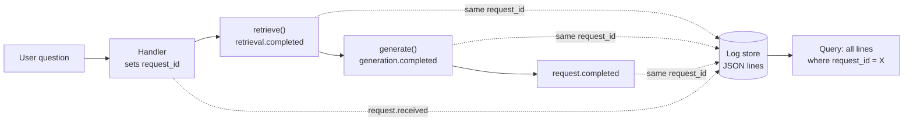

A RAG system that answers wrongly does not crash. It returns a confident, well-formatted paragraph, the HTTP status is 200, and nothing on any dashboard turns red. When a user later reports that AskMeridian told them they could carry over ten days of leave, the only way to find out why is to look at what the system actually did for that request: which chunks it retrieved, with what scores, what the model was asked, and what it said. That record is the log.

This lesson is about writing logs that can answer such questions. It covers **structured logging** (one machine-readable event per line instead of free text), the fields every RAG stage should emit, **correlation identifiers** that tie the lines of one request together, log levels and sampling, and the hardest decision in RAG logging: how much of the user's question, the retrieved documents and the generated answer you are allowed to keep. Spans and timing trees belong to the next lesson, [Tracing](/learn/rag-observability/tracing); this one builds the foundation they sit on.

## Learning objectives

- Explain why free-text log messages fail for RAG systems and convert a pipeline to structured, one-event-per-line JSON logging.
- List the fields each RAG stage (request, retrieval, generation, outcome) should log, and justify each by a question it answers.
- Propagate a request identifier through a pipeline with `contextvars` so that every log line of one request can be joined.
- Choose, for a given system, what to log about queries, chunks and answers (full text, fingerprint, length or nothing) and defend the choice on privacy and debugging grounds.
- Query a set of JSON log lines with pandas to answer an operational question.

## Prerequisites

- [Exception handling](/learn/python-for-rag-engineering/exception-handling): the `logging` module basics and the rule "log an error once, where it is handled".
- [End-to-end RAG lifecycle](/learn/rag-architecture-fundamentals/end-to-end-rag-lifecycle): the stages a request passes through.
- [Retrieval pipeline](/learn/rag-architecture-fundamentals/retrieval-pipeline) and [Generation pipeline](/learn/rag-architecture-fundamentals/generation-pipeline): what each stage takes in and gives out.

## Why this matters

Observability is the ability to answer questions about a running system from the data it emits, including questions you did not anticipate. It rests on three signals: **logs** (discrete events with details), **metrics** (numbers aggregated over time) and **traces** (the timed tree of operations inside one request). Logs come first: they are the cheapest to add and carry the richest detail about a single event.

A conventional web service fails loudly: an exception, a 500 status, a timeout. Its logs mostly need to record errors. A RAG service fails quietly, and its failures live in the *content* of successful requests:

- The retriever returned five chunks, but none contained the answer.
- The right chunk was retrieved but was ranked sixth and cut from the context.
- The right chunk reached the model, which ignored it and answered from memory.
- The index still holds the superseded 2023 handbook, so the answer is a correct quote of the wrong document.

None of these raises an exception. To tell them apart after the fact you need, for the specific request in question, the chunk identifiers and scores, the document versions, the prompt size and the model's stop reason. A log line that says `INFO answered question in 2.3s` tells you nothing about any of them.

Without good logs, someone re-runs the user's question an hour later, gets a different answer because the index has changed, and declares the bug "not reproducible". With good logs, the investigation is a query: find the request, read its retrieval event, see which chunk was ranked first.

## The intuition

Think of a hospital ward. Every nurse who does something to a patient writes a line on the patient's chart: the time, what was done, the dose, their initials. The chart has a fixed layout, so a doctor arriving at 3 a.m. can scan it in seconds. Every line carries the patient's identifier, so charts never get mixed up. And there are rules about what goes on the chart and what does not: the chart records "blood pressure 120/80", not the patient's private conversation with the nurse.

Good logging is the same three habits:

1. **A fixed layout.** Each entry is a set of named fields (time, event, values), not a sentence that someone must read and interpret.
2. **A patient identifier on every line.** In software this is the request identifier, and it lets you pull out exactly the entries belonging to one request from millions of others.
3. **Rules about content.** You record what you need to act on, and you leave out what you have no right or reason to keep.

A line such as `Retrieved 3 docs for user priya@meridian.example, best match leave policy (0.44)` breaks all three: it is a sentence, it cannot be joined to its request's other lines, and it writes a personal e-mail address into a file many engineers can read.

## How it works

### Structured logging

A **structured log** is a sequence of records, each a set of key-value fields, written in a machine-readable format. The common choice is **JSON Lines**: one JSON object per line. Compare:

```text
2025-06-03 14:02:11 INFO retrieved 3 chunks, top score 0.44 (hb-leave-01) in 0.7ms
```

```json
{"ts": "2025-06-03T14:02:11Z", "level": "INFO", "event": "retrieval.completed", "request_id": "1c80a3b1799d", "chunk_ids": ["hb-leave-01", "it-vpn-01", "it-pass-01"], "top_score": 0.44, "latency_ms": 0.7}
```

The first is pleasant for a human reading one line. The second can be filtered (`top_score < 0.2`), aggregated (median `latency_ms` by hour), joined (all events with this `request_id`) and loaded into any log platform without a parsing rule.

Three conventions make structured logs useful:

- **The message is an event name, not a sentence.** Use a small, stable vocabulary such as `request.received`, `retrieval.completed`, `generation.completed`, `request.failed`. Dashboards and alerts filter on these names, so treat them as an interface and do not rename them casually.
- **Values go in fields, never in the message string.** If the score is inside the message, nobody can compute its distribution.
- **Field names and types are consistent.** `latency_ms` is always a number in milliseconds, in every event that has it. A field that is a number in one service and a string with "ms" on the end in another cannot be aggregated.

### What a RAG pipeline should log

Each field should earn its place by answering a question you will actually ask. A practical minimum for each stage:

| Event | Fields | The question it answers |
| --- | --- | --- |
| `request.received` | request id, user or tenant id (pseudonymous), channel, query length, query fingerprint | Who asked, through what, and is this the same question as another request? |
| `retrieval.completed` | k, filters applied, chunk ids, scores, document versions, index name, latency | What evidence did the system find, and how confident was the retriever? |
| `rerank.completed` | candidate count, kept ids, scores, latency | Did reranking promote or drop the right chunk? |
| `context.built` | chunk ids included, chunks dropped for budget, context token count | What did the model actually see? |
| `generation.completed` | model, input and output tokens, stop reason, latency, refused flag, cited ids | What did the model do, and did it finish? |
| `request.completed` / `request.failed` | status, total latency, error type | Did the user get an answer? |
| `feedback.received` | request id, rating, optional reason code | Was the user satisfied? |

Two fields deserve special emphasis.

**Chunk identifiers with versions.** Logging `"leave policy"` is useless; logging `hb-leave-01` with the document version or content hash lets you open the exact text the model saw, even after the document has been edited. This depends on the stable identifiers built in [Document identifiers](/learn/document-engineering/document-identifiers) and [Document versioning](/learn/document-engineering/document-versioning).

**A pipeline version.** RAG behaviour depends on the prompt template, model, embedding model, chunking settings and index snapshot. Stamp every line with a `pipeline_version` that changes whenever any of them does, and "answers got worse on Tuesday" becomes "answers got worse when the version changed", which is half the diagnosis.

### Correlation identifiers

A single request produces several log lines, written by different functions, possibly interleaved with lines from hundreds of concurrent requests. A **correlation identifier** (here, `request_id`) is a value generated once at the start of a request and attached to every line it produces, so that one filter recovers the whole story.

Passing the identifier as an argument to every function is clumsy and easy to forget. Python's `contextvars` module solves this: a `ContextVar` holds a value that is local to the current execution context, which means to the current thread and, in asynchronous code, to the current task. You set it once when the request arrives, and the log formatter reads it when writing each line. Concurrent `asyncio` requests each see their own value, which a plain global variable could not do.

The flow, step by step:

1. The request handler generates a request identifier (or accepts one sent by the caller, such as a gateway's request header).
2. It sets the `ContextVar` and keeps the reset token.
3. Every stage logs events through a helper; the formatter adds `request_id` from the `ContextVar` automatically.
4. The handler returns the identifier to the client (for example as a response header), so a user's bug report can quote it.
5. In a `finally` block the handler resets the `ContextVar`, so the identifier cannot leak into the next request handled by the same thread.



When a request crosses process boundaries (gateway, retrieval service, model gateway), the identifier must travel with it, usually in an HTTP header. That is exactly the problem the W3C trace context standard solves, and it is covered properly in [Distributed tracing](/learn/rag-observability/distributed-tracing). Once you adopt tracing, log the trace identifier as well, so a log line can take you straight to the trace.

### Levels and volume

Log **levels** classify how urgent an event is: `DEBUG` (detail useful while developing), `INFO` (normal, noteworthy events), `WARNING` (something unexpected that the system handled, such as a retry or a fallback to a smaller model), `ERROR` (a request failed) and `CRITICAL` (the service cannot work). Production usually runs at `INFO`.

For RAG, a useful rule is that the per-stage events in the table above are `INFO`, because you need them for *every* request, including the successful ones; the quiet failures are inside successful requests. Detailed payloads such as full prompt text belong at `DEBUG` or in a separate, access-controlled store. Use `WARNING` for degraded behaviour that a dashboard should count: retrieval returned fewer than k results after filtering, the context was truncated to fit the budget, the model stopped because it hit `max_tokens`.

If volume becomes a problem, **sample** rather than drop whole event types. Keep every error and warning, keep every event for a random fraction of requests (decided once per request, so a sampled request is complete), and keep aggregated counts of the rest as metrics.

### The content question: what may you keep?

The most valuable debugging data in a RAG system is also the most sensitive. The query may contain personal data ("my manager Dave refused my leave because of my surgery"); the retrieved chunks may be restricted documents; the answer may repeat both. Logs are typically retained longer, replicated more widely and readable by more people than the source systems. So decide deliberately, per field, among four options:

1. **Nothing.** Safest, and enough for many metrics.
2. **Length or count.** `query_chars`, `answer_chars`. Useful for distributions and anomalies, reveals almost nothing.
3. **A fingerprint.** A hash of the normalised query lets you count repeated questions and match a user's report to a log entry without storing the text. A short unsalted hash of a common question can be reversed by trying likely inputs, so treat fingerprints as pseudonymous rather than anonymous, and use a keyed hash (HMAC) if that matters.
4. **Full text.** Necessary for real debugging and for building evaluation sets from production traffic, but it should go to a separate store with restricted access, a short retention period and redaction applied first.

Chunks are different: you rarely need their text in logs, because the id plus version fetches it from the document store, which already enforces access control.

> [!KEY]
> Log identifiers, numbers and decisions for every request; log raw text only where you have a purpose, a restricted store and a retention limit. For chunks, the id and version are almost always enough.

In a containerised service, write JSON lines to standard output and let the platform collect, ship and index them; the application should not manage log files itself.

## In code

**The problem.** Instrument a small AskMeridian pipeline so that every stage emits one structured event, every line carries the request identifier and pipeline version, personal data is scrubbed, and the resulting logs can be queried as data.

**Dependencies.** The standard library's `logging`, plus scikit-learn for a toy TF-IDF retriever and pandas to query the logs. No API key is needed; the generator is a stand-in that returns realistic usage fields.

```bash
pip install scikit-learn pandas
```

```python
import contextvars
import hashlib
import io
import json
import logging
import random
import re
import time

import pandas as pd
from sklearn.feature_extraction.text import TfidfVectorizer
from sklearn.metrics.pairwise import cosine_similarity

# --- 1. Context that every log line in a request should carry -----------------
request_id_var = contextvars.ContextVar("request_id", default="-")
PIPELINE_VERSION = "askmeridian-2025.06.1"   # bump when prompt, model or index changes


class JsonFormatter(logging.Formatter):
    """One JSON object per line: machine-parseable, one event per record."""
    converter = time.gmtime   # timestamps in UTC

    def format(self, record: logging.LogRecord) -> str:
        entry = {
            "ts": self.formatTime(record, "%Y-%m-%dT%H:%M:%SZ"),
            "level": record.levelname,
            "logger": record.name,
            "event": record.getMessage(),
            "request_id": request_id_var.get(),
            "pipeline_version": PIPELINE_VERSION,
        }
        entry.update(getattr(record, "fields", {}))
        if record.exc_info:
            entry["error"] = self.formatException(record.exc_info).splitlines()[-1]
        return json.dumps(entry, ensure_ascii=False)


EMAIL = re.compile(r"[\w.+-]+@[\w-]+\.[\w.]+")


class RedactFilter(logging.Filter):
    """Last line of defence: scrub e-mail addresses from every string field."""

    def filter(self, record: logging.LogRecord) -> bool:
        fields = getattr(record, "fields", {})
        for key, value in fields.items():
            if isinstance(value, str):
                fields[key] = EMAIL.sub("<email>", value)
        return True


stream = io.StringIO()                        # stands in for stdout / a log shipper
handler = logging.StreamHandler(stream)
handler.setFormatter(JsonFormatter())
handler.addFilter(RedactFilter())
log = logging.getLogger("askmeridian")
log.setLevel(logging.INFO)
log.addHandler(handler)
log.propagate = False


def event(name: str, level: int = logging.INFO, **fields) -> None:
    log.log(level, name, extra={"fields": fields})


# --- 2. A tiny RAG pipeline that logs one event per stage ----------------------
DOCS = {
    "hb-leave-01": "Annual leave is 25 days; up to 5 unused days carry over until 31 March.",
    "hb-remote-01": "Staff may work remotely up to 3 days a week.",
    "hb-equip-01": "The home-office equipment budget is £400; contractors are not eligible.",
    "it-vpn-01": "Error E-4021 means the VPN client is out of date; update it from the IT portal.",
    "it-pass-01": "Passwords must be rotated every 90 days.",
}
ids, texts = list(DOCS), list(DOCS.values())
vectoriser = TfidfVectorizer().fit(texts)
matrix = vectoriser.transform(texts)


def retrieve(query: str, k: int = 3):
    t0 = time.perf_counter()
    scores = cosine_similarity(vectoriser.transform([query]), matrix)[0]
    order = scores.argsort()[::-1][:k]
    hits = [(ids[i], round(float(scores[i]), 3)) for i in order]
    event("retrieval.completed",
          k=k, chunk_ids=[h[0] for h in hits], scores=[h[1] for h in hits],
          top_score=hits[0][1], latency_ms=round((time.perf_counter() - t0) * 1000, 1))
    return hits


def fake_generate(query: str, hits):
    """Stands in for the LLM call; returns text plus usage like a real API."""
    if hits[0][1] < 0.2:
        text, stop = "I don't know based on the handbook.", "end_turn"
    else:
        text, stop = f"According to [{hits[0][0]}]: {DOCS[hits[0][0]]}", "end_turn"
    usage = {"input_tokens": 180 + 40 * len(hits), "output_tokens": len(text.split()) * 2}
    event("generation.completed", model="claude-opus-5-5", stop_reason=stop,
          refused=text.startswith("I don't know"), answer_chars=len(text), **usage)
    return text


rng = random.Random(42)   # seeded so the example is reproducible; use uuid4 in production


def answer(query: str, user: str):
    token = request_id_var.set(f"{rng.getrandbits(48):012x}")
    t0 = time.perf_counter()
    try:
        # Log a fingerprint and the length of the query, not the query itself.
        event("request.received", user=user,
              query_sha=hashlib.sha256(query.encode()).hexdigest()[:10], query_chars=len(query))
        if not query.strip():
            raise ValueError("empty query")
        hits = retrieve(query)
        text = fake_generate(query, hits)
        event("request.completed", status="ok",
              total_ms=round((time.perf_counter() - t0) * 1000, 1))
        return text
    except Exception:
        log.error("request.failed", exc_info=True, extra={"fields": {"status": "error"}})
        return None
    finally:
        request_id_var.reset(token)


for q, u in [("How many days of annual leave do I get?", "priya@meridian.example"),
             ("What does error E-4021 mean?", "tom@meridian.example"),
             ("Can I bring my dog to the office?", "sam@meridian.example"),
             ("   ", "lee@meridian.example")]:
    answer(q, u)

lines = stream.getvalue().splitlines()
print(lines[0])
print(lines[1])
print(f"... {len(lines)} lines in total\n")

# --- 3. Logs as data: answer questions with a query, not with grep -----------
df = pd.DataFrame(json.loads(line) for line in lines)
retr = df[df.event == "retrieval.completed"][["request_id", "top_score", "chunk_ids"]]
gen = df[df.event == "generation.completed"][["request_id", "refused", "input_tokens"]]
gen = gen.astype({"input_tokens": int})
joined = retr.merge(gen, on="request_id")
print(joined.to_string(index=False))
print("\nfailed requests:", df[df.event == "request.failed"][["request_id", "error"]].to_dict("records"))
```

```output
{"ts": "2026-11-14T14:29:54Z", "level": "INFO", "logger": "askmeridian", "event": "request.received", "request_id": "1c80a3b1799d", "pipeline_version": "askmeridian-2025.06.1", "user": "<email>", "query_sha": "188eac8525", "query_chars": 39}
{"ts": "2026-11-14T14:29:54Z", "level": "INFO", "logger": "askmeridian", "event": "retrieval.completed", "request_id": "1c80a3b1799d", "pipeline_version": "askmeridian-2025.06.1", "k": 3, "chunk_ids": ["hb-leave-01", "it-vpn-01", "it-pass-01"], "scores": [0.44, 0.127, 0.095], "top_score": 0.44, "latency_ms": 0.4}
... 14 lines in total

  request_id  top_score                              chunk_ids refused  input_tokens
1c80a3b1799d      0.440   [hb-leave-01, it-vpn-01, it-pass-01]   False           300
bdd606671ad1      0.333   [it-vpn-01, it-pass-01, hb-equip-01]   False           300
3eb146685257      0.342 [hb-equip-01, it-vpn-01, hb-remote-01]   False           300

failed requests: [{'request_id': '23b8392456de', 'error': 'ValueError: empty query'}]
```

(Timestamps and latencies will differ on your machine.)

**The important lines.**

- `JsonFormatter.format` builds one dictionary per record. Fixed fields (`ts`, `level`, `event`, `request_id`, `pipeline_version`) come first, then whatever the caller passed in `fields`. `converter = time.gmtime` makes timestamps UTC, which avoids confusion when servers sit in different time zones.
- `request_id_var` is a `ContextVar`. The formatter reads it, so no stage function needs a `request_id` argument. The `finally` block resets it with the token returned by `set`, so the next request on this thread starts clean.
- `event(...)` is a thin helper that passes structured fields via `extra={"fields": ...}`. The stdlib logger copies `extra` keys onto the record, which is how the formatter finds them.
- `RedactFilter` runs before formatting and replaces e-mail addresses in string fields. Here it scrubbed the `user` field, which in a real system should have been a pseudonymous internal id in the first place; the filter is a safety net for the mistakes you will make anyway, not a substitute for choosing what to log.
- `request.received` logs `query_sha` and `query_chars` instead of the query. Two users asking the identical question produce the same fingerprint, so you can count popular questions without storing them.
- `log.error("request.failed", exc_info=True, ...)` records the exception once, where the request is handled.

**What the output means.** The first two lines are the first request's `request.received` and `retrieval.completed` events, sharing `request_id` `1c80a3b1799d`. The table is built by joining retrieval and generation events on `request_id`, the operation that free-text logs make impossible. Look at the third row: "Can I bring my dog to the office?" retrieved `hb-equip-01` with a top score of 0.342, higher than the genuine E-4021 lookup, purely because "office" appears in "home-office". The stand-in generator answered instead of refusing. The logs did not prevent this failure, but they make it findable: a reviewer can see what was retrieved and with what score, and the question "how often do we answer with a top score below X?" becomes a one-line filter. Turning such checks into continuous dashboards is the subject of [Retrieval monitoring](/learn/rag-observability/retrieval-monitoring). The fourth request failed validation, and its `request.failed` line carries the error type.

**Common errors.**

- Passing a reserved attribute name in `extra` (such as `message`, `args` or `name`) raises `KeyError: "Attempt to overwrite 'message' in LogRecord"`. Nesting fields under a single `fields` key, as here, avoids collisions.
- `json.dumps` fails on values that are not JSON-serialisable, such as NumPy floats in older NumPy versions or `datetime` objects. Convert to built-in types (`float(...)`, `.isoformat()`) before logging, or pass `default=str` to `json.dumps`.

**Extending it.** Write to `sys.stdout` instead of a `StringIO`, add a `trace_id` field once you adopt [Tracing](/learn/rag-observability/tracing), or swap the hand-written formatter for a maintained library such as `structlog`; the design decisions do not change.

## A real-world example

Meridian's Platform team ran the first version of AskMeridian with the logging that came with their web framework: one access-log line per HTTP request, with path, status and duration, plus free-text `INFO` messages scattered through the code. For two months that seemed sufficient.

Then HR raised a complaint: several employees had been told that unused leave carries over "until 30 June", a rule from an old draft. The access log showed the requests had succeeded. Nobody could see which chunks had been used, because the retrieval code logged `"found 5 docs"`, and re-running the questions gave the correct answer because a re-index had since changed the corpus. The investigation stalled for a week.

The fix was a logging redesign along the lines of this lesson. Every stage now emits a structured event; `retrieval.completed` lists chunk ids with document versions and scores; `pipeline_version` records the prompt template, model and index snapshot together. The query text itself is written only to a separate store visible to the two engineers on call, with redaction and a 30-day retention period agreed with HR and the data-protection lead. Ordinary logs carry only the fingerprint and length.

The next similar complaint took twenty minutes. The `request_id` from the user's screenshot led to a `retrieval.completed` line whose top chunk's version identifier pointed to a draft folder an ingestion connector should have skipped. The defect was in ingestion, and the logs said so directly.

## Common mistakes

- **Logging sentences instead of fields.** Scores and ids embedded in prose cannot be filtered, aggregated or joined. Every analysis then starts with a fragile regular expression.
- **No request identifier, or one that is not on every line.** Concurrent requests interleave, and you cannot tell which retrieval belongs to which answer.
- **Logging only failures.** RAG's typical failures are successful requests with wrong content, which then leave no trace.
- **Logging chunk text instead of chunk ids and versions.** It multiplies log volume, copies restricted content into a less protected store, and still does not tell you which version of the document was used.
- **Writing raw user questions into the general log stream.** Personal data then sits in a system with broad access and long retention, which is a privacy problem and, in many jurisdictions, a legal one.
- **Omitting the pipeline version.** You cannot tell whether a change in behaviour came from the model, the prompt or a re-index.

## Best practices

- Emit JSON Lines to standard output and let the platform collect them.
- Define a small, documented event vocabulary (`request.received`, `retrieval.completed`, …) and a field dictionary with units in the names (`latency_ms`, `context_tokens`).
- Generate a request identifier at the edge, store it in a `ContextVar`, attach it to every line and return it to the client.
- Log chunk ids, document versions, scores and the context token count for every request; these are what make a quiet failure diagnosable.
- Stamp every line with the pipeline version (prompt, model, embedding model, index snapshot).
- Decide per field whether to keep nothing, a length, a fingerprint or the full text, and record that decision with the data-protection owner. Put any full text in a separate, access-controlled store with a short retention period.
- Apply a redaction filter as a backstop, and test it with known personal data.

## Performance considerations

Logging has a cost in CPU, I/O and storage, and the storage cost is usually the one that grows. Reason about it with arithmetic. Suppose (as an assumption) AskMeridian handles 50,000 requests a day and each request emits 5 events averaging 400 bytes. That is $50{,}000 \times 5 \times 400 = 100$ MB a day, or about 3 GB a month before compression: modest. Now add the full prompt (say 6,000 characters of context) to the generation event: each request gains about 6 KB, the daily volume rises to about 400 MB, and the logs now hold four times as much data, almost all of it document text you could have fetched by id. This is another reason to log ids, not chunk text.

Formatting JSON costs microseconds per event, negligible next to model calls measured in hundreds of milliseconds. Two things can still hurt:

- **Synchronous writes to a slow destination.** If a handler writes over the network and the destination stalls, request threads block. Write to standard output or a local buffer and ship asynchronously; the standard library's `QueueHandler` and `QueueListener` move formatting and I/O off the request path.
- **Expensive work for discarded messages.** `log.debug(json.dumps(huge_object))` serialises the object even when `DEBUG` is disabled. Check `log.isEnabledFor(logging.DEBUG)` first, or pass arguments lazily.


## Security considerations

- **Personal data.** Queries and answers can contain names, health information and other personal data. Minimise what you log, pseudonymise user identifiers, set retention limits, and make sure log stores are covered by your deletion processes ([PII detection](/learn/access-control-and-privacy/pii-detection) and [Data retention](/learn/access-control-and-privacy/data-retention) go further).
- **Access control leakage.** If AskMeridian enforces document-level permissions at retrieval time, logging chunk *text* copies restricted content to everyone who can read logs. Logging ids keeps the permission check where it belongs.
- **Secrets.** Never log API keys, authorisation headers or full HTTP request objects. Client libraries sometimes include headers in exception messages; review what `exc_info` captures.
- **Log injection.** User input in free-text logs can contain newlines that forge extra lines; JSON encoding escapes them.
- **Logs are not audit logs.** Operational logs may be sampled and rotated; an [audit log](/learn/enterprise-rag-governance/audit-logs) for compliance needs completeness and tamper resistance and should be designed separately.

## Summary

- RAG systems fail quietly inside successful requests, so logs must record what each stage did for every request, not just errors.
- Use structured logging: one JSON object per line, a stable event name, values in typed fields with units in their names.
- Attach a request identifier (via `contextvars`) and a pipeline version to every line, so one request's events can be joined and behaviour changes can be dated.
- Log chunk ids, versions, scores, token counts and stop reasons; these are the facts that separate ingestion, retrieval and generation faults.
- Treat query and answer text as sensitive: prefer lengths and fingerprints in the general logs, and keep any full text in a restricted store with short retention.

## Exercises

**1.** A colleague's retrieval code logs `log.info(f"Top match {doc_title} scored {score:.2f}")`. List three questions about production behaviour that this line cannot answer and that a structured `retrieval.completed` event could.

<details><summary>Show solution</summary>

Any three of: (a) what fraction of requests had a top score below a threshold (the score is buried in a string); (b) which request, and so which answer, this retrieval belongs to (no request id); (c) which version of the document was retrieved (a title is not an identifier); (d) what the other k−1 chunks were; (e) whether behaviour changed after a deployment (no pipeline version). A structured event with `request_id`, `chunk_ids`, `scores`, versions and `pipeline_version` answers each with a filter or a join.

</details>

**2.** Extend the code so that `retrieve` emits a `WARNING`-level `retrieval.low_confidence` event whenever the top score is below 0.35, and then use pandas to compute the fraction of requests that triggered it. Which requests in the example trigger it?

<details><summary>Show solution</summary>

Inside `retrieve`, after computing `hits`:

```python
if hits[0][1] < 0.35:
    event("retrieval.low_confidence", level=logging.WARNING, top_score=hits[0][1])
```

Then:

```python
total = (df.event == "request.received").sum()
low = (df.event == "retrieval.low_confidence").sum()
print(low / total)
```

The E-4021 question (0.333) and the dog question (0.342) trigger it; the leave question (0.44) does not, and the empty query never reaches retrieval. So 2 of 4 requests, 0.5. Note what this shows: a fixed threshold catches the genuinely off-topic question but also a perfectly good identifier lookup, because TF-IDF scores for short, exact queries are not on the same scale as for longer ones. Thresholds need calibrating on real traffic ([Retrieval thresholding](/learn/advanced-retrieval-optimisation/retrieval-thresholding)), and a warning count is a monitoring signal, not a verdict.

</details>

**3.** The `query_sha` field uses the first 10 hex characters of an unsalted SHA-256 of the raw query. Give two weaknesses of this design and an improvement for each.

<details><summary>Show solution</summary>

First, it is reversible for common questions: anyone can hash "How many days of annual leave do I get?" and find matching log lines, so the fingerprint is pseudonymous, not anonymous. Use a keyed hash (`hmac.new(secret, query.encode(), "sha256")`) with the key held outside the log system; then only holders of the key can test guesses.

Second, it treats trivially different queries as different: a change of case or a trailing space gives a new hash. Normalise before hashing (lower-case, collapse whitespace, strip trailing punctuation) so the fingerprint groups what are really the same question.

</details>

**4.** Design decision. Meridian's HR team asks for every AskMeridian question and answer to be logged in full and kept for two years "so we can see what people ask about". The Platform team wants full text for debugging, but only briefly. Propose a design that serves both needs and explain what each party gets.

<details><summary>Show solution</summary>

Separate the purposes. **Operational logs** (all engineers) carry no free text: ids, versions, scores, token counts, lengths and keyed fingerprints, retained for, say, 30 to 90 days. **A debug store** holds redacted full query and answer text for a short period (for example 14 to 30 days), readable only by the on-call engineers, with access itself logged. **An analytics dataset** for HR holds aggregated or categorised data rather than raw text: topic labels assigned by a classifier, counts per topic per week, and anonymised examples reviewed before release. It can be kept for two years because it contains no individual's questions.

HR gets what it needs (topics and trends) without a two-year archive of individuals' possibly sensitive questions; engineers get full text for recent incidents; the data-protection lead gets a stated purpose, minimisation and retention for each store. If HR genuinely needs raw text, that is a policy decision for the data-protection lead, not a logging setting.

</details>

## Check your understanding

```quiz
[
  {
    "q": "Why are per-stage INFO events needed for successful RAG requests, not only for failures?",
    "options": [
      "Because log platforms charge less for INFO than for ERROR lines",
      "Because the typical RAG failure is a successful request with wrong content, which leaves no error",
      "Because Python's logging module drops ERROR lines when INFO is disabled",
      "Because successful requests are slower and need timing data"
    ],
    "answer": 1,
    "why": "Retrieving the wrong chunk or ignoring the right one raises no exception; only detailed events on every request make these failures diagnosable."
  },
  {
    "q": "What does a `contextvars.ContextVar` provide that a module-level global variable does not, for holding a request id?",
    "options": [
      "Faster access from the log formatter",
      "Automatic JSON serialisation",
      "A separate value per thread and per asyncio task, so concurrent requests do not overwrite each other's id",
      "Persistence of the id across process restarts"
    ],
    "answer": 2,
    "why": "A ContextVar's value is local to the current execution context, so concurrent requests each see their own id."
  },
  {
    "q": "Which is the best thing to log about each retrieved chunk in the general log stream?",
    "options": [
      "Its stable id, document version and score",
      "Its full text, so the log is self-contained",
      "Its title, which is human-readable",
      "Nothing; retrieval is deterministic and can be re-run later"
    ],
    "answer": 0,
    "why": "The id and version let you fetch the exact text later under the document store's own access control; text is costly and leaks restricted content; re-running is not reliable because the index changes."
  },
  {
    "q": "A request's logs show `top_score` 0.34, the right chunk at rank 1, and `stop_reason` equal to `max_tokens`. The user complained the answer stopped mid-sentence. Which stage is at fault?",
    "options": [
      "Ingestion, because the document version is old",
      "Retrieval, because 0.34 is a low score",
      "Generation configuration: the output limit was too small for the answer",
      "Nothing; the user's browser truncated the answer"
    ],
    "answer": 2,
    "why": "The right evidence was retrieved and ranked first; the max_tokens stop reason shows the model was cut off by the output token limit."
  },
  {
    "q": "Why is an unsalted hash of the query only a pseudonymous, not an anonymous, record?",
    "options": [
      "Hashes can be decrypted with the right key",
      "Anyone can hash a guessed question and look for matching log lines",
      "SHA-256 is known to be broken",
      "Hashes include the user's id"
    ],
    "answer": 1,
    "why": "Common questions can be guessed and hashed; a keyed hash (HMAC) limits this to holders of the key."
  }
]
```

## Further reading

- Python documentation, [Logging HOWTO](https://docs.python.org/3/howto/logging.html) and [Logging Cookbook](https://docs.python.org/3/howto/logging-cookbook.html), including `QueueHandler` and adding contextual information.
- Python documentation, [contextvars](https://docs.python.org/3/library/contextvars.html).
- The Twelve-Factor App, [XI. Logs](https://12factor.net/logs): treating logs as event streams written to standard output.
- OpenTelemetry documentation, [Logs](https://opentelemetry.io/docs/concepts/signals/logs/): how logs relate to traces and metrics in a common data model.
- Beyer, Jones, Petoff and Murphy (eds.), *Site Reliability Engineering* (O'Reilly, 2016), chapter 6, "Monitoring Distributed Systems".
