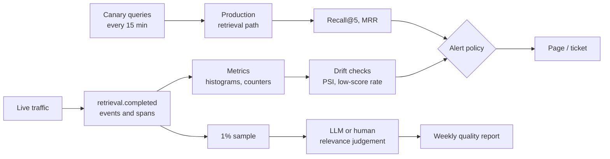

Offline evaluation tells you how good retrieval was on a test set on the day you ran it. Production is a different place: the index is rebuilt, documents are edited, a connector silently stops syncing, users start asking about a new policy, an embedding model is upgraded. Any of these can make retrieval worse, and none of them raises an error. **Retrieval monitoring** is the continuous measurement of retrieval behaviour on live traffic, so that such regressions are noticed in hours rather than discovered through complaints weeks later.

The difficulty is that live traffic has no labels. You do not know, for a given production query, which chunk was the right one. This lesson shows what you *can* measure without labels (score distributions, empty and low-confidence rates, freshness, latency), how to detect when those distributions shift (the population stability index and the Kolmogorov-Smirnov test), how to add a small amount of labelled signal through canary queries and sampled judgements, and how to turn all of it into alerts that are worth waking someone for.

## Learning objectives

- List the label-free signals of retrieval health and explain what failure each one detects.
- Compute the population stability index between two score distributions by hand and in code, and interpret it.
- Explain why a statistically significant Kolmogorov-Smirnov result on large samples is not by itself a reason to alert.
- Design a canary-query and sampled-judgement scheme that estimates retrieval quality continuously.
- Choose metric types and labels for retrieval metrics without creating a cardinality problem.

## Prerequisites

- [Logging](/learn/rag-observability/logging): the `retrieval.completed` event and its fields.
- [Recall@K](/learn/retrieval-evaluation/recall-k) and [Golden datasets](/learn/testing-and-benchmarking/golden-datasets): offline retrieval measurement.
- [Similarity distributions](/learn/embedding-mathematics/similarity-distributions) and [Score calibration](/learn/advanced-retrieval-optimisation/score-calibration): why raw similarity scores have model-specific scales.

## Why this matters

A retriever never says "I could not find anything good". It returns its top k, every time, with scores attached. So the typical retrieval regression looks like nothing at all from the outside: the service is up, latency is normal, every request returns five chunks. Only the *content* of those chunks has become worse.

Real causes of such regressions in RAG systems include:

- **Ingestion faults.** A parser update drops tables from PDFs; a connector's credentials expire and new documents stop arriving; a deduplication bug removes the current version of a policy and keeps the old one.
- **Index changes.** A rebuild with different chunking settings; an approximate index rebuilt with lower recall parameters; a collection restored from an old backup.
- **Model changes.** A new embedding model deployed for queries before the documents were re-embedded, so queries and documents live in different vector spaces.
- **Permission and filter faults.** A group-membership sync fails and users suddenly match fewer documents, so filtered searches return little or nothing.
- **Query drift.** Users start asking about something the corpus does not cover: a new benefit announced by e-mail but not yet in the handbook.

Your offline test set catches the first three only if you re-run it after every change, and catches the last two not at all. Monitoring the live system is the only defence that covers all five.

## The intuition

Imagine a librarian whose work you cannot check directly: you do not know what each visitor really needed. You can still notice things. If, over a normal week, the librarian finds a clearly matching book for nine visitors in ten, and today it is six in ten, something has changed. If visitors who used to leave with five books now leave with none, a shelf may have been closed off. If every book handed out today was printed before last year, the new deliveries are not being shelved. And once an hour you can send in a colleague with a question whose answer you know, and see whether the librarian finds it.

These are the two families of retrieval monitoring. **Proxy signals** are cheap measurements on every request that move when quality moves, without measuring quality itself. **Probes** (canary queries, sampled judgements) measure quality directly on a small number of requests whose answer is known or can be checked. Proxies tell you quickly that *something* changed; probes tell you whether it matters.

## How it works

### Label-free signals

Every signal below can be computed from the `retrieval.completed` events of the [Logging](/learn/rag-observability/logging) lesson or from span attributes.

| Signal | What it measures | Failure it catches |
| --- | --- | --- |
| Top-1 score distribution | How strongly the best chunk matches | Index damage, model mismatch, query drift |
| Low-confidence rate | Share of requests whose top score is below a threshold | The same, as a single number to alert on |
| Score gap (top-1 minus top-2) | Whether one chunk clearly wins | Duplicates flooding results (gap near zero) |
| Empty or short result rate | Share of requests returning fewer than k chunks after filters | Permission sync failures, over-strict filters |
| Source mix | Share of retrieved chunks by source, collection or document type | A source disappearing from results |
| Retrieved-document age | Age of the versions being retrieved | Stale index, ingestion stopped |
| Index size and freshness | Vector count; time since last successful upsert per source | Connector failures, accidental deletes |
| Latency percentiles per stage | Embedding, search, rerank time | Capacity problems, index parameter changes |
| Reranker movement | How often reranking changes the top result | First-stage quality drifting relative to reranker |

Two warnings about scores. First, scores are only comparable *within one model and one index configuration*: an embedding-model upgrade shifts the whole distribution, so monitoring needs a new baseline after any such change (and a deliberate decision that the shift is expected). Second, a high score does not mean a correct answer; it means a strong match. Top-1 score is a proxy for whether the corpus contains something close to the question, not for whether the retrieved chunk answers it.

### From signals to drift detection

A single day's median top-1 score of 0.57 means nothing by itself. It means something compared with a **baseline**: the distribution of the same signal over a period you consider normal, recorded under the current pipeline version. Monitoring then asks: is today's distribution different from the baseline, and by how much? Three tools, in increasing statistical subtlety:

1. **Rates against fixed thresholds.** Define "low confidence" as below the baseline's 5th percentile; by construction, about 5% of normal traffic falls there. If 20% of today's traffic does, something has changed. This is easy to explain and to alert on.
2. **The population stability index (PSI).** Bin the baseline into, say, ten equal-mass bins, measure what share of today's traffic falls into each, and sum a divergence over the bins. PSI captures a shift anywhere in the distribution, not only in the tail. Common rules of thumb, inherited from credit-risk modelling rather than derived from theory, read below 0.1 as stable, 0.1 to 0.25 as a moderate shift, and above 0.25 as a major shift. Calibrate them on your own history.
3. **The two-sample Kolmogorov-Smirnov (KS) test.** It measures the largest vertical distance between the two cumulative distributions and gives a p-value for "these samples come from the same distribution". With thousands of requests a day, even a trivial, harmless shift produces a tiny p-value, so the test answers "is there any difference?" when you want "is there a difference big enough to matter?". Use its statistic as an effect size or use PSI; do not alert on the p-value alone.

### Probes: canary queries and sampled judgements

Proxies cannot tell a harmful shift from a harmless one. When users start asking about a newly announced policy, scores drop because the corpus genuinely lacks the answer; the right fix is content, not engineering. Probes resolve this ambiguity.

**Canary queries** (also called synthetic probes) are a fixed set of questions with known relevant chunks, drawn from your [golden dataset](/learn/testing-and-benchmarking/golden-datasets), sent through the production retrieval path on a schedule. For each run you compute [Recall@K](/learn/retrieval-evaluation/recall-k) and [MRR](/learn/retrieval-evaluation/mrr). Because the questions never change, any movement is caused by the system, not by users. Canaries catch index damage, model mismatch and filter faults within one schedule interval, even at night when traffic is low. Keep them tagged so they are excluded from user-facing analytics and costs, and refresh their expected answers when documents legitimately change, or they will alert on every policy update.

**Sampled judgements** estimate quality on real traffic. Take a random sample of production requests (for example 1%), and have an LLM judge or a human reviewer rate whether each retrieved chunk is relevant to the query: the [context relevance](/learn/generation-evaluation/context-relevance) metric applied to live data. The result is an estimate of precision on today's actual questions, with a confidence interval that depends on the sample size (the [Generation monitoring](/learn/rag-observability/generation-monitoring) lesson shows how to compute one). Judging is not free, and production queries may contain personal data, so the sample needs the same privacy handling as the debug store described in the Logging lesson.

**Implicit feedback** is a third, noisier source: whether users open cited sources, rephrase the same question immediately (a sign the first answer missed), or rate the answer. These signals mix retrieval and generation quality together, so treat them as corroboration rather than measurement.

### Metrics, not just logs

Computing distributions from logs works for daily reports. For real-time dashboards and alerts, emit **metrics**: numeric time series aggregated in the process and scraped or pushed to a metrics system. Use the right type:

- A **counter** for things that only increase: requests, empty results, canary failures.
- A **histogram** for distributions: top-1 score, latency, number of results. A histogram counts observations into predefined buckets, from which the backend estimates percentiles. Choose score buckets around your baseline (for example every 0.05 between 0.3 and 0.9) or the estimates will be coarse where it matters.
- A **gauge** for current values: vector count, seconds since last successful ingestion per source.

Metrics have **labels** (also called attributes or dimensions), such as `collection` or `pipeline_version`. Each distinct combination of label values is a separate time series, so label only by things with a small, bounded set of values. Labelling by user id, query text or chunk id creates millions of series, which is called a **cardinality explosion**, and it can overwhelm a metrics system. High-cardinality detail belongs in logs and traces; metrics hold the aggregates.

### Alerting that people trust

An alert should mean "a person needs to act now". A practical scheme:

1. **Page** (wake someone) on canary recall dropping below a floor, on empty-result rate spiking, and on ingestion freshness exceeding its limit. These are unambiguous and actionable.
2. **Ticket** (next working day) on PSI above the major-shift threshold or low-confidence rate well above baseline for a sustained period, typically several hours, so a burst of unusual questions does not fire it.
3. **Report** weekly on slower trends: sampled relevance, source mix, query topics without good matches (a content-gap list for document owners).

Compare like with like: traffic on Monday morning differs from Saturday night, and a baseline that mixes them will alert on the calendar. Use the same weekday and hour from previous weeks, or a long enough window that seasonality averages out.



## The mathematics

### Population stability index

**Intuition.** Split the range of scores into bins. If today's traffic falls into the bins in the same proportions as the baseline, nothing has changed. PSI adds up, over the bins, how much the proportions differ, weighting each difference by the log of their ratio so that a bin going from 1% to 5% counts more than one going from 30% to 34%.

$$
\text{PSI} = \sum_{i=1}^{B} (c_i - r_i)\,\ln\frac{c_i}{r_i}
$$

Here $B$ is the number of bins, $r_i$ is the share of baseline (reference) observations in bin $i$, and $c_i$ is the share of current observations in bin $i$. Both sets of shares sum to 1. Each term is non-negative, because $(c_i - r_i)$ and $\ln(c_i / r_i)$ always have the same sign, so PSI is zero only when the distributions match bin for bin. PSI is the symmetric form of the Kullback-Leibler divergence: $\text{KL}(c\,\|\,r) + \text{KL}(r\,\|\,c)$. An empty bin makes the logarithm infinite, so implementations replace zero shares with a small constant.

**By hand.** Three bins (low, medium, high top-1 score). Baseline shares $r = (0.5, 0.3, 0.2)$, today $c = (0.3, 0.3, 0.4)$.

- Bin 1: $(0.3 - 0.5)\ln(0.3/0.5) = (-0.2)(-0.5108) = 0.1022$.
- Bin 2: $(0.3 - 0.3)\ln 1 = 0$.
- Bin 3: $(0.4 - 0.2)\ln 2 = (0.2)(0.6931) = 0.1386$.

PSI $= 0.2408$: a moderate shift by the usual rule of thumb, close to the 0.25 line.

```python
import numpy as np

ref = np.array([0.5, 0.3, 0.2])          # baseline share of requests in each score bin
cur = np.array([0.3, 0.3, 0.4])          # today's share
terms = (cur - ref) * np.log(cur / ref)
print("per-bin terms:", terms.round(4))
print("PSI:", round(float(terms.sum()), 4))
```

```output
per-bin terms: [0.1022 0.     0.1386]
PSI: 0.2408
```

### The Kolmogorov-Smirnov statistic

**Intuition.** Plot each sample's cumulative distribution: for every score $x$, the fraction of observations at or below $x$. If the samples come from the same distribution, the two curves stay close everywhere. The KS statistic is the largest gap.

$$
D = \sup_x \big|F_{\text{ref}}(x) - F_{\text{cur}}(x)\big|
$$

$F_{\text{ref}}$ and $F_{\text{cur}}$ are the empirical cumulative distribution functions of the two samples, and $\sup_x$ means the largest value over all $x$. For a large sample the test's critical value shrinks roughly in proportion to $1/\sqrt{n}$, so with 2,000 requests a day even a $D$ of 0.05 (curves never more than 5 percentage points apart, usually harmless) can be "significant". That is why $D$ or PSI, not the p-value, should drive alerts.

## In code

**The problem.** Given a day's retrieval events (top-1 score, top-2 score and the number of results returned after filters), compute a daily retrieval-health report against a two-week baseline, and raise alerts for score drift, a high low-confidence rate and empty results. The data is simulated with a fixed seed so you can see the monitor respond to a known incident: on Wednesday a re-index with a parser bug damages a quarter of the answer chunks, and on Thursday a permission sync also fails.

**Dependencies.** NumPy, pandas and SciPy; no models or services.

```bash
pip install numpy pandas scipy
```

```python
import numpy as np
import pandas as pd
from scipy.stats import ks_2samp

rng = np.random.default_rng(0)


def simulate_day(n, broken_share=0.0, empty_rate=0.004):
    """Retrieval events for one day: top-1 score, top-2 score, results after filtering."""
    healthy = rng.beta(14, 9, n)                      # top-1 cosine, mostly 0.5 to 0.75
    broken = rng.beta(7, 11, n)                       # queries whose answer chunk is damaged
    top1 = np.where(rng.random(n) < broken_share, broken, healthy)
    top2 = top1 - rng.gamma(2.0, 0.02, n)             # gap between first and second hit
    returned = np.where(rng.random(n) < empty_rate, 0, 5)
    return pd.DataFrame({"top1": top1.round(3), "top2": top2.round(3), "returned": returned})


baseline = simulate_day(14_000)                       # a "normal" fortnight, pooled
days = {
    "Mon": simulate_day(2_000),
    "Tue": simulate_day(2_100),
    "Wed": simulate_day(1_900, broken_share=0.25),    # re-index with a parser bug
    "Thu": simulate_day(2_000, broken_share=0.25, empty_rate=0.03),
}

edges = np.quantile(baseline.top1, np.linspace(0, 1, 11))   # 10 equal-mass baseline bins
edges[0], edges[-1] = -np.inf, np.inf


def psi(reference, current, edges, eps=1e-4):
    ref = np.histogram(reference, edges)[0] / len(reference)
    cur = np.histogram(current, edges)[0] / len(current)
    ref, cur = np.clip(ref, eps, None), np.clip(cur, eps, None)
    return float(np.sum((cur - ref) * np.log(cur / ref)))


LOW = float(np.quantile(baseline.top1, 0.05))          # "low" = bottom 5% of normal days
rows = []
for day, df in days.items():
    served = df[df.returned > 0]
    rows.append({
        "day": day,
        "requests": len(df),
        "p50_top1": round(served.top1.median(), 3),
        "low_rate": round((served.top1 < LOW).mean(), 3),
        "gap_p50": round((served.top1 - served.top2).median(), 3),
        "empty_rate": round((df.returned == 0).mean(), 4),
        "psi": round(psi(baseline.top1, served.top1, edges), 3),
        "ks_p": f"{ks_2samp(baseline.top1, served.top1).pvalue:.2g}",
    })
report = pd.DataFrame(rows).set_index("day")


def alerts(r):
    out = []
    if r.psi > 0.25: out.append("score drift")
    if r.low_rate > 0.10: out.append("low-score rate")
    if r.empty_rate > 0.01: out.append("empty results")
    return ", ".join(out) or "-"


report["alerts"] = report.apply(alerts, axis=1)
print(f"low-score threshold (baseline 5th percentile): {LOW:.3f}\n")
print(report.to_string())
```

```output
low-score threshold (baseline 5th percentile): 0.441

     requests  p50_top1  low_rate  gap_p50  empty_rate    psi     ks_p                                      alerts
day                                                                                                               
Mon      2000     0.614     0.048    0.035      0.0030  0.001        1                                           -
Tue      2100     0.613     0.047    0.033      0.0052  0.010     0.31                                           -
Wed      1900     0.571     0.204    0.032      0.0011  0.233  9.3e-51                              low-score rate
Thu      2000     0.565     0.234    0.032      0.0305  0.278    8e-62  score drift, low-score rate, empty results
```

**The important lines.**

- `simulate_day` stands in for a day of logged `retrieval.completed` events. In production you would load these from your log store or compute them from metrics; the monitor code would not change.
- `edges = np.quantile(baseline.top1, ...)` builds ten **equal-mass** bins from the baseline, so each holds 10% of normal traffic. Equal-width bins would put most observations into two or three bins and make PSI insensitive. The outer edges are widened to infinity so no current observation falls outside.
- `np.clip(..., eps, None)` replaces empty bins with a tiny share, avoiding division by zero and an infinite logarithm.
- `LOW` is the baseline's 5th percentile, so the expected low-confidence rate on a normal day is 5%. Defining thresholds as baseline percentiles, rather than as a raw score such as 0.45, makes them portable across embedding models.
- `served = df[df.returned > 0]` separates the two failure modes: score metrics are computed on requests that returned something, while `empty_rate` counts the rest. Mixing them would make an empty-result spike look like a score drop.

**What the output means.** Monday and Tuesday behave like the baseline: about 5% low-confidence, PSI near zero. Wednesday's parser bug pushes the low-confidence rate to 20.4% and the median top-1 score down by about 0.04, and the low-rate alert fires. Note that PSI, at 0.233, sits just under the 0.25 rule of thumb: a whole-distribution measure dilutes a problem affecting a quarter of queries, while a tail rate isolates it. That is why monitors combine signals. On Thursday the empty-result rate jumps from about 0.4% to 3%, the permission-sync symptom, and all three alerts fire. The KS p-values show the large-sample problem: both incident days are "significant" at absurd levels, which tells you nothing about severity; Tuesday's 0.31 merely confirms no detectable shift. Notice also the score gap: unchanged throughout, so the incident is not a duplication problem. The monitor says *that* retrieval changed and *where to look*; a canary run or a look at Wednesday's ingestion logs says *why*.

**Common errors.** Recomputing the baseline from a window that includes the incident hides the incident. Comparing distributions across a model change produces a huge PSI that is not a fault. Using equal-width bins on scores concentrated in a narrow range makes PSI nearly blind.

**Extending it.** Compute PSI per source collection or query category, which localises the damage. Add canary recall as a column. Emit `top1` as an OpenTelemetry or Prometheus histogram so the same checks run continuously rather than in a daily batch.

## A real-world example

Meridian's Platform team rebuilt AskMeridian's Qdrant collection to adopt a new chunking configuration. Their offline evaluation on the golden dataset had shown a small improvement, and the rebuild was done on a Wednesday afternoon.

By Thursday morning the retrieval dashboard showed the low-confidence rate for the IT runbooks collection at roughly three times its baseline, while the handbook collection was normal. Canary queries for runbooks were still passing, which puzzled the team until they looked at which canaries existed: all of them asked about VPN errors and password rules, and none touched the newer runbooks added in the last quarter.

Comparing source mix before and after the rebuild showed the cause: the rebuild job had read runbooks from a cached export taken three months earlier, so every runbook added since then was missing from the index. Questions about those topics found only weak matches. The canary set had the same blind spot as the stale export, because both dated from the same quarter.

The fixes were a freshness gauge per source (the newest document version indexed, compared with the newest in the source system), an alert when the per-source document count drops by more than a few per cent after a rebuild, and a rule that canary queries are refreshed from recent production questions every month.

## Common mistakes

- **Monitoring only latency and errors.** The service looks perfectly healthy while retrieving the wrong chunks.
- **Alerting on KS-test p-values.** With production sample sizes everything is significant; the pager fires on harmless shifts until people ignore it.
- **Keeping a baseline across a model or index change.** Every metric drifts at once, and real problems hide in the noise.
- **Treating a high top-1 score as correctness.** A strong match to the superseded 2023 handbook is still a strong match.
- **Canaries that never change.** They drift away from what users ask and from the current documents, and either alert constantly or test nothing that matters.
- **Labelling metrics by query, user or chunk id.** The metrics backend fills with millions of series and becomes slow or expensive.
- **One global metric for many collections.** A collapse in a small collection disappears inside the average of a large one.

## Best practices

- Emit top-1 score, result count, score gap and per-stage latency for every request, as histograms labelled by collection and pipeline version.
- Express thresholds as baseline percentiles, and rebuild baselines deliberately after model or index changes.
- Combine a tail rate (low-confidence share) with a whole-distribution measure (PSI); alert on sustained deviation.
- Run canary queries through the production path on a schedule, with fresh expectations, and page on canary recall falling below a floor.
- Sample a small share of live traffic for relevance judgement, with privacy controls, and report it with confidence intervals.
- Track freshness and document counts per source; ingestion failures are among the commonest causes of retrieval regressions.
- Break every metric down by collection or source before concluding nothing changed.

## Performance considerations

Label-free monitoring is nearly free at request time: recording three histogram observations costs microseconds. The costs that need arithmetic are the probes and the storage.

**Canaries.** Suppose (as assumptions) 200 canary queries every 15 minutes, each costing one query embedding and one search. That is $200 \times 96 = 19{,}200$ retrievals a day. Against 50,000 user requests a day that is a 38% increase in retrieval load, which is too much; 50 canaries hourly ($1{,}200$ a day, about 2%) may be the better balance. Canaries normally test retrieval only; adding generation multiplies their cost by the model price.

**Sampled judgements.** A 1% sample of 50,000 requests is 500 judgements a day. If each judges 5 chunks at roughly 1,500 input tokens per judgement call, that is about 0.75 million input tokens a day for the judge; price it with your provider's current rates, and see [Cost tracking](/learn/rag-observability/cost-tracking) for how to attribute it.

**Metric cardinality.** A histogram with 15 buckets labelled by 4 collections and 2 live pipeline versions is $15 \times 4 \times 2 = 120$ series: trivial. Add a label for 400 users and it is 48,000; add query fingerprints and it is unbounded.

## Security considerations

- Sampled judgements send real user queries and retrieved chunks to a judge model, possibly an external API, and to reviewers. Apply the same minimisation, redaction and access rules as the debug store, and do not sample from document collections the reviewers are not entitled to read.
- A sudden change in source mix or score distribution can be a symptom of [data poisoning](/learn/rag-security-fundamentals/data-poisoning) or [retrieval manipulation](/learn/rag-security-fundamentals/retrieval-manipulation): documents crafted to match many queries strongly. Watch for a single new document appearing in an unusually large share of results.
- Canary queries must run with a service identity whose permissions are known and minimal, so they test filtering rather than bypass it.

## Summary

- Retrieval regressions are silent; monitor the content of retrieval on live traffic, not only availability and latency.
- Label-free proxies (top-1 score distribution, low-confidence rate, empty-result rate, score gap, source mix, freshness) are cheap and fast; compare them with a baseline from the same pipeline version.
- PSI measures whole-distribution shift and is easy to compute; a tail rate catches problems that affect part of the traffic; KS p-values are too sensitive at production volumes to alert on.
- Canary queries and sampled relevance judgements measure quality directly and tell harmful shifts from harmless ones.
- Use histograms with low-cardinality labels for metrics, keep detail in logs and traces, and page only on unambiguous, actionable signals.

## Exercises

**1.** Baseline bin shares are $(0.25, 0.25, 0.25, 0.25)$ and today's are $(0.10, 0.20, 0.30, 0.40)$. Compute PSI and interpret it.

<details><summary>Show solution</summary>

Terms: $(0.10-0.25)\ln(0.4) = (-0.15)(-0.9163) = 0.1374$; $(0.20-0.25)\ln(0.8) = (-0.05)(-0.2231) = 0.0112$; $(0.30-0.25)\ln(1.2) = (0.05)(0.1823) = 0.0091$; $(0.40-0.25)\ln(1.6) = (0.15)(0.4700) = 0.0705$. PSI $\approx 0.228$: a moderate shift by the rule of thumb. Mass has moved from low-score bins to high-score bins, so retrieval matches have become *stronger*. That is not necessarily good news: a flood of near-duplicate chunks, or a new document that matches everything, also raises top scores. Check the score gap and source mix before celebrating.

</details>

**2.** Add a column to the code's report that counts the share of served requests whose score gap is below 0.005, and simulate a "duplicates" incident for Friday in which, for 30% of requests, the top-2 score equals the top-1 score. Which existing signals react, and which do not?

<details><summary>Show solution</summary>

In `simulate_day` add a parameter `dup_share=0.0` and, after computing `top2`, set `top2 = np.where(rng.random(n) < dup_share, top1, top2)`. Add `"dup_rate": round(((served.top1 - served.top2) < 0.005).mean(), 3)` to the row and `"Fri": simulate_day(2_000, dup_share=0.3)` to `days`. The new column jumps from a few per cent to over 30%, and `gap_p50` falls; top-1 scores, PSI, the low-confidence rate and the empty rate do not move, because duplicates do not change how well the best chunk matches. Duplicates waste context slots and crowd out other evidence, which is why the gap deserves its own signal ([Duplicate removal](/learn/advanced-retrieval-optimisation/duplicate-removal) covers the fix).

</details>

**3.** Your canary set has 50 queries, and canary Recall@5 has been 0.94 for months. Today it is 0.90. Should you page? Reason about the sampling noise.

<details><summary>Show solution</summary>

0.94 of 50 is 47 hits; 0.90 is 45. The difference is two queries. If the true recall were still 0.94, the number of hits in a run would vary with a standard deviation of about $\sqrt{50 \times 0.94 \times 0.06} \approx 1.7$, but canaries are a *fixed* set, so run-to-run variation comes only from non-determinism in the system (approximate search, ties), not from sampling new queries. So look at *which* two queries changed. If they flip back and forth between runs, the system is non-deterministic near the cut-off and this is noise; if they fail consistently since a known change, it is a real regression affecting specific content. Do not page on a two-query drop; page on a drop beyond a floor set from historical variation (for example, below 0.85 or more than five queries failing), and ticket the investigation of the specific failures.

</details>

**4.** Design decision. AskMeridian serves three collections: the handbook (stable, 600 chunks), IT runbooks (changes weekly, 4,000 chunks) and product documentation (changes daily, 30,000 chunks). Design the retrieval monitoring for each: which signals, which alerts, and which probes.

<details><summary>Show solution</summary>

All three get the per-request histograms (top-1 score, result count, gap, latency) labelled by collection, and a low-confidence rate and PSI against a per-collection baseline.

**Handbook:** stable content, so canaries are cheap to keep correct: 20 to 30 policy questions, run hourly, paging on any consistent failure. Freshness alert only if the source changes and the index does not within a day.

**IT runbooks:** weekly change, so canaries are refreshed monthly from recent questions. Per-source freshness gauge and a document-count check after every ingestion run (the real-world example's failure). Ticket on sustained low-confidence rises, since new runbooks lagging behind new incidents is common.

**Product docs:** daily change and the largest collection. Canaries need automatic expectation updates (link canaries to stable document ids, not chunk ids, so re-chunking does not break them). The biggest risk is ingestion lag, so alert on time since last successful ingestion per product. Sample relevance judgements here preferentially, because it has the most query variety.

Weekly report across all three: content gaps (frequent queries with low scores), source mix trends and judged relevance with confidence intervals.

</details>

## Check your understanding

```quiz
[
  {
    "q": "Why is a two-sample KS-test p-value a poor basis for alerting on daily retrieval scores?",
    "options": [
      "It cannot be computed for more than 1,000 samples",
      "With thousands of samples, even trivial shifts give tiny p-values, so it flags harmless changes",
      "It only detects shifts in the mean",
      "It requires labelled data"
    ],
    "answer": 1,
    "why": "Large samples make the test sensitive to differences far too small to matter; use an effect size such as PSI or the D statistic instead."
  },
  {
    "q": "Retrieval scores dropped across the board immediately after a deployment. Which cause is most consistent with that?",
    "options": [
      "A new query embedding model was deployed before documents were re-embedded",
      "Users began asking about a new topic",
      "One small collection lost its newest documents",
      "The reranker's latency increased"
    ],
    "answer": 0,
    "why": "Queries and documents embedded by different models no longer share a vector space, which lowers matches for every query at once; the others affect only some queries or no scores at all."
  },
  {
    "q": "What is the main advantage of canary queries over label-free score monitoring?",
    "options": [
      "They are cheaper to run",
      "They measure retrieval quality directly on questions with known answers, independent of what users happen to ask",
      "They need no maintenance",
      "They cover every topic users ask about"
    ],
    "answer": 1,
    "why": "Canaries have known relevant chunks, so a drop in their recall is caused by the system, not by changing traffic."
  },
  {
    "q": "Which metric label is safe to put on a retrieval-score histogram?",
    "options": ["user_id", "query_fingerprint", "chunk_id", "collection"],
    "answer": 3,
    "why": "Collection has a small, bounded set of values; the others create a time series per user, query or chunk."
  },
  {
    "q": "Baseline shares are (0.5, 0.5) and today's are (0.5, 0.5). Today's median top-1 score is nevertheless 0.03 lower. How can PSI be zero?",
    "options": [
      "PSI is computed incorrectly",
      "PSI only measures the tails",
      "The shift happened within bins, which coarse binning cannot see",
      "Medians cannot shift without changing bin shares"
    ],
    "answer": 2,
    "why": "PSI compares bin proportions; movements inside a bin are invisible, which is why ten or more equal-mass bins are used."
  }
]
```

## Further reading

- Breck, Cai, Nielsen, Salib and Sculley (2017), "The ML Test Score: A Rubric for ML Production Readiness and Technical Debt Reduction", IEEE Big Data: the monitoring section covers data and model drift.
- Rabanser, Günnemann and Lipton (2019), [Failing Loudly: An Empirical Study of Methods for Detecting Dataset Shift](https://arxiv.org/abs/1810.11953), NeurIPS.
- SciPy documentation, [`scipy.stats.ks_2samp`](https://docs.scipy.org/doc/scipy/reference/generated/scipy.stats.ks_2samp.html).
- OpenTelemetry documentation, [Metrics](https://opentelemetry.io/docs/concepts/signals/metrics/), and Prometheus documentation, [Histograms and summaries](https://prometheus.io/docs/practices/histograms/).
- Beyer, Jones, Petoff and Murphy (eds.), *Site Reliability Engineering* (O'Reilly, 2016), chapter 6, "Monitoring Distributed Systems", on symptom-based alerting.
