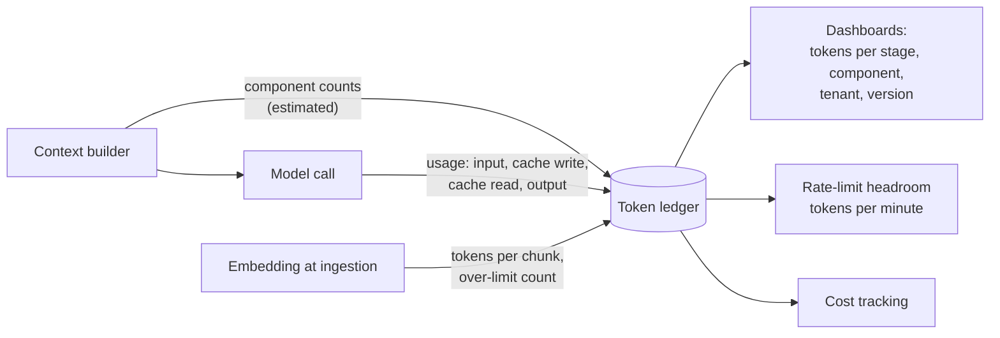

Tokens are the unit in which a language model reads, writes, bills and limits. Every RAG request spends them in several places: the system prompt, the retrieved context, the conversation history, the question, the answer, and any extra model calls for query rewriting or judging. The totals determine the bill, the latency (a longer prompt takes longer to process before the first token appears), whether the request fits the context window at all, and whether you hit your provider's rate limits.

**Token tracking** is the practice of measuring those tokens accurately, attributing them to the stage and the prompt component that consumed them, and watching how they change. This lesson covers where the authoritative counts come from, how to estimate before a call and reconcile afterwards, how to break a prompt down by component, the special accounting of prompt caching, the quadratic growth of multi-turn conversations, and the embedding-side token limit that silently truncates chunks. Turning tokens into money is the next lesson, [Cost tracking](/learn/rag-observability/cost-tracking).

## Learning objectives

- Read token usage from a model response, including prompt-caching fields, and explain how they add up.
- Distinguish provider-reported counts from local estimates, and explain why a local tokeniser can disagree with the provider.
- Attribute a request's input tokens to system prompt, context, history and question, and use the breakdown to find prompt bloat.
- Derive and apply the formula for cumulative input tokens in a multi-turn conversation.
- Detect chunks that exceed an embedding model's maximum sequence length.

## Prerequisites

- [Tokens and tokenisation](/learn/understanding-large-language-models/tokens-and-tokenisation): what a token is and why counts differ between models.
- [Context windows](/learn/context-engineering/context-windows): the limit tokens must fit within.
- [Multi-turn RAG](/learn/generation-strategies/multi-turn-rag): how conversation history is sent with each turn.
- [Tracing](/learn/rag-observability/tracing): where `gen_ai.usage.*` attributes are recorded.

## Why this matters

Without token tracking, three kinds of problem go unnoticed until they hurt.

**Silent growth.** Someone raises retrieval `k` from 5 to 10, a document owner pastes a long table into a policy, or a conversation feature starts re-sending history. Each change makes every prompt longer. Nothing breaks; the bill rises, time to first token rises, and nobody can say why, because nobody knows what the prompt is made of.

**Hard limits.** A request whose prompt exceeds the model's context window is rejected. A deployment that exceeds its provider's tokens-per-minute limit gets rate-limit errors for *every* user, not just the heavy one. Both are predictable from token data and avoidable with it.

**Truncation you cannot see.** Embedding models have a maximum input length, and most libraries silently cut longer inputs. A chunk of 400 tokens embedded by a model that reads 256 is represented by its first 256 tokens only; questions about its last paragraph will never match it. Only token tracking on the indexing side reveals this.

Token data is also the raw material for cost attribution, capacity planning and the [token budgets](/learn/cost-engineering/token-budgets) that cost engineering builds on. If it is wrong or missing, everything downstream is guesswork.

## The intuition

Think of a mobile phone bill that lists only the monthly total. When it doubles, you cannot tell whether it was calls, data or roaming, or which member of the family was responsible. An itemised bill shows each call with its duration and number, and the problem becomes obvious: a teenager's video calls abroad.

Token tracking turns the model bill into an itemised bill. Each model call records what it used, split into categories (input, output, cache reads, cache writes), and each request records which parts of the prompt the input went on. The question "why did usage double?" then has an answer such as "context tokens per request doubled on the 12th, when `k` changed", rather than a shrug.

## How it works

### Where the authoritative count comes from

There is exactly one authoritative count of the tokens a model call used: the one the provider reports in the response, because it is the count the provider bills and rate-limits on. With the Anthropic Python SDK:

```python
response = client.messages.create(...)
usage = response.usage
usage.input_tokens                 # input tokens not read from or written to the prompt cache
usage.cache_creation_input_tokens  # input tokens written to the cache by this call
usage.cache_read_input_tokens      # input tokens served from the cache
usage.output_tokens                # tokens generated
```

The total prompt size is the sum of the three input fields. Note that `input_tokens` alone is *not* the prompt size when caching is in use; reading it alone is a common accounting bug. With streaming, the final usage figures arrive with the end of the stream; the SDK's stream helper exposes the final message (`stream.get_final_message()`), whose `usage` holds them.

Record these four numbers on every model call, on the span (`gen_ai.usage.input_tokens`, `gen_ai.usage.output_tokens` and the cache attributes in the [generative-AI semantic conventions](/learn/rag-observability/tracing)) and in the `generation.completed` log event. Record them for *every* call in the request: query rewriting, HyDE generation, routing, the answer itself and any judge, each tagged with its stage.

### Estimating before the call

Sometimes you need a count before calling the model: to check the prompt fits the context window, to choose how many chunks to include, or to enforce a per-user budget. Three options, from most to least accurate:

1. **The provider's counting endpoint.** Anthropic's API offers `client.messages.count_tokens(model=..., system=..., messages=[...])`, which returns an `input_tokens` count for exactly the request you would send, using the model's real tokeniser. It costs a network round trip.
2. **A local tokeniser for the same model family.** Exact if the provider publishes the tokeniser; for models whose tokeniser is not published, any local tokeniser is an approximation.
3. **A character heuristic.** For English prose, a rough rule of about four characters per token is often quoted; it is wrong for code, numbers, non-English text and tables, sometimes by a factor of two. Good only for coarse capacity planning.

Different models' tokenisers split the same text differently, so a count from one model's tokeniser can be off for another by a noticeable margin in either direction. The code in this lesson uses `tiktoken`, OpenAI's open-source tokeniser library, to *estimate* the relative sizes of prompt components; it is not Claude's tokeniser, and the absolute numbers are approximations. That is fine for attribution (which component is biggest) but not for enforcing a hard limit close to the window size; leave a margin, or use the provider's counter.

Whatever you estimate, **reconcile** with the reported usage afterwards: log both, and track the ratio. If the estimate drifts away from reality (a new model, a new language in the corpus), the ratio shows it.

### Attributing input tokens to prompt components

The provider reports one input figure per call. To know what it was spent on, measure the components as you assemble the prompt:

1. When the context builder assembles the prompt, count each component: system prompt, context chunks (and how many), conversation history, the question, any tool definitions or few-shot examples.
2. Log the component counts with the request id (and on the generation span as `rag.*` attributes).
3. When the response arrives, log the provider's total beside them. Scale the estimates to the reported total if you need exact shares; the proportions from a good estimator are usually close enough.
4. Aggregate: median and 95th percentile of each component per day, per pipeline version and per tenant.

This breakdown makes prompt problems visible at a glance. In most RAG systems context dominates input; a system prompt that has crept to a quarter of the input, or history that exceeds the context, is a design smell worth investigating.

### Prompt caching changes the accounting

Providers including Anthropic offer **prompt caching**: a long, unchanging prefix of the prompt (system prompt, tool definitions, a fixed document) can be cached, so later calls that start with the same prefix read it from the cache at a reduced price and with lower latency. A call that writes the prefix to the cache reports those tokens as `cache_creation_input_tokens`; later calls report them as `cache_read_input_tokens`. Writes are typically billed at a premium over ordinary input and reads at a large discount; check the current pricing page rather than assuming figures.

For tracking, caching adds two derived metrics worth watching:

- **Cache read share**: cache-read tokens divided by total prompt tokens. If it falls after a release, something changed the prefix (a timestamp inserted into the system prompt is a classic culprit) and every call is now writing a new cache entry instead of reading.
- **Write-to-read ratio**: if writes are frequent relative to reads, the cached prefix expires before it is reused, and caching may cost more than it saves.

In RAG, the retrieved context changes with every question, so only the stable prefix before it (system prompt, instructions, examples) is cacheable; order prompts so that stable parts come first. Deciding *what* to cache is covered in [Caching strategies](/learn/cost-engineering/caching-strategies); the job here is to measure whether it works.

### Embedding-side tokens

Tokens matter on the indexing side too. Hosted embedding APIs bill by tokens and report usage per call; record it per ingestion run so that a re-index has a known size. And every embedding model has a **maximum sequence length**. For `all-MiniLM-L6-v2` in `sentence-transformers` it is 256 tokens (`model.max_seq_length`); longer inputs are truncated without an error. Count every chunk with the embedding model's own tokeniser during ingestion, log the distribution, and alert on any chunk above the limit. The fix is in [chunking](/learn/chunking-fundamentals/chunk-size), but the detection is token tracking.

### Rate limits and quotas

Providers limit throughput, commonly as requests per minute and input and output tokens per minute, per organisation or per workspace; the exact limits depend on your account and change over time. Track tokens per minute as a metric and compare with your limit. Per-tenant tracking lets you enforce internal quotas before one heavy user exhausts the shared limit and causes rate-limit errors for everyone.



## The mathematics

### Cumulative input in a multi-turn conversation

**Intuition.** A model has no memory between calls, so a chat feature re-sends the conversation so far with each new question. Each turn's prompt is longer than the last by one question-and-answer exchange, so the total input over a conversation grows faster than linearly with its length.

Let $B$ be the tokens in each turn's prompt excluding history (system prompt, retrieved context and the question), $h$ the tokens added to the history by each exchange, and $T$ the number of turns. Turn $t$ (counting from 1) re-sends $t - 1$ previous exchanges, so its input is $B + (t-1)h$, and the total is

$$
I(T) = \sum_{t=1}^{T} \big(B + (t-1)h\big) = T\,B + h\,\frac{T(T-1)}{2}
$$

The first term grows linearly with $T$, the second quadratically. When $h(T-1)/2$ becomes comparable with $B$, history costs as much as everything else put together.

**By hand.** With $B = 200$ and $h = 34$ (close to the measured values in the code below), a 5-turn conversation uses $5 \times 200 + 34 \times 5 \times 4 / 2 = 1{,}000 + 340 = 1{,}340$ input tokens, 1.34 times what five independent questions would. A 20-turn conversation uses $20 \times 200 + 34 \times 20 \times 19 / 2 = 4{,}000 + 6{,}460 = 10{,}460$, 2.6 times as many. With realistic contexts of thousands of tokens and long answers in the history, the effect is larger in absolute terms.

```python
def conversation_tokens(base: int, per_turn: int, turns: int) -> int:
    """Total input tokens when each turn re-sends all previous exchanges."""
    return turns * base + per_turn * turns * (turns - 1) // 2

for T in (5, 20):
    with_history = conversation_tokens(200, 34, T)
    print(f"T={T:>2}: {with_history:>6} tokens with history, {T * 200:>5} without, "
          f"ratio {with_history / (T * 200):.2f}")
```

```output
T= 5:   1340 tokens with history,  1000 without, ratio 1.34
T=20:  10460 tokens with history,  4000 without, ratio 2.62
```

This is why multi-turn systems summarise or truncate history beyond a few turns, and why history tokens deserve their own line on a dashboard.

## In code

**The problem.** Measure what an AskMeridian prompt is made of, watch history grow over a five-turn conversation, and aggregate provider-reported usage by pipeline stage, including prompt-cache reads.

**Dependencies.** `tiktoken` (for estimates) and pandas. No API key: parts 1 and 2 estimate token counts locally, and part 3 aggregates usage records of the shape the API returns, written out by hand as they would appear in a log.

```bash
pip install tiktoken pandas
```

```python
import pandas as pd
import tiktoken

# tiktoken implements OpenAI's tokenisers. Claude uses a different tokeniser, so these
# counts are ESTIMATES for attribution; the provider's reported usage is the truth.
enc = tiktoken.get_encoding("cl100k_base")


def n_tokens(text: str) -> int:
    return len(enc.encode(text))


SYSTEM = ("You are AskMeridian, Meridian's internal assistant. Answer only from the provided "
          "context. Cite chunk ids in square brackets. If the answer is not in the context, "
          "say: I don't know based on the provided documents.")
CHUNKS = {
    "hb-leave-01": "Annual leave is 25 days per year for all permanent staff. Up to 5 unused days "
                   "carry over into the next leave year and must be used by 31 March.",
    "hb-leave-02": "Leave requests are made in the HR portal at least two weeks in advance. "
                   "Requests for more than 10 consecutive days need line-manager approval.",
    "hb-remote-01": "Staff may work remotely up to 3 days a week. The home-office equipment "
                    "budget is £400; contractors are not eligible.",
    "it-pass-01": "Passwords must be rotated every 90 days. VPN is required on public Wi-Fi.",
}


def build_prompt(question, chunk_ids, history):
    context = "\n\n".join(f"[{cid}] {CHUNKS[cid]}" for cid in chunk_ids)
    parts = {
        "system": SYSTEM,
        "context": f"<context>\n{context}\n</context>",
        "history": "\n".join(f"{role}: {text}" for role, text in history),
        "question": f"Question: {question}",
    }
    return {name: n_tokens(text) for name, text in parts.items()}


# --- 1. Attribute one request's input tokens to prompt components ---------------
parts = build_prompt("How many unused leave days can I carry over?",
                     ["hb-leave-01", "hb-leave-02", "hb-remote-01", "it-pass-01"], history=[])
total = sum(parts.values())
print("single turn, estimated input tokens by component")
for name, n in parts.items():
    print(f"  {name:<9} {n:>4}  {n / total:6.1%}")
print(f"  {'total':<9} {total:>4}\n")

# --- 2. Multi-turn: history is re-sent every turn, so input grows -----------------
turns = [
    ("How many unused leave days can I carry over?",
     "Up to 5 unused days carry over and must be used by 31 March [hb-leave-01]."),
    ("And how far in advance do I need to request leave?",
     "At least two weeks in advance, through the HR portal [hb-leave-02]."),
    ("What if I want three weeks off in a row?",
     "More than 10 consecutive days needs line-manager approval [hb-leave-02]."),
    ("Can I work from home in the week before?",
     "Yes, up to 3 days a week [hb-remote-01]."),
    ("Is there a budget for a home-office chair?",
     "Yes, the home-office equipment budget is £400 [hb-remote-01]."),
]
history, cumulative = [], 0
print("turn  history  input(est)  cumulative")
for t, (question, answer) in enumerate(turns, start=1):
    p = build_prompt(question, ["hb-leave-01", "hb-leave-02", "hb-remote-01", "it-pass-01"], history)
    turn_input = sum(p.values())
    cumulative += turn_input
    print(f"{t:>4}  {p['history']:>7}  {turn_input:>10}  {cumulative:>10}")
    history += [("user", question), ("assistant", answer)]

# --- 3. Aggregate provider-reported usage by stage (example records from a log) ----
usage_log = pd.DataFrame([
    # stage,      input, cache_write, cache_read, output   (fields as the API reports them)
    ("rewrite",      310,          0,          0,     24),
    ("generate",     900,       1450,          0,    160),   # first call writes the cache
    ("rewrite",      295,          0,          0,     21),
    ("generate",     870,          0,       1450,    142),   # later calls read it
    ("generate",     940,          0,       1450,    188),
    ("judge",       2100,          0,          0,    130),   # sampled faithfulness check
], columns=["stage", "input_tokens", "cache_creation_input_tokens",
            "cache_read_input_tokens", "output_tokens"])
usage_log["prompt_tokens"] = usage_log[["input_tokens", "cache_creation_input_tokens",
                                        "cache_read_input_tokens"]].sum(axis=1)
by_stage = usage_log.groupby("stage")[["prompt_tokens", "cache_read_input_tokens",
                                       "output_tokens"]].sum()
by_stage["cache_read_share"] = (by_stage.cache_read_input_tokens / by_stage.prompt_tokens).round(2)
print("\n" + by_stage.to_string())
```

```output
single turn, estimated input tokens by component
  system      48   24.2%
  context    138   69.7%
  history      0    0.0%
  question    12    6.1%
  total      198

turn  history  input(est)  cumulative
   1        0         198         198
   2       37         237         435
   3       71         270         705
   4      103         301        1006
   5      133         331        1337

          prompt_tokens  cache_read_input_tokens  output_tokens  cache_read_share
stage                                                                            
generate           7060                     2900            490              0.41
judge              2100                        0            130              0.00
rewrite             605                        0             45              0.00
```

**The important lines.**

- `enc = tiktoken.get_encoding("cl100k_base")` loads an OpenAI tokeniser. The comment is deliberate: the counts are estimates for a Claude model, good for comparing components with each other.
- `build_prompt` returns counts per named component rather than one number. Building the prompt and counting it in the same function guarantees the counts describe the prompt actually sent.
- In part 2, the history list grows by two messages per turn and is counted again each time, exactly as a stateless chat API requires.
- In part 3, `prompt_tokens` sums the three input fields; using `input_tokens` alone would understate the generation stage's prompt size by 4,350 tokens, almost two-thirds of the generation prompt tokens in this small log.

**What the output means.** In the single-turn prompt, context is about 70% of the input and the system prompt about a quarter. With only four short chunks the system prompt looks large; with realistic chunks of a few hundred tokens each, context would dominate even more, and that is the component to watch. In the conversation, each exchange adds 30 to 37 tokens of history, and by turn 5 history (133) is almost as large as the context (138); the cumulative total of 1,337 matches the formula's 1,340 closely. In the stage table, the first generation call wrote 1,450 tokens of stable prefix to the cache and the next two read them, so 41% of generation prompt tokens were cache reads. The judge, which runs on only one request here, uses more prompt tokens than both rewrite calls together: sampled side calls are easy to forget and can be a large share of usage.

**Common errors.** Counting the prompt template before filling it in, so the counts exclude the context. Forgetting the tokens of tool definitions or structured-output schemas, which are part of the input. Reading `usage` from the first streamed event rather than the final message, which gives incomplete figures.

**Extending it.** Replace the `tiktoken` estimate with `client.messages.count_tokens(...)` for exact pre-flight counts. Emit each component as a histogram metric labelled by pipeline version. Add an ingestion check that counts every chunk with the embedding model's tokeniser (`model.tokenizer` in `sentence-transformers`) and flags those above `model.max_seq_length`.

## A real-world example

AskMeridian's monthly model usage rose by about 60% over six weeks, while the number of questions grew by only 10%. The finance department asked the Platform team to explain it.

The team had provider-reported usage per call but no breakdown by component, so their first week went on hypotheses: longer answers (output tokens per call had barely changed), more judge calls (the judging sample rate had not changed). They then added component counts to the context builder and had an answer within a day. Two changes had compounded. First, the HR team had begun pasting whole tables of regional leave entitlements into handbook pages, and the chunker kept tables whole, so context chunks from the handbook had roughly doubled in median size. Second, a new "follow-up question" button had made multi-turn conversations common, and history was being sent in full; for conversations of more than five turns, history had become the largest component of the prompt.

The fixes were matched to the causes: table-aware chunking for the handbook ([Table chunking](/learn/advanced-chunking-strategies/table-chunking)), and history summarisation after the fourth turn. The more lasting change was a dashboard showing median and 95th-percentile tokens per component per day, so the next drift would be visible within a day rather than six weeks.

## Common mistakes

- **Treating `input_tokens` as the prompt size when caching is on.** Cache reads and writes are reported separately; the prompt size is the sum.
- **Using a different model's tokeniser for hard limits.** Estimates can be off by enough to overflow a context window you thought you had room in.
- **Tracking only the generation call.** Query rewriting, routing, HyDE and judging calls add up and are often forgotten.
- **No component breakdown.** You can see usage rising but not why; every investigation starts from scratch.
- **Ignoring embedding truncation.** Over-long chunks are silently cut at the model's maximum sequence length and become partly unsearchable.
- **Sending full conversation history indefinitely.** Input grows quadratically with conversation length.
- **Inserting volatile values (timestamps, request ids) at the start of the prompt.** Every call then has a unique prefix, and the prompt cache never hits.

## Best practices

- Record the provider-reported usage, all four fields, for every model call, tagged with stage, model and pipeline version.
- Count prompt components (system, context, history, question, tools) in the context builder and log them with the request id.
- Use the provider's counting endpoint, or a large margin, where a pre-flight count must be exact.
- Reconcile estimates with reported usage and track the ratio.
- Watch cache read share; alert if it drops after a release.
- Count chunk tokens with the embedding model's tokeniser at ingestion and fail or warn on chunks over the limit.
- Track tokens per minute against your provider limits, per tenant as well as in total.

## Performance considerations

Local token counting is fast but not free. Encoding a few thousand tokens with a compiled tokeniser takes on the order of a millisecond or less on a modern CPU, which is negligible next to a model call; counting every chunk of a large corpus at ingestion is a batch job you should time once and budget for. A provider counting endpoint adds a network round trip (tens of milliseconds) to the request path, so use it where exactness matters, not on every request by default.

Tokens drive latency as well as cost. Time to first token grows with prompt length because the model must process the whole prompt first. If context tokens per request double, expect TTFT to rise, though not necessarily proportionally; measure it with the timings from [Generation monitoring](/learn/rag-observability/generation-monitoring) rather than assuming.

For rate limits, arithmetic gives early warning. Suppose (as assumptions) a peak of 20 requests per second, 3,000 prompt tokens each, and an input limit of 2 million tokens per minute. Peak demand is $20 \times 60 \times 3{,}000 = 3.6$ million tokens per minute, almost double the limit. Prompt-cache reads may count differently towards limits than uncached input, depending on the provider; check the documentation for your account.

## Security considerations

- Token counts are safe to log; prompt text is not. Component counts give most of the diagnostic value of logging prompts without the privacy cost.
- A sudden rise in tokens from one user or tenant can indicate abuse: someone using the assistant as a free general-purpose model, or an attempt to exhaust your rate limits. Per-tenant token tracking with quotas limits the damage.
- Unexpectedly long retrieved chunks can be a sign of a planted document stuffed with text to dominate the context ([Malicious documents](/learn/rag-security-fundamentals/malicious-documents)); a per-chunk token ceiling in the context builder is a cheap guard.

## Summary

- The provider's reported usage is the authoritative count; with prompt caching, prompt size is input plus cache-write plus cache-read tokens.
- Local tokenisers from other model families give estimates, useful for attribution and coarse limits; use the provider's counter or a margin where exactness matters.
- Count prompt components in the context builder to see what the input is spent on; context usually dominates, and history grows quadratically over a conversation.
- Track every model call in a request, including rewriting and judging, and watch cache read share to see whether caching works.
- On the indexing side, count chunk tokens with the embedding model's tokeniser to catch silent truncation.

## Exercises

**1.** A response reports `input_tokens=820`, `cache_creation_input_tokens=0`, `cache_read_input_tokens=2400`, `output_tokens=210`. What was the prompt size, and what fraction was served from the cache?

<details><summary>Show solution</summary>

Prompt size is $820 + 0 + 2{,}400 = 3{,}220$ tokens. The cache served $2{,}400 / 3{,}220 \approx 74.5\%$ of it. The 820 uncached tokens are the part after the cached prefix: in a RAG prompt, the retrieved context and the question, which change on every request.

</details>

**2.** Using the formula, how many turns can a conversation have before history tokens (summed over all turns) exceed the non-history tokens, with $B = 2{,}000$ and $h = 300$?

<details><summary>Show solution</summary>

History total is $h\,T(T-1)/2$ and non-history total is $T B$. History exceeds it when $h(T-1)/2 > B$, so $T - 1 > 2B/h = 4{,}000/300 \approx 13.3$, so $T \ge 15$. From the 15th turn onwards, the conversation has spent more input tokens on re-sent history than on everything else combined.

</details>

**3.** Write a function that, given a list of chunk texts and a `SentenceTransformer` model, returns the ids of chunks longer than the model's maximum sequence length. What does it report for the four chunks in the code with `all-MiniLM-L6-v2`?

<details><summary>Show solution</summary>

```python
def overlong(chunks: dict, model) -> list[str]:
    limit = model.max_seq_length
    tok = model.tokenizer
    return [cid for cid, text in chunks.items()
            if len(tok(text, add_special_tokens=True)["input_ids"]) > limit]
```

`all-MiniLM-L6-v2` has `max_seq_length` 256, and the four example chunks are each well under 60 tokens, so the function returns an empty list. Include special tokens in the count, because they occupy positions in the model's input. Run it during ingestion and treat a non-empty result as a chunking bug.

</details>

**4.** Design decision. AskMeridian's conversations average 3 turns, but 5% exceed 12 turns. The team is choosing between (a) a sliding window of the last 4 exchanges, (b) summarising history beyond 4 exchanges with a cheap model, and (c) no change. What token data would you collect to decide, and what would make each option win?

<details><summary>Show solution</summary>

Collect, per conversation: turn count, history tokens per turn, total input tokens, and, for long conversations, whether later questions refer back to early turns (sampled and labelled, or detected by a judge). Also measure answer quality for long conversations with and without each option on a replayed sample.

(c) wins if long conversations are a small share of total tokens: with 5% of conversations long, compute their share of input tokens; if it is small and quality matters more, leave it. (a) wins if later questions rarely refer to early turns: it is free and bounds history at 4 exchanges, so input stops growing. (b) wins if early context is often needed (for example a user states their office location in turn 1): it bounds growth while keeping key facts, at the price of an extra model call whose tokens must also be tracked. The decision is an arithmetic comparison of token savings against the summariser's tokens and any measured quality change.

</details>

## Check your understanding

```quiz
[
  {
    "q": "With prompt caching in use, how do you compute a call's total prompt size from Anthropic usage fields?",
    "options": [
      "`input_tokens`",
      "`input_tokens + output_tokens`",
      "`input_tokens + cache_creation_input_tokens + cache_read_input_tokens`",
      "`cache_read_input_tokens` only"
    ],
    "answer": 2,
    "why": "Cached and cache-written tokens are reported separately from input_tokens; the prompt is the sum of all three."
  },
  {
    "q": "Why are `tiktoken` counts only estimates for a Claude model?",
    "options": [
      "tiktoken is slower than Claude's tokeniser",
      "tiktoken implements OpenAI's tokenisers, and different models split text into tokens differently",
      "tiktoken counts characters, not tokens",
      "Claude does not use tokens"
    ],
    "answer": 1,
    "why": "Tokenisers differ between model families, so the same text yields different counts; the provider's count is authoritative."
  },
  {
    "q": "Each turn's prompt is 1,000 tokens without history, and each exchange adds 100 tokens to history. What is the total input over 10 turns?",
    "options": ["10,000", "14,500", "11,000", "20,000"],
    "answer": 1,
    "why": "TB + h T(T-1)/2 = 10 x 1,000 + 100 x 10 x 9 / 2 = 10,000 + 4,500 = 14,500."
  },
  {
    "q": "After a release, cache read share for the generation stage drops from 0.6 to near 0. What is a likely cause?",
    "options": [
      "Users asked shorter questions",
      "The retrieved context got longer",
      "Output tokens increased",
      "Something volatile, such as a timestamp, was added to the start of the prompt, so the prefix no longer matches"
    ],
    "answer": 3,
    "why": "Caching requires an identical prefix; any per-request value early in the prompt makes every prefix unique."
  },
  {
    "q": "A 400-token chunk is embedded with a model whose maximum sequence length is 256. What happens with typical sentence-transformers settings?",
    "options": [
      "The input is truncated to the first 256 tokens without an error, so the rest is not represented",
      "An exception is raised",
      "The chunk is split into two embeddings automatically",
      "The model's limit expands to fit"
    ],
    "answer": 0,
    "why": "Inputs longer than max_seq_length are silently truncated; only token tracking at ingestion reveals it."
  }
]
```

## Further reading

- Anthropic documentation, [Token counting](https://docs.anthropic.com/en/docs/build-with-claude/token-counting) and [Prompt caching](https://docs.anthropic.com/en/docs/build-with-claude/prompt-caching).
- OpenAI, [tiktoken](https://github.com/openai/tiktoken) repository: the tokeniser library used for estimates in this lesson.
- Sentence Transformers documentation, [sbert.net](https://www.sbert.net/): `max_seq_length` and model tokenisers.
- OpenTelemetry, [Semantic conventions for generative AI systems](https://opentelemetry.io/docs/specs/semconv/gen-ai/): the `gen_ai.usage.*` attributes.
