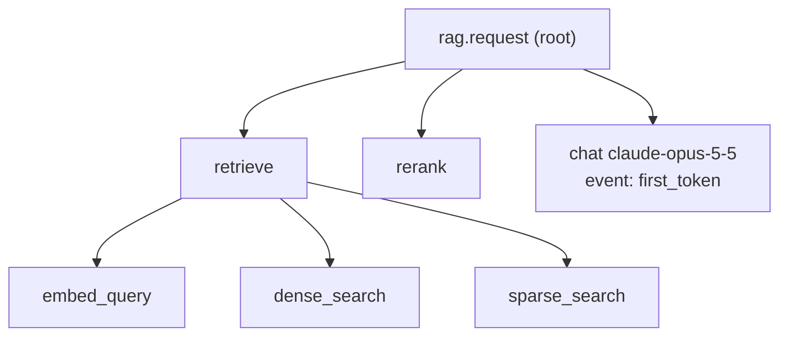

Logs tell you *what* happened in a request; they are poor at telling you *where the time went* and *how the steps relate*. A RAG request is a small program: it embeds the query, runs two searches in parallel, fuses and reranks the results, builds a prompt and calls a model that streams tokens back. When it takes four seconds instead of one, or fails halfway, you want to see that program's execution as a picture: which step ran inside which, which ran in parallel, how long each took, and which one failed.

That picture is a **trace**. This lesson explains traces and spans from first principles, instruments a RAG pipeline with OpenTelemetry (the vendor-neutral standard for traces), and shows how to read the result: self time, the critical path, errors and the generative-AI attributes that make a model call's span useful. Everything here happens inside one process; carrying a trace across services is the subject of [Distributed tracing](/learn/rag-observability/distributed-tracing).

## Learning objectives

- Define trace, span, parent span, span context, attribute, event and status, and draw the span tree of a RAG request.
- Instrument the stages of a Python RAG pipeline with the OpenTelemetry API and export the spans.
- Compute a span's self time and identify the critical path of a trace, by hand and in code.
- Apply the OpenTelemetry generative-AI semantic conventions to a model-call span, and explain their maturity status.
- Diagnose lost parent-child links when work moves to threads, and fix them.

## Prerequisites

- [Logging](/learn/rag-observability/logging): structured events, request identifiers and the decision about logging content.
- [End-to-end RAG lifecycle](/learn/rag-architecture-fundamentals/end-to-end-rag-lifecycle): the stages of a request.
- [Async programming](/learn/python-for-rag-engineering/async-programming): tasks and concurrency in Python.

## Why this matters

A latency number on its own is not actionable. Suppose AskMeridian's 95th-percentile latency rises from 2.1 to 3.4 seconds. The cause could be the embedding service, the vector database, a reranker that now receives more candidates, a longer prompt that slows the model's first token, or a new permission check nobody thought to time. Logs with a `latency_ms` per stage help, but only for the stages someone remembered to log, and they do not show overlap: if dense and sparse search run in parallel, adding their latencies overstates the request time, and you cannot tell from two log lines whether they really overlapped.

Traces fix both problems. Every instrumented operation records its start and end time and its parent, so the trace shows nesting and concurrency directly. Time that no child accounts for is visible as a gap, which is often where the surprise lives. And because every span in a trace shares the trace identifier, the trace is also the natural unit for attaching evidence: the chunk ids, token counts and stop reason of *this* request, displayed next to the step that produced them.

For RAG specifically, tracing is also the basis of most LLM observability tools. Phoenix, LangSmith, Langfuse and similar products display and evaluate traces; several accept OpenTelemetry data directly. Understanding the underlying model lets you use any of them, or none, without being locked to one vendor's SDK.

## The intuition

Think of a stopwatch timeline of making breakfast. "Make breakfast" runs from 07:00 to 07:15. Inside it, "boil the kettle" runs 07:00 to 07:04 while "toast bread" runs 07:01 to 07:04, at the same time. Then "make tea" runs 07:04 to 07:09, and inside that, "steep" runs 07:05 to 07:08. Every step sits inside its parent's interval.

Draw each step as a horizontal bar under its parent and you get a **waterfall**, the standard view of a trace. Three things jump out of such a picture without any arithmetic:

1. Which step is longest.
2. Which steps overlapped (the kettle and the toast), so that their times do not add.
3. Unexplained gaps: if "make breakfast" lasted 15 minutes but its steps only cover 9, six minutes went on something nobody wrote down. Perhaps finding a clean mug.

A trace is that timeline for a request, recorded automatically by the code itself.

## How it works

### Spans and traces

A **span** represents one operation: a unit of work with a name, a start time and an end time. A **trace** is the set of spans produced by one request, organised as a tree. Each span records:

| Field | Meaning | RAG example |
| --- | --- | --- |
| Name | What the operation is | `retrieve`, `rerank`, `chat claude-opus-5-5` |
| Trace id | 16-byte id shared by every span in the trace | identical for all spans of one question |
| Span id | 8-byte id unique to this span | |
| Parent span id | The span this one ran inside; absent for the **root span** | `rerank`'s parent is `rag.request` |
| Start and end time | Timestamps, so duration = end − start | |
| Attributes | Typed key-value pairs describing the operation | `rag.k = 20`, `gen_ai.usage.input_tokens = 1830` |
| Events | Timestamped points within the span | `first_token`, `exception` |
| Status | Unset, Ok or Error, with an optional description | Error: "generation timeout" |
| Kind | The span's role: internal, client, server, producer, consumer | a call to the model API is a client span |

The trace id plus span id (plus a few flags) form the **span context**: the minimum needed for another span to say "you are my parent". Spans can also carry **links** to spans in other traces, used when one operation relates to several others (a batch job processing messages from many requests) rather than having a single parent.



### The current span and context

When you start a span, how does it know its parent? OpenTelemetry keeps a **current context** that holds the active span. In Python it is stored in a `contextvars.ContextVar`, the same mechanism the [Logging](/learn/rag-observability/logging) lesson used for request ids. `tracer.start_as_current_span("rerank")` does four things:

1. Reads the current span from the context and makes it the new span's parent (if there is none, the new span is a root and gets a fresh trace id).
2. Records the start time.
3. Sets the new span as current for the duration of the `with` block, so anything started inside becomes its child.
4. On exit, records the end time, restores the previous current span and hands the finished span to the span processors. If an exception escapes the block, by default it records an `exception` event and sets the status to Error.

Because context lives in a `ContextVar`, it flows automatically through ordinary calls and `asyncio` tasks (each task gets a copy of the context at creation). It does **not** flow into threads started by a `ThreadPoolExecutor`: worker threads run with their own context, so spans started there have no parent and each becomes the root of a new, orphaned trace. The fix is to run the work inside a copy of the caller's context, `contextvars.copy_context().run(fn, *args)`, as the code below does. Orphaned spans are among the most common tracing bugs, and they look like "the trace is missing the search step" rather than an error.

### From span to backend

The OpenTelemetry project separates the **API** (what your code calls: `get_tracer`, `start_as_current_span`) from the **SDK** (what happens to finished spans). Libraries depend only on the API, which does nothing until an application installs an SDK, so instrumentation costs almost nothing when tracing is off. The SDK pipeline is:

1. A **TracerProvider**, configured once per process with a **resource**: attributes that describe the process itself, above all `service.name`.
2. One or more **span processors**. `SimpleSpanProcessor` exports each span synchronously as it ends; useful for tests, too slow for production. `BatchSpanProcessor` queues spans and exports them in batches from a background thread.
3. An **exporter**, which sends spans somewhere: the console, memory (for tests), or over OTLP (the OpenTelemetry protocol) to a **collector** or directly to a tracing backend.

**Sampling** decides which traces to keep at all; at high traffic you rarely keep every trace. Because sampling decisions must be consistent across all the services a request touches, it is covered in [Distributed tracing](/learn/rag-observability/distributed-tracing).

### Instrumentation: manual and automatic

**Manual instrumentation** means writing `with tracer.start_as_current_span(...)` around the operations you care about, as in this lesson's code. It gives you RAG-specific spans and attributes no library knows about: the fused candidate count, the chunk ids that survived reranking, the context token budget.

**Automatic instrumentation** means installing instrumentation packages that patch libraries (HTTP clients, web frameworks, database drivers, LLM SDKs) to create spans for you. OpenTelemetry's contrib project instruments common infrastructure libraries, and several projects (OpenInference from Arize and OpenLLMetry from Traceloop, among others) instrument LLM SDKs and RAG frameworks. LangChain, LlamaIndex and Haystack all expose tracing hooks, as the [Haystack architecture](/learn/haystack-and-other-frameworks/haystack-architecture) lesson describes. Automatic instrumentation is a fast start; manual spans add the domain detail. Most production systems use both.

### Semantic conventions for model calls

Attribute names matter: a dashboard that sums `gen_ai.usage.input_tokens` works only if every service writes that name. OpenTelemetry's **semantic conventions** standardise names for common operations. The generative-AI conventions define, among others:

- `gen_ai.operation.name`: `chat`, `embeddings`, `retrieval`, `execute_tool` and others.
- `gen_ai.provider.name`, `gen_ai.request.model`, `gen_ai.request.max_tokens`, `gen_ai.response.model`.
- `gen_ai.usage.input_tokens`, `gen_ai.usage.output_tokens`.
- `gen_ai.response.finish_reasons`.
- A recommended span name of the form `{operation} {model}`, for example `chat claude-opus-5-5`.

> [!WARNING]
> At the time of writing the generative-AI conventions are marked as in development, not stable, and names have already changed (an earlier `gen_ai.system` attribute was replaced by `gen_ai.provider.name`). Check the current specification, pin your instrumentation versions, and expect occasional renames.

The conventions also define attributes for prompt and completion *content*. Instrumentation libraries typically leave content capture off by default, because prompts contain user questions and document text. Turning it on is the same privacy decision discussed in [Logging](/learn/rag-observability/logging), with the added concern that trace backends are often third-party services.

### Reading a trace

Three questions turn a waterfall into a diagnosis:

1. **Where is the time?** Sort spans by duration, but remember that a parent's duration includes its children's. The useful number is **self time**: the part of a span's duration not covered by any child.
2. **What is on the critical path?** The **critical path** is the chain of spans that determines the end time of the request: speed up anything on it and the request gets faster; speed up something off it (a parallel branch that finishes early) and nothing changes.
3. **Where did it fail?** A span with Error status and an `exception` event pinpoints the failing operation; the root span's status tells you whether the request as a whole failed.

## The mathematics

### Self time

**Intuition.** A parent span's duration is partly its children's work and partly its own. Its own part is whatever time no child covers. Overlapping children must not be counted twice.

$$
t_{\text{self}}(s) = \big(t_{\text{end}}(s) - t_{\text{start}}(s)\big) - \Big|\bigcup_{c \in \text{children}(s)} [\,t_{\text{start}}(c),\, t_{\text{end}}(c)\,]\Big|
$$

Here $s$ is the span, $t_{\text{start}}$ and $t_{\text{end}}$ are timestamps, $\text{children}(s)$ is the set of its direct child spans, the $\bigcup$ is the union of their time intervals, and $|\cdot|$ is the total length of that union. Using the union rather than the sum is what makes parallel children count once.

**By hand.** A `retrieve` span runs from 0 to 90 ms. Its children are `embed_query` [0, 20], `dense_search` [22, 82] and `sparse_search` [22, 52]. The sum of child durations is $20 + 60 + 30 = 110$ ms, more than the parent, which is the giveaway that children overlapped. The union is [0, 20] plus [22, 82] (the sparse interval lies inside the dense one), so its length is $20 + 60 = 80$ ms. Self time is $90 - 80 = 10$ ms: thread-pool start-up, result fusion and the 2 ms gap.

```python
def union_length(intervals):
    total, cur_start, cur_end = 0, None, None
    for start, end in sorted(intervals):
        if cur_end is None or start > cur_end:      # a gap: close the current block
            if cur_end is not None:
                total += cur_end - cur_start
            cur_start, cur_end = start, end
        else:                                        # overlap: extend the block
            cur_end = max(cur_end, end)
    return total + (cur_end - cur_start if cur_end is not None else 0)

parent = (0, 90)                                     # retrieve span, ms
kids = [(0, 20), (22, 82), (22, 52)]                 # embed, dense, sparse
busy = union_length(kids)
print("sum of child durations:", sum(e - s for s, e in kids), "ms")
print("union of child time:   ", busy, "ms")
print("self time:             ", (parent[1] - parent[0]) - busy, "ms")
```

```output
sum of child durations: 110 ms
union of child time:    80 ms
self time:              10 ms
```

### The critical path

For sequential children the critical path passes through all of them. For parallel children it passes through whichever finishes last. In the example, the critical path of `retrieve` is `embed_query` → `dense_search`; `sparse_search` is off it. Making sparse search twice as fast saves nothing; making dense search 20 ms faster saves 20 ms of request time (until sparse search becomes the slower branch at 30 ms, after which further dense gains stop counting). This is why a trace, not a per-stage latency table, should drive [latency optimisation](/learn/performance-optimisation/latency-optimisation).

## In code

**The problem.** Instrument an AskMeridian pipeline (embed, parallel dense and sparse search, rerank, generate) so that each request produces one trace, with model-call attributes following the generative-AI conventions and a failing request clearly marked. Then print each trace as an indented tree.

**Dependencies.** The OpenTelemetry API and SDK. Stages are simulated with `time.sleep` so the example runs with no models, no database and no API key; the structure is identical with real calls.

```bash
pip install opentelemetry-api opentelemetry-sdk
```

```python
import contextvars
import time
from concurrent.futures import ThreadPoolExecutor

from opentelemetry import trace
from opentelemetry.sdk.resources import Resource
from opentelemetry.sdk.trace import TracerProvider
from opentelemetry.sdk.trace.export import SimpleSpanProcessor
from opentelemetry.sdk.trace.export.in_memory_span_exporter import InMemorySpanExporter
from opentelemetry.trace import Status, StatusCode

# --- 1. Set up the SDK once per process ----------------------------------------
exporter = InMemorySpanExporter()                     # in production: an OTLP exporter
provider = TracerProvider(resource=Resource.create({"service.name": "askmeridian-api"}))
provider.add_span_processor(SimpleSpanProcessor(exporter))  # production: BatchSpanProcessor
trace.set_tracer_provider(provider)
tracer = trace.get_tracer("askmeridian.pipeline")


def work(seconds: float) -> None:
    time.sleep(seconds)                               # stands in for real I/O


# --- 2. Instrument each stage with a span ----------------------------------------
def embed_query(query: str):
    with tracer.start_as_current_span("embed_query") as span:
        span.set_attribute("gen_ai.operation.name", "embeddings")
        span.set_attribute("gen_ai.request.model", "all-MiniLM-L6-v2")
        work(0.02)
        return [0.1] * 384


def dense_search(vector):
    with tracer.start_as_current_span("dense_search") as span:
        span.set_attribute("db.system.name", "qdrant")
        span.set_attribute("rag.k", 20)
        work(0.06)
        return ["hb-leave-01", "hb-leave-02", "hb-remote-01"]


def sparse_search(query: str):
    with tracer.start_as_current_span("sparse_search") as span:
        span.set_attribute("rag.k", 20)
        work(0.03)
        return ["hb-leave-01", "it-pass-01"]


def retrieve(query: str):
    with tracer.start_as_current_span("retrieve") as span:
        vector = embed_query(query)
        # Run both searches in parallel. Each thread needs a copy of the current
        # context, or its spans lose their parent and start new traces.
        with ThreadPoolExecutor(max_workers=2) as pool:
            f_dense = pool.submit(contextvars.copy_context().run, dense_search, vector)
            f_sparse = pool.submit(contextvars.copy_context().run, sparse_search, query)
            fused = list(dict.fromkeys(f_dense.result() + f_sparse.result()))
        span.set_attribute("rag.candidates", len(fused))
        return fused


def rerank(query: str, candidates):
    with tracer.start_as_current_span("rerank") as span:
        span.set_attribute("rag.rerank.model", "ms-marco-MiniLM-L-6-v2")
        span.set_attribute("rag.rerank.input_count", len(candidates))
        work(0.05)
        kept = candidates[:3]
        span.set_attribute("rag.chunk_ids", kept)
        return kept


def generate(query: str, chunks, fail: bool = False):
    with tracer.start_as_current_span("chat claude-opus-5-5") as span:
        span.set_attribute("gen_ai.operation.name", "chat")
        span.set_attribute("gen_ai.provider.name", "anthropic")
        span.set_attribute("gen_ai.request.model", "claude-opus-5-5")
        span.set_attribute("gen_ai.request.max_tokens", 1024)
        work(0.09)
        span.add_event("first_token")                 # a timestamped point inside the span
        work(0.25)
        if fail:
            raise TimeoutError("model call exceeded 0.3 s budget")
        span.set_attribute("gen_ai.usage.input_tokens", 1830)
        span.set_attribute("gen_ai.usage.output_tokens", 142)
        span.set_attribute("gen_ai.response.finish_reasons", ["end_turn"])
        return "Annual leave is 25 days [hb-leave-01]."


def answer(query: str, fail: bool = False):
    with tracer.start_as_current_span("rag.request") as root:
        root.set_attribute("rag.query_chars", len(query))
        try:
            chunks = rerank(query, retrieve(query))
            return generate(query, chunks, fail)
        except TimeoutError:
            root.set_status(Status(StatusCode.ERROR, "generation timeout"))
            return None   # the exception was recorded on the generation span automatically


# --- 3. Run twice and print each trace as a tree ----------------------------------
answer("How many days of annual leave do I get?")
answer("How many days of annual leave do I get?", fail=True)

spans = exporter.get_finished_spans()
children = {}
for s in spans:
    children.setdefault(s.parent.span_id if s.parent else None, []).append(s)


def ms(ns: int) -> int:
    return round(ns / 1e6 / 10) * 10                  # round to 10 ms: sleep timing jitters


def show(span, depth=0):
    kids = sorted(children.get(span.context.span_id, []), key=lambda k: k.start_time)
    dur = span.end_time - span.start_time
    status = "" if span.status.status_code is StatusCode.UNSET else f"  [{span.status.status_code.name}]"
    events = ", ".join(e.name for e in span.events)
    print(f"{'  ' * depth}{span.name:<{30 - 2 * depth}} {ms(dur):>4} ms{status}"
          + (f"  events: {events}" if events else ""))
    for k in kids:
        show(k, depth + 1)


for root in sorted(children[None], key=lambda r: r.start_time):
    print(f"trace {root.context.trace_id:032x}"[:22] + "…")
    show(root)
    print()

gen = [s for s in spans if s.name.startswith("chat")][0]
print({k: v for k, v in gen.attributes.items() if k.startswith("gen_ai.usage")})
print("spans exported:", len(spans), "| distinct traces:", len({s.context.trace_id for s in spans}))
```

```output
trace e141d11b510da062…
rag.request                     490 ms
  retrieve                       90 ms
    embed_query                  20 ms
    dense_search                 70 ms
    sparse_search                40 ms
  rerank                         60 ms
  chat claude-opus-5-5          350 ms  events: first_token

trace c3efa2353e03559b…
rag.request                     500 ms  [ERROR]
  retrieve                       90 ms
    embed_query                  30 ms
    dense_search                 70 ms
    sparse_search                40 ms
  rerank                         60 ms
  chat claude-opus-5-5          360 ms  [ERROR]  events: first_token, exception

{'gen_ai.usage.input_tokens': 1830, 'gen_ai.usage.output_tokens': 142}
spans exported: 14 | distinct traces: 2
```

Trace ids are random, and durations can differ by about 10 ms between runs because `time.sleep` is not exact.

**The important lines.**

- `TracerProvider(resource=...)` with `service.name` identifies which service produced the spans; every backend groups by it. `SimpleSpanProcessor` plus `InMemorySpanExporter` is the standard test setup. In production use `BatchSpanProcessor` with an OTLP exporter.
- `trace.get_tracer("askmeridian.pipeline")` names the instrumentation scope, so you can tell your manual spans from a library's automatic ones.
- Each stage is a `with tracer.start_as_current_span(name)` block. Nesting in the code becomes nesting in the trace, with no ids passed around.
- `contextvars.copy_context().run` in `retrieve` carries the current span into the worker threads. Remove it and run again: `dense_search` and `sparse_search` become roots of their own one-span traces and the "distinct traces" count rises from 2 to 6.
- `span.add_event("first_token")` marks a point in time inside the generation span. With a streaming client you would add it when the first text arrives, which makes time to first token visible in every trace.
- In the failing run the `TimeoutError` escapes the generation span's `with` block. The SDK records an `exception` event (type, message, stack trace) and sets the span's status to Error. The root span catches the exception and sets its own status explicitly, because a handled exception does not mark the parent automatically.

**What the output means.** In each trace, `retrieve` lasts 90 ms although its children sum to 130 ms: the searches overlapped, exactly as the mathematics predicted. The critical path is `embed_query` → `dense_search` → `rerank` → `chat`, and the model call accounts for about 70% of the request. That tells you where optimisation effort pays: shortening sparse search would save nothing. The second trace shows the failure located precisely on the model-call span, with the root marked as failed too.

**Common errors.** Calling `trace.set_tracer_provider` twice logs a warning and ignores the second call, so configure tracing once at start-up. Forgetting to call `provider.shutdown()` (or `force_flush()`) in short scripts with a `BatchSpanProcessor` loses the last batch. Attribute values should be strings, booleans, numbers or lists of these; many backends do not index nested structures, so flatten them into separate attributes.

**Extending it.** Replace the exporter with `OTLPSpanExporter` from `opentelemetry-exporter-otlp` and point it at a collector or at a local Phoenix instance. Wrap the real Anthropic call from the [Generation pipeline](/learn/rag-architecture-fundamentals/generation-pipeline) and set `gen_ai.usage.*` from `response.usage.input_tokens` and `response.usage.output_tokens`. Add the trace id to your log lines (`trace.get_current_span().get_span_context().trace_id`) so logs and traces link to each other.

## A real-world example

After a release, AskMeridian's median latency rose from about 1.6 to about 2.3 seconds. The Platform team's logs had per-stage `latency_ms` for retrieval and generation, and neither had changed. The extra 0.7 seconds was somewhere else.

The team had added manual spans for the main stages two weeks earlier, so they opened a slow trace. The `retrieve` span itself was about 0.8 seconds, but its child spans (`embed_query`, `dense_search`, `sparse_search`) covered barely 150 ms. Self time of more than half a second, in a span whose own code did almost nothing, meant uninstrumented work inside it.

The release had added document-level permissions: before searching, `retrieve` now called the HR directory to fetch the user's groups, and that call had no span. Once one was added, it showed the directory lookup taking 500 to 700 ms per request, with no caching. The fix was a short-lived cache of group memberships keyed by user; the lesson the team wrote into their review checklist was that any new network call gets a span, and that large self time in a parent span is a prompt to look for missing children.

## Common mistakes

- **Spans in worker threads without the parent context.** They become separate one-span traces; the trace looks incomplete and the work seems to vanish.
- **Adding child durations to explain a parent.** Parallel children overlap; the sum overstates the time and points optimisation at the wrong branch.
- **Using `SimpleSpanProcessor` in production.** Every span ends with a synchronous export on the request path, adding network latency to each operation.
- **Inventing attribute names per team.** `tokens_in`, `input_tokens` and `gen_ai.usage.input_tokens` across three services make cross-service queries impossible. Follow the semantic conventions and document your own `rag.*` additions.
- **Capturing prompt and document text in spans by default.** Spans often go to third-party backends and are widely visible; content capture should be a deliberate, reviewed setting.
- **Too many tiny spans.** A span per token or per loop iteration multiplies overhead and storage and hides the structure. Span the operations you would want to see on a waterfall.
- **Not marking handled failures.** If a fallback path swallows an exception without setting status or an event, the trace looks healthy.

## Best practices

- Configure the SDK once at process start, with `service.name` and a version in the resource.
- Create a root span per request, and child spans for each RAG stage and every network call.
- Name model-call spans `{operation} {model}` and set the `gen_ai.*` attributes, including token usage and finish reasons.
- Record RAG-specific facts as attributes: candidate counts, chunk ids kept after reranking, context tokens, cache hits.
- Mark the first streamed token with an event, so time to first token is visible per trace.
- Propagate context explicitly into thread pools; prefer `asyncio`, where context flows automatically.
- Put the trace id in every log line and the request id in the root span, so you can move between the two.
- Keep content capture off in production unless a reviewed policy says otherwise.

## Performance considerations

Tracing overhead has three parts.

**In-process cost.** Creating a span, setting a dozen attributes and ending it costs on the order of microseconds in the Python SDK. A RAG request with 10 to 20 spans therefore spends well under a millisecond on tracing, against hundreds of milliseconds of model and search time. The cost becomes noticeable only with thousands of spans per request.

**Export cost.** `BatchSpanProcessor` moves export off the request path. Its queue has a maximum size; if the exporter cannot keep up, spans are dropped rather than blocking requests, which is the right trade-off but means a struggling backend produces incomplete traces.

**Storage cost.** Estimate it. Suppose (as assumptions) 50,000 requests a day, 15 spans each, about 500 bytes per span with attributes: $50{,}000 \times 15 \times 500 \approx 375$ MB a day, roughly 11 GB a month. Capturing prompt content (say 8 KB per model-call span) would add about 400 MB a day on its own. Sampling, covered in the next lesson, is the main lever: keeping 10% of successful traces and all failing ones divides the bulk of that by ten.

## Security considerations

- Span attributes and events are data leaving your process, often to a hosted service. Treat them like logs: no secrets, no raw personal data by default, and an agreed policy for prompt and completion content.
- Exception events capture messages and stack traces; client libraries sometimes put request details in exception messages. Review what your failure spans contain.
- Trace backends that show prompts and retrieved chunks need access control at least as strict as the documents themselves, or tracing becomes a way around document-level permissions.

## Summary

- A trace is the tree of timed spans for one request; each span has a name, ids, a parent, start and end times, attributes, events and a status.
- OpenTelemetry separates the API (cheap, used by libraries) from the SDK (provider, processors, exporters), and keeps the current span in context so nesting in code becomes nesting in the trace.
- Read a trace with self time (duration minus the union of child intervals) and the critical path; parallel children do not add up.
- Use the generative-AI semantic conventions for model spans, knowing they are still in development, and add your own documented `rag.*` attributes.
- Context does not flow into thread pools by itself; orphaned spans are the commonest tracing bug.

## Exercises

**1.** A `rag.request` span lasts 1,200 ms. Its children are `retrieve` [0, 300], `rerank` [310, 410] and `generate` [420, 1,150]. What is its self time, and what is on the critical path?

<details><summary>Show solution</summary>

The children do not overlap, so the union is $300 + 100 + 730 = 1{,}130$ ms and self time is $1{,}200 - 1{,}130 = 70$ ms: two 10 ms gaps between stages and 50 ms after generation ends (perhaps response serialisation or a post-processing step without a span). All three children are on the critical path because they run one after another.

</details>

**2.** In the code, remove `contextvars.copy_context().run` from both `pool.submit` calls (submit the functions directly). Predict what changes in the printed output, then run it to check.

<details><summary>Show solution</summary>

`dense_search` and `sparse_search` no longer see the `retrieve` span as current, so each starts a new trace as a root span. Each of the two requests now has three traces instead of one: the main trace (without the search spans under `retrieve`) and two single-span traces. The output prints six trees and reports `distinct traces: 6`. The `retrieve` span still lasts about 90 ms, but its visible children cover only the 20 ms embedding, so its apparent self time jumps to about 70 ms: exactly the symptom of the real-world example, caused this time by lost context rather than a missing span.

</details>

**3.** Add a `context.build` span between rerank and generation that records `rag.context_tokens` and `rag.chunks_dropped` attributes. Give the span a sensible position in the tree and explain why these two attributes are worth recording.

<details><summary>Show solution</summary>

Inside `answer`, after `rerank` and before `generate`:

```python
with tracer.start_as_current_span("context.build") as span:
    context = "\n\n".join(chunks)          # real code: format, number and budget the chunks
    span.set_attribute("rag.context_tokens", 1650)
    span.set_attribute("rag.chunks_dropped", 0)
```

It is a child of `rag.request` and a sibling of `rerank` and `chat`. `rag.context_tokens` explains the model call's input token count and time to first token (longer prompts take longer to process), and `rag.chunks_dropped` reveals when the right chunk was retrieved but cut for the token budget, a quiet failure that is otherwise invisible.

</details>

**4.** Design decision. Meridian's security lead objects to sending traces to a hosted LLM-observability service because spans "will contain staff questions". The Platform team wants the service's trace views. Propose a configuration that serves both, and say what is lost.

<details><summary>Show solution</summary>

Send spans with content capture off: names, timings, statuses, token counts, model names, chunk ids, scores and pseudonymous user ids, but no prompt, query or completion text. Run an OpenTelemetry collector inside Meridian's network as the only exporter destination, with a processor that deletes or hashes any attribute matching content keys, so a misconfigured library cannot leak text. For deep debugging, keep full-content traces in a self-hosted backend with restricted access and short retention, or sample a small fraction with redaction.

What is lost: the hosted service cannot show the actual question and answer, so features that evaluate content (LLM judges over production traces) work only on the self-hosted side. That is an acceptable trade if the decision is recorded and reviewed.

</details>

## Check your understanding

```quiz
[
  {
    "q": "A `retrieve` span lasts 100 ms. Its children are `embed` [0, 20], `dense` [20, 90] and `sparse` [20, 50]. What is its self time?",
    "options": ["0 ms", "10 ms", "-20 ms", "30 ms"],
    "answer": 1,
    "why": "The union of the child intervals is [0, 90], 90 ms long, so self time is 100 - 90 = 10 ms. Summing the children (120 ms) double-counts the overlap."
  },
  {
    "q": "Why do spans created in a `ThreadPoolExecutor` worker often appear as separate traces?",
    "options": [
      "OpenTelemetry does not support threads",
      "The worker thread does not inherit the caller's context, so it sees no current span",
      "BatchSpanProcessor exports thread spans separately",
      "Each thread has its own TracerProvider"
    ],
    "answer": 1,
    "why": "The current span lives in a ContextVar; worker threads run with their own context unless you run the work inside a copy of the caller's context."
  },
  {
    "q": "Dense search (60 ms) and sparse search (30 ms) run in parallel after embedding. Which change shortens the request?",
    "options": [
      "Making sparse search 20 ms faster",
      "Adding a cache in front of sparse search",
      "Making dense search 20 ms faster",
      "Moving sparse search before embedding"
    ],
    "answer": 2,
    "why": "Dense search is on the critical path; the request waits for the slower branch. Speeding up sparse search changes nothing."
  },
  {
    "q": "What is the status of OpenTelemetry's generative-AI semantic conventions, and what follows from it?",
    "options": [
      "In development; names can change, so pin instrumentation versions and check the current specification",
      "Stable since their first release; they will never change",
      "Deprecated in favour of vendor-specific attributes",
      "Only applicable to OpenAI models"
    ],
    "answer": 0,
    "why": "They are still in development and have already been renamed in places (gen_ai.system became gen_ai.provider.name)."
  },
  {
    "q": "Which processor and exporter combination is appropriate for a production RAG service?",
    "options": [
      "SimpleSpanProcessor with ConsoleSpanExporter",
      "SimpleSpanProcessor with an OTLP exporter",
      "BatchSpanProcessor with InMemorySpanExporter",
      "BatchSpanProcessor with an OTLP exporter to a collector or backend"
    ],
    "answer": 3,
    "why": "Batching keeps export off the request path, and OTLP sends spans to a collector or backend; the simple processor exports synchronously and the in-memory exporter is for tests."
  }
]
```

## Further reading

- OpenTelemetry documentation, [Traces](https://opentelemetry.io/docs/concepts/signals/traces/), and the [Python instrumentation guide](https://opentelemetry.io/docs/languages/python/instrumentation/).
- OpenTelemetry, [Semantic conventions for generative AI systems](https://opentelemetry.io/docs/specs/semconv/gen-ai/) (status: development).
- Sigelman, Barroso, Burrows, Stephenson, Plakal, Beaver, Jaspan and Shanbhag (2010), *Dapper, a Large-Scale Distributed Systems Tracing Infrastructure*, Google Technical Report: the design that modern tracing descends from.
- Arize Phoenix documentation, [Tracing](https://docs.arize.com/phoenix): an OpenTelemetry-based LLM trace viewer you can run locally.
