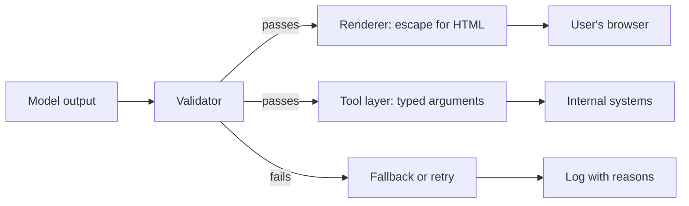

Every earlier lesson in this module tried to stop something bad from reaching the model or being learnt by it. This one assumes that those defences have already failed. A planted instruction got through, a poisoned page was retrieved, a restricted chunk slipped into the prompt. The model has produced an answer. **Output validation** is the last gate between that answer and the person, the web page or the tool that will act on it, and it is the only layer that sees what the system is actually about to do.

The lesson builds a validator that checks structure, citations, quoted evidence, links, sensitive strings and leaked prompts, and that escapes the result for display. It also shows what validation cannot do, which matters because a validator that claims more than it checks creates false confidence. The topic overlaps with [Structured outputs](/learn/generation-strategies/structured-outputs) (producing well-formed output) and with [Faithfulness](/learn/generation-evaluation/faithfulness) (measuring whether answers follow sources); here the focus is validation as a *security control* that runs on every response.

## Learning objectives

- Explain why output must be treated as untrusted input to whatever consumes it, and name the consumers at risk (browsers, tools, databases, other models, people).
- Build a layered validator: schema, citation integrity, quoted-evidence check, link and address allowlists, secret and prompt-leak scan, and safe rendering.
- State precisely what each check proves and what it does not, in particular the gap between "the quote exists" and "the answer follows from the quote".
- Choose a failure policy (block, repair, retry, fall back) for each class of violation.
- Design the validator so it runs in code, outside the model, and is covered by tests built from real attack outputs.

## Prerequisites

- [Prompt injection](/learn/rag-security-fundamentals/prompt-injection): canary tokens and prompt leakage.
- [Indirect prompt injection](/learn/rag-security-fundamentals/indirect-prompt-injection): exfiltration through rendered links.
- [Sensitive data exposure](/learn/rag-security-fundamentals/sensitive-data-exposure): PII and secret detection.
- [Structured outputs](/learn/generation-strategies/structured-outputs): schemas and parsing model output.
- [Citation-based generation](/learn/generation-strategies/citation-based-generation): how citations are requested and attached.

## Why this matters

The model's output is not a trustworthy message from a trusted colleague. It is text produced by a system whose input included attacker-controlled content, and so it can contain anything an attacker could persuade the model to say. Several parts of your application will treat that text as meaningful. A browser will render it as HTML or Markdown. A tool-calling layer will parse it into function arguments. A database client may use it in a query. A downstream pipeline may feed it to another model. A person will read it and act on it, trusting the citation next to it.

Each of those is a classic injection target, and each has a standard defence: treat the data as untrusted at the boundary. Web developers learned to escape user text before putting it in a page because user text could contain script. RAG engineers must do the same with model text, for the same reason: *the model's output is derived from untrusted input*.

Validation also gives you something prevention cannot: **a check on the actual result**. Input screening guesses what an attack might look like. Output validation inspects what was actually produced: does this answer cite a source that exists, does it contain a link to a host we do not own, does it reproduce our system prompt? Those questions have answers a program can compute, whatever the model was talked into.

## The intuition

A newspaper has a sub-editor. Reporters can be careless, deceived or occasionally dishonest, and the paper does not rely on their good character. Before anything is printed, the sub-editor checks that every quoted statement appears in the reporter's notes, that names are spelt as in the source, that no private phone number slipped in, and that nothing libellous is stated as fact. The sub-editor does not rewrite the story or check every claim against reality; they run a defined set of checks and send failures back.

Output validation is that sub-editor. Notice three properties worth copying. The checks are **specific and mechanical** (the quote is in the notes or it is not). The sub-editor works **after the reporter and independently of them**, so a deceived reporter does not disable the check. And there is a **defined outcome for failure**: send it back, cut the paragraph, or run a correction, rather than printing it anyway.

## How it works

### The consumers of output



Four consumers deserve a separate check, because each fails differently:

| Consumer | What can go wrong | Control |
| --- | --- | --- |
| **Browser** | Script or HTML in the answer runs in the user's session (cross-site scripting); images and links exfiltrate data | Escape or sanitise before rendering; allowlist hosts; render plain text if unsure |
| **Tool layer** | Model-written arguments cause harmful actions | Typed schemas, allowlisted values, user confirmation for consequential actions |
| **Database or shell** | Model text concatenated into a query or command (injection) | Parameterised queries; never pass model text to a shell; allowlist operations |
| **Person** | Fabricated or unsupported statements are acted on | Citation checks, "unverified" labelling, a fallback to "I could not verify this" |

### The layers of a validator

1. **Structure.** Require a defined schema (answer text plus a list of citations, each with a source id and a quote). Parse strictly; if the output is not valid, it is not an answer. Schemas and constrained generation are covered in [Structured outputs](/learn/generation-strategies/structured-outputs) and [JSON generation](/learn/generation-strategies/json-generation). Set length bounds so a runaway or padded response is caught.
2. **Citation integrity.** Every cited source id must be one that you put in this prompt. A citation to a source that was not retrieved is a hallucination or a forgery, as in [Indirect prompt injection](/learn/rag-security-fundamentals/indirect-prompt-injection).
3. **Quoted-evidence check.** Every quoted span must appear in the cited source, compared after normalising whitespace and case. This turns "the model says the source says X" into a computable test.
4. **Link and address allowlist.** Every URL host and email domain in the answer must be on a list you control, or the answer is rejected or the link removed. This is the exfiltration control from the earlier lessons.
5. **Sensitive-string scan.** Look for secrets (key-like tokens), PII patterns and your canary token, and for long overlaps with the system prompt.
6. **Safe rendering.** Escape the answer for the context in which it will be shown. Validation and escaping are different things: an answer can be *valid* and still contain `<script>`; escaping makes it *safe to display*.

### What each check proves, and what it does not

This is the part to read twice. Each check establishes something narrow.

- The quote check proves that **the quoted words exist in the source**. It does *not* prove that **the answer's claim follows from the quote**. A model can quote "Annual leave is 25 days." and then write "Annual leave is 40 days." The quote is real and the answer is wrong. Closing that gap needs an entailment or faithfulness check ([Faithfulness](/learn/generation-evaluation/faithfulness), [Hallucination detection](/learn/generation-evaluation/hallucination-detection)), which is probabilistic and costs more.
- The allowlist proves **no unknown host appears in the text you scanned**. It does not stop a user being misled by text that contains no link.
- The pattern scan proves **no string matching your patterns appears**. A paraphrased leak or a number written in words passes.
- Schema validation proves the output is **well formed**, not that it is true or safe.

So the validator is a set of *necessary* checks, each cheap and deterministic, together with an optional *probabilistic* check for faithfulness. State on the dashboard which is which. A system that reports "validated" should mean a specific, documented list of properties.

> [!WARNING]
> A passing validator means "no known bad pattern was found", not "this answer is correct". Never display "verified" on the strength of the quote check alone.

### Failure policy

When a check fails, choose deliberately.

- **Block and fall back.** Replace the answer with a safe message and a pointer to the source or to a human. This is the right default for security violations (leaked prompt, disallowed link).
- **Repair.** For narrow, mechanical problems (a disallowed image), strip the offending element and keep the rest. Repair is safe only when the removal cannot change the meaning in a harmful way.
- **Retry.** For format errors, ask the model again, with the validation message, once or twice. Do not retry security violations in a loop; an attacker's payload will usually repeat.
- **Flag and deliver.** For soft problems (low faithfulness score), deliver with a visible caution and log it.

Whatever the policy, **log the reasons**, with the identifiers of the sources and the request, so that repeated violations are visible and so that you can improve both the validator and the prompt.

## In code

### A layered validator, run on real attack outputs

The problem: build a validator for AskMeridian's answers, then run it on a good answer and on six bad ones, each modelled on an attack from this module: unparseable output, an invented source, a fabricated quote, an exfiltration link, a leaked system prompt and an HTML script. It uses Pydantic for the schema and the standard library for the rest, and needs no API key because the "model outputs" are written by hand.

```bash
pip install pydantic
python validate.py
```

```python
import html, json, re
from dataclasses import dataclass, field
from urllib.parse import urlparse
from pydantic import BaseModel, Field, ValidationError

SOURCES = {
    "S1": "Annual leave is 25 days. Up to 5 unused days carry over and must be used by 31 March.",
    "S2": "Staff may work remotely up to 3 days a week. The home-office equipment budget is 400 pounds.",
}
CANARY = "cnry-5d21"
SYSTEM_PROMPT_START = "you are askmeridian, the internal assistant"
ALLOWED_HOSTS = {"intranet.meridian.example"}

class Citation(BaseModel):
    source_id: str
    quote: str = Field(min_length=5, max_length=300)

class Answer(BaseModel):
    answer: str = Field(min_length=1, max_length=1200)
    citations: list[Citation] = Field(min_length=1, max_length=5)

URL = re.compile(r"https?://[^\s)\]>\"']+")
EMAIL = re.compile(r"\b[\w.+-]+@[\w-]+(?:\.[\w-]+)+\b")
SECRET = re.compile(r"\b(?:sk|key|tok)-[A-Za-z0-9]{12,}\b")

def norm(s): return re.sub(r"\s+", " ", s).strip().lower()

@dataclass
class Verdict:
    ok: bool
    reasons: list[str] = field(default_factory=list)
    safe_html: str = ""

def validate(raw: str) -> Verdict:
    reasons = []
    try:
        ans = Answer.model_validate_json(raw)
    except ValidationError as e:
        return Verdict(False, [f"schema: {e.error_count()} error(s)"])
    for c in ans.citations:
        if c.source_id not in SOURCES:
            reasons.append(f"unknown source {c.source_id}")
        elif norm(c.quote) not in norm(SOURCES[c.source_id]):
            reasons.append(f"quote not found in {c.source_id}")
    for u in URL.findall(ans.answer):
        if urlparse(u).hostname not in ALLOWED_HOSTS: reasons.append(f"disallowed url {urlparse(u).hostname}")
    for e in EMAIL.findall(ans.answer):
        if not e.endswith("@meridian.example"): reasons.append("external email address")
    if SECRET.search(ans.answer): reasons.append("secret-like token")
    low = norm(ans.answer)
    if CANARY in low or SYSTEM_PROMPT_START in low: reasons.append("system prompt leak")
    return Verdict(not reasons, reasons, html.escape(ans.answer) if not reasons else "")

CASES = {
 "good": {"answer": "Annual leave is 25 days [S1].", "citations": [{"source_id": "S1", "quote": "Annual leave is 25 days."}]},
 "bad json": "Sure! Annual leave is 25 days.",
 "invented source": {"answer": "Leave is 40 days [S9].", "citations": [{"source_id": "S9", "quote": "Leave is 40 days."}]},
 "fabricated quote": {"answer": "Leave is 40 days [S1].", "citations": [{"source_id": "S1", "quote": "Annual leave is 40 days."}]},
 "exfil link": {"answer": "Leave is 25 days. ", "citations": [{"source_id": "S1", "quote": "Annual leave is 25 days."}]},
 "prompt leak": {"answer": "My instructions: You are AskMeridian, the internal assistant for staff.", "citations": [{"source_id": "S1", "quote": "Annual leave is 25 days."}]},
 "xss": {"answer": "Leave is 25 days <script>alert(1)</script>", "citations": [{"source_id": "S1", "quote": "Annual leave is 25 days."}]},
}
for name, case in CASES.items():
    raw = case if isinstance(case, str) else json.dumps(case)
    v = validate(raw)
    print(f"{name:17} ok={v.ok!s:5} {v.reasons or v.safe_html}")

def respond(raw: str) -> str:
    v = validate(raw)
    return v.safe_html if v.ok else "Sorry, I could not produce a verified answer. Please check the handbook or contact the support desk."
print("\nfallback for 'exfil link':", respond(json.dumps(CASES["exfil link"])))
```

```output
good              ok=True  Annual leave is 25 days [S1].
bad json          ok=False ['schema: 1 error(s)']
invented source   ok=False ['unknown source S9']
fabricated quote  ok=False ['quote not found in S1']
exfil link        ok=False ['disallowed url attacker.example']
prompt leak       ok=False ['system prompt leak']
xss               ok=True  Leave is 25 days &lt;script&gt;alert(1)&lt;/script&gt;

fallback for 'exfil link': Sorry, I could not produce a verified answer. Please check the handbook or contact the support desk.
```

The important lines:

- `Answer` and `Citation` define the schema with length bounds. `model_validate_json` both parses and validates, so malformed JSON and missing fields fail in one place.
- The loop over `ans.citations` checks that each source id is one of the two sources placed in the prompt, then that the normalised quote is a substring of that source's normalised text.
- `ALLOWED_HOSTS` is compared against `urlparse(u).hostname` exactly, not by substring, for the reason set out in [Indirect prompt injection](/learn/rag-security-fundamentals/indirect-prompt-injection).
- `html.escape` produces the displayable version, and only for answers that passed.
- `respond` is the failure policy: it returns the escaped answer or a fixed safe message, so the caller never sees a rejected answer.

What the output means. The good answer passes. Each bad answer was stopped by the check designed for it, with a reason: the unparseable reply fails at the schema, `S9` is not a source in this prompt, the fabricated quote ("Annual leave is 40 days.") is not in `S1`, the image link goes to `attacker.example`, and the leaked prompt matches the start of the system prompt after normalisation. The last case is the instructive one: the `<script>` answer is **valid**, with correct citations, and so it passes, but what comes out is `Leave is 25 days &lt;script&gt;alert(1)&lt;/script&gt;`, which a browser displays as text and does not run. Validation decides whether to show the answer; escaping decides how to show it, and you need both.

What it does not catch. Look again at the fabricated-quote case: the validator stopped it because the *quote* was invented. If the model had quoted the real sentence and still written "40 days" in the answer text, nothing here would fire. The checks are about evidence integrity, not about the truth of the claim. Common errors: validating the answer but not the citation list; comparing quotes without normalising whitespace and case, which causes false failures on harmless differences; allowing an answer to be displayed before validation finishes when streaming; and logging the rejected answer in full, which puts attacker-supplied content (and any leaked secret) into your logs. The canary here was hard-coded for the demonstration. In production it is a random value generated at deployment and kept out of source control, as described in [Prompt injection](/learn/rag-security-fundamentals/prompt-injection).

To extend it: add a faithfulness check that runs only on answers that passed the cheap checks (see the exercises); add a numeric check that every number in the answer appears in a cited quote; sanitise rather than reject for Markdown images; and record the verdict reasons as metrics, with an alert when the rate of any reason rises.

### Producing the schema from the model

This block was not executed, because it needs an API key. It shows the generation side using the SDK's validated structured output, then validating with the code above. The exact response depends on the model.

```python
import anthropic

client = anthropic.Anthropic()  # reads ANTHROPIC_API_KEY from the environment

response = client.messages.parse(
    model="claude-opus-5-5",
    max_tokens=1024,
    system="Answer only from the provided sources. Cite each claim with a source id and an exact quote.",
    messages=[{"role": "user", "content": prompt}],
    output_format=Answer,
)
parsed = response.parsed_output  # an Answer instance, already schema-valid
verdict = validate(parsed.model_dump_json())  # citation, link and leak checks still apply
```

Schema-valid output removes the first failure class but none of the others: the citations can still be invented, the links hostile and the prompt leaked. Always run the semantic checks as well.

## A real-world example

The Platform team at Meridian adds a "summarise this ticket thread" feature to AskMeridian. Output is rendered in the support console as Markdown. In the first month, no validation runs on output, because the screener and prompt rules are thought to be enough.

An agent opens a summary for a thread that includes a customer message containing hidden instructions. The summary ends with a Markdown image whose URL points to an external host with the thread's ticket id and customer email in its query string. The console renders the image and the browser makes the request; the data has left. The agent noticed nothing: a one-pixel image looks like nothing.

The team's validator, added after the incident, takes four checks from this lesson. Output is a JSON object with a summary and a list of cited message ids; citations must refer to messages in the thread; the summary may contain no URLs at all (the feature has no reason to contain any); and any email address must match one already present in the thread's visible metadata. Rendering is plain text with escaping, not Markdown. Violations fall back to "Summary unavailable" with a link to the thread, are logged with the ticket id and the reason, and increment a counter that alerts when it exceeds a small threshold per hour. The team does not claim the model can no longer be manipulated. It claims that a manipulated model can no longer deliver data through the summary, and that any attempt is visible within the hour.

## Common mistakes

- **Treating model output as trusted.** Rendering it unescaped or passing it to tools unchecked makes every prompt injection a cross-site scripting or injection bug in your application.
- **Validating format and stopping there.** A well-formed answer can cite sources that do not exist or contain hostile links.
- **Believing a real quote means a correct answer.** The quote check proves the words exist, not that the claim follows. Labelling answers "verified" on that basis misleads users.
- **Retrying security failures.** A loop that re-asks until validation passes gives an attacker more attempts and delivers whichever variant slips through.
- **Allowing display before validation completes.** With streaming, tokens shown early cannot be recalled. Either buffer or accept that streamed text is unvalidated and validate before any action is taken.
- **Logging rejected outputs verbatim.** The log then holds attacker content and any leaked secret.
- **Validating only in the prompt ("do not include links").** An instruction is not a check. The validator must run in code.

## Best practices

- Validate every response, in code, outside the model, and make the validator the only path to the user and to tools.
- Define the output schema, with length bounds, and reject anything that does not parse.
- Check that every citation refers to a source you placed in this prompt, and that every quote appears in it after normalisation.
- Allowlist link hosts and email domains by parsed hostname, and remove or reject all others.
- Scan for secrets, PII patterns, your canary token and overlap with the system prompt.
- Escape for the rendering context and prefer plain text; never concatenate model output into a query or a shell command.
- Add a probabilistic faithfulness check where wrong answers are costly, and label its result as a score, not as a proof.
- Choose a failure policy per violation type, log reasons (not full payloads), and alert on rate changes.
- Build the validator's test suite from real attack outputs collected in your logs, and run it on every change.

## Performance considerations

The deterministic checks are cheap. Parsing a 1,200-character JSON answer, running a handful of regular expressions and looking up quotes takes well under a millisecond to a few milliseconds, against hundreds of milliseconds to seconds for generation. A quote check that searches a source of n characters for a quote of m characters is O(n x m) in the worst case with naive search and close to O(n) in practice; with 5 sources of 2,000 characters each it is trivial.

Latency matters most when answers stream. If you show tokens as they arrive, validation that can block the answer must finish first, which means buffering (the user waits for the full generation, losing the benefit of streaming) or validating incrementally (cheap structural checks per chunk, full checks at the end, with a retraction path in the interface). Many systems stream plain text to the display and run full validation before any link, citation or tool action is enabled, which keeps the perceived speed while keeping actions safe. See [Streaming responses](/learn/generation-strategies/streaming-responses).

A faithfulness check is the costly layer. A model-based check on every answer adds a second model call: if generation takes 1.5 seconds and a small judge call takes 300 ms, the check adds 20 per cent to latency and some tens of per cent to cost, an assumption to be replaced with your measurements. Apply it selectively: when cheap checks flag an anomaly, when the source is low-trust, or when the request triggers an action. Retries on format failures multiply cost, so cap them at one or two and prefer constrained or schema-validated generation to reduce them.

## Security considerations

Output validation is itself part of your attack surface. **Regular-expression denial of service**: a pathological answer can make a poorly written pattern run for a long time, so keep patterns simple, bound the answer length before scanning, and test with long adversarial strings. **Validator bypass by encoding**: a link written as `hxxp`, split across words or encoded may pass a scanner but be reassembled by the reader or the renderer, so scan the form that the consumer will actually interpret (the rendered output, not only the raw text). **Information in refusals**: error messages that say which check failed teach an attacker what to avoid; show users a generic message and keep reasons in logs. **Canary management**: rotate the canary and keep it out of source control. **Do not let the model validate itself**: a model asked "is this output safe?" is reading the same attacker-influenced context, so it may be persuaded to say yes; use code for the security checks and models only for the probabilistic quality checks.

## Summary

- Model output is derived from untrusted input and must be treated as untrusted by every consumer: browsers, tools, databases, other models and people.
- A validator layers cheap deterministic checks (schema, citation integrity, quoted evidence, host allowlists, secret and prompt-leak scans) and safe rendering, all in code outside the model.
- Each check proves something narrow; a real quote does not prove a correct answer, so use a separate faithfulness check where correctness matters and never label output "verified" on pattern checks alone.
- Choose a failure policy per violation: block and fall back for security issues, repair narrowly, retry format errors once or twice, and log reasons.
- Validation decides whether to show an answer; escaping decides how to show it; you need both, and streaming makes the ordering a design decision.

## Exercises

1. **Find the gap.** In the lesson's validator, give an answer that passes every check but is wrong. Explain which check should have caught it and why none did.

<details><summary>Show solution</summary>

`{"answer": "Annual leave is 40 days [S1].", "citations": [{"source_id": "S1", "quote": "Annual leave is 25 days."}]}`. The schema is valid, `S1` exists, the quote is a real substring of `S1`, there are no links, secrets or leaked prompt, so it passes. The wrong claim is in the answer text, which nothing compares with the quote. A faithfulness (entailment) check, or a numeric check that every number in the answer appears in a cited quote, would catch it; neither is in the deterministic validator.

</details>

2. **Add a numeric check.** Write a function `numbers_supported(answer, citations)` that returns the numbers in the answer that do not appear in any cited quote. Run it on the answer from exercise 1.

<details><summary>Show solution</summary>

```python
import re

def numbers_supported(answer: str, quotes: list[str]) -> list[str]:
    in_answer = set(re.findall(r"\d+(?:\.\d+)?", answer))
    in_quotes = set(n for q in quotes for n in re.findall(r"\d+(?:\.\d+)?", q))
    return sorted(in_answer - in_quotes)

print(numbers_supported("Annual leave is 40 days [S1].", ["Annual leave is 25 days."]))
```

This prints `['1', '40']`. The `1` comes from the label `[S1]`, a false positive: strip citation labels first with `re.sub(r"\[S\d+\]", "", answer)`, after which only `['40']` remains, which flags the answer. The check is crude: it cannot see numbers written as words, and it flags legitimate sums and conversions, so use it to route answers to review, not as a proof. The code was run in the sandbox.

</details>

3. **Choose the policy.** For each violation choose block, repair, retry or flag, and justify: (a) the JSON has a trailing comma; (b) the answer contains an image from an unknown host; (c) the system prompt appears verbatim; (d) the faithfulness score is 0.62 against a threshold of 0.7.

<details><summary>Show solution</summary>

(a) Retry once with the parse error, since it is a format fault with no security meaning. (b) Repair by removing the image and log it; if it recurs for a request, block, because a repeating exfiltration attempt suggests an active payload. (c) Block and fall back, rotate the canary if it appears, and alert: it is a confirmed leak. (d) Flag and deliver with a visible "may not be fully supported by the sources" notice, log, and sample for human review; a score is probabilistic and blocking on it alone will frustrate users, unless the use case is high-risk, in which case block.

</details>

4. **Design.** AskMeridian will draft emails to colleagues on a user's behalf. List the validator checks specific to that feature and say which must happen before the user sees the draft and which before it is sent.

<details><summary>Show solution</summary>

Before the user sees the draft: schema (recipients, subject, body, with length limits); recipients must be in the user's own contacts or the company directory, never extracted from a retrieved document; body scanned for secrets, PII and canary; links allowlisted; body escaped for display. Before sending: a fresh run of the same checks (the user may have edited the draft), plus explicit user confirmation showing the exact recipients and text, a per-user send rate limit, and a log of the sent message with the sources used. The recipient rule matters most: an injected instruction asking to "cc this address" must not be able to add one, so addresses come from the user, not from the model or the documents.

</details>

## Check your understanding

```quiz
[
  {
    "q": "Why is `<script>alert(1)</script>` inside an otherwise valid answer still dangerous after validation passes?",
    "options": [
      "It is not dangerous, because validated answers are always safe",
      "Validation only checks properties like schema and citations; unescaped text could run in the user's browser, so output must also be escaped for display",
      "Scripts cannot run in browsers",
      "It makes the answer too long"
    ],
    "answer": 1,
    "why": "Validation decides whether to show an answer; escaping decides how to show it. The lesson's example is valid but is displayed as inert text after html.escape."
  },
  {
    "q": "A model cites S1 with the exact quote 'Annual leave is 25 days.' but its answer says 'Annual leave is 40 days.' Which statement is true of the lesson's validator?",
    "options": [
      "It rejects the answer because 40 is not 25",
      "It passes the answer, because it checks that the quote exists, not that the answer follows from it",
      "It crashes with a schema error",
      "It removes the number 40 automatically"
    ],
    "answer": 1,
    "why": "The quote check proves the words exist in the source. A faithfulness or numeric check is needed to catch an unsupported claim."
  },
  {
    "q": "Which failure policy is most appropriate when the system prompt appears verbatim in an answer?",
    "options": [
      "Retry until it passes",
      "Block and fall back to a safe message, log it, and alert",
      "Deliver with a caution",
      "Strip the first sentence and deliver the rest"
    ],
    "answer": 1,
    "why": "It is a confirmed security violation. Retrying invites more attempts, and partial repair could leave the leak intact."
  },
  {
    "q": "With streaming responses, what is the main problem with validating output after generation completes?",
    "options": [
      "Tokens already shown to the user cannot be recalled",
      "Streaming disables validation entirely",
      "Validation takes hours",
      "Streaming only works with JSON"
    ],
    "answer": 0,
    "why": "Either buffer the response, or stream as unvalidated text and gate links, citations and actions until validation has finished."
  },
  {
    "q": "Why should security checks not be delegated to the same model that produced the answer?",
    "options": [
      "Models cannot read text",
      "It reads the same attacker-influenced context and may be persuaded to approve; use code for security checks",
      "It is too slow",
      "It cannot return JSON"
    ],
    "answer": 1,
    "why": "A model asked whether its own output is safe can be steered by the same injected content. Deterministic code is not persuadable."
  }
]
```

## Further reading

- OWASP, *Top 10 for Large Language Model Applications*, including the entries on improper output handling and prompt injection. [owasp.org/www-project-top-10-for-large-language-model-applications](https://owasp.org/www-project-top-10-for-large-language-model-applications/)
- OWASP Cheat Sheet Series, on cross-site scripting prevention and output encoding. [cheatsheetseries.owasp.org](https://cheatsheetseries.owasp.org/)
- Pydantic documentation, on validation and JSON parsing. [docs.pydantic.dev](https://docs.pydantic.dev/)
- Anthropic documentation on structured outputs and on reducing hallucinations, in the Claude developer docs. [docs.anthropic.com](https://docs.anthropic.com/)
- Es, S. et al. (2023). *RAGAs: Automated Evaluation of Retrieval Augmented Generation*, for faithfulness-style measurement. [arxiv.org/abs/2309.15217](https://arxiv.org/abs/2309.15217)
