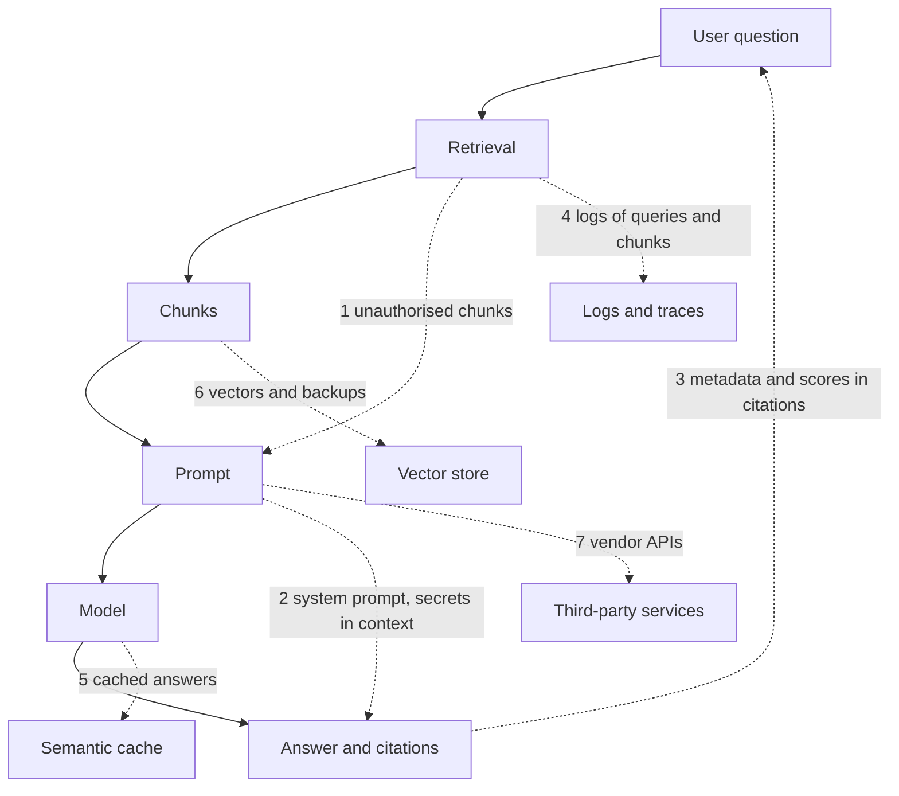

The previous lessons were about attackers who put something *into* a RAG system. This one is about information coming *out* of it. A RAG assistant is, by design, a machine for finding text and repeating it, and it is very good at that. Unless care is taken, it will find and repeat text the asker was never meant to see: an HR file, a customer's card number in an old ticket, a salary in a spreadsheet that someone indexed in a hurry, or the system prompt itself. **Sensitive data exposure** is the failure in which the system discloses data to a person, a log, a third party or a cache that should not have it.

This lesson maps the places where leakage happens (it is more than the answer text), shows why filtering by permission *after* ranking is both leaky and lossy, and builds a small detector and redactor with a real checksum test. The full machinery of authentication, role-based access and PII programmes is the subject of the next module, [Access control and privacy](/learn/access-control-and-privacy); this lesson gives you the security fundamentals and the leak map, so that you know what that module must achieve.

## Learning objectives

- Enumerate the leakage paths in a RAG system beyond the generated answer: retrieval, system prompt, citations and metadata, logs, caches, embeddings, and third-party services.
- Explain why filtering after ranking returns fewer results than requested and discloses the existence of restricted documents, and why pre-filtering is the right pattern.
- Build a PII detector that uses pattern matching plus a validity check (the Luhn algorithm), and describe its false positives and false negatives.
- Decide where in the pipeline (ingestion, retrieval, output, logging) each protective control belongs.
- Treat embeddings, logs and caches as sensitive stores with the same access rules as the source documents.

## Prerequisites

- [Prompt injection](/learn/rag-security-fundamentals/prompt-injection): extraction attacks and canary tokens.
- [Retrieval manipulation](/learn/rag-security-fundamentals/retrieval-manipulation): query-side probing and filter injection.
- [Metadata](/learn/vector-database-fundamentals/metadata) and [Filtering](/learn/vector-database-fundamentals/filtering): how restrictions are expressed on vector queries.
- [Logging](/learn/rag-observability/logging): what a RAG system records about each request.
- [Regular expressions](/learn/data-processing/regular-expressions): the pattern syntax used in the detector.

## Why this matters

A search engine over a company's documents has always been dangerous in one specific way: it makes everything findable, including things that were only ever safe because nobody could find them. This is sometimes called *security by obscurity*, and it describes most shared drives. A folder with a confusing name and no links to it is "protected" until an index crawls it. A semantic search over the whole drive removes that protection overnight, and a conversational interface makes the result frighteningly easy to use: "what's the redundancy plan for the support desk?" gets an answer in plain English.

Exposure is also not limited to what the user sees. The same sensitive text can flow into places with different, usually weaker, protection: application logs kept for a year, an analytics dashboard, a semantic cache shared between users, an evaluation dataset exported to a spreadsheet, a third-party model API, a vector database backup. Every copy has its own audience. Engineers who protect the chat window and forget the logs have moved the leak, not closed it.

The consequences are legal and personal as well as technical: privacy law applies to personal data wherever it sits, and an employee who learns a colleague's salary or a customer whose card number appears in a reply cannot un-learn it.

## The intuition

Think of a hotel concierge with a master key who is very helpful. Guests ask where to find things, and the concierge fetches them. The danger is not that the concierge is malicious; it is that "being helpful" and "checking who is asking" are separate skills, and the concierge only has the first unless you train and equip them with the second. You would not solve the problem by telling the concierge to "be discreet" and handing over the master key. You would give them keys that open only the doors the guest is entitled to, and ask them to write nothing about guests in the public notice board.

Two corrections follow for RAG. **The key set should be decided before the concierge looks for anything**: restrictions belong in the retrieval step, which is the part of the system that holds the "keys", not in the prompt. And **what the concierge writes down** (logs, caches, notes) is a second place to leak, so it must be treated as carefully as the rooms themselves.

## How it works

### The leak map



1. **Retrieval of unauthorised chunks.** The root cause of most real exposures: the retriever returns a chunk the user may not read, and the model dutifully summarises it. Once it is in the prompt, no prompt instruction can reliably prevent it appearing in the answer.
2. **System prompt and context secrets.** Anything placed in the prompt, from API keys to confidential business rules, can be extracted, as in [Prompt injection](/learn/rag-security-fundamentals/prompt-injection).
3. **Citations and metadata.** A citation shows a title, a path, an author, a score or a snippet. A title such as "Redundancy plan 2026 (draft, HR only)" is itself a disclosure, as is the *existence* of a result.
4. **Logs and traces.** Debugging logs often record the full prompt, including retrieved chunks and the user's question. These are stored longer, read by more people and protected less than the source system.
5. **Caches.** A semantic cache returns a stored answer when a new question is similar to an earlier one. If the cache is keyed only on the question's meaning and not on the user's permissions, one user's answer, built from their permitted documents, is served to another.
6. **Embeddings and vector stores.** A vector is not a safe summary. Morris et al. (2023) showed that, given access to an embedding and to the model that produced it, a large share of short texts could be reconstructed from the vector alone. The practical rule is to treat vectors, indexes and backups as being as sensitive as the text they came from.
7. **Third-party services.** The text you send to an embedding API, a reranker or a model provider leaves your boundary. Check retention terms, data-processing agreements and regional controls before sending sensitive material.

### Permission filtering: before, not after

The central design choice is where the access check runs.

**Post-filtering** ranks all documents, takes the top k, and then removes those the user may not see. It is simple to bolt on, and it is wrong in two ways. It **loses results**: if the top three contain two restricted documents, the user gets one result even though many permitted documents would have matched. And it **leaks**: how many results were removed, how long the request took, and the pattern of what is missing tell an attacker that restricted documents on that topic exist.

**Pre-filtering** constrains the candidate set to what the user may read *before* ranking, so the top k are the best permitted documents. The cost is that the filter must be expressed in the retriever (a metadata filter or a per-user index partition), which interacts with approximate search performance, as [Filtering](/learn/vector-database-fundamentals/filtering) discusses. How to represent and maintain permissions is the work of [Document-level permissions](/learn/access-control-and-privacy/document-level-permissions); the principle for this lesson is that **authorisation is enforced by code in the retrieval path, using the authenticated identity, and never by a prompt instruction**.

### Controls by position in the pipeline

| Position | Control | Limits |
| --- | --- | --- |
| **Ingestion** | Classify and tag sensitivity; detect and redact or tokenise PII; refuse to index data you do not need | Detectors miss; redaction can be irreversible |
| **Retrieval** | Pre-filter by the user's identity; separate tenants; withhold scores and counts | Needs accurate, current permissions |
| **Prompt** | Include only what the answer needs; no secrets | Relies on retrieval being correct |
| **Output** | Scan for PII, secrets, canary tokens; allowlist links ([Output validation](/learn/rag-security-fundamentals/output-validation)) | Pattern-based; paraphrase evades |
| **Logging** | Redact before writing; log chunk ids, not text; short retention; restricted access | Reduces debuggability |
| **Caching** | Key on the user's permission scope as well as the query | Lower hit rate |

> [!KEY]
> Do not put in the prompt what the user may not read. A model cannot withhold what it has been given, and an instruction to do so is just text.

### Detecting personal data

PII detection finds spans that look like personal data: emails, phone numbers, national identifiers, payment-card numbers, names and addresses. Pattern matching works well where the data has a fixed format (emails, card numbers, national insurance numbers). Names and addresses need statistical models, covered in [PII detection](/learn/access-control-and-privacy/pii-detection). A pattern alone has many false positives: any 16-digit number looks like a card. Adding a **validity check** reduces them. Payment-card numbers carry a check digit defined by the **Luhn algorithm**: working from the right, double every second digit (subtracting 9 if the result exceeds 9), sum all the digits, and the total of a valid number is divisible by 10. A random 16-digit ticket id passes this about one time in ten, so the check removes roughly nine in ten false matches; it does not prove that the number is a live card.

## In code

### Redaction and the two filtering orders

The problem: redact emails, card numbers and national insurance numbers before text is indexed or logged, using Luhn to avoid redacting ticket ids; then compare filtering after ranking with filtering before, on a small index in which confidential HR documents crowd the top of the ranking for a query. The code uses only `re` and `rank_bm25`.

```bash
pip install rank-bm25
python exposure.py
```

```python
import re
from rank_bm25 import BM25Okapi

# ---------- 1. PII detection and redaction
EMAIL = re.compile(r"\b[\w.+-]+@[\w-]+(?:\.[\w-]+)+\b")
NI = re.compile(r"\b[A-CEGHJ-PR-TW-Z]{2}\s?\d{2}\s?\d{2}\s?\d{2}\s?[A-D]\b")
CARD = re.compile(r"\b\d(?:[ -]?\d){12,18}\b")

def luhn_ok(number: str) -> bool:
    digits = [int(c) for c in number if c.isdigit()][::-1]
    total = sum(d if i % 2 == 0 else (d * 2 - 9 if d * 2 > 9 else d * 2) for i, d in enumerate(digits))
    return len(digits) >= 13 and total % 10 == 0

def redact(text: str):
    found = []
    def sub(label, pattern, check=None):
        nonlocal text
        def r(m):
            if check and not check(m.group(0)): return m.group(0)
            found.append(label); return f"[{label}]"
        text = pattern.sub(r, text)
    sub("CARD", CARD, luhn_ok); sub("EMAIL", EMAIL); sub("NI", NI)
    return text, found

SAMPLES = [
    "Contact jordan.lee@meridian.example about the expense claim.",
    "Reimbursed to card 4111 1111 1111 1111 on 3 March.",
    "Ticket number 4111 1111 1111 1112 was closed.",       # fails Luhn: a ticket id, not a card
    "Payroll lists NI number AB 12 34 56 C for the contractor.",
    "Annual leave is 25 days.",
]
print("--- redaction")
for s in SAMPLES:
    out, found = redact(s)
    print(f"{found!s:12} {out}")

# ---------- 2. permission filtering: before versus after ranking
DOCS = [
    ("d1", "hr-private", "Redundancy consultation plan: voluntary redundancy terms for the support desk team."),
    ("d2", "hr-private", "Redundancy pay calculation and consultation timeline for support desk staff."),
    ("d3", "hr-private", "Support desk redundancy briefing notes for managers."),
    ("d4", "public", "Support desk hours are 08:00 to 18:00 UK time."),
    ("d5", "public", "Report a lost laptop to the support desk at once."),
    ("d6", "public", "Annual leave is 25 days. Up to 5 unused days carry over."),
]
tok = lambda t: re.findall(r"[a-z0-9]+", t.lower())
bm = BM25Okapi([tok(d[2]) for d in DOCS])
QUERY, K, USER_ACL = "support desk redundancy", 3, {"public"}

scores = bm.get_scores(tok(QUERY))
ranked = sorted(range(len(DOCS)), key=lambda i: -scores[i])

top_k = ranked[:K]
post = [DOCS[i][0] for i in top_k if DOCS[i][1] in USER_ACL]
print("\n--- post-filter: rank, take top 3, then drop unauthorised")
print("returned:", post, "| candidates dropped:", K - len(post))

pre = [DOCS[i][0] for i in ranked if DOCS[i][1] in USER_ACL][:K]
print("--- pre-filter: drop unauthorised, then rank")
print("returned:", pre)
```

```output
--- redaction
['EMAIL']    Contact [EMAIL] about the expense claim.
['CARD']     Reimbursed to card [CARD] on 3 March.
[]           Ticket number 4111 1111 1111 1112 was closed.
['NI']       Payroll lists NI number [NI] for the contractor.
[]           Annual leave is 25 days.

--- post-filter: rank, take top 3, then drop unauthorised
returned: ['d5'] | candidates dropped: 2
--- pre-filter: drop unauthorised, then rank
returned: ['d5', 'd4', 'd6']
```

The important lines:

- `luhn_ok` implements the check digit rule above. It is applied to anything the `CARD` pattern matches, so a 16-digit number that fails the check is left alone.
- `redact` replaces each detected span by a label such as `[EMAIL]`, and returns the labels it found for logging. Order matters: cards are handled before the generic patterns so a long digit run is not mistaken for something else.
- In the second half, `post` ranks everything, keeps the top three and then removes unauthorised documents. `pre` removes unauthorised documents first and then takes the top three.
- The sample national insurance number `AB 12 34 56 C` is fictional, as are all the other values.

What the output means. The redactor changed three of the five sample lines. The ticket number `4111 1111 1111 1112` was correctly left alone: it matches the card pattern but has an invalid check digit (the real test number `4111 1111 1111 1111` passes), so the Luhn step prevented a false positive. The ranking comparison is the more important result. For the query "support desk redundancy", two of the three confidential HR documents and one public document (`d5`) make up the top three by BM25. Post-filtering takes those three and then discards the two confidential ones, so the user gets one result and two slots are wasted, although the index holds three permitted documents that could have been returned. Pre-filtering returned `d5`, `d4` and `d6`, the three best documents the user may read. The post-filter route also leaks: a system that reports "2 results hidden", or that behaves visibly differently for such queries, confirms to the user that confidential redundancy documents exist.

Limits and errors. Regular expressions find formats, not meaning: a number written with words, an email with spaces ("jordan dot lee at meridian") or a card number split across lines escapes them; and any pattern can match benign text. Redaction at ingestion is not reversible, so decide deliberately whether you will need the original (store it separately under stricter control) or tokenise (replace by a reversible token held in a vault). The national insurance pattern here is a simplification of the real rules. Common mistakes in code of this kind: running the redactor on the answer but not on the logs; redacting after chunking so that a number split across two chunks escapes; and using the validity check as proof of identity of a real card.

To extend it: add a phone-number and postcode pattern; add a named-entity model for personal names; log the labels found, not the text; and run the redactor over your existing logs and cache to see what has already leaked.

## A real-world example

Meridian's HR team uploads a folder of case files to a shared drive "for the new HR assistant", and the Platform team indexes the whole drive because the connector indexes by folder. The folder holds redundancy consultation plans, disciplinary notes and a payroll export. AskMeridian has a prompt line telling it never to discuss HR cases, and there is no permission filtering in retrieval, since "the prompt handles it".

A new starter asks, "Is the support desk being restructured?" The retriever returns the consultation plan; the model, which has been told not to discuss HR cases but has also been told to answer from the sources, writes a hedged answer that confirms a restructuring is being planned, naming the team. The prompt rule failed because the sensitive text had already been placed in the prompt, and the model weighed two instructions.

The Platform team's response has four parts. Retrieval gains a pre-filter driven by the user's identity and by an `acl` tag assigned at ingestion from the drive's own permissions; documents without a tag are not indexed at all. The ingestion pipeline refuses folders classified as HR-confidential unless the owner approves. Logging switches from storing prompts to storing chunk ids, with the PII redactor running before any write. And the semantic cache is keyed on the user's permission scope, so an answer built for HR staff is never served to others. The team also learns something about the old data: the existing cache and logs contained the plan text and are purged under the retention policy ([Data retention](/learn/access-control-and-privacy/data-retention)).

## Common mistakes

- **Enforcing access with a prompt instruction.** The sensitive text is already in the context, and the instruction competes with others. The consequence is disclosure under paraphrase or pressure.
- **Post-filtering after top-k.** Users get fewer results than they should, and the gaps reveal that restricted documents exist.
- **Logging full prompts forever.** Logs then hold a copy of every sensitive chunk, with weaker controls and a longer life than the source.
- **A shared semantic cache.** One user's permitted answer is served to a user without that permission.
- **Treating vectors as anonymous.** Embeddings can leak the text they encode; backups and exports of the index carry the same sensitivity as the documents.
- **Redacting only the answer.** The data persists in the index, the prompt, the logs and the cache.
- **Trusting detector coverage.** Pattern-based PII detection misses names, free-text addresses and paraphrase, so a "clean" scan is not a guarantee.
- **Showing scores, counts or restricted titles in citations.** These are small disclosures that accumulate into a map of what exists.

## Best practices

- Enforce authorisation in the retrieval path, from the authenticated identity, before ranking; assign access tags at ingestion from the source system's permissions.
- Index only what the assistant needs; keep sensitive systems (payroll, case files) out unless there is an owner and an access model.
- Detect and redact or tokenise PII at ingestion, at output and before logging, and measure detector recall on a labelled sample.
- Store chunk ids and metadata in logs, not text; set short retention; restrict who can read them.
- Scope caches by permission, and treat vector stores, backups and evaluation exports as sensitive.
- Show users only what they are entitled to: no scores, no counts of hidden results, no restricted titles.
- Check vendor terms (retention, training use, region) before sending sensitive text to a third-party API.
- Test with seeded canary documents: plant a document tagged for one group and verify, by automated test, that other groups can never retrieve or see it.

## Performance considerations

Pre-filtering is the more expensive design at the retriever, and the cost depends on how selective the filter is. A filter that removes 1 per cent of documents barely changes search; one that leaves 0.1 per cent of a 10-million-vector index can make approximate nearest-neighbour search either slow (if the engine scans many candidates to find permitted ones) or incomplete (if it stops early), depending on the engine. Options include per-tenant partitions or collections for large, stable groups, and filtered indexes for the rest; see [Filtering](/learn/vector-database-fundamentals/filtering) and the [tenant isolation](/learn/access-control-and-privacy/tenant-isolation) lesson. Post-filtering looks cheap, but compensating by over-fetching (retrieve 50, hope 5 survive) raises cost and still has no guarantee.

PII scanning costs depend on the method. Regular expressions run in microseconds per chunk; for a corpus of 1 million chunks of 300 tokens each, a simple pattern set typically finishes in minutes on one machine, an assumption you should measure on yours. Model-based entity recognition is typically orders of magnitude slower per chunk and is usually run at ingestion rather than per query. Scanning output adds a small, constant cost to each answer. Redaction before logging adds the same cost to every request, which is why many systems log ids and only redact the few free-text fields they keep. Cache scoping reduces hit rate, since an answer can be reused only within a permission scope; measure the hit rate per scope before deciding whether the cache is worth keeping.

## Security considerations

Exposure touches the rest of the module. **Prompt injection** can be the *means*: an injected instruction asks the model to reveal the context or to put it in a URL, which is why [output validation](/learn/rag-security-fundamentals/output-validation) and link allowlists matter. **Legal duties**: personal data is regulated wherever it lives, including in vectors and logs; retention, subject-access and deletion duties apply to every copy ([Data retention](/learn/access-control-and-privacy/data-retention), [GDPR concepts](/learn/enterprise-rag-governance/gdpr-concepts)). **Encryption** at rest and in transit protects against theft of storage, not against an over-permissive retriever ([Data encryption](/learn/access-control-and-privacy/data-encryption)). **Insiders** are in scope: the user asking is usually legitimate but not entitled to everything. **Error messages and traces** can include chunk text, so review what your frameworks print on failure.

## Summary

- A RAG system makes everything it indexes findable, so exposure is chiefly an access-control problem in retrieval, not a prompt problem.
- Leakage paths include retrieved chunks, the system prompt, citations and metadata, logs, caches, embeddings and third-party services.
- Filter by permission before ranking, using the authenticated identity; post-filtering loses results and discloses that restricted documents exist.
- Pattern-based PII detection works for fixed formats and improves with validity checks such as Luhn, but misses names, free text and paraphrase.
- Treat logs, caches, vectors and backups as sensitive stores, scope caches by permission, and log ids instead of text.

## Exercises

1. **Apply Luhn by hand.** Verify that `4111 1111 1111 1111` passes the Luhn check, and that `4111 1111 1111 1112` fails.

<details><summary>Show solution</summary>

Write the digits from the right (position 0 is the rightmost) and double every digit at an odd position, subtracting 9 if the doubled value exceeds 9. In `4111 1111 1111 1111` the digits at positions 0 to 14 are all 1 and the digit at position 15 is 4. The eight odd positions hold seven 1s and the 4: doubled, they give 7 x 2 + 8 = 22. The eight even positions hold eight 1s, giving 8. The total is 30, divisible by 10, so it passes. In `...1112` the rightmost digit (position 0, not doubled) is 2 instead of 1, so the total is 31 and it fails. This matches the program: the first is redacted, the second is left alone.

</details>

2. **Quantify the loss.** An index returns the top 10 for each query, and 60 per cent of the chunks that match a typical query are restricted for a given user. Under post-filtering, how many results does the user get on average, and what does over-fetching to 25 give?

<details><summary>Show solution</summary>

Top 10 with 60 per cent restricted: 10 x 0.4 = 4 permitted results on average. Over-fetch to 25: 25 x 0.4 = 10, so about 10 results, at 2.5 times the retrieval work, and only on average. The variance matters: some queries return fewer. Under pre-filtering the user gets 10 every time (if 10 permitted documents match) at the cost of a filtered search. This assumes restricted chunks are spread evenly through the ranking; if they cluster at the top, as in the lesson's example, the loss is worse.

</details>

3. **Scope a cache.** Write a function `cache_key(query_embedding_id, user)` that returns a key safe for a semantic cache in AskMeridian, where each user has a set of permission groups. State one trade-off.

<details><summary>Show solution</summary>

```python
import hashlib

def cache_key(query_embedding_id: str, groups: set[str]) -> str:
    scope = ",".join(sorted(groups))
    return hashlib.sha256(f"{scope}|{query_embedding_id}".encode()).hexdigest()
```

Two users with identical group sets share entries; users with different group sets never do. The trade-off is hit rate: the more varied the permission scopes, the less reuse, and in the worst case every user has a unique scope and the cache never hits. Also invalidate entries when a user's groups or a document's access tag change. This sketch was not run in the sandbox.

</details>

4. **Design.** Choose where to place each control for a new feature, "ask about my payslip": the payslip PDFs contain names, national insurance numbers and salaries. Say what you would index, what you would store in logs, and how you would test for leakage.

<details><summary>Show solution</summary>

Prefer not to put payslips in the shared index at all; if the feature is essential, create a per-user partition (or a metadata filter set from the authenticated identity) so a user can only ever retrieve their own payslips. Index text with the national insurance number tokenised. Show no scores or counts, and cite only the payslip month. Logs hold chunk ids and a redacted question, never the answer text; retention is short and access is restricted. The cache is disabled for this feature or keyed per user. Test with seeded fake payslips for two test users: automated tests must show that user A can never retrieve or see anything of user B's, across paraphrased and adversarial queries, including prompt-injection attempts that ask for "all payslips". Include the logs and the cache in the test by searching them for the other user's fake values.

</details>

## Check your understanding

```quiz
[
  {
    "q": "Why is telling the model 'never discuss HR cases' an inadequate way to protect HR documents?",
    "options": [
      "Models cannot read instructions",
      "The sensitive text is already in the prompt, and the instruction competes with others and can be bypassed by paraphrase or pressure",
      "HR documents cannot be embedded",
      "Prompts are logged"
    ],
    "answer": 1,
    "why": "A model cannot withhold what it has been given. Enforce access in retrieval so unauthorised chunks never reach the prompt."
  },
  {
    "q": "Post-filtering returned one result where pre-filtering returned three. What explains this?",
    "options": [
      "Post-filtering ranks permitted documents first",
      "Post-filtering takes the top k from all documents and then discards the unauthorised ones, so restricted documents occupy slots that permitted ones could have filled",
      "Pre-filtering uses a different embedding model",
      "Post-filtering uses fewer documents"
    ],
    "answer": 1,
    "why": "The top three were mostly confidential; removing them left one. Pre-filtering ranks only what the user may read."
  },
  {
    "q": "The check digit of `4111 1111 1111 1112` is invalid, so the redactor leaves it. What does that show?",
    "options": [
      "It is definitely not a card number",
      "Luhn removes most random look-alikes, such as ticket ids, but a passing number is not proof of a real card",
      "Luhn detects names",
      "Redaction is not needed for cards"
    ],
    "answer": 1,
    "why": "A random digit string passes Luhn about one time in ten. It reduces false positives but does not prove identity."
  },
  {
    "q": "Which is a leak path that many teams forget when they protect the chat window?",
    "options": [
      "The model's tokenizer",
      "Application logs and semantic caches that hold copies of sensitive prompts and answers",
      "The monitor of the developer",
      "The CSS of the chat page"
    ],
    "answer": 1,
    "why": "Logs and caches are stored longer and protected less than source systems. Redact before writing, scope caches by permission and set short retention."
  },
  {
    "q": "What did Morris et al. (2023) show that matters for vector stores?",
    "options": [
      "Embeddings are always safe to share",
      "Given an embedding and access to the model that produced it, a substantial share of short texts could be reconstructed, so vectors should be treated as sensitive",
      "Embeddings cannot be compared",
      "Vector search cannot be filtered"
    ],
    "answer": 1,
    "why": "Vectors are not anonymous summaries. Apply the same access control, encryption and retention to indexes and backups as to the text."
  }
]
```

## Further reading

- Morris, J. X., Kuleshov, V., Shmatikov, V. and Rush, A. M. (2023). *Text Embeddings Reveal (Almost) As Much As Text*. EMNLP. [arxiv.org/abs/2310.06816](https://arxiv.org/abs/2310.06816)
- OWASP, *Top 10 for Large Language Model Applications*, including the entry on sensitive information disclosure. [owasp.org/www-project-top-10-for-large-language-model-applications](https://owasp.org/www-project-top-10-for-large-language-model-applications/)
- Carlini, N. et al. (2021). *Extracting Training Data from Large Language Models*. USENIX Security. [arxiv.org/abs/2012.07805](https://arxiv.org/abs/2012.07805)
- Microsoft Presidio documentation, an open-source framework for PII detection and anonymisation. [microsoft.github.io/presidio](https://microsoft.github.io/presidio/)
- UK Information Commissioner's Office, guidance on UK GDPR and data protection. [ico.org.uk](https://ico.org.uk/)
