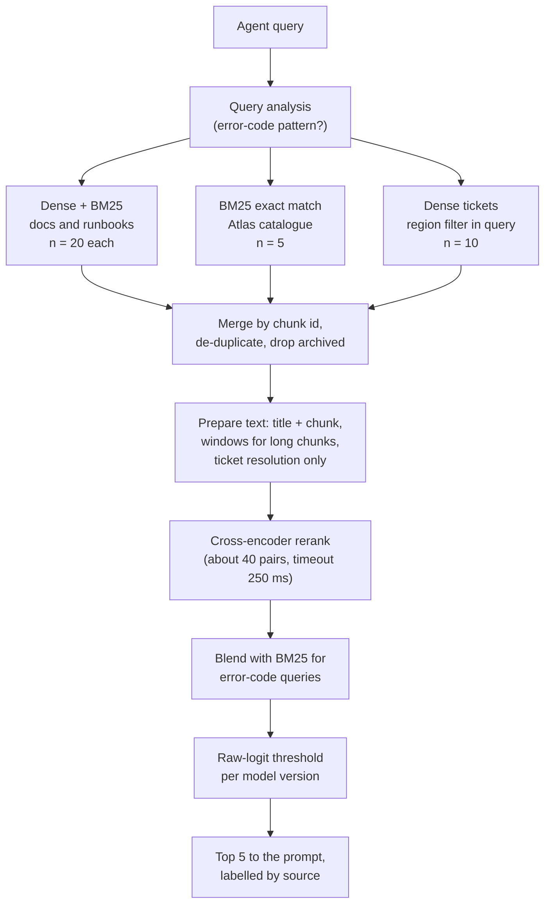

This assessment covers the whole Reranking Fundamentals module: why a first-stage retriever needs a second stage, how bi-encoders and cross-encoders work and differ, how retrieval and reranking divide the work, how to select candidates, and what ranking scores do and do not mean. Aim for at least 80% on the quiz (16 of 20) before moving on, then attempt the open questions, coding exercises, design challenge and troubleshooting scenarios without looking at the model answers first.

```quiz
[
  {
    "q": "What is the main reason a RAG system benefits from reranking even when first-stage Recall@50 is high?",
    "options": [
      "Reranking increases the number of relevant chunks in the corpus",
      "The language model only sees the top few chunks, and the first stage is weak at ordering the top of its list",
      "The first stage cannot return 50 results quickly",
      "Rerankers reduce the size of the vector index"
    ],
    "answer": 1,
    "why": "High recall at depth means the answer is somewhere in the 50; reranking is about getting it into the handful that reach the prompt."
  },
  {
    "q": "A bi-encoder's score can be written as f(q) · g(d). Which capability follows directly from this form?",
    "options": [
      "Reading query and document tokens together",
      "Producing calibrated probabilities",
      "Handling unlimited document length",
      "Precomputing every document vector before any query arrives"
    ],
    "answer": 3,
    "why": "g(d) does not depend on the query, so it can be computed at indexing time and searched with a nearest-neighbour index."
  },
  {
    "q": "Which failure is most characteristic of a bi-encoder rather than a cross-encoder?",
    "options": [
      "Truncating text after 512 tokens",
      "Producing different scores when the query and passage are swapped",
      "Needing one forward pass per candidate",
      "Scoring a passage that restates the question above the passage that answers it"
    ],
    "answer": 3,
    "why": "Scoring by vector similarity rewards restatements. A cross-encoder trained on question-answer relevance handles this much better."
  },
  {
    "q": "What does a BERT-style cross-encoder read for one candidate?",
    "options": [
      "Two separate sequences encoded by two networks",
      "Only the passage, with a precomputed query vector",
      "[CLS] query [SEP] passage [SEP] as one sequence",
      "The query's token vectors and the passage's stored token vectors"
    ],
    "answer": 2,
    "why": "Query and passage are packed into one sequence so attention mixes them in every layer."
  },
  {
    "q": "What does this code print?\n```python\nN, K = 30, 5\nfirst_rank, final_rank = 41, None\nprint('retrieval miss' if first_rank > N else 'other')\n```",
    "options": [
      "other",
      "None",
      "An error",
      "retrieval miss"
    ],
    "answer": 3,
    "why": "Rank 41 is beyond the 30 candidates, so the reranker never saw the chunk."
  },
  {
    "q": "First-stage Recall@40 is 0.88. What is the highest Hit@5 a perfect reranker over those 40 candidates can achieve?",
    "options": [
      "1.00",
      "0.95",
      "0.88",
      "0.44"
    ],
    "answer": 2,
    "why": "Reranking reorders; it cannot add missing chunks. The candidate recall is the ceiling."
  },
  {
    "q": "A reranker costs about 3 ms per pair. Doubling the corpus from 5 to 10 million chunks while keeping N = 50 changes reranking latency by roughly:",
    "options": [
      "Doubles it",
      "Halves it",
      "Adds 50%",
      "Nothing; it stays about 150 ms"
    ],
    "answer": 3,
    "why": "Reranking cost depends on the number and length of candidates, not on corpus size."
  },
  {
    "q": "Where do ColBERT-style late-interaction models sit?",
    "options": [
      "They are bi-encoders with one vector per document",
      "They are cross-encoders with a longer maximum length",
      "They are lexical models",
      "Between bi-encoders and cross-encoders: per-token vectors computed separately and matched at query time"
    ],
    "answer": 3,
    "why": "Token vectors are precomputable like a bi-encoder's, but matching is token by token, giving richer interaction at more storage cost."
  },
  {
    "q": "A 1,000-token chunk has its answer at token 800. A 512-token cross-encoder scores it whole. What happens?",
    "options": [
      "The model reads the whole chunk",
      "An exception is raised",
      "The answer is truncated away and the chunk is scored as if it lacked it",
      "The query is truncated instead of the passage"
    ],
    "answer": 2,
    "why": "Tokens beyond the limit are dropped silently. Window long chunks or rerank shorter units."
  },
  {
    "q": "Which statement about cross-encoder outputs is correct?",
    "options": [
      "They are logits from a linear head unless an activation such as a sigmoid is applied, depending on configuration",
      "They are always probabilities",
      "They can be stored in the index",
      "They are cosines"
    ],
    "answer": 0,
    "why": "The head outputs a real-valued logit; whether a sigmoid is applied depends on the model's configuration and library version."
  },
  {
    "q": "Dense and BM25 each contribute 25 candidates; 9 appear in both. How many pairs does the reranker score?",
    "options": [
      "25",
      "41",
      "50",
      "59"
    ],
    "answer": 1,
    "why": "2n minus the overlap: 50 - 9 = 41."
  },
  {
    "q": "Where should a filter removing archived (superseded) documents run?",
    "options": [
      "After generation",
      "Before reranking, because the reranker will judge archived chunks relevant",
      "Nowhere; the reranker demotes archived chunks automatically",
      "Only in the system prompt"
    ],
    "answer": 1,
    "why": "Relevance is not currency. Status is a metadata decision and should remove candidates before reranker work is spent on them."
  },
  {
    "q": "Recall@N rises from 0.94 at N = 40 to 0.96 at N = 80, and final hit@3 is identical at both. Which depth is better?",
    "options": [
      "40, because the extra 40 pairs cost reranker time without improving the final metric",
      "80, because recall is higher",
      "Neither; set N = k",
      "It cannot be decided without a GPU"
    ],
    "answer": 0,
    "why": "The goal is the final metric at acceptable cost. Past its knee, extra candidates only add latency."
  },
  {
    "q": "What does this code print?\n```python\nimport numpy as np\ns = np.array([-10.9, -11.1, -11.3])\nprint(round(float(((s - s.min()) / (s.max() - s.min())).max()), 2))\n```",
    "options": [
      "1.0",
      "0.0",
      "0.5",
      "-10.9"
    ],
    "answer": 0,
    "why": "Min-max normalisation always maps the top score to 1.0, even when every candidate is irrelevant, as these very low logits suggest."
  },
  {
    "q": "Every logit for a query increases by 4. Which outputs are unchanged?",
    "options": [
      "Sigmoid only",
      "Softmax and min-max",
      "All transformations change",
      "Raw logits"
    ],
    "answer": 1,
    "why": "Softmax and min-max depend only on differences between logits."
  },
  {
    "q": "A team blends `0.5 * cosine + 0.5 * logit` without normalisation. Cosines span about 0.4 and logits about 15. What is the effect?",
    "options": [
      "A balanced combination",
      "The cosine dominates",
      "The logit dominates and the cosine has almost no effect",
      "The order becomes random"
    ],
    "answer": 2,
    "why": "The score with the larger spread controls the sum. Normalise within the query or use rank fusion."
  },
  {
    "q": "After a reranker upgrade, AskMeridian refuses many answerable questions. The most likely cause is:",
    "options": [
      "The vector index needs rebuilding",
      "A threshold tuned on the old model's score scale",
      "The language model changed",
      "The candidate depth is too large"
    ],
    "answer": 1,
    "why": "Score scales are model-specific; thresholds must be refitted on labelled data for every model version."
  },
  {
    "q": "Which problem is a reranker least able to fix?",
    "options": [
      "The relevant chunk sits at first-stage rank 300 with N = 50",
      "An FAQ outranking the policy that answers the question",
      "Two error codes differing by one digit swapped at ranks 1 and 2",
      "A multi-topic chunk ranked 6th for a narrow question"
    ],
    "answer": 0,
    "why": "A chunk outside the candidate list never reaches the reranker."
  },
  {
    "q": "Why are cross-encoders often used when training bi-encoders?",
    "options": [
      "They score pairs accurately, so they can filter false negatives and act as teachers for distillation",
      "They produce embeddings for the index",
      "They make bi-encoders accept longer inputs",
      "They remove the need for labelled data at evaluation"
    ],
    "answer": 0,
    "why": "Their accurate pair scores are used to clean mined negatives and as distillation targets for the faster model."
  },
  {
    "q": "In failure attribution, a query's chunk was at first-stage rank 2 and final rank 7 with k = 5. What is it?",
    "options": [
      "Retrieval miss",
      "Ranking miss",
      "Broken by reranker",
      "Already right"
    ],
    "answer": 2,
    "why": "The first stage had it within k and the reranker pushed it out: a regression."
  }
]
```

## Conceptual questions

**1.** Explain, in terms of when query and document information meet inside the model, why a bi-encoder can search a million chunks in milliseconds while a cross-encoder cannot, and why the cross-encoder is nonetheless more accurate.

<details><summary>Show model answer</summary>

In a bi-encoder, query and document meet only at the final dot product; each side is encoded alone, so all document vectors are computed once, offline, and an approximate nearest-neighbour index finds the best matches without scoring every chunk. Per query, the transformer runs once, on the query. In a cross-encoder they meet at the input: the pair is one sequence and every layer's attention mixes them. Nothing can be computed before the query exists, so each candidate needs its own forward pass; a million chunks would need a million passes per query. The same joint reading is what makes it accurate: query tokens attend to specific passage tokens, so it can check exact codes, ignore restated questions and locate the relevant sentence in a long chunk, none of which a single precomputed vector allows.

</details>

**2.** A colleague argues: "We should drop the first stage and run our reranker on everything; it is more accurate." Give the cost argument against this and one situation in which scoring every chunk with a cross-encoder would be reasonable.

<details><summary>Show model answer</summary>

Reranking cost is one forward pass per scored chunk. At, say, 3 ms per pair on a CPU (an assumption), 100,000 chunks would take 300 seconds per query, and the cost grows linearly with the corpus. The two-stage design caps reranker work at $N$ candidates regardless of corpus size. Scoring everything is reasonable only for tiny collections (tens or a few hundred short chunks, such as a single document a user uploaded) or offline, for evaluation: the whole-corpus "oracle" used in failure attribution, or labelling data for training.

</details>

**3.** Why does a reranker judge relevance rather than truth, and what does that imply for superseded documents and contradictory content in a corpus?

<details><summary>Show model answer</summary>

Rerankers are trained on labels saying whether a passage is relevant to (answers) a query, not whether its claims are true or current. A superseded policy answering the question is, by that standard, relevant; "contractors are eligible" and "contractors are not eligible" are both relevant to "can contractors claim?". So correctness must be handled elsewhere: archived and superseded documents filtered or demoted by metadata, contradictory sources resolved at ingestion, and the generator instructed to prefer authoritative or recent sources when the context conflicts.

</details>

**4.** Explain why per-query normalisation (min-max or softmax) is appropriate for blending first-stage and reranker scores but inappropriate for deciding whether to answer.

<details><summary>Show model answer</summary>

Blending only needs to order the candidates of one query, so putting both score lists on a common 0-to-1 scale within that query is exactly what is required; absolute levels are irrelevant. Deciding whether to answer needs absolute information: is any candidate actually good? Min-max always gives the top candidate 1.0 and softmax always gives some candidate a sizeable share, because both depend only on differences between scores. A query with nothing relevant therefore looks just as confident as one with a perfect match. Thresholds need raw or sigmoid scores, tuned (ideally calibrated) on labelled data for the specific model.

</details>

**5.** Describe how you would choose the candidate depth $N$ for a new deployment, including the data you need and how you would handle a conflict between recall and latency.

<details><summary>Show model answer</summary>

Collect a few hundred labelled queries from real or realistic traffic. Measure first-stage Recall@$N$ (per source and for the merged pool) at depths from about 5 to well past the plausible budget, and the final metric after reranking at the same depths. Measure the reranker's cost per pair, or per batch on a GPU, with real chunk lengths. Pick the smallest depth at the knee of the final metric that meets the recall target, and check it against $N_{\text{budget}} = \lfloor (B - t_1)/c \rfloor$ with slack for variance. If the target needs more than the budget allows, change something structural: add a complementary retriever, improve the first-stage model, shorten candidate text, use a cheaper reranker or a cascade. Re-measure whenever the corpus, chunking or models change.

</details>

## Coding exercises

### Exercise 1: failure attribution

Write `attribute(first_rank, final_rank, n, k)` that classifies a query as "retrieval miss", "ranking miss", "broken by reranker", "fixed by reranker" or "already right" (ranks are 1-based; `None` means not in the list). Apply it to the log below with $N = 50$, $k = 3$, and report Hit@3 and the ceiling.

```python
log = [(1, 1), (4, 1), (2, 3), (37, 2), (55, None), (12, 2), (3, 1), (1, 4), (8, 5), (None, None)]
```

<details><summary>Show solution</summary>

```python
from collections import Counter

def attribute(first_rank, final_rank, n, k):
    """Classify one query. Ranks are 1-based; None means 'not in the list'."""
    if first_rank is None or first_rank > n:
        return "retrieval miss"
    hit_before = first_rank <= k
    hit_after = final_rank is not None and final_rank <= k
    if hit_after:
        return "already right" if hit_before else "fixed by reranker"
    return "broken by reranker" if hit_before else "ranking miss"

# (first-stage rank, rank after reranking) of the relevant chunk, per query
log = [(1, 1), (4, 1), (2, 3), (37, 2), (55, None), (12, 2), (3, 1), (1, 4), (8, 5), (None, None)]
N, K = 50, 3
counts = Counter(attribute(r1, r2, N, K) for r1, r2 in log)
print(dict(counts))
hit = (counts["already right"] + counts["fixed by reranker"]) / len(log)
ceiling = 1 - counts["retrieval miss"] / len(log)
print(f"Hit@{K} = {hit:.2f}, ceiling = {ceiling:.2f}")
```

```output
{'already right': 3, 'fixed by reranker': 3, 'retrieval miss': 2, 'broken by reranker': 1, 'ranking miss': 1}
Hit@3 = 0.60, ceiling = 0.80
```

Half the shortfall (2 of 4 failed queries) is retrieval; one query was broken by the reranker (first-stage rank 1, final rank 4), which deserves individual inspection. Even a perfect reranker could reach only 0.80.

</details>

### Exercise 2: choosing the candidate depth

Write `choose_depth(depths, recall, target, budget_ms, first_ms, ms_per_pair)` returning the chosen depth, the budget depth and a message, or reporting a conflict. Use a first stage of 40 ms, 3.5 ms per pair, a target of 0.95, and budgets of 300 ms and 150 ms.

<details><summary>Show solution</summary>

```python
import numpy as np

def choose_depth(depths, recall, target, budget_ms, first_ms, ms_per_pair):
    n_budget = int((budget_ms - first_ms) // ms_per_pair)
    reach = [d for d, r in zip(depths, recall) if r >= target]
    if not reach:
        return None, n_budget, "target never reached: improve the first stage"
    n_recall = reach[0]
    if n_recall > n_budget:
        return None, n_budget, f"conflict: need {n_recall}, can afford {n_budget}"
    return n_recall, n_budget, "ok"

depths = [10, 20, 40, 60, 100]
recall = [0.78, 0.88, 0.93, 0.95, 0.97]
for budget in (300, 150):
    print(budget, choose_depth(depths, recall, 0.95, budget, 40, 3.5))
```

```output
300 (60, 74, 'ok')
150 (None, 31, 'conflict: need 60, can afford 31')
```

With 300 ms, depth 60 meets the target and fits under the budget depth of 74. With 150 ms only 31 candidates are affordable, so the function reports a conflict rather than silently choosing an inadequate depth; the fix is a better first stage or a cheaper reranker, not a smaller target.

</details>

### Exercise 3: blending to protect exact matches

A query contains an Atlas error code. BM25 ranks the exact-code entry (candidate 0) far ahead; the reranker prefers a fluent neighbouring entry. Write `blend(first, rerank, alpha)` using per-query min-max normalisation (guarding against a zero range) and find the smallest of $\alpha \in \{0, 0.3, 0.5\}$ that restores candidate 0 to the top.

<details><summary>Show solution</summary>

```python
import numpy as np

def minmax(x):
    x = np.asarray(x, dtype=float)
    rng = x.max() - x.min()
    return np.zeros_like(x) if rng == 0 else (x - x.min()) / rng

def blend(first, rerank, alpha):
    return alpha * minmax(first) + (1 - alpha) * minmax(rerank)

bm25 = [14.2, 3.1, 2.8, 2.5]          # candidate 0 is an exact error-code match
logits = [1.5, 4.0, 3.2, -6.0]        # the reranker prefers a fluent neighbour
for alpha in (0.0, 0.3, 0.5):
    b = blend(bm25, logits, alpha)
    print(f"alpha={alpha}: {np.round(b, 3)}  top = candidate {int(np.argmax(b))}")
```

```output
alpha=0.0: [0.75 1.   0.92 0.  ]  top = candidate 1
alpha=0.3: [0.825 0.715 0.652 0.   ]  top = candidate 0
alpha=0.5: [0.875 0.526 0.473 0.   ]  top = candidate 0
```

$\alpha = 0.3$ is enough here, because BM25's normalised margin for candidate 0 is very large (1.0 against at most 0.05). In production, tune $\alpha$ on labelled queries, apply it only to query types where the reranker is known to regress (for example queries matching an error-code pattern), and refit it whenever either model changes.

</details>

## Architecture design challenge

Meridian is opening AskMeridian to its customer support team. The corpus will contain the existing handbook and IT runbooks (about 5,000 chunks), the product documentation for Meridian Sync, Relay and Reports (about 20,000 chunks), the Atlas error-code catalogue (about 8,000 short entries) and resolved customer tickets (about 400,000, user-written, some containing personal data). Queries are a mix of natural-language questions and pasted error codes. The latency budget for retrieval and reranking is 400 ms at p95, on CPU-only infrastructure. Support agents may see tickets only for customers in their region. Design the retrieval and reranking stages, including candidate selection and score handling.

<details><summary>Show reference design</summary>



**Retrieval.** Separate collections with fixed quotas, so that 400,000 tickets cannot crowd out 25,000 trusted chunks. Hybrid retrieval for documentation and runbooks (dense for paraphrases, BM25 for product names and identifiers). The Atlas catalogue is queried lexically, because exact codes are its main use. The ticket collection applies the region filter inside the retrieval query, so restricted tickets are never retrieved, scored or logged.

**Candidate selection.** Merge by chunk id, de-duplicate, remove archived content. The pool is at most 55 and usually about 40 after overlap. Tickets are presented to the reranker by their resolution text, not the customer's question, to avoid question echoes. Long runbook procedures are windowed. Depth per source is chosen from per-source recall curves on a labelled set built from real agent queries.

**Reranking.** A small CPU cross-encoder, sized from measured cost per pair at real lengths: with roughly 40 pairs and a 250 ms budget, the reranker must manage about 6 ms per pair. A timeout falls back to the fused first-stage order. For queries matching the error-code pattern, blend normalised BM25 and reranker scores (or pin exact-code matches), because rerankers can prefer fluent neighbours.

**Scores.** A raw-logit threshold, fitted on labelled answerable and unanswerable questions, decides whether to answer; it is stored with the reranker version and refitted on upgrades. No normalised score is displayed as confidence.

**Trade-offs.** Quotas may exclude a relevant ticket when documentation is plentiful; measure recall per source and adjust. A larger reranker would improve ordering but does not fit the CPU budget at this depth; a cascade or GPU is the upgrade path if measurements demand it. Personal data in tickets argues against a hosted reranker unless its data-processing terms are acceptable.

</details>

## Troubleshooting scenarios

**Scenario 1.** After adding a cross-encoder reranker over the top 20 dense candidates, AskMeridian's overall answer quality improved, but questions that quote Atlas error codes got noticeably worse. Logs show the correct entry is often at dense rank 1 and final rank 3 or 4.

<details><summary>Show diagnosis and fix</summary>

These are "broken by reranker" cases: the first stage had the right entry at the top and the reranker demoted it. The reranker prefers neighbouring entries that read more like fluent answers, and its judgement of near-identical codes is not reliable enough for this content. Fix: detect error-code queries with a pattern, and for them blend normalised first-stage (ideally BM25) and reranker scores, or pin exact-code matches to the top; add BM25 to the candidate pool so exact matches are always present. Track the regression count by query type in future evaluations.

</details>

**Scenario 2.** The team switched to a newer, larger reranker that scored better offline. In production, the share of "I don't know" replies jumped from about 5% to about 30% overnight, though users confirm many of the refused questions are answered in the handbook.

<details><summary>Show diagnosis and fix</summary>

The refusal threshold was tuned on the old reranker's logits. The new model's scores sit on a different range, so many genuinely relevant top candidates now fall below the old threshold. Fix: roll back or temporarily disable the threshold, refit it on the labelled set of answerable and unanswerable questions using the new model's raw scores (check whether it applies a sigmoid by default), and store thresholds with the model version so that future upgrades cannot ship without a refit.

</details>

**Scenario 3.** Runbook questions are answered poorly although failure attribution shows the right runbook chunk is a candidate in nearly every case. Runbook chunks average about 1,100 tokens; handbook chunks about 250. Handbook questions are fine.

<details><summary>Show diagnosis and fix</summary>

These are ranking misses specific to long chunks. A 512-token reranker truncates the runbook chunks, so answers in their second half are never seen, and even within the limit short answers buried in long text score poorly. Fix: score overlapping windows of each long chunk and use the maximum as its score (sending the full chunk to the generator), or rerank smaller child chunks and expand to the parent afterwards. Re-measure reranker latency, since windows multiply pairs, and add a regression test with an answer deep inside a long chunk.

</details>
