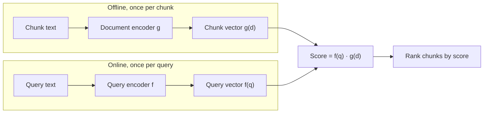

Every dense first-stage retriever you have met so far is a **bi-encoder**: a model that turns the query into one vector and each chunk into another, separately, and scores the pair by comparing the two vectors. The [Sentence Transformers](/learn/embedding-models/sentence-transformers) lesson showed how such a model is built and why it scales. This lesson looks at the bi-encoder from the other side, as a *ranking model*: what its scoring rule makes possible, what the same rule makes impossible, and why those limits are the reason a second stage exists.

The key idea is one line of algebra. A bi-encoder's score can be written as $s(q, d) = \mathbf{f}(q) \cdot \mathbf{g}(d)$: something computed from the query alone, combined with something computed from the document alone. Everything good about bi-encoders follows from that factorisation, and so does everything they get wrong.

## Learning objectives

- Define a bi-encoder and write its scoring rule as a factorised function of the query and the document.
- Explain how factorisation enables offline indexing, approximate nearest-neighbour search and caching.
- Demonstrate, with a real model, the representation bottleneck: question echoes, near-identical codes and negations that a single vector struggles to separate.
- Distinguish symmetric from asymmetric bi-encoders and apply a model's query and document prompts correctly.
- Estimate the storage and online compute of a bi-encoder index from the corpus size and vector dimension.

## Prerequisites

- [Why reranking is needed](/learn/reranking-fundamentals/why-reranking-is-needed): the two-stage pipeline this lesson's model sits at the front of.
- [Sentence Transformers](/learn/embedding-models/sentence-transformers): pooling, `encode`, and why a bi-encoder needs $n$ passes rather than one per pair.
- [Dense vector search](/learn/dense-retrieval/dense-vector-search): searching an index of chunk vectors.
- [Contrastive learning](/learn/embedding-optimisation/contrastive-learning): how bi-encoders are trained with in-batch negatives.

## Why this matters

You will make two kinds of decision about bi-encoders as a RAG engineer. The first is how to use one well: which prompts to add, whether to normalise, how much memory the index needs, whether the same model may embed queries and documents. Getting these wrong produces silent quality loss, not errors. The second is when to stop trying to improve the bi-encoder and add a different kind of model behind it. Teams regularly spend weeks swapping embedding models to fix failures that no single-vector model can fix, because the failure lives in the scoring rule itself, not in the particular weights.

Knowing exactly what the factorised score can and cannot express turns that second decision from guesswork into diagnosis. If a failure is "the chunk restating the question beats the chunk answering it", a better embedding model may shrink the gap but the structure that causes it remains. If the failure is "the relevant chunk is about a topic the model has never seen", a domain-adapted embedding model is the right fix. The two look the same in a complaint ticket.

## The intuition

Imagine Meridian runs a question-matching service by post. Every document in the handbook is sent, in advance, to a summariser who writes a short fingerprint of it on an index card: a fixed list of 384 numbers. The summariser never knows what questions will be asked later. When an employee asks a question, a second summariser (or the same one) writes a fingerprint of the question on its own card. A clerk then lines up the question card against every document card and adds up how well the numbers agree. The best-agreeing cards win.

This is fast. The document cards are written once and filed; answering a question needs one new card and a lot of quick arithmetic, which machines do very fast. But notice the constraint. The document's card must be good for *every* question anyone might ever ask about it, because it is written before any question exists. A handbook section that covers leave allowance, booking, approval and carry-over gets one card for all four topics. And the clerk can only compare numbers; he cannot look at the question and the document together and notice that this document restates the question rather than answering it, or that it says E-4012 where the question says E-4021.

A cross-encoder, the subject of the [next lesson](/learn/reranking-fundamentals/cross-encoders), is the opposite arrangement: an expert who reads the question and the document side by side. That is much more accurate and impossible to prepare in advance.

## How it works

### Two encoders, one comparison



A bi-encoder has two encoding paths that meet only at the end:

1. **Encode documents (offline).** Each chunk passes through a transformer encoder; the token outputs are pooled (mean pooling or the first token, depending on the model) into one vector of $D$ dimensions, often normalised to length 1. The vectors are stored in a vector index.
2. **Encode the query (online).** When a question arrives, it passes through the query encoder once, producing one vector of the same $D$ dimensions.
3. **Compare.** The score for each chunk is the dot product of the query vector and the chunk vector, or the cosine, which equals the dot product for unit-length vectors.
4. **Search.** An exact or [approximate nearest-neighbour](/learn/vector-indexing-algorithms/approximate-nearest-neighbour-search) index returns the chunks with the highest scores without computing every one.

The name says it: two ("bi") encoders, one per side. Whether they are really two different networks is a design choice.

### Symmetric and asymmetric bi-encoders

In a **symmetric** bi-encoder, $\mathbf{f}$ and $\mathbf{g}$ are the same network applied the same way. Sentence-BERT (Reimers and Gurevych, 2019) is the classic example, and `all-MiniLM-L6-v2` works this way. This is natural when both sides are the same kind of text, as in duplicate-question detection.

Retrieval is not symmetric: a short question is matched with a longer passage that answers it. Three designs handle the asymmetry:

- **Separate weights.** Dense Passage Retrieval (Karpukhin and colleagues, 2020) trained two separate BERT encoders, one for questions and one for passages.
- **Shared weights with prefixes.** One network, but the input is marked by role. The E5 family expects `query: ` and `passage: ` at the start of inputs; several BGE models recommend an instruction prefix on queries only. The [E5 models](/learn/embedding-models/e5-models) and [BGE models](/learn/embedding-models/bge-models) lessons give the exact strings.
- **Library support for roles.** Recent Sentence Transformers releases store a model's prompts in its configuration and provide `encode_query` and `encode_document`, which apply the right prompt automatically when the model defines one. With older releases, you pass `prompt_name=` or prepend the prefix yourself.

> [!WARNING]
> Encoding queries with the document prefix, or omitting a required prefix, produces vectors that still work, just worse. Nothing errors. Always check the model card, and encode queries and documents with the same model and the same normalisation.

### What the factorisation buys

Because $\mathbf{g}(d)$ does not depend on the query, it can be computed before any query exists. Four things follow:

- **Offline indexing.** The expensive transformer pass over the corpus happens once, at ingestion. A query costs one transformer pass, whatever the corpus size.
- **Sub-linear search.** Ranking by $\mathbf{f}(q) \cdot \mathbf{g}(d)$ is maximum inner-product search, for which indexes such as [HNSW](/learn/vector-indexing-algorithms/hnsw) find the top results without scoring every vector.
- **Caching and reuse.** A chunk vector can serve every query, every user and every application that shares the index. A popular query's vector can be cached too.
- **Cheap updates.** Adding a chunk means encoding that chunk only. Nothing else changes.

This is why every production first stage that uses neural models is a bi-encoder or a close relative such as a learned sparse model: nothing else lets a transformer's understanding reach millions of documents in tens of milliseconds.

### What the factorisation costs

The same property is a constraint. Each chunk gets one vector, fixed before the question is known, and the query and chunk interact only through a dot product. Call this the **representation bottleneck**. It shows up in four recognisable ways:

1. **No conditioning on the query.** The chunk vector must summarise everything the chunk might be asked about. Multi-topic chunks become averages, and the narrow fact the user wants is a small part of the vector.
2. **Similarity is not answering.** The model is trained to put questions near their answers, but the text *most* similar to a question is usually another version of the question. FAQ headings, forum posts and restated questions can outrank the answer.
3. **Fine detail is compressed away.** Error codes that differ in one digit, "over" and "under", "eligible" and "not eligible" change a few tokens in a long sentence. Their vectors stay close, so small scoring noise can swap them.
4. **Limited ranking capacity.** A dot product in $D$ dimensions cannot produce every possible ordering of a set of documents. The mathematics below shows this in two dimensions; in hundreds of dimensions the limit is far looser, but research has shown it can bind in practice for queries that combine many specific documents (Weller and colleagues, 2025, *On the Theoretical Limitations of Embedding-Based Retrieval*).

None of this makes bi-encoders bad. It makes them a **recall** tool: excellent at finding the right neighbourhood of a large corpus, less reliable at ordering the top of it. That division of labour is the subject of [Retrieval versus reranking](/learn/reranking-fundamentals/retrieval-versus-reranking).

### How bi-encoders are trained

Bi-encoders for retrieval are trained contrastively: given a query, its relevant passage should score higher than other passages in the batch, as the [contrastive learning](/learn/embedding-optimisation/contrastive-learning) lesson explains. Two training practices connect directly to reranking:

- **Hard negatives from a first-stage system.** Training is most informative on passages that look relevant but are not, so negatives are mined from BM25 or an earlier bi-encoder's results ([Hard negative mining](/learn/embedding-optimisation/hard-negative-mining)). A cross-encoder is often used to filter out mined "negatives" that are actually relevant.
- **Distillation from a cross-encoder.** A slow, accurate cross-encoder scores many query-passage pairs, and the bi-encoder is trained to reproduce the cross-encoder's score margins. Hofstätter and colleagues (2020) showed that this cross-architecture distillation improves efficient rankers. The reranker of today is often the teacher of tomorrow's first stage.

Distillation narrows the gap between the two architectures but does not remove the bottleneck: the student still has one vector per chunk.

## The mathematics

### The factorised score

**Intuition.** The score is a sum, over dimensions, of "how much the query wants feature $i$" times "how much the chunk has feature $i$". Nothing in the formula lets a query feature interact with a *specific word* in the chunk; it interacts only with the chunk's summary.

$$
s(q, d) = \mathbf{f}(q) \cdot \mathbf{g}(d) = \sum_{i=1}^{D} f_i(q)\, g_i(d)
$$

- $q$ is the query text and $d$ the document (chunk) text.
- $\mathbf{f}(q) \in \mathbb{R}^D$ is the query vector, produced by the query encoder.
- $\mathbf{g}(d) \in \mathbb{R}^D$ is the chunk vector, produced by the document encoder; for a symmetric model, $\mathbf{g} = \mathbf{f}$.
- $D$ is the embedding dimension (384 for `all-MiniLM-L6-v2`).
- If both vectors are normalised to length 1, $s$ is their cosine similarity, between $-1$ and $1$.

**By hand.** With $D = 3$, let $\mathbf{f}(q) = (0.6, 0.8, 0.0)$, and two chunks $\mathbf{g}(d_1) = (0.8, 0.6, 0.0)$ and $\mathbf{g}(d_2) = (0.0, 0.6, 0.8)$. Then $s(q, d_1) = 0.6 \times 0.8 + 0.8 \times 0.6 + 0 = 0.96$ and $s(q, d_2) = 0 + 0.8 \times 0.6 + 0 = 0.48$. All three vectors have length 1, so these are cosines; $d_1$ ranks first.

### Ranking capacity

**Intuition.** Fix the chunk vectors. Every possible query is a direction in the same space, and each direction produces one ordering of the chunks. Can every ordering be reached by *some* query? In one dimension, clearly not: every chunk is a single number, a positive query sorts them in descending order, a negative query in ascending order, and those are the only two rankings available. Adding dimensions adds orderings, but only so fast.

For $n$ chunks in $D = 2$ dimensions, the query direction rotates around a circle, and the ordering changes only when the query passes a direction at which two chunks tie. Each of the $\binom{n}{2}$ pairs ties at exactly two opposite directions, so there are at most

$$
R_2(n) = 2 \binom{n}{2} = n(n-1)
$$

distinct rankings, compared with $n!$ possible ones. $R_2(n)$ is the number of reachable rankings and $\binom{n}{2} = n(n-1)/2$ the number of pairs. For fixed $D$, the count of reachable rankings grows like a polynomial in $n$ of degree $2(D-1)$, while $n!$ grows faster than any polynomial, so for large enough collections some orderings are always out of reach.

**By hand.** With $n = 4$ chunks: in one dimension, 2 of the $4! = 24$ orderings. In two dimensions, $4 \times 3 = 12$ of 24. In three dimensions, with points in general position, all 24 are reachable. Real embeddings have hundreds of dimensions and the bound is enormous, so this is not why your bi-encoder misranks a single FAQ. It is a reminder that "make the embedding better" has a ceiling that depends on the architecture.

```python
import numpy as np, itertools
rng = np.random.default_rng(0)
n = 4
for d in (1, 2, 3):
    pts = rng.normal(size=(n, d))
    seen = set()
    for _ in range(200_000 if d > 1 else 1000):
        q = rng.normal(size=d)
        seen.add(tuple(np.argsort(-(pts @ q))))
    print(f"d={d}: {len(seen):2d} of {len(list(itertools.permutations(range(n))))} possible orderings of {n} documents are reachable")
```

```output
d=1:  2 of 24 possible orderings of 4 documents are reachable
d=2: 12 of 24 possible orderings of 4 documents are reachable
d=3: 24 of 24 possible orderings of 4 documents are reachable
```

The code samples random query directions and records the distinct orderings they produce. Sampling can only *under*-count, so these are lower bounds that happen to match the exact values.

### Storage and online compute

**Intuition.** The index is a matrix with one row per chunk; the online work is one encoder pass plus a matrix-vector product (or far less with an approximate index).

$$
\text{memory} = N \times D \times b, \qquad \text{exact scoring} = N \times D \text{ multiply-adds}
$$

$N$ is the number of chunks, $D$ the dimension and $b$ the bytes per number (4 for float32). For $N = 1{,}000{,}000$ and $D = 384$: memory is $1{,}000{,}000 \times 384 \times 4 = 1{,}536{,}000{,}000$ bytes, about 1.5 GB, before any index overhead; exact scoring is 384 million multiply-adds per query, which a modern CPU does in a few tens of milliseconds and an ANN index avoids almost entirely. Compare a cross-encoder, which would need a million transformer passes for the same query. [Embedding quantisation](/learn/embedding-optimisation/embedding-quantisation) reduces $b$.

## In code

**The problem.** Build a minimal bi-encoder search engine, then probe it with chunk pairs that differ in the ways the bottleneck predicts: a restated question against its answer, one digit in an error code, "over" against "under", and a negation.

**Dependencies.** Sentence Transformers and NumPy; the model downloads on first use (about 90 MB).

```bash
pip install sentence-transformers numpy
```

```python
import numpy as np
from sentence_transformers import SentenceTransformer

model = SentenceTransformer("sentence-transformers/all-MiniLM-L6-v2")

# --- Offline: encode every chunk once, without knowing any query -----------
chunks = [
    "Passwords must be rotated every 90 days.",
    "How often must passwords be rotated? Staff ask this a lot.",
    "Any expense over £75 needs a receipt.",
    "Any expense under £75 does not need a receipt.",
    "E-4021: the VPN client is out of date. Update it from the IT portal.",
    "E-4012: the VPN certificate has expired. Reinstall it from the IT portal.",
    "Contractors are not eligible for the home-office equipment budget.",
    "Contractors are eligible for the home-office equipment budget.",
]
chunk_vecs = model.encode(chunks, normalize_embeddings=True)   # shape (8, 384)
print(f"index: {chunk_vecs.shape[0]} vectors x {chunk_vecs.shape[1]} dims, "
      f"{chunk_vecs.nbytes:,} bytes as {chunk_vecs.dtype}")

# --- Online: one encoder pass for the query, then only dot products --------
def search(query, k=3):
    q = model.encode(query, normalize_embeddings=True)          # shape (384,)
    scores = chunk_vecs @ q                                     # cosine, since unit length
    top = np.argsort(-scores)[:k]
    print(f"\nQ: {query}")
    for i in top:
        print(f"   {scores[i]:.3f}  {chunks[i]}")

search("How often must passwords be rotated?")
search("Which expenses need a receipt?")
search("What does error E-4021 mean?")
search("Can contractors claim the equipment budget?")

# How far apart are chunks that differ by one word or one digit?
print("\nchunk-to-chunk cosine:")
for a, b in [(2, 3), (4, 5), (6, 7)]:
    print(f"   {chunk_vecs[a] @ chunk_vecs[b]:.3f}  {chunks[a][:30]}... vs {chunks[b][:30]}...")
```

```output
index: 8 vectors x 384 dims, 12,288 bytes as float32

Q: How often must passwords be rotated?
   0.968  How often must passwords be rotated? Staff ask this a lot.
   0.833  Passwords must be rotated every 90 days.
   0.052  Contractors are eligible for the home-office equipment budget.

Q: Which expenses need a receipt?
   0.802  Any expense over £75 needs a receipt.
   0.714  Any expense under £75 does not need a receipt.
   0.380  Contractors are eligible for the home-office equipment budget.

Q: What does error E-4021 mean?
   0.522  E-4021: the VPN client is out of date. Update it from the IT portal.
   0.438  E-4012: the VPN certificate has expired. Reinstall it from the IT portal.
   0.189  Any expense over £75 needs a receipt.

Q: Can contractors claim the equipment budget?
   0.714  Contractors are eligible for the home-office equipment budget.
   0.588  Contractors are not eligible for the home-office equipment budget.
   0.333  Any expense over £75 needs a receipt.

chunk-to-chunk cosine:
   0.913  Any expense over £75 needs a r... vs Any expense under £75 does not...
   0.804  E-4021: the VPN client is out ... vs E-4012: the VPN certificate ha...
   0.832  Contractors are not eligible f... vs Contractors are eligible for t...
```

**The important lines.**

- `model.encode(chunks, normalize_embeddings=True)` is the whole offline phase. The resulting matrix is the index; 8 vectors of 384 float32 numbers take $8 \times 384 \times 4 = 12{,}288$ bytes, exactly as the storage formula predicts.
- `chunk_vecs @ q` is the whole online scoring phase: one matrix-vector product. The chunk vectors were computed without the query and are reused unchanged for all four questions.
- Normalising both sides makes the dot product a cosine, so scores are comparable across chunks for one query. Forgetting to normalise one side changes the ranking whenever chunk vectors differ in length.

**What the output means.** The first query shows the question-echo failure at full strength. The chunk that merely restates the question scores 0.968; the chunk with the answer scores 0.833. A RAG system sending only its top result would give the model a question instead of an answer. This is not a defect of this particular model so much as a consequence of scoring by similarity: a restatement is, by construction, the most similar text available.

The other three queries rank correctly, but look at the margins. For the error code, the right chunk wins by 0.08; the two chunks share everything except the code and the fault, and their vectors have a cosine of 0.804 with each other. For receipts, "over £75 needs a receipt" and "under £75 does not need a receipt" have chunk-to-chunk cosine 0.913: to this model they are nearly the same text. The contractor query ranks the chunk that says contractors *are* eligible above the one that says they are not, which happens to be the false statement (Meridian's actual policy is the second). Both are relevant to the question, so this is not a retrieval error as such, but it shows how little the word "not" moves the vector.

These are exactly the cases a cross-encoder handles by reading the two texts together. The [next lesson](/learn/reranking-fundamentals/cross-encoders) runs the same pairs through one.

**Common errors.**

- Using a symmetric model's habits with an asymmetric model: forgetting `query: `-style prefixes, or adding them to both sides when the model wants them on queries only.
- Embedding the corpus with one model and the queries with another, for example after an upgrade. Vectors from different models live in unrelated spaces; scores become meaningless but still sort.
- Comparing cosines across models or across queries as if they were probabilities; see [Ranking scores](/learn/reranking-fundamentals/ranking-scores).

**Extending it.** Add a third password chunk, "Rotate your password via the IT portal every 90 days", and see where it lands. Replace the model with one that defines query prompts and use `model.encode_query` and `model.encode_document` (Sentence Transformers 5 or later), then compare the margins.

## A real-world example

The Platform team was asked why AskMeridian kept answering "how often must I change my password?" with the reply "Staff often ask how often passwords must be rotated." Priya, who owned retrieval, found the cause in minutes: the support team's new FAQ chunks began with the question in bold, and those chunks were the top dense result for their own question. The FAQ answers were further down the same chunks, but the opening question dominated the vector.

Her first instinct was to try three newer embedding models. On the team's labelled set of 250 queries, each changed which FAQ won for which question, and the best of them reduced the problem without removing it. That matched the diagnosis: the failure was "most similar text is a restatement", which every similarity-trained bi-encoder shares to some degree.

The fix had two parts. At ingestion, the bold question heading of each FAQ chunk was moved into a metadata field instead of the embedded text, so chunks were embedded by their answers. That was a cheap, structural fix for this one corpus. More generally, the team added a cross-encoder reranker over the top 30 candidates, because the same pattern would recur with every new source of question-shaped text: tickets, forum threads, meeting notes. Priya's write-up recorded the lesson as "embedding upgrades move the boundary; they don't remove it".

## Common mistakes

- **Expecting a better embedding model to fix question echoes and near-duplicates completely.** It may shrink the problem; the scoring rule still rewards similarity, not answering.
- **Mismatched prefixes or prompts.** Queries encoded as documents, or prefixes omitted, give a quiet drop in recall with no error.
- **Different models for corpus and queries.** After a model upgrade, every chunk must be re-embedded; mixing versions makes scores meaningless.
- **Not normalising when the model expects cosine.** Longer or more emphatic chunks can get larger dot products and rise for every query.
- **Embedding whole documents as one vector.** The bottleneck gets worse as more topics are averaged into one vector; chunk at a size the model was trained on.
- **Reading a high cosine as "answers the question".** A score of 0.97 often means "restates the question".

## Best practices

- Read the model card for query and document prompts, pooling and normalisation, and encode exactly as it says.
- Store the model name and version with the index and refuse queries from a mismatched model.
- Treat the bi-encoder as a recall stage: evaluate it with Recall@$N$ at the candidate depth, not only with hit@1.
- Keep question-shaped boilerplate (FAQ headings, form labels) out of the embedded text when it is not the answer, and put it in metadata instead.
- Add a reranker rather than chasing the last points of precision with embedding swaps; fine-tune or [domain-adapt](/learn/embedding-optimisation/domain-adaptation) the bi-encoder when recall, not order, is the problem.

## Performance considerations

A bi-encoder's online cost is one encoder pass for the query (a few milliseconds for a small model on CPU, typically more for large models) plus the vector search. The offline cost is one encoder pass per chunk, paid at ingestion and again whenever the model changes.

Memory dominates at scale. Using the formula above, 10 million chunks at 768 dimensions in float32 is $10^7 \times 768 \times 4 \approx 30.7$ GB of raw vectors, before the index's own structures (HNSW adds neighbour lists per vector). Halving the dimension halves this; int8 [quantisation](/learn/embedding-optimisation/embedding-quantisation) divides it by four relative to float32, at some cost in accuracy that you should measure. [Matryoshka embeddings](/learn/embedding-optimisation/matryoshka-embeddings) let you truncate dimensions with less loss.

Re-embedding is the hidden cost. Changing the embedding model means encoding the whole corpus again: at, say, 1,000 chunks per second on one GPU (an assumption; measure yours), 10 million chunks take about 2.8 hours, plus rebuilding the index. A reranker can be changed without touching the index, which is one practical reason teams improve precision there.

## Security considerations

- **Embedding vectors leak content.** Research on embedding inversion has shown that text can be partly reconstructed from its embedding. Treat stored vectors with the same access controls as the chunks they came from.
- **Similarity can be targeted.** Text written to be close to common queries (a planted "FAQ" that restates popular questions) will be retrieved for them. If you index untrusted content, track its source and consider ranking it separately.

## Summary

- A bi-encoder encodes the query and each chunk separately and scores them with a dot product: $s(q, d) = \mathbf{f}(q) \cdot \mathbf{g}(d)$.
- Factorisation is what allows offline indexing, nearest-neighbour search and reuse of chunk vectors across every query.
- The same factorisation forces each chunk into one query-independent vector, so restated questions, one-digit differences and negations are hard to separate.
- Asymmetric bi-encoders use separate weights or role prefixes; using the wrong prefix degrades quality silently.
- Bi-encoders are recall tools: evaluate them at the candidate depth, and add a reranker when the problem is the order of the top results.

## Exercises

**1.** A bi-encoder index holds 2.5 million chunks at 1,024 dimensions in float32. How much memory do the raw vectors need, and what would int8 storage need?

<details><summary>Show solution</summary>

$2{,}500{,}000 \times 1{,}024 \times 4 = 10{,}240{,}000{,}000$ bytes, about 10.2 GB. With int8, 1 byte per number: about 2.6 GB, before index overhead in both cases.

</details>

**2.** Explain, using the scoring formula, why a bi-encoder cannot give the chunk "Staff ask how often passwords must be rotated" a lower score than "Passwords must be rotated every 90 days" for one question and a higher score for a paraphrase of that question, if the two questions have nearly the same vector.

<details><summary>Show solution</summary>

The score is $\mathbf{f}(q) \cdot \mathbf{g}(d)$, and the chunk vectors are fixed. If $\mathbf{f}(q_1) \approx \mathbf{f}(q_2)$, then the score difference between the two chunks, $\mathbf{f}(q) \cdot (\mathbf{g}(d_1) - \mathbf{g}(d_2))$, is nearly the same for both questions, so their order is the same. The only way to change the order is to change the query vector substantially, which a paraphrase does not do. Ordering decisions are therefore fixed by the chunk vectors, which were made without seeing the question.

</details>

**3.** In the code, add the chunk "Rotate your password every 90 days using the IT portal." Before running it, predict where it lands for the password query relative to the echo and the original answer; then run it and explain the result.

<details><summary>Show solution</summary>

Add the string to `chunks` and rerun. With this model the new chunk scores 0.645: third, below both the echo (0.968) and the original answer (0.833). It contains the same fact, but in different word forms ("rotate your password" rather than "passwords must be rotated") and with extra content about the portal, so its vector is further from the question's. The point is that a second, perfectly good answer ranks *below* a non-answer: similarity tracks wording and topic, not whether the text answers.

</details>

**4.** Design decision. Meridian wants to index customer support tickets (question-shaped, many near-duplicates) alongside product documentation. The tickets often restate the user's question without a good answer. Propose two changes at the bi-encoder stage and one after it, and say what each addresses.

<details><summary>Show solution</summary>

At the bi-encoder stage: (1) embed tickets and documentation in separate collections or with a source field, and retrieve a quota from each so tickets cannot crowd out documentation; (2) embed only the resolution part of each ticket, keeping the customer's question in metadata, so tickets are retrieved by their answers. After the bi-encoder: (3) a cross-encoder reranker over the merged candidates, which scores whether a passage answers the question rather than resembles it. Optionally, drop tickets without a resolution at ingestion.

</details>

## Check your understanding

```quiz
[
  {
    "q": "Which property of a bi-encoder makes approximate nearest-neighbour search possible?",
    "options": [
      "It uses a transformer",
      "Its score factorises into a query vector and a chunk vector, so chunk vectors can be computed and indexed in advance",
      "It outputs probabilities between 0 and 1",
      "It reads the query and chunk together"
    ],
    "answer": 1,
    "why": "Because g(d) does not depend on the query, all chunk vectors can be precomputed and organised in an index that supports fast inner-product search."
  },
  {
    "q": "A chunk restates the user's question and does not answer it. Why does a bi-encoder often rank it first?",
    "options": [
      "The chunk is shorter than the answer",
      "The vector index is approximate",
      "The chunk was embedded with the wrong model",
      "The bi-encoder scores similarity, and a restatement is the most similar text to the question"
    ],
    "answer": 3,
    "why": "Training pulls questions towards their answers, but nothing is closer to a question than a paraphrase of it. Scoring by similarity rewards the echo."
  },
  {
    "q": "In two dimensions, how many distinct rankings of 5 chunks can a dot-product scorer produce over all possible query directions, at most?",
    "options": [
      "20",
      "5",
      "10",
      "120"
    ],
    "answer": 0,
    "why": "At most n(n-1) = 5 x 4 = 20 rankings, far fewer than 5! = 120."
  },
  {
    "q": "A model card says to prefix queries with an instruction and leave documents unprefixed. You prefix both. What happens?",
    "options": [
      "An error is raised at encoding time",
      "Nothing; prefixes are ignored at inference",
      "Retrieval still works but quality usually drops, silently",
      "Only cosine similarity is affected, not the dot product"
    ],
    "answer": 2,
    "why": "The model was trained with documents unprefixed; changing that shifts document vectors away from where training put them. Nothing fails visibly."
  },
  {
    "q": "Which of these problems is a better embedding model most likely to fix, rather than a reranker?",
    "options": [
      "The right chunk is retrieved at rank 6 behind five topical FAQs",
      "The right chunk, about internal jargon the model never saw, is not in the top 100 at all",
      "Two error codes that differ by one digit swap places at ranks 1 and 2",
      "A restated question ranks above its answer"
    ],
    "answer": 1,
    "why": "A recall failure, where the chunk is not a candidate at all, can only be fixed at the first stage, for example by domain adaptation. The others are ordering problems a reranker addresses."
  }
]
```

## Further reading

- Reimers, N. and Gurevych, I. (2019). *Sentence-BERT: Sentence Embeddings using Siamese BERT-Networks*. [arXiv:1908.10084](https://arxiv.org/abs/1908.10084).
- Karpukhin, V. and colleagues (2020). *Dense Passage Retrieval for Open-Domain Question Answering*. [arXiv:2004.04906](https://arxiv.org/abs/2004.04906). Separate question and passage encoders.
- Hofstätter, S. and colleagues (2020). *Improving Efficient Neural Ranking Models with Cross-Architecture Knowledge Distillation*. [arXiv:2010.02666](https://arxiv.org/abs/2010.02666).
- Weller, O. and colleagues (2025). *On the Theoretical Limitations of Embedding-Based Retrieval*. The dimension-based limits of single-vector retrieval, with an empirical test.
- Sentence Transformers documentation, [sbert.net](https://www.sbert.net/): bi-encoder models, prompts and `encode_query` / `encode_document`.
