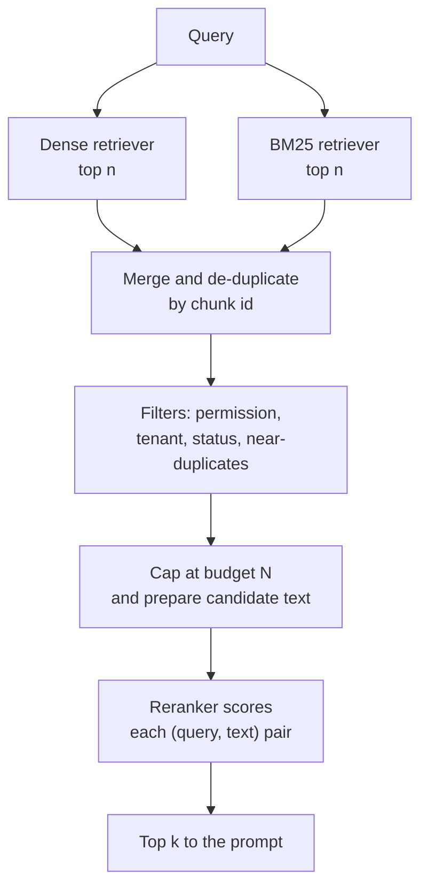

A reranker can only choose among the candidates it is handed, so the most consequential decisions about reranking are made *before* the reranker runs. How many candidates should it see? From which retrievers? Which should be removed first, and what text of each should it read? Together these are **candidate selection**: the step that turns one or more first-stage result lists into the exact set of `(query, passage)` pairs the reranker will score.

This lesson treats candidate selection as an engineering problem with measurable inputs. You will choose the candidate depth from a recall curve and a latency budget, merge a dense and a lexical retriever into one candidate pool, apply filters at the right point, and decide what text each candidate presents to the reranker. The earlier lessons established *why* the first stage sets the ceiling ([Retrieval versus reranking](/learn/reranking-fundamentals/retrieval-versus-reranking)); this one is about raising that ceiling at the lowest cost.

## Learning objectives

- Choose a candidate depth $N$ from a measured Recall@$N$ curve and a latency budget, and recognise when the two conflict.
- Merge candidates from several retrievers, removing duplicates, and explain why a union of short lists often beats one long list.
- Place access, tenancy, status and deduplication filters at the correct point relative to reranking.
- Decide what text each candidate presents to the reranker: the chunk, a window of it, or the chunk with its title.
- Measure the per-pair cost of a reranker and turn it into a candidate budget.

## Prerequisites

- [Retrieval versus reranking](/learn/reranking-fundamentals/retrieval-versus-reranking): the ceiling set by the first stage and failure attribution.
- [Cross-encoders](/learn/reranking-fundamentals/cross-encoders): maximum length, dilution and per-pair cost.
- [Top-K retrieval](/learn/retrieval-fundamentals/top-k-retrieval): the separate roles of `fetch_k` and the final $k$.
- [Dense versus sparse retrieval](/learn/hybrid-search/dense-versus-sparse-retrieval): why lexical and semantic retrievers miss different chunks.

## Why this matters

Candidate selection is where most reranking budgets are won or wasted. Too few candidates and the reranker cannot promote the chunks the first stage ranked slightly too low; the expensive model then mostly re-sorts the top three. Too many and you pay for hundreds of reranker passes per query, most of them on chunks with no chance of being relevant, while latency climbs. Candidates from a single retriever inherit that retriever's blind spots, so a reranker downstream of a dense-only search cannot recover the error-code chunk that only BM25 would have found.

There are quieter failures too. A permission filter applied after reranking wastes reranker work and, worse, makes it tempting to "just show the top 5" before the filter runs. Archived documents that reach the reranker are judged relevant, because they are. Long chunks presented whole are truncated or diluted, so a candidate that was correctly retrieved is scored as irrelevant. None of these shows up as an error; each shows up as a slightly worse answer.

## The intuition

Think of a selection panel for a job with 300 applications. The panel's interviews are excellent and expensive, so a screener chooses whom to interview. Three choices decide the outcome before any interview takes place. How many to invite: invite five and the best candidate may have been sixth on the screener's list; invite eighty and the panel spends a week interviewing people with no chance. Where to look: if the screener only reads applications submitted through the website, anyone referred by a colleague is never seen, however good. And what the panel reads: hand them a forty-page portfolio and they skim the first pages; hand them the one relevant page and they judge on it.

The panel is the reranker. The screener's list length is $N$, the application channels are the retrievers, and the portfolio page is the candidate text.

## How it works

### The pipeline between the stages



Step by step:

1. **Retrieve from each source.** Each retriever returns its own top $n$ with its own scores. The sources can be different retrievers (dense and BM25), different query variants ([multi-query retrieval](/learn/advanced-retrieval/multi-query-retrieval)) or different collections.
2. **Merge.** Take the union of the lists, keyed by chunk id, so a chunk found by two retrievers appears once. Keep each first-stage rank and score as features for logging and possible later blending.
3. **Filter.** Remove what must never be shown or is not worth scoring. Permission and tenancy filters should ideally already be inside each retriever's query (see [Filtered retrieval](/learn/advanced-retrieval/filtered-retrieval)); this step is a second line of defence plus status filters (archived, draft) and exact or near-duplicate removal.
4. **Cap.** If the pool exceeds the reranker budget, trim it, preferably by interleaving the sources rather than cutting one source off entirely.
5. **Prepare the text.** Decide what each candidate's reranker input is: the chunk, the chunk with its document title and section heading, or a window around the best-matching part of a long chunk.
6. **Rerank and cut.** Score the pairs, sort and keep the top $k$.

### Choosing the depth $N$

The candidate depth has two constraints pulling in opposite directions, and both can be measured.

**Recall from below.** Plot the first stage's Recall@$N$ on your labelled queries for a range of depths. The curve rises steeply at first and then flattens; past the knee, each extra ten candidates adds little recall. Choose the smallest $N$ that reaches your target recall, because anything beyond it is reranker work spent on chunks that rarely matter.

**Latency from above.** The reranker's time is roughly linear in the number of pairs. With a budget $B$ for retrieval and reranking, a first-stage time $t_1$ and a measured cost per pair $c$, the largest affordable depth is about $(B - t_1)/c$.

If the recall target needs more candidates than the budget allows, the answer is rarely "exceed the budget". Improve the first stage so that the target is reached at a smaller depth (hybrid retrieval often does exactly this), use a cheaper intermediate ranker as a cascade, or shorten candidate text so that each pair is cheaper.

There is also a quality reason not to overshoot. A reranker's errors are mostly confusions between plausible candidates; every extra candidate is another chance for a distractor to be ranked above the answer. With a strong reranker this effect is small, but it is not zero, so "more is always safer" is not true either. Measure the final metric at several depths, not only recall.

### Merging several retrievers

A dense retriever and BM25 make different mistakes: dense search misses rare identifiers and exact phrases, BM25 misses paraphrases. Taking the top $n$ from each and merging gives a pool of between $n$ (if the lists coincide) and $2n$ (if they are disjoint) candidates, and its recall is at least as high as either list's. Because the reranker re-scores everything, you do not need to reconcile the two retrievers' incomparable scores at this point; [Reciprocal Rank Fusion](/learn/hybrid-search/reciprocal-rank-fusion) or score fusion is needed only if you must order or cap the merged pool before reranking.

Two practical rules follow. First, compare recall at **equal reranker cost**: union of top 10 + top 10 (at most 20 pairs) against dense top 20, not against dense top 10. Second, if the pool must be capped, interleave the sources (dense 1, BM25 1, dense 2, BM25 2, ...) or cap by fused rank, so neither retriever is cut off entirely.

### Filtering before, not after

The rule is simple: anything that would remove a candidate regardless of its reranker score should run before the reranker.

- **Access control and tenancy** belong inside the first-stage query, so that restricted chunks are never retrieved. Re-check before reranking as defence in depth. Filtering after reranking also shrinks your final list unpredictably: if three of the top five were restricted, the user receives two.
- **Status** (archived, superseded, draft) is decided by metadata, not relevance. The reranker will happily rank a superseded policy first because it is relevant.
- **Duplicates** waste reranker work and then fill the prompt with the same text. Remove exact duplicates by content hash; near-duplicates (the same paragraph in two PDF versions) need fuzzy matching, covered in [Duplicate removal](/learn/advanced-retrieval-optimisation/duplicate-removal).

Things that *depend* on the reranker score, such as relevance thresholds and diversity re-ordering with [MMR](/learn/advanced-retrieval-optimisation/mmr), naturally run after it.

### What text the reranker reads

The candidate's identity is the chunk, but its reranker input is a choice:

- **The chunk as stored.** Simplest, and right when chunks are short and self-contained.
- **Title and heading plus chunk.** A chunk reading "Must be submitted within 30 days" is ambiguous on its own; "Expenses policy > Deadlines: must be submitted within 30 days" is not. Prepending the document title and section path often helps the reranker, at the cost of a few tokens; [Contextual retrieval](/learn/advanced-retrieval/contextual-retrieval) applies the same idea at indexing time.
- **Windows of a long chunk.** As [Cross-encoders](/learn/reranking-fundamentals/cross-encoders) showed, text past the maximum length is never seen, and even within it a short answer late in a long passage can score badly. Score overlapping windows and take the maximum, or rerank the child chunks of a [parent-child](/learn/hierarchical-rag/parent-child-retrieval) index and send the parents to the model.

Whatever you choose, use the same preparation in evaluation and production, and log it.

### Adaptive depth

A fixed $N$ treats every query alike. Some systems vary it: fewer candidates when the first stage's top score is far above the rest (an exact identifier match, say), more for vague questions whose scores are flat. Adaptive depth can save a good share of reranker cost, but its thresholds are tied to the first stage's score scale and must be re-tuned whenever that model changes; [Ranking scores](/learn/reranking-fundamentals/ranking-scores) explains why raw scores are fragile signals. Start with a fixed $N$ and add adaptivity only when cost demands it.

## The mathematics

### Depth from recall and budget

**Intuition.** Find the smallest depth that achieves the recall you need and the largest depth you can afford; if the first is no bigger than the second, use it.

$$
N_{\text{recall}} = \min\{\, N : \text{Recall@}N \ge \rho \,\}, \qquad N_{\text{budget}} = \left\lfloor \frac{B - t_1}{c} \right\rfloor
$$

- $\rho$ is the target recall, for example 0.95.
- $\text{Recall@}N$ is the first stage's recall at depth $N$ on your labelled queries.
- $B$ is the latency budget for retrieval plus reranking, $t_1$ the first-stage latency, and $c$ the reranker's measured cost per pair (for batched CPU inference; for GPU inference, measure batch latency at the depths you care about instead).
- $\lfloor \cdot \rfloor$ rounds down.

Choose $N = N_{\text{recall}}$ if $N_{\text{recall}} \le N_{\text{budget}}$; otherwise the two constraints conflict, and the first stage or the reranker's cost must change.

**By hand.** Suppose a measured recall curve (the numbers are illustrative) gives Recall@30 = 0.93 and Recall@50 = 0.96, with a target of 0.95: $N_{\text{recall}} = 50$. With $B = 250$ ms, $t_1 = 40$ ms and $c = 3$ ms per pair: $N_{\text{budget}} = \lfloor 210 / 3 \rfloor = 70$. Since $50 \le 70$, use $N = 50$, leaving 60 ms of slack for variance. The marginal gain also tells a story: from 10 to 20 candidates, recall rises 0.08 per ten extra candidates; from 75 to 100, only 0.002. The last 25 candidates would cost 75 ms for almost nothing.

### The size of a merged pool

For two lists of $n$ each with $o$ chunks in common, the merged pool has

$$
|U| = 2n - o, \qquad n \le |U| \le 2n
$$

candidates, where $o$ is the overlap. With $n = 10$ and 4 shared chunks, $|U| = 16$: you pay for 16 reranker passes, not 20.

```python
import numpy as np

# Recall@N measured at a few depths on a labelled set (illustrative numbers)
depths = np.array([10, 20, 30, 50, 75, 100])
recall = np.array([0.81, 0.89, 0.93, 0.96, 0.97, 0.975])
target = 0.95
n_recall = depths[np.argmax(recall >= target)]

budget_ms, first_stage_ms, ms_per_pair = 250, 40, 3.0
n_budget = int((budget_ms - first_stage_ms) // ms_per_pair)

print(f"smallest N with recall >= {target}: {n_recall}")
print(f"largest N the latency budget allows: {n_budget}")
print("choose N =", min(n_recall, n_budget) if n_recall <= n_budget else "conflict: improve the first stage")
gain = np.diff(recall) / np.diff(depths) * 10
for d0, d1, g in zip(depths[:-1], depths[1:], gain):
    print(f"{d0:3d} -> {d1:3d}: +{g:.3f} recall per 10 extra candidates")
```

```output
smallest N with recall >= 0.95: 50
largest N the latency budget allows: 70
choose N = 50
 10 ->  20: +0.080 recall per 10 extra candidates
 20 ->  30: +0.040 recall per 10 extra candidates
 30 ->  50: +0.015 recall per 10 extra candidates
 50 ->  75: +0.004 recall per 10 extra candidates
 75 -> 100: +0.002 recall per 10 extra candidates
```

## In code

**The problem.** For AskMeridian's labelled queries, compare dense-only, BM25-only and merged candidate pools at several depths, with archived chunks filtered out first, and measure the final hit@1 after reranking and the number of pairs the reranker scored. Then measure the cost of one pair on this machine.

**Dependencies.** rank-bm25, Sentence Transformers and NumPy.

```bash
pip install rank-bm25 sentence-transformers numpy
```

```python
import re, time
import numpy as np
from rank_bm25 import BM25Okapi
from sentence_transformers import SentenceTransformer, CrossEncoder

DOCS = {
    "hb-leave": "Annual leave is 25 days per year. Leave is booked in the HR portal and approved by your "
                "line manager. Up to 5 unused days carry over and must be used by 31 March.",
    "hb-sick": "Sick days are recorded separately and are not deducted from annual leave.",
    "hb-remote": "Staff may work remotely up to 3 days a week. VPN is required on public Wi-Fi. "
                 "The home-office equipment budget is £400; contractors are not eligible.",
    "hb-expenses": "Expenses must be submitted within 30 days. Anything over £75 needs a receipt.",
    "it-password": "Passwords must be rotated every 90 days and be at least 14 characters.",
    "it-laptop": "Laptops are refreshed on a 3-year cycle. A lost or stolen laptop must be reported "
                 "to the support desk at once.",
    "it-desk": "The support desk is open 08:00 to 18:00 UK time on weekdays.",
    "faq-expense-app": "How to submit an expense claim: open the finance app, photograph the item "
                       "and press submit.",
    "faq-leave-calendar": "Holiday calendar: add your holiday to the team calendar so colleagues "
                          "can plan around it.",
    "faq-password-tips": "Choosing a good password: use a passphrase of several random words.",
    "faq-desk-contact": "Contacting IT: raise a ticket in the IT portal and include your laptop asset tag.",
    "it-vpn-errors": "E-4021: the VPN client is out of date. E-4012: the VPN certificate has expired.",
    "faq-vpn-install": "Installing the VPN: download the client from the IT portal and sign in.",
    "hb-2023": "ARCHIVED 2023 handbook: laptops were refreshed every 4 years; equipment budget £250.",
}
ARCHIVED = {"hb-2023"}
QUERIES = {
    "What is the deadline for submitting an expense claim?": "hb-expenses",
    "How long do I have to claim back a train ticket?": "hb-expenses",
    "How often must I change my password?": "it-password",
    "How long must a password be?": "it-password",
    "Who approves my holiday?": "hb-leave",
    "What happens to holiday I don't use?": "hb-leave",
    "Is being off ill taken from my holiday?": "hb-sick",
    "Who do I tell if my laptop goes missing?": "it-laptop",
    "What are the support desk hours?": "it-desk",
    "How often do we get new laptops?": "it-laptop",
    "What does E-4012 mean?": "it-vpn-errors",
    "How much is the home-office equipment budget?": "hb-remote",
}
ids, texts = list(DOCS), list(DOCS.values())
tokenise = lambda t: re.findall(r"[a-z0-9]+", t.lower())
bm25 = BM25Okapi([tokenise(t) for t in texts])
bi = SentenceTransformer("sentence-transformers/all-MiniLM-L6-v2")
doc_vecs = bi.encode(texts, normalize_embeddings=True)
reranker = CrossEncoder("cross-encoder/ms-marco-MiniLM-L-6-v2")

def ranked(scores):                     # chunk ids, best first, archived chunks removed
    return [ids[i] for i in np.argsort(-scores, kind="stable") if ids[i] not in ARCHIVED]

def candidates(query, n):
    dense = ranked(doc_vecs @ bi.encode(query, normalize_embeddings=True))[:n]
    sparse = ranked(bm25.get_scores(tokenise(query)))[:n]
    union = list(dict.fromkeys(dense + sparse))          # merge, drop duplicates, keep order
    return dense, sparse, union

def rerank(query, cands):
    scores = reranker.predict([(query, DOCS[c]) for c in cands])
    return [cands[i] for i in np.argsort(-scores)]

print(" n | recall dense  sparse  union | avg pairs | hit@1 after rerank")
for n in (1, 2, 3, 4, 6):
    rec = np.zeros(3); hits = pairs = 0
    for q, rel in QUERIES.items():
        dense, sparse, union = candidates(q, n)
        rec += [rel in dense, rel in sparse, rel in union]
        pairs += len(union)
        hits += rerank(q, union)[0] == rel
    m = len(QUERIES)
    print(f"{n:2d} | {rec[0]/m:11.2f} {rec[1]/m:7.2f} {rec[2]/m:6.2f} | {pairs/m:9.1f} | {hits/m:.2f}")

# What does one reranker pair cost on this machine? (varies by hardware)
batch = [(q, DOCS[c]) for q in QUERIES for c in ids]
reranker.predict(batch[:8])                               # warm-up
t0 = time.perf_counter(); reranker.predict(batch, batch_size=32)
print(f"\n{1000 * (time.perf_counter() - t0) / len(batch):.2f} ms per pair on this CPU")
```

```output
 n | recall dense  sparse  union | avg pairs | hit@1 after rerank
 1 |        0.75    0.17   0.75 |       1.6 | 0.75
 2 |        0.83    0.58   0.92 |       2.9 | 0.83
 3 |        0.92    0.67   1.00 |       4.7 | 0.83
 4 |        1.00    0.75   1.00 |       6.2 | 0.83
 6 |        1.00    0.83   1.00 |       8.3 | 0.83

0.64 ms per pair on this CPU
```

The final timing line depends on your hardware and will differ; all other numbers are deterministic for these model versions.

**The important lines.**

- `ranked(...)` drops `ARCHIVED` chunks before the depth cut. Filtering before the cut matters: filtering *after* taking the top $n$ would leave fewer than $n$ candidates whenever an archived chunk ranked highly, which is exactly when it matters.
- `list(dict.fromkeys(dense + sparse))` is the merge: an order-preserving de-duplication by chunk id. A chunk found by both retrievers is scored once.
- `pairs += len(union)` counts reranker work, so the depths are compared at their real cost rather than by the nominal $n$.
- The timing block warms the model up first, then times one batched call, because the first call includes one-off set-up costs that would inflate the estimate.

**What the output means.** At $n = 1$, BM25's top result is right for only 2 of 12 queries (0.17) while dense search gets 9 (0.75); the union adds nothing, because BM25's two hits are queries dense search already found. By $n = 3$ the union reaches recall 1.00 with an average of 4.7 pairs per query, while dense search alone needs $n = 4$ (4 pairs) to get there, and BM25 alone does not reach it even at $n = 6$. On a corpus this small the union's advantage is modest; on real corpora with identifiers and jargon, it is usually the main reason for hybrid candidates.

The hit@1 column is the more important lesson. It rises from 0.75 to 0.83 at $n = 2$ and then stays flat, although recall keeps rising to 1.00. Once every relevant chunk is a candidate, the remaining failures belong to the reranker (here, two queries where it prefers a neighbouring chunk), and extra candidates only add cost: 8.3 pairs at $n = 6$ against 2.9 at $n = 2$ for the same result. This is the shape to look for on your own data: choose the depth at the knee of the *final* metric, confirmed by the recall curve, not the largest depth you can afford.

The measured cost of well under a millisecond per pair is for very short chunks and a 6-layer model, batched on this CPU. Pairs of 300 tokens cost many times more. Measure with your real chunk lengths before turning this into a budget.

**Common errors.**

- Filtering after the depth cut, which silently shrinks the pool for exactly the queries where filtered chunks ranked highly.
- Merging lists by text rather than by chunk id, so the same chunk with slightly different whitespace appears twice.
- Timing the first, cold call to the model and concluding the reranker is far slower than it is.

**Extending it.** Remove `ARCHIVED` from the filter and rerun; check which queries the archived handbook now wins. Prepend each chunk's id (a stand-in for its title) to the reranker text and compare hit@1. Replace the fixed `n` with interleaved capping of the union to a budget of 4 pairs.

## A real-world example

When the Atlas error-code catalogue was added to AskMeridian, the Platform team's reranker was fed the top 40 dense candidates. Within a week, support engineers noticed that questions quoting a specific code ("what does E-4021 mean?") often returned the entry for a neighbouring code. Femi traced it with the attribution script: the right entry was usually a *retrieval* miss. The dense retriever placed dozens of similar VPN error entries near the query and often left the exact code below position 40; the reranker, which would have recognised the exact code, never saw it.

Raising the depth to 120 fixed most cases but tripled reranker latency, breaking the budget. Instead, the team added BM25 as a second source with $n = 10$ and kept dense at $n = 30$. BM25 placed the exact-code entry first almost every time, so the merged pool of at most 40 candidates, usually fewer because of overlap, contained it. Reranker cost was unchanged, and code questions recovered.

The review surfaced a second issue. Permissions for the finance runbooks were applied after reranking, so finance-only chunks were being scored, then removed, leaving some users with two or three chunks instead of five. Moving the permission filter into both retrievers' queries returned full context lists and cut wasted reranker work. The team wrote both changes into the module's design notes: sources chosen for complementary misses, and every unconditional filter before the reranker.

## Common mistakes

- **Choosing $N$ by habit.** "Top 100" copied from an example may be far past the knee of your recall curve, or short of it. Measure.
- **Comparing pools at unequal cost.** A union of two top-20 lists can be 40 pairs; compare it with a single top-40 list, not a top-20.
- **Single-source candidates for mixed query types.** A dense-only pool cannot deliver exact identifiers the dense model blurs, however good the reranker.
- **Filtering after reranking.** Wastes reranker work and shrinks the final list unpredictably; for permissions, it also risks leaking through logs or debug output.
- **Sending long chunks whole.** Truncation and dilution make correctly retrieved candidates score as irrelevant.
- **Different candidate preparation in evaluation and production.** Titles prepended in one but not the other make offline numbers meaningless.

## Best practices

- Plot Recall@$N$ for each source and for the merged pool, and the final metric after reranking, at depths from 5 to well past your budget.
- Pick the depth at the knee of the final metric, check it against $N_{\text{budget}}$, and leave slack for latency variance.
- Merge complementary sources by chunk id, keeping per-source ranks and scores for logging.
- Push permission and tenancy filters into the retrievers; apply status and duplicate filters before the reranker.
- Give the reranker self-contained text: prepend titles and headings, window long chunks.
- Re-measure the curves whenever the corpus, the chunking or either retriever changes.

## Performance considerations

Reranker cost per query is approximately $|U| \times c(L)$, where $|U|$ is the merged pool size and $c(L)$ the cost of a pair of length $L$. Every lever in this lesson acts on one of those two factors. Merging sources raises $|U|$ by less than you might expect, because overlap is usually substantial for easy queries. Filtering and de-duplication lower $|U|$ for free. Windowing raises the number of pairs but lowers $L$ for each, which can reduce total cost, because attention cost grows faster than linearly with length.

On a GPU, pairs are processed in batches, and latency is closer to a step function of the batch count than a straight line: 33 candidates in batches of 32 cost two batches. Align $N$ with your batch size when it is convenient. With padding, one very long candidate slows its whole batch; capping candidate length, or sorting by length before batching, keeps batches even.

The first stage's cost of fetching more candidates is usually small (an approximate index returning 50 instead of 20 results is cheap), so the depth decision is driven almost entirely by reranker cost and by the final metric.

## Security considerations

- **Permissions before scoring.** A reranker processes every candidate's text. If restricted chunks reach it, they reach its logs, its traces and, with a hosted reranker, a third party. Filter in the retriever.
- **Untrusted sources need quotas.** If one source is user-generated (tickets, forum posts), cap its share of the pool so that crafted content cannot crowd out trusted documentation, and label its origin for later stages.
- **Unbounded inputs are a cost risk.** Cap candidate text length so that a few very long documents cannot exhaust reranker capacity.

## Summary

- Candidate selection decides how many candidates the reranker sees, from which sources, after which filters, and as what text.
- Choose $N$ as the smallest depth meeting a recall target, checked against the depth the latency budget allows; when they conflict, improve the first stage.
- Merging complementary retrievers by chunk id raises recall at modest cost; compare pools at equal reranker cost.
- Unconditional filters (permission, tenancy, status, duplicates) go before reranking; score-dependent steps go after.
- Present each candidate as self-contained text short enough for the reranker to read whole.

## Exercises

**1.** A reranker costs 4 ms per pair on your hardware, the first stage takes 50 ms, and the budget for both is 300 ms. Measured recall is 0.90 at 30, 0.94 at 50 and 0.96 at 80. What depth do you choose for a target of 0.95?

<details><summary>Show solution</summary>

$N_{\text{budget}} = \lfloor (300 - 50)/4 \rfloor = 62$. The target 0.95 is first reached at 80 (0.94 at 50 falls short), so $N_{\text{recall}} = 80 > 62$: the constraints conflict. Options: accept 0.94 at $N = 50$; add BM25 candidates to reach 0.95 at a smaller pool; use a cheaper reranker or shorter candidate text; or add a cascade stage. Do not simply set $N = 80$ and miss the budget.

</details>

**2.** Dense and BM25 each return 15 candidates; on average 6 chunks appear in both lists. How many pairs does the reranker score per query, and which single-source depth should you compare the merged pool against?

<details><summary>Show solution</summary>

$|U| = 2 \times 15 - 6 = 24$ pairs. Compare with dense-only (or BM25-only) at depth 24, which has the same reranker cost.

</details>

**3.** In the code, replace the fixed-depth union with a function `capped_union(dense, sparse, budget)` that interleaves the two lists, skips duplicates and stops at `budget` candidates. Report hit@1 for a budget of 3.

<details><summary>Show solution</summary>

```python
from itertools import chain, zip_longest

def capped_union(dense, sparse, budget):
    pool = []
    for c in chain.from_iterable(zip_longest(dense, sparse)):
        if c is not None and c not in pool:
            pool.append(c)
        if len(pool) == budget:
            break
    return pool
```

Call it with the dense and BM25 lists at depth 6 and a budget of 3, then rerank. Interleaving guarantees that each source's top result is a candidate, so exact-match winners from BM25 are never cut off by a long dense list. Compare the resulting hit@1 with the fixed-depth rows at a similar average number of pairs.

</details>

**4.** Design decision. AskMeridian is adding customer tickets (hundreds of thousands, user-written) to a corpus of a few thousand trusted documentation chunks. Propose a candidate selection design and justify each part.

<details><summary>Show solution</summary>

Retrieve from the two collections separately with fixed quotas, for example 30 documentation and 10 ticket candidates, so that the far larger ticket collection cannot crowd out documentation. Use hybrid retrieval for documentation, where identifiers matter. Filter tickets by tenant and permission in the retriever, and drop tickets without a resolution. De-duplicate near-identical tickets before reranking. Present tickets to the reranker as their resolution text, not the customer's question, to avoid question echoes. Label each candidate's source so that the prompt can treat ticket content as lower-trust. Measure recall and final metrics per source.

</details>

## Check your understanding

```quiz
[
  {
    "q": "Recall@N keeps rising up to N = 100, but hit@1 after reranking stops improving at N = 20. What depth is most defensible?",
    "options": [
      "100, because recall is highest there",
      "Around 20, because extra candidates add cost without improving the final result",
      "5, to minimise cost",
      "Whatever the reranker's maximum batch size is"
    ],
    "answer": 1,
    "why": "The goal is the final metric. Past its knee, more candidates add reranker cost and occasional distractors without benefit."
  },
  {
    "q": "Dense and BM25 each return 20 candidates with 8 in common. How many pairs does the reranker score?",
    "options": [
      "20",
      "40",
      "48",
      "32"
    ],
    "answer": 3,
    "why": "The merged pool is 2n minus the overlap: 40 - 8 = 32."
  },
  {
    "q": "Where should a filter that removes chunks the user is not permitted to see run?",
    "options": [
      "Inside the first-stage retrieval query, with a re-check before reranking",
      "After reranking, before the prompt",
      "Only in the language model's system prompt",
      "It is unnecessary if the reranker is accurate"
    ],
    "answer": 0,
    "why": "Unconditional filters belong before the reranker; permission filters ideally inside retrieval so restricted text is never retrieved, scored or logged."
  },
  {
    "q": "Why can a merged dense-plus-BM25 pool deliver an exact error code that a deeper dense-only pool misses?",
    "options": [
      "BM25 scores are larger",
      "Merging sorts candidates alphabetically",
      "BM25 matches the rare exact token and ranks the entry near the top, while dense search blurs similar codes",
      "The reranker prefers BM25 candidates"
    ],
    "answer": 2,
    "why": "The two retrievers have complementary misses. A rare exact identifier is a strength of lexical matching and a weakness of single-vector embeddings."
  },
  {
    "q": "A correctly retrieved 1,200-token runbook chunk keeps scoring low with a 512-token reranker. What candidate-preparation change is most likely to help?",
    "options": [
      "Prepend more boilerplate",
      "Score overlapping windows of the chunk and use the maximum",
      "Increase the candidate depth",
      "Lower the reranker's temperature"
    ],
    "answer": 1,
    "why": "The reranker cannot see past its limit, and long passages dilute short answers. Windows let it read the relevant part."
  }
]
```

## Further reading

- Lin, J., Nogueira, R. and Yates, A. (2021). *Pretrained Transformers for Text Ranking: BERT and Beyond*. [arXiv:2010.06467](https://arxiv.org/abs/2010.06467). Candidate depth and multi-stage design.
- Cormack, G. V., Clarke, C. L. A. and Büttcher, S. (2009). *Reciprocal Rank Fusion Outperforms Condorcet and Individual Rank Learning Methods*. SIGIR 2009. Merging ranked lists.
- Thakur, N. and colleagues (2021). *BEIR: A Heterogeneous Benchmark for Zero-shot Evaluation of Information Retrieval Models*. [arXiv:2104.08663](https://arxiv.org/abs/2104.08663). Lexical and dense first stages under reranking.
- Sentence Transformers documentation, [sbert.net](https://www.sbert.net/): retrieve-and-rerank examples.
