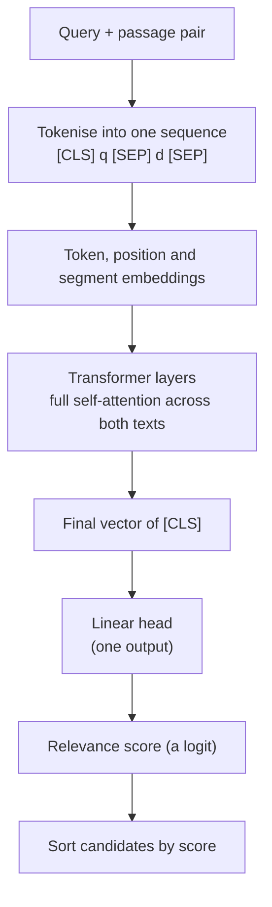

A **cross-encoder** is a transformer that reads a query and a passage together, as one input, and outputs a single number saying how relevant the passage is to the query. It is the model behind most rerankers, and it fixes several of the failures a [bi-encoder](/learn/reranking-fundamentals/bi-encoders) cannot, for one reason: every word of the query can attend to every word of the passage. That reason also makes it far too expensive to run over a whole corpus.

This lesson opens the model up. You will see the exact token sequence it reads, run one forward pass by hand and check it against the library, watch it separate the pairs that defeated the bi-encoder, and then break it in two instructive ways: by swapping the order of its inputs and by hiding the answer past its length limit. The open-source and hosted reranking models built on this design are surveyed in the next module, starting with [Cross-encoder models](/learn/reranking-models/cross-encoder-models).

## Learning objectives

- Describe the input format of a cross-encoder (`[CLS] query [SEP] passage [SEP]`) and how the relevance score is produced from it.
- Explain why joint attention lets a cross-encoder handle question echoes, near-identical codes and multi-topic chunks better than a bi-encoder.
- Run a cross-encoder manually with Hugging Face Transformers and through Sentence Transformers, and get the same score from both.
- Explain how cross-encoders are trained for relevance, including the binary cross-entropy objective.
- Predict the effects of input order, truncation and candidate length on a cross-encoder's scores and cost.

## Prerequisites

- [Bi-encoders](/learn/reranking-fundamentals/bi-encoders): the factorised score and the bottleneck this model removes.
- [Why reranking is needed](/learn/reranking-fundamentals/why-reranking-is-needed): where the cross-encoder sits in a two-stage pipeline.
- [Attention mechanism](/learn/understanding-large-language-models/attention-mechanisms): how tokens exchange information inside a transformer.
- [Tokens and tokenisation](/learn/understanding-large-language-models/tokens-and-tokenisation): sub-word tokens and length limits.

## Why this matters

When you add a reranker to a RAG system, you are almost always adding a cross-encoder, either one you run yourself or one behind an API. Its behaviour has sharp edges that do not show up in a demo. It reads at most a fixed number of tokens, typically 512, and silently ignores the rest, so a long chunk whose answer is near the end scores as irrelevant. It expects the query first; swap the arguments and the scores change. Its output is usually a raw number with no fixed scale, so a threshold copied from a blog post means nothing for your model. And its cost grows with the number and the length of the candidates on every single query.

Engineers who know what the model reads, and how its score is produced, can set candidate length, batch size and latency budget deliberately, and can tell a model limit from a usage mistake.

## The intuition

Return to the two arrangements from the bi-encoder lesson. A bi-encoder is two clerks who each summarise one text on an index card, never seeing the other text, and a third person who compares the cards. A cross-encoder is a single examiner who is handed the question and the passage on the same sheet of paper and asked, "does this passage answer this question?".

The examiner can do things the card-comparers cannot. She can see that the passage merely restates the question. She can check that the error code in the passage is the same code as in the question, digit by digit. She can find the one relevant sentence inside a long passage about four different topics and ignore the rest. She has no summary to compress into; she looks at the actual words of both texts at once.

The price is that nothing can be prepared in advance. The examiner's judgement is about *this question with this passage*. A new question means re-reading every passage. That is affordable for the 50 passages a first stage hands her and impossible for a million.

## How it works

### The input: one sequence, two segments

A cross-encoder built on a BERT-style encoder receives the query and the passage packed into one token sequence:

```text
[CLS] how often must password ##s be rotated ? [SEP] password ##s must be rotated every 90 days . [SEP]
```

`[CLS]` is a special token at the start whose final representation is used for classification. `[SEP]` marks the end of each segment. Many BERT-family models also receive **segment ids** (Hugging Face calls them `token_type_ids`): 0 for every query token, 1 for every passage token, so the model knows which side each token came from. Models based on RoBERTa or XLM-RoBERTa use different special tokens (`<s>` and `</s>`) and no segment ids, but the idea is the same. You do not build this sequence yourself; the tokenizer does it when you pass two texts.

### The mechanism, step by step



1. **Tokenise the pair.** The query and passage are converted into one sequence with special tokens, truncated if longer than the model's maximum length. Truncation usually cuts the passage, not the query.
2. **Embed.** Each token gets an embedding, plus a position embedding and, if used, a segment embedding.
3. **Attend across both texts.** Every transformer layer lets every token attend to every other token. From the first layer on, query tokens are combined with passage tokens: "4021" in the query can attend directly to "4021" or "4012" in the passage. This is the **joint encoding** a bi-encoder never performs.
4. **Pool.** After the last layer, the vector at the `[CLS]` position has absorbed information from the whole pair. (BERT models pass it through a small "pooler" layer first.)
5. **Score.** A linear classification head maps that vector to a single number, the **logit**. Higher means more relevant.
6. **Repeat per candidate.** Each candidate is a separate pair and a separate forward pass. Pairs are batched, so 50 candidates are scored together, but the work still scales with the number of candidates.

Optionally, a sigmoid turns the logit into a number between 0 and 1. Whether a library applies it by default depends on the model's saved configuration and the library version; the code below asks for raw logits explicitly. What these numbers do and do not mean is the subject of [Ranking scores](/learn/reranking-fundamentals/ranking-scores).

### Why joint attention fixes the bi-encoder's failures

Each bottleneck failure from the [bi-encoders lesson](/learn/reranking-fundamentals/bi-encoders) maps onto something attention can do:

| Bi-encoder failure | Why the cross-encoder copes |
| --- | --- |
| Question echo outranks the answer | Trained on (question, answering passage) labels, it learns that a passage repeating the question without new information is not an answer |
| One-digit code differences | Query tokens attend to the specific passage tokens, so a mismatch in "4021" against "4012" is visible directly |
| Multi-topic chunk diluted | Attention can concentrate on the one relevant sentence; the rest of the passage does not dilute a pre-made summary because there is none |
| No conditioning on the query | The passage's representation is computed *with* the query, so it is different for every question |

What the cross-encoder still does not do: it judges **relevance**, not truth. "Contractors are eligible for the budget" and "Contractors are not eligible for the budget" are both highly relevant to "can contractors claim the budget?", and the code below shows the model scoring them close together. Deciding which is *correct* is the generator's job, given the right context, and the corpus's job, by not containing the false one.

### How cross-encoders are trained

A relevance cross-encoder is a pretrained encoder (BERT, MiniLM, ELECTRA, XLM-RoBERTa and so on) fine-tuned on labelled query-passage pairs. The most widely used public data is **MS MARCO**, a large set of real search queries from Bing with passages judged relevant; the `cross-encoder/ms-marco-*` models used in this module are trained on it. The common training objectives are:

- **Pointwise.** Treat each pair as a yes/no classification and minimise binary cross-entropy between the sigmoid of the logit and the label. Nogueira and Cho (2019) trained their BERT reranker this way, with a cross-entropy loss over relevant and non-relevant pairs.
- **Pairwise.** Show the model a relevant and a non-relevant passage for the same query and penalise it when the non-relevant one scores higher.
- **Listwise.** Score a whole list of candidates for a query and optimise a loss over the list, for example a softmax cross-entropy that pushes the relevant passage to the top.
- **Distillation.** Train a small cross-encoder to reproduce the scores of a larger one, trading a little accuracy for speed.

Negatives matter as much as for bi-encoders: a reranker trained only on random negatives learns to separate "about passwords" from "about expenses", which the first stage already does. Good training sets use negatives mined from a first-stage retriever, so the model learns to separate candidates that *look* relevant. Fine-tuning your own reranker is covered with the reranking models, and current Sentence Transformers releases include cross-encoder training losses for all of these styles.

A different design produces the score from a sequence-to-sequence or decoder model instead of a classification head. monoT5 (Nogueira and colleagues, 2020) feeds "Query: ... Document: ... Relevant:" to a T5 model and reads the probability of the word "true". Rerankers built on large language models work similarly. They share the essential property of a cross-encoder, joint reading of query and passage, at a larger cost.

### Length, order and other sharp edges

- **Maximum length.** BERT-style cross-encoders have a fixed maximum of 512 tokens for the *pair*. A 12-token query leaves about 500 for the passage. Anything beyond is truncated, and the model never sees it.
- **Length and position.** Models trained on short passages can under-score a relevant sentence buried in a long, mostly irrelevant passage, even inside the limit.
- **Order.** The model was trained with the query in the first segment. Feeding `(passage, query)` is a different input and gives a different, usually worse, score.
- **Formatting.** Headings, boilerplate and markup consume tokens and can distract. Rerank clean text.
- **Domain and language.** A model trained on English web search may be weaker on legal text, code or other languages. Multilingual rerankers exist; check the model card.

## The mathematics

### From the `[CLS]` vector to a score and a probability

**Intuition.** The model compresses its whole reading of the pair into one vector, then a single weighted sum turns that vector into a number. A sigmoid can squash the number into the range 0 to 1.

$$
s(q, d) = \mathbf{w}^\top \mathbf{h}_{\text{CLS}}(q, d) + b, \qquad \sigma(s) = \frac{1}{1 + e^{-s}}
$$

- $\mathbf{h}_{\text{CLS}}(q, d) \in \mathbb{R}^{H}$ is the final hidden vector at the `[CLS]` position, computed from the query and the passage *together* (contrast $\mathbf{f}(q) \cdot \mathbf{g}(d)$ for a bi-encoder, where each side is computed alone).
- $H$ is the hidden size (384 for the MiniLM model below).
- $\mathbf{w} \in \mathbb{R}^H$ and $b$ are the weights and bias of the classification head.
- $s$ is the logit, any real number; $\sigma(s)$ is the sigmoid of it.

### The pointwise training loss

**Intuition.** When the label says "relevant", the loss is small if the model's probability is near 1 and large if it is near 0, and the reverse for "not relevant".

$$
\mathcal{L}(s, y) = -\big[\, y \log \sigma(s) + (1 - y) \log\big(1 - \sigma(s)\big) \big]
$$

$y \in \{0, 1\}$ is the label (1 for relevant), $s$ is the logit and $\log$ is the natural logarithm.

**By hand.** A relevant pair ($y = 1$) with logit $s = 2$: $\sigma(2) = 1 / (1 + e^{-2}) = 1 / 1.1353 = 0.8808$, so $\mathcal{L} = -\log 0.8808 = 0.1269$. The same logit on a non-relevant pair ($y = 0$): $\mathcal{L} = -\log(1 - 0.8808) = -\log 0.1192 = 2.1269$, a heavy penalty for confidence in the wrong direction. A non-relevant pair at $s = -1$: $\sigma(-1) = 0.2689$, $\mathcal{L} = -\log 0.7311 = 0.3133$.

### Cost per query

**Intuition.** The bi-encoder runs the transformer over the query once. The cross-encoder runs it over the query *and* each candidate, once per candidate.

$$
T_{\text{cross}} = N\,(L_q + L_d), \qquad T_{\text{bi}} = L_q
$$

$T$ is the number of tokens processed by the transformer per query, $N$ the number of candidates, $L_q$ the query length and $L_d$ the candidate length in tokens. Attention inside each pass costs roughly in proportion to the square of the sequence length, so long candidates cost more than this count suggests.

**By hand.** $N = 50$ candidates of $L_d = 300$ tokens and a 12-token query: $50 \times 312 = 15{,}600$ tokens through the cross-encoder, against 12 for the bi-encoder's query pass. That ratio of about 1,300 is why the cross-encoder is a second stage.

```python
import numpy as np

def sigmoid(s):
    return 1 / (1 + np.exp(-s))

def bce(s, y):                     # binary cross-entropy for one pair
    p = sigmoid(s)
    return -(y * np.log(p) + (1 - y) * np.log(1 - p))

for s, y in [(2.0, 1), (2.0, 0), (-1.0, 0), (9.919, 1)]:
    print(f"logit {s:6.3f}  label {y}  sigmoid {sigmoid(s):.4f}  loss {bce(s, y):.4f}")

q_len, d_len, n_cand = 12, 300, 50
print("tokens through the cross-encoder per query:", n_cand * (q_len + d_len))
print("tokens through the bi-encoder per query:   ", q_len)
```

```output
logit  2.000  label 1  sigmoid 0.8808  loss 0.1269
logit  2.000  label 0  sigmoid 0.8808  loss 2.1269
logit -1.000  label 0  sigmoid 0.2689  loss 0.3133
logit  9.919  label 1  sigmoid 1.0000  loss 0.0000
tokens through the cross-encoder per query: 15600
tokens through the bi-encoder per query:    12
```

The last loss line shows saturation: at a logit near 10, the sigmoid rounds to 1 and the loss to 0. Logits this large are why sigmoid outputs from rerankers bunch up near 0 and 1, a point [Ranking scores](/learn/reranking-fundamentals/ranking-scores) returns to.

## In code

**The problem.** Look inside a cross-encoder: the sequence it reads, the number it produces, and how it scores the pairs that the bi-encoder found hard. Then test two sharp edges: argument order and truncation.

**Dependencies.** Sentence Transformers (version 4 or later for the `activation_fn` argument), Hugging Face Transformers, PyTorch and NumPy. The model is about 90 MB and downloads on first use.

```bash
pip install "sentence-transformers>=4" transformers torch numpy
```

```python
import numpy as np
import torch
from sentence_transformers import CrossEncoder
from transformers import AutoTokenizer, AutoModelForSequenceClassification

NAME = "cross-encoder/ms-marco-MiniLM-L-6-v2"

# 1. What the model actually reads: one sequence holding both texts
tok = AutoTokenizer.from_pretrained(NAME)
query = "How often must passwords be rotated?"
answer = "Passwords must be rotated every 90 days."
enc = tok(query, answer, return_tensors="pt")
print(tok.convert_ids_to_tokens(enc["input_ids"][0]))
print("segment ids:", enc["token_type_ids"][0].tolist())

# 2. One forward pass -> one number (a logit) from the classification head
model = AutoModelForSequenceClassification.from_pretrained(NAME).eval()
with torch.no_grad():
    logit = model(**enc).logits[0, 0].item()
print(f"raw logit: {logit:.3f}   sigmoid: {1 / (1 + np.exp(-logit)):.3f}")

# 3. The same thing through the Sentence Transformers wrapper, batched
ce = CrossEncoder(NAME)
pairs = [
    (query, answer),
    (query, "How often must passwords be rotated? Staff ask this a lot."),
    ("What does error E-4021 mean?", "E-4021: the VPN client is out of date. Update it from the IT portal."),
    ("What does error E-4021 mean?", "E-4012: the VPN certificate has expired. Reinstall it from the IT portal."),
    ("Which expenses need a receipt?", "Any expense over £75 needs a receipt."),
    ("Which expenses need a receipt?", "Any expense under £75 does not need a receipt."),
    ("Can contractors claim the equipment budget?", "Contractors are not eligible for the home-office equipment budget."),
    ("Can contractors claim the equipment budget?", "Contractors are eligible for the home-office equipment budget."),
]
scores = ce.predict(pairs, activation_fn=torch.nn.Identity())   # ask for raw logits explicitly
print(f"\nwrapper agrees with manual pass: {np.isclose(scores[0], logit, atol=1e-4)}")
for (q, d), s in zip(pairs, scores):
    print(f"{s:7.2f}  {q[:30]:<30} | {d[:48]}")

# 4. Order matters: the model was trained with the query first
swapped = ce.predict([(answer, query)], activation_fn=torch.nn.Identity())[0]
print(f"\nquery first: {scores[0]:.2f}   passage first: {swapped:.2f}")

# 5. Long passages: the answer sentence buried among unrelated sentences
other = ["The office opens at 07:30.", "Desks are booked through the facilities app.",
         "Lockers are allocated quarterly.", "Printers accept jobs from the print queue.",
         "Badge in at the printer to release your job.", "Meridian Sync keeps files in step across devices.",
         "Meridian Relay forwards webhooks between services.", "Expenses must be submitted within 30 days.",
         "The support desk is open 08:00 to 18:00 UK time."]

def logit(passage):
    return ce.predict([(query, passage)], activation_fn=torch.nn.Identity())[0]

print(f"\nmodel limit: {tok.model_max_length} tokens")
for n in (8, 32, 64):
    filler = " ".join((other * 8)[:n])
    n_tok = len(tok(query, filler + " " + answer)["input_ids"])
    print(f"{n_tok:4d} tokens | answer first {logit(answer + ' ' + filler):6.2f}"
          f" | answer last {logit(filler + ' ' + answer):6.2f} | no answer {logit(filler):6.2f}")
```

```output
['[CLS]', 'how', 'often', 'must', 'password', '##s', 'be', 'rotated', '?', '[SEP]', 'password', '##s', 'must', 'be', 'rotated', 'every', '90', 'days', '.', '[SEP]']
segment ids: [0, 0, 0, 0, 0, 0, 0, 0, 0, 0, 1, 1, 1, 1, 1, 1, 1, 1, 1, 1]
raw logit: 9.919   sigmoid: 1.000

wrapper agrees with manual pass: True
   9.92  How often must passwords be ro | Passwords must be rotated every 90 days.
   6.66  How often must passwords be ro | How often must passwords be rotated? Staff ask t
   1.67  What does error E-4021 mean?   | E-4021: the VPN client is out of date. Update it
  -5.71  What does error E-4021 mean?   | E-4012: the VPN certificate has expired. Reinsta
   8.29  Which expenses need a receipt? | Any expense over £75 needs a receipt.
   7.62  Which expenses need a receipt? | Any expense under £75 does not need a receipt.
   7.62  Can contractors claim the equi | Contractors are not eligible for the home-office
   7.09  Can contractors claim the equi | Contractors are eligible for the home-office equ

query first: 9.92   passage first: 4.27

model limit: 512 tokens
  88 tokens | answer first   7.96 | answer last   4.81 | no answer  -9.84
 310 tokens | answer first   6.01 | answer last  -1.03 | no answer  -9.85
 609 tokens | answer first   5.91 | answer last  -7.76 | no answer  -7.76
```

The tokenizer also prints a warning about the 609-token sequence exceeding 512; that is expected, and it is the truncation being demonstrated.

**The important lines.**

- `tok(query, answer)` with **two** arguments builds the pair sequence. Passing a single concatenated string would lose the `[SEP]` boundary and the segment ids.
- `model(**enc).logits[0, 0]` is the classification head's single output for the one pair in the batch. The model has `num_labels = 1`, so the logits tensor has shape `(1, 1)`.
- `ce.predict(pairs, activation_fn=torch.nn.Identity())` returns raw logits. Without the argument, the wrapper applies whatever activation the model's configuration specifies; some models return sigmoid outputs, others raw logits. Being explicit makes your scores reproducible across library versions.

**What the output means.** Section 1 shows the exact input: the query segment (ids 0) and the passage segment (ids 1) with their boundaries. Section 2 shows that a cross-encoder is nothing more exotic than a sequence classifier, and section 3 confirms that the wrapper produces the identical logit, 9.92.

Now compare the eight pairs with the bi-encoder lesson's numbers for the same texts. The question echo, which the bi-encoder scored *above* the answer (0.968 against 0.833), is now well below it: 6.66 against 9.92. The error codes, which the bi-encoder separated by a cosine margin of 0.08, are now 1.67 against $-5.71$, a gap of more than 7 logits. Joint attention sees that "4021" is not "4012". "Over £75 needs a receipt" beats "under £75 does not", by a modest margin. And the contractor pair scores 7.62 and 7.09: both judged relevant, as they should be, because relevance is not truth.

Section 4 shows that order is not cosmetic: putting the passage first drops the score from 9.92 to 4.27.

Section 5 matters most in production, and shows two separate effects. **Truncation**: at 609 tokens, the passage with the answer at the end scores $-7.76$, *exactly* the same as the passage with no answer at all. The answer was cut off, and the model never saw it. **Dilution**: even inside the limit, an answer sentence that comes after many unrelated sentences scores lower (4.81 at 88 tokens, $-1.03$ at 310) than the same sentence placed first (7.96 and 6.01). This model was trained on short MS MARCO passages, and its scores are sensitive to where a short answer sits in a long passage. How strongly this happens varies between models, so test your own reranker on your own chunk lengths.

**Common errors.**

- `TypeError` or unexpected scores from passing strings instead of `(query, passage)` tuples.
- Older Sentence Transformers versions call the argument `activation_fct` rather than `activation_fn`. Check `help(CrossEncoder.predict)` for your version.
- Comparing these logits with another model's outputs or applying a threshold from another model; scales differ between models.

**Extending it.** Score the long passage as short overlapping windows and take the maximum window score; exercise 3 shows that the buried answer is found again. Try `BAAI/bge-reranker-base` on the same pairs (its configuration applies a sigmoid by default) and compare how it treats the echo.

## A real-world example

Six weeks after AskMeridian gained a reranker, Hannah on the Platform team noticed a new pattern in the feedback: questions about the IT runbooks were getting worse, not better, while handbook questions had improved. The runbooks were chunked differently from the handbook: whole procedures, often 800 to 1,200 tokens, because the IT team had asked that steps never be split across chunks.

She took ten failing questions and looked at where the answer sat in each relevant chunk. In eight, it was in the second half of a long procedure, beyond the reranker's 512-token window. The reranker had read only the first part of the procedure, decided it was not relevant, and pushed the chunk down below shorter, less useful chunks. The first-stage bi-encoder, which also truncates but had a different limit and a different view of the text, had ranked them higher.

Re-chunking would have broken the IT team's requirement, and a longer-context reranker was slower than the budget allowed. Testing on her ten examples also showed that answers deep inside long procedures scored poorly even when within the limit. So the team scored each long chunk as overlapping windows of about 150 tokens, took the maximum window score as the chunk's score, and still sent the whole procedure to the generator. Reranking for runbook queries became somewhat more expensive but fitted the latency budget, and the complaints stopped. A regression test now hides an answer at token 700 and asserts that its chunk still ranks first.

## Common mistakes

- **Ignoring the maximum length.** Text past the limit is silently dropped, so long chunks with late answers are scored as irrelevant.
- **Assuming long passages are scored fairly.** Even within the limit, a short answer buried in a long passage can score much lower than the same answer alone; test your model on your chunk lengths.
- **Swapping the query and the passage.** The model was trained query-first; the reversed input is out of distribution and scores change.
- **Concatenating query and passage into one string.** This loses the separator and segment ids the model was trained with.
- **Assuming `predict` returns probabilities.** Some models return logits and some return sigmoid outputs, depending on configuration and version.
- **Using a reranker as a fact-checker.** It scores relevance; a confident wrong statement on the right topic scores highly.
- **Using a cross-encoder as the first stage.** Scoring every chunk for every query costs one forward pass per chunk; it does not scale beyond tiny corpora.

## Best practices

- Pass `(query, passage)` pairs in that order, and set the activation explicitly when you depend on the score's scale.
- Know the model's maximum length, measure your chunk lengths in the model's tokens, and window long chunks rather than letting them be truncated.
- Rerank clean text: strip markup and repeated boilerplate before scoring, while keeping headings that carry meaning.
- Batch all candidates for a query in one call, and keep the model loaded in a long-lived process rather than reloading it per request.
- Choose a reranker trained for your language and domain; evaluate at least two on your own labelled queries.
- Log the reranker score and rank for each returned chunk, alongside the first-stage score.

## Performance considerations

Per query, the cross-encoder processes $N(L_q + L_d)$ tokens, and attention adds a cost that grows with the square of each pair's length. Three levers follow from that formula:

- **Fewer candidates** reduce cost linearly; [Candidate selection](/learn/reranking-fundamentals/candidate-selection) chooses $N$ from measurements.
- **Shorter candidates** reduce cost faster than linearly. Halving $L_d$ from 400 to 200 tokens more than halves the work per pair.
- **A smaller model** reduces the cost per token. A 6-layer MiniLM has a fraction of the layers and a smaller hidden size than a 12-layer base model or a 24-layer large model, and runs correspondingly faster, usually with some loss of accuracy that you should measure.

Hardware matters as much. On a CPU, pairs are processed largely in sequence and a few milliseconds per short pair is typical for a small model (an assumption; measure yours). On a GPU, a batch of 50 pairs runs in parallel, and padding all pairs in a batch to the same length means one long candidate makes the whole batch slower. Sorting candidates by length before batching, or capping candidate length, keeps batches efficient. ONNX or OpenVINO backends, which recent Sentence Transformers versions support, can speed up CPU inference; verify accuracy after converting.

## Security considerations

- **Joint reading can be exploited.** Because the model reads the passage *with* the query, text that mimics answers to common questions, or instructs a reader that it is "the most relevant answer", can push untrusted content up. Keep untrusted sources separately labelled and consider ranking them below trusted ones.
- **Long inputs are a cost lever.** If users or documents control candidate length, cap it before reranking so that a few very long inputs cannot exhaust the reranker's capacity.

## Summary

- A cross-encoder reads `[CLS] query [SEP] passage [SEP]` as one sequence and maps the `[CLS]` vector to a single relevance logit through a linear head.
- Joint attention lets it see exact token matches, ignore restated questions and focus on the relevant sentence, which is why it outperforms a bi-encoder at ordering candidates.
- Its score depends on both texts, so nothing can be precomputed; cost per query is one forward pass per candidate, growing with candidate length.
- It is trained on labelled pairs, often from MS MARCO, with pointwise, pairwise, listwise or distillation objectives and hard negatives from a first stage.
- Order, the maximum length and the output activation are sharp edges: pass the query first, window long chunks and set the activation explicitly.

## Exercises

**1.** A cross-encoder has a 512-token limit. Your queries are up to 30 tokens and the special tokens take 3. What is the longest passage, in tokens, that the model sees whole? A chunk is 900 tokens; with 400-token windows and a 100-token overlap, how many windows are scored?

<details><summary>Show solution</summary>

$512 - 30 - 3 = 479$ tokens. With windows of 400 starting every 300 tokens (400 minus the 100 overlap), the starts are 0, 300 and 600; the window starting at 600 covers 600 to 900, the end. So 3 windows.

</details>

**2.** Compute the binary cross-entropy loss for a relevant pair with logit 0 and for a non-relevant pair with logit 4. Which mistake does the loss punish more, and why is that the desired behaviour?

<details><summary>Show solution</summary>

$\sigma(0) = 0.5$, so the relevant pair's loss is $-\log 0.5 = 0.693$. $\sigma(4) = 0.982$, so the non-relevant pair's loss is $-\log(1 - 0.982) = -\log 0.018 \approx 4.02$. Confident wrong answers are punished much more than uncertain ones, which pushes the model to be confident only when it is right.

</details>

**3.** Write a function `window_score(ce, query, passage, size=60, stride=45)` that splits the passage into overlapping windows of `size` words, scores each with the cross-encoder, and returns the maximum. Check it on the 64-sentence passage from section 5, with and without the answer.

<details><summary>Show solution</summary>

```python
import torch

def window_score(ce, query, passage, size=60, stride=45):
    words = passage.split()
    starts = range(0, max(len(words) - size, 0) + 1, stride)
    windows = [" ".join(words[s:s + size]) for s in starts]
    if len(words) > size and (len(words) - size) % stride:
        windows.append(" ".join(words[-size:]))       # make sure the tail is covered
    scores = ce.predict([(query, w) for w in windows], activation_fn=torch.nn.Identity())
    return float(scores.max())
```

Run on the 64-sentence passage, this gives about 5.02 with the answer at the end and about $-9.24$ without it: the buried answer is found again, because its window is short and the answer is near the top of it. The cost is 10 windows instead of one pair. Words are not tokens; 60 English words is roughly 75 to 90 tokens.

</details>

**4.** Design decision. Meridian Reports' documentation is in English, but a third of AskMeridian's users in the Lisbon office ask questions in Portuguese. The current reranker is `cross-encoder/ms-marco-MiniLM-L-6-v2`. What risk does this create, how would you test it, and what are your options?

<details><summary>Show solution</summary>

The reranker was trained on English MS MARCO data; for Portuguese queries against English passages it may score poorly or erratically, undoing the first stage's work. Test by building a labelled set of Portuguese queries (translations of existing English test queries are a reasonable start) and comparing hit@1 and MRR with and without reranking. Options: a multilingual reranker (for example from the BGE family, which is built on XLM-RoBERTa), translating queries to English before reranking, or skipping reranking for non-English queries if neither helps. Decide from the measurements, per language.

</details>

## Check your understanding

```quiz
[
  {
    "q": "What does a BERT-style cross-encoder receive as input when scoring one candidate?",
    "options": [
      "Two separate sequences, encoded by two separate networks",
      "A precomputed passage vector and a query vector",
      "One sequence: [CLS] query [SEP] passage [SEP], with segment ids marking each side",
      "Only the passage, with the query appended as metadata"
    ],
    "answer": 2,
    "why": "The query and passage are packed into one sequence so that attention can operate across both texts from the first layer."
  },
  {
    "q": "In this lesson's output, the passage-first input scored 4.27 while the query-first input scored 9.92. What is the best explanation?",
    "options": [
      "The model is random",
      "The model was trained with the query in the first segment, so the swapped input is out of distribution",
      "The passage is too long when placed first",
      "Sigmoid was applied to one score but not the other"
    ],
    "answer": 1,
    "why": "Segment ids and training data fix the roles of the two segments. Swapping them is a different input from the one the model learned to score."
  },
  {
    "q": "A 900-token chunk has its answer at token 700. A 512-token cross-encoder scores the whole chunk as one input. What is most likely?",
    "options": [
      "The chunk scores highly because the cross-encoder reads all of it",
      "An error is raised",
      "The answer is truncated away and the chunk is scored as if it did not contain it",
      "The cross-encoder automatically splits it into windows"
    ],
    "answer": 2,
    "why": "Tokens beyond the maximum length are dropped. The model never sees the answer, so the score reflects only the first part of the chunk."
  },
  {
    "q": "Which statement about cross-encoder scores is correct?",
    "options": [
      "They are always probabilities between 0 and 1",
      "They can be computed at indexing time and stored",
      "They measure whether a passage is true",
      "They are logits from a linear head unless an activation such as a sigmoid is applied"
    ],
    "answer": 3,
    "why": "The head outputs a real-valued logit. Whether a sigmoid is applied depends on configuration; either way it measures relevance, not truth, and depends on the query."
  },
  {
    "q": "Reranking 40 candidates of 250 tokens with a 10-token query. Roughly how many tokens does the cross-encoder process per query?",
    "options": ["260", "2,600", "10,400", "40,000"],
    "answer": 2,
    "why": "N(Lq + Ld) = 40 x (10 + 250) = 10,400 tokens, ignoring special tokens."
  }
]
```

## Further reading

- Nogueira, R. and Cho, K. (2019). *Passage Re-ranking with BERT*. [arXiv:1901.04085](https://arxiv.org/abs/1901.04085).
- Devlin, J., Chang, M.-W., Lee, K. and Toutanova, K. (2018). *BERT: Pre-training of Deep Bidirectional Transformers for Language Understanding*. [arXiv:1810.04805](https://arxiv.org/abs/1810.04805). Sentence-pair input, `[CLS]` and segment embeddings.
- Nogueira, R., Jiang, Z., Pradeep, R. and Lin, J. (2020). *Document Ranking with a Pretrained Sequence-to-Sequence Model*. [arXiv:2003.06713](https://arxiv.org/abs/2003.06713). monoT5.
- Bajaj, P. and colleagues (2016). *MS MARCO: A Human Generated MAchine Reading COmprehension Dataset*. [arXiv:1611.09268](https://arxiv.org/abs/1611.09268).
- Sentence Transformers documentation, [sbert.net](https://www.sbert.net/): `CrossEncoder` usage and training.
