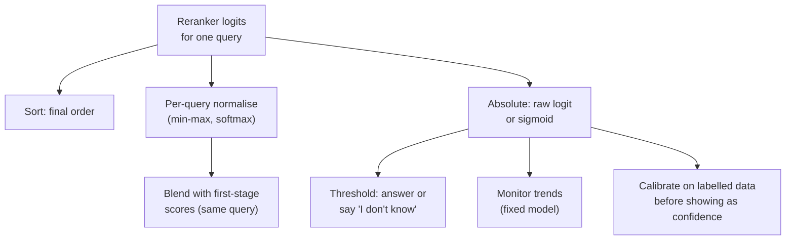

Every stage of a retrieval pipeline attaches a number to each chunk: a cosine from the bi-encoder, a BM25 score, a logit from the reranker. It is natural to read these numbers as measures of how relevant a chunk is, to compare them between queries, to set thresholds on them and to add them together. Most of those uses are wrong in ways that do not show up until production. This lesson explains what ranking scores actually are, which transformations of them are harmless, which are misleading, and what you may and may not conclude from them.

The central fact is short: **a ranking score is guaranteed to mean one thing only, the order it puts the candidates in for one query, under one model.** Everything else (its scale, its comparability across queries, its interpretation as a probability) has to be established separately, and usually is not. The full treatment of turning scores into calibrated probabilities and thresholds belongs to [Score calibration](/learn/advanced-retrieval-optimisation/score-calibration) and [Retrieval thresholding](/learn/advanced-retrieval-optimisation/retrieval-thresholding) in the next module; this lesson gives you the foundations those lessons need.

## Learning objectives

- Explain why ranking scores are ordinal within a query and why their scale differs between models, queries and versions.
- Apply sigmoid, softmax, min-max and z-score transformations to reranker logits, and predict which preserve the order and what each implies.
- Show why per-query normalisation makes an unanswerable query look confident, and why raw or sigmoid scores do not.
- Blend first-stage and reranker scores correctly, and explain when rank-based fusion is safer.
- Decide which score-based decisions (ordering, thresholds, blending, monitoring) are justified with uncalibrated scores.

## Prerequisites

- [Cross-encoders](/learn/reranking-fundamentals/cross-encoders): logits from a classification head and the sigmoid.
- [Bi-encoders](/learn/reranking-fundamentals/bi-encoders): the cosine as a first-stage score.
- [Similarity distributions](/learn/embedding-mathematics/similarity-distributions): how cosine values spread for a given embedding model.
- [Reciprocal Rank Fusion](/learn/hybrid-search/reciprocal-rank-fusion): combining lists by rank rather than score.

## Why this matters

Scores leak into decisions all over a RAG system. A threshold decides whether the assistant answers or says it does not know. A blend of first-stage and reranker scores decides the final order. A dashboard tracks "average top score" as a health metric. A product manager asks to show a "confidence" percentage next to each source. Every one of these assumes something about the score that the model never promised.

The consequences are concrete. A threshold of 0.5 tuned on one reranker is meaningless after an upgrade to another whose logits sit on a different range; overnight, the assistant either refuses everything or answers everything. A min-max normalised score shown as "confidence" says 100% for the top chunk of every query, including queries the corpus cannot answer. A blend that adds a cosine (between about 0 and 1) to a logit (between about $-11$ and 10) is effectively the logit alone. Understanding scores turns these from production incidents into design decisions.

## The intuition

Think of judges scoring a diving competition. Within one event, the scores reliably tell you who dived best: an 8.5 beat a 7.0. Across events, they are much less reliable: a 7.0 in a final with strict judges may represent a better dive than an 8.0 in a junior heat. And if a different panel used a 1-to-100 scale, you could not compare their numbers with these at all without knowing how each panel tends to score.

Now suppose you rescale each event so that its winner gets 100% and its last place 0%. Rankings are unchanged, and the numbers look friendlier. But every event now has a 100% winner, including an event in which every diver belly-flopped. That is what per-query normalisation does to retrieval scores.

## How it works

### What a score is, for each kind of model

| Model | Score | Typical range | What it is |
| --- | --- | --- | --- |
| BM25 | Sum of term weights | 0 to unbounded, grows with query length | Lexical evidence; depends on query terms and corpus statistics |
| Bi-encoder (normalised) | Cosine | $-1$ to 1, often clustered in a narrow band | Geometric closeness in one model's space |
| Cross-encoder | Logit | Any real number; for MS MARCO MiniLM roughly $-11$ to 10 | Output of a linear head trained to separate relevant from non-relevant |
| Cross-encoder with sigmoid | $\sigma(\text{logit})$ | 0 to 1 | A monotone squashing of the logit; looks like a probability, usually is not one |
| Hosted rerank API | Provider-defined "relevance score" | Often 0 to 1 | Depends on the provider and model version; read its documentation |

Three properties hold for all of them:

1. **Ordinal within a query.** For one query and one model, a higher score means the model prefers that candidate. This is the only property every ranker is trained to deliver.
2. **Scale is model-specific.** Different models, and different versions of the same model, place scores on unrelated scales. The [bi-encoders lesson](/learn/reranking-fundamentals/bi-encoders) found cosines of 0.8 to 0.97 for relevant pairs with one model; another embedding model might give 0.4 to 0.6 for the same pairs.
3. **Weakly comparable across queries.** A cross-encoder trained with a pointwise loss produces logits that are *somewhat* comparable across queries, which is why thresholds on them can work. A bi-encoder's cosine is less so: some queries have every chunk at 0.6, others have the best at 0.3. Neither is reliably comparable without measurement.

### Transformations and what they do

Given the reranker's logits $s_1, \dots, s_N$ for one query's candidates, four transformations are common.

- **Sigmoid**, $\sigma(s_i) = 1/(1 + e^{-s_i})$, applied to each score alone. Monotone, so the order is unchanged. Each output depends only on its own logit, so a query with no good candidates keeps low scores. It saturates: large logits all become about 1.0, small ones about 0.0, which hides differences at the extremes.
- **Softmax over the candidates**, $e^{s_i}/\sum_j e^{s_j}$. Monotone within the query. Outputs sum to 1 across the candidates, so they describe how the model divides its preference among *these* candidates, not whether any of them is relevant. A query with nothing relevant still has a winner with a sizeable share.
- **Min-max normalisation**, $(s_i - \min s)/(\max s - \min s)$. Monotone. The top candidate is always 1 and the bottom always 0, for every query. It erases all information about absolute quality.
- **Z-score normalisation**, $(s_i - \mu)/\sigma_s$ using the query's mean and standard deviation. Monotone; centres each query's scores. Like min-max, it removes the absolute level.

So all four leave the *ranking* untouched; they differ in what the numbers claim. Only the sigmoid (or the raw logit) retains information about whether the query has any good candidate at all. Softmax, min-max and z-score describe a candidate *relative to its competitors*. That is the right information for blending scores within one query, and the wrong information for deciding whether to answer.

### Scores are not probabilities

The sigmoid of a logit is a number between 0 and 1, and a model trained with binary cross-entropy is, in principle, pushed towards outputs that match the frequency of relevance in its training data. That does not make it a calibrated probability for *your* data. The training distribution (web search queries, MS MARCO's labelling conventions and its ratio of relevant to non-relevant pairs) differs from Meridian's handbook questions, and modern networks are often over-confident even on their own distribution. A sigmoid output of 0.9 means "high on this model's scale", not "relevant nine times out of ten".

If you need probabilities, for a confidence display or a principled threshold, fit a calibration mapping on your own labelled data. The simplest, Platt scaling, fits $\sigma(a s + b)$ with two parameters $a$ and $b$ learned from labelled pairs. [Score calibration](/learn/advanced-retrieval-optimisation/score-calibration) covers it and alternatives.

### Combining first-stage and reranker scores

Replacing the first-stage order with the reranker's is the default, and usually right. Sometimes blending helps: when the first stage carries information the reranker lacks (an exact identifier match, recency, document authority) or when the reranker is unreliable on some query types. There are two families:

- **Score interpolation.** Normalise each score list within the query, then take $\alpha \cdot \tilde{s}_{\text{first}} + (1 - \alpha)\, \tilde{s}_{\text{rerank}}$. Normalisation is essential: adding a raw cosine and a raw logit lets the larger-scale score dominate. Here per-query normalisation is the *right* tool, because the blend only needs to order this query's candidates.
- **Rank fusion.** Ignore scores and combine ranks, as [Reciprocal Rank Fusion](/learn/hybrid-search/reciprocal-rank-fusion) does. Robust to scale differences and to model upgrades, at the cost of discarding how decisively one candidate beat another.

Tune $\alpha$ on labelled queries, and re-tune it whenever either model changes. [Weighted score fusion](/learn/hybrid-search/weighted-score-fusion) discusses the same choices for combining dense and sparse retrievers.

### Score-based decisions, from safe to risky

1. **Ordering within a query.** Always justified; it is what the score is for.
2. **Blending within a query** after normalisation. Justified with a tuned weight.
3. **Monitoring trends** in raw top scores for a fixed model. Useful: a drop in the median top score after a corpus change is a real signal, even if the numbers mean nothing absolute.
4. **Thresholds across queries** on raw logits or sigmoid scores. Workable for cross-encoders if tuned on labelled data from your domain and re-tuned on every model change; unreliable on normalised scores.
5. **Showing scores to users as confidence.** Only after calibration, and even then with care.



## The mathematics

### Sigmoid, softmax and min-max

**Intuition.** Each maps logits to friendlier numbers. The sigmoid looks at one score at a time; softmax and min-max look at the whole list for the query, so they express relative standing.

$$
\sigma(s_i) = \frac{1}{1 + e^{-s_i}}, \qquad \text{softmax}(s)_i = \frac{e^{s_i}}{\sum_{j=1}^{N} e^{s_j}}, \qquad \text{mm}(s)_i = \frac{s_i - \min_j s_j}{\max_j s_j - \min_j s_j}
$$

$s_i$ is candidate $i$'s logit, $N$ the number of candidates for the query, and $e$ the base of the natural logarithm. All three are strictly increasing in $s_i$ (for min-max, provided the scores are not all equal), so all preserve the order.

**By hand.** Three candidates with logits $(2, 0, -1)$:

- Sigmoid: $\sigma(2) = 1/(1 + 0.1353) = 0.8808$; $\sigma(0) = 0.5$; $\sigma(-1) = 1/(1 + 2.7183) = 0.2689$.
- Softmax: $e^2 = 7.389$, $e^0 = 1$, $e^{-1} = 0.3679$, summing to $8.757$; shares $0.8438$, $0.1142$, $0.0420$.
- Min-max: $(2 - (-1))/3 = 1$, $(0 - (-1))/3 = 0.3333$, $0$.

Now add 20 to every logit, $(22, 20, 19)$, as if the model were simply more confident about this query. Softmax and min-max give *exactly* the same outputs, because they depend only on differences between logits. The sigmoid outputs all move to about 1.0. Only the sigmoid sees the shift; that is why only absolute scores can tell an answerable query from an unanswerable one.

### Blending after normalisation

**Intuition.** Put both scores on the same 0-to-1 scale within the query, then take a weighted average.

$$
b_i = \alpha\, \text{mm}(c)_i + (1 - \alpha)\, \text{mm}(s)_i
$$

$c_i$ is candidate $i$'s first-stage score (here a cosine), $s_i$ its reranker logit, and $\alpha \in [0, 1]$ the weight on the first stage.

**By hand.** Cosines $(0.62, 0.70, 0.55)$ normalise to $(0.4667, 1, 0)$; logits $(2, 0, -1)$ to $(1, 0.3333, 0)$. With $\alpha = 0.3$: $b_1 = 0.3 \times 0.4667 + 0.7 \times 1 = 0.84$; $b_2 = 0.3 \times 1 + 0.7 \times 0.3333 = 0.5333$; $b_3 = 0$. The reranker's choice stays first, but the first stage's favourite has closed some of the gap; with a larger $\alpha$ it would overtake.

```python
import numpy as np

logits = np.array([2.0, 0.0, -1.0])           # one query, three candidates
sig = 1 / (1 + np.exp(-logits))
soft = np.exp(logits) / np.exp(logits).sum()
mm = (logits - logits.min()) / (logits.max() - logits.min())
print("sigmoid:", sig.round(4))
print("softmax:", soft.round(4))
print("min-max:", mm.round(4))

# Blend a first-stage cosine with a reranker logit after min-max normalising each
cosine = np.array([0.62, 0.70, 0.55])
alpha = 0.3                                     # weight on the first stage
norm = lambda x: (x - x.min()) / (x.max() - x.min())
blend = alpha * norm(cosine) + (1 - alpha) * norm(logits)
print("blended:", blend.round(4), "-> order", np.argsort(-blend).tolist())
```

```output
sigmoid: [0.8808 0.5    0.2689]
softmax: [0.8438 0.1142 0.042 ]
min-max: [1.     0.3333 0.    ]
blended: [0.84   0.5333 0.    ] -> order [0, 1, 2]
```

## In code

**The problem.** Score the same five Meridian chunks for an answerable question and an unanswerable one with three models, and look at what each score and each transformation says. Can the numbers tell the two queries apart?

**Dependencies.** Sentence Transformers (version 4 or later for `activation_fn`), PyTorch and NumPy. Three models download on first use; `BAAI/bge-reranker-base` is about 1 GB.

```bash
pip install "sentence-transformers>=4" torch numpy
```

```python
import numpy as np
import torch
from sentence_transformers import SentenceTransformer, CrossEncoder

chunks = [
    "Expenses must be submitted within 30 days. Anything over £75 needs a receipt.",
    "Passwords must be rotated every 90 days.",
    "Staff may work remotely up to 3 days a week.",
    "The support desk is open 08:00 to 18:00 UK time.",
    "Annual leave is 25 days; up to 5 unused days carry over to 31 March.",
]
queries = {
    "answerable": "How long do I have to submit an expense claim?",
    "unanswerable": "Where can I park my car at the office?",
}
bi = SentenceTransformer("sentence-transformers/all-MiniLM-L6-v2")
minilm = CrossEncoder("cross-encoder/ms-marco-MiniLM-L-6-v2")
bge = CrossEncoder("BAAI/bge-reranker-base")
raw = torch.nn.Identity()
chunk_vecs = bi.encode(chunks, normalize_embeddings=True)

def sigmoid(x):
    return 1 / (1 + np.exp(-x))

def softmax(x):
    e = np.exp(x - x.max())                  # subtract max for numerical stability
    return e / e.sum()

def minmax(x):
    return (x - x.min()) / (x.max() - x.min())

for label, q in queries.items():
    cos = chunk_vecs @ bi.encode(q, normalize_embeddings=True)
    lm = minilm.predict([(q, c) for c in chunks], activation_fn=raw)
    bg = bge.predict([(q, c) for c in chunks], activation_fn=raw)
    top = int(np.argmax(lm))
    print(f"\n[{label}] {q}")
    print(f"  top chunk by MiniLM: {chunks[top][:45]}...")
    print(f"  bi-encoder cosine   top {cos.max():6.3f}   range {cos.min():6.3f} .. {cos.max():6.3f}")
    print(f"  MiniLM logit        top {lm.max():6.2f}   range {lm.min():6.2f} .. {lm.max():6.2f}")
    print(f"  BGE logit           top {bg.max():6.2f}   range {bg.min():6.2f} .. {bg.max():6.2f}")
    print(f"  sigmoid(MiniLM)     top {sigmoid(lm).max():6.3f}")
    print(f"  softmax(MiniLM)     top {softmax(lm).max():6.3f}   <- shares sum to 1 per query")
    print(f"  min-max(MiniLM)     top {minmax(lm).max():6.3f}   <- always 1 by construction")
    same = np.argsort(-lm).tolist() == np.argsort(-sigmoid(lm)).tolist() == np.argsort(-softmax(lm)).tolist()
    print(f"  ranking unchanged by sigmoid/softmax: {same}")
```

```output

[answerable] How long do I have to submit an expense claim?
  top chunk by MiniLM: Expenses must be submitted within 30 days. An...
  bi-encoder cosine   top  0.648   range  0.122 ..  0.648
  MiniLM logit        top   6.26   range -11.08 ..   6.26
  BGE logit           top   5.34   range -10.19 ..   5.34
  sigmoid(MiniLM)     top  0.998
  softmax(MiniLM)     top  1.000   <- shares sum to 1 per query
  min-max(MiniLM)     top  1.000   <- always 1 by construction
  ranking unchanged by sigmoid/softmax: True

[unanswerable] Where can I park my car at the office?
  top chunk by MiniLM: The support desk is open 08:00 to 18:00 UK ti...
  bi-encoder cosine   top  0.234   range  0.069 ..  0.234
  MiniLM logit        top -10.84   range -11.35 .. -10.84
  BGE logit           top -10.18   range -10.20 .. -10.18
  sigmoid(MiniLM)     top  0.000
  softmax(MiniLM)     top  0.288   <- shares sum to 1 per query
  min-max(MiniLM)     top  1.000   <- always 1 by construction
  ranking unchanged by sigmoid/softmax: True
```

**The important lines.**

- `activation_fn=raw` requests raw logits from both rerankers. Without it, `BAAI/bge-reranker-base` returns sigmoid outputs by default in this library version while the MiniLM model returns logits; mixing them unknowingly is a classic source of broken thresholds.
- `softmax` subtracts the maximum before exponentiating. This changes nothing mathematically (the factor cancels) and prevents overflow for large logits.
- The final check confirms that sigmoid and softmax leave the ranking unchanged; min-max does too, by the same argument.

**What the output means.** For the answerable question, the expense chunk wins clearly under every model: cosine 0.648, MiniLM logit 6.26, BGE logit 5.34. Note how different the three scales are; there is no sense in which 0.648 and 6.26 are "the same amount" of relevance.

For the unanswerable parking question, the raw scores tell the truth. The best cosine is only 0.234, the best MiniLM logit is $-10.84$ and the best BGE logit $-10.18$, all close to their own floors, and the MiniLM sigmoid is 0.000. A threshold on raw logits or sigmoid scores would correctly refuse. The model still picks a "winner" (the support-desk chunk), because a ranking always has a first item.

The normalised scores tell a different story. Min-max gives the top chunk 1.000 for both queries, by construction. Softmax gives the parking query's winner 0.288 of the probability mass. The five MiniLM logits for that query lie within about half a logit of each other, so softmax spreads its mass nearly evenly, and 0.288 is simply "slightly more than a fifth". On a list of two candidates the same flat logits would give the winner about 0.5. Neither number says anything about whether the chunk answers the question. Display either as "confidence" and you would tell users the assistant is fully, or substantially, confident about a parking policy it does not have.

**Common errors.**

- Forgetting which models apply a sigmoid by default, and comparing a sigmoid output from one with a logit from another.
- Computing min-max over a single candidate (division by zero) or over identical scores; guard against a zero range.
- Copying a threshold from documentation or another project; thresholds are properties of a model and a corpus, not universal constants.

**Extending it.** Add a third, partially answerable query such as "Can I claim for a taxi?" and see where its top logit falls between the two. Collect the top MiniLM logit for twenty labelled answerable and twenty unanswerable questions and plot the two distributions; the gap between them is the room a threshold has.

## A real-world example

AskMeridian shows a small "source match" percentage next to each cited chunk. The first version computed it as a softmax over the five reranked chunks. Within a month, Hannah on the Platform team received a screenshot from the HR team: the assistant had replied "I don't have information on parking" (correctly, from its refusal logic, which used a raw-logit threshold) while displaying a source with "61% match" beneath it. Users reasonably asked which to believe.

The cause was the mismatch between the two numbers. The refusal threshold used absolute logits; the displayed percentage was relative to the other four candidates. On a flat, low-scoring list, the softmax handed the marginal winner a large share. The team removed the percentage and replaced it with a three-level label ("strong", "partial", "weak match") derived from raw-logit bands, which they fitted on 600 labelled query-chunk pairs and checked monthly.

A second incident came three months later, when the team upgraded to a larger reranker. Overnight, the refusal rate jumped, because the new model's logits sat on a different range and the old threshold sat inside its "relevant" band. The fix was procedural: thresholds and label bands are now stored with the reranker's version, refitted from the labelled set as part of every reranker upgrade, and an upgrade cannot ship until the refit is reviewed.

## Common mistakes

- **Comparing scores across models or versions.** Scales differ; a number from one model says nothing about another's.
- **Reading sigmoid outputs as calibrated probabilities.** They are monotone squashings of logits, usually miscalibrated on your data.
- **Using per-query normalised scores for thresholds or confidence.** Min-max always makes the top 1.0, softmax always produces a winner; both hide unanswerable queries.
- **Adding unnormalised scores from different stages.** The one with the larger range dominates the sum.
- **Keeping thresholds through a model upgrade.** Every model change needs thresholds refitted from labelled data.
- **Treating score gaps as fixed.** A gap of 2 logits means different things for different models and query types.

## Best practices

- Use scores for ordering by default, and treat every other use as a claim that needs evidence from labelled data.
- Record which activation each model applies, and request raw logits explicitly where you depend on the scale.
- Normalise within a query for blending; keep absolute scores for thresholds and monitoring.
- Prefer rank-based fusion when combining sources whose scales you cannot control, such as hosted APIs that may change.
- Store thresholds, blend weights and calibration parameters with the model version, and refit them on every change.
- Monitor the distribution of top scores per model version over time; shifts reveal corpus changes and model regressions.

## Performance considerations

Score transformations themselves cost nothing measurable: a few arithmetic operations per candidate. The costs are elsewhere.

- **Thresholding saves generation.** A raw-score threshold that lets the system refuse unanswerable questions without calling the language model saves the full cost of a generation call for each such query. If a tenth of traffic is unanswerable, that is roughly a tenth of generation cost.
- **Adaptive depth** based on first-stage scores can skip reranking for queries with a decisive first-stage winner. It depends on first-stage scores being stable, so tie it to the model version.
- **Logging scores** for every candidate of every query is cheap in compute and valuable in diagnosis, but adds storage: 50 candidates × 2 scores × 4 bytes × 1 million queries is 400 MB, plus identifiers. Sample if needed.

## Security considerations

- **Scores can be steered.** If users or document authors can influence content, they can influence scores. Never use a score alone to grant access or to decide that content is trustworthy.
- **Displayed confidence shapes trust.** Showing uncalibrated scores as percentages invites users to over-trust weak answers; keep displayed confidence to calibrated, coarse bands.

## Summary

- A ranking score is guaranteed only to order one query's candidates under one model; scale and cross-query meaning must be established separately.
- Sigmoid, softmax, min-max and z-score all preserve the order; only absolute scores (raw or sigmoid) keep information about whether any candidate is good.
- Per-query normalisation is right for blending scores within a query and wrong for thresholds or confidence displays.
- Sigmoid outputs are not calibrated probabilities; calibrate on your own labelled data before treating them as such.
- Thresholds, blend weights and calibration belong to a specific model version and must be refitted whenever it changes.

## Exercises

**1.** Logits for one query are $(3, 1, 1, -2)$. Compute the sigmoid, softmax and min-max values by hand (to two decimals). Then add 10 to every logit and say which outputs change.

<details><summary>Show solution</summary>

Sigmoid: $0.95, 0.73, 0.73, 0.12$. Softmax: $e^3 = 20.09$, $e^1 = 2.72$ twice, $e^{-2} = 0.14$, sum $25.66$: $0.78, 0.11, 0.11, 0.01$. Min-max: $(3+2)/5 = 1$, $(1+2)/5 = 0.6$, $0.6$, $0$. After adding 10, softmax and min-max are unchanged (they depend only on differences); the sigmoids all become about 1.00.

</details>

**2.** A colleague blends scores as `0.5 * cosine + 0.5 * logit` with no normalisation. Using the answerable query's ranges from the code output, explain what the blend actually does.

<details><summary>Show solution</summary>

Cosines range from 0.122 to 0.648, a spread of about 0.5; logits range from $-11.08$ to 6.26, a spread of about 17. Halving both, the cosine can move the blend by about 0.26 while the logit moves it by about 8.7. The blend is effectively the reranker score alone, and the cosine weight does nothing. Normalise each within the query first, or use rank fusion.

</details>

**3.** Write a function `should_answer(top_logit, threshold)` and choose a threshold for MiniLM from the two queries in the code. Then explain why two queries are not enough, and describe what data you would collect.

<details><summary>Show solution</summary>

```python
def should_answer(top_logit: float, threshold: float = 0.0) -> bool:
    return top_logit >= threshold
```

Any threshold between $-10.84$ and 6.26 separates these two queries; 0.0 is a natural midpoint. Two queries say nothing about the overlap between the distributions. Collect a few hundred labelled questions from real traffic, mark each answerable or not from the corpus, record the top logit, and choose the threshold from the two distributions by the cost of each error: a wrong refusal versus a wrong answer. Refit on every reranker upgrade.

</details>

**4.** Design decision. Product wants a "confidence" indicator next to each AskMeridian answer. Propose what to show and how to compute it, and say what you would refuse to show.

<details><summary>Show solution</summary>

Show a coarse label (for example strong, partial, weak) derived from absolute reranker scores, with bands fitted on labelled data so that each band corresponds to a measured rate of correct answers, and refitted per model version. Ideally calibrate with Platt scaling and check the calibration on held-out data. Refuse to show softmax or min-max values (always confident at the top) or raw percentages implying precision the model does not have. Pair the label with the refusal threshold so that the two never contradict each other.

</details>

## Check your understanding

```quiz
[
  {
    "q": "Which property does every ranking score reliably have?",
    "options": [
      "It is a calibrated probability of relevance",
      "It orders the candidates for one query under one model",
      "It is comparable across different models",
      "It lies between 0 and 1"
    ],
    "answer": 1,
    "why": "Ranking models are trained to order candidates. Scale, cross-query comparability and probability interpretation are not guaranteed."
  },
  {
    "q": "For an unanswerable query, which transformation of the reranker's logits will still give the top candidate a value of exactly 1.0?",
    "options": [
      "Sigmoid",
      "Raw logit",
      "Min-max normalisation",
      "None of these"
    ],
    "answer": 2,
    "why": "Min-max maps the top score of every query to 1 by construction, erasing information about absolute quality."
  },
  {
    "q": "All of a query's logits increase by 5. Which outputs change?",
    "options": [
      "Sigmoid only",
      "Softmax and min-max only",
      "All of sigmoid, softmax and min-max",
      "None"
    ],
    "answer": 0,
    "why": "Softmax and min-max depend only on differences between logits, which are unchanged. Each sigmoid output depends on its own logit, so all increase."
  },
  {
    "q": "After a reranker upgrade, AskMeridian's refusal rate jumps. What is the most likely cause?",
    "options": [
      "The new reranker is non-deterministic",
      "The vector index was corrupted",
      "Softmax was applied twice",
      "The old threshold was tuned to the old model's score scale"
    ],
    "answer": 3,
    "why": "Score scales are model-specific. Thresholds must be refitted from labelled data on every model change."
  },
  {
    "q": "You need to combine a hosted API's relevance scores with your own BM25 ranking, and the provider may change its model without notice. Which approach is most robust?",
    "options": [
      "Add the raw scores",
      "Multiply the raw scores",
      "Rank-based fusion such as Reciprocal Rank Fusion",
      "Threshold each score at 0.5"
    ],
    "answer": 2,
    "why": "Rank fusion ignores score scales, so it keeps working when a provider's score distribution shifts."
  }
]
```

## Further reading

- Platt, J. (1999). *Probabilistic Outputs for Support Vector Machines and Comparisons to Regularized Likelihood Methods*. In *Advances in Large Margin Classifiers*, MIT Press. The origin of Platt scaling.
- Guo, C., Pleiss, G., Sun, Y. and Weinberger, K. Q. (2017). *On Calibration of Modern Neural Networks*. [arXiv:1706.04599](https://arxiv.org/abs/1706.04599). Why network outputs are often over-confident.
- Cormack, G. V., Clarke, C. L. A. and Büttcher, S. (2009). *Reciprocal Rank Fusion Outperforms Condorcet and Individual Rank Learning Methods*. SIGIR 2009.
- Sentence Transformers documentation, [sbert.net](https://www.sbert.net/): `CrossEncoder.predict` and its activation options.
